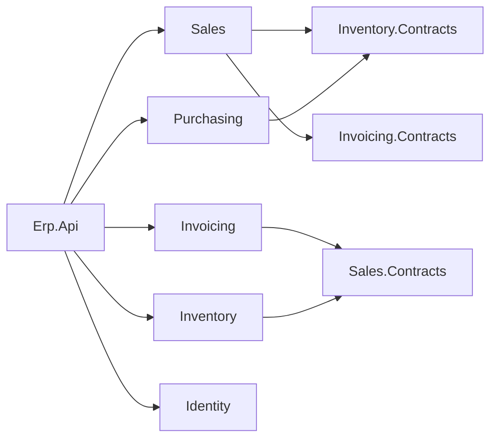

# Roadmap — from tutorial to sellable product

The course used to end in a teaching build with deliberate shortcuts. It now ends in a working ERP a
business can run, and whose source can be sold. This file is the plan and the progress log. The rules live
in [CLAUDE.md](CLAUDE.md).

**Order of work:** code first, lessons second. Each milestone lands in the reference build
([course-validation/business/](course-validation/business/)) with the build and tests green, *then* the
lessons covering it are rewritten against that working code. Writing lessons ahead of code is how the old
course drifted.

---

## Decisions (2026-11-05)

| Decision | Choice | Replaces |
|---|---|---|
| Database | **PostgreSQL** (16+; dev on 18), snake_case, schema per module | SQL Server |
| Writes & transactions | **EF Core 10 (Npgsql)**, one DbContext per module, handlers use it directly (no repositories) | Dapper + insert/update stored procs, raw ADO.NET transactions |
| Reads | **Dapper + SQL functions** (`RETURNS TABLE`; PostgreSQL procedures can't return rows), shipped by EF migrations (`migrationBuilder.Sql`) | Stored procs applied by a custom `DatabaseInitializer` |
| Schema management | **EF Core migrations** (per-module history table); production via a migrations bundle | `001_schema.sql` scripts run on boot |
| Mediator | **`martinothamar/Mediator`** (MIT, source-generated) | Hand-rolled mediator |
| Module boundaries | Everything `internal`; **one `.Contracts` project per module** is the only public surface | Contract in `Shared` (base) / `Contracts/` folder in module (Phase 15) |
| Reference builds | **One** build | `business` + `business-phase15` |
| Front end | **Blazor WebAssembly + MudBlazor**, hosted by `Erp.Api`; cookie auth for the browser | None (Swagger only) |
| Observability | **OpenTelemetry** logs/traces/metrics, health checks, OTLP export; local dashboard via .NET Aspire | None |
| Cross-module events | **Transactional outbox** + background dispatcher | Best-effort after-commit dispatch |
| Licensing | Permissive OSS only (MIT/Apache/BSD/PostgreSQL); FluentAssertions 8 → **AwesomeAssertions**; see [THIRD-PARTY-NOTICES.md](course-validation/business/THIRD-PARTY-NOTICES.md) | Mixed |
| Modules | Identity/Admin, **Sales, Inventory, Purchasing, Invoicing** | Sales + stock reservation only |
| Tutorial shortcuts | **Resolved** in the product (credit exposure, real stock movement, approval workflow, outbox, rate limiting/HTTPS) | Documented as ⚠️ limitations |

---

## Target solution layout

```
Erp.slnx
src/
  Erp.Api/                         host: Program.cs, auth, OpenTelemetry, health, hosts the Blazor app
  Erp.Web/                         Blazor WebAssembly + MudBlazor
  Shared/
    Erp.Shared.BuildingBlocks/     Entity, AggregateRoot, DomainException, contracts for ICurrentUser, IClock…
    Erp.Shared.Infrastructure/     EF/Dapper plumbing, outbox, security, telemetry (referenced only by Erp.Api)
  Modules/
    Identity/   Erp.Modules.Identity      (+ .Contracts once another module needs it)
    Sales/      Erp.Modules.Sales         + .Contracts
    Inventory/  Erp.Modules.Inventory     + .Contracts
    Purchasing/ Erp.Modules.Purchasing    + .Contracts
    Invoicing/  Erp.Modules.Invoicing     + .Contracts
tests/
  Erp.Modules.<X>.UnitTests/       domain tests, no database
  Erp.Integration.Tests/           whole API in memory against a fresh PostgreSQL erp_test database
  Erp.Architecture.Tests/          proves the boundary rules (no module→module reference, internal-only)
```



A module only ever points at another module's **Contracts**; contracts point at nothing but BuildingBlocks,
so the graph can't form a cycle.

---

## Product scope

| Module | Features |
|---|---|
| **Identity / Admin** | Login (cookie + JWT), refresh tokens, change password, **user management** (create, roles, disable, reset password), audit of logins |
| **Sales** | Customers (CRUD, block/unblock, credit limit, terms), sales orders (create, edit, submit, **approval workflow**, cancel), credit exposure check, order search |
| **Inventory** | Items & categories (CRUD, pricing), warehouses, **stock receipts, adjustments (with reason), reservations, shipments** (`OnHand` really decreases), stock levels & movement history |
| **Purchasing** | Suppliers, purchase orders (create, approve, send), **goods receipt → Inventory**, partial receipts |
| **Invoicing** | Invoice from shipment, payments, customer balance & aging (feeds Sales' credit check), invoice PDF (PdfSharp/MigraDoc) |

🚫 **Out of scope:** general ledger / full accounting, payroll, HR, multi-currency, multi-company, POS.

⚠️ **BIR compliance (Philippines).** Software that issues invoices may need BIR registration (CAS/CBA) and
e-invoicing (EIS) support. The Invoicing module will be built to sound practice (sequential, gap-free
numbering, no deletes, void-with-reason), but **what BIR requires must be confirmed with a tax adviser
before selling.**

---

## Milestones

Status: ⬜ not started · 🟨 in progress · ✅ done

### M0 — Rules & plan ✅
- [x] Rewrite [CLAUDE.md](CLAUDE.md) for the new stack and production bar
- [x] This roadmap

### M1 — Foundation swap (existing features, new plumbing) ✅ code · ⬜ lessons
Goal: the current Sales/Inventory features behave exactly as before, on the new stack. Tests stay green.
- [x] Spike: `martinothamar/Mediator` 3.0.2 and `internal` handlers in another assembly → generator in the
      host fails with `CS0122`; **works when the module grants `InternalsVisibleTo("Erp.Api")`**. Adopted.
- [x] Spike: `dotnet ef` works with `internal` DbContexts via an internal `IDesignTimeDbContextFactory`;
      migration history table per schema
- [x] Merge builds: `business-phase15` code copied over `business`; `business-phase15` removed
- [x] Identity extracted from `Erp.Api/Auth` into `Erp.Modules.Identity` (brought forward from M3)
- [x] `Erp.Modules.Inventory.Contracts` holds `IStockReservation`; Sales references only that
- [x] Hand-rolled mediator replaced by `martinothamar/Mediator`; logging + validation behaviours ported
- [x] PostgreSQL + EF Core: per-module DbContext, value converters for ids/`Money`/`Quantity`, owned order lines
- [x] Handlers use the DbContext directly (no repositories); explicit transaction only where a contract joins in
- [x] Shared connection (`ISharedConnection`) so Inventory joins Sales' transaction — proven by a rollback test
- [x] Reads: Dapper + SQL functions shipped by migration `AddReadFunctions`; `DatabaseInitializer` deleted
- [x] Concurrency: `xmin` row version on aggregates (+ root touch for line-only edits, with a test); atomic
      `ExecuteUpdate` for stock reservation (race test)
- [x] Refresh-token rotation race closed (`revoked_utc` concurrency token → treated as reuse)
- [x] Cross-schema FKs to `identity.app_user` removed
- [x] AwesomeAssertions; every package licence checked;
      [THIRD-PARTY-NOTICES.md](course-validation/business/THIRD-PARTY-NOTICES.md)
- [x] Patched transitive versions pinned (`CentralPackageTransitivePinningEnabled`)
- [x] Architecture tests for the boundary rules (6)
- [x] Errors are RFC 9457 `application/problem+json` with a `traceId`
- [x] Unhandled domain events removed (only `SalesOrderApproved`, which has a handler); MSG0005 stays on

### M2 — Production bar on existing scope ✅ code · ⬜ lessons
- [x] Transactional outbox: `OutboxInterceptor` (same SaveChanges) + `OutboxDispatcher` (background,
      `FOR UPDATE SKIP LOCKED`, retries, at-least-once); handlers no longer publish
- [x] OpenTelemetry logs/traces/metrics (OTLP when configured), `X-Trace-Id` header, `traceId` in errors,
      `/health/live` + `/health/ready`, `TelemetryBehavior` (span + duration metric per command/query)
- [x] Aspire AppHost (dev-only dashboard; no Docker) — verified it starts the API and the dashboard
- [x] Credit exposure counts orders awaiting approval; submit locks the customer row (`FOR UPDATE`)
- [x] Approval workflow: ≤ ₱50,000 auto-approved on submit; above → manager approval; creator can't approve
      own order; reject with reason releases stock; cancel reverses charge and releases stock
- [x] **Auth moved to ASP.NET Core Identity** (user request): login/refresh/cookies/lockout/password policy from
      the library; custom JWT + refresh-token code deleted; `/auth/register` blocked; data-protection keys in
      PostgreSQL; sign-out-everywhere via security stamp. Forced 90-day password expiry dropped (NIST SP 800-63B)
- [x] Rate limiting (per user/IP; strict per-IP on `/auth`), HTTPS redirection + HSTS, security headers, CORS
      from config, no `Server` header
- [x] Least privilege: `deploy/postgres/create-roles.sql` (`erp_owner` migrates, `erp_app` rows only);
      verified — full integration suite passes as `erp_app`, and `erp_app` cannot DROP/CREATE/ALTER
- [x] Search count is a separate function, so a page past the end reports the real total
- [x] Found and fixed: `Money` deserialised as ₱0 from the outbox (`[JsonConstructor]`), caught by a new test
- [x] Code comments trimmed to the non-obvious *why* (user request)

### M3 — Complete Sales, Inventory, Identity ⬜
- [ ] User management (Identity module already extracted in M1)
- [ ] Quantities become `numeric(18,3)` when items gain units of measure
- [ ] Customers CRUD; items/categories CRUD; warehouses
- [ ] Stock receipts, adjustments, shipments, movement history

### M4 — Blazor front end ⬜
- [ ] `Erp.Web` (WASM + MudBlazor) hosted by `Erp.Api`; cookie auth; role-aware navigation
- [ ] Screens for M3 features: orders (with line editing), customers, items, stock, users
- [ ] CSP and security headers for the hosted app

### M5 — Purchasing ⬜
### M6 — Invoicing ⬜ (BIR check first)
### M7 — Packaging & install ⬜
- [ ] Migrations bundle, first-run admin, IIS guide (from 14b), backup/restore guide, release checklist
- [ ] Buyer monitoring guide: "quick live view" (standalone Aspire dashboard — in-memory, no alerts) vs
      "real monitoring" (free OTLP backend with retention + alerts, e.g. SigNoz or Grafana stack); just
      `OTEL_EXPORTER_OTLP_ENDPOINT` either way. The Aspire AppHost stays dev-only.

### L — Lessons 🟨
Rewritten against the M1 + M2 build. Lessons for M3+ are written when that code lands.

Domain before database: with EF Core the schema follows the model, and the rules get unit tests from day one.

| # | Lesson | Replaces |
|---|---|---|
| 00 / 00a / 00b | Start here · Foundations · PowerShell | same files, updated |
| 01 | Solution setup — modules, `internal`, central packages, base types | 01 + 15 + 15b |
| 02 | Mediator — the pain, then `martinothamar/Mediator` + behaviours | 02 |
| 03 | Domain model + its unit tests | 05 |
| 04 | Database — PostgreSQL, EF Core per module, shared connection, migrations, seed | 03 + 03b |
| 05 | Sign-in — ASP.NET Core Identity | 04, 04a–04e |
| 06 | Create an order | 06 |
| 07 | Submit — Inventory module, contract, one transaction, credit lock | 07 |
| 08 | Approve, reject, cancel | 08 |
| 09 | Update an order — lost updates and `xmin` | 09 |
| 10 | Reads — Dapper + SQL functions | 10 + 03a |
| 11 | Cross-cutting — validation, errors, the outbox | 11 |
| 12 | Observability — OpenTelemetry, health, Aspire | **new** |
| 13 | Security hardening — rate limits, HTTPS, headers, least privilege | parts of 13 |
| 14 | Testing — integration and architecture tests | 12 |
| 15 | Deploy to IIS | 14b |
| 16 | Production checklist & going further | 13 + 14 |

⚠️ A reader's migration history is longer than the reference build's (e.g. `AddOutbox` in lesson 11); the
reference squashed each module into one `InitialCreate` before release. The resulting schema is identical.

---

## Risks to retire early

- ~~**Source-generated mediator + `internal` handlers in other assemblies.**~~ Retired 2026-11-05:
  `InternalsVisibleTo("Erp.Api")` per module; an architecture test stops it spreading to other modules.
- ~~**EF tooling with internal DbContexts**~~ Retired 2026-11-05: internal design-time factories work.
- ~~**Sharing one transaction across module DbContexts**~~ Retired 2026-11-05: `ISharedConnection` +
  `UseTransaction`; `A_reservation_rolls_back_with_the_callers_transaction` proves it.
- **Course length.** Adding four modules and a UI roughly doubles the course. Lessons for the new modules
  should lean on patterns already taught and only teach what's new.
- **Selling source vs. a public course.** If the course is published openly and ends in the full product,
  the product's source is effectively free. Decide how the course is distributed before M4.

---

## Log

- **2026-11-05** — Direction changed (see Decisions). CLAUDE.md rewritten; roadmap created. Baseline
  `business-phase15`: 14 unit + 8 integration tests pass.
- **2026-11-05** — Database switched to PostgreSQL (user decision). PostgreSQL 18 installed locally via winget
  (dev superuser password `erp_dev_only`, dev only). M1 code complete on PostgreSQL: **14 unit + 6 architecture
  + 10 integration tests pass.** Lessons not yet converted.
- **2026-11-05** — M2 code complete: **22 unit + 6 architecture + 23 integration tests pass** (also as the
  least-privilege `erp_app` role). Auth switched to ASP.NET Core Identity at the user's request.
