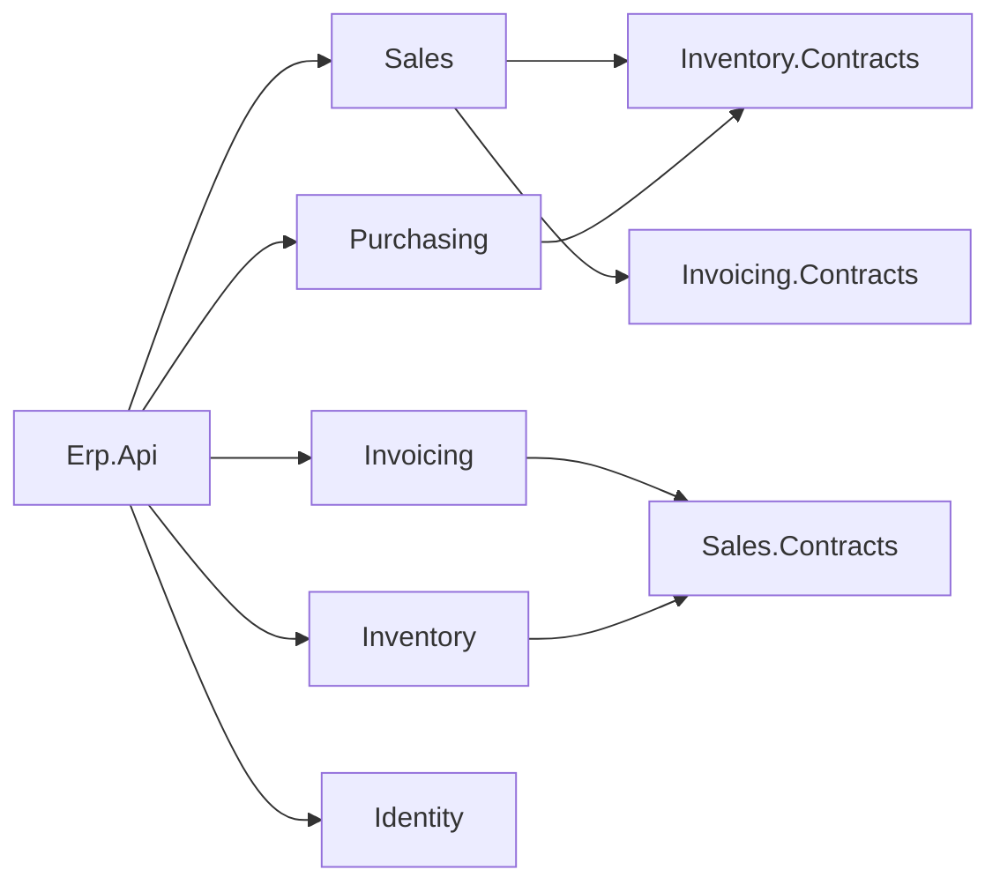

# Roadmap — from tutorial to sellable product

The course used to end in a teaching build with deliberate shortcuts. It now ends in a working ERP a
business can run, and whose source can be sold. This file is the plan and the progress log. The rules live
in [CLAUDE.md](CLAUDE.md).

**Order of work:** code first, lessons second. Each milestone lands in the reference build
([course-validation/business/](course-validation/business/)) with the build and tests green, *then* the
lessons covering it are rewritten against that working code. Writing lessons ahead of code is how the old
course drifted.

---

## Decisions (2026-11-05)

| Decision | Choice | Replaces |
|---|---|---|
| Database | **PostgreSQL** (16+; dev on 18), snake_case, schema per module | SQL Server |
| Writes & transactions | **EF Core 10 (Npgsql)**, one DbContext per module, handlers use it directly (no repositories) | Dapper + insert/update stored procs, raw ADO.NET transactions |
| Reads | **Dapper + SQL functions** (`RETURNS TABLE`; PostgreSQL procedures can't return rows), shipped by EF migrations (`migrationBuilder.Sql`) | Stored procs applied by a custom `DatabaseInitializer` |
| Schema management | **EF Core migrations** (per-module history table); production via a migrations bundle | `001_schema.sql` scripts run on boot |
| Module boundaries | Everything `internal`; **one `.Contracts` project per module** is the only public surface | Contract in `Shared` (base) / `Contracts/` folder in module (Phase 15) |
| Reference builds | **One** build | `business` + `business-phase15` |
| Front end | **Blazor WebAssembly + MudBlazor**, hosted by `Erp.Api`; cookie auth for the browser; built along the course | None (Swagger only) |
| Deployment | **Compose on Podman** (2026-11-12; same files run on Docker), Caddy for HTTPS; IIS dropped 2026-11-06 (user decision); no API keys | IIS only, API keys |
| Tax | Regime (`Vat`/`PercentageTax`/`Exempt`), VAT rate, company details and BIR permit are **business data** in `invoicing.company_profile`, edited on a screen; special-discount programs in a Sales table; per-item VAT treatment and discount eligibility; each invoice stores its rate, breakdown, discount and seller; layout follows BIR RR 7-2024 Sec. 6(B) | 12% constant, `VatRegistered` flag; then (briefly) appsettings |
| Observability | **OpenTelemetry** logs/traces/metrics, health checks, OTLP export; local dashboard via .NET Aspire | None |
| Cross-module events | **Transactional outbox** + background dispatcher | Best-effort after-commit dispatch |
| Licensing | Permissive OSS only (MIT/Apache/BSD/PostgreSQL); FluentAssertions 8 → **AwesomeAssertions**; see [THIRD-PARTY-NOTICES.md](course-validation/business/THIRD-PARTY-NOTICES.md) | Mixed |
| Modules | Identity/Admin, **Sales, Inventory, Purchasing, Invoicing** | Sales + stock reservation only |
| Tutorial shortcuts | **Resolved** in the product (credit exposure, real stock movement, approval workflow, outbox, rate limiting/HTTPS) | Documented as ⚠️ limitations |
| Testing (2026-11-12, user decision) | **Every lesson from 02 on ends with tests**, edge cases included. New **Lesson 02 — Testing** teaches setup and use; each test kind is set up in the lesson that first needs it: architecture, property-based (FsCheck), integration, browser, race, coverage (coverlet), mutation (Stryker.NET), Testcontainers, CI (GitHub Actions). Key tests in full plus an edge-case table per lesson; every test exists in the reference build | Unit tests in lesson 03, everything else in lesson 12 |
| Containers (2026-11-12, user decision) | **Podman everywhere containers are used**, introduced in new **Lesson 12 — Containers and CI** after the reader has used a native PostgreSQL since lesson 05 (build up, then refactor). Deployment stays **Compose** files and an OCI `Dockerfile`, so the same files run on Docker | Docker only (deployment); native PostgreSQL for dev and tests throughout |

---

## Target solution layout

```
Erp.slnx
src/
  Erp.Api/                         host: Program.cs, auth, OpenTelemetry, health, hosts the Blazor app
  Erp.Web/                         Blazor WebAssembly + MudBlazor
  Shared/
    Erp.Shared.BuildingBlocks/     Entity, AggregateRoot, DomainException, contracts for ICurrentUser, IClock…
    Erp.Shared.Infrastructure/     EF/Dapper plumbing, outbox, security, telemetry (referenced only by Erp.Api)
  Modules/
    Identity/   Erp.Modules.Identity      (+ .Contracts once another module needs it)
    Sales/      Erp.Modules.Sales         + .Contracts
    Inventory/  Erp.Modules.Inventory     + .Contracts
    Purchasing/ Erp.Modules.Purchasing    + .Contracts
    Invoicing/  Erp.Modules.Invoicing     + .Contracts
tests/
  Erp.Modules.<X>.UnitTests/       domain tests, no database
  Erp.Integration.Tests/           whole API in memory against a fresh PostgreSQL erp_test database
  Erp.Architecture.Tests/          proves the boundary rules (no module→module reference, internal-only)
```



A module only ever points at another module's **Contracts**; contracts point at nothing but BuildingBlocks,
so the graph can't form a cycle.

---

## Product scope

| Module | Features |
|---|---|
| **Identity / Admin** | Login (cookie + JWT), refresh tokens, change password, **user management** (create, roles, disable, reset password), audit of logins |
| **Sales** | Customers (CRUD, block/unblock, credit limit, terms), sales orders (create, edit, submit, **approval workflow**, cancel), credit exposure check, order search |
| **Inventory** | Items & categories (CRUD, pricing), warehouses, **stock receipts, adjustments (with reason), reservations, shipments** (`OnHand` really decreases), stock levels & movement history |
| **Purchasing** | Suppliers, purchase orders (create, approve, send), **goods receipt → Inventory**, partial receipts |
| **Invoicing** | Invoice from shipment, payments, customer balance & aging (feeds Sales' credit check), invoice PDF (PdfSharp/MigraDoc) |

🚫 **Out of scope:** general ledger / full accounting, payroll, HR, multi-currency, multi-company, POS.

⚠️ **BIR compliance (Philippines).** Software that issues invoices may need BIR registration (CAS/CBA) and
e-invoicing (EIS) support. The Invoicing module will be built to sound practice (sequential, gap-free
numbering, no deletes, void-with-reason), but **what BIR requires must be confirmed with a tax adviser
before selling.**

---

## Milestones

Status: ⬜ not started · 🟨 in progress · ✅ done

Finished milestones keep one line here. Their full checklists, and the dated log, are in
[ROADMAP-HISTORY.md](ROADMAP-HISTORY.md).

- M0 — Rules & plan ✅
- M1 — Foundation swap (existing features, new plumbing) ✅ code · ✅ lessons
- M2 — Production bar on existing scope ✅ code · ✅ lessons
- M3 — Complete Sales, Inventory, Identity ✅ code · ✅ lessons (14–17)
- M4 — Blazor front end ✅ code · ✅ lessons (built along the way, from lesson 01)
- M5 — Purchasing ✅ code · ✅ lesson 18
- M6 — Invoicing ✅ code · ✅ lessons 19–21 (BIR registration is the business's step)
- M7 — Packaging & install ✅ code · ✅ lessons (22–24) · ⚠️ Docker not run here
- M8 — Tests in every lesson, and Podman ✅ code · ✅ lessons (decided and done 2026-11-12/13) · ⚠️ `podman compose up` not run
- L — Lessons ✅ (all milestones)
- M9 — Best-practices alignment ✅ (decided 2026-11-13, done 2026-11-14)

Left open on purpose inside those milestones:

- [ ] Warehouses: out of scope for this release (one warehouse); listed in lesson 24
- [ ] Two-factor sign-in: not built; listed in lesson 24
- [ ] ⚠️ BIR registration (CAS) and a tax adviser's review of the printed invoice: the business's step (lesson 24)
- [ ] The seniors' 5% basic-necessities discount (weekly cap, purchase booklet): not built; listed in lesson 24

### M10 — Sellable: approvals, sorting, and the gaps a buyer sees 🟨 (decided 2026-11-15)

User decisions (2026-11-15): close the gaps lesson 25 listed as "not built" that would stop a sale; make the
approval limit data, with a per-customer override; credit holds go to accounting, not sales; an "Awaiting my
approval" page; every paged list sorts on the server. **Build first, lessons after**: each item lands as code and
tests, and its lesson is written in a second pass once the design has settled (an explicit exception to the
same-edit rule, so later features don't force rewrites of lessons written days earlier).

Approvals and sorting (code ✅ · lessons ⬜):

- [x] Sales: `sales_settings.approval_threshold` (seeded ₱50,000, Admin edits it) + `customer.approval_threshold`
      (null = company's; ₱0 = every order). `ApprovalPolicy` constant removed
- [x] Over the credit limit is a **credit hold**, not a refusal: the order waits (`PendingApprovals` flags:
      `Manager`, `CreditRelease`); `ApprovalNeedsRules`: SalesManager approves size, Accountant releases credit,
      Admin both; creator never; reject by anyone whose approval is awaited. SALES-0003 now means "on credit hold";
      SALES-0030 "not your approval". Drafts may go over credit (the check moved entirely to Submit)
- [x] Purchasing: `Draft → submit → PendingApproval → approve | send back (to Draft, with reason)`;
      `purchasing_settings.approval_threshold` (seeded ₱0 = an admin approves every PO, as before); PURCHASING-0015
- [x] "Awaiting my approval" page (`awaitingMe=true` on both searches; a role sees only what it may approve, never
      its own); Approval rules page (Admin); customer dialog edits the override; order/PO pages show what an order
      waits for and who released credit
- [x] Server sorting: `ValidSort` allow-list per query, `p_sort`/`p_desc` in the SQL functions (one `CASE` per
      column and direction; nothing built from text); `GridSort` + `ListAddress` keep the sort in the address
      (`sort=`, `desc=true`) and restore the arrow (`InitialDirection`). Done: sales orders, customers, price list,
      purchase orders, suppliers, users; client-side on aging and 2307. Items, shipments and invoices get theirs
      with costing, partial shipments and credit memos (their functions change then anyway). Logs (movements,
      sign-in) stay in time order on purpose
- [x] Squashed (user decision, 2026-11-15): no `.v2` files or extra migrations in the build. Each changed function
      was folded into its `.v1.sql`, and every module's migrations regenerated as one `InitialCreate` + one
      `AddReadFunctions` (lesson 05's convention). A dev database created before this must be recreated. The lessons
      will show the steps as `.v2` files and named migrations, the way lessons 15 and 18 already do
- [x] `MoneyColumn` is now `MoneyColumn.Of<T>(title, property, …)`, which writes the `PropertyColumn` in place.
      Fixes a bug that predates M10: a column inside a wrapper component joins the grid after its siblings, so every
      amount column rendered last (after the ⋮ menu)
- [x] Tests: approval rules (unit), PO workflow (unit), credit hold, customer limit, admin-only limit, awaiting-me
      filter, sorting allow-list and order (integration), approvals queue and sort-in-address (browser)
- [ ] Lessons: 04 (rules), 09–10 (submit/approve), 15 (customer limit), 18 (PO workflow), 08 (sorting) and
      MUDBLAZOR.md (`MoneyColumn.Of`, sortable columns)

The buyer gaps, in build order (code ⬜ · lessons ⬜):

- [x] Inventory costing (code ✅ · lesson ⬜): `UnitCost` (4 decimals, never negative) and a moving average on
      `item.average_cost`; a receipt locks the item row (`FOR UPDATE`) and re-averages; shipments and stock lost leave
      at the average, stock found at a stated cost or the average; every movement and shipment line stores its unit
      cost; Purchasing passes the PO line's cost (`IStockReceiving` gained `unitCost`). Cost is shown to clerks,
      buyers, accountants, sales managers and admins, never to reps (nulled in the handler, cost sorts ignored).
      Items page: average cost, value, total stock value (`/api/stock-valuation`); movements show cost and value;
      PO lines prefill with the average
- [x] Partial shipments (code ✅ · lesson ⬜): order lines track `shipped_quantity`; `PartiallyShipped` and
      `Closed` statuses; `RecordShipment` refuses a line not on the order or over what's left (SALES-0031); an order
      with an SC/PWD discount ships whole (SALES-0032) so its one invoice equals the order; close short releases the
      reservation and takes the unshipped value off the balance; `ShipmentRecorded` carries lines with cost, and each
      shipment gets its own invoice billing what shipped, with item and unit cost on each line (margins). Ship
      dialog lets the clerk lower quantities. Shipments list sorts and shows cost of goods
- [x] CSV import (code ✅ · lesson ⬜): Import data page (Admin; accountants see opening balances). The browser
      reads the CSV (`Csv`, RFC 4180) and sends typed rows; each module checks every row with its domain and answers
      per-row errors with codes (`ImportResult`); Commit saves all or nothing. Customers (SALES-0033 already exists),
      items with opening stock at cost (an "Opening stock" adjustment), prices by SKU and category name (SALES-0034
      duplicate row), and opening balances: an `Invoice` flagged `IsOpeningBalance` with its own `OB-` series (never
      the BIR series), no tax breakdown, never printed or reissued; it appears in aging and takes payments, and Sales
      adds it to the customer's balance (`OpeningBalanceCharged`/`Voided`, idempotent by document number in
      `applied_charge`). New contract `ICustomerDirectory`. Invoices list sorts. MudFileUpload in MudBlazor 9 uses
      `CustomContent` (`ActivatorContent` is gone and was silently ignored)
- [x] Returns and credit memos (code ✅ · lesson ⬜): `CreditMemo` aggregate, own `CM-` series; `Invoice.Credit` credits
      chosen lines and quantities (earlier memos count; INVOICING-0031…0039), with the VAT of what's credited at the
      invoice's own rate; an SC/PWD invoice is credited whole and the memo mirrors it. What's still owed is reduced first
      (`invoice.credited`, status `Credited` when nothing was paid), the rest is a refund due, recorded once paid out.
      Returned goods come back in the same transaction at the cost they left with (`IStockReturns`, movement kind
      `Return`); Sales takes the applied part off the balance (`CreditMemoIssued`, idempotent in `applied_credit`).
      Aging subtracts credits. Credit memo PDF (counted, REPRINT). Invoice page: Credit memo dialog, memos with print
      and Record refund; Credit memos list (sortable, refunds to pay). No void of a credit memo yet: a wrong one is
      corrected by invoicing again
- [ ] Accounts payable: supplier bills, PO ↔ receipt ↔ bill match, payments, Form 2307 issued
- [ ] Reorder points, low-stock list, stock count with variance posting
- [ ] Reports + CSV export: sales by customer/item/rep/period, stock valuation, BIR summary lists
- [ ] Change audit on master data (who changed a credit limit, price or customer, and when)

---

## Risks to retire early

Retired risks are in [ROADMAP-HISTORY.md](ROADMAP-HISTORY.md).

- **Course length.** Done: 24 lessons, about 55–65 hours. Later lessons show new ideas in full and point to
  the reference build for screens built from patterns already taught.
- **Full `podman compose up` not executed yet.** Images build with Podman and db + migrate + app ran together in
  Production; run lesson 24 end to end (with Caddy and backups) on a Linux server before the first sale.
- **`podman exec` broken by crun 1.31 (found 2026-11-15).** Fedora updated crun 1.30.1 → 1.31 on 2026-11-15; from then
  every `podman exec` into a container whose OOM score is not above the caller's fails with `crun: write to
  /proc/self/oom_score_adj: Permission denied`. Testcontainers' PostgreSQL readiness check and `create-roles.sql` both
  use exec, so the integration tests hang. Not the kernel: the suite passed on 2026-11-13 under kernel 7.3.3 with crun
  1.30.1. Fix on the machine, not in the code: `sudo dnf downgrade crun` (or install crun-1.30.1-2.fc45 from Koji),
  then `sudo dnf versionlock add crun` until a fixed crun ships. No reboot needed. Docker in CI is unaffected.
- **Selling source vs. a public course.** If the course is published openly and ends in the full product,
  the product's source is effectively free. Decide how the course is distributed before M4.

---

## Log

One dated line per landed change goes in [ROADMAP-HISTORY.md](ROADMAP-HISTORY.md), at the end of its log.
