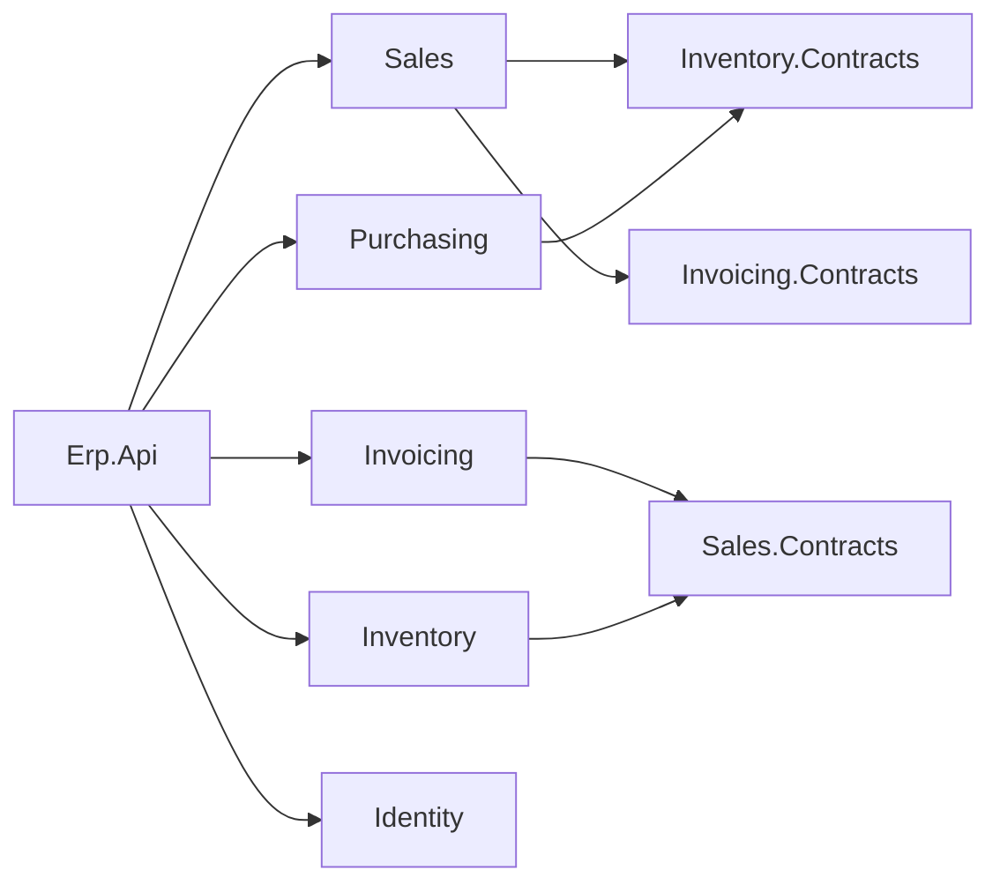

# Roadmap — from tutorial to sellable product

The course used to end in a teaching build with deliberate shortcuts. It now ends in a working ERP a
business can run, and whose source can be sold. This file is the plan and the progress log. The rules live
in [CLAUDE.md](CLAUDE.md).

**Order of work:** code first, lessons second. Each milestone lands in the reference build
([course-validation/business/](course-validation/business/)) with the build and tests green, *then* the
lessons covering it are rewritten against that working code. Writing lessons ahead of code is how the old
course drifted.

---

## Decisions (2026-11-05)

| Decision | Choice | Replaces |
|---|---|---|
| Database | **PostgreSQL** (16+; dev on 18), snake_case, schema per module | SQL Server |
| Writes & transactions | **EF Core 10 (Npgsql)**, one DbContext per module, handlers use it directly (no repositories) | Dapper + insert/update stored procs, raw ADO.NET transactions |
| Reads | **Dapper + SQL functions** (`RETURNS TABLE`; PostgreSQL procedures can't return rows), shipped by EF migrations (`migrationBuilder.Sql`) | Stored procs applied by a custom `DatabaseInitializer` |
| Schema management | **EF Core migrations** (per-module history table); production via a migrations bundle | `001_schema.sql` scripts run on boot |
| Mediator | **`martinothamar/Mediator`** (MIT, source-generated) | Hand-rolled mediator |
| Module boundaries | Everything `internal`; **one `.Contracts` project per module** is the only public surface | Contract in `Shared` (base) / `Contracts/` folder in module (Phase 15) |
| Reference builds | **One** build | `business` + `business-phase15` |
| Front end | **Blazor WebAssembly + MudBlazor**, hosted by `Erp.Api`; cookie auth for the browser; built along the course | None (Swagger only) |
| Deployment | **Docker Compose** (Caddy for HTTPS) as the main path; **IIS** as the alternative; no API keys | IIS only, API keys |
| Observability | **OpenTelemetry** logs/traces/metrics, health checks, OTLP export; local dashboard via .NET Aspire | None |
| Cross-module events | **Transactional outbox** + background dispatcher | Best-effort after-commit dispatch |
| Licensing | Permissive OSS only (MIT/Apache/BSD/PostgreSQL); FluentAssertions 8 → **AwesomeAssertions**; see [THIRD-PARTY-NOTICES.md](course-validation/business/THIRD-PARTY-NOTICES.md) | Mixed |
| Modules | Identity/Admin, **Sales, Inventory, Purchasing, Invoicing** | Sales + stock reservation only |
| Tutorial shortcuts | **Resolved** in the product (credit exposure, real stock movement, approval workflow, outbox, rate limiting/HTTPS) | Documented as ⚠️ limitations |

---

## Target solution layout

```
Erp.slnx
src/
  Erp.Api/                         host: Program.cs, auth, OpenTelemetry, health, hosts the Blazor app
  Erp.Web/                         Blazor WebAssembly + MudBlazor
  Shared/
    Erp.Shared.BuildingBlocks/     Entity, AggregateRoot, DomainException, contracts for ICurrentUser, IClock…
    Erp.Shared.Infrastructure/     EF/Dapper plumbing, outbox, security, telemetry (referenced only by Erp.Api)
  Modules/
    Identity/   Erp.Modules.Identity      (+ .Contracts once another module needs it)
    Sales/      Erp.Modules.Sales         + .Contracts
    Inventory/  Erp.Modules.Inventory     + .Contracts
    Purchasing/ Erp.Modules.Purchasing    + .Contracts
    Invoicing/  Erp.Modules.Invoicing     + .Contracts
tests/
  Erp.Modules.<X>.UnitTests/       domain tests, no database
  Erp.Integration.Tests/           whole API in memory against a fresh PostgreSQL erp_test database
  Erp.Architecture.Tests/          proves the boundary rules (no module→module reference, internal-only)
```



A module only ever points at another module's **Contracts**; contracts point at nothing but BuildingBlocks,
so the graph can't form a cycle.

---

## Product scope

| Module | Features |
|---|---|
| **Identity / Admin** | Login (cookie + JWT), refresh tokens, change password, **user management** (create, roles, disable, reset password), audit of logins |
| **Sales** | Customers (CRUD, block/unblock, credit limit, terms), sales orders (create, edit, submit, **approval workflow**, cancel), credit exposure check, order search |
| **Inventory** | Items & categories (CRUD, pricing), warehouses, **stock receipts, adjustments (with reason), reservations, shipments** (`OnHand` really decreases), stock levels & movement history |
| **Purchasing** | Suppliers, purchase orders (create, approve, send), **goods receipt → Inventory**, partial receipts |
| **Invoicing** | Invoice from shipment, payments, customer balance & aging (feeds Sales' credit check), invoice PDF (PdfSharp/MigraDoc) |

🚫 **Out of scope:** general ledger / full accounting, payroll, HR, multi-currency, multi-company, POS.

⚠️ **BIR compliance (Philippines).** Software that issues invoices may need BIR registration (CAS/CBA) and
e-invoicing (EIS) support. The Invoicing module will be built to sound practice (sequential, gap-free
numbering, no deletes, void-with-reason), but **what BIR requires must be confirmed with a tax adviser
before selling.**

---

## Milestones

Status: ⬜ not started · 🟨 in progress · ✅ done

### M0 — Rules & plan ✅
- [x] Rewrite [CLAUDE.md](CLAUDE.md) for the new stack and production bar
- [x] This roadmap

### M1 — Foundation swap (existing features, new plumbing) ✅ code · ✅ lessons
Goal: the current Sales/Inventory features behave exactly as before, on the new stack. Tests stay green.
- [x] Spike: `martinothamar/Mediator` 3.0.2 and `internal` handlers in another assembly → generator in the
      host fails with `CS0122`; **works when the module grants `InternalsVisibleTo("Erp.Api")`**. Adopted.
- [x] Spike: `dotnet ef` works with `internal` DbContexts via an internal `IDesignTimeDbContextFactory`;
      migration history table per schema
- [x] Merge builds: `business-phase15` code copied over `business`; `business-phase15` removed
- [x] Identity extracted from `Erp.Api/Auth` into `Erp.Modules.Identity` (brought forward from M3)
- [x] `Erp.Modules.Inventory.Contracts` holds `IStockReservation`; Sales references only that
- [x] Hand-rolled mediator replaced by `martinothamar/Mediator`; logging + validation behaviors ported
- [x] PostgreSQL + EF Core: per-module DbContext, value converters for ids/`Money`/`Quantity`, owned order lines
- [x] Handlers use the DbContext directly (no repositories); explicit transaction only where a contract joins in
- [x] Shared connection (`ISharedConnection`) so Inventory joins Sales' transaction — proven by a rollback test
- [x] Reads: Dapper + SQL functions shipped by migration `AddReadFunctions`; `DatabaseInitializer` deleted
- [x] Concurrency: `xmin` row version on aggregates (+ root touch for line-only edits, with a test); atomic
      `ExecuteUpdate` for stock reservation (race test)
- [x] Refresh-token rotation race closed (`revoked_utc` concurrency token → treated as reuse)
- [x] Cross-schema FKs to `identity.app_user` removed
- [x] AwesomeAssertions; every package license checked;
      [THIRD-PARTY-NOTICES.md](course-validation/business/THIRD-PARTY-NOTICES.md)
- [x] Patched transitive versions pinned (`CentralPackageTransitivePinningEnabled`)
- [x] Architecture tests for the boundary rules (6)
- [x] Errors are RFC 9457 `application/problem+json` with a `traceId`
- [x] Unhandled domain events removed (only `SalesOrderApproved`, which has a handler); MSG0005 stays on

### M2 — Production bar on existing scope ✅ code · ✅ lessons
- [x] Transactional outbox: `OutboxInterceptor` (same SaveChanges) + `OutboxDispatcher` (background,
      `FOR UPDATE SKIP LOCKED`, retries, at-least-once); handlers no longer publish
- [x] OpenTelemetry logs/traces/metrics (OTLP when configured), `X-Trace-Id` header, `traceId` in errors,
      `/health/live` + `/health/ready`, `TelemetryBehavior` (span + duration metric per command/query)
- [x] Aspire AppHost (dev-only dashboard; no Docker) — verified it starts the API and the dashboard
- [x] Credit exposure counts orders awaiting approval; submit locks the customer row (`FOR UPDATE`)
- [x] Approval workflow: ≤ ₱50,000 auto-approved on submit; above → manager approval; creator can't approve
      own order; reject with reason releases stock; cancel reverses charge and releases stock
- [x] **Auth moved to ASP.NET Core Identity** (user request): login/refresh/cookies/lockout/password policy from
      the library; custom JWT + refresh-token code deleted; `/auth/register` blocked; data-protection keys in
      PostgreSQL; sign-out-everywhere via security stamp. Forced 90-day password expiry dropped (NIST SP 800-63B)
- [x] Rate limiting (per user/IP; strict per-IP on `/auth`), HTTPS redirection + HSTS, security headers, CORS
      from config, no `Server` header
- [x] Least privilege: `deploy/postgres/create-roles.sql` (`erp_owner` migrates, `erp_app` rows only);
      verified — full integration suite passes as `erp_app`, and `erp_app` cannot DROP/CREATE/ALTER
- [x] Search count is a separate function, so a page past the end reports the real total
- [x] Found and fixed: `Money` deserialised as ₱0 from the outbox (`[JsonConstructor]`), caught by a new test
- [x] Code comments trimmed to the non-obvious *why* (user request)

### M3 — Complete Sales, Inventory, Identity ✅ code · ✅ lessons (14–17)
- [x] User management: admin creates (temporary password, must change), edits role, disables, resets
      password; `StaffAccountRules` (no self-disable, no self-role-change, keep the last admin); six roles
- [x] `ErpSignInManager`: disabled users can't sign in; every password attempt in `identity.sign_in_attempt`
- [x] MailKit `IEmailSender<AppUser>`; with no `Smtp:Host` the mail is logged (development)
- [x] Quantities `numeric(18,3)` with units of measure (`Quantity` value object, `AllowsFractions` per item)
- [x] Customers maintenance (TIN, address, terms, block); item catalog owned by Inventory, Sales keeps a copy
      via `ItemCatalogChanged`; price list and categories; audited stock adjustments and movement history
- [x] Shipping: Inventory ships, Sales marks shipped through `ISalesOrders` (Sales.Contracts), one transaction
- [x] Who sees which orders: **decided** — a SalesRep sees only their own; everyone else sees all; another's
      order is a 404 (`SalesOrder.CreatorFilterFor` / `IsVisibleTo`, `p_created_by` in the SQL functions)
- [ ] Warehouses: out of scope for this release (one warehouse); listed in lesson 24

### M4 — Blazor front end ✅ code · ✅ lessons (built along the way, from lesson 01)
- [x] `Erp.Web` (WASM + MudBlazor 9.12) hosted by `Erp.Api` (`MapStaticAssets` + `MapFallbackToFile`); API
      under `/api`; cookie sign-in via `CookieAuthenticationStateProvider`; role-aware navigation
- [x] Screens for every feature: orders (create/edit/submit/approve/reject/cancel/ship), customers, price
      list and categories, items and stock, shipments, suppliers, purchase orders and receiving, invoices,
      payments, aging, users, sign-in log, change/forgot password
- [x] Two CSPs (strict for `/api`, Blazor-compatible for pages, no inline scripts); API keys removed (a key in
      a browser app is public)
- [x] Playwright UI tests (3) against a running app
- [ ] Two-factor sign-in: not built; listed in lesson 24

### M5 — Purchasing ✅ code · ✅ lesson 18
- [x] Suppliers; purchase orders (draft → admin approval, never the buyer → sent → partial/complete receipt →
      closed short or cancelled); receiving through `IStockReceiving`; `IItemCatalog` for item details

### M6 — Invoicing ✅ code · ✅ lessons 19–20 (BIR check still with a tax adviser)
- [x] Invoice issued from `ShipmentRecorded` (idempotent issuer), gap-free numbers (counter row in the
      transaction), void with reason + reissue, VAT split, PDF (PDFsharp-MigraDoc **6.2.4**, the last MIT
      release; 6.5+ is AGPL — pinned)
- [x] Payments and payment voids; `PaymentRecorded`/`PaymentVoided` applied by Sales exactly once
      (`applied_payment` inbox); receivables aging by as-of date; overdue filter
- [ ] ⚠️ BIR registration (CAS) and approved invoice format: business decision with a tax adviser (lesson 24)

### M7 — Packaging & install ✅ code · ✅ lessons (21–24) · ⚠️ Docker and IIS not run here
- [x] Data-protection keys encrypted with a certificate; app refuses to start in Production without one
      (verified with an OpenSSL `.pfx`: stored keys show `encryptedSecret`)
- [x] Docker (main path): multi-stage `Dockerfile` (`app` + `migrate` targets), Compose (db with initdb roles,
      migrate, api, Caddy for HTTPS, nightly `pg_dump` backup), `.env.example`, secrets folder. ⚠️ **Not run:
      Docker isn't installed on this machine** — shell scripts pass `sh -n`, the Linux bundle cross-builds
- [x] IIS (alternative): lesson 23 updated for five modules, certificate, company/SMTP settings. ⚠️ Not run on
      a real Windows Server 2019+
- [x] First-run admin; migration bundles; backup and restore drill; production checklist with "not built yet"
- [ ] The 2012 R2 dev server can't run .NET 10; see [runbooks/14b-deploy-ws2012r2.md](runbooks/14b-deploy-ws2012r2.md)

### L — Lessons ✅ (all milestones)
Rewritten 2026-11-06 into one start-to-finish course of 24 lessons. The interface is built along the way
(user decision): lesson 01 creates the Blazor app, lesson 05 signs in through it, and every feature lesson
adds its screen.

| # | Lesson | Introduces | Refactors (before → after) |
|---|---|---|---|
| 01 | Solution setup | slnx, CPM, 4 projects; `Erp.Web` (WASM, MudBlazor), host serves it (`MapStaticAssets`, fallbacks), `/api` group | — |
| 02 | Mediator | Mediator, FluentValidation, Carter, behaviors, IVT Erp.Api; Ping slice + Ping page | — |
| 03 | Domain model | Entity/AggregateRoot/DomainException, Roles (3), Money (rounding), Quantity (decimal), Customer (+Block), ItemCategory, SalesItem, SalesOrder (`SetLines`), 18 unit tests | — |
| 04 | Database | PostgreSQL, EF Core per module, `IModuleDatabase`, seed (items with explicit ids) | — |
| 05 | Sign-in | Identity, `ICurrentUser`, `/api/auth/me`, sign out everywhere; Components.Authorization, `CookieAuthenticationStateProvider`, `[Authorize]` everywhere, Login, account menu | App.razor `RouteView` → `AuthorizeRouteView` |
| 06 | Create an order | `IClock`, `NotFoundException`, `DocumentNumber`, `ResolveLinesAsync`, `ValidQuantity`, `SalesRoles.Sellers`, problem details (+`BadHttpRequestException`), Swagger; `ApiClient`, snackbar, Roles link into Erp.Web, id-based order form | delete Ping |
| 07 | Find orders | Dapper, `IDbConnectionFactory`, `PagedResult`, paging rules, SQL functions (orders, customers, price list), visibility (`CreatorFilterFor`); Models, Format, Url, StatusChip, list/detail pages, `Tile` | order form: ids → autocompletes |
| 08 | Submit | Inventory module + Contracts, `IStockReservation`, `StockService`, `GetVisibleOrderAsync`, `LockCustomerAsync`; Submit button | `NpgsqlDataSource` → `ISharedConnection` |
| 09 | Approve, reject, cancel | `SalesRoles.Managers`, `xmin`, 409; `ReasonDialog`, dialog provider, buttons, approval tile | — |
| 10 | Update an order | update slice; edit mode of the form | `SaveChangesAsync` root touch |
| 11 | Events and the outbox | outbox, interceptor, dispatcher, `SalesOrderApproved` | `Money`/`Quantity` gain `[JsonConstructor]` |
| 12 | Testing | integration, architecture (+ `Every_event_has_a_handler`), Playwright UI tests | — |
| 13 | Observability | OpenTelemetry, health checks, Aspire | `LoggingBehavior` → `TelemetryBehavior` |
| 14 | Customers | customer slices, Customers page + dialog | `Customer.Create` → `Create` calls `Update` (+TIN/address/terms); `search_customers` v2 |
| 15 | Users and email | 6 roles, AppUser fields, `StaffAccountRules`, `ErpSignInManager`, sign-in log, user slices, MailKit, user directory; admin pages, change/forgot password; `SalesRoles.Readers` | `/me` gains FullName + MustChangePassword |
| 16 | Item catalog and stock | Inventory `Item` aggregate, `StockMovement`, `ItemCatalogChanged`, Sales upsert handler, price list + categories slices, 23505 → 409; items/price list pages | Inventory `Item` (stock only) → catalog; reservation guard gains `IsActive`; Mediator assemblies gain Contracts |
| 17 | Shipping | Sales.Contracts `ISalesOrders`, `Shipment`, ship slice, `LockOrderAsync`, Shipped status; Ship button, Shipments page | `get_sales_order` v2 |
| 18 | Purchasing | Purchasing module, `IItemCatalog`, `IStockReceiving`, `DateOnlyTypeHandler`; purchasing pages | `StockService` registered once, mapped to three interfaces |
| 19 | Invoicing | `IClock.Today`, `ShipmentRecorded`, `GetForInvoiceAsync`, Invoice, counter, issuer, void/reissue, PDF (6.2.4), invoice pages | — |
| 20 | Payments and receivables | Invoicing.Contracts, payments, `AppliedPayment` inbox, aging, `JsonStringEnumConverter`; payment dialog, aging page | Invoice → AggregateRoot; `search_invoices` v2 |
| 21 | Security hardening | rate limits (`/api` only), HSTS, headers + two CSPs, CORS, data-protection keys in DB + certificate, least privilege, `ErpDbMigrations` | `IModuleDatabase` takes the owner connection; test factory gains `ERP_TEST_DB_OWNER` |
| 22 | Docker | `InitialAdmin` + `FirstRunTests`, Dockerfile, Compose, Caddy, initdb, backup, `.env` | — |
| 23 | Deploy to IIS | bundles, IIS, app pool, certificate on Windows | — |
| 24 | Production checklist | done list, first-day setup, IIS backups, restore drill, not-built list | — |

⚠️ A reader's migrations and SQL files are more numerous than the reference build's (e.g. `AddCustomerDetails`,
`search_customers.v2`); the reference squashes each module to `InitialCreate` + `AddReadFunctions` with each
function at its final shape as `v1`. The resulting schema is identical.

---

## Risks to retire early

- ~~**Source-generated mediator + `internal` handlers in other assemblies.**~~ Retired 2026-11-05:
  `InternalsVisibleTo("Erp.Api")` per module; an architecture test stops it spreading to other modules.
- ~~**EF tooling with internal DbContexts**~~ Retired 2026-11-05: internal design-time factories work.
- ~~**Sharing one transaction across module DbContexts**~~ Retired 2026-11-05: `ISharedConnection` +
  `UseTransaction`; `A_reservation_rolls_back_with_the_callers_transaction` proves it.
- **Course length.** Done: 24 lessons, about 50–60 hours. Later lessons show new ideas in full and point to
  the reference build for screens built from patterns already taught.
- **Docker and IIS paths not executed here.** Run lesson 22 on a machine with Docker, and lesson 23 on a real
  Windows Server 2019+, before the first sale.
- **Selling source vs. a public course.** If the course is published openly and ends in the full product,
  the product's source is effectively free. Decide how the course is distributed before M4.

---

## Log

- **2026-11-05** — Direction changed (see Decisions). CLAUDE.md rewritten; roadmap created. Baseline
  `business-phase15`: 14 unit + 8 integration tests pass.
- **2026-11-05** — Database switched to PostgreSQL (user decision). PostgreSQL 18 installed locally via winget
  (dev superuser password `erp_dev_only`, dev only). M1 code complete on PostgreSQL: **14 unit + 6 architecture
  + 10 integration tests pass.** Lessons not yet converted.
- **2026-11-05** — M2 code complete: **22 unit + 6 architecture + 23 integration tests pass** (also as the
  least-privilege `erp_app` role). Auth switched to ASP.NET Core Identity at the user's request.
- **2026-11-06** — Lessons 00–16 rewritten for M1 + M2 in the WRITING-STYLE voice; old phase files deleted;
  glossary, answer key, foundations, PowerShell companion, resources and README rewritten. Added the
  first-run admin; 400 responses now carry a readable `detail`, and problem details declare UTF-8. Verified
  live: migration bundles, the published app in Production as `erp_app`, backup → restore onto fresh roles,
  and the PowerShell companion on PS 5.1. **22 unit + 6 architecture + 25 integration tests pass.** IIS itself
  not yet run (see [course-validation/FINDINGS.md](course-validation/FINDINGS.md)).
- **2026-11-06** — M3–M7 code complete: Identity user management + sign-in log + MailKit; Inventory catalog,
  adjustments, shipments; Purchasing; Invoicing with payments and aging; Blazor app with every screen;
  data-protection certificate; Docker deployment. API keys removed; reps see only their own orders.
  **45 unit + 7 architecture + 35 integration + 3 UI tests pass.** PDFsharp pinned to 6.2.4 (6.5 is AGPL).
- **2026-11-06** — Lessons rewritten as one 24-lesson course with the interface built from lesson 01 (user
  decision: the interface is built along with the logic). Support docs, glossary and answer key rebuilt.
  Docker and IIS paths written but not executed on this machine (see FINDINGS).
