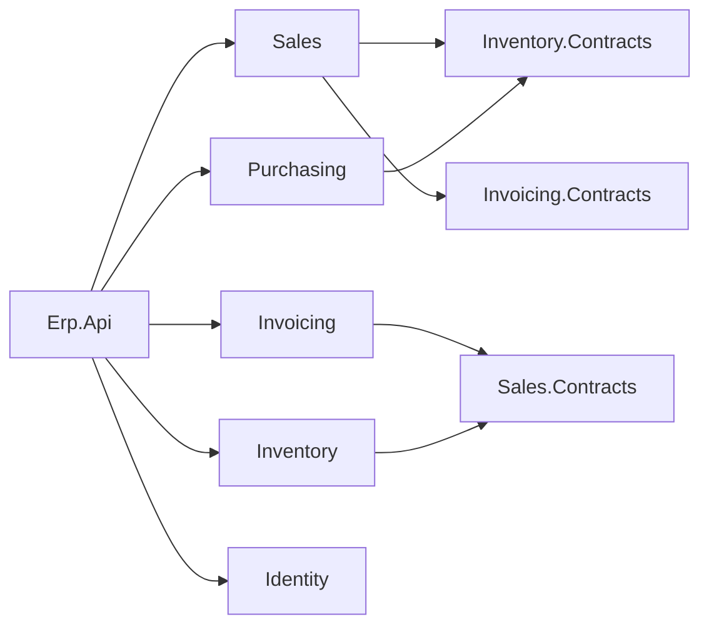

# Roadmap — from tutorial to sellable product

The course used to end in a teaching build with deliberate shortcuts. It now ends in a working ERP a
business can run, and whose source can be sold. This file is the plan and the progress log. The rules live
in [CLAUDE.md](CLAUDE.md).

**Order of work:** code first, lessons second. Each milestone lands in the reference build
([course-validation/business/](course-validation/business/)) with the build and tests green, *then* the
lessons covering it are rewritten against that working code. Writing lessons ahead of code is how the old
course drifted.

---

## Decisions (2026-11-05)

| Decision | Choice | Replaces |
|---|---|---|
| Database | **PostgreSQL** (16+; dev on 18), snake_case, schema per module | SQL Server |
| Writes & transactions | **EF Core 10 (Npgsql)**, one DbContext per module, handlers use it directly (no repositories) | Dapper + insert/update stored procs, raw ADO.NET transactions |
| Reads | **Dapper + SQL functions** (`RETURNS TABLE`; PostgreSQL procedures can't return rows), shipped by EF migrations (`migrationBuilder.Sql`) | Stored procs applied by a custom `DatabaseInitializer` |
| Schema management | **EF Core migrations** (per-module history table); production via a migrations bundle | `001_schema.sql` scripts run on boot |
| Mediator | **`martinothamar/Mediator`** (MIT, source-generated) | Hand-rolled mediator |
| Module boundaries | Everything `internal`; **one `.Contracts` project per module** is the only public surface | Contract in `Shared` (base) / `Contracts/` folder in module (Phase 15) |
| Reference builds | **One** build | `business` + `business-phase15` |
| Front end | **Blazor WebAssembly + MudBlazor**, hosted by `Erp.Api`; cookie auth for the browser; built along the course | None (Swagger only) |
| Deployment | **Compose on Podman** (2026-11-12; same files run on Docker), Caddy for HTTPS; IIS dropped 2026-11-06 (user decision); no API keys | IIS only, API keys |
| Tax | Regime (`Vat`/`PercentageTax`/`Exempt`), VAT rate, company details and BIR permit are **business data** in `invoicing.company_profile`, edited on a screen; special-discount programs in a Sales table; per-item VAT treatment and discount eligibility; each invoice stores its rate, breakdown, discount and seller; layout follows BIR RR 7-2024 Sec. 6(B) | 12% constant, `VatRegistered` flag; then (briefly) appsettings |
| Observability | **OpenTelemetry** logs/traces/metrics, health checks, OTLP export; local dashboard via .NET Aspire | None |
| Cross-module events | **Transactional outbox** + background dispatcher | Best-effort after-commit dispatch |
| Licensing | Permissive OSS only (MIT/Apache/BSD/PostgreSQL); FluentAssertions 8 → **AwesomeAssertions**; see [THIRD-PARTY-NOTICES.md](course-validation/business/THIRD-PARTY-NOTICES.md) | Mixed |
| Modules | Identity/Admin, **Sales, Inventory, Purchasing, Invoicing** | Sales + stock reservation only |
| Tutorial shortcuts | **Resolved** in the product (credit exposure, real stock movement, approval workflow, outbox, rate limiting/HTTPS) | Documented as ⚠️ limitations |
| Testing (2026-11-12, user decision) | **Every lesson from 02 on ends with tests**, edge cases included. New **Lesson 02 — Testing** teaches setup and use; each test kind is set up in the lesson that first needs it: architecture, property-based (FsCheck), integration, browser, race, coverage (coverlet), mutation (Stryker.NET), Testcontainers, CI (GitHub Actions). Key tests in full plus an edge-case table per lesson; every test exists in the reference build | Unit tests in lesson 03, everything else in lesson 12 |
| Containers (2026-11-12, user decision) | **Podman everywhere containers are used**, introduced in new **Lesson 12 — Containers and CI** after the reader has used a native PostgreSQL since lesson 05 (build up, then refactor). Deployment stays **Compose** files and an OCI `Dockerfile`, so the same files run on Docker | Docker only (deployment); native PostgreSQL for dev and tests throughout |

---

## Target solution layout

```
Erp.slnx
src/
  Erp.Api/                         host: Program.cs, auth, OpenTelemetry, health, hosts the Blazor app
  Erp.Web/                         Blazor WebAssembly + MudBlazor
  Shared/
    Erp.Shared.BuildingBlocks/     Entity, AggregateRoot, DomainException, contracts for ICurrentUser, IClock…
    Erp.Shared.Infrastructure/     EF/Dapper plumbing, outbox, security, telemetry (referenced only by Erp.Api)
  Modules/
    Identity/   Erp.Modules.Identity      (+ .Contracts once another module needs it)
    Sales/      Erp.Modules.Sales         + .Contracts
    Inventory/  Erp.Modules.Inventory     + .Contracts
    Purchasing/ Erp.Modules.Purchasing    + .Contracts
    Invoicing/  Erp.Modules.Invoicing     + .Contracts
tests/
  Erp.Modules.<X>.UnitTests/       domain tests, no database
  Erp.Integration.Tests/           whole API in memory against a fresh PostgreSQL erp_test database
  Erp.Architecture.Tests/          proves the boundary rules (no module→module reference, internal-only)
```



A module only ever points at another module's **Contracts**; contracts point at nothing but BuildingBlocks,
so the graph can't form a cycle.

---

## Product scope

| Module | Features |
|---|---|
| **Identity / Admin** | Login (cookie + JWT), refresh tokens, change password, **user management** (create, roles, disable, reset password), audit of logins |
| **Sales** | Customers (CRUD, block/unblock, credit limit, terms), sales orders (create, edit, submit, **approval workflow**, cancel), credit exposure check, order search |
| **Inventory** | Items & categories (CRUD, pricing), warehouses, **stock receipts, adjustments (with reason), reservations, shipments** (`OnHand` really decreases), stock levels & movement history |
| **Purchasing** | Suppliers, purchase orders (create, approve, send), **goods receipt → Inventory**, partial receipts |
| **Invoicing** | Invoice from shipment, payments, customer balance & aging (feeds Sales' credit check), invoice PDF (PdfSharp/MigraDoc) |

🚫 **Out of scope:** general ledger / full accounting, payroll, HR, multi-currency, multi-company, POS.

⚠️ **BIR compliance (Philippines).** Software that issues invoices may need BIR registration (CAS/CBA) and
e-invoicing (EIS) support. The Invoicing module will be built to sound practice (sequential, gap-free
numbering, no deletes, void-with-reason), but **what BIR requires must be confirmed with a tax adviser
before selling.**

---

## Milestones

Status: ⬜ not started · 🟨 in progress · ✅ done

### M0 — Rules & plan ✅
- [x] Rewrite [CLAUDE.md](CLAUDE.md) for the new stack and production bar
- [x] This roadmap

### M1 — Foundation swap (existing features, new plumbing) ✅ code · ✅ lessons
Goal: the current Sales/Inventory features behave exactly as before, on the new stack. Tests stay green.
- [x] Spike: `martinothamar/Mediator` 3.0.2 and `internal` handlers in another assembly → generator in the
      host fails with `CS0122`; **works when the module grants `InternalsVisibleTo("Erp.Api")`**. Adopted.
- [x] Spike: `dotnet ef` works with `internal` DbContexts via an internal `IDesignTimeDbContextFactory`;
      migration history table per schema
- [x] Merge builds: `business-phase15` code copied over `business`; `business-phase15` removed
- [x] Identity extracted from `Erp.Api/Auth` into `Erp.Modules.Identity` (brought forward from M3)
- [x] `Erp.Modules.Inventory.Contracts` holds `IStockReservation`; Sales references only that
- [x] Hand-rolled mediator replaced by `martinothamar/Mediator`; logging + validation behaviors ported
- [x] PostgreSQL + EF Core: per-module DbContext, value converters for ids/`Money`/`Quantity`, owned order lines
- [x] Handlers use the DbContext directly (no repositories); explicit transaction only where a contract joins in
- [x] Shared connection (`ISharedConnection`) so Inventory joins Sales' transaction — proven by a rollback test
- [x] Reads: Dapper + SQL functions shipped by migration `AddReadFunctions`; `DatabaseInitializer` deleted
- [x] Concurrency: `xmin` row version on aggregates (+ root touch for line-only edits, with a test); atomic
      `ExecuteUpdate` for stock reservation (race test)
- [x] Refresh-token rotation race closed (`revoked_utc` concurrency token → treated as reuse)
- [x] Cross-schema FKs to `identity.app_user` removed
- [x] AwesomeAssertions; every package license checked;
      [THIRD-PARTY-NOTICES.md](course-validation/business/THIRD-PARTY-NOTICES.md)
- [x] Patched transitive versions pinned (`CentralPackageTransitivePinningEnabled`)
- [x] Architecture tests for the boundary rules (6)
- [x] Errors are RFC 9457 `application/problem+json` with a `traceId`
- [x] Unhandled domain events removed (only `SalesOrderApproved`, which has a handler); MSG0005 stays on

### M2 — Production bar on existing scope ✅ code · ✅ lessons
- [x] Transactional outbox: `OutboxInterceptor` (same SaveChanges) + `OutboxDispatcher` (background,
      `FOR UPDATE SKIP LOCKED`, retries, at-least-once); handlers no longer publish
- [x] OpenTelemetry logs/traces/metrics (OTLP when configured), `X-Trace-Id` header, `traceId` in errors,
      `/health/live` + `/health/ready`, `TelemetryBehavior` (span + duration metric per command/query)
- [x] Aspire AppHost (dev-only dashboard; no Docker) — verified it starts the API and the dashboard
- [x] Credit exposure counts orders awaiting approval; submit locks the customer row (`FOR UPDATE`)
- [x] Approval workflow: ≤ ₱50,000 auto-approved on submit; above → manager approval; creator can't approve
      own order; reject with reason releases stock; cancel reverses charge and releases stock
- [x] **Auth moved to ASP.NET Core Identity** (user request): login/refresh/cookies/lockout/password policy from
      the library; custom JWT + refresh-token code deleted; `/auth/register` blocked; data-protection keys in
      PostgreSQL; sign-out-everywhere via security stamp. Forced 90-day password expiry dropped (NIST SP 800-63B)
- [x] Rate limiting (per user/IP; strict per-IP on `/auth`), HTTPS redirection + HSTS, security headers, CORS
      from config, no `Server` header
- [x] Least privilege: `deploy/postgres/create-roles.sql` (`erp_owner` migrates, `erp_app` rows only);
      verified — full integration suite passes as `erp_app`, and `erp_app` cannot DROP/CREATE/ALTER
- [x] Search count is a separate function, so a page past the end reports the real total
- [x] Found and fixed: `Money` deserialised as ₱0 from the outbox (`[JsonConstructor]`), caught by a new test
- [x] Code comments trimmed to the non-obvious *why* (user request)

### M3 — Complete Sales, Inventory, Identity ✅ code · ✅ lessons (14–17)
- [x] User management: admin creates (temporary password, must change), edits role, disables, resets
      password; `StaffAccountRules` (no self-disable, no self-role-change, keep the last admin); six roles
- [x] `ErpSignInManager`: disabled users can't sign in; every password attempt in `identity.sign_in_attempt`
- [x] MailKit `IEmailSender<AppUser>`; with no `Smtp:Host` the mail is logged (development)
- [x] Quantities `numeric(18,3)` with units of measure (`Quantity` value object, `AllowsFractions` per item)
- [x] Customers maintenance (TIN, address, terms, block); item catalog owned by Inventory, Sales keeps a copy
      via `ItemCatalogChanged`; price list and categories; audited stock adjustments and movement history
- [x] Shipping: Inventory ships, Sales marks shipped through `ISalesOrders` (Sales.Contracts), one transaction
- [x] Who sees which orders: **decided** — a SalesRep sees only their own; everyone else sees all; another's
      order is a 404 (`SalesOrder.CreatorFilterFor` / `IsVisibleTo`, `p_created_by` in the SQL functions)
- [ ] Warehouses: out of scope for this release (one warehouse); listed in lesson 24

### M4 — Blazor front end ✅ code · ✅ lessons (built along the way, from lesson 01)
- [x] `Erp.Web` (WASM + MudBlazor 9.12) hosted by `Erp.Api` (`MapStaticAssets` + `MapFallbackToFile`); API
      under `/api`; cookie sign-in via `CookieAuthenticationStateProvider`; role-aware navigation
- [x] Screens for every feature: orders (create/edit/submit/approve/reject/cancel/ship), customers, price
      list and categories, items and stock, shipments, suppliers, purchase orders and receiving, invoices,
      payments, aging, users, sign-in log, change/forgot password
- [x] Two CSPs (strict for `/api`, Blazor-compatible for pages, no inline scripts); API keys removed (a key in
      a browser app is public)
- [x] Playwright UI tests (3) against a running app
- [ ] Two-factor sign-in: not built; listed in lesson 24

### M5 — Purchasing ✅ code · ✅ lesson 18
- [x] Suppliers; purchase orders (draft → admin approval, never the buyer → sent → partial/complete receipt →
      closed short or cancelled); receiving through `IStockReceiving`; `IItemCatalog` for item details

### M6 — Invoicing ✅ code · ✅ lessons 19–21 (BIR registration is the business's step)
- [x] Invoice issued from `ShipmentRecorded` (idempotent issuer), gap-free numbers (counter row in the
      transaction), void with reason + reissue, PDF (PDFsharp-MigraDoc **6.2.4**, the last MIT release; 6.5+
      is AGPL — pinned; kept by user decision 2026-11-06)
- [x] BIR RR 7-2024 alignment (2026-11-06): tax regime and rate, company details and BIR permit in the
      `company_profile` table with a Company and tax page (2026-11-07, user decision: business data, not
      configuration); each invoice keeps a copy of the seller; shipping refused until the profile is complete; VATable / zero-rated /
      VAT-exempt per item, snapshotted on order and invoice lines; stored breakdown; TIN statement with branch
      code; title must contain "Invoice"; REPRINT from an atomic print counter; PTU/ACCN, series range and date
      issued in the footer
- [x] Payments and payment voids; `PaymentRecorded`/`PaymentVoided` applied by Sales exactly once
      (`applied_payment` inbox); receivables aging by as-of date; overdue filter
- [ ] ⚠️ BIR registration (CAS) and a tax adviser's review of the printed invoice: the business's step (lesson 24)
- [x] Senior citizen / PWD discounts (Sec. 6(B.18)), 2026-11-07: programs table (SC/PWD seeded), per-item
      eligibility, VAT exemption then 20% on the order, one shared calculation so the invoice equals the order,
      ID and signature block on the PDF (lesson 21)
- [x] Creditable withholding tax and BIR Form 2307, 2026-11-07: tax withheld on payments settles the invoice;
      certificates recorded per customer and quarter; withheld / certified / missing report (lesson 20)
- [ ] The seniors' 5% basic-necessities discount (weekly cap, purchase booklet): not built; listed in lesson 24

### M7 — Packaging & install ✅ code · ✅ lessons (22–24) · ⚠️ Docker not run here
- [x] Data-protection keys encrypted with a certificate; app refuses to start in Production without one
      (verified with an OpenSSL `.pfx`: stored keys show `encryptedSecret`)
- [x] Docker (main path): multi-stage `Dockerfile` (`app` + `migrate` targets), Compose (db with initdb roles,
      migrate, api, Caddy for HTTPS, nightly `pg_dump` backup), `.env.example`, secrets folder. ⚠️ **Not run:
      Docker isn't installed on this machine** — shell scripts pass `sh -n`, the Linux bundle cross-builds
- [x] First-run admin; migration bundles; backup and restore drill; production checklist with "not built yet"

### M8 — Tests in every lesson, and Podman ✅ code · ✅ lessons (decided and done 2026-11-12/13) · ⚠️ `podman compose up` not run

Goal: the reader proves every lesson works before moving on, learns to hunt for edge cases, and learns
containers when they've felt the need for them. Course becomes **25 lessons**:

| New # | Lesson | Was |
|---|---|---|
| 01 | Solution setup (no tests: setup only) | 01 |
| **02** | **Testing** (new): why we test; setting up the test projects; *using* them | — |
| 03–11 | Mediator · Domain model · Database · Sign-in · Create an order · Find orders · Submit · Approve, reject, cancel · Update an order | 02–10 |
| **12** | **Containers and CI** (new): Podman, dev database into a container, Testcontainers, GitHub Actions | — |
| 13 | Events and the outbox | 11 |
| — | (old 12 Testing is split across the lessons below) | 12 |
| 14–23 | Observability · Customers · Users and email · Item catalog · Shipping · Purchasing · Invoicing · Payments · Special discounts · Security hardening | 13–22 |
| 24 | Deploying with Podman (Compose; the same files run on Docker) | 23 Docker |
| 25 | Production checklist | 24 |

Each lesson shows the tests that teach something new in full, then a table of every edge case (test name + why
it matters). Every test exists in the reference build.

**Build up, then refactor (user decision).** Lesson 05 installs PostgreSQL normally, and lessons 05–11 run the
integration tests against a local `erp_test` database dropped at the start of each run. Lesson 12 names the
pain (leftover data, a teammate on another PostgreSQL version, a CI machine with no database), installs
Podman and says why Podman (free on every OS incl. Podman Desktop on Windows/Mac, rootless, no root daemon,
Apache-2.0, OCI images Docker can also run), moves the dev database into a `postgres:18` container, and
refactors the test factory to Testcontainers (before → after; `DropDatabase` goes). **Compose stays the
deployment format**, run with `podman compose` (docker-compose v2 as provider, Apache-2.0) and unchanged with
`docker compose`; the `Dockerfile` builds with `podman build` or `docker build`. Quadlet was considered and
dropped: Podman-only.

**Test kinds and where each is first set up and explained**

| Kind | Tool (license) | Introduced in |
|---|---|---|
| In-memory API tests | xUnit 2.9.3, AwesomeAssertions, `WebApplicationFactory` | 02 Testing |
| Unit tests (validators) | xUnit `[Fact]`/`[Theory]` | 02 (basics), 03 (validators) |
| Architecture tests | reflection over assemblies, no extra package | 03, grows in 04, 10, 13 |
| Domain unit tests | xUnit | 04 Domain model |
| Property-based tests | FsCheck.Xunit 3.6.0 (BSD-3) | 04 (`Money`, `Quantity`); again 20–22 for tax math |
| Integration tests on real PostgreSQL | local `erp_test` database | 05 Database |
| Browser tests | Microsoft.Playwright (MIT) | 06 Sign-in |
| Concurrency / race tests | `Task.WhenAll` | 09 Submit |
| Coverage | coverlet.collector 10.1.0 (MIT) + report | 11 Update an order |
| Mutation testing | Stryker.NET 5.1.0 (Apache-2.0), dotnet tool | 11 |
| Containers for tests | Testcontainers.PostgreSql 4.16.0 (MIT) on Podman (Docker works too) | 12 Containers and CI |
| CI | GitHub Actions; first Git/GitHub use in the course | 12 |

Lesson 02 also teaches *using* tests: `dotnet test`, `--filter`, `dotnet watch test`, the test explorers (VS
Code C# Dev Kit, Visual Studio, Rider), reading a failure, debugging one test, Arrange/Act/Assert, naming
(`Blocked_customer_cannot_order`), `[Fact]` vs `[Theory]`, "make it fail once", and an edge-case checklist
(empty, zero, negative, one, many, max, boundary ±1, duplicate, wrong role, someone else's data, twice in a row,
at the same time, after the state changed).

**Per lesson (new numbers) — what the tests prove (✚ = edge case to add; the rest exist)**

| # | Lesson | Tests |
|---|---|---|
| 01 | Solution setup | none |
| 02 | Testing | host starts; `/` and a deep link serve the app; unknown `/api/...` is 404, not HTML ✚; `/api` with trailing slash ✚; static asset 200 ✚ |
| 03 | Mediator | Ping handler; validator `[Theory]` (empty, whitespace, max length ±1) ✚; invalid request → 400 problem details with `detail` ✚; internal validator actually runs (`includeInternalTypes`) ✚; arch: IVT only to host + tests, a module exposes only its entry class |
| 04 | Domain model | existing Sales rules; ✚ `Money` rounding at the ₱0.005 boundary and `numeric(18,2)` max; ✚ `Quantity` 3-decimal boundary; ✚ credit exactly at the limit (allowed) vs +₱0.01; ✚ category cap exactly at the cap; ✚ approval threshold exactly ₱50,000 vs ₱50,000.01; ✚ same item merged then over the cap; properties: Money sums never drift a centavo, Quantity never negative; arch: domain depends on no data access or web |
| 05 | Database | test factory on `erp_test`; ✚ migrations apply on an empty database; ✚ seed is idempotent (run twice); ✚ value converters round-trip ids, `Money`, `Quantity`; ✚ snake_case names; ✚ history table per schema |
| 06 | Sign-in | wrong password 401; ✚ unknown email 401 with the same body; `/register` blocked; lockout after 5 (throwaway user); ✚ lockout ends after the window; refresh; ✚ refresh with a revoked token; sign out everywhere; ✚ anonymous `/api/*` → 401, not a redirect; ✚ cookie and bearer both accepted; Playwright: ✚ sign in, ✚ wrong password shows the message |
| 07 | Create an order | ✚ number and date from a fixed `IClock`; ✚ unknown customer/item → 404; ✚ zero/negative/4-decimal quantity → 400; ✚ 0 lines and over the line limit; ✚ duplicate item lines merged; ✚ wrong role → 403; ✚ document numbers unique under parallel creates; Playwright: ✚ create an order |
| 08 | Find orders | ✚ paging: page 0, negative, size 0, over the max, past the end (real total — exists); ✚ search text with `%`, `_`, `'` matches literally; ✚ case-insensitive; rep sees own only (exists), ✚ another's order by id → 404; ✚ empty result → total 0 |
| 09 | Submit | race for the last units; rollback joins the caller's transaction; ✚ submit twice; ✚ insufficient stock → 422, nothing reserved; blocked / over credit (✚ exact boundary) → 422; ✚ someone else's draft → 404 |
| 10 | Approve, reject, cancel | existing workflow tests; ✚ every illegal transition as a `[Theory]`; ✚ empty/whitespace reason; ✚ stale version → 409; ✚ two managers approve at once → one wins, charged once; arch: module → others' Contracts only, contracts reference no module, only the host references shared infrastructure |
| 11 | Update an order | lost update (exists); ✚ editing a submitted order refused; ✚ line-only edit bumps the root version; ✚ remove all lines → 400 · **coverage report; mutation run on the Sales domain, surviving mutants killed** |
| 12 | Containers and CI | factory refactored to Testcontainers; ✚ two runs in parallel don't collide; ✚ suite passes on a fresh container with no local PostgreSQL; ✚ CI run on GitHub Actions |
| 13 | Events and the outbox | round trip, delivery (exist); ✚ handler runs once when delivered twice; ✚ failing handler retried, then parked; ✚ crash between save and dispatch → still delivered; ✚ rollback writes no outbox row; arch: every event has a handler |
| 14–25 | (old 13–24) | existing tests kept, plus: 14 ready fails when the database is down ✚; 15 TIN/terms boundaries ✚; 16 reset-password token reused ✚; 17 duplicate name → 409 ✚; 18 ship twice ✚, ship more than reserved ✚; 19 over-receipt ✚; 20 invoice numbers gap-free under concurrency ✚, VAT properties ✚; 21 void a payment twice ✚, aging day boundaries 30/31 ✚; 22 property: invoice total = order total ✚; 23 rate limit → 429 ✚, `erp_app` cannot DDL (inside the container ✚); 24 first run, and the whole stack verified with `podman compose` ✚ |

**Work order (code first):** (1) edge-case tests per lesson in the reference build, each made to fail once,
suite green on a local PostgreSQL; (2) Testcontainers on Podman, FsCheck, coverlet, Stryker, GitHub Actions;
(3) deployment verified with `podman compose` on this machine (retires "Docker path not executed");
(4) lessons: new 02 and 12, renumber, split old 12, convert old 23 to Podman, each lesson's tests section and
edge-case table, ANSWER-KEY, GLOSSARY, README, 00-START-HERE, 00b (Podman Desktop on Windows). Open: Ryuk under
rootless Podman; rootless Caddy on ports 80/443 (`net.ipv4.ip_unprivileged_port_start`); restart on boot
(`podman-restart.service` + linger).

### L — Lessons ✅ (all milestones)
Rewritten 2026-11-06 into one start-to-finish course; 2026-11-12 (M8) grew to **25 lessons**: a new 02 Testing and
12 Containers and CI, old 02–11 → 03–13 around them, old 12 Testing split up, old 13–24 → 14–25. The interface is built
along the way (user decision): lesson 01 creates the Blazor app, lesson 06 signs in through it, and every feature lesson
adds its screen. Every lesson from 02 proves itself with tests.

| # | Lesson | Introduces | Refactors (before → after) | Tests (M8) |
|---|---|---|---|---|
| 01 | Solution setup | slnx, CPM, 4 projects; `Erp.Web` (WASM, MudBlazor), host serves it (`MapStaticAssets`, fallbacks), `/api` group | — | — |
| 02 | Testing | test project, `CustomWebAppFactory`, `public partial class Program`, `PrivateAssets` on the Erp.Web reference | — | xUnit, AwesomeAssertions, `WebApplicationFactory`; host routing tests (13); test habits; edge-case checklist |
| 03 | Mediator | Mediator, FluentValidation, Carter, behaviors, IVT Erp.Api; Ping slice + Ping page; unit + architecture test projects | — | first unit tests (Ping), first architecture tests (3) |
| 04 | Domain model | Entity/AggregateRoot/DomainException, Roles (3), Money (rounding), Quantity (decimal), Customer (+Block), ItemCategory, SalesItem, SalesOrder (`SetLines`, built aside then swapped), domain unit tests; FsCheck | — | boundary + status-transition theories, FsCheck properties, 2 architecture tests |
| 05 | Database | PostgreSQL, EF Core per module, `IModuleDatabase`, seed (items with explicit ids) | — | test DB `erp_test` (dropped per run), collection, Dapper in tests, `DatabaseTests` (schemas, snake_case, no cross-schema FK, idempotent seed, round trip) |
| 06 | Sign-in | Identity, `ICurrentUser`, `/api/auth/me`, sign out everywhere; Components.Authorization, `CookieAuthenticationStateProvider`, `[Authorize]` everywhere, Login, account menu | App.razor `RouteView` → `AuthorizeRouteView` | signed-in clients, throwaway users, `AuthTests` (12), Playwright project + sign-in tests |
| 07 | Create an order | `IClock`, `NotFoundException`, `DocumentNumber`, `ResolveLinesAsync`, `ValidQuantity`, `SalesRoles.Sellers`, problem details (+`BadHttpRequestException`), Swagger; `ApiClient`, snackbar, Roles link into Erp.Web, id-based order form | delete Ping | validator tests, `SalesOrderWorkflowTests`, `SalesOrderEdgeCaseTests`; `UseStatusCodePages` |
| 08 | Find orders | Dapper, `IDbConnectionFactory`, `PagedResult`, paging rules, SQL functions (orders, customers, price list), visibility (`CreatorFilterFor`); Models, Format, Url, StatusChip, list/detail pages, `Tile` | order form: ids → autocompletes | search edges (found the `%` bug → `SearchText`), status names not `TryParse`, C#/SQL total agreement, parallel order numbers, every-page UI test |
| 09 | Submit | Inventory module + Contracts, `IStockReservation`, `StockService`, `GetVisibleOrderAsync`, `LockCustomerAsync`; Submit button | `NpgsqlDataSource` → `ISharedConnection` | race + rollback tests, submit edges, 3 contract architecture tests |
| 10 | Approve, reject, cancel | `SalesRoles.Managers`, `xmin`, 409; `ReasonDialog`, dialog provider, buttons, approval tile | — | two managers at once (409/422), workflow table, first UI flow |
| 11 | Update an order | update slice; edit mode of the form | `SaveChangesAsync` root touch | lost-update test; coverlet + ReportGenerator; Stryker.NET + `RulesFoundByMutationTests` |
| 12 | Containers and CI | Podman, `podman run` dev DB, Testcontainers, `IAsyncLifetime`, Git, GitHub Actions | factory: drop `erp_test` → own container | Podman, dev DB in a container, Testcontainers, Git + GitHub Actions CI |
| 13 | Events and the outbox | outbox, interceptor, dispatcher, `SalesOrderApproved` | `Money`/`Quantity` gain `[JsonConstructor]` | outbox delivered / rolled back / parked / redelivered; `Every_event_has_a_handler` |
| 14 | Observability | OpenTelemetry, health checks, Aspire | `LoggingBehavior` → `TelemetryBehavior` | health tests; one trace id in every problem body |
| 15 | Customers | customer slices, Customers page + dialog | `Customer.Create` → `Create` calls `Update` (+TIN/address/terms); `search_customers` v2 | customer edges |
| 16 | Users and email | 6 roles, AppUser fields, `StaffAccountRules`, `ErpSignInManager`, sign-in log, user slices, MailKit, user directory; admin pages, change/forgot password; `SalesRoles.Readers` | `/me` gains FullName + MustChangePassword | disabled user can't refresh; 403 vs 401 |
| 17 | Item catalog and stock | Inventory `Item` aggregate, `StockMovement`, `ItemCatalogChanged`, Sales upsert handler, price list + categories slices, 23505 → 409; items/price list pages | Inventory `Item` (stock only) → catalog; reservation guard gains `IsActive`; Mediator assemblies gain Contracts | duplicate SKU → 409; redelivery snapshot grows |
| 18 | Shipping | Sales.Contracts `ISalesOrders`, `Shipment`, ship slice, `LockOrderAsync`, Shipped status; Ship button, Shipments page | `get_sales_order` v2 | status theory gains Ship; UI flow ships |
| 19 | Purchasing | Purchasing module, `IItemCatalog`, `IStockReceiving`, `DateOnlyTypeHandler`; purchasing pages | `StockService` registered once, mapped to three interfaces | atomic receipt and line changes |
| 20 | Invoicing | `IClock.Today`, `ShipmentRecorded`, `TaxType`, `JsonStringEnumConverter`, `GetForInvoiceAsync`, Invoice, `TaxPolicy`/`TaxBreakdown`, `CompanyProfile` + `SellerDetails` + Company and tax page, Invoicing.Contracts `IInvoicingSetup` (shipping refused until the profile is complete), counter, issuer, void/reissue, print counter + REPRINT, BIR PDF (6.2.4), invoice pages | `SetPricing` + order line gain `TaxType`; `search_price_list` v2 | FsCheck tax-breakdown property; UI flow finds the invoice |
| 21 | Payments and receivables | payments with tax withheld, `AppliedPayment` inbox, aging, `WithholdingCertificate` + 2307 report; payment dialog, aging and withholding pages | Invoice → AggregateRoot; `search_invoices` v2 | payment edges; UI flow pays |
| 22 | Special discounts | `SpecialDiscount` (BuildingBlocks), `SpecialDiscountProgram` table + tab, apply/remove on draft orders, B.18 block on the PDF | `SetPricing` + line gain eligibility; order `Total` subtracts stored amounts; `get_sales_order` v3, `search_sales_orders` v2, `search_customers` v3, `search_price_list` v3, `search_invoices` v3 | discount properties |
| 23 | Security hardening | rate limits (`/api` only), HSTS, headers + two CSPs, CORS, data-protection keys in DB + certificate, least privilege, `ErpDbMigrations` | `IModuleDatabase` takes the owner connection; test factory runs `create-roles.sql` in its container | least-privilege suite inside the container; 429; DDL refused |
| 24 | Deploying with Podman | `InitialAdmin` + `FirstRunTests`, Dockerfile, Compose, Caddy, initdb, backup, `.env` | — | first run on its own container; no dev users in production |
| 25 | Production checklist | done list (incl. tax and invoices), first-day setup, restore drill, not-built list | — | test list in the done table |

⚠️ A reader's migrations and SQL files are more numerous than the reference build's (e.g. `AddCustomerDetails`,
`search_customers.v2`); the reference squashes each module to `InitialCreate` + `AddReadFunctions` with each
function at its final shape as `v1`. The resulting schema is identical.

### M9 — Best-practices alignment ⬜ code · ⬜ lessons (decided 2026-11-13)

Every locked decision was checked against what Microsoft and established .NET practitioners actually do, with
sources: [BEST-PRACTICES-REVIEW.md](BEST-PRACTICES-REVIEW.md). User decisions: every **Change** item is accepted;
reads keep Dapper + SQL functions; domain and integration events are split; the front end becomes a Blazor Web
App; errors gain stable, documented codes.

- [x] Spike (2026-11-13, scratch copy): FluentValidation endpoint filter with internal validators → standard
      400 problem, no exception; `Microsoft.AspNetCore.OpenApi` describes internal types, and `TypedResults`
      unions list their status codes (Microsoft: "`TypedResults` is preferred"); .NET 10 `AddValidation()`
      validates only public models in the host and **silently skips** internal ones and module endpoints;
      xUnit v3 4.0.3 + FsCheck.Xunit.v3 3.6.0 + Stryker.NET 5.1.0 (`--test-runner mtp`, preview) +
      `coverlet.MTP` 10.1.0 all work, given `global.json` opts into Microsoft.Testing.Platform
- [ ] `IClock` → `TimeProvider` (+ `FakeTimeProvider` in tests)
- [ ] Error codes: `ErrorCode`, one catalog per module, `DomainException(ErrorCode)`, `code` and `type` in every
      problem response; tests that codes are unique, documented and used
- [ ] Domain events stay in the module; integration events in Contracts are mapped from them; the outbox delivers
      to `IIntegrationEventHandler<T>` registered by each module (no Mediator)
- [ ] Mediator removed: handlers injected into endpoints, `ValidationFilter<T>` (no exception for a bad request),
      `TelemetryBehavior` removed (ASP.NET Core instrumentation covers it)
- [ ] Carter removed: each module exposes `MapXxxEndpoints()` beside `AddXxxModule()`, with `MapGroup`
- [ ] `NotFoundException` removed: handlers return `null`, endpoints return `TypedResults`
- [ ] `InternalsVisibleTo Erp.Api` removed; architecture tests allow test projects only, check `Erp.Api` uses
      only public module types, and enforce the CQRS split (no DbContext in a query handler, no Dapper in a
      command handler)
- [ ] Swashbuckle → `Microsoft.AspNetCore.OpenApi`
- [ ] xUnit v3 + FsCheck.Xunit.v3 + `coverlet.MTP`; `global.json` opts into Microsoft.Testing.Platform
- [ ] Build hygiene: analyzers, warnings as errors in CI, `.editorconfig`
- [ ] Blazor Web App with interactive WebAssembly; `/errors/{code}` catalog page
- [ ] Lessons: 03 rewritten (features, handlers, validation filter, error codes); post-office analogy moves to
      the dispatcher in 13; every feature lesson's endpoint and handler code; 01, 02, 06, 13, 14, 22 for their
      specific changes; GLOSSARY, ANSWER-KEY
- [ ] Rules: CLAUDE.md §3–5, README, THIRD-PARTY-NOTICES

---

## Risks to retire early

- ~~**Source-generated mediator + `internal` handlers in other assemblies.**~~ Retired 2026-11-05:
  `InternalsVisibleTo("Erp.Api")` per module; an architecture test stops it spreading to other modules.
- ~~**EF tooling with internal DbContexts**~~ Retired 2026-11-05: internal design-time factories work.
- ~~**Sharing one transaction across module DbContexts**~~ Retired 2026-11-05: `ISharedConnection` +
  `UseTransaction`; `A_reservation_rolls_back_with_the_callers_transaction` proves it.
- **Course length.** Done: 24 lessons, about 55–65 hours. Later lessons show new ideas in full and point to
  the reference build for screens built from patterns already taught.
- **Full `podman compose up` not executed yet.** Images build with Podman and db + migrate + app ran together in
  Production; run lesson 24 end to end (with Caddy and backups) on a Linux server before the first sale.
- **Selling source vs. a public course.** If the course is published openly and ends in the full product,
  the product's source is effectively free. Decide how the course is distributed before M4.

---

## Log

- **2026-11-05** — Direction changed (see Decisions). CLAUDE.md rewritten; roadmap created. Baseline
  `business-phase15`: 14 unit + 8 integration tests pass.
- **2026-11-05** — Database switched to PostgreSQL (user decision). PostgreSQL 18 installed locally via winget
  (dev superuser password `erp_dev_only`, dev only). M1 code complete on PostgreSQL: **14 unit + 6 architecture
  + 10 integration tests pass.** Lessons not yet converted.
- **2026-11-05** — M2 code complete: **22 unit + 6 architecture + 23 integration tests pass** (also as the
  least-privilege `erp_app` role). Auth switched to ASP.NET Core Identity at the user's request.
- **2026-11-06** — Lessons 00–16 rewritten for M1 + M2 in the WRITING-STYLE voice; old phase files deleted;
  glossary, answer key, foundations, PowerShell companion, resources and README rewritten. Added the
  first-run admin; 400 responses now carry a readable `detail`, and problem details declare UTF-8. Verified
  live: migration bundles, the published app in Production as `erp_app`, backup → restore onto fresh roles,
  and the PowerShell companion on PS 5.1. **22 unit + 6 architecture + 25 integration tests pass.** IIS itself
  not yet run (see [course-validation/FINDINGS.md](course-validation/FINDINGS.md)).
- **2026-11-06** — M3–M7 code complete: Identity user management + sign-in log + MailKit; Inventory catalog,
  adjustments, shipments; Purchasing; Invoicing with payments and aging; Blazor app with every screen;
  data-protection certificate; Docker deployment. API keys removed; reps see only their own orders.
  **45 unit + 7 architecture + 35 integration + 3 UI tests pass.** PDFsharp pinned to 6.2.4 (6.5 is AGPL).
- **2026-11-06** — Lessons rewritten as one 24-lesson course with the interface built from lesson 01 (user
  decision: the interface is built along with the logic). Support docs, glossary and answer key rebuilt.
  Docker and IIS paths written but not executed on this machine (see FINDINGS).
- **2026-11-06** — IIS removed (user decision: Docker only): lesson 23 (IIS) and the Windows Server 2012 R2
  runbook deleted; the checklist is now lesson 23, Docker-only. Invoicing aligned with BIR RR 7-2024 and made
  tax-configurable (see M6); PDFsharp 6.2.4 kept (user decision; 6.5+ is AGPL). Verified: the rendered PDF
  shows every Sec. 6(B) field and REPRINT on the second print. **47 unit + 7 architecture + 35 integration
  tests pass.** Sales and Invoicing migrations regenerated (pre-release squash): existing dev databases must
  be recreated.
- **2026-11-07** — Business values moved out of configuration (user decision): company profile (registered
  details, tax regime and rate, invoice title, BIR permit) in Invoicing with a Company and tax page; special
  discount programs in Sales. Added senior citizen / PWD discounts (new lesson 21; security, Docker and the
  checklist are now 22–24) and creditable withholding tax with BIR Form 2307 tracking (lesson 20). Fixed a bug
  dating from lesson 01: `ReferenceOutputAssembly="false"` stopped the host serving MudBlazor's CSS and JS; the
  reference is now normal with `Aliases` and `PrivateAssets`. **59 unit + 7 architecture + 37 integration + 3 UI
  tests pass.** Sales and Invoicing migrations regenerated again: dev databases must be recreated.
- **2026-11-12/13** — M8 (user decisions): tests in every lesson from a new lesson 02, containers on Podman from a
  new lesson 12, 25 lessons. Code first: the reference build gained edge-case, property, architecture, race and
  outbox tests; integration tests now run on Testcontainers + rootless Podman, as `erp_app` with the production
  roles script (Ryuk works rootless); coverlet, ReportGenerator, Stryker.NET (Sales domain 75% → 94%); GitHub
  Actions workflow. **The new tests found real bugs, all fixed:** `%`/`_` acted as wildcards in every search
  (`SearchText.ForLike`); `?status=99` passed validation (`Enum.TryParse` takes any number); `SalesOrder.SetLines`
  and `PurchaseOrder.SetLines`/`Receive` left the aggregate half-changed when a line was refused; a missing order
  answered an empty 404 and framework errors used another trace-id format (`UseStatusCodePages`,
  `CustomizeProblemDetails`); invoice PDFs failed on Fedora/RHEL (font paths); two tests depended on test order.
  Also: lesson 05's `SalesDbContext` listing lacked `using Erp.Shared.BuildingBlocks;`; Aspire 13.6.4 →
  13.6.5 (CVE-2026-120006). Deployment: `deploy/docker` → `deploy/compose`, `:z` mount labels for SELinux hosts,
  `GSS Encryption Mode=Disable`. Verified: images build with Podman; db + migrate + app run in Production on
  Podman; lessons 01–05 rebuilt from scratch and match their stated test counts; lesson 12's factory run on its
  own. Not run: `podman compose up` (no Compose program installed; download was declined), CI on GitHub (nothing
  pushed). **159 unit + 9 architecture + 103 integration + 6 UI tests pass** (UI against a running app on Linux
  with Playwright's Chromium).
