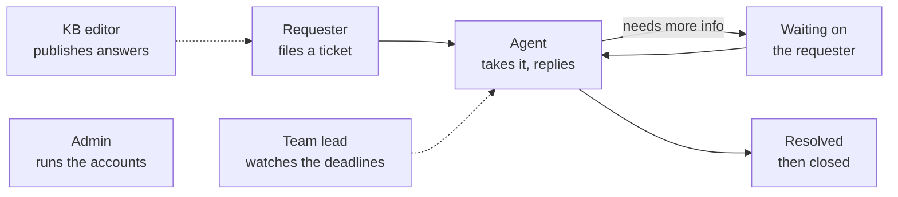

# 00 — Start Here: Build a Service Desk People Can Rely On

Good day, developer! Welcome to the course. Over the next lessons, you'll build **YASDA**, *Yet Another
Service Desk Application*: the system an IT team, a school office or a building admin uses when people need
help. Someone files a ticket, an agent takes it, the clock starts ticking, and nobody's request falls through
the cracks. You'll build its screens as you go, so every lesson ends with something you click through in the
browser. Not a toy and not a sketch: every line is something you type and understand. You don't need anything
installed yet; we install each tool the moment we first need it. Are you ready? Let's begin!

## What we'll build

A help request, from start to finish:

| Module | What it owns |
|---|---|
| **Identity** | Sign-in, accounts, roles, teams, the sign-in log, email |
| **Tickets** | Tickets, replies and internal notes, categories, priorities, assignment, attachments |
| **Sla** | Response and resolve deadlines, business hours, holidays, warnings and breaches |
| **Knowledge** | Help articles, written, reviewed and published, suggested on matching tickets |

There are five roles, and these are their exact spellings: **`Admin`**, **`TeamLead`**, **`Agent`**,
**`KbEditor`** and **`Requester`**. When a lesson says "an agent", it means `Agent`. `Admin` can do
everything.

## The business rules

Here's the heart of the course. None of this is plain create-read-update-delete. Each rule raises the same
question: **where should this logic live?** Learning to answer that well is the skill we're here for.

1. **Sign-in** is required for everything. Five wrong passwords lock an account for 15 minutes. Accounts are
   created by an admin; nobody signs themselves up.
2. **A requester sees only their own tickets.** An agent sees their team's queue.
3. **A ticket moves through set steps:** New → Open → Pending (waiting on the requester) → Resolved → Closed.
   A resolved ticket reopens if the requester replies within 7 days; after that, it's closed for good.
4. **Two agents can never both take the same ticket.** The second one is told someone was faster.
5. **Every ticket has deadlines:** a first response within, say, 4 business hours, and a resolution within 3
   business days, depending on its priority.
6. **Business hours are real hours:** nights, weekends and holidays don't count, and the clock stops while
   the ticket waits on the requester.
7. **A deadline about to pass warns the team lead;** a deadline that passes escalates the ticket. A restart
   of the server never loses one.
8. **Internal notes stay internal.** A requester never sees them.
9. **Articles are reviewed before they're published.**
10. **No lost updates:** if two people change the same ticket at the same time, the second save is refused.

## The tools we'll use

You don't need to understand this table yet. Each tool is explained, and installed, in the lesson that first
needs it.

| What for | Tool |
|---|---|
| Language and runtime | **.NET 10**, C# |
| How the code is organized | A **modular monolith** (one app, walled-off modules) with **vertical slices** (one folder per feature) |
| The screens | A **Blazor Web App** running as WebAssembly, plain HTML in one simple look, served by the API itself |
| Endpoints | ASP.NET Core **minimal APIs**, all under `/api`; each endpoint calls its handler directly |
| Database | **PostgreSQL**, one schema per module |
| Saving data | **EF Core** |
| Reading data for screens | **Dapper**, calling SQL functions |
| Checking requests | **FluentValidation**, run by one filter for the whole API |
| When something is refused | A stable **error code** on every error (`IDENTITY-0003`), and a page that explains each one |
| Sign-in | **ASP.NET Core Identity**, cookies for the browser |
| Reacting to events reliably | A **transactional outbox** |
| Seeing what the app is doing | **OpenTelemetry**, with the **Aspire** dashboard while developing |
| Email | **MailKit** |
| Tests | **xUnit v3**, **AwesomeAssertions**, **FsCheck** (property-based), **Testcontainers**, **Playwright**, **coverlet** and **Stryker.NET**; **GitHub Actions** runs them on every push |
| Containers | **Podman** (Docker works too): the development database, the tests' databases, and production |
| Hosting | **Compose** with **Caddy** for HTTPS, on any Linux server |

Every one of these is free and openly licensed (MIT, Apache-2.0, BSD or the PostgreSQL license), and so is
YASDA itself (MIT). Nothing in this course will ever ask you for money. The reference build's
[THIRD-PARTY-NOTICES.md](../course-validation/business/THIRD-PARTY-NOTICES.md) lists them all.

A few popular tools are left out on purpose: Clean Architecture's four-project split, a generic
`Repository<T>`, message brokers like RabbitMQ, Redis, microservices and Kubernetes. Each is good somewhere.
The last lesson tells you when you'd actually reach for them.

If you came from WebForms, you'll feel at home faster than you think. Your `.aspx` page with its code-behind
becomes a Razor page, your `[WebMethod]` becomes a minimal API endpoint, your `Button_Click` logic becomes a
handler, and your `SqlCommand` and `DataSet` become EF Core for saving and Dapper for reading. The rules you
used to scatter across pages move into one place: the domain model.

## The lessons

Each lesson builds on the one before, and each one ends with something you run and click through. The
course is written alongside the product, so the lessons without a link are still on their way.

| # | Lesson | What you'll build |
|---|---|---|
| 01 | [Solution setup](01-solution-setup.md) | Your tools installed, the projects, the module walls, and the browser app, served from day one |
| 02 | [Testing](02-testing.md) | Why we test, how to set tests up and use them, and the edge-case checklist every lesson after uses |
| 03 | [Features](03-features.md) | The first slice, a stand-in `ping`: endpoint, handler, validator, one validation filter for the whole API; the first unit and architecture tests |
| 04 | [Domain model](04-domain-model.md) | The `Ticket` and its status rules in plain C#, with unit and property-based tests |
| 05 | [Database](05-database.md) | PostgreSQL installed, EF Core, migrations, seed data; tests against a real database |
| 06 | [Sign-in](06-sign-in.md) | ASP.NET Core Identity, the five roles, the sign-in page; the first browser tests |
| 07 | [File a ticket](07-file-a-ticket.md) | The requester's form, from the browser to the database, with proper error responses |
| 08 | [Queues](08-queues.md) | Dapper and SQL functions; agent queues with filters, sorting and paging in the address |
| 09 | [Take a ticket](09-take-a-ticket.md) | Assigning safely when two agents click at once; race tests |
| 10 | [The ticket's life](10-the-tickets-life.md) | Pending, resolved, reopened, closed, cancelled |
| 11 | [Replies and notes](11-replies-and-notes.md) | The conversation, internal notes, lost updates stopped |
| 12 | [Containers and CI](12-containers-ci.md) | Podman installed, the database in a container, coverage and mutation testing, every test on every push |
| 13 | [Events and the outbox](13-events-outbox.md) | Tickets tells, Sla listens: every ticket gets a clock, reliably |
| 14 | [Sla answers](14-sla-answers.md) | Tickets keeps the deadlines; the queue, the ticket and the policies page show them |
| 15 | [Observability](15-observability.md) | Traces, metrics, logs, health checks, the Aspire dashboard |
| 16 | [Users and the sign-in log](16-users.md) | Accounts an admin creates, disables and resets; the sign-in log; first run |
| 17 | [Teams](17-teams.md) | Teams, their members, and who is told about new work |
| 18 | [Categories and routing](18-routing.md) | Categories, and tickets routed to the right team |
| 19 | [Email](19-email.md) | Mail for new tickets, assignments and replies, queued and sent without blocking |
| 20 | [The knowledge base, part one](20-articles.md) | Articles, a review that nobody passes alone, who may edit, and an audit trail |
| 21 | [The knowledge base, part two](21-readers.md) | What requesters may read, view counts and popular articles, and every screen |
| 22 | Business hours | Counting only open time, and the calendar as data |
| 23 | Holidays | A country's holidays, imports, and the business hours screen |
| 24 | Attachments | Files on tickets, stored and served safely |
| 25 | Search | Full-text search over tickets and articles; suggested answers |
| 26 | Reports | SLA compliance, response and resolve times, CSV export |
| 27 | Security hardening | Rate limits, HTTPS, a Content-Security-Policy, encrypted sign-in keys, least privilege |
| 28 | Deploying with Podman | All of YASDA on one server: Compose, Caddy, migrations, backups |
| 29 | Production checklist | What "done" means, a new install's first day, and what's not built yet |

Every lesson from 02 on ends by proving itself: tests for what it built, the edge cases included, and a
table of which edges they cover and why.

## How each lesson goes

Every lesson walks the same path, so you always know where you are:

1. **What we'll build** — the result.
2. **Why we build it this way** — the obvious approach first, why it hurts, then the better way.
3. **The steps** — the code, with where each file goes, including its screen.
4. **How a request flows** — following one request through the code.
5. **Mistakes to avoid.**
6. **Prove it** — the tests for what you built, edge cases included (from lesson 02 on; it's one of the steps).
7. **Let's run it!** — you run it, run the tests, click through it, and see it work.
8. **Let's check!** — questions to answer from memory. The answers are in [ANSWER-KEY.md](ANSWER-KEY.md),
   but try first. Pulling the answer out of your own head is what makes it stick.

## A few tips before we start

- **Go in order.** Each lesson expects the one before it to build and run.
- **Type the code, don't paste it.** Fixing the compiler's complaints is where the learning happens.
- **One terminal language for everyone.** The commands are written for a Bash terminal: Git Bash on Windows
  (lesson 01 installs it), the built-in Terminal on macOS and Linux. That's also the form you'll see in every
  API's documentation.
- **Stuck on a word?** Look it up in [GLOSSARY.md](GLOSSARY.md).
- **Want to compare with the finished thing?** [`course-validation/business/`](../course-validation/business/)
  is the complete, tested reference build, and the repo [README](../README.md) shows how to run it. Its
  database history is squashed to its final shape, so it has fewer migration files than you will; the
  tables that come out are the same.

## What you need

A computer running Windows 10 or 11, macOS, or Linux, with an internet connection and administrator rights
to install programs. That's all. Here's when each tool arrives:

| Tool | Installed in |
|---|---|
| .NET 10 SDK, Git (with Git Bash on Windows), a code editor | [Lesson 01](01-solution-setup.md) |
| PostgreSQL | Lesson 05 |
| A browser for automated tests | Lesson 06 |
| Podman, and a free GitHub account | Lesson 12 |

All together, the course is about 65 to 75 hours of focused work. Lessons 04, 05, 07, 08, 12, 18 and 19 are
the heaviest, so start those when you're fresh.

And that's the whole plan. Next, we install your tools, set up the solution, put up the walls between the
modules, and open the app in the browser for the first time. Good luck, developer!

---

Next: [Lesson 01 — Solution setup](01-solution-setup.md) →
