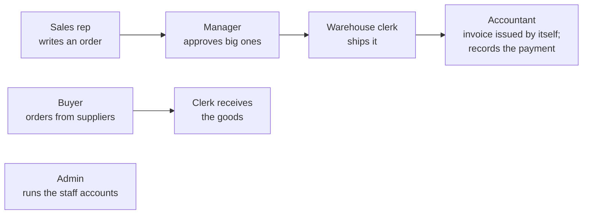

# 00 — Start Here: Build an ERP You Could Sell

Good day, developer! Welcome to the course. Over the next lessons, you'll build an ERP a real company can run
every day: sales orders with credit checks and manager approvals, a warehouse whose stock two people can't
sell twice, purchasing from suppliers, invoices with numbers an auditor trusts, payments, and the staff
accounts to run it all. You'll build its screens as you go, so every lesson ends with something you click
through in the browser. Not a toy and not a sketch: every line is something you type and understand. Are
you ready? Let's begin!

## What we'll build

A business's day, from end to end:

| Module | What it owns |
|---|---|
| **Sales** | Customers and their credit, the price list and categories, sales orders and their approval |
| **Inventory** | The item catalog, stock on hand and reserved, adjustments, shipments |
| **Purchasing** | Suppliers, purchase orders and their approval, receiving goods |
| **Invoicing** | Invoices (issued automatically when goods ship), payments, receivables aging, invoice PDFs |
| **Identity** | Sign-in, staff accounts, roles, the sign-in log, password-reset email |

There are six roles, and these are their exact spellings: **`SalesRep`**, **`SalesManager`**, **`Admin`**,
**`InventoryClerk`**, **`Purchaser`** and **`Accountant`**. When a lesson says "a manager", it means
`SalesManager`. `Admin` can do everything.

## The business rules

Here's the heart of the course. None of this is plain create-read-update-delete. Each rule raises the
same question: **where should this logic live?** Learning to answer that well is the skill we're here for.

1. **Sign-in** is required for everything. Five wrong passwords lock an account for 15 minutes. Staff
   accounts are created by an admin; nobody signs themselves up.
2. **Blocked customers** can't order.
3. **Credit limit:** what the customer owes, plus their orders still waiting for approval, plus this order,
   must fit within their limit.
4. **Stock** is reserved the moment an order is submitted, and two reps can never both take the last five
   units.
5. **Item categories** can be limited to a role, and capped per order. Items are sold in their unit: whole
   pieces, or 2.5 kg.
6. **Approval:** an order of ₱50,000 or less is approved automatically. Anything bigger waits for a manager,
   and nobody approves their own order, or their own purchase order.
7. **A sales rep sees only their own orders.**
8. **Rejecting or cancelling** releases the stock and reverses any charge. A shipped order can't be
   cancelled.
9. **All or nothing:** reserving stock and changing an order, or shipping stock and marking the order
   shipped, succeed together or not at all.
10. **No lost updates:** if two people change the same thing at the same time, the second save is refused.
11. **Invoices** are issued when goods ship, numbered without gaps, never edited, only voided and reissued.
12. **Payments** lower the customer's balance exactly once, and a voided payment puts it back.

## The tools we'll use

You don't need to understand this table yet. Each tool is explained in the lesson that first needs it.

| What for | Tool |
|---|---|
| Language and runtime | **.NET 10**, C# |
| How the code is organized | A **modular monolith** (one app, walled-off modules) with **vertical slices** (one folder per feature) |
| The screens | **Blazor WebAssembly** with **MudBlazor**, served by the API itself |
| Endpoints | **Carter**, on top of ASP.NET Core minimal APIs, all under `/api` |
| Database | **PostgreSQL**, one schema per module |
| Saving data | **EF Core** |
| Reading data for screens | **Dapper**, calling SQL functions |
| Sending requests to handlers | **Mediator** (`martinothamar/Mediator`) |
| Checking requests | **FluentValidation** |
| Sign-in | **ASP.NET Core Identity**, cookies for the browser |
| Reacting to events reliably | A **transactional outbox** |
| Seeing what the app is doing | **OpenTelemetry**, with the **Aspire** dashboard while developing |
| Invoice PDFs and email | **PDFsharp/MigraDoc** and **MailKit** |
| Tests | **xUnit**, **AwesomeAssertions** and **Playwright** |
| Hosting | **Docker Compose** with **Caddy** for HTTPS, on any Linux server |

Every one of these is free and openly licensed (MIT, Apache-2.0, BSD or the PostgreSQL license). That
matters: it means you can build this and sell it, and your buyer owes nobody a license fee. The reference
build's [THIRD-PARTY-NOTICES.md](../course-validation/business/THIRD-PARTY-NOTICES.md) lists them all.

A few popular tools are left out on purpose: Clean Architecture's four-project split, a generic
`Repository<T>`, message brokers like RabbitMQ, Redis, microservices and Kubernetes. Each is good somewhere.
[Lesson 24](24-production-checklist.md) tells you when you'd actually reach for them.

If you came from WebForms, you'll feel at home faster than you think. Your `.aspx` page with its
code-behind becomes a Razor page, your `[WebMethod]` becomes a Carter endpoint, your `Button_Click` logic
becomes a handler, and your `SqlCommand` and `DataSet` become EF Core for saving and Dapper for reading. The
business rules you used to scatter across pages move into one place: the domain model.

## The lessons

Each lesson builds on the one before, and each one ends with something you run and click through.

| # | Lesson | What you'll build |
|---|---|---|
| 01 | [Solution setup](01-solution-setup.md) | The projects, the module walls, and the browser app, served from day one |
| 02 | [Mediator](02-mediator.md) | Commands, queries, handlers, pipeline behaviors, and a first screen calling the API |
| 03 | [Domain model](03-domain-model.md) | The sales rules in plain C#, with unit tests from day one |
| 04 | [Database](04-database.md) | PostgreSQL, EF Core, migrations, seed data |
| 05 | [Sign-in](05-sign-in.md) | ASP.NET Core Identity, and the sign-in page and account menu |
| 06 | [Create an order](06-create-order.md) | The first real feature from the form to the database, with proper error responses |
| 07 | [Find orders](07-find-orders.md) | Dapper and SQL functions; the order list and page; who sees which orders |
| 08 | [Submit](08-submit.md) | The Inventory module, safe stock reservation, one transaction across two modules |
| 09 | [Approve, reject, cancel](09-approve-reject-cancel.md) | The approval workflow, and lost updates stopped by `xmin` |
| 10 | [Update an order](10-update-order.md) | Editing drafts safely |
| 11 | [Events and the outbox](11-events-outbox.md) | Reacting to what happened, reliably |
| 12 | [Testing](12-testing.md) | Integration, architecture and browser tests |
| 13 | [Observability](13-observability.md) | Traces, metrics, logs, health checks, the Aspire dashboard |
| 14 | [Customers](14-customers.md) | Customer maintenance, and a SQL function's second version |
| 15 | [Users and email](15-users-email.md) | Staff accounts, six roles, the sign-in log, password-reset email |
| 16 | [Item catalog and stock](16-item-catalog.md) | Inventory's catalog, audited adjustments, Sales' copy kept in step by events |
| 17 | [Shipping](17-shipping.md) | Two modules calling each other through their contracts |
| 18 | [Purchasing](18-purchasing.md) | Suppliers, purchase orders, receiving goods |
| 19 | [Invoicing](19-invoicing.md) | Invoices from shipments laid out to the BIR's rules, gap-free numbers, void and reissue, the company profile, PDFs |
| 20 | [Payments and receivables](20-payments.md) | Payments, tax withheld and BIR Forms 2307, the customer's balance kept exactly once, aging |
| 21 | [Special discounts](21-special-discounts.md) | Senior citizen and PWD discounts, on the order and the invoice alike |
| 22 | [Security hardening](22-security-hardening.md) | Rate limits, HTTPS, a Content-Security-Policy, encrypted sign-in keys, least privilege |
| 23 | [Docker](23-docker.md) | The whole ERP on one server: Compose, Caddy, migrations, backups |
| 24 | [Production checklist](24-production-checklist.md) | What "done" means, a new install's first day, and what's not built yet |

All together, it's about 55 to 65 hours of focused work. Lessons 03, 05, 07, 08 and 16 are the heaviest, so
start those when you're fresh. If C# itself is new to you, read [00a-FOUNDATIONS.md](00a-FOUNDATIONS.md)
first, and give yourself half again as much time.

## How each lesson goes

Every lesson walks the same path, so you always know where you are:

1. **What we'll build** — the result.
2. **Why we build it this way** — the obvious approach first, why it hurts, then the better way.
3. **The steps** — the code, with where each file goes, including its screen.
4. **How a request flows** — following one request through the code.
5. **Mistakes to avoid.**
6. **Let's run it!** — you run it, click through it, and see it work.
7. **Let's check!** — questions to answer from memory. The answers are in [ANSWER-KEY.md](ANSWER-KEY.md),
   but try first. Pulling the answer out of your own head is what makes it stick.

## A few tips before we start

- **Go in order.** Each lesson expects the one before it to build and run.
- **Type the code, don't paste it.** Fixing the compiler's complaints is where the learning happens. The
  later lessons show the new ideas in full and point to the reference build for screens built from patterns
  you already know; type those too.
- **The terminal commands use Git Bash** (`curl`, `$(...)`, `jq`), because that's the form you'll see in
  every API's documentation. Prefer PowerShell? [00b-WINDOWS-POWERSHELL.md](00b-WINDOWS-POWERSHELL.md) has
  every command translated.
- **Stuck on a word?** Look it up in [GLOSSARY.md](GLOSSARY.md).
- **Want to compare with the finished thing?** [`course-validation/business/`](../course-validation/business/)
  is the complete, tested reference build. The repo [README](../README.md) shows how to run it. Its
  migrations and SQL files are squashed to their final shape, so it has fewer of them than you will; the
  tables that come out are the same.

## What you need installed

| Tool | How to check |
|---|---|
| **.NET 10 SDK** | `dotnet --version` prints `10.x` |
| **PostgreSQL 16 or newer** | [Lesson 04](04-database.md) walks you through installing it |
| **An editor** | Visual Studio 2022 or 2026, VS Code with C# Dev Kit, or Rider |
| **Git Bash and `jq`** | `jq --version` (Git Bash comes with Git for Windows) |
| **A browser** | Edge or Chrome; the browser tests in lesson 12 use the one you have |
| **Docker** (for lesson 23 only) | `docker --version`. Docker Desktop, or Docker Engine in WSL 2 |

And that's the whole plan. Next, we set up the solution, put up the walls between the modules, and open
the app in the browser for the first time. Good luck, developer!

---

Next: [Lesson 01 — Solution setup](01-solution-setup.md) → · New to C#? [Foundations](00a-FOUNDATIONS.md)
