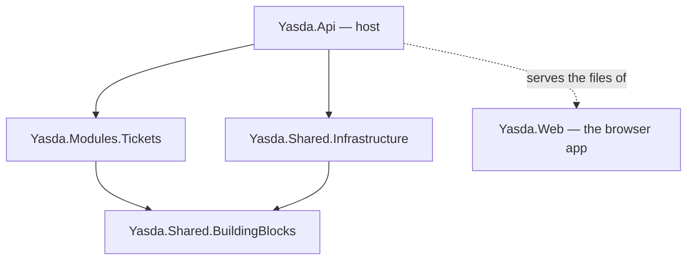
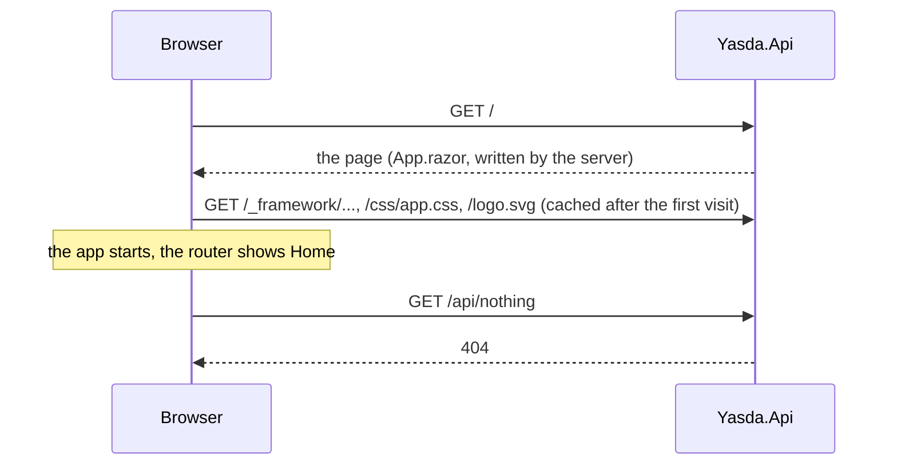

# Lesson 01 — Solution Setup: Modules With Walls

Good day, developer! Today we lay the foundation. First we install your tools, from nothing. Then a few
commands and small files, but the decisions we make here shape every lesson after it. By the end, you'll have
a solution with real walls between its parts, and an app you open in your browser. From this lesson on, every
feature you build gets its screen in that app, so you'll always test your work the way a person will. It
takes about two hours, half of it installing. Are you ready? Let's begin!

## What we'll build

Your tools, installed and checked, and an empty-but-running solution already in the shape the whole course
grows into:

```
yasda/
  Yasda.slnx
  Directory.Build.props        settings every project shares
  Directory.Packages.props     where every NuGet version will live
  src/
    Yasda.Api/                       the host: the only program that runs; it serves the API and the app
    Yasda.Web/                       the app people use, in the browser
    Shared/
      Yasda.Shared.BuildingBlocks/   what every module may use
      Yasda.Shared.Infrastructure/   the implementations; only the host sees them
    Modules/
      Tickets/Yasda.Modules.Tickets/ our first module
```

At the end, `dotnet run` starts the host, and your browser shows YASDA's home page: a small logo, the name,
a line of links, on warm paper.

## Why we build it this way

### One app, with walled-off modules

Let's start with the obvious way to build an app like this: one big project with folders called
`Controllers`, `Services` and `Repositories`. It works for a month. Then the ticket code reads the SLA tables
directly, "just this once". Then the SLA code starts changing tickets. A year later, nobody can change how
deadlines work without breaking tickets. And nothing stopped any of it, because folders are only suggestions.

The other obvious way is microservices: a separate app for every area. Now the walls are real, but every
call between areas goes over the network, "save the ticket and start its clock" becomes a distributed
problem, and you're running four apps to answer help requests.

A **modular monolith** sits in between. It's **one** app and **one** database, split into **modules**
(Tickets, Sla, Knowledge, Identity) whose walls are enforced by the **compiler**. A module's code is
`internal`, so another module can't even name it. The only way in is a small public **contracts** project,
which you'll meet when the first module needs another.

To remember it easily: each module is an island with one service window. You can't walk onto the island.
You can only ask at its window, and the window only offers what the island chose to offer.

### One folder per feature

Inside a module, we don't split by technical layer either. Each **feature**, like "file a ticket" or "take a
ticket", gets one folder holding everything it needs: the request, its validation, the handler and the
endpoint. This is called **vertical slice architecture**.

Think of a taco drawer. You keep everything for tacos in one drawer, instead of tortillas in one cupboard,
salsa in another and cheese in a third. When you want to change tacos, you open one drawer.

### Two shared projects, and why exactly two

| Project | What it holds | Who references it |
|---|---|---|
| `Yasda.Shared.BuildingBlocks` | The shared vocabulary: base classes and small interfaces like "give me a database connection" or "who is the current user" | Every module, and the host |
| `Yasda.Shared.Infrastructure` | The real implementations: the PostgreSQL connection, the code that reads the signed-in user from the HTTP request | **Only the host** |

That last column is the whole point. A module that can't see `Yasda.Shared.Infrastructure` can't reach a
connection string or the raw HTTP request, however tempting it gets.

So why not five shared projects? Here's the rule to remember: **a project boundary exists to make something
a compile error; folders organize code you're allowed to use.** Five shared projects that every module
references anyway would enforce nothing. Clear so far?



### An interface from day one

A service desk is used by people clicking through screens, not by developers typing `curl`. If we built every
rule first and the screens at the end, the last lessons would be a wall of forms, and you'd only find out on
day twenty that a rule is awkward to use. So the app starts today, and every lesson that adds a feature adds
its screen right next to it.

Which kind of front end?

| Option | What it costs us |
|---|---|
| React, Angular or Vue | A second language (TypeScript), a second toolchain (npm), and every data shape written twice |
| Blazor, screens running on the server | Every click is a message over a live connection, and every open browser holds server memory |
| **Blazor, screens running as WebAssembly** | **C# in the browser, talking to our own API.** One language, one toolchain, and the server only answers API calls |

We build a **Blazor Web App** whose screens all run as **WebAssembly**: it downloads the .NET runtime and our
app into the browser once, then runs there. The server sends the page, and the screens inside it run where
you choose. We choose the browser for all of them. Now, let's be honest about the cost: the first visit
downloads a few megabytes, so the app takes a second or two to start. After that, the browser caches it. For
a desk that agents open every morning and keep open all day, that's a fine trade.

If you came from WebForms, think of each page as an `.aspx` page with its code-behind in the same file,
except the code runs in the browser and fetches its data from the API, instead of the server rebuilding the
page on every postback.

### Plain on purpose

Most apps reach for a component library: ready-made tables, dialogs and menus. They're quick for the first
screen. Then you spend months bending them away from their designer's taste, and every major version moves
something you had bent.

YASDA's look is written down in the repo's [DESIGN.md](../DESIGN.md): warm paper, black serif text, blue
underlined links, thin black lines, one column. Its rule is *if plain HTML has an element for it,
use that element*: a heading, a link, a table, a horizontal rule. So we use **no component library at all**.
Our screens are HTML, Blazor's own form components, and one small CSS file holding the design's values.

Now, let's be honest about the cost here: when we need something HTML doesn't have, like a sortable table or
a status line for messages, we write it ourselves. Each one is a few dozen lines, written once, and you'll
understand every one of them. In return there's nothing to upgrade but .NET itself, and every page still
reads in order with the CSS switched off.

### One address for the app and the API

`Yasda.Api` serves the app's page and files itself, from the same address as the API. That makes signing in
simple and safe later. But the app wants addresses for its own pages, like `/tickets`, and the API wants
addresses for its data. So the whole API lives under **`/api`**, and everything else belongs to the app.

## 1. Install your tools

We assume a computer with nothing on it yet. You need three things today:

| Tool | What it is |
|---|---|
| **.NET 10 SDK** | The compiler, the runtime and the `dotnet` command that creates, builds and runs everything |
| **Git** | Keeps every version of your code, so a mistake is one command away from undone. On Windows it brings **Git Bash**, the terminal this course uses |
| **Visual Studio Code** | A free code editor, with the C# extension for colors, errors as you type, and debugging |

Pick the section for your computer. You only need one.

### On Windows 10 or 11

Windows already has a package manager, **winget**. Open **PowerShell** from the Start menu (the only terminal
you'll use it for), and run:

```powershell
winget install --id Microsoft.DotNet.SDK.10 -e
winget install --id Git.Git -e
winget install --id Microsoft.VisualStudioCode -e
```

Each one asks for permission to install; say yes. Then close PowerShell and open **Git Bash** from the Start
menu. From here on, every command in this course goes into Git Bash.

### On macOS

macOS uses **Homebrew** as its package manager. Open **Terminal** (in Applications, Utilities), and install
Homebrew first, with the command from its own site, [brew.sh](https://brew.sh):

```bash
/bin/bash -c "$(curl -fsSL https://raw.githubusercontent.com/Homebrew/install/HEAD/install.sh)"
```

Follow what it prints at the end (it may ask you to run two lines that add `brew` to your path). Then:

```bash
brew install --cask dotnet-sdk@10
brew install git
brew install --cask visual-studio-code
```

The `@10` matters: plain `dotnet-sdk` always means the newest .NET, which is a newer version than this course uses.

### On Fedora Linux

The .NET SDK and Git are in Fedora's own packages. Visual Studio Code comes from Microsoft's package
repository, which we add first, exactly as Microsoft's install page says:

```bash
sudo dnf install dotnet-sdk-10.0 git

sudo rpm --import https://packages.microsoft.com/keys/microsoft.asc
echo -e "[code]\nname=Visual Studio Code\nbaseurl=https://packages.microsoft.com/yumrepos/vscode\nenabled=1\ngpgcheck=1\ngpgkey=https://packages.microsoft.com/keys/microsoft.asc" \
  | sudo tee /etc/yum.repos.d/vscode.repo > /dev/null
sudo dnf install code
```

### On Ubuntu

On Ubuntu 22.04, .NET 10 comes from Canonical's backports archive, so add it first. Ubuntu 24.04 and newer have it in their
own archive already and can skip that line:

```bash
sudo add-apt-repository ppa:dotnet/backports     # Ubuntu 22.04 only
sudo apt-get update
sudo apt-get install -y dotnet-sdk-10.0 git
sudo snap install code --classic
```

### Check that everything is there

Open a new terminal (Git Bash on Windows) and ask each tool its version:

```bash
dotnet --version
git --version
code --version
```

```
10.0.103
git version 2.51.0
1.106.2
```

Your numbers will differ. What matters is that `dotnet` starts with `10.` and that no line says "command not
found". If one does, close the terminal, open a new one, and try again: a terminal only sees programs that
were installed before it opened.

### Tell Git who you are

Git signs every saved version with your name. Tell it once:

```bash
git config --global user.name "Your Name"
git config --global user.email "you@example.com"
git config --global init.defaultBranch main
```

### The editor's C# extension

```bash
code --install-extension ms-dotnettools.csdevkit
```

**C# Dev Kit** adds C# to VS Code: a solution explorer, errors as you type, running and debugging tests.
One thing to watch out for: it's free for individuals, for learning and for open-source work, but a company
beyond a small team needs a paid Visual Studio subscription to use it. If that's you, install the plain,
open-source C# extension instead (`code --install-extension ms-dotnettools.csharp`): you lose the solution
explorer and the test panel, and keep everything this course needs.

If you'd rather use another editor, Visual Studio Community (Windows only) and JetBrains Rider (free for
non-commercial use) both work. The course only ever needs a terminal and a place to type code.

## 2. The solution folder

Make a folder for the solution, step into it, and start keeping its history:

```bash
mkdir yasda
cd yasda
git init
dotnet new gitignore
```

`git init` turns the folder into a Git repository. `dotnet new gitignore` writes a `.gitignore` that tells Git
to skip what the build produces (the `bin` and `obj` folders), so you only ever save your own work.

## 3. Shared build settings

In the solution folder, create `Directory.Build.props`. MSBuild applies this file to every project
underneath it, so no `.csproj` has to repeat these lines:

```xml
<!-- Directory.Build.props -->
<Project>
  <PropertyGroup>
    <TargetFramework>net10.0</TargetFramework>
    <Nullable>enable</Nullable>
    <ImplicitUsings>enable</ImplicitUsings>
    <!-- Microsoft's recommended code-quality rules, and the style rules in .editorconfig, on every build. -->
    <AnalysisLevel>latest-recommended</AnalysisLevel>
    <EnforceCodeStyleInBuild>true</EnforceCodeStyleInBuild>
  </PropertyGroup>
</Project>
```

| Setting | What it does |
|---|---|
| `TargetFramework` | Every project builds for .NET 10 |
| `Nullable` | The compiler warns you wherever a `null` could slip through, so you fix it before it crashes |
| `ImplicitUsings` | The common `using` lines (`System`, `System.Linq`, …) are added for you, so files stay short |
| `AnalysisLevel` | Turns on the code analyzers Microsoft recommends. Each finding shows as a warning with a link that explains it |
| `EnforceCodeStyleInBuild` | Checks the style rules written in `.editorconfig` on every build, not only in your editor |

And next to it, `.editorconfig`, which every editor and the build both read:

```ini
# .editorconfig
root = true

[*]
charset = utf-8
indent_style = space
insert_final_newline = true
trim_trailing_whitespace = true

[*.{cs,razor}]
indent_size = 4

[*.{json,yml,yaml,csproj,props,slnx,xml}]
indent_size = 2

[*.cs]
# The house style, checked on every build (EnforceCodeStyleInBuild): one namespace line per file.
csharp_style_namespace_declarations = file_scoped:warning

# Analyzer rules this product switches off on purpose (AnalysisLevel latest-recommended is on in Directory.Build.props).
# CA1716: "Shared" and "Module" are Visual Basic keywords. This is a C#-only product; no VB code will ever consume it.
dotnet_diagnostic.CA1716.severity = none
```

When a rule doesn't fit this code, we switch it off *here*, with the reason beside it, never silently. You'll
see the list grow by a line or two in later lessons, each time with its reason.

## 4. One place for package versions

Soon we'll start adding NuGet packages, one lesson at a time. A **NuGet package** is a library someone
published for .NET, downloaded by the `dotnet` command when a project asks for it. Before the first one
arrives, let's decide where their versions live.

The usual way puts a version on every package line in every `.csproj`. Then two projects drift onto
different versions of the same package, and upgrading means hunting through every file. **Central package
management** fixes that: each `.csproj` says *which* packages it uses, and one file says *which version*.

```xml
<!-- Directory.Packages.props -->
<Project>
  <PropertyGroup>
    <ManagePackageVersionsCentrally>true</ManagePackageVersionsCentrally>
  </PropertyGroup>
</Project>
```

It's empty on purpose. Each lesson adds the packages it needs, the first one in step 7 of this lesson, with
a command like this:

```bash
dotnet add src/Some/Project package Some.Package --version 1.2.3
```

With central package management turned on, that command writes the pinned version into
`Directory.Packages.props` for you, and leaves the `.csproj` line without a version. Upgrading a package
later is one line in one file.

One thing to watch out for: licenses. YASDA is open source, and whoever runs it inherits the license of every
package it uses. So every package in this course is free and openly licensed (MIT, Apache-2.0 or the
PostgreSQL license), and the lesson that adds it says so. Some well-known packages, like MediatR,
FluentAssertions 8 and later, AutoMapper and QuestPDF, moved to paid or revenue-limited licenses in 2025.
That's why you won't see them here. Always check a package's license *before* you add it.

## 5. Create the projects

Now let's create the projects. From the solution folder:

```bash
dotnet new sln -n Yasda                          # .NET 10 creates Yasda.slnx, the solution file

dotnet new web       -n Yasda.Api                    -o src/Yasda.Api
dotnet new classlib  -n Yasda.Shared.BuildingBlocks  -o src/Shared/Yasda.Shared.BuildingBlocks
dotnet new classlib  -n Yasda.Shared.Infrastructure  -o src/Shared/Yasda.Shared.Infrastructure
dotnet new classlib  -n Yasda.Modules.Tickets        -o src/Modules/Tickets/Yasda.Modules.Tickets

dotnet sln add src/Yasda.Api src/Shared/Yasda.Shared.BuildingBlocks src/Shared/Yasda.Shared.Infrastructure \
  src/Modules/Tickets/Yasda.Modules.Tickets

dotnet add src/Shared/Yasda.Shared.Infrastructure reference src/Shared/Yasda.Shared.BuildingBlocks
dotnet add src/Modules/Tickets/Yasda.Modules.Tickets reference src/Shared/Yasda.Shared.BuildingBlocks
dotnet add src/Yasda.Api reference src/Modules/Tickets/Yasda.Modules.Tickets src/Shared/Yasda.Shared.Infrastructure

rm src/Shared/*/Class1.cs src/Modules/Tickets/Yasda.Modules.Tickets/Class1.cs
```

Here's what those commands made: `web` is an empty ASP.NET Core app (our host), and `classlib` is a plain
class library. `sln add` puts them in the solution, and `add reference` lets one project use another's code.

Open each new `.csproj` and **delete its `<PropertyGroup>`**. `Directory.Build.props` already sets those
values, and two places that set the same thing will disagree one day.

Now look at what's *missing*: **Tickets does not reference `Yasda.Shared.Infrastructure`.** That one absent
line is a wall.

`Yasda.Shared.BuildingBlocks` and `Yasda.Shared.Infrastructure` stay empty for now. They fill up as the
lessons need them, starting with lesson 03.

## 6. The module's front door

A module shows the outside world exactly one public type: the class the host calls to plug it in.

```csharp
// src/Modules/Tickets/Yasda.Modules.Tickets/TicketsModule.cs
using Microsoft.Extensions.DependencyInjection;

namespace Yasda.Modules.Tickets;

public static class TicketsModule
{
    public static IServiceCollection AddTicketsModule(this IServiceCollection services) =>
        services;   // grows as the module does
}
```

`IServiceCollection` is ASP.NET Core's list of services the app can hand out (that's **dependency
injection**: classes ask for what they need, and the app supplies it). A class library doesn't know that
type yet, so give Tickets the ASP.NET Core shared framework. It's part of .NET itself, nothing to download,
and in lesson 03 Tickets will need it anyway for its endpoints. In `Yasda.Modules.Tickets.csproj`:

```xml
<ItemGroup>
  <FrameworkReference Include="Microsoft.AspNetCore.App" />
</ItemGroup>
```

From lesson 03 on, every class you write inside a module starts with `internal`.

The host's `Program.cs` plugs the module in. Replace the template's version:

```csharp
// src/Yasda.Api/Program.cs
using Yasda.Modules.Tickets;

var builder = WebApplication.CreateBuilder(args);

builder.Services.AddTicketsModule();

var app = builder.Build();

app.MapGet("/", () => "YASDA API");

app.Run();
```

Three steps, and you'll see this shape in every ASP.NET Core app: the **builder** collects services
(`builder.Services`), `Build()` turns them into an **app**, and the app maps URLs to code before it `Run`s.

## 7. The browser app

```bash
dotnet new blazorwasm --empty -o src/Yasda.Web
dotnet sln add src/Yasda.Web
```

This is the browser half of a Blazor Web App: the part that runs as WebAssembly. Microsoft's Blazor Web App
template makes a server project and a `.Client` project; our server is `Yasda.Api`, which we already have, so
we only need the client. The template writes versions on its packages, which central package management
forbids, plus a sample page and files we'll write ourselves. Replace the generated `.csproj` with this:

```xml
<!-- src/Yasda.Web/Yasda.Web.csproj -->
<Project Sdk="Microsoft.NET.Sdk.BlazorWebAssembly">

  <!-- The browser app. It talks to Yasda.Api over HTTP only: no project references to any module. -->

</Project>
```

The template also tried to download its packages and printed "Restore failed": its `.csproj` wrote versions,
and central package management refuses them. That's expected, and the new `.csproj` fixes it. Delete the
template's `Properties`, `wwwroot` and `Pages` folders (we write our own `wwwroot` and pages below, and its
`App.razor`, `Program.cs`, `_Imports.razor` and `Layout/MainLayout.razor` get replaced as we go). Then add the
one package it needs:

```bash
dotnet add src/Yasda.Web package Microsoft.AspNetCore.Components.WebAssembly --version 10.0.14
```

| Package | What it's for | License |
|---|---|---|
| `Microsoft.AspNetCore.Components.WebAssembly` | Runs Blazor in the browser | MIT |

Notice the comment in the `.csproj`. The app references no module and no shared project. It only talks to
the API, over HTTP, like any other client. That keeps the browser free of server code, and the modules free
of browser code.

### The page the server sends

Every address of the app gets the same page from the server. It's a Razor component, written once, here in
the app project:

```razor
@* src/Yasda.Web/App.razor *@
@* The page the server sends for every address of the app. Only Routes (and the page title) run in the browser, as
   WebAssembly; prerender is off because every screen needs the signed-in user's data from the API. *@

<!DOCTYPE html>
<html lang="en">

<head>
    <meta charset="utf-8" />
    <meta name="viewport" content="width=device-width, initial-scale=1.0" />
    <base href="/" />
    <link rel="icon" type="image/svg+xml" href="@Assets["logo.svg"]" />
    <link rel="stylesheet" href="@Assets["css/app.css"]" />
    <HeadOutlet @rendermode="InBrowser" />
</head>

<body>
    <Routes @rendermode="InBrowser" />

    <div id="blazor-error-ui">
        Something went wrong. <a href="." class="reload">Reload</a>
    </div>

    @* No inline scripts anywhere: the Content-Security-Policy forbids them. *@
    <script src="@Assets["_framework/blazor.web.js"]"></script>
</body>

</html>

@code {
    private static readonly IComponentRenderMode InBrowser = new InteractiveWebAssemblyRenderMode(prerender: false);
}
```

- **`@rendermode="InBrowser"`** is the line that makes this a WebAssembly app. The server writes the page;
  `Routes`, and every screen under it, runs in the browser.
- **`prerender: false`**: by default the server would first draw each screen itself, then hand it to the
  browser. Our screens are almost all data from the API, which the server would have to fetch twice, so we
  skip that.
- **`@Assets["css/app.css"]`** writes the file's name with a fingerprint in it (`app.wdx55whw5k.css`). When the
  file changes, so does the name, so a browser never runs yesterday's copy from its cache.
- **`blazor-error-ui`** is the bar Blazor shows if the app crashes.

And notice there's no `<script>` with code inside it, and no `style=` on any element. A later lesson adds a
Content-Security-Policy that forbids both, because inline code is the classic way an attacker's script gets
onto a page. We never write either, so that lesson costs us nothing.

### The look, in one file

DESIGN.md gives the whole look as a short list of values, its **tokens**: a few colors, one font, three gaps.
CSS lets us name each value once, as a **custom property** (`--link: #0069C2`), and use the name everywhere
else (`color: var(--link)`). Change the value in one place, and the whole app follows. Today we add only the
tokens this lesson uses; the rest arrive with the first screen that needs them.

```css
/* src/Yasda.Web/wwwroot/css/app.css */
/* The whole look, from DESIGN.md: warm paper, black text, blue links, one serif, no shadows, no rounded corners.
   Everything is plain HTML, so the page still reads in order with this file switched off. */

:root {
    color-scheme: light;

    --bg: #FEF1CD;
    --text: #000000;
    --text-muted: #333333;
    --link: #0069C2;
    --visited: #551A8B;
    --line: #000000;

    --font: Georgia, "Times New Roman", serif;
    --size-body: 1rem;
    --size-h1: 2rem;
    --line-height: 1.5;

    --max-width: 900px;
    --gap-s: 0.5rem;
    --gap-m: 1rem;
    --gap-l: 2rem;
    --target: 2.75rem;
    --border: 1px solid var(--line);
}

html {
    background: var(--bg);
}

body {
    margin: 0;
    background: var(--bg);
    color: var(--text);
    font-family: var(--font);
    font-size: var(--size-body);
    line-height: var(--line-height);
    overflow-wrap: break-word;
}

img {
    max-width: 100%;
}

.page {
    max-width: var(--max-width);
    margin: var(--gap-l) auto;
    padding: 0 var(--gap-m);
}

a {
    color: var(--link);
    text-decoration: underline;
}

a:visited {
    color: var(--visited);
}

/* Keyboard users always see where they are: the only "effect" DESIGN.md allows. */
:focus-visible {
    outline: 2px solid var(--link);
    outline-offset: 2px;
}

hr {
    border: 0;
    border-top: var(--border);
    margin: var(--gap-m) 0;
}

/* The header: logo and name on the left, the navigation on the right, wrapping below it on a narrow screen. */
.site-head {
    display: flex;
    flex-wrap: wrap;
    justify-content: space-between;
    align-items: center;
    gap: var(--gap-s) var(--gap-m);
}

.brand {
    display: flex;
    align-items: center;
    gap: var(--gap-s);
    margin: 0;
    font-weight: bold;
}

.links {
    display: flex;
    flex-wrap: wrap;
    gap: 0 var(--gap-m);
    list-style: none;
    margin: 0;
    padding: 0;
}

.links a, .links strong {
    display: inline-flex;
    align-items: center;
    min-height: var(--target);
}

h1 {
    font-size: var(--size-h1);
    margin: 0;
}

.muted {
    color: var(--text-muted);
}

#blazor-error-ui {
    display: none;
    position: fixed;
    bottom: 0;
    left: 0;
    right: 0;
    padding: var(--gap-s) var(--gap-m);
    background: var(--bg);
    border-top: var(--border);
}
```

Everything after `:root` uses only those names, never a raw color or size. That's the rule for every line we
add to this file later: tables, forms and messages each get a few lines in the lesson that first shows one.
`--target` is 44 pixels, the least height for anything clickable, so a thumb can hit it. `color-scheme: light`
stops a dark-mode browser from darkening our fields.

The logo is a small drawing in black lines, a speech bubble with a tick. **SVG** is a picture written as
text, so it stays sharp at any size and weighs almost nothing:

```xml
<!-- src/Yasda.Web/wwwroot/logo.svg -->
<svg xmlns="http://www.w3.org/2000/svg" viewBox="0 0 70 70" width="70" height="70" fill="none" stroke="#000" stroke-width="2.5" stroke-linejoin="round" stroke-linecap="round"><path d="M9 11h52v35H33L20 58V46H9z"/><path d="M24 29l8 8 14-15"/></svg>
```

The same file is the little picture on the browser tab: `App.razor`'s `<link rel="icon">` points at it.

### Starting the app

```csharp
// src/Yasda.Web/Program.cs
using Microsoft.AspNetCore.Components.WebAssembly.Hosting;

// The browser half of the app. The server sends the page (App.razor); what runs here is Routes and everything below.
var builder = WebAssemblyHostBuilder.CreateDefault(args);

// Same origin as the API, so every call goes back to the server that served the app.
builder.Services.AddScoped(_ => new HttpClient { BaseAddress = new Uri(builder.HostEnvironment.BaseAddress) });

await builder.Build().RunAsync();
```

It's the same builder shape as the host's `Program.cs`, running in the browser. In a browser app, `Scoped`
means "one for as long as the tab is open".

```razor
@* src/Yasda.Web/_Imports.razor *@
@using System.Net.Http
@using System.Net.Http.Json
@using Microsoft.AspNetCore.Components.Forms
@using Microsoft.AspNetCore.Components.Routing
@using Microsoft.AspNetCore.Components.Web
@using Microsoft.AspNetCore.Components.WebAssembly.Http
@using Microsoft.JSInterop
@using Yasda.Web
@using Yasda.Web.Layout
```

`_Imports.razor` applies its `using` lines to every `.razor` file in the project, so pages stay short.

### The router, the layout and the first page

```razor
@* src/Yasda.Web/Routes.razor *@
<Router AppAssembly="typeof(Routes).Assembly" NotFoundPage="typeof(Pages.NotFound)">
    <Found Context="routeData">
        <RouteView RouteData="routeData" DefaultLayout="typeof(MainLayout)" />
        <FocusOnNavigate RouteData="routeData" Selector="h1" />
    </Found>
</Router>
```

The **router** looks at the address and picks the page whose `@page` line matches. The **layout** is the
frame around every page. If you came from WebForms, it's the master page. `FocusOnNavigate` moves the
keyboard focus to each new page's `<h1>`, so a screen reader announces where you arrived.

DESIGN.md gives every page the same **shell**: one header line, with a small logo and the name on the left and
the navigation on the right, then a rule across the page, then the page itself. Let's start with the
navigation. Each entry is a link, except the page you're already on: DESIGN.md wants that one in bold, as
plain text, because a link to where you already are does nothing. So we write one small component for an
entry:

```razor
@* src/Yasda.Web/Layout/NavItem.razor *@
@implements IDisposable
@inject NavigationManager Nav

@* One navigation entry. The page you're on is bold text, not a link: a link to where you already are does nothing. *@
@if (IsCurrent)
{
    <strong aria-current="page">@ChildContent</strong>
}
else
{
    <a href="@Href">@ChildContent</a>
}

@code {
    [Parameter, EditorRequired] public string Href { get; set; } = "";
    [Parameter] public RenderFragment? ChildContent { get; set; }

    // The path without its query: tickets?assigned=me is the Tickets page; users/5 is not the Users page.
    private bool IsCurrent => Nav.ToBaseRelativePath(Nav.Uri).Split('?')[0] == Href;

    protected override void OnInitialized() => Nav.LocationChanged += Refresh;

    private void Refresh(object? sender, LocationChangedEventArgs e) => InvokeAsync(StateHasChanged);

    public void Dispose() => Nav.LocationChanged -= Refresh;
}
```

- **`NavigationManager`** is the address bar. We compare its path, without the `?…` part, to the entry's.
- **`[Parameter]`** is what the user of the component passes in; `ChildContent` is the text between the tags.
- **`LocationChanged`** fires when the address changes, so the bold moves as you click around. We unsubscribe in
  `Dispose`, or the event would keep the component alive forever.
- **`aria-current="page"`** tells a screen reader "you are here".

Then the navigation itself, a row of those entries:

```razor
@* src/Yasda.Web/Layout/NavMenu.razor *@
<nav aria-label="Main">
    <ul class="links">
        <li><NavItem Href="">Home</NavItem></li>
    </ul>
</nav>
```

`aria-label="Main"` names this `<nav>`, so a screen reader can say "Main navigation", and a browser test can
find it by that name. One entry for now; every feature lesson adds its own. And the frame itself:

```razor
@* src/Yasda.Web/Layout/MainLayout.razor *@
@inherits LayoutComponentBase

@* DESIGN.md's shell: one header line (logo and name, then the navigation), a rule, then the page. *@
<div class="page">
    <header class="site-head">
        <p class="brand"> YASDA</p>
        <NavMenu />
    </header>
    <hr />
    <main>
        @Body
    </main>
</div>
```

The logo's `alt=""` is deliberate: the name is written right beside it, so a screen reader would only say
"YASDA" twice. `@Body` is where each page goes. The `<header>` and `<main>` elements are **landmarks**: a screen reader can
jump straight to the main content, past the navigation, and the browser tests in lesson 06 find things the
same way. That's DESIGN.md's rule paying off: the right HTML element gives you meaning for free.

```razor
@* src/Yasda.Web/Pages/Home.razor *@
@page "/"

<PageTitle>Home · YASDA</PageTitle>

<h1>Good day!</h1>
<p class="muted">YASDA is running. Here's where your work will start.</p>
```

```razor
@* src/Yasda.Web/Pages/NotFound.razor *@
@page "/not-found"

<PageTitle>Not found · YASDA</PageTitle>

<h1>Not found</h1>
<p>There's nothing at this address. <a href="">Go home</a></p>
```

`PageTitle` sets the text on the browser tab. Easy, right? Plain HTML, with a little C# where the page needs
it.

## 8. The host serves the app

`Yasda.Api` needs the app's files, and one package that knows how to run its screens in the browser:

```bash
dotnet add src/Yasda.Api package Microsoft.AspNetCore.Components.WebAssembly.Server --version 10.0.14
```

| Package | What it's for | License |
|---|---|---|
| `Microsoft.AspNetCore.Components.WebAssembly.Server` | Lets the host send the app's page and run its screens in the browser | MIT |

And a reference to the app project, plus one setting, in `Yasda.Api.csproj`:

```xml
<!-- Serve the framework's blazor.web.js. The SDK turns this on by itself only when the project has .razor files;
     here they all live in Yasda.Web, so it's said explicitly. -->
<PropertyGroup>
  <RequiresAspNetWebAssets>true</RequiresAspNetWebAssets>
</PropertyGroup>

<ItemGroup>
  <!-- The browser app, served by this host from the same address as the API. -->
  <ProjectReference Include="..\Yasda.Web\Yasda.Web.csproj" />
</ItemGroup>
```

The host never calls the app's screens; it sends the page and hands the browser its files. Still, it's a
normal reference, and that matters: the host only learns about another project's files (our `app.css` and
`logo.svg`) through a normal reference. Tempted to add `ReferenceOutputAssembly="false"`, "build it, but
don't give me its classes"? Don't: the app would open unstyled, with its stylesheet answering 404.

And `RequiresAspNetWebAssets`? Without it, the browser asks for `_framework/blazor.web.js` and gets a 404, and
the page stays blank. The SDK adds that file only to a project that has `.razor` files itself, and all ours
live in `Yasda.Web`.

Now `Program.cs` again. Before:

```csharp
builder.Services.AddTicketsModule();

var app = builder.Build();

app.MapGet("/", () => "YASDA API");
```

After:

```csharp
// src/Yasda.Api/Program.cs
using Yasda.Modules.Tickets;

var builder = WebApplication.CreateBuilder(args);

builder.Services.AddTicketsModule();
// The browser app: the server sends its page, the screens run in the browser as WebAssembly.
builder.Services.AddRazorComponents().AddInteractiveWebAssemblyComponents();

var app = builder.Build();

// An address that is no page of the app shows the app's own "not found" page (with a 404).
app.UseWhen(ctx => !ctx.Request.Path.StartsWithSegments("/api"),
    pages => pages.UseStatusCodePagesWithReExecute("/not-found", createScopeForStatusCodePages: true));
// Explicit, and after the status-code pages: a re-executed request ("/not-found") must be routed again.
app.UseRouting();
app.UseAntiforgery();

// The browser app is served from the same host, so the API gets a prefix of its own.
var api = app.MapGroup("/api");
api.MapFallback(() => Results.NotFound());   // an unknown API address is a 404, never the app's page

app.MapStaticAssets();
app.MapRazorComponents<Yasda.Web.App>()
    .AddInteractiveWebAssemblyRenderMode();

app.Run();
```

- **`MapGroup("/api")`** makes a group of routes that all start with `/api`. It's empty today; in lesson 03,
  the first module's endpoints go into it.
- **`MapStaticAssets`** serves the app's files: the `.wasm` runtime, our compiled app, `app.css`, the logo.
  It compresses them at build time and gives them cache headers, so a returning visitor downloads nothing.
- **`MapRazorComponents<App>()`** looks through the app for every `@page` line and answers each of those
  addresses with `App.razor`; the router running in the browser then shows the right page. Today that's `/`
  and `/not-found`. When a later lesson adds `@page "/tickets"`, the server answers that address too, with no
  change here. `AddInteractiveWebAssemblyRenderMode` is what lets the screens run in the browser.
- **`UseStatusCodePagesWithReExecute`** handles an address that's no page at all (`/no-such-page`): the
  server quietly runs the request again as `/not-found`, so the person sees the app's own "not found" page,
  with an honest 404. Not for `/api`, though: an API client wants a short error, not a page of HTML.
- **`UseRouting`** usually happens on its own, first. Here it must come after the status-code pages, or the
  re-run `/not-found` request would never find its page.
- **`UseAntiforgery`** is required by `MapRazorComponents`: it protects forms the server renders against
  cross-site posts. We have none, but the framework insists, and it costs nothing.

## How a request flows



Every lesson adds a stop to this trip.

## Mistakes to avoid

- Running the course's commands in PowerShell or `cmd` on Windows. Use Git Bash; `rm`, `\` line breaks and
  later `curl` examples are written for it.
- Opening a terminal *before* installing a tool, and then getting "command not found". Open a new one.
- Leaving the template's `<PropertyGroup>` in each `.csproj`. Now two places set the target framework.
- Putting a `Version` on a `PackageReference`. With central package management that's an error (`NU1008`);
  versions belong only in `Directory.Packages.props`.
- Referencing `Yasda.Shared.Infrastructure` from a module "just to get the connection". That's the one line
  that knocks the wall down.
- Writing a color or a size straight into a rule in `app.css`, or a `style=` on an element. Use the `:root`
  names; the second color you invent is the start of a second design.
- Following an older tutorial's "hosted Blazor WebAssembly" setup: an `index.html`, `blazor.webassembly.js`,
  `UseBlazorFrameworkFiles()` and `MapFallbackToFile`. Microsoft folded that template into the Blazor Web App in
  .NET 8; `App.razor` plus `MapRazorComponents` is the current shape. Mixing the two serves the same files twice.
- Leaving out `RequiresAspNetWebAssets`. The page arrives, `blazor.web.js` answers 404, and the screen stays
  blank with no error on the server.
- Forgetting `api.MapFallback`. A typo in an API address then returns the app's HTML with a 200, and the
  client fails somewhere confusing.

## Let's run it!

```bash
dotnet build
dotnet run --project src/Yasda.Api
```

The build should show **0 warnings and 0 errors**. If you see `NU1008`, a `.csproj` still has a version on a
package reference.

`dotnet run` prints the address it listens on, something like `http://localhost:5264`. Open it in your
browser. After a moment, you see warm paper and one header line: the small speech-bubble logo and **YASDA** on
the left, and **Home** in bold on the right (bold, not a link, because you're on it). Then a line across the
page, and "Good day!". Type `/no-such-page` after the address: the app says there's nothing
there.

Now check that the API and the pages each answer their own way, in a second terminal (use your port):

```bash
curl -i http://localhost:5264/                # 200 and HTML: the app's page
curl -i http://localhost:5264/api/nothing     # 404, no HTML: an API address that doesn't exist
curl -i http://localhost:5264/no-such-page    # 404, with the app's "not found" page
```

One more check, from DESIGN.md: would the page read fine with no CSS at all? In Firefox, choose **View, Page
Style, No Style**; in Chrome or Edge, open the developer tools (F12), and in the **Network** tab right-click
`app.css` and choose **Block request URL**, then reload. You see a plain list: the logo, the name, Home, a
line, the greeting. Same order, same meaning. Unblock it when you're done.

Last, save your work in Git. Stop the app with Ctrl+C, then:

```bash
git add .
git commit -m "Lesson 01: solution, module walls, browser app"
```

## Let's check!

1. Why doesn't `Yasda.Modules.Tickets` reference `Yasda.Shared.Infrastructure`? What could go wrong if it did?
2. You add a sixth shared project, `Yasda.Shared.Messaging`, and every module references it. What does that
   new project boundary enforce?
3. Later, a teammate wants to upgrade a package the whole solution uses. With central package management,
   how many files change?
4. Why use vertical slices instead of `Controllers`, `Services` and `Repositories` folders?
5. Why do our screens run as WebAssembly, and what does that cost on the first visit?
6. Why does the API live under `/api`, and what does `GET /api/typo` answer?
7. Why does YASDA use no component library, and what do we pay for that?
8. You open a new terminal and `dotnet --version` says "command not found", though you just installed it.
   What's the most likely reason?

And that's where this lesson ends. Your tools are in, the walls are up, and the app opens in your browser.
Next time, we learn to prove that what we build works, with tests. Good luck, developer!

---

← [00 — Start here](00-START-HERE.md) · Next: [Lesson 02 — Testing](02-testing.md) →
