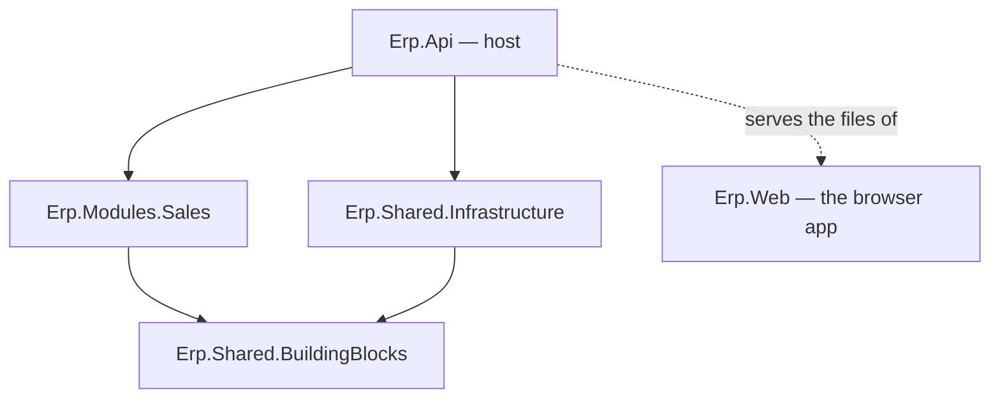

# Lesson 01 — Solution Setup: Modules With Walls

Good day, developer! Today we lay the foundation. It's mostly commands and a few small files, but the
decisions we make here shape every lesson after it. By the end, you'll have a solution with real walls
between its parts, and an app you open in your browser. From this lesson on, every feature you build gets
its screen in that app, so you'll always test your work the way a user will. It takes about an hour and a
half. Are you ready? Let's
begin!

## What we'll build

An empty-but-running solution, already in the shape the whole course grows into:

```
Erp.slnx
Directory.Build.props        settings every project shares
Directory.Packages.props     where every NuGet version will live (empty for now)
src/
  Erp.Api/                       the host: the only program that runs; it serves the API and the app
  Erp.Web/                       the app people use, in the browser
  Shared/
    Erp.Shared.BuildingBlocks/   what every module may use
    Erp.Shared.Infrastructure/   the implementations; only the host sees them
  Modules/
    Sales/Erp.Modules.Sales/     our first module
```

At the end, `dotnet run` starts the host, and your browser shows the ERP's home page.

## Why we build it this way

### One app, with walled-off modules

Let's start with the obvious way to build an app like this: one big project with folders called
`Controllers`, `Services` and `Repositories`. It works for a month. Then `OrderService` calls
`InventoryRepository` directly, "just this once". Then the inventory code starts reading sales tables. A
year later, nobody can change how stock works without breaking orders. And nothing stopped any of it,
because folders are only suggestions.

The other obvious way is microservices: a separate app for every area. Now the walls are real, but every
call between areas goes over the network, "reserve the stock and mark the order submitted" becomes a
distributed transaction, and you're running five apps to sell one ERP.

A **modular monolith** sits in between. It's **one** app and **one** database, split into **modules**
(Sales, Inventory, and so on) whose walls are enforced by the **compiler**. A module's code is `internal`,
so another module can't even name it. The only way in is a small public **contracts** project, which you'll
meet in [lesson 09](09-submit.md).

To remember it easily: each module is an island with one service window. You can't walk onto the island.
You can only ask at its window, and the window only offers what the island chose to offer.

### One folder per feature

Inside a module, we don't split by technical layer either. Each **feature**, like "create an order" or
"approve an order", gets one folder holding everything it needs: the request, its validation, the handler
and the endpoint. This is called **vertical slice architecture**.

Think of a taco drawer. You keep everything for tacos in one drawer, instead of tortillas in one cupboard,
salsa in another and cheese in a third. When you want to change tacos, you open one drawer.

### Two shared projects, and why exactly two

| Project | What it holds | Who references it |
|---|---|---|
| `Erp.Shared.BuildingBlocks` | The shared vocabulary: base classes and small interfaces like "give me a database connection" or "who is the current user" | Every module, and the host |
| `Erp.Shared.Infrastructure` | The real implementations: the PostgreSQL connection, the code that reads the signed-in user from the HTTP request | **Only the host** |

That last column is the whole point. A module that can't see `Erp.Shared.Infrastructure` can't reach a
connection string or the raw HTTP request, however tempting it gets.

So why not five shared projects? Here's the rule to remember: **a project boundary exists to make something
a compile error; folders organize code you're allowed to use.** Five shared projects that every module
references anyway would enforce nothing. Clear so far?



### An interface from day one

An ERP is used by people clicking through screens, not by developers typing `curl`. If we built every rule
first and the screens at the end, the last lessons would be a wall of forms, and you'd only find out on day
twenty that a rule is awkward to use. So the app starts today, and every lesson that adds a feature adds its
screen right next to it.

Which kind of front end?

| Option | What it costs us |
|---|---|
| React, Angular or Vue | A second language (TypeScript), a second toolchain (npm), and every data shape written twice |
| Blazor Server | The screen lives on the server; every click is a message over a live connection, and every open browser holds server memory |
| **Blazor WebAssembly** | **C# in the browser, talking to our own API.** One language, one toolchain, and the server only answers API calls |

Blazor WebAssembly downloads the .NET runtime and our app into the browser once, then runs there. Now,
let's be honest about the cost: the first visit downloads a few megabytes, so the app takes a second or two
to start. After that, the browser caches it. For an ERP that staff open every morning and keep open all day,
that's a fine trade.

If you came from WebForms, think of each page as an `.aspx` page with its code-behind in the same file,
except the code runs in the browser and fetches its data from the API, instead of the server rebuilding the
page on every postback.

For the screen components (tables, forms, menus, dialogs), we use **MudBlazor**, under the MIT license. The
well-known alternatives, Telerik, Syncfusion and DevExpress, need a paid license per developer, and the buyer
of this source would inherit that bill.

### One address for the app and the API

`Erp.Api` serves the app's files itself, from the same address as the API. That makes signing in simple and
safe later ([lesson 06](06-sign-in.md)). But the app wants addresses for its own pages, like
`/sales-orders`, and the API wants addresses for its data. So the whole API lives under **`/api`**, and
everything else belongs to the app.

## 1. Shared build settings

Make a folder for the solution. In it, create `Directory.Build.props`. MSBuild applies this file to every
project underneath it, so no `.csproj` has to repeat these lines:

```xml
<!-- Directory.Build.props -->
<Project>
  <PropertyGroup>
    <TargetFramework>net10.0</TargetFramework>
    <Nullable>enable</Nullable>
    <ImplicitUsings>enable</ImplicitUsings>
  </PropertyGroup>
</Project>
```

| Setting | What it does |
|---|---|
| `TargetFramework` | Every project builds for .NET 10 |
| `Nullable` | The compiler warns you wherever a `null` could slip through, so you fix it before it crashes |
| `ImplicitUsings` | The common `using` lines (`System`, `System.Linq`, …) are added for you, so files stay short |

## 2. One place for package versions

Soon we'll start adding NuGet packages, one lesson at a time. Before the first one arrives, let's decide
where their versions live.

The usual way puts a version on every package line in every `.csproj`. Then two projects drift onto
different versions of the same package, and upgrading means hunting through every file. **Central package
management** fixes that: each `.csproj` says *which* packages it uses, and one file says *which version*.

```xml
<!-- Directory.Packages.props -->
<Project>
  <PropertyGroup>
    <ManagePackageVersionsCentrally>true</ManagePackageVersionsCentrally>
  </PropertyGroup>
</Project>
```

It's empty on purpose. Each lesson adds the packages it needs, the first ones in step 6 of this lesson, with
a command like this:

```bash
dotnet add src/Some/Project package Some.Package --version 1.2.3
```

With central package management turned on, that command writes the pinned version into
`Directory.Packages.props` for you, and leaves the `.csproj` line without a version. Upgrading a package
later is one line in one file.

One thing to watch out for: licenses. If you ever sell your source code, every buyer inherits the license of
every package you used. So every package in this course is free and openly licensed (MIT, Apache-2.0 or the
PostgreSQL license), and the lesson that adds it says so. Some well-known packages, like MediatR,
FluentAssertions 8 and later, AutoMapper and QuestPDF, moved to paid or revenue-limited licenses in 2025.
That's why you won't see them here. Always check a package's license *before* you add it.

## 3. Create the projects

Now let's create the projects. From the solution folder, in Git Bash:

```bash
dotnet new sln -n Erp                          # .NET 10 creates Erp.slnx, the solution file

dotnet new web       -n Erp.Api                    -o src/Erp.Api
dotnet new classlib  -n Erp.Shared.BuildingBlocks  -o src/Shared/Erp.Shared.BuildingBlocks
dotnet new classlib  -n Erp.Shared.Infrastructure  -o src/Shared/Erp.Shared.Infrastructure
dotnet new classlib  -n Erp.Modules.Sales          -o src/Modules/Sales/Erp.Modules.Sales

dotnet sln add src/Erp.Api src/Shared/Erp.Shared.BuildingBlocks src/Shared/Erp.Shared.Infrastructure \
  src/Modules/Sales/Erp.Modules.Sales

dotnet add src/Shared/Erp.Shared.Infrastructure reference src/Shared/Erp.Shared.BuildingBlocks
dotnet add src/Modules/Sales/Erp.Modules.Sales   reference src/Shared/Erp.Shared.BuildingBlocks
dotnet add src/Erp.Api reference src/Modules/Sales/Erp.Modules.Sales src/Shared/Erp.Shared.Infrastructure

rm src/Shared/*/Class1.cs src/Modules/Sales/Erp.Modules.Sales/Class1.cs
```

Here's what those commands made: `web` is an empty ASP.NET Core app (our host), and `classlib` is a plain
class library. `sln add` puts them in the solution, and `add reference` lets one project use another's code.

Open each new `.csproj` and **delete its `<PropertyGroup>`**. `Directory.Build.props` already sets those
values, and two places that set the same thing will disagree one day.

Now look at what's *missing*: **Sales does not reference `Erp.Shared.Infrastructure`.** That one absent line
is a wall.

`Erp.Shared.BuildingBlocks` and `Erp.Shared.Infrastructure` stay empty for now. They fill up as the lessons
need them, starting with the very next one.

## 4. The module's front door

A module shows the outside world exactly one public type: the class the host calls to plug it in.

```csharp
// src/Modules/Sales/Erp.Modules.Sales/SalesModule.cs
using Microsoft.Extensions.DependencyInjection;

namespace Erp.Modules.Sales;

public static class SalesModule
{
    public static IServiceCollection AddSalesModule(this IServiceCollection services) =>
        services;   // grows as the module does
}
```

`IServiceCollection` is ASP.NET Core's list of services the app can hand out (that's **dependency
injection**: classes ask for what they need, and the app supplies it). A class library doesn't know that
type yet, so give Sales the ASP.NET Core shared framework. It's part of .NET itself, nothing to download,
and next lesson Sales will need it anyway for its endpoints. In `Erp.Modules.Sales.csproj`:

```xml
<ItemGroup>
  <FrameworkReference Include="Microsoft.AspNetCore.App" />
</ItemGroup>
```

From [lesson 03](03-mediator.md) on, every class you write inside a module starts with `internal`.

## 5. The host

Replace the template's `Program.cs`:

```csharp
// src/Erp.Api/Program.cs
using Erp.Modules.Sales;

var builder = WebApplication.CreateBuilder(args);

builder.Services.AddSalesModule();

var app = builder.Build();

app.MapGet("/", () => "Erp API");

app.Run();
```

Three steps, and you'll see this shape in every ASP.NET Core app: the **builder** collects services
(`builder.Services`), `Build()` turns them into an **app**, and the app maps URLs to code before it `Run`s.

## 6. The browser app

```bash
dotnet new blazorwasm --empty -o src/Erp.Web
dotnet sln add src/Erp.Web
```

The template gives us a project with versions on its packages, which central package management forbids,
plus a sample page and some files we'll write ourselves. Replace the generated `.csproj` with this:

```xml
<!-- src/Erp.Web/Erp.Web.csproj -->
<Project Sdk="Microsoft.NET.Sdk.BlazorWebAssembly">

  <!-- The browser app. It talks to Erp.Api over HTTP only: no project references to any module. -->

</Project>
```

and delete its `Properties` folder and everything in `wwwroot` and `Pages`. Then add the two packages it
needs:

```bash
dotnet add src/Erp.Web package Microsoft.AspNetCore.Components.WebAssembly --version 10.0.14
dotnet add src/Erp.Web package MudBlazor --version 9.12.0
```

| Package | What it's for | License |
|---|---|---|
| `Microsoft.AspNetCore.Components.WebAssembly` | Runs Blazor in the browser | MIT |
| `MudBlazor` | The screen components | MIT |

Notice the comment in the `.csproj`. The app references no module and no shared project. It only talks to
the API, over HTTP, like any other client. That keeps the browser free of server code, and the modules free
of browser code.

### The page the browser loads first

```html
<!-- src/Erp.Web/wwwroot/index.html -->
<!DOCTYPE html>
<html lang="en">

<head>
    <meta charset="utf-8" />
    <meta name="viewport" content="width=device-width, initial-scale=1.0" />
    <title>ERP</title>
    <base href="/" />
    <link rel="stylesheet" href="_content/MudBlazor/MudBlazor.min.css" />
    <link rel="stylesheet" href="css/app.css" />
</head>

<body>
    <div id="app">
        <div class="boot">Loading…</div>
    </div>

    <div id="blazor-error-ui">
        Something went wrong. <a href="." class="reload">Reload</a>
    </div>

    <!-- No inline scripts anywhere: the Content-Security-Policy forbids them. -->
    <script src="_framework/blazor.webassembly.js"></script>
    <script src="_content/MudBlazor/MudBlazor.min.js"></script>
</body>

</html>
```

Blazor replaces whatever is inside `<div id="app">` once it has started, so "Loading…" shows for the second
or two that takes. `blazor-error-ui` is the bar Blazor shows if the app crashes. And notice there's no
`<script>` with code inside it. [Lesson 23](23-security-hardening.md) adds a Content-Security-Policy that
forbids inline scripts, the classic way an attacker's script gets onto a page, so we never write one.

```css
/* src/Erp.Web/wwwroot/css/app.css */
html, body {
    font-family: system-ui, -apple-system, "Segoe UI", Roboto, "Helvetica Neue", Arial, sans-serif;
}

.boot {
    display: flex;
    align-items: center;
    justify-content: center;
    height: 100vh;
    color: #666;
}

#blazor-error-ui {
    display: none;
    position: fixed;
    bottom: 0;
    left: 0;
    right: 0;
    padding: 0.75rem 1.25rem;
    background: #fff3cd;
    box-shadow: 0 -1px 2px rgba(0, 0, 0, 0.2);
    z-index: 2000;
}
```

### Starting the app

```csharp
// src/Erp.Web/Program.cs
using Erp.Web;
using Microsoft.AspNetCore.Components.Web;
using Microsoft.AspNetCore.Components.WebAssembly.Hosting;
using MudBlazor.Services;

var builder = WebAssemblyHostBuilder.CreateDefault(args);
builder.RootComponents.Add<App>("#app");
builder.RootComponents.Add<HeadOutlet>("head::after");

// Same origin as the API, so every call goes back to the server that served the app.
builder.Services.AddScoped(_ => new HttpClient { BaseAddress = new Uri(builder.HostEnvironment.BaseAddress) });

builder.Services.AddMudServices();

await builder.Build().RunAsync();
```

It's the same builder shape as the host's `Program.cs`, running in the browser. `App` goes into
`<div id="app">`. `HeadOutlet` lets each page set the browser tab's title with `<PageTitle>`. In a browser
app, `Scoped` means "one for as long as the tab is open".

```razor
@* src/Erp.Web/_Imports.razor *@
@using System.Net.Http
@using System.Net.Http.Json
@using Microsoft.AspNetCore.Components.Forms
@using Microsoft.AspNetCore.Components.Routing
@using Microsoft.AspNetCore.Components.Web
@using Microsoft.AspNetCore.Components.WebAssembly.Http
@using MudBlazor
@using Erp.Web
@using Erp.Web.Layout
```

`_Imports.razor` applies its `using` lines to every `.razor` file in the project, so pages stay short.

### The router, the layout and the first page

```razor
@* src/Erp.Web/App.razor *@
<Router AppAssembly="typeof(App).Assembly" NotFoundPage="typeof(Pages.NotFound)">
    <Found Context="routeData">
        <RouteView RouteData="routeData" DefaultLayout="typeof(MainLayout)" />
        <FocusOnNavigate RouteData="routeData" Selector="h1" />
    </Found>
</Router>
```

The **router** looks at the address and picks the page whose `@page` line matches. The **layout** is the
frame around every page: the top bar, the menu on the left, and the page in the middle (`@Body`). If you
came from WebForms, it's the master page.

```razor
@* src/Erp.Web/Layout/MainLayout.razor *@
@inherits LayoutComponentBase

<MudThemeProvider Theme="Theme" />

<MudLayout>
    <MudAppBar Elevation="1" Dense="true">
        <MudIconButton Icon="@Icons.Material.Filled.Menu" Color="Color.Inherit" Edge="Edge.Start"
                       OnClick="() => _drawerOpen = !_drawerOpen" aria-label="Menu" />
        <MudText Typo="Typo.h6" Class="ml-2">ERP</MudText>
    </MudAppBar>
    <MudDrawer @bind-Open="_drawerOpen" ClipMode="DrawerClipMode.Always" Elevation="1">
        <NavMenu />
    </MudDrawer>
    <MudMainContent>
        <MudContainer MaxWidth="MaxWidth.ExtraLarge" Class="py-6">
            @Body
        </MudContainer>
    </MudMainContent>
</MudLayout>

@code {
    private bool _drawerOpen = true;

    private static readonly MudTheme Theme = new()
    {
        PaletteLight = new PaletteLight { Primary = "#1e5aa8", AppbarBackground = "#1e5aa8" }
    };
}
```

A Razor component is markup on top and C# in `@code` below. `@bind-Open` ties the drawer's open state to
`_drawerOpen` both ways, so the menu button opens and closes it. `MudThemeProvider` applies the colors, once,
for every page.

```razor
@* src/Erp.Web/Layout/NavMenu.razor *@
<MudNavMenu>
    <MudNavLink Href="" Match="NavLinkMatch.All" Icon="@Icons.Material.Filled.Dashboard">Home</MudNavLink>
</MudNavMenu>
```

One link for now. Every feature lesson adds its own.

```razor
@* src/Erp.Web/Pages/Home.razor *@
@page "/"

<PageTitle>Home · ERP</PageTitle>

<MudText Typo="Typo.h4" GutterBottom="true">Good day!</MudText>
<MudText Class="mb-6 mud-text-secondary">The ERP is running. Here's where your work will start.</MudText>
```

```razor
@* src/Erp.Web/Pages/NotFound.razor *@
@page "/not-found"

<PageTitle>Not found · ERP</PageTitle>

<MudAlert Severity="Severity.Info" Class="ma-6">There's nothing at this address. <MudLink Href="">Go home</MudLink></MudAlert>
```

## 7. The host serves the app

`Erp.Api` needs the app's files, and one package that knows how to serve them:

```bash
dotnet add src/Erp.Api package Microsoft.AspNetCore.Components.WebAssembly.Server --version 10.0.14
```

And a reference to the app project, in `Erp.Api.csproj`:

```xml
<!-- The browser app, served by this host from the same address as the API. -->
<ProjectReference Include="..\Erp.Web\Erp.Web.csproj" />
```

The host never calls the app's code; it only hands its files to the browser. Still, it's a normal reference, and
that matters: the app's packages bring files of their own (MudBlazor's stylesheet and script, under
`_content/MudBlazor/`), and the host only learns about a package's files through a normal reference. Tempted to
add `ReferenceOutputAssembly="false"`, "build it, but don't give me its classes"? Don't: the app would open,
unstyled, with MudBlazor's files answering 404.

Now `Program.cs` again. Before:

```csharp
app.MapGet("/", () => "Erp API");
```

After:

```csharp
// The browser app is served from the same host, so the API gets a prefix of its own.
var api = app.MapGroup("/api");
api.MapFallback(() => Results.NotFound());   // an unknown API address is a 404, never the app's page

app.MapStaticAssets();
app.MapFallbackToFile("index.html");          // any other address is a page of the app: let it route
```

- **`MapGroup("/api")`** makes a group of routes that all start with `/api`. It's empty today; next lesson,
  every module's endpoints go into it.
- **`MapStaticAssets`** serves the app's files: the `.wasm` runtime, our compiled app, MudBlazor's CSS. It
  compresses them at build time and gives them cache headers, so a returning user downloads nothing.
- **`MapFallbackToFile`** answers every other address with `index.html`. Type `http://localhost:5264/sales-orders`
  into the address bar, and the server has no such file, so it sends the app, and the app's router shows the
  right page (today, "There's nothing at this address").
- **The API's own fallback comes first**, so `/api/anything-unknown` gets an honest 404, not a page of HTML
  that would confuse every API client.

## How a request flows

```mermaid
sequenceDiagram
  participant B as Browser
  participant H as Erp.Api
  B->>H: GET /
  H-->>B: index.html (fallback)
  B->>H: GET /_framework/... (cached after the first visit)
  Note over B: the app starts; the router shows Home
  B->>H: GET /api/nothing
  H-->>B: 404
```

Every lesson adds a stop to this trip.

## Mistakes to avoid

- Leaving the template's `<PropertyGroup>` in each `.csproj`. Now two places set the target framework.
- Putting a `Version` on a `PackageReference`. With central package management that's an error (`NU1008`);
  versions belong only in `Directory.Packages.props`.
- Referencing `Erp.Shared.Infrastructure` from a module "just to get the connection". That's the one line
  that knocks the wall down.
- Writing `public class` inside a module. Before you do, ask whether another module truly needs it. Usually
  the answer is a contract ([lesson 09](09-submit.md)).
- Calling `UseBlazorFrameworkFiles()` from older tutorials as well as `MapStaticAssets()`. In .NET 10 they
  serve the same files twice and `/_framework` breaks with a 500. `MapStaticAssets` alone is right.
- Forgetting `api.MapFallback`. A typo in an API address then returns the app's HTML with a 200, and the
  client fails somewhere confusing.

## Let's run it!

```bash
dotnet build
dotnet run --project src/Erp.Api
```

Open **http://localhost:5264** (the port `dotnet run` printed) in your browser. After a moment of
"Loading…", you see the ERP's blue top bar, a menu with Home, and "Good day! The ERP is running." Click the
menu button: the drawer closes and opens. Type `/no-such-page` after the address: the app says there's
nothing there.

Now check that the API and the pages each answer their own way, in a second terminal:

```bash
curl -i http://localhost:5264/api/nothing     # 404: an API address that doesn't exist
curl -i http://localhost:5264/sales-orders    # 200 and HTML: an address for the app to route
```

The build should show **0 warnings and 0 errors**. If you see `NU1008`, a `.csproj` still has a version on a
package reference.

## Let's check!

1. Why doesn't `Erp.Modules.Sales` reference `Erp.Shared.Infrastructure`? What could go wrong if it did?
2. You add a sixth shared project, `Erp.Shared.Messaging`, and every module references it. What does that
   new project boundary enforce?
3. Later, a teammate wants to upgrade a package the whole solution uses. With central package management,
   how many files change?
4. Why use vertical slices instead of `Controllers`, `Services` and `Repositories` folders?
5. Why did we choose Blazor WebAssembly, and what does it cost on the first visit?
6. Why does the API live under `/api`, and what does `GET /api/typo` answer?

And that's where this lesson ends. The walls are up, and the app opens in your browser. Next time, we give
our endpoints a proper way to hand their work to a handler, the mediator, and call our first one from a
screen. Good luck, developer!

---

← [00 — Start here](00-START-HERE.md) · Next: [Lesson 02 — Testing](02-testing.md) →
