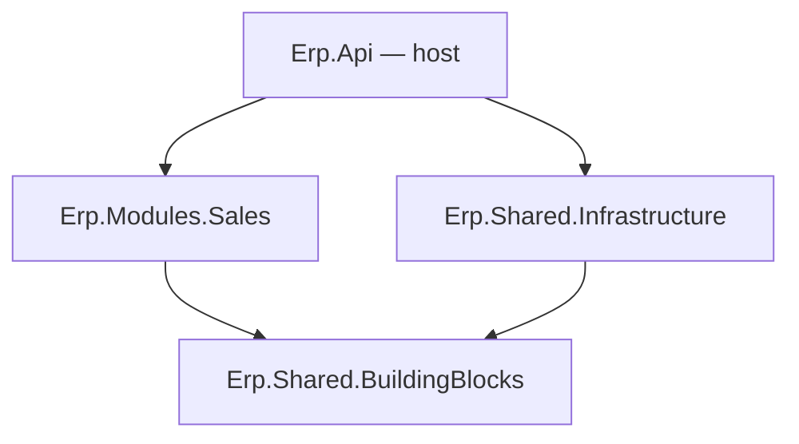

# Lesson 01 — Solution Setup: Modules With Walls

Good day, developer! Today we lay the foundation. It's mostly commands and a few small files, but the
decisions we make here shape every lesson after it. By the end, you'll have a solution with real walls
between its parts, and an API that answers when you call it. It takes about an hour. Are you ready? Let's
begin!

## What we'll build

An empty-but-running solution, already in the shape the whole course grows into:

```
Erp.slnx
Directory.Build.props        settings every project shares
Directory.Packages.props     where every NuGet version will live (empty for now)
src/
  Erp.Api/                       the host: the only program that runs
  Shared/
    Erp.Shared.BuildingBlocks/   what every module may use
    Erp.Shared.Infrastructure/   the implementations; only the host sees them
  Modules/
    Sales/Erp.Modules.Sales/     our first module
```

At the end, `dotnet run` starts the API and `GET /` answers.

## Why we build it this way

### One app, with walled-off modules

Let's start with the obvious way to build an app like this: one big project with folders called
`Controllers`, `Services` and `Repositories`. It works for a month. Then `OrderService` calls
`InventoryRepository` directly, "just this once". Then the inventory code starts reading sales tables. A
year later, nobody can change how stock works without breaking orders. And nothing stopped any of it,
because folders are only suggestions.

The other obvious way is microservices: a separate app for every area. Now the walls are real, but every
call between areas goes over the network, "reserve the stock and mark the order submitted" becomes a
distributed transaction, and you're running five apps to sell one ERP.

A **modular monolith** sits in between. It's **one** app and **one** database, split into **modules**
(Sales, Inventory, and so on) whose walls are enforced by the **compiler**. A module's code is `internal`,
so another module can't even name it. The only way in is a small public **contracts** project, which you'll
meet in [lesson 09](09-submit.md).

To remember it easily: each module is an island with one service window. You can't walk onto the island.
You can only ask at its window, and the window only offers what the island chose to offer.

### One folder per feature

Inside a module, we don't split by technical layer either. Each **feature**, like "create an order" or
"approve an order", gets one folder holding everything it needs: the request, its validation, the handler
and the endpoint. This is called **vertical slice architecture**.

Think of a taco drawer. You keep everything for tacos in one drawer, instead of tortillas in one cupboard,
salsa in another and cheese in a third. When you want to change tacos, you open one drawer.

### Two shared projects, and why exactly two

| Project | What it holds | Who references it |
|---|---|---|
| `Erp.Shared.BuildingBlocks` | The shared vocabulary: base classes and small interfaces like "give me a database connection" or "who is the current user" | Every module, and the host |
| `Erp.Shared.Infrastructure` | The real implementations: the PostgreSQL connection, the code that reads the signed-in user from the HTTP request | **Only the host** |

That last column is the whole point. A module that can't see `Erp.Shared.Infrastructure` can't reach a
connection string or the raw HTTP request, however tempting it gets.

So why not five shared projects? Here's the rule to remember: **a project boundary exists to make something
a compile error; folders organize code you're allowed to use.** Five shared projects that every module
references anyway would enforce nothing. Clear so far?



## 1. Shared build settings

Make a folder for the solution. In it, create `Directory.Build.props`. MSBuild applies this file to every
project underneath it, so no `.csproj` has to repeat these lines:

```xml
<!-- Directory.Build.props -->
<Project>
  <PropertyGroup>
    <TargetFramework>net10.0</TargetFramework>
    <Nullable>enable</Nullable>
    <ImplicitUsings>enable</ImplicitUsings>
  </PropertyGroup>
</Project>
```

| Setting | What it does |
|---|---|
| `TargetFramework` | Every project builds for .NET 10 |
| `Nullable` | The compiler warns you wherever a `null` could slip through, so you fix it before it crashes |
| `ImplicitUsings` | The common `using` lines (`System`, `System.Linq`, …) are added for you, so files stay short |

## 2. One place for package versions

Soon we'll start adding NuGet packages, one lesson at a time. Before the first one arrives, let's decide
where their versions live.

The usual way puts a version on every package line in every `.csproj`. Then two projects drift onto
different versions of the same package, and upgrading means hunting through every file. **Central package
management** fixes that: each `.csproj` says *which* packages it uses, and one file says *which version*.

```xml
<!-- Directory.Packages.props -->
<Project>
  <PropertyGroup>
    <ManagePackageVersionsCentrally>true</ManagePackageVersionsCentrally>
  </PropertyGroup>
</Project>
```

It's empty on purpose. This lesson needs no packages at all. From [lesson 02](02-mediator.md) on, we'll add
each package with a command like this:

```bash
dotnet add src/Some/Project package Some.Package --version 1.2.3
```

With central package management turned on, that command writes the pinned version into
`Directory.Packages.props` for you, and leaves the `.csproj` line without a version. Upgrading a package
later is one line in one file.

One thing to watch out for: licenses. If you ever sell your source code, every buyer inherits the license of
every package you used. So every package in this course is free and openly licensed (MIT, Apache-2.0 or the
PostgreSQL license), and the lesson that adds it says so. Some well-known packages, like MediatR,
FluentAssertions 8 and later, AutoMapper and QuestPDF, moved to paid or revenue-limited licenses in 2025.
That's why you won't see them here. Always check a package's license *before* you add it.

## 3. Create the projects

Now let's create the projects. From the solution folder, in Git Bash:

```bash
dotnet new sln -n Erp                          # .NET 10 creates Erp.slnx, the solution file

dotnet new web       -n Erp.Api                    -o src/Erp.Api
dotnet new classlib  -n Erp.Shared.BuildingBlocks  -o src/Shared/Erp.Shared.BuildingBlocks
dotnet new classlib  -n Erp.Shared.Infrastructure  -o src/Shared/Erp.Shared.Infrastructure
dotnet new classlib  -n Erp.Modules.Sales          -o src/Modules/Sales/Erp.Modules.Sales

dotnet sln add src/Erp.Api src/Shared/Erp.Shared.BuildingBlocks src/Shared/Erp.Shared.Infrastructure \
  src/Modules/Sales/Erp.Modules.Sales

dotnet add src/Shared/Erp.Shared.Infrastructure reference src/Shared/Erp.Shared.BuildingBlocks
dotnet add src/Modules/Sales/Erp.Modules.Sales   reference src/Shared/Erp.Shared.BuildingBlocks
dotnet add src/Erp.Api reference src/Modules/Sales/Erp.Modules.Sales src/Shared/Erp.Shared.Infrastructure

rm src/Shared/*/Class1.cs src/Modules/Sales/Erp.Modules.Sales/Class1.cs
```

Here's what those commands made: `web` is an empty ASP.NET Core app (our host), and `classlib` is a plain
class library. `sln add` puts them in the solution, and `add reference` lets one project use another's code.

Open each new `.csproj` and **delete its `<PropertyGroup>`**. `Directory.Build.props` already sets those
values, and two places that set the same thing will disagree one day.

Now look at what's *missing*: **Sales does not reference `Erp.Shared.Infrastructure`.** That one absent line
is a wall.

`Erp.Shared.BuildingBlocks` and `Erp.Shared.Infrastructure` stay empty for now. They fill up as the lessons
need them, starting with the very next one.

## 4. The module's front door

A module shows the outside world exactly one public type: the class the host calls to plug it in.

```csharp
// src/Modules/Sales/Erp.Modules.Sales/SalesModule.cs
using Microsoft.Extensions.DependencyInjection;

namespace Erp.Modules.Sales;

public static class SalesModule
{
    public static IServiceCollection AddSalesModule(this IServiceCollection services) =>
        services;   // grows as the module does
}
```

`IServiceCollection` is ASP.NET Core's list of services the app can hand out (that's **dependency
injection**: classes ask for what they need, and the app supplies it). A class library doesn't know that
type yet, so give Sales the ASP.NET Core shared framework. It's part of .NET itself, nothing to download,
and next lesson Sales will need it anyway for its endpoints. In `Erp.Modules.Sales.csproj`:

```xml
<ItemGroup>
  <FrameworkReference Include="Microsoft.AspNetCore.App" />
</ItemGroup>
```

From [lesson 02](02-mediator.md) on, every class you write inside a module starts with `internal`.

## 5. The host

Replace the template's `Program.cs`:

```csharp
// src/Erp.Api/Program.cs
using Erp.Modules.Sales;

var builder = WebApplication.CreateBuilder(args);

builder.Services.AddSalesModule();

var app = builder.Build();

app.MapGet("/", () => "Erp API");

app.Run();
```

Three steps, and you'll see this shape in every ASP.NET Core app: the **builder** collects services
(`builder.Services`), `Build()` turns them into an **app**, and the app maps URLs to code before it `Run`s.

## How a request flows

For now, the journey is short:

```
GET /  →  Kestrel  →  the "/" endpoint in Program.cs  →  "Erp API"
```

Every lesson adds a stop to this trip.

## Mistakes to avoid

- Leaving the template's `<PropertyGroup>` in each `.csproj`. Now two places set the target framework.
- Putting a `Version` on a `PackageReference`. With central package management that's an error (`NU1008`);
  versions belong only in `Directory.Packages.props`.
- Referencing `Erp.Shared.Infrastructure` from a module "just to get the connection". That's the one line
  that knocks the wall down.
- Writing `public class` inside a module. Before you do, ask whether another module truly needs it. Usually
  the answer is a contract ([lesson 09](09-submit.md)).

## Let's run it!

```bash
dotnet build
dotnet run --project src/Erp.Api
```

In a second terminal, using the port `dotnet run` printed:

```bash
curl http://localhost:5264/
# Erp API
```

The build should show **0 warnings and 0 errors**. If you see `NU1008`, a `.csproj` still has a version on a
package reference.

## Let's check!

1. Why doesn't `Erp.Modules.Sales` reference `Erp.Shared.Infrastructure`? What could go wrong if it did?
2. You add a sixth shared project, `Erp.Shared.Messaging`, and every module references it. What does that
   new project boundary enforce?
3. Later, a teammate wants to upgrade a package the whole solution uses. With central package management,
   how many files change?
4. Why use vertical slices instead of `Controllers`, `Services` and `Repositories` folders?

And that's where this lesson ends. The walls are up and the API answers. Next time, we give our endpoints a
proper way to hand their work to a handler: the mediator. Good luck, developer!

---

← [00 — Start here](00-START-HERE.md) · Next: [Lesson 02 — Mediator](02-mediator.md) →
