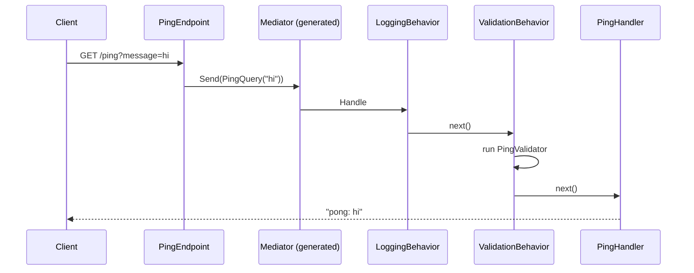

# Lesson 02 — The Mediator: One Door for Every Request

Good day, developer! Last time, we built the solution and put up the module walls. Today we'll teach our
endpoints a better way to get work done: instead of calling the code that does the work, they'll send a
message, and a mediator will deliver it. Along the way, every request will get logged and validated
automatically, without a single endpoint asking for it. It takes about an hour. Are you ready? Let's begin!

## What we'll build

- Commands and queries as small message types, each with exactly one handler.
- A **mediator** that delivers each message to its handler. We use `martinothamar/Mediator`, which writes
  the delivery code at compile time.
- Two **pipeline behaviors** that wrap every handler: one logs, one validates.
- Carter endpoints that do just one thing: turn an HTTP request into a message and send it.
- A throwaway `GET /ping` feature to prove it all works. We'll delete it in
  [lesson 06](06-create-order.md).

## Why we build it this way

### The pain

Here's the obvious design. Each endpoint injects the class that does the work, and calls it:

```csharp
app.MapPost("/sales-orders", async (CreateOrderRequest body, CreateOrderService service) =>
{
    // validate the body...
    // log that we started...
    var id = await service.CreateAsync(body);
    // log how long it took...
    return Results.Created($"/sales-orders/{id}", new { id });
});
```

For one endpoint, that's fine. By the tenth, "validate, log, time it" has been copied ten times, each copy a
little different. The day you need tracing, you edit every endpoint again. And each endpoint knows exactly
which class does its work, so changing that class means touching HTTP code.

### The fix

Instead, the endpoint builds a **message**, like "create this order", and hands it to a **mediator**. The
mediator finds the one **handler** for that kind of message and runs it, wrapped in **behaviors** that apply
to every message: validation, logging, and later, tracing. Written once, used everywhere.

To remember it easily: think of a post office. You address the envelope and drop it in the box. You don't
drive it to the recipient yourself, and you don't care which van carries it. The post office delivers it
(the mediator), and stamps it along the way (the behaviors).

There are two kinds of message, so the intent is always clear:

| Kind | What it does | Example |
|---|---|---|
| **Command** | Changes something | `CreateSalesOrderCommand` |
| **Query** | Only reads | `GetSalesOrderQuery` |

Handling commands and queries separately like this is called **CQRS-lite**.

### Why this library

`martinothamar/Mediator` is a **source generator**. While your code compiles, it finds every handler and
writes the delivery code as plain C#. Nothing is looked up at runtime, and a message with no handler shows
up as a warning when you build, not as a surprise in production. It's MIT-licensed and free. MediatR, the
older and more famous one, now needs a paid license for larger companies.

Now, let's be honest about the cost: indirection. If you press "Go to definition" on a message, you land on
the message, not on its handler. We soften that by always keeping the handler in the same file as its
message, inside the feature's folder.

## 1. BuildingBlocks gets the mediator's interfaces

Our first packages. Each one earns its place:

```bash
dotnet add src/Shared/Erp.Shared.BuildingBlocks package Mediator.Abstractions --version 3.0.2
dotnet add src/Shared/Erp.Shared.BuildingBlocks package FluentValidation --version 12.1.1
dotnet add src/Shared/Erp.Shared.BuildingBlocks package Microsoft.Extensions.Logging.Abstractions --version 10.0.14
```

| Package | What it gives us | License |
|---|---|---|
| `Mediator.Abstractions` | The message and handler interfaces: `ICommand`, `IQuery`, `IPipelineBehavior`, `ISender` | MIT |
| `FluentValidation` | A clean way to write validation rules, used by the validation behavior below | Apache-2.0 |
| `Microsoft.Extensions.Logging.Abstractions` | `ILogger`, so the logging behavior can write log lines | MIT |

Open `Directory.Packages.props` now. You'll see three `PackageVersion` lines that weren't there before. The
command put them there.

## 2. Two behaviors

```csharp
// src/Shared/Erp.Shared.BuildingBlocks/Messaging/Behaviors.cs
using System.Diagnostics;
using FluentValidation;
using Mediator;
using Microsoft.Extensions.Logging;

namespace Erp.Shared.BuildingBlocks;

public sealed class LoggingBehavior<TMessage, TResponse>(ILogger<LoggingBehavior<TMessage, TResponse>> log)
    : IPipelineBehavior<TMessage, TResponse>
    where TMessage : IMessage
{
    public async ValueTask<TResponse> Handle(
        TMessage message, MessageHandlerDelegate<TMessage, TResponse> next, CancellationToken ct)
    {
        var name = typeof(TMessage).Name;
        var sw = Stopwatch.StartNew();
        try
        {
            var response = await next(message, ct);
            log.LogInformation("{Request} handled in {ElapsedMs} ms", name, sw.ElapsedMilliseconds);
            return response;
        }
        catch (Exception ex)
        {
            log.LogWarning(ex, "{Request} failed after {ElapsedMs} ms", name, sw.ElapsedMilliseconds);
            throw;   // observe, never swallow
        }
    }
}

public sealed class ValidationBehavior<TMessage, TResponse>(IEnumerable<IValidator<TMessage>> validators)
    : IPipelineBehavior<TMessage, TResponse>
    where TMessage : IMessage
{
    public async ValueTask<TResponse> Handle(
        TMessage message, MessageHandlerDelegate<TMessage, TResponse> next, CancellationToken ct)
    {
        var failures = new List<FluentValidation.Results.ValidationFailure>();
        foreach (var validator in validators)
            failures.AddRange((await validator.ValidateAsync(message, ct)).Errors);

        if (failures.Count != 0)
            throw new ValidationException(failures);

        return await next(message, ct);
    }
}
```

The key word here is `next`. It means "the rest of the pipeline": the next behavior, or finally the handler
itself. A behavior can do something before `next`, after it, or instead of it. The validation behavior does
the last one: when a message is invalid, it throws and never calls `next`, so the handler never runs.

## 3. Our first feature: message, validator, handler, endpoint

Each feature is two files in its own folder: `XxxHandler.cs` (the message, its validator and its handler)
and `XxxEndpoint.cs` (the HTTP part). First, the packages Sales needs:

```bash
dotnet add src/Modules/Sales/Erp.Modules.Sales package Carter --version 10.0.0
dotnet add src/Modules/Sales/Erp.Modules.Sales package FluentValidation.DependencyInjectionExtensions --version 12.1.1
```

| Package | What it gives us | License |
|---|---|---|
| `Carter` | `ICarterModule`: each feature declares its own routes in its own file, instead of one giant `Program.cs` | MIT |
| `FluentValidation.DependencyInjectionExtensions` | `AddValidatorsFromAssembly`, which finds and registers every validator for us | Apache-2.0 |

```csharp
// src/Modules/Sales/Erp.Modules.Sales/Features/Ping/PingHandler.cs
using FluentValidation;
using Mediator;

namespace Erp.Modules.Sales.Features;

internal sealed record PingQuery(string Message) : IQuery<string>;

internal sealed class PingValidator : AbstractValidator<PingQuery>
{
    public PingValidator() => RuleFor(x => x.Message).NotEmpty();
}

internal sealed class PingHandler : IQueryHandler<PingQuery, string>
{
    public ValueTask<string> Handle(PingQuery query, CancellationToken ct) =>
        ValueTask.FromResult($"pong: {query.Message}");
}
```

```csharp
// src/Modules/Sales/Erp.Modules.Sales/Features/Ping/PingEndpoint.cs
using Carter;
using Mediator;
using Microsoft.AspNetCore.Builder;
using Microsoft.AspNetCore.Http;
using Microsoft.AspNetCore.Routing;

namespace Erp.Modules.Sales.Features;

internal sealed class PingEndpoint : ICarterModule
{
    public void AddRoutes(IEndpointRouteBuilder app) =>
        app.MapGet("/ping", async (string? message, ISender sender, CancellationToken ct) =>
            Results.Ok(await sender.Send(new PingQuery(message ?? ""), ct)));
}
```

Everything is `internal`. And notice that the endpoint knows the message, but never the handler.

If you came from WebForms, here's the translation: `PingEndpoint` is your `[WebMethod]`, and `PingHandler`
is the code that used to live in the code-behind. Only now, the two don't know each other.

## 4. Register the module's internal pieces

Now we meet the first price of `internal`. Read this part slowly, because both problems fail *silently*:

| Problem | What happens if you ignore it |
|---|---|
| Carter's `AddCarter()` only finds **public** endpoint classes | It finds none of ours, and every route returns 404 with no error |
| `AddValidatorsFromAssembly` skips **internal** validators unless told otherwise | Validation simply never runs, again with no error |

So the module registers both itself, from inside its own assembly, where `internal` is visible:

```csharp
// src/Modules/Sales/Erp.Modules.Sales/SalesModule.cs
using Carter;
using FluentValidation;
using Microsoft.Extensions.DependencyInjection;

namespace Erp.Modules.Sales;

public static class SalesModule
{
    public static IServiceCollection AddSalesModule(this IServiceCollection services)
    {
        var assembly = typeof(SalesModule).Assembly;

        // AddCarter() only finds public endpoint classes; ours are internal.
        foreach (var endpoint in assembly.GetTypes().Where(t => !t.IsAbstract && typeof(ICarterModule).IsAssignableFrom(t)))
            services.AddSingleton(typeof(ICarterModule), endpoint);

        // Without includeInternalTypes no validator is found, and validation silently stops.
        services.AddValidatorsFromAssembly(assembly, includeInternalTypes: true);
        return services;
    }
}
```

## 5. The host runs the generator

The source generator runs in whichever project calls `AddMediator`, and that's the host:

```bash
dotnet add src/Erp.Api package Carter --version 10.0.0
dotnet add src/Erp.Api package Mediator.Abstractions --version 3.0.2
dotnet add src/Erp.Api package Mediator.SourceGenerator --version 3.0.2
```

The host needs Carter to map every module's routes, and the generator to write the mediator. The generator
(MIT, same author as the abstractions) only runs while compiling; it isn't part of the app that ships. So in
`Erp.Api.csproj`, mark it build-only:

```xml
<PackageReference Include="Mediator.SourceGenerator" PrivateAssets="all" />
```

```csharp
// src/Erp.Api/Program.cs
using Carter;
using Erp.Modules.Sales;
using Erp.Shared.BuildingBlocks;
using Mediator;

var builder = WebApplication.CreateBuilder(args);

builder.Services.AddMediator((MediatorOptions options) =>
{
    options.ServiceLifetime = ServiceLifetime.Scoped;   // handlers will use scoped database contexts
    options.Assemblies = [typeof(SalesModule)];
    options.PipelineBehaviors = [typeof(LoggingBehavior<,>), typeof(ValidationBehavior<,>)];   // outermost first
});

builder.Services.AddSalesModule();
builder.Services.AddCarter();

var app = builder.Build();

app.MapGet("/", () => "Erp API");
app.MapCarter();

app.Run();
```

`AddCarter()` registers Carter's own services, and `MapCarter()` asks every registered `ICarterModule` to add
its routes. The `ServiceLifetime.Scoped` line means each HTTP request gets its own handlers. That's the
default you want for anything that will talk to a database.

Now build it. You'll get this:

```
error CS0122: 'PingQuery' is inaccessible due to its protection level
```

Here's what happened. The generator wrote code *inside Erp.Api* that mentions `PingQuery` and
`PingHandler`, and those are internal to Sales. The fix is to let the host, and only the host, see Sales'
internals. In `Erp.Modules.Sales.csproj`:

```xml
<!-- Erp.Api: the Mediator source generator runs there. Never grant this to another module. -->
<ItemGroup>
  <InternalsVisibleTo Include="Erp.Api" />
</ItemGroup>
```

Does this weaken the module wall? No. The host already references every module; wiring them together is
its job. What must never happen is a *module* seeing another module's internals, and
[lesson 14](14-testing.md) adds a test that fails if one ever does. Not so hard, right?

## How a request flows



The order matters. Logging is the outermost behavior, so it also records the requests that fail
validation.

## Mistakes to avoid

- Calling `AddCarter()` and expecting it to find internal endpoints. It won't, and the routes 404 silently.
- Forgetting `includeInternalTypes: true`. Your validators exist, compile, and never run.
- Granting `InternalsVisibleTo` to another module "just to share one class". Use a contract instead.
- Putting logic in the endpoint. An endpoint turns HTTP into a message, and a result back into HTTP.
  Nothing else.
- Sharing one handler between two features. If two features need the same logic, it belongs in the domain
  ([lesson 03](03-domain-model.md)).

## Let's run it!

```bash
dotnet run --project src/Erp.Api
```

```bash
curl "http://localhost:5264/ping?message=hello"
# "pong: hello"

curl -i "http://localhost:5264/ping?message="
# HTTP/1.1 500 ... FluentValidation.ValidationException: Validation failed: 'Message' must not be empty.
```

That 500 is good news for now: it proves the validator ran *before* the handler. It should really be a
`400 Bad Request` with a tidy body, and [lesson 06](06-create-order.md) will make it one. In the API's
console you'll see the logging behavior's lines: `PingQuery handled in 0 ms`, then
`PingQuery failed after 2 ms`.

## Let's check!

1. Why does the generator need `InternalsVisibleTo("Erp.Api")`? Why is granting it to the host safe, but
   granting it to another module not?
2. You forget `includeInternalTypes: true`. What happens when you call `GET /ping?message=`?
3. Why is `LoggingBehavior` registered before `ValidationBehavior`?
4. What's the difference between a command and a query, and why bother telling them apart?
5. Name one real cost of the mediator pattern.

And that's where this lesson ends. Our endpoints now send messages, and every message is logged and
validated on its way. Next time, we write the most important code in the whole course: the business rules
themselves. Good luck, developer!

---

← [Lesson 01 — Solution setup](01-solution-setup.md) · Next: [Lesson 03 — Domain model](03-domain-model.md) →
