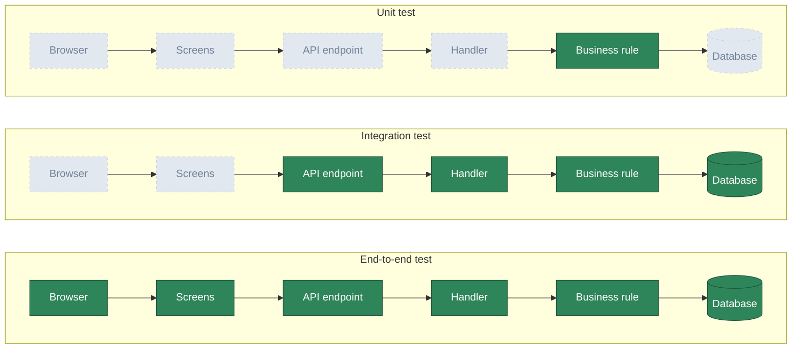
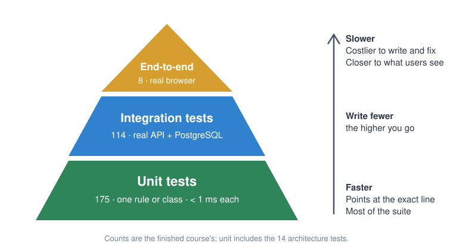
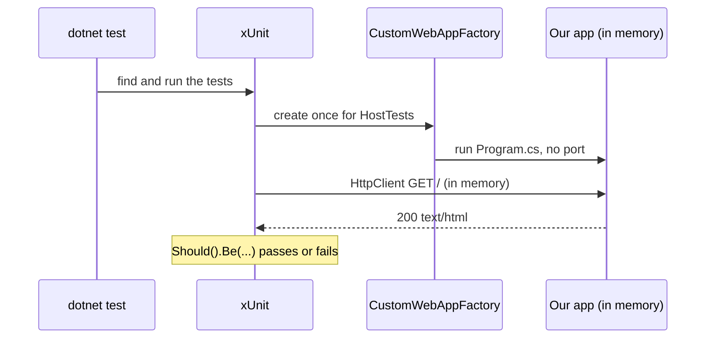

# Lesson 02 — Testing: Let the Computer Check Your Work

Good day, developer! At the end of last lesson you checked four things by hand: the home page loads, a page
address loads, an unknown API address answers 404, and the build is clean. Today we teach the computer to
check them for us, in about two seconds, every time you change anything. From now on, every lesson ends with
tests that prove it works, and you'll learn to hunt for the cases that break software: the edges. About an
hour and a half. Are you ready? Let's begin!

## What we'll build

| What | Why |
|---|---|
| `Erp.Integration.Tests`, a test project that starts the whole app in memory | So a test can send real requests, without a browser or a port |
| Twelve checks of lesson 01's promises | The home page, unknown page and API addresses, missing files, MudBlazor's files |
| The everyday habits: run, filter, watch, debug, read a failure | Tests you don't run don't protect anything |
| An edge-case checklist | You'll use it in every lesson after this one |

## Why we build it this way

### Checking by hand doesn't last

Today there are four things to check. By lesson 10 there are fifty; by the end of the course, about three
hundred. Nobody clicks through three hundred things after every change, so we stop clicking, and a change
in lesson 15 quietly breaks something from lesson 08. Nobody notices until a customer does.

A **test** is a check written down once and run forever. It costs a few minutes today, and it pays you back
every time you run it.

To remember it easily: if you checked it by hand twice, write it down as a test.

### What a test looks like

Every test has the same three parts, often called **Arrange, Act, Assert**:

```csharp
[Fact]
public async Task The_home_page_is_the_app()
{
    var client = factory.CreateClient();             // Arrange: get ready
    var response = await client.GetAsync("/");       // Act: do the one thing being tested
    response.StatusCode.Should().Be(HttpStatusCode.OK);   // Assert: check what happened
}
```

The name is a sentence about what the software does, with underscores for spaces. When it fails, the test
list reads like a list of broken promises: "The home page is the app: failed." You know what broke before
you open a file.

### What kinds of tests are there?

If you've never written a test, the names can sound like jargon: unit, integration, end-to-end. They answer one
question: **how much of the app does the test switch on?**

Think of a car factory. You can check one bolt on a workbench. You can run the engine on a stand, with real
fuel and real wires. Or you can take the whole car for a test drive on a real road. Each check catches
different problems, and each one costs more time than the one before.

| Kind | The car | In our app | What it catches | What it can't see |
|---|---|---|---|---|
| **Unit test** | One bolt, on the bench | One rule or class, alone: "a blocked customer can't order". No web server, no database | A wrong rule, a wrong calculation | Whether the pieces are wired together |
| **Integration test** | The engine, on a stand | The real API, started in memory, answering a real HTTP request; from lesson 05 also a real PostgreSQL | Wrong wiring, a missing registration, a bad SQL query, a wrong status code | Whether the screen shows the answer properly |
| **End-to-end test** | A test drive | A real browser clicking through the real screens of the running app | A broken button, a page that never loads | Which line of code is wrong, when it fails |

Here is the same idea as a picture. Every box is a part of our app; the coloured ones are switched on for real
in that kind of test, and the grey ones aren't used at all:



Easy, right? The more a test switches on, the more it proves, and the slower and harder to read it gets
when it fails. A failing unit test points at one rule. A failing browser test only says "something between
the button and the database is wrong."

So a healthy suite has many small tests and few big ones. People draw it as the **test pyramid**:



Microsoft's advice says the same in one line: if a behaviour can be tested with either a unit test or an
integration test, choose the unit test. The opposite shape, mostly slow browser tests and hardly any unit
tests, has a name too, the *ice-cream cone*, and it's what a team ends up with when testing is left for the
end. Our pyramid is fatter in the middle than the textbook one, and that's on purpose: a lot of our risk sits in
SQL and in the wiring between modules, which only an integration test can see.

To remember it easily: **unit = one piece, integration = the pieces together, end-to-end = what the user
does.**

### Other words you'll hear

Testers also sort tests in other ways. You'll meet these words in job posts and code reviews, so here they
are, once:

- **Automated vs. manual.** An automated test is code that checks itself. A manual test is a person
  clicking through. This course automates nearly everything, but every lesson still ends with "Let's run
  it!": a short manual check, because a person notices things no test asked about ("this button is in a
  strange place"). Exploring the app freely to find surprises is called **exploratory testing**.
- **Functional vs. non-functional.** Functional tests check *what* the app does: the right total, the right
  answer. Non-functional tests check *how well*: fast enough, secure, still standing with 500 users at once.
  Most of our tests are functional; lesson 23 adds security checks. Load testing (many users at once) is
  something this course leaves out, and [lesson 25](25-production-checklist.md) says when you'd add it.
- **Regression test.** Any test you run again after a change, to prove nothing that used to work broke. In
  practice that's the whole suite, every time. The word is also used for a test written right after fixing
  a bug, so that bug can't come back.
- **Smoke test.** A few quick checks right after starting or deploying the app: does it start, does the
  home page load? If those fail, there's no point running the rest. Today's first test is one.

### When each kind arrives

We don't set up every kind today. Each one arrives in the lesson that first needs it:

| Kind | What it proves | Speed | First in |
|---|---|---|---|
| **Integration test** | The whole app answers a real request correctly | Milliseconds to seconds | Today |
| **Unit test** | One class or rule, alone | Under a millisecond | [Lesson 03](03-features.md) |
| **Architecture test** | The module walls stand: who may reference whom, what may be public | Milliseconds | [Lesson 03](03-features.md) |
| **Property-based test** | A rule holds for hundreds of generated inputs, not just the ones we thought of | Milliseconds | [Lesson 04](04-domain-model.md) |
| **Database test** | Migrations, SQL functions and saved values are right (integration tests with a real database) | Seconds | [Lesson 05](05-database.md) |
| **End-to-end (browser) test** | A real browser can click through the real screens | Seconds | [Lesson 06](06-sign-in.md) |
| **Race test** | Two people acting at the same instant can't break the rules | Seconds | [Lesson 09](09-submit.md) |
| **Coverage and mutation testing** | Which code no test runs, and which bugs no test would notice | Minutes | [Lesson 11](11-update-order.md) |
| **CI** | All of it, on a clean machine, on every push | Minutes | [Lesson 12](12-containers-ci.md) |

Why start with integration tests, the middle of the pyramid? Because lesson 01 built no business rules yet,
so there's no single piece to test alone. What we have is an app that starts and answers addresses, and
checking that takes the whole app.

### Why from lesson 02, and not at the end

A test written right after the code checks what the code *should* do, while you still remember. A test
written months later tends to check what the code *happens* to do, bugs included. And a bug found the same
day costs minutes; found in production, it costs a customer's trust.

Now, let's be honest about the cost here: tests are code, and code needs looking after. A test that checks
*how* something is done, instead of *what* it does, breaks on every harmless refactor, and people learn to
ignore it. A slow suite gets skipped. So we test behavior, keep most tests fast, and delete a test that no
longer protects anything.

## 1. Let the tests start the app

The test project will start our app inside its own process. To do that, it needs to see the `Program`
class, and top-level statements make that class internal. One line at the very end of `Program.cs` makes it
public:

```csharp
// src/Erp.Api/Program.cs (the last line)
public partial class Program { }   // lets the integration tests start the app
```

## 2. The test project

```bash
dotnet new classlib -n Erp.Integration.Tests -o tests/Erp.Integration.Tests
rm tests/Erp.Integration.Tests/Class1.cs
dotnet sln add tests/Erp.Integration.Tests
dotnet add tests/Erp.Integration.Tests reference src/Erp.Api

dotnet add tests/Erp.Integration.Tests package xunit.v3 --version 4.0.2
dotnet add tests/Erp.Integration.Tests package AwesomeAssertions --version 9.6.0
dotnet add tests/Erp.Integration.Tests package Microsoft.AspNetCore.Mvc.Testing --version 10.0.14
```

We start from a plain class library, not the `xunit` template: the template writes a version on every package
line, and central package management refuses that.

| Package | What it's for | License |
|---|---|---|
| `xunit.v3` | The test framework, version 3: `[Fact]`, `[Theory]`, fixtures, and the runner, all in one package | Apache-2.0 |
| `AwesomeAssertions` | Readable checks with clear failure messages: `status.Should().Be(...)`. A free fork of FluentAssertions, whose version 8 needs a paid license | Apache-2.0 |
| `Microsoft.AspNetCore.Mvc.Testing` | `WebApplicationFactory`: our app, started in memory | MIT |

Open `Erp.Integration.Tests.csproj`, delete its `<PropertyGroup>` as in lesson 01, and add:

```xml
<PropertyGroup>
  <IsPackable>false</IsPackable>
  <OutputType>Exe</OutputType>
</PropertyGroup>

<ItemGroup>
  <Using Include="Xunit" />
</ItemGroup>
```

`IsPackable` stops anyone from accidentally publishing the tests as a NuGet package. `OutputType Exe` is new in
xUnit v3: a test project is a small program that runs its own tests. The `Using` line saves an `using Xunit;`
at the top of every test file.

That program runs on **Microsoft.Testing.Platform**, the test runner Microsoft ships with .NET 10, instead of
the older VSTest. `dotnet test` needs to be told, once, for the whole solution. Create `global.json` next to
`Erp.slnx`:

```json
{
  "test": {
    "runner": "Microsoft.Testing.Platform"
  }
}
```

Leave it out and `dotnet test` stops with "Testing with VSTest target is no longer supported by
Microsoft.Testing.Platform on .NET 10 SDK and later". If you meet older tutorials with `Microsoft.NET.Test.Sdk`
and `xunit.runner.visualstudio`, that's the VSTest way; xUnit v3 doesn't need either.

Two of the code-quality rules from lesson 01 don't fit test code, so a small `.editorconfig` in the `tests`
folder switches them off there, with the reason written next to each:

```ini
# tests/.editorconfig
[*.cs]
# Test names are sentences (An_order_without_lines_is_refused): the xUnit convention, so underscores are wanted here.
dotnet_diagnostic.CA1707.severity = none
# xUnit1051 asks every call to pass TestContext.Current.CancellationToken, so a cancelled run stops a little sooner.
# These tests finish in milliseconds against an in-memory server; a token on every line would bury what each one checks.
dotnet_diagnostic.xUnit1051.severity = none
```

Now, let's be honest about that second one: xUnit recommends passing the token, and in a slow test (one that
waits on a real network, say) you should. Ours are fast, and you'll read hundreds of them in this course, so we
choose readable.

One more line, in `Erp.Api.csproj`. The tests reference the host, and by default everything the host
references flows on to them, the browser app included. The tests talk to the host over HTTP; the browser
app's classes have no business in them. Before:

```xml
<ProjectReference Include="..\Erp.Web\Erp.Web.csproj" />
```

After:

```xml
<!-- PrivateAssets: the browser app's classes stop here; the test projects that reference the host never see them. -->
<ProjectReference Include="..\Erp.Web\Erp.Web.csproj" PrivateAssets="all" />
```

## 3. The test host

```csharp
// tests/Erp.Integration.Tests/CustomWebAppFactory.cs
using Microsoft.AspNetCore.Hosting;
using Microsoft.AspNetCore.Mvc.Testing;

namespace Erp.Integration.Tests;

// The whole app, started in memory inside the test process.
public sealed class CustomWebAppFactory : WebApplicationFactory<Program>
{
    protected override void ConfigureWebHost(IWebHostBuilder builder) => builder.UseEnvironment("Development");
}
```

This is the `WebApplicationFactory`. It runs our `Program.cs`, the same code `dotnet run` runs, but instead
of listening on a port it keeps the server in memory. `factory.CreateClient()` hands you an `HttpClient`
wired straight to it: real requests, real middleware, real routing, no network.

We pick the `Development` environment on purpose. That's where ASP.NET Core finds the browser app's files
the way `dotnet run` does, so `MapStaticAssets` can serve them. Over the next lessons this class grows: a
database in [lesson 05](05-database.md), signed-in clients in [lesson 06](06-sign-in.md).

## 4. Your first test

```csharp
// tests/Erp.Integration.Tests/HostTests.cs
using System.Net;
using AwesomeAssertions;

namespace Erp.Integration.Tests;

// Lesson 01's promise: one host serves the browser app and the API, and never mixes them up.
public class HostTests(CustomWebAppFactory factory) : IClassFixture<CustomWebAppFactory>
{
    [Fact]
    public async Task The_home_page_is_the_app()
    {
        var response = await factory.CreateClient().GetAsync("/");

        response.StatusCode.Should().Be(HttpStatusCode.OK);
        response.Content.Headers.ContentType!.MediaType.Should().Be("text/html");
    }
}
```

Three new things:

- **`[Fact]`** marks a method as a test: a fact that should always be true.
- **`IClassFixture<CustomWebAppFactory>`** tells xUnit to create the factory once for this class, start the
  app once, and pass it to the constructor. Starting the app takes a moment, so every test in the class shares
  it.
- **`.Should().Be(...)`** is AwesomeAssertions. When it fails, it says what it expected and what it found,
  in English.

Run it:

```bash
dotnet test
```

```
Test run summary: Passed!
  total: 1
  failed: 0
  succeeded: 1
  skipped: 0
```

## 5. Make it fail once

A test that has never failed proves nothing: maybe it can't fail. So break the code it guards, on purpose,
and watch. In `Program.cs`, comment out the line that serves the app's page:

```csharp
// app.MapRazorComponents<Erp.Web.App>()
//     .AddInteractiveWebAssemblyRenderMode();
```

Run `dotnet test` again:

```
failed Erp.Integration.Tests.HostTests.The_home_page_is_the_app (41ms)
  Expected response.StatusCode to be HttpStatusCode.OK {value: 200}, but found HttpStatusCode.NotFound {value: 404}.
  at Erp.Integration.Tests.HostTests.The_home_page_is_the_app() in .../HostTests.cs:15
```

Here's how to read a failure, top to bottom: **which test** failed, **what it expected and what it found**,
and **where**: the file and line of the check. Easy, right? Now put the line back and run again. Green.

Do this with every new test you write. It takes ten seconds, and it's the only way to know the test works.

## 6. One test, many inputs

An unknown API address must be a 404 for a `GET`, and just as much for a `POST`, a `PUT` or a `DELETE`. Four
copies of the same test would be four places to fix later. A **`[Theory]`** is one test with several sets of
inputs, each passed in by an `[InlineData]`:

```csharp
[Theory]
[InlineData("GET")]
[InlineData("POST")]
[InlineData("PUT")]
[InlineData("DELETE")]
public async Task An_unknown_api_address_is_404_whatever_the_method(string method)
{
    var response = await factory.CreateClient().SendAsync(new HttpRequestMessage(new HttpMethod(method), "/api/no-such-thing"));

    response.StatusCode.Should().Be(HttpStatusCode.NotFound);
    response.Content.Headers.ContentType?.MediaType.Should().NotBe("text/html");
}
```

xUnit runs it four times and reports each one on its own line, so a failure tells you exactly which method
broke.

## 7. Hunting for edges

Bugs rarely live in the middle of the road. They live at the edges: the empty box, the number exactly at
the limit, the second click, two people at once. Here's the checklist we'll come back to in every lesson:

| Edge | Ask yourself |
|---|---|
| Nothing | Empty text, whitespace only, no lines, no body, a missing file |
| Zero and negative | 0, -1, a negative amount |
| At the limit | Exactly at it, one step under, one step over (₱50,000.00 vs ₱50,000.01) |
| Too precise, too big | Four decimal places, the largest value the database can hold |
| Odd characters | `%`, `_`, `'`, `\`, upper and lower case, very long text |
| Twice | The same item twice, the same button twice, the same message delivered twice |
| Who | Not signed in, the wrong role, someone else's data |
| When | The wrong status, after it already changed, at the same instant as someone else |
| Broken input | Malformed JSON, an id that doesn't exist |

Let's use it on lesson 01's promises. *Odd characters*: does `/API/no-such-thing`, in capitals, still count as
the API? *Nothing*: what about `/api` itself, with nothing after it? And a file that doesn't exist, like
`/missing-script.js`: the server must answer 404, not 200, or the browser will try to run whatever came back as
JavaScript.

And one more, from this course's own history. Lesson 01 warns against `ReferenceOutputAssembly="false"` on the
browser app's reference. That warning exists because it happened: the app ran with MudBlazor's files missing,
and it looked unstyled and broken. A test that fetches those files makes sure it never happens again. A test
written after a bug, so the bug can't come back, is called a **regression test**.

Here's the whole file:

```csharp
// tests/Erp.Integration.Tests/HostTests.cs
using System.Net;
using AwesomeAssertions;

namespace Erp.Integration.Tests;

// Lesson 01's promise: one host serves the browser app and the API, and never mixes them up.
public class HostTests(CustomWebAppFactory factory) : IClassFixture<CustomWebAppFactory>
{
    [Fact]
    public async Task The_home_page_is_the_app()
    {
        var response = await factory.CreateClient().GetAsync("/");

        response.StatusCode.Should().Be(HttpStatusCode.OK);
        response.Content.Headers.ContentType!.MediaType.Should().Be("text/html");
    }

    // An address that is no page of the app is an honest 404, but a person still sees the app's own "not found" page.
    [Fact]
    public async Task An_unknown_page_is_a_404_with_the_apps_own_page()
    {
        var response = await factory.CreateClient().GetAsync("/no-such-page");

        response.StatusCode.Should().Be(HttpStatusCode.NotFound);
        response.Content.Headers.ContentType!.MediaType.Should().Be("text/html");
    }

    [Theory]
    [InlineData("GET")]
    [InlineData("POST")]
    [InlineData("PUT")]
    [InlineData("DELETE")]
    public async Task An_unknown_api_address_is_404_whatever_the_method(string method)
    {
        var response = await factory.CreateClient().SendAsync(new HttpRequestMessage(new HttpMethod(method), "/api/no-such-thing"));

        response.StatusCode.Should().Be(HttpStatusCode.NotFound);
        response.Content.Headers.ContentType?.MediaType.Should().NotBe("text/html");
    }

    [Theory]
    [InlineData("/api")]
    [InlineData("/api/")]
    [InlineData("/API/no-such-thing")]   // URLs are case-insensitive in ASP.NET Core, so the prefix is too
    public async Task The_api_prefix_itself_is_never_the_app(string path) =>
        (await factory.CreateClient().GetAsync(path)).StatusCode.Should().Be(HttpStatusCode.NotFound);

    // A missing file is a 404, whatever page comes with it: a 200 would make the browser try to run the page as a script.
    [Fact]
    public async Task A_missing_file_is_a_404() =>
        (await factory.CreateClient().GetAsync("/missing-script.js")).StatusCode.Should().Be(HttpStatusCode.NotFound);

    // Regression guard: a ReferenceOutputAssembly="false" reference once left the app without MudBlazor's styles.
    [Theory]
    [InlineData("/_content/MudBlazor/MudBlazor.min.css", "text/css")]
    [InlineData("/_content/MudBlazor/MudBlazor.min.js", "text/javascript")]
    public async Task The_component_library_files_are_served(string path, string mediaType)
    {
        var response = await factory.CreateClient().GetAsync(path);

        response.StatusCode.Should().Be(HttpStatusCode.OK);
        response.Content.Headers.ContentType!.MediaType.Should().Be(mediaType);
    }
}
```

Make each new one fail once: add `ReferenceOutputAssembly="false"` to the app's reference and watch the
MudBlazor tests go red; remove `api.MapFallback` and watch the API tests go red; remove the
`UseStatusCodePagesWithReExecute` line and watch the unknown page lose its HTML. Then undo all three.

## 8. Using tests every day

### From the terminal

| You want to | Type |
|---|---|
| Run everything | `dotnet test` |
| Run one project | `dotnet test --project tests/Erp.Integration.Tests` |
| Run one class | `dotnet test --filter-class "*HostTests"` |
| Run tests whose name contains a word | `dotnet test --filter-method "*unknown_api*"` |
| See every test's name and result | `dotnet test --output Detailed` |
| Rerun on every save | `dotnet watch test --project tests/Erp.Integration.Tests` |

`dotnet watch test` is the one to leave open in a second terminal while you work: save a file, and a moment
later you know whether you broke something.

### From your editor

- **VS Code** with the C# Dev Kit: the **Testing** panel (the flask icon) lists every test. Above each test
  method, *Run Test* and *Debug Test* links appear.
- **Visual Studio**: **Test > Test Explorer** (Ctrl+E, T). Right-click a test to run or debug it.
- **Rider**: the green arrows in the gutter beside each test, and the **Unit Tests** window.

### Debugging a failing test

Set a breakpoint, in the test or in the app's own code (`Program.cs`, later a handler), and choose *Debug
Test*. The app runs inside the test process, so a breakpoint anywhere in it stops there. Look at the values,
step through, find the bug. This is much faster than adding `Console.WriteLine` and running again.

## How a test runs



## Mistakes to avoid

- Writing a test and never seeing it fail. Break the code once and watch it go red.
- Naming tests `Test1` or `HomePageTest`. Name the behavior: `The_home_page_is_the_app`.
- Checking several unrelated things in one test. When it fails, you won't know which promise broke.
- Testing *how* the code works instead of *what* it does. That test breaks on every refactor.
- Starting from the `xunit` template and keeping its package versions. Central package management refuses
  them (`NU1008`).
- Forgetting `global.json`. `dotnet test` then refuses to run xUnit v3 projects at all.
- Forgetting `UseEnvironment("Development")`. Then the app's files aren't found, and the page tests fail
  for a reason that has nothing to do with your code.

## Let's run it!

```bash
dotnet test --output Detailed
```

```
passed Erp.Integration.Tests.HostTests.The_home_page_is_the_app (312ms)
passed Erp.Integration.Tests.HostTests.An_unknown_page_is_a_404_with_the_apps_own_page (6ms)
...
Test run summary: Passed!
  total: 12
  failed: 0
  succeeded: 12
  skipped: 0
```

Twelve checks, about a second. The four things you checked by hand last lesson are now twelve things the
computer checks for you, every time.

## Let's check!

1. What are the three parts of a test, and what does each one do?
2. Why do we break the code on purpose after writing a test?
3. What does `WebApplicationFactory` do, and why doesn't it need a port?
4. When would you write a `[Theory]` instead of a `[Fact]`?
5. Pick three rows of the edge-case checklist and give an example of each for a sales order.
6. What is a regression test? Name the one in this lesson and the bug it guards against.
7. Why should most tests be unit tests, and only a few drive a browser?
8. A test signs in, creates an order through the API and reads it back, without a browser. Which kind of test
   is it, and name one bug it can't catch?

And that's where this lesson ends. Your app now checks itself in a second, and you have a checklist for
finding the bugs that hide at the edges. Next time, we write our first feature the way every feature will
be written: an endpoint, a handler and a validator, and we write our first unit tests and our first test of
the module walls. Good
luck, developer!

---

← [Lesson 01 — Solution setup](01-solution-setup.md) · Next: [Lesson 03 — Features](03-features.md) →
