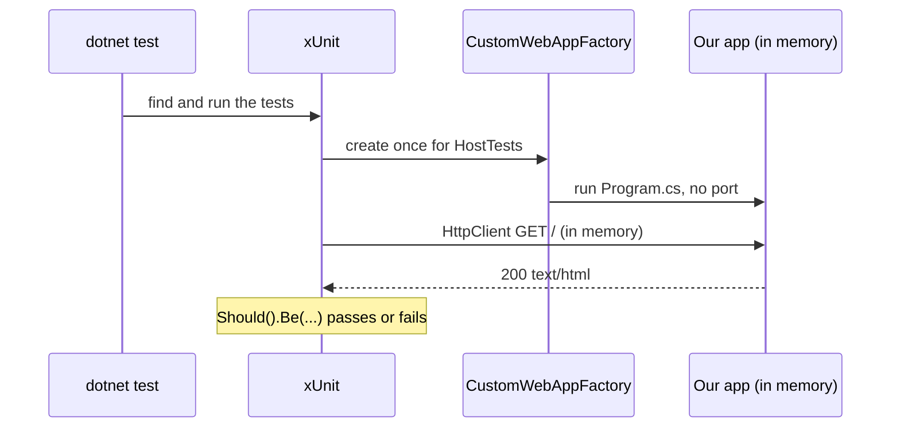

# Lesson 02 — Testing: Let the Computer Check Your Work

Good day, developer! At the end of last lesson you checked four things by hand: the home page loads, a page
address loads, an unknown API address answers 404, and the build is clean. Today we teach the computer to
check them for us, in about two seconds, every time you change anything. From now on, every lesson ends with
tests that prove it works, and you'll learn to hunt for the cases that break software: the edges. About an
hour and a half. Are you ready? Let's begin!

## What we'll build

| What | Why |
|---|---|
| `Erp.Integration.Tests`, a test project that starts the whole app in memory | So a test can send real requests, without a browser or a port |
| Thirteen checks of lesson 01's promises | The home page, page addresses, unknown API addresses, missing files, MudBlazor's files |
| The everyday habits: run, filter, watch, debug, read a failure | Tests you don't run don't protect anything |
| An edge-case checklist | You'll use it in every lesson after this one |

## Why we build it this way

### Checking by hand doesn't last

Today there are four things to check. By lesson 10 there are fifty; by the end of the course, about three
hundred. Nobody clicks through three hundred things after every change, so we stop clicking, and a change
in lesson 15 quietly breaks something from lesson 08. Nobody notices until a customer does.

A **test** is a check written down once and run forever. It costs a few minutes today, and it pays you back
every time you run it.

To remember it easily: if you checked it by hand twice, write it down as a test.

### What a test looks like

Every test has the same three parts, often called **Arrange, Act, Assert**:

```csharp
[Fact]
public async Task The_home_page_is_the_app()
{
    var client = factory.CreateClient();             // Arrange: get ready
    var response = await client.GetAsync("/");       // Act: do the one thing being tested
    response.StatusCode.Should().Be(HttpStatusCode.OK);   // Assert: check what happened
}
```

The name is a sentence about what the software does, with underscores for spaces. When it fails, the test
list reads like a list of broken promises: "The home page is the app: failed." You know what broke before
you open a file.

### The kinds of tests, and when each one arrives

Not every check is the same size. A business rule ("a blocked customer can't order") needs no web server and
no database, so its test runs in a millisecond. A race between two people needs a real database. A broken
button needs a real browser. So we use different kinds, and each one arrives in the lesson that first needs
it:

| Kind | What it proves | Speed | First in |
|---|---|---|---|
| **Integration test** | The whole app answers a real request correctly | Milliseconds to seconds | Today |
| **Unit test** | One class or rule, alone | Under a millisecond | [Lesson 03](03-mediator.md) |
| **Architecture test** | The module walls stand: who may reference whom, what may be public | Milliseconds | [Lesson 03](03-mediator.md) |
| **Property-based test** | A rule holds for hundreds of generated inputs, not just the ones we thought of | Milliseconds | [Lesson 04](04-domain-model.md) |
| **Database test** | Migrations, SQL functions and saved values are right | Seconds | [Lesson 05](05-database.md) |
| **Browser test** | A real browser can click through the real screens | Seconds | [Lesson 06](06-sign-in.md) |
| **Race test** | Two people acting at the same instant can't break the rules | Seconds | [Lesson 09](09-submit.md) |
| **Coverage and mutation testing** | Which code no test runs, and which bugs no test would notice | Minutes | [Lesson 11](11-update-order.md) |
| **CI** | All of it, on a clean machine, on every push | Minutes | [Lesson 12](12-containers-ci.md) |

Most of our tests will be unit tests, because most of our logic will live in the domain. A few will be
integration tests, and only a handful will drive a browser. Fast tests at the bottom, slow ones at the top:
people call that the **test pyramid**.

### Why from lesson 02, and not at the end

A test written right after the code checks what the code *should* do, while you still remember. A test
written months later tends to check what the code *happens* to do, bugs included. And a bug found the same
day costs minutes; found in production, it costs a customer's trust.

Now, let's be honest about the cost here: tests are code, and code needs looking after. A test that checks
*how* something is done, instead of *what* it does, breaks on every harmless refactor, and people learn to
ignore it. A slow suite gets skipped. So we test behavior, keep most tests fast, and delete a test that no
longer protects anything.

## 1. Let the tests start the app

The test project will start our app inside its own process. To do that, it needs to see the `Program`
class, and top-level statements make that class internal. One line at the very end of `Program.cs` makes it
public:

```csharp
// src/Erp.Api/Program.cs (the last line)
public partial class Program { }   // lets the integration tests start the app
```

## 2. The test project

```bash
dotnet new classlib -n Erp.Integration.Tests -o tests/Erp.Integration.Tests
rm tests/Erp.Integration.Tests/Class1.cs
dotnet sln add tests/Erp.Integration.Tests
dotnet add tests/Erp.Integration.Tests reference src/Erp.Api

dotnet add tests/Erp.Integration.Tests package Microsoft.NET.Test.Sdk --version 17.14.1
dotnet add tests/Erp.Integration.Tests package xunit --version 2.9.3
dotnet add tests/Erp.Integration.Tests package xunit.runner.visualstudio --version 3.1.4
dotnet add tests/Erp.Integration.Tests package AwesomeAssertions --version 9.6.0
dotnet add tests/Erp.Integration.Tests package Microsoft.AspNetCore.Mvc.Testing --version 10.0.14
```

We start from a plain class library, not the `xunit` template: the template writes a version on every package
line, and central package management refuses that.

| Package | What it's for | License |
|---|---|---|
| `xunit` | The test framework: `[Fact]`, `[Theory]`, fixtures | Apache-2.0 |
| `xunit.runner.visualstudio` | Lets `dotnet test` and your editor find and run xUnit tests | Apache-2.0 |
| `Microsoft.NET.Test.Sdk` | The plumbing between `dotnet test` and the framework | MIT |
| `AwesomeAssertions` | Readable checks with clear failure messages: `status.Should().Be(...)`. A free fork of FluentAssertions, whose version 8 needs a paid license | Apache-2.0 |
| `Microsoft.AspNetCore.Mvc.Testing` | `WebApplicationFactory`: our app, started in memory | MIT |

Open `Erp.Integration.Tests.csproj`, delete its `<PropertyGroup>` as in lesson 01, and add:

```xml
<PropertyGroup>
  <IsPackable>false</IsPackable>
</PropertyGroup>

<ItemGroup>
  <Using Include="Xunit" />
</ItemGroup>
```

`IsPackable` stops anyone from accidentally publishing the tests as a NuGet package. The `Using` line saves an
`using Xunit;` at the top of every test file.

One more line, in `Erp.Api.csproj`. The tests reference the host, and by default everything the host
references flows on to them, the browser app included. The tests talk to the host over HTTP; the browser
app's classes have no business in them. Before:

```xml
<ProjectReference Include="..\Erp.Web\Erp.Web.csproj" />
```

After:

```xml
<!-- PrivateAssets: the browser app's classes stop here; the test projects that reference the host never see them. -->
<ProjectReference Include="..\Erp.Web\Erp.Web.csproj" PrivateAssets="all" />
```

## 3. The test host

```csharp
// tests/Erp.Integration.Tests/CustomWebAppFactory.cs
using Microsoft.AspNetCore.Hosting;
using Microsoft.AspNetCore.Mvc.Testing;

namespace Erp.Integration.Tests;

// The whole app, started in memory inside the test process.
public sealed class CustomWebAppFactory : WebApplicationFactory<Program>
{
    protected override void ConfigureWebHost(IWebHostBuilder builder) => builder.UseEnvironment("Development");
}
```

This is the `WebApplicationFactory`. It runs our `Program.cs`, the same code `dotnet run` runs, but instead
of listening on a port it keeps the server in memory. `factory.CreateClient()` hands you an `HttpClient`
wired straight to it: real requests, real middleware, real routing, no network.

We pick the `Development` environment on purpose. That's where ASP.NET Core finds the browser app's files
the way `dotnet run` does, so `MapStaticAssets` can serve them. Over the next lessons this class grows: a
database in [lesson 05](05-database.md), signed-in clients in [lesson 06](06-sign-in.md).

## 4. Your first test

```csharp
// tests/Erp.Integration.Tests/HostTests.cs
using System.Net;
using AwesomeAssertions;

namespace Erp.Integration.Tests;

// Lesson 01's promise: one host serves the browser app and the API, and never mixes them up.
public class HostTests(CustomWebAppFactory factory) : IClassFixture<CustomWebAppFactory>
{
    [Fact]
    public async Task The_home_page_is_the_app()
    {
        var response = await factory.CreateClient().GetAsync("/");

        response.StatusCode.Should().Be(HttpStatusCode.OK);
        response.Content.Headers.ContentType!.MediaType.Should().Be("text/html");
    }
}
```

Three new things:

- **`[Fact]`** marks a method as a test: a fact that should always be true.
- **`IClassFixture<CustomWebAppFactory>`** tells xUnit to create the factory once for this class, start the
  app once, and pass it to the constructor. Starting the app takes a moment, so every test in the class shares
  it.
- **`.Should().Be(...)`** is AwesomeAssertions. When it fails, it says what it expected and what it found,
  in English.

Run it:

```bash
dotnet test
```

```
Passed!  - Failed: 0, Passed: 1, Skipped: 0, Total: 1, Duration: 312 ms - Erp.Integration.Tests.dll (net10.0)
```

## 5. Make it fail once

A test that has never failed proves nothing: maybe it can't fail. So break the code it guards, on purpose,
and watch. In `Program.cs`, comment out the fallback:

```csharp
// app.MapFallbackToFile("index.html");
```

Run `dotnet test` again:

```
Failed Erp.Integration.Tests.HostTests.The_home_page_is_the_app [41 ms]
  Error Message:
   Expected response.StatusCode to be HttpStatusCode.OK {value: 200}, but found HttpStatusCode.NotFound {value: 404}.
  Stack Trace:
     at Erp.Integration.Tests.HostTests.The_home_page_is_the_app() in .../HostTests.cs:line 15
```

Here's how to read a failure, top to bottom: **which test** failed, **what it expected and what it found**,
and **where**: the file and line of the check. Easy, right? Now put the line back and run again. Green.

Do this with every new test you write. It takes ten seconds, and it's the only way to know the test works.

## 6. One test, many inputs

An unknown API address must be a 404 for a `GET`, and just as much for a `POST`, a `PUT` or a `DELETE`. Four
copies of the same test would be four places to fix later. A **`[Theory]`** is one test with several sets of
inputs, each passed in by an `[InlineData]`:

```csharp
[Theory]
[InlineData("GET")]
[InlineData("POST")]
[InlineData("PUT")]
[InlineData("DELETE")]
public async Task An_unknown_api_address_is_404_whatever_the_method(string method)
{
    var response = await factory.CreateClient().SendAsync(new HttpRequestMessage(new HttpMethod(method), "/api/no-such-thing"));

    response.StatusCode.Should().Be(HttpStatusCode.NotFound);
    response.Content.Headers.ContentType?.MediaType.Should().NotBe("text/html");
}
```

xUnit runs it four times and reports each one on its own line, so a failure tells you exactly which method
broke.

## 7. Hunting for edges

Bugs rarely live in the middle of the road. They live at the edges: the empty box, the number exactly at
the limit, the second click, two people at once. Here's the checklist we'll come back to in every lesson:

| Edge | Ask yourself |
|---|---|
| Nothing | Empty text, whitespace only, no lines, no body, a missing file |
| Zero and negative | 0, -1, a negative amount |
| At the limit | Exactly at it, one step under, one step over (₱50,000.00 vs ₱50,000.01) |
| Too precise, too big | Four decimal places, the largest value the database can hold |
| Odd characters | `%`, `_`, `'`, `\`, upper and lower case, very long text |
| Twice | The same item twice, the same button twice, the same message delivered twice |
| Who | Not signed in, the wrong role, someone else's data |
| When | The wrong status, after it already changed, at the same instant as someone else |
| Broken input | Malformed JSON, an id that doesn't exist |

Let's use it on lesson 01's promises. *Odd characters*: does `/API/no-such-thing`, in capitals, still count as
the API? *Nothing*: what about `/api` itself, with nothing after it? And a file that doesn't exist, like
`/missing-script.js`: the server mustn't answer with the app's page, or the browser will try to run HTML as
JavaScript.

And one more, from this course's own history. Lesson 01 warns against `ReferenceOutputAssembly="false"` on the
browser app's reference. That warning exists because it happened: the app ran with MudBlazor's files missing,
and it looked unstyled and broken. A test that fetches those files makes sure it never happens again. A test
written after a bug, so the bug can't come back, is called a **regression test**.

Here's the whole file:

```csharp
// tests/Erp.Integration.Tests/HostTests.cs
using System.Net;
using AwesomeAssertions;

namespace Erp.Integration.Tests;

// Lesson 01's promise: one host serves the browser app and the API, and never mixes them up.
public class HostTests(CustomWebAppFactory factory) : IClassFixture<CustomWebAppFactory>
{
    [Fact]
    public async Task The_home_page_is_the_app()
    {
        var response = await factory.CreateClient().GetAsync("/");

        response.StatusCode.Should().Be(HttpStatusCode.OK);
        response.Content.Headers.ContentType!.MediaType.Should().Be("text/html");
    }

    // The server has no file called /sales-orders/42: it sends the app, and the app's router shows that page.
    [Theory]
    [InlineData("/sales-orders")]
    [InlineData("/sales-orders/42")]
    public async Task A_page_address_is_the_app_too(string path)
    {
        var response = await factory.CreateClient().GetAsync(path);

        response.StatusCode.Should().Be(HttpStatusCode.OK);
        response.Content.Headers.ContentType!.MediaType.Should().Be("text/html");
    }

    [Theory]
    [InlineData("GET")]
    [InlineData("POST")]
    [InlineData("PUT")]
    [InlineData("DELETE")]
    public async Task An_unknown_api_address_is_404_whatever_the_method(string method)
    {
        var response = await factory.CreateClient().SendAsync(new HttpRequestMessage(new HttpMethod(method), "/api/no-such-thing"));

        response.StatusCode.Should().Be(HttpStatusCode.NotFound);
        response.Content.Headers.ContentType?.MediaType.Should().NotBe("text/html");
    }

    [Theory]
    [InlineData("/api")]
    [InlineData("/api/")]
    [InlineData("/API/no-such-thing")]   // URLs are case-insensitive in ASP.NET Core, so the prefix is too
    public async Task The_api_prefix_itself_is_never_the_app(string path) =>
        (await factory.CreateClient().GetAsync(path)).StatusCode.Should().Be(HttpStatusCode.NotFound);

    // A path with a file extension is a file. If it's missing, say so; the app's page would be a confusing answer.
    [Fact]
    public async Task A_missing_file_is_404_not_the_app() =>
        (await factory.CreateClient().GetAsync("/missing-script.js")).StatusCode.Should().Be(HttpStatusCode.NotFound);

    // Regression guard: a ReferenceOutputAssembly="false" reference once left the app without MudBlazor's styles.
    [Theory]
    [InlineData("/_content/MudBlazor/MudBlazor.min.css", "text/css")]
    [InlineData("/_content/MudBlazor/MudBlazor.min.js", "text/javascript")]
    public async Task The_component_library_files_are_served(string path, string mediaType)
    {
        var response = await factory.CreateClient().GetAsync(path);

        response.StatusCode.Should().Be(HttpStatusCode.OK);
        response.Content.Headers.ContentType!.MediaType.Should().Be(mediaType);
    }
}
```

Make each new one fail once: add `ReferenceOutputAssembly="false"` to the app's reference and watch the
MudBlazor tests go red; remove `api.MapFallback` and watch the API tests go red. Then undo both.

## 8. Using tests every day

### From the terminal

| You want to | Type |
|---|---|
| Run everything | `dotnet test` |
| Run one project | `dotnet test tests/Erp.Integration.Tests` |
| Run one class | `dotnet test --filter "FullyQualifiedName~HostTests"` |
| Run tests whose name contains a word | `dotnet test --filter "DisplayName~unknown_api"` |
| See every test's name as it runs | `dotnet test --logger "console;verbosity=normal"` |
| Rerun on every save | `dotnet watch test --project tests/Erp.Integration.Tests` |

`dotnet watch test` is the one to leave open in a second terminal while you work: save a file, and a moment
later you know whether you broke something.

### From your editor

- **VS Code** with the C# Dev Kit: the **Testing** panel (the flask icon) lists every test. Above each test
  method, *Run Test* and *Debug Test* links appear.
- **Visual Studio**: **Test > Test Explorer** (Ctrl+E, T). Right-click a test to run or debug it.
- **Rider**: the green arrows in the gutter beside each test, and the **Unit Tests** window.

### Debugging a failing test

Set a breakpoint, in the test or in the app's own code (`Program.cs`, later a handler), and choose *Debug
Test*. The app runs inside the test process, so a breakpoint anywhere in it stops there. Look at the values,
step through, find the bug. This is much faster than adding `Console.WriteLine` and running again.

## How a test runs



## Mistakes to avoid

- Writing a test and never seeing it fail. Break the code once and watch it go red.
- Naming tests `Test1` or `HomePageTest`. Name the behavior: `The_home_page_is_the_app`.
- Checking several unrelated things in one test. When it fails, you won't know which promise broke.
- Testing *how* the code works instead of *what* it does. That test breaks on every refactor.
- Starting from the `xunit` template and keeping its package versions. Central package management refuses
  them (`NU1008`).
- Forgetting `UseEnvironment("Development")`. Then the app's files aren't found, and the page tests fail
  for a reason that has nothing to do with your code.

## Let's run it!

```bash
dotnet test --logger "console;verbosity=normal"
```

```
  Passed Erp.Integration.Tests.HostTests.The_home_page_is_the_app [312 ms]
  Passed Erp.Integration.Tests.HostTests.A_page_address_is_the_app_too(path: "/sales-orders") [4 ms]
  ...
Passed!  - Failed: 0, Passed: 13, Skipped: 0, Total: 13, Duration: 1 s - Erp.Integration.Tests.dll (net10.0)
```

Thirteen checks, about a second. The four things you checked by hand last lesson are now thirteen things the
computer checks for you, every time.

## Let's check!

1. What are the three parts of a test, and what does each one do?
2. Why do we break the code on purpose after writing a test?
3. What does `WebApplicationFactory` do, and why doesn't it need a port?
4. When would you write a `[Theory]` instead of a `[Fact]`?
5. Pick three rows of the edge-case checklist and give an example of each for a sales order.
6. What is a regression test? Name the one in this lesson and the bug it guards against.
7. Why should most tests be unit tests, and only a few drive a browser?

And that's where this lesson ends. Your app now checks itself in a second, and you have a checklist for
finding the bugs that hide at the edges. Next time, we give our endpoints a proper way to hand their work to
a handler, the mediator, and we write our first unit tests and our first test of the module walls. Good
luck, developer!

---

← [Lesson 01 — Solution setup](01-solution-setup.md) · Next: [Lesson 03 — Mediator](03-mediator.md) →
