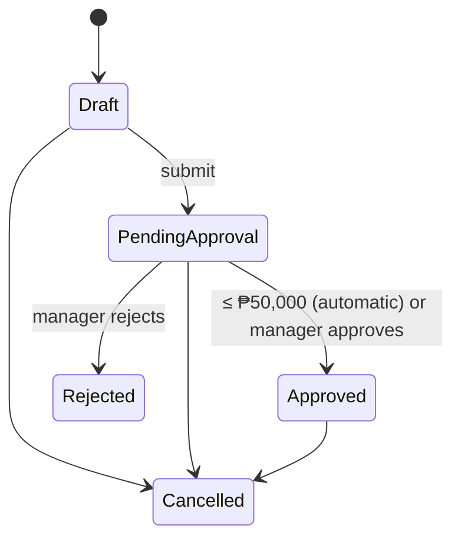

# Lesson 03 — The Domain Model: The Rules, in Plain C#

Good day, developer! Today is the most important lesson in the whole course. We'll write the business rules
themselves: when a customer is blocked, how much credit is left, when an order needs a manager, and why
nobody may approve their own order. And we'll do it with no database and no HTTP, just plain C#, so we can
prove every rule with tests that run in milliseconds. Give yourself about two hours. Are you ready? Let's
begin!

## What we'll build

| Piece | What it is |
|---|---|
| **Value objects** | `Money`, `Quantity`, and typed ids like `SalesOrderId` and `CustomerId` |
| **Base types** | `Entity`, `AggregateRoot`, `DomainException`, shared by every module |
| **Entities** | `Customer`, `ItemCategory` |
| **The aggregate** | `SalesOrder` with its lines, a status state machine, and the approval workflow |
| **A test project** | About twenty tests that need no database |

## Why we build it this way

### The pain: rules scattered across handlers

Here's the obvious version. You put the checks right where the data is loaded:

```csharp
// inside some handler
if (customer.IsBlocked) throw ...;
if (customer.Balance + total > customer.CreditLimit) throw ...;
order.Status = "PendingApproval";
```

Now "submit" has the credit check, "update" copies it, and the copy slowly drifts. Someone sets
`order.Status = "Approved"` straight from a draft, because nothing stops them. And testing the credit rule
means starting a database, because the rule lives next to the query.

### The fix: put each rule on the thing it's about

| The question | Where the answer lives |
|---|---|
| May this customer order? | A method on `Customer` |
| Can this order move from Draft to Approved? | A method on `SalesOrder`, guarded by a state machine |
| Is this amount valid? | `Money` itself: it refuses to exist if it isn't |

The data can only change through those methods, because the setters are private. So the rules can't be
skipped. And since none of this touches a database, every rule can be unit-tested.

Here's the one table to remember from the whole course. Every rule you'll ever write fits in one of these
rows:

| The question | Where it lives |
|---|---|
| Is the request well-formed? (positive ids, at least one line) | A validator ([lesson 06](06-create-order.md)) |
| Is this operation allowed? (blocked, credit, status, approval) | **The domain** — this lesson |
| Load, act, save | A handler ([lesson 06](06-create-order.md)), with no business `if`s |
| Two people acting at once | The database, atomically ([lessons 07](07-submit.md) and [09](09-update-order.md)) |

To remember it easily: if the question is "is this allowed?", the answer lives in the domain.

### Three words you need

- A **value object** is defined only by its value, and never changes. Think of money: any ₱1,000 bill is as
  good as any other. You don't care *which* bill you have, only its value. `Money` and `Quantity` are value
  objects.
- An **entity** has an identity that stays the same while its data changes. Customer #1 is still customer
  #1 after they change their name.
- An **aggregate** is a group of objects changed as one unit, with one **root** that the outside world
  talks to. An order and its lines are one aggregate: you never change a line except through its order.

## 1. Three base types

Every module's domain will need the same few building blocks, so they go in `Erp.Shared.BuildingBlocks`:

```csharp
// src/Shared/Erp.Shared.BuildingBlocks/Domain/BuildingBlocks.cs
namespace Erp.Shared.BuildingBlocks;

public abstract class Entity<TId> where TId : struct
{
    public TId Id { get; protected set; }
}

public abstract class AggregateRoot<TId> : Entity<TId> where TId : struct;

// A business rule said no. Becomes HTTP 422.
public class DomainException(string message) : Exception(message);
```

- **`Entity<TId>`** is anything with an identity. `TId` is a small struct like `SalesOrderId`, never a
  plain `long`; you'll see why in a moment.
- **`AggregateRoot<TId>`** marks the one entity the outside world talks to. It's empty for now. In
  [lesson 11](11-events-outbox.md) it learns to record events.
- **`DomainException`** is how a business rule says no.
- **`where TId : struct`** appears on both classes. Leave it off `AggregateRoot` and the compiler stops you
  with `CS0453`: a derived generic class must repeat its base class's constraints.

You might wonder why all of BuildingBlocks shares one namespace, whatever the folder. Folders like
`Domain/` are for people browsing the project; one namespace means one `using` line in every module.

## 2. Value objects and typed ids

Folder: `src/Modules/Sales/Erp.Modules.Sales/Domain/`. All `internal`.

```csharp
// Domain/Common/Money.cs
using Erp.Shared.BuildingBlocks;

namespace Erp.Modules.Sales.Domain;

// Philippine pesos, never negative.
internal readonly record struct Money
{
    public static readonly Money Zero = new(0m);

    public decimal Amount { get; }

    public Money(decimal amount) =>
        Amount = amount >= 0 ? amount : throw new DomainException("Money cannot be negative.");

    public static Money operator +(Money a, Money b) => new(a.Amount + b.Amount);
    public static Money operator *(Money m, int qty) => new(m.Amount * qty);
    public static bool operator >(Money a, Money b) => a.Amount > b.Amount;
    public static bool operator <(Money a, Money b) => a.Amount < b.Amount;
    public static bool operator >=(Money a, Money b) => a.Amount >= b.Amount;
    public static bool operator <=(Money a, Money b) => a.Amount <= b.Amount;
}
```

```csharp
// Domain/Common/Quantity.cs
using Erp.Shared.BuildingBlocks;

namespace Erp.Modules.Sales.Domain;

internal readonly record struct Quantity
{
    public int Value { get; }

    public Quantity(int value) =>
        Value = value > 0 ? value : throw new DomainException("Quantity must be greater than zero.");
}
```

A `readonly record struct` gives you two things for free: value equality (`new Money(5) == new Money(5)`)
and immutability. And because the constructor is the only way in, an invalid `Money` can't exist anywhere
in the program.

```csharp
// Domain/Common/ItemId.cs
namespace Erp.Modules.Sales.Domain;

// An item Sales refers to but does not own.
internal readonly record struct ItemId(long Value);
```

```csharp
// Domain/Common/UserId.cs
namespace Erp.Modules.Sales.Domain;

// A user owned by the Identity module, referenced by id only.
internal readonly record struct UserId(long Value);
```

```csharp
// Domain/Customers/CustomerId.cs
namespace Erp.Modules.Sales.Domain;

internal readonly record struct CustomerId(long Value);
```

```csharp
// Domain/SalesOrders/SalesOrderId.cs
namespace Erp.Modules.Sales.Domain;

internal readonly record struct SalesOrderId(long Value);
```

You might be wondering why we don't just use `long`. Here's why: `Approve(long orderId, long customerId)`
happily accepts the two the wrong way round. With `Approve(SalesOrderId, CustomerId)`, that mistake is a
compile error. It costs one line per id. Easy, right?

## 3. Roles, once

`ItemCategory` needs to know that `Admin` bypasses restrictions, and the endpoints will need role names too.
A typo in a role string silently breaks an auth check, so they're defined once:

```csharp
// src/Shared/Erp.Shared.BuildingBlocks/Abstractions/Roles.cs
namespace Erp.Shared.BuildingBlocks;

public static class Roles
{
    public const string SalesRep = "SalesRep";
    public const string SalesManager = "SalesManager";
    public const string Admin = "Admin";
}
```

## 4. Customer and item category

```csharp
// Domain/Customers/Customer.cs
using Erp.Shared.BuildingBlocks;

namespace Erp.Modules.Sales.Domain;

internal sealed class Customer
{
    public CustomerId Id { get; private set; }
    public string Name { get; private set; } = default!;
    public bool IsBlocked { get; private set; }
    public Money CreditLimit { get; private set; }
    public Money OutstandingBalance { get; private set; }   // approved orders the customer hasn't paid for yet

    public Customer(CustomerId id, string name, bool isBlocked, Money creditLimit, Money outstandingBalance)
    { Id = id; Name = name; IsBlocked = isBlocked; CreditLimit = creditLimit; OutstandingBalance = outstandingBalance; }

    public void EnsureNotBlocked()
    {
        if (IsBlocked)
            throw new DomainException($"Customer '{Name}' is blocked and cannot place orders.");
    }

    // Exposure = what they owe + what's awaiting approval + this order.
    public void EnsureWithinCreditLimit(Money orderTotal, Money otherPendingTotal)
    {
        if (OutstandingBalance + otherPendingTotal + orderTotal <= CreditLimit) return;

        var available = Math.Max(0, CreditLimit.Amount - OutstandingBalance.Amount - otherPendingTotal.Amount);
        throw new DomainException(
            $"Order total ₱{orderTotal.Amount:N2} would exceed the credit limit. Available credit: ₱{available:N2}.");
    }

    public void AddToBalance(Money amount) => OutstandingBalance += amount;

    public void DeductFromBalance(Money amount) =>
        OutstandingBalance = new Money(OutstandingBalance.Amount - amount.Amount);
}
```

Look closely at the credit rule. It counts **orders still waiting for approval** (`otherPendingTotal`).
Without that, a rep could submit three ₱75,000 orders for a customer with a ₱200,000 limit. Each one passes
on its own, and all three together go over the limit. The caller supplies that total, and
[lesson 07](07-submit.md) shows how to compute it safely.

```csharp
// Domain/ItemCategories/ItemCategory.cs
using Erp.Shared.BuildingBlocks;

namespace Erp.Modules.Sales.Domain;

internal sealed class ItemCategory
{
    public long Id { get; private set; }
    public string Name { get; private set; } = default!;
    public int MaxQuantityPerOrder { get; private set; }
    public string? RequiredRole { get; private set; }   // null = anyone

    public ItemCategory(long id, string name, int maxQuantityPerOrder, string? requiredRole)
    { Id = id; Name = name; MaxQuantityPerOrder = maxQuantityPerOrder; RequiredRole = requiredRole; }

    public void EnsureRoleAllowed(string callerRole)
    {
        if (RequiredRole is not null && !string.Equals(callerRole, RequiredRole, StringComparison.OrdinalIgnoreCase)
            && !string.Equals(callerRole, Roles.Admin, StringComparison.OrdinalIgnoreCase))
            throw new DomainException($"Category '{Name}' requires role '{RequiredRole}'.");
    }

    public void EnsureQuantityAllowed(int quantityOnOrder)
    {
        if (quantityOnOrder > MaxQuantityPerOrder)
            throw new DomainException(
                $"Category '{Name}' allows at most {MaxQuantityPerOrder} units per order (requested {quantityOnOrder}).");
    }
}
```

## 5. The order's states

```csharp
// Domain/SalesOrders/SalesOrderStatus.cs
namespace Erp.Modules.Sales.Domain;

// Stored as numbers: never renumber.
internal enum SalesOrderStatus
{
    Draft = 0,
    PendingApproval = 1,
    Approved = 2,
    Cancelled = 3,
    Rejected = 4
}
```

```csharp
// Domain/SalesOrders/SalesOrderStatusRules.cs
namespace Erp.Modules.Sales.Domain;

internal static class SalesOrderStatusRules
{
    private static readonly Dictionary<SalesOrderStatus, SalesOrderStatus[]> _allowed = new()
    {
        [SalesOrderStatus.Draft]           = new[] { SalesOrderStatus.PendingApproval, SalesOrderStatus.Cancelled },
        [SalesOrderStatus.PendingApproval] = new[] { SalesOrderStatus.Approved, SalesOrderStatus.Rejected, SalesOrderStatus.Cancelled },
        [SalesOrderStatus.Approved]        = new[] { SalesOrderStatus.Cancelled },
        [SalesOrderStatus.Cancelled]       = Array.Empty<SalesOrderStatus>(),
        [SalesOrderStatus.Rejected]        = Array.Empty<SalesOrderStatus>(),
    };

    public static bool CanTransitionTo(this SalesOrderStatus from, SalesOrderStatus to) =>
        _allowed[from].Contains(to);
}
```



That's the whole life of an order, in one dictionary. Every status change goes through one guarded method,
so an illegal jump isn't just discouraged, it's impossible.

```csharp
// Domain/SalesOrders/ApprovalPolicy.cs
namespace Erp.Modules.Sales.Domain;

internal static class ApprovalPolicy
{
    // Orders above this need a manager; at or below it they are approved on submit.
    public static readonly Money Threshold = new(50_000m);
}
```

```csharp
// Domain/SalesOrders/OrderNumbering.cs
namespace Erp.Modules.Sales.Domain;

// e.g. SO-2026-000042
internal static class OrderNumbering
{
    public static string Format(long sequence, DateTime nowUtc) => $"SO-{nowUtc:yyyy}-{sequence:000000}";
}
```

The number itself will come from the database ([lesson 06](06-create-order.md)). But how it's *shown* to
people is a business convention, so it lives here.

## 6. The aggregate

```csharp
// Domain/SalesOrders/SalesOrderLine.cs
namespace Erp.Modules.Sales.Domain;

internal sealed class SalesOrderLine
{
    public ItemId ItemId { get; private set; }
    public Quantity Quantity { get; private set; }
    public Money UnitPrice { get; private set; }
    public Money LineTotal => UnitPrice * Quantity.Value;

    public SalesOrderLine(ItemId itemId, Quantity qty, Money unitPrice)
    { ItemId = itemId; Quantity = qty; UnitPrice = unitPrice; }

    public void IncreaseQuantity(Quantity extra) => Quantity = new Quantity(Quantity.Value + extra.Value);
}
```

```csharp
// Domain/SalesOrders/SalesOrder.cs
using Erp.Shared.BuildingBlocks;

namespace Erp.Modules.Sales.Domain;

internal sealed class SalesOrder : AggregateRoot<SalesOrderId>
{
    private readonly List<SalesOrderLine> _lines = new();
    public IReadOnlyList<SalesOrderLine> Lines => _lines;

    public string OrderNumber { get; private set; } = default!;
    public CustomerId CustomerId { get; private set; }
    public SalesOrderStatus Status { get; private set; }
    public UserId CreatedBy { get; private set; }
    public DateTime CreatedUtc { get; private set; }
    public DateTime? SubmittedUtc { get; private set; }
    public UserId? ApprovedBy { get; private set; }   // null = approved automatically
    public DateTime? ApprovedUtc { get; private set; }
    public UserId? RejectedBy { get; private set; }
    public DateTime? RejectedUtc { get; private set; }
    public string? RejectionReason { get; private set; }

    public Money Total => _lines.Aggregate(Money.Zero, (sum, l) => sum + l.LineTotal);
    public bool RequiresApproval => Total > ApprovalPolicy.Threshold;
    public bool HoldsStock => Status is SalesOrderStatus.PendingApproval or SalesOrderStatus.Approved;

    private SalesOrder() { }

    public static SalesOrder Create(string orderNumber, CustomerId customerId, UserId createdBy, DateTime nowUtc) => new()
    {
        OrderNumber = orderNumber,
        CustomerId = customerId,
        CreatedBy = createdBy,
        CreatedUtc = nowUtc,
        Status = SalesOrderStatus.Draft
    };

    public void AddLine(ItemId itemId, Quantity qty, Money unitPrice)
    {
        EnsureDraft();
        var existing = _lines.FirstOrDefault(l => l.ItemId == itemId);
        if (existing is not null) existing.IncreaseQuantity(qty);
        else _lines.Add(new SalesOrderLine(itemId, qty, unitPrice));
    }

    public void ClearLines()
    {
        EnsureDraft();
        _lines.Clear();
    }

    // otherPendingTotal: the customer's other submitted-but-unapproved orders, which already count against credit.
    public void Submit(Customer customer, Money otherPendingTotal, DateTime nowUtc)
    {
        EnsureBelongsTo(customer);
        if (_lines.Count == 0)
            throw new DomainException("Cannot submit an order with no lines.");
        customer.EnsureNotBlocked();
        customer.EnsureWithinCreditLimit(Total, otherPendingTotal);

        Transition(SalesOrderStatus.PendingApproval);
        SubmittedUtc = nowUtc;

        if (!RequiresApproval)
            MarkApproved(approver: null, customer, nowUtc);
    }

    public void Approve(UserId approver, Customer customer, DateTime nowUtc)
    {
        EnsureBelongsTo(customer);
        if (approver == CreatedBy)
            throw new DomainException("An order can't be approved by the person who created it.");
        MarkApproved(approver, customer, nowUtc);
    }

    // Returns the lines whose reserved stock must be released.
    public IReadOnlyList<SalesOrderLine> Reject(UserId rejectedBy, string reason, DateTime nowUtc)
    {
        if (string.IsNullOrWhiteSpace(reason))
            throw new DomainException("A rejection needs a reason.");
        Transition(SalesOrderStatus.Rejected);
        RejectedBy = rejectedBy;
        RejectedUtc = nowUtc;
        RejectionReason = reason.Trim();
        return _lines;
    }

    // Returns the lines whose reserved stock must be released (none for a draft).
    public IReadOnlyList<SalesOrderLine> Cancel(Customer customer)
    {
        EnsureBelongsTo(customer);
        var heldStock = HoldsStock;
        var wasCharged = Status == SalesOrderStatus.Approved;

        Transition(SalesOrderStatus.Cancelled);

        if (wasCharged)
            customer.DeductFromBalance(Total);
        return heldStock ? _lines : [];
    }

    private void MarkApproved(UserId? approver, Customer customer, DateTime nowUtc)
    {
        Transition(SalesOrderStatus.Approved);
        ApprovedBy = approver;
        ApprovedUtc = nowUtc;
        customer.AddToBalance(Total);
    }

    private void EnsureDraft()
    {
        if (Status != SalesOrderStatus.Draft)
            throw new DomainException("Lines can only be changed on a draft order.");
    }

    private void EnsureBelongsTo(Customer customer)
    {
        if (customer.Id != CustomerId)
            throw new InvalidOperationException($"Customer {customer.Id.Value} does not own order {OrderNumber}.");
    }

    private void Transition(SalesOrderStatus to)
    {
        if (!Status.CanTransitionTo(to))
            throw new DomainException($"Cannot move a {Status} order to {to}.");
        Status = to;
    }
}
```

That's a long class, so let's read it the way a business person would, one sentence at a time:

- **`Total` is computed** from the lines. It can never disagree with them, because it's never stored.
- **`Submit`** checks the customer and moves the order to `PendingApproval`. If the order is ₱50,000 or
  less, it approves it on the spot. Small orders don't wait for a manager.
- **`Approve`** refuses the person who created the order. Businesses call this *segregation of duties*:
  nobody signs off on their own big sale.
- **Approving charges the customer** (`AddToBalance`), and **cancelling an approved order takes it back**.
  The domain does both, so no handler can forget one.
- **`Reject` and `Cancel` return the lines to release.** The order knows whether it was holding stock; the
  handler just does what it's told ([lesson 08](08-approve-reject-cancel.md)). No business `if` leaks out.
- **The time comes in as a parameter** (`nowUtc`) instead of `DateTime.UtcNow`, so tests can control it.
- `EnsureBelongsTo` throws `InvalidOperationException`, not `DomainException`. Passing the wrong customer is
  a programming bug, not a business rule a user can break.

Clear so far? Good. Now let's prove all of it.

## 7. Prove it with unit tests

We'll start from a plain class library, because the `xunit` project template writes a version on every
package line, and central package management refuses those. Then we add the test packages ourselves:

```bash
dotnet new classlib -n Erp.Modules.Sales.UnitTests -o tests/Erp.Modules.Sales.UnitTests
rm tests/Erp.Modules.Sales.UnitTests/Class1.cs
dotnet sln add tests/Erp.Modules.Sales.UnitTests
dotnet add tests/Erp.Modules.Sales.UnitTests reference src/Modules/Sales/Erp.Modules.Sales

dotnet add tests/Erp.Modules.Sales.UnitTests package Microsoft.NET.Test.Sdk --version 17.14.1
dotnet add tests/Erp.Modules.Sales.UnitTests package xunit --version 2.9.3
dotnet add tests/Erp.Modules.Sales.UnitTests package xunit.runner.visualstudio --version 3.1.4
dotnet add tests/Erp.Modules.Sales.UnitTests package AwesomeAssertions --version 9.6.0
```

| Package | What it gives us | License |
|---|---|---|
| `Microsoft.NET.Test.Sdk` | Turns the project into one `dotnet test` can run | MIT |
| `xunit` | The test framework: `[Fact]` marks a test | Apache-2.0 |
| `xunit.runner.visualstudio` | Lets `dotnet test` and your editor find and run xUnit tests | Apache-2.0 |
| `AwesomeAssertions` | Readable checks like `order.Status.Should().Be(...)` | Apache-2.0 |

You might wonder why AwesomeAssertions and not the better-known FluentAssertions. FluentAssertions 8 and
later needs a paid license for commercial use. AwesomeAssertions is its free community fork, with almost the
same API.

Now open the test `.csproj`, delete its `<PropertyGroup>` as before, and add two small things:

```xml
<PropertyGroup>
  <IsPackable>false</IsPackable>        <!-- a test project is never published as a NuGet package -->
</PropertyGroup>

<ItemGroup>
  <Using Include="Xunit" />             <!-- every test file uses xUnit, so import it once for all of them -->
</ItemGroup>
```

The domain is `internal`, so let the test project in. In `Erp.Modules.Sales.csproj`, add a line next to
the `Erp.Api` one:

```xml
<InternalsVisibleTo Include="Erp.Modules.Sales.UnitTests" />
```

```csharp
// tests/Erp.Modules.Sales.UnitTests/DomainTests.cs
using AwesomeAssertions;
using Erp.Modules.Sales.Domain;
using Erp.Shared.BuildingBlocks;

namespace Erp.Modules.Sales.UnitTests;

internal static class Make
{
    public static readonly DateTime Now = new(2026, 11, 5, 9, 0, 0, DateTimeKind.Utc);
    public static readonly UserId Rep = new(1);
    public static readonly UserId Manager = new(2);

    public static Customer Customer(decimal limit = 1_000_000, decimal balance = 0, bool blocked = false) =>
        new(new CustomerId(1), "Acme", blocked, new Money(limit), new Money(balance));

    public static SalesOrder Order(decimal unitPrice, int qty = 1)
    {
        var order = SalesOrder.Create("SO-1", new CustomerId(1), Rep, Now);
        order.AddLine(new ItemId(1), new Quantity(qty), new Money(unitPrice));
        return order;
    }
}

public class CustomerRuleTests
{
    [Fact]
    public void Blocked_customer_cannot_order() =>
        Make.Customer(blocked: true).Invoking(c => c.EnsureNotBlocked())
            .Should().Throw<DomainException>().WithMessage("*blocked*");

    [Fact]
    public void Order_over_available_credit_is_rejected() =>
        Make.Customer(limit: 5000, balance: 4500).Invoking(c => c.EnsureWithinCreditLimit(new Money(600), Money.Zero))
            .Should().Throw<DomainException>().WithMessage("*credit limit*");

    [Fact]
    public void Order_within_available_credit_is_allowed() =>
        Make.Customer(limit: 5000, balance: 4500).Invoking(c => c.EnsureWithinCreditLimit(new Money(400), Money.Zero))
            .Should().NotThrow();

    [Fact]
    public void Orders_awaiting_approval_count_against_credit() =>
        Make.Customer(limit: 200_000).Invoking(c => c.EnsureWithinCreditLimit(new Money(75_000), new Money(150_000)))
            .Should().Throw<DomainException>().WithMessage("*Available credit: ₱50,000.00*");
}

public class CategoryRuleTests
{
    private static readonly ItemCategory Controlled = new(2, "Controlled", maxQuantityPerOrder: 5, requiredRole: Roles.SalesManager);

    [Fact]
    public void Controlled_category_requires_manager_role()
    {
        Controlled.Invoking(c => c.EnsureRoleAllowed(Roles.SalesRep)).Should().Throw<DomainException>();
        Controlled.Invoking(c => c.EnsureRoleAllowed(Roles.SalesManager)).Should().NotThrow();
        Controlled.Invoking(c => c.EnsureRoleAllowed(Roles.Admin)).Should().NotThrow();
    }

    [Fact]
    public void Category_quantity_cap_is_enforced()
    {
        Controlled.Invoking(c => c.EnsureQuantityAllowed(6)).Should().Throw<DomainException>();
        Controlled.Invoking(c => c.EnsureQuantityAllowed(5)).Should().NotThrow();
    }
}

public class SubmitAndApproveTests
{
    [Fact]
    public void Small_order_is_approved_automatically_and_charged()
    {
        var customer = Make.Customer();
        var order = Make.Order(unitPrice: 25, qty: 2);

        order.Submit(customer, Money.Zero, Make.Now);

        order.Status.Should().Be(SalesOrderStatus.Approved);
        order.ApprovedBy.Should().BeNull();
        customer.OutstandingBalance.Should().Be(new Money(50));
    }

    [Fact]
    public void High_value_order_waits_for_a_manager()
    {
        var customer = Make.Customer();
        var order = Make.Order(unitPrice: 60_000);

        order.Submit(customer, Money.Zero, Make.Now);

        order.Status.Should().Be(SalesOrderStatus.PendingApproval);
        customer.OutstandingBalance.Should().Be(Money.Zero);
    }

    [Fact]
    public void Manager_approval_charges_the_customer()
    {
        var customer = Make.Customer();
        var order = Make.Order(unitPrice: 60_000);
        order.Submit(customer, Money.Zero, Make.Now);

        order.Approve(Make.Manager, customer, Make.Now);

        order.Status.Should().Be(SalesOrderStatus.Approved);
        order.ApprovedBy.Should().Be(Make.Manager);
        customer.OutstandingBalance.Should().Be(new Money(60_000));
    }

    [Fact]
    public void Creator_cannot_approve_their_own_order()
    {
        var customer = Make.Customer();
        var order = Make.Order(unitPrice: 60_000);
        order.Submit(customer, Money.Zero, Make.Now);

        order.Invoking(o => o.Approve(Make.Rep, customer, Make.Now))
            .Should().Throw<DomainException>().WithMessage("*person who created it*");
    }

    [Fact]
    public void Cannot_approve_a_draft() =>
        Make.Order(unitPrice: 60_000).Invoking(o => o.Approve(Make.Manager, Make.Customer(), Make.Now))
            .Should().Throw<DomainException>();

    [Fact]
    public void Cannot_submit_an_empty_order() =>
        SalesOrder.Create("SO-1", new CustomerId(1), Make.Rep, Make.Now)
            .Invoking(o => o.Submit(Make.Customer(), Money.Zero, Make.Now))
            .Should().Throw<DomainException>().WithMessage("*no lines*");

    [Fact]
    public void Blocked_customer_cannot_submit() =>
        Make.Order(unitPrice: 25).Invoking(o => o.Submit(Make.Customer(blocked: true), Money.Zero, Make.Now))
            .Should().Throw<DomainException>().WithMessage("*blocked*");

    [Fact]
    public void Cannot_add_lines_after_submitting()
    {
        var order = Make.Order(unitPrice: 25);
        order.Submit(Make.Customer(), Money.Zero, Make.Now);
        order.Invoking(o => o.AddLine(new ItemId(2), new Quantity(1), new Money(40))).Should().Throw<DomainException>();
    }
}

public class RejectAndCancelTests
{
    [Fact]
    public void Rejecting_needs_a_reason_and_releases_the_stock()
    {
        var order = Make.Order(unitPrice: 60_000);
        order.Submit(Make.Customer(), Money.Zero, Make.Now);

        order.Invoking(o => o.Reject(Make.Manager, " ", Make.Now)).Should().Throw<DomainException>();

        var released = order.Reject(Make.Manager, "Customer asked for a quote first", Make.Now);
        order.Status.Should().Be(SalesOrderStatus.Rejected);
        order.RejectionReason.Should().Be("Customer asked for a quote first");
        released.Should().HaveCount(1);
    }

    [Fact]
    public void Cancelling_an_approved_order_reverses_the_charge_and_releases_stock()
    {
        var customer = Make.Customer();
        var order = Make.Order(unitPrice: 25, qty: 2);
        order.Submit(customer, Money.Zero, Make.Now);   // auto-approved: charged ₱50

        var released = order.Cancel(customer);

        order.Status.Should().Be(SalesOrderStatus.Cancelled);
        customer.OutstandingBalance.Should().Be(Money.Zero);
        released.Should().HaveCount(1);
    }

    [Fact]
    public void Cancelling_a_draft_releases_nothing() =>
        Make.Order(unitPrice: 25).Cancel(Make.Customer()).Should().BeEmpty();

    [Fact]
    public void Approved_cannot_go_back_to_pending() =>
        SalesOrderStatus.Approved.CanTransitionTo(SalesOrderStatus.PendingApproval).Should().BeFalse();
}

public class ValueObjectTests
{
    [Fact]
    public void Total_is_the_sum_of_lines()
    {
        var order = SalesOrder.Create("SO-1", new CustomerId(1), Make.Rep, Make.Now);
        order.AddLine(new ItemId(1), new Quantity(2), new Money(25));
        order.AddLine(new ItemId(2), new Quantity(3), new Money(40));
        order.Total.Should().Be(new Money(170));
    }

    [Fact]
    public void Quantity_must_be_positive() =>
        FluentActions.Invoking(() => new Quantity(0)).Should().Throw<DomainException>();

    [Fact]
    public void Money_cannot_be_negative() =>
        FluentActions.Invoking(() => new Money(-1)).Should().Throw<DomainException>();
}
```

Each test reads like a sentence from the business rules. When a rule changes, the test that names it is the
first thing you update.

## Mistakes to avoid

- Public setters "for convenience". One `order.Status = Approved` anywhere, and the state machine is just
  decoration.
- Storing `Total`. A stored total can disagree with the lines; a computed one can't. (The read side
  computes it in SQL too, in [lesson 10](10-reads.md).)
- `DateTime.UtcNow` inside the domain. You can't test it. Pass the time in.
- Throwing `DomainException` for programmer mistakes. It becomes a 422 the user sees, when a bug should be
  a loud 500.
- Vague method names. Use one method per business verb (`Submit`, `Approve`, `Reject`, `Cancel`), named in
  the business's own words.

## Let's run it!

```bash
dotnet test
```

```
Passed!  - Failed: 0, Passed: 21, Skipped: 0, Total: 21
```

Twenty-one business rules, proven in well under a second, with no database in sight. That's the reward for
keeping the domain pure.

## Let's check!

1. Why does `Customer.EnsureWithinCreditLimit` take `otherPendingTotal`? Describe the bug without it.
2. Where is "an order over ₱50,000 needs a manager" enforced, and how does a small order skip the manager?
3. Why does `Reject` return the order's lines, instead of the handler deciding what to release?
4. What stops a handler from setting `order.Status = SalesOrderStatus.Approved` on a draft?
5. Why is `CustomerId` a struct and not a `long`?
6. Why does approving charge the customer inside the domain, and not in the handler?

And that's where this lesson ends. You now have every business rule of the Sales module, in plain C#, with
tests to prove them. Next time, we give the module its memory: a PostgreSQL database. Good luck, developer!

---

← [Lesson 02 — Mediator](02-mediator.md) · Next: [Lesson 04 — Database](04-database.md) →
