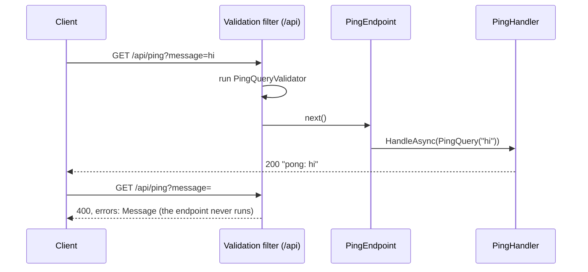

# Lesson 03 — Features: One Handler per Request, Checked at the Door

Good day, developer! Last time, we taught the computer to check our work. Today we write our first feature the
way every feature in this course will be written: an endpoint that speaks HTTP, a handler that does the work,
and a validator that refuses a bad request before the handler ever sees it. Along the way, every request in
the whole API will get validated automatically, without a single endpoint asking for it. It takes about an
hour. Are you ready? Let's begin!

## What we'll build

- A feature in two files: the **handler** (the message and the class that does the work) and the
  **endpoint** (the HTTP part).
- Commands and queries as small message types, so a reader always knows whether a request changes something.
- **One validation filter** on the `/api` group: every request that has a validator is checked there, and a
  bad one gets a proper `400 Bad Request` with the field that's wrong.
- The module's **two public methods**: `AddSalesModule()` registers its pieces, `MapSalesEndpoints()` maps its
  addresses.
- A throwaway `GET /api/ping` feature, and a page in the app that calls it, to prove it all works. We'll
  delete both in [lesson 07](07-create-order.md).
- The first **unit tests** (the validator and the handler, alone), and the first **architecture tests**
  (the module walls, checked on every build).

## Why we build it this way

### The pain

Here's the obvious design. Each endpoint does the work right where the request arrives:

```csharp
app.MapPost("/sales-orders", async (CreateOrderRequest body, SalesDbContext db) =>
{
    if (body.Lines.Count == 0) return Results.BadRequest("An order needs at least one line.");
    // ...thirty lines that build and save the order...
    return Results.Created($"/sales-orders/{order.Id}", new { order.Id });
});
```

For one endpoint, that's fine. By the tenth, two things hurt. The checks ("at least one line", "a positive
quantity") are copied into every endpoint, each copy a little different, and the day one is forgotten, bad
data gets in. And the work is tangled with HTTP: to test the thirty lines, you have to send a web request.

### The fix

We split each feature in two, and pull the checks out of both:

- The **handler** is a plain class that does the work. It knows nothing about HTTP, so a test can create it
  with `new` and call it.
- The **endpoint** only translates: the HTTP request into a message for the handler, and the handler's answer
  back into HTTP. Nothing else.
- The **validator** says what a well-formed request looks like. One **endpoint filter**, set once on the whole
  `/api` group, runs it before the endpoint. Written once, used everywhere, impossible to forget.

There are two kinds of message, so the intent is always clear:

| Kind | What it does | Example |
|---|---|---|
| **Command** | Changes something | `CreateSalesOrderCommand` |
| **Query** | Only reads | `GetSalesOrderQuery` |

Handling commands and queries separately like this is called **CQRS-lite**. You'll see why it pays off in
[lesson 08](08-find-orders.md), where queries start reading the database a different way than commands write
it.

If you came from WebForms, here's the translation: the endpoint is your `[WebMethod]`, the handler is the code
that used to live in the code-behind, and the validator is your `RequiredFieldValidator`, except it runs on
the server where nobody can switch it off.

### What about a mediator?

Many .NET tutorials put a **mediator** library (MediatR, or `martinothamar/Mediator`) between the endpoint and
the handler: the endpoint sends a message, and the library finds the handler and runs it, wrapped in
"behaviors" for logging and validation. It's worth knowing why we don't.

A mediator earns its place when the same request arrives from many places (HTTP, a background job, a message
queue) and every path needs the same checks. Ours arrive only from HTTP, and ASP.NET Core already has the
hook for that: the endpoint filter. Tracing and timing every request comes from OpenTelemetry in
[lesson 14](14-observability.md), again without touching an endpoint. And a mediator has costs: "Go to
definition" on a message lands on the message, not on the code that runs; and the source-generated one has
to see every module's `internal` handlers from the host, which punches a hole in the walls we built in
lesson 01. So the endpoint calls its handler directly, and you can always click straight through to it.

The one place we *do* want "deliver this to whoever is interested, without knowing who" is events between
modules. We'll build exactly that, small, in [lesson 13](13-events-outbox.md).

## 1. The packages

```bash
dotnet add src/Modules/Sales/Erp.Modules.Sales package FluentValidation.DependencyInjectionExtensions --version 12.1.1
dotnet add src/Erp.Api package FluentValidation --version 12.1.1
```

| Package | What it gives us | License |
|---|---|---|
| `FluentValidation` | A clean way to write validation rules: `RuleFor(x => x.Message).NotEmpty()` | Apache-2.0 |
| `FluentValidation.DependencyInjectionExtensions` | `AddValidatorsFromAssembly`, which finds and registers every validator for us (brings `FluentValidation` with it) | Apache-2.0 |

Why not .NET 10's own validation (`AddValidation()`)? It only checks **public** classes in the host project.
We tried it on a module's internal request: it skipped it, silently, and let an empty value through with a 200.
Our modules are all `internal`, so we use FluentValidation, which works with them.

## 2. Our first feature: message, validator, handler

Each feature is two files in its own folder. First the handler file:

```csharp
// src/Modules/Sales/Erp.Modules.Sales/Features/Ping/PingHandler.cs
using System.Diagnostics.CodeAnalysis;
using FluentValidation;

namespace Erp.Modules.Sales.Features;

// The query string binds straight onto this record; the default makes "message" optional in the address.
internal sealed record PingQuery(string Message = "");

internal sealed class PingQueryValidator : AbstractValidator<PingQuery>
{
    public PingQueryValidator() => RuleFor(x => x.Message).NotEmpty();
}

internal sealed class PingHandler
{
    [SuppressMessage("Performance", "CA1822", Justification = "A stand-in with nothing to inject; real handlers take their DbContext.")]
    public Task<string> HandleAsync(PingQuery query, CancellationToken ct) =>
        Task.FromResult($"pong: {query.Message}");
}
```

- **`PingQuery`** is the message. It reads, so it's a query.
- **`PingQueryValidator`** says what a good `PingQuery` looks like. It's next to the query because the
  endpoint receives the query itself, straight from the address.
- **`PingHandler`** does the work. No base class, no interface: a plain class with one `HandleAsync` method.
  It returns a `Task` because nearly every real handler waits for the database.
- **`[SuppressMessage]`** answers the first analyzer warning you'll meet: CA1822 notices that `HandleAsync`
  uses nothing of its own and suggests making it `static`. It's right, for Ping. But every real handler holds
  a database context, and Ping is gone in four lessons, so we switch the warning off *for this one method*,
  with the reason written next to it. A rule that never fits the whole project goes in `.editorconfig`
  instead, like lesson 01's CA1716.

Everything is `internal`.

## 3. The endpoint

```csharp
// src/Modules/Sales/Erp.Modules.Sales/Features/Ping/PingEndpoint.cs
using Microsoft.AspNetCore.Builder;
using Microsoft.AspNetCore.Http;
using Microsoft.AspNetCore.Routing;

namespace Erp.Modules.Sales.Features;

internal static class PingEndpoint
{
    public static void Map(IEndpointRouteBuilder app) =>
        app.MapGet("/ping", async ([AsParameters] PingQuery query, PingHandler handler, CancellationToken ct) =>
            TypedResults.Ok(await handler.HandleAsync(query, ct)));
}
```

Three things to see here:

- **`[AsParameters] PingQuery query`** builds the query from the address: `/ping?message=hi` becomes
  `new PingQuery("hi")`.
- **`PingHandler handler`** comes from dependency injection. The endpoint asks for the handler it needs, by
  name. Press "Go to definition" on it, and you're in the code that runs.
- **`TypedResults.Ok(...)`** rather than `Results.Ok(...)`. Microsoft's docs prefer `TypedResults`: the answer
  has a real type (`Ok<string>`), so a test can check it, and the API description we add in
  [lesson 07](07-create-order.md) knows what every endpoint can answer without being told.

## 4. The module's two public methods

Now we meet the first price of `internal`. Read this part slowly, because both problems fail *silently*:

| Problem | What happens if you ignore it |
|---|---|
| The host can't see `PingEndpoint` or `PingHandler`: they're internal | It can't map the route or create the handler |
| `AddValidatorsFromAssembly` skips **internal** validators unless told otherwise | Validation simply never runs, with no error |

So the module does both itself, from inside its own assembly, where `internal` is visible:

```csharp
// src/Modules/Sales/Erp.Modules.Sales/SalesModule.cs
using Erp.Modules.Sales.Features;
using FluentValidation;
using Microsoft.AspNetCore.Routing;
using Microsoft.Extensions.DependencyInjection;

namespace Erp.Modules.Sales;

public static class SalesModule
{
    public static IServiceCollection AddSalesModule(this IServiceCollection services)
    {
        // Handlers: plain classes, injected straight into the endpoints that use them.
        services.AddScoped<PingHandler>();

        // Without includeInternalTypes no validator is found, and validation silently stops.
        services.AddValidatorsFromAssembly(typeof(SalesModule).Assembly, includeInternalTypes: true);
        return services;
    }

    public static IEndpointRouteBuilder MapSalesEndpoints(this IEndpointRouteBuilder api)
    {
        PingEndpoint.Map(api);
        return api;
    }
}
```

These two methods are the module's whole public face. The host calls `AddSalesModule()` to plug the module's
services in, and `MapSalesEndpoints()` to plug its addresses in. It never sees anything else.

`AddScoped` means each HTTP request gets its own `PingHandler`. That's the lifetime you want for anything that
will talk to a database, which every other handler will.

Now, let's be honest about the cost here: every new handler is one more `AddScoped` line, and a forgotten one
breaks that endpoint. We'll write a test below that catches it the moment it happens.

## 5. The validation filter: once, for the whole API

The filter lives in the host, because it's about HTTP, and the host is the only place that sees every
module's endpoints:

```csharp
// src/Erp.Api/RequestValidation.cs
using FluentValidation;
using FluentValidation.Results;

namespace Erp.Api;

// Validates every endpoint argument that has a FluentValidation validator, before the endpoint runs. Attached once to
// the /api group, so no endpoint can forget it. A malformed request is answered 400 with its field errors; nothing is
// thrown, because a bad request is an everyday event, not an exceptional one.
internal static class RequestValidation
{
    public static RouteGroupBuilder ValidateRequests(this RouteGroupBuilder group) =>
        group.AddEndpointFilterFactory((context, next) =>
        {
            // Worked out once per endpoint at startup: which arguments have a validator at all.
            var isService = context.ApplicationServices.GetRequiredService<IServiceProviderIsService>();
            var validated = context.MethodInfo.GetParameters()
                .Select((p, index) => (Index: index, Validator: typeof(IValidator<>).MakeGenericType(p.ParameterType)))
                .Where(p => isService.IsService(p.Validator))
                .ToArray();
            if (validated.Length == 0) return next;

            return async invocation =>
            {
                var failures = new List<ValidationFailure>();
                foreach (var (index, validatorType) in validated)
                {
                    if (invocation.Arguments[index] is not { } argument) continue;
                    var validator = (IValidator)invocation.HttpContext.RequestServices.GetRequiredService(validatorType);
                    var result = await validator.ValidateAsync(new ValidationContext<object>(argument), invocation.HttpContext.RequestAborted);
                    failures.AddRange(result.Errors);
                }

                if (failures.Count == 0) return await next(invocation);
                return TypedResults.ValidationProblem(
                    failures.GroupBy(f => f.PropertyName).ToDictionary(g => g.Key, g => g.Select(f => f.ErrorMessage).ToArray()),
                    detail: string.Join(" ", failures.Select(f => f.ErrorMessage)));
            };
        });
}
```

It looks long, so let's read it in two halves:

- **At startup**, once per endpoint, the factory looks at the endpoint's parameters and asks: is there an
  `IValidator<T>` registered for this type? For `/ping`, the answer is yes for `PingQuery`. An endpoint with
  nothing to validate gets `next` back unchanged, and pays nothing per request.
- **On each request**, the filter runs those validators. If any rule fails, it answers
  `400 Bad Request` itself and the endpoint never runs. Otherwise `next` runs the endpoint.

The answer is a **problem details** body, the standard shape for an HTTP error (RFC 9457), with the failures
grouped by field so a form can mark the right box:

```json
{
  "title": "One or more validation errors occurred.",
  "status": 400,
  "detail": "'Message' must not be empty.",
  "errors": { "Message": ["'Message' must not be empty."] }
}
```

Notice what it doesn't do: throw. A user leaving a box empty happens all day; Microsoft's guidance is to
handle common conditions without exceptions, and an exception would be slower and would fill the logs with
noise.

Now wire it up. In `Program.cs`, before:

```csharp
var api = app.MapGroup("/api");
api.MapFallback(() => Results.NotFound());   // an unknown API address is a 404, never the app's page
```

After:

```csharp
// Every request with a body or query record is validated here, once, before any module's endpoint runs.
var api = app.MapGroup("/api").ValidateRequests();
api.MapSalesEndpoints();
api.MapFallback(() => Results.NotFound());   // an unknown API address is a 404, never the app's page
```

and add `using Erp.Api;` at the top. `MapSalesEndpoints()` maps `/ping` inside the `/api` group, so it answers
at `/api/ping`, without the endpoint knowing about the prefix. Not so hard, right?

## 6. Call it from a screen

A small page in the app: type a message, press the button, see the answer.

```razor
@* src/Erp.Web/Pages/Ping.razor *@
@page "/ping"
@inject HttpClient Http

<PageTitle>Ping · ERP</PageTitle>

<MudText Typo="Typo.h4" GutterBottom="true">Ping</MudText>

<MudStack Row="true" AlignItems="AlignItems.Center" Spacing="3" Class="mb-4">
    <MudTextField @bind-Value="_message" Label="Message" Immediate="true" />
    <MudButton OnClick="Send" Variant="Variant.Filled" Color="Color.Primary">Send</MudButton>
</MudStack>

@if (_answer is not null)
{
    <MudAlert Severity="@(_ok ? Severity.Success : Severity.Error)">@_answer</MudAlert>
}

@code {
    private string _message = "hello";
    private string? _answer;
    private bool _ok;

    private async Task Send()
    {
        var response = await Http.GetAsync($"api/ping?message={Uri.EscapeDataString(_message)}");
        _ok = response.IsSuccessStatusCode;
        _answer = _ok
            ? await response.Content.ReadFromJsonAsync<string>()
            : $"The server answered {(int)response.StatusCode}.";
    }
}
```

- **`@inject HttpClient Http`** asks dependency injection for the `HttpClient` lesson 01 registered, the one
  whose base address is the server that served the app. So `api/ping` goes to `/api/ping` on our host.
- **`@bind-Value` with `Immediate="true"`** updates `_message` on every keystroke, not only when you leave
  the box.
- **`@if (_answer is not null)`** shows the answer only once there is one. Blazor redraws the page by itself
  after `Send` finishes.

Then a way to get there, in `NavMenu.razor`, under Home:

```razor
<MudNavLink Href="ping" Icon="@Icons.Material.Filled.NetworkCheck">Ping</MudNavLink>
```

## 7. Prove it: the first unit tests, and a test for the walls

Last lesson's tests went through the front door, over HTTP. Today we have pieces small enough to test on
their own: a validator and a handler are plain classes. And we have rules that no compiler checks. Let's
prove them all.

### Unit tests: the pieces, alone

A **unit test** creates one class with `new`, calls it, and checks the answer. No web server, no database.
It runs in well under a millisecond, and when it fails, there's only one place to look.

```bash
dotnet new classlib -n Erp.Modules.Sales.UnitTests -o tests/Erp.Modules.Sales.UnitTests
rm tests/Erp.Modules.Sales.UnitTests/Class1.cs
dotnet sln add tests/Erp.Modules.Sales.UnitTests
dotnet add tests/Erp.Modules.Sales.UnitTests reference src/Modules/Sales/Erp.Modules.Sales
dotnet add tests/Erp.Modules.Sales.UnitTests package xunit.v3 --version 4.0.2
dotnet add tests/Erp.Modules.Sales.UnitTests package AwesomeAssertions --version 9.6.0
```

The same packages as last lesson, minus the web host. As before, delete the `<PropertyGroup>`, then add
`<IsPackable>false</IsPackable>`, `<OutputType>Exe</OutputType>` and `<Using Include="Xunit" />`.

Everything in Sales is `internal`, so the test project can't see `PingHandler` yet. Let it in, in
`Erp.Modules.Sales.csproj`:

```xml
<ItemGroup>
  <InternalsVisibleTo Include="Erp.Modules.Sales.UnitTests" />
</ItemGroup>
```

Only test projects ever get this line. Not the host, not another module.

```csharp
// tests/Erp.Modules.Sales.UnitTests/PingTests.cs
using AwesomeAssertions;
using Erp.Modules.Sales.Features;

namespace Erp.Modules.Sales.UnitTests;

public class PingTests
{
    [Fact]
    public async Task The_handler_answers_pong_and_the_message() =>
        (await new PingHandler().HandleAsync(new PingQuery("hi"), default)).Should().Be("pong: hi");

    [Theory]
    [InlineData("")]
    [InlineData("   ")]   // NotEmpty also refuses whitespace: a message of spaces says nothing
    public void An_empty_message_is_refused(string message) =>
        new PingQueryValidator().Validate(new PingQuery(message)).IsValid.Should().BeFalse();

    [Fact]
    public void Any_real_message_passes() =>
        new PingQueryValidator().Validate(new PingQuery("a")).IsValid.Should().BeTrue();
}
```

See how easy the handler is to test: `new PingHandler()`, call it, check. That's the payoff of keeping HTTP
out of it.

### The same thing through the front door

The unit tests prove the validator works. They can't prove it *runs*: that depends on `includeInternalTypes:
true` in `SalesModule`, and on `.ValidateRequests()` on the group. Forget either one, and the unit tests stay
green while the API happily answers `pong: ` to an empty message. Only a real request shows it.

The integration tests can't see Sales' internals either, and one test below needs to, so add a second line
next to the first in `Erp.Modules.Sales.csproj`:

```xml
<InternalsVisibleTo Include="Erp.Integration.Tests" />
```

```csharp
// tests/Erp.Integration.Tests/PingTests.cs
using System.Net;
using System.Net.Http.Json;
using System.Text.Json;
using AwesomeAssertions;

namespace Erp.Integration.Tests;

public class PingTests(CustomWebAppFactory factory) : IClassFixture<CustomWebAppFactory>
{
    [Fact]
    public async Task Ping_answers_through_its_handler() =>
        (await factory.CreateClient().GetFromJsonAsync<string>("/api/ping?message=hello")).Should().Be("pong: hello");

    // Regression guard: validators are internal. Without includeInternalTypes: true they silently never run.
    [Theory]
    [InlineData("/api/ping?message=")]
    [InlineData("/api/ping")]
    public async Task An_empty_message_is_a_400_that_names_the_field(string address)
    {
        var response = await factory.CreateClient().GetAsync(address);

        response.StatusCode.Should().Be(HttpStatusCode.BadRequest);
        var problem = await response.Content.ReadFromJsonAsync<JsonElement>();
        problem.GetProperty("errors").GetProperty("Message")[0].GetString().Should().Contain("must not be empty");
    }
}
```

And the test for that `AddScoped` cost we promised:

```csharp
// tests/Erp.Integration.Tests/WiringTests.cs
using AwesomeAssertions;
using Erp.Modules.Sales;
using Microsoft.Extensions.DependencyInjection;

namespace Erp.Integration.Tests;

// Each module registers its own handlers by hand. A handler that's never registered compiles and passes every unit test;
// then its endpoint fails at startup. This asks the running app's container for each one.
public class WiringTests(CustomWebAppFactory factory) : IClassFixture<CustomWebAppFactory>
{
    // Every new module joins this list.
    private static readonly Type[] Modules = [typeof(SalesModule)];

    [Fact]
    public async Task Every_feature_handler_is_registered()
    {
        var handlers = Modules.SelectMany(m => m.Assembly.GetTypes())
            .Where(t => t.Name.EndsWith("Handler", StringComparison.Ordinal) && (t.Namespace ?? "").EndsWith(".Features", StringComparison.Ordinal))
            .ToList();

        await using var scope = factory.Services.CreateAsyncScope();
        var isService = scope.ServiceProvider.GetRequiredService<IServiceProviderIsService>();
        handlers.Should().NotBeEmpty();
        handlers.Where(h => !isService.IsService(h)).Select(h => h.Name).Should().BeEmpty("an endpoint can only use a registered handler");
    }
}
```

`IServiceProviderIsService` answers "is this type registered?" without creating anything. And
`StringComparison.Ordinal`? The analyzers from lesson 01 ask for it: a plain `EndsWith` compares by the
computer's language settings, which is slower, and for names in code, wrong.

Make each one fail once:

- Remove `includeInternalTypes: true`: the 400 test goes red while the unit tests stay green. That's exactly
  why we have both kinds.
- Remove `.ValidateRequests()`: the same test goes red.
- Comment out `services.AddScoped<PingHandler>();`: the wiring test names `PingHandler`.

Put all three back.

### Architecture tests: the walls themselves

Some of our rules aren't about what the code does, but about how it's built: a module shows one public class;
its internals are visible only to test projects; features live in feature folders. The compiler doesn't check
any of that. A reviewer might miss it in a big change. An **architecture test** reads the compiled
assemblies with reflection and fails the build when a rule breaks.

```bash
dotnet new classlib -n Erp.Architecture.Tests -o tests/Erp.Architecture.Tests
rm tests/Erp.Architecture.Tests/Class1.cs
dotnet sln add tests/Erp.Architecture.Tests
dotnet add tests/Erp.Architecture.Tests reference src/Erp.Api
dotnet add tests/Erp.Architecture.Tests package xunit.v3 --version 4.0.2
dotnet add tests/Erp.Architecture.Tests package AwesomeAssertions --version 9.6.0
```

It references the host, which references every module, so every module is in reach. Same `.csproj` clean-up
as the others.

```csharp
// tests/Erp.Architecture.Tests/ModuleBoundaryTests.cs
using System.Reflection;
using System.Runtime.CompilerServices;
using AwesomeAssertions;
using Erp.Modules.Sales;

namespace Erp.Architecture.Tests;

// The module rules as tests: a reviewer can miss a stray `public` class; these can't.
public class ModuleBoundaryTests
{
    // Every new module joins this list.
    private static readonly Assembly[] Modules = [typeof(SalesModule).Assembly];

    [Fact]
    public void A_module_exposes_only_its_entry_class()
    {
        foreach (var module in Modules)
            module.GetExportedTypes().Select(t => t.FullName)
                .Should().ContainSingle($"{module.GetName().Name} should expose only its AddXModule entry class")
                .Which.Should().EndWith("Module");
    }

    // Not even the host: it reaches a module only through AddXModule and MapXEndpoints, so the compiler itself keeps
    // Program.cs away from a module's DbContext and handlers.
    [Fact]
    public void Internals_are_shared_only_with_tests()
    {
        foreach (var module in Modules)
            module.GetCustomAttributes<InternalsVisibleToAttribute>().Select(a => a.AssemblyName)
                .Should().OnlyContain(f => f.EndsWith("Tests", StringComparison.Ordinal),
                    $"{module.GetName().Name} may grant InternalsVisibleTo to test projects only, never to the host or another module");
    }

    // Vertical slices: a feature's files sit together. Folders named after a technical layer pull them apart again.
    [Fact]
    public void Code_is_grouped_by_feature_not_by_technical_layer()
    {
        string[] layers = [".Commands", ".Queries", ".Handlers", ".Validators", ".Endpoints", ".Repositories", ".Services"];

        Modules.SelectMany(m => m.GetTypes())
            .Select(t => t.Namespace ?? "")
            .Distinct()
            .Where(ns => layers.Any(l => ns.EndsWith(l, StringComparison.Ordinal)))
            .Should().BeEmpty("a feature folder holds its handler and endpoint together");
    }
}
```

- **`GetExportedTypes()`** returns only the public types: exactly the ones another project could use.
- **`InternalsVisibleToAttribute`** is what the `<InternalsVisibleTo>` lines in the `.csproj` turn into. The
  test reads them back out of the compiled module.

Make the first one fail once: add a file to Sales with `public static class SalesHelpers { }`, the kind of
"just a little helper" that slips in.

```
Expected module.GetExportedTypes().Select(t => t.FullName) to contain a single item because Erp.Modules.Sales
should expose only its AddXModule entry class, but found {"Erp.Modules.Sales.SalesHelpers", "Erp.Modules.Sales.SalesModule"}.
```

Delete it again. These tests grow with the course: the [domain model](04-domain-model.md) adds two, the
second module in [lesson 09](09-submit.md) adds three, [lesson 08](08-find-orders.md) adds one that keeps
commands and queries apart, and [lesson 13](13-events-outbox.md) adds the ones that catch an event nobody
handles.

### Edge cases covered in this lesson

| Test | The edge | Why it matters |
|---|---|---|
| `An_empty_message_is_refused` | Nothing: empty and whitespace | "Required" must mean more than "not null" |
| `Any_real_message_passes` | The smallest valid input | A rule that's too strict is a bug too |
| `An_empty_message_is_a_400_that_names_the_field` | Configuration, not code; the parameter left out entirely | The silent failure the unit test can't see |
| `Every_feature_handler_is_registered` | A forgotten `AddScoped` | The cost of registering by hand, caught at once |
| `A_module_exposes_only_its_entry_class` | One `public` too many | The wall gets a hole and nobody notices |
| `Internals_are_shared_only_with_tests` | A shortcut between modules, or into the host | One `InternalsVisibleTo` turns two islands into one |

## How a request flows



## Mistakes to avoid

- Forgetting `includeInternalTypes: true`. Your validators exist, compile, and never run.
- Forgetting the `AddScoped` line for a new handler. The wiring test catches it; so does the app, at startup.
- Putting logic in the endpoint. An endpoint turns HTTP into a message, and a result back into HTTP.
  Nothing else.
- Throwing an exception for a bad request. It's an everyday event: answer it.
- Granting `InternalsVisibleTo` to the host or to another module "just to share one class". Use a contract
  instead ([lesson 09](09-submit.md)).
- Testing only the validator with a unit test. It proves the rule, not that the rule runs; keep the one
  request that proves it.
- Naming a test project anything but `...Tests`. The architecture test allows `InternalsVisibleTo` only for
  names that end that way.
- Sharing one handler between two features. If two features need the same logic, it belongs in the domain
  ([lesson 04](04-domain-model.md)).

## Let's run it!

```bash
dotnet run --project src/Erp.Api
```

Open the app, click **Ping**, and press **Send**. The green box says `pong: hello`. That's a full trip: the
browser called the API, the filter checked the request, the endpoint called its handler, and the answer came
back to the screen.

Now clear the box and press **Send** again. The red box says "The server answered 400." The same from the
terminal shows why:

```bash
curl "http://localhost:5264/api/ping?message=hello"
# "pong: hello"

curl -i "http://localhost:5264/api/ping?message="
# HTTP/1.1 400 Bad Request
# Content-Type: application/problem+json
# {"title":"One or more validation errors occurred.","status":400,"detail":"'Message' must not be empty.",
#  "errors":{"Message":["'Message' must not be empty."]}}
```

The handler never ran: the filter refused the request at the door. In [lesson 07](07-create-order.md) the
page learns to show that `detail` instead of the bare status code.

Finally, the tests:

```bash
dotnet test
```

```
Test run summary: Passed!
  total: 23
  failed: 0
  succeeded: 23
  skipped: 0
```

That's 4 unit tests, 3 architecture tests and 16 integration tests.

## Let's check!

1. Why does the endpoint call its handler directly, instead of sending a message through a mediator? When
   would a mediator earn its place?
2. You forget `includeInternalTypes: true`. What happens when you send an empty message from the Ping page?
3. Why is the validation filter set once on the `/api` group, instead of on each endpoint?
4. What's the difference between a command and a query, and why bother telling them apart?
5. Why does a bad request get a 400 answer instead of an exception?
6. The unit test for `PingQueryValidator` passes, but the API still answers `pong: ` to an empty message.
   What's wrong, and which test catches it?
7. What does an architecture test check that the compiler doesn't? Give two examples.

And that's where this lesson ends. Our endpoints now hand their work to plain handlers, every request is
checked at the door, and the walls are checked by a test. Next time, we write the most important code in the
whole course: the business rules themselves. Good luck, developer!

---

← [Lesson 02 — Testing](02-testing.md) · Next: [Lesson 04 — Domain model](04-domain-model.md) →
