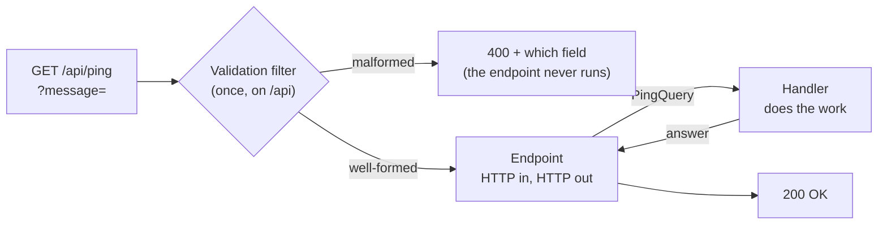
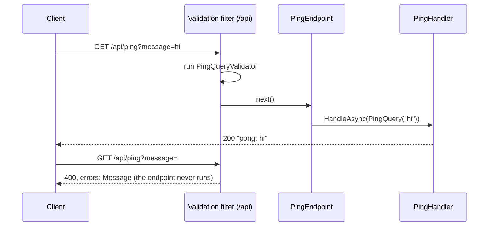

# Lesson 03 — Features: One Handler per Request, Checked at the Door

Good day, developer! Last time, we taught the computer to check our work. Today we write our first feature the
way every feature in this course will be written: an endpoint that speaks HTTP, a handler that does the work,
and a validator that refuses a bad request before the handler ever sees it. Along the way, every request in the
whole API gets validated automatically, without a single endpoint asking for it. It takes about an hour and a
half. Are you ready? Let's begin!

## What we'll build

- A feature in two files: the **handler** (the message and the class that does the work) and the **endpoint**
  (the HTTP part).
- Commands and queries as small message types, so a reader always knows whether a request changes something.
- **One validation filter** on the `/api` group: every request that has a validator is checked there, and a bad
  one gets a proper `400 Bad Request` naming the field that's wrong.
- The module's **two public methods**: `AddTicketsModule()` registers its pieces, `MapTicketsEndpoints()` maps
  its addresses.
- A throwaway `GET /api/ping` feature, and a page in the app that calls it, to prove it all works. There's no
  database yet, so there's nothing real to save. We delete both in lesson 07, when
  filing a ticket takes their place.
- The first **unit tests** (the validator and the handler, alone) and the first **architecture tests** (the
  module walls, checked on every build).

## Why we build it this way

### The pain

Here's the obvious design. Each endpoint does the work right where the request arrives:

```csharp
app.MapPost("/tickets", async (NewTicketRequest body, TicketsDbContext db) =>
{
    if (string.IsNullOrWhiteSpace(body.Subject)) return Results.BadRequest("A ticket needs a subject.");
    // ...thirty lines that build and save the ticket...
    return Results.Created($"/tickets/{ticket.Id}", new { ticket.Id });
});
```

For one endpoint, that's fine. By the tenth, two things hurt. The checks ("a subject", "a message", "a known
priority") are copied into every endpoint, each copy a little different, and the day one is forgotten, bad data
gets in. And the work is tangled with HTTP: to test the thirty lines, you have to send a web request.

### The fix

We split each feature in two, and pull the checks out of both:

- The **handler** is a plain class that does the work. It knows nothing about HTTP, so a test can create it
  with `new` and call it.
- The **endpoint** only translates: the HTTP request into a message for the handler, and the handler's answer
  back into HTTP. Nothing else.
- The **validator** says what a well-formed request looks like. One **endpoint filter**, set once on the whole
  `/api` group, runs it before the endpoint. Written once, used everywhere, impossible to forget.

Follow one request through the three pieces:



The handler never sees a bad request, and it never sees HTTP either. Each piece has one job, and you can test
each one alone.

There are two kinds of message, so the intent is always clear:

| Kind | What it does | Example |
|---|---|---|
| **Command** | Changes something | `CreateTicketCommand` |
| **Query** | Only reads | `GetTicketQuery` |

Handling commands and queries separately like this is called **CQRS-lite**. You'll see why it pays off in
lesson 08, where queries start reading the database a different way than commands write it.

If you came from WebForms, here's the translation: the endpoint is your `[WebMethod]`, the handler is the code
that used to live in the code-behind, and the validator is your `RequiredFieldValidator`, except it runs on the
server where nobody can switch it off.

### What about a mediator?

Many .NET tutorials put a **mediator** library between the endpoint and the handler: the endpoint sends a
message, and the library finds the handler and runs it, wrapped in "behaviors" for logging and validation. It's
worth knowing why we don't.

A mediator earns its place when the same request arrives from many places (HTTP, a background job, a message
queue) and every path needs the same checks. Ours arrive only from HTTP, and ASP.NET Core already has the hook
for that: the endpoint filter. Tracing and timing every request comes from OpenTelemetry in
lesson 14, again without touching an endpoint. And a mediator has costs: "Go to
definition" on a message lands on the message, not on the code that runs; and the popular one is a paid product
now, which our license rule forbids. So the endpoint calls its handler directly, and you can always click
straight through to it.

The one place we *do* want "deliver this to whoever is interested, without knowing who" is events between
modules. We'll build exactly that, small, in lesson 13.

## 1. The packages

```bash
dotnet add src/Modules/Tickets/Yasda.Modules.Tickets package FluentValidation.DependencyInjectionExtensions --version 12.1.1
dotnet add src/Yasda.Api package FluentValidation --version 12.1.1
```

| Package | What it gives us | License |
|---|---|---|
| `FluentValidation` | A clean way to write validation rules: `RuleFor(x => x.Message).NotEmpty()` | Apache-2.0 |
| `FluentValidation.DependencyInjectionExtensions` | `AddValidatorsFromAssembly`, which finds and registers every validator for us (brings `FluentValidation` with it) | Apache-2.0 |

Why not .NET 10's own validation (`AddValidation()`)? It only checks **public** classes in the host project. We
tried it on a module's internal request: it skipped it, silently, and let an empty value through with a 200.
Our modules are all `internal`, so we use FluentValidation, which works with them.

## 2. Our first feature: message, validator, handler

Each feature is two files in its own folder. First the handler file:

```csharp
// src/Modules/Tickets/Yasda.Modules.Tickets/Features/Ping/PingHandler.cs
using System.Diagnostics.CodeAnalysis;
using FluentValidation;

namespace Yasda.Modules.Tickets.Features;

// The query string binds straight onto this record; the default makes "message" optional in the address.
internal sealed record PingQuery(string Message = "");

internal sealed class PingQueryValidator : AbstractValidator<PingQuery>
{
    public PingQueryValidator()
    {
        RuleFor(x => x.Message).NotEmpty();
    }
}

internal sealed class PingHandler
{
    [SuppressMessage("Performance", "CA1822", Justification = "A stand-in with nothing to inject; real handlers take their DbContext.")]
    public Task<string> HandleAsync(PingQuery query, CancellationToken ct)
    {
        return Task.FromResult($"pong: {query.Message}");
    }
}
```

- **`PingQuery`** is the message. It reads, so it's a query.
- **`PingQueryValidator`** says what a good `PingQuery` looks like. It sits next to the query because the
  endpoint receives the query itself, straight from the address.
- **`PingHandler`** does the work. No base class, no interface: a plain class with one `HandleAsync` method. It
  returns a `Task` because nearly every real handler waits for the database.
- **`[SuppressMessage]`** answers the first analyzer warning you'll meet. CA1822 notices that `HandleAsync`
  uses nothing of its own and suggests making it `static`. It's right, for Ping. But every real handler holds a
  database context, and Ping is gone in four lessons, so we switch the warning off *for this one method*, with
  the reason written next to it. A rule that never fits the whole project goes in `.editorconfig` instead, like
  lesson 01's CA1716.

Everything is `internal`.

## 3. The endpoint

```csharp
// src/Modules/Tickets/Yasda.Modules.Tickets/Features/Ping/PingEndpoint.cs
using Microsoft.AspNetCore.Builder;
using Microsoft.AspNetCore.Http;
using Microsoft.AspNetCore.Routing;

namespace Yasda.Modules.Tickets.Features;

internal static class PingEndpoint
{
    public static void Map(IEndpointRouteBuilder app)
    {
        app.MapGet("/ping", async ([AsParameters] PingQuery query, PingHandler handler, CancellationToken ct) =>
        {
            var answer = await handler.HandleAsync(query, ct);
            return TypedResults.Ok(answer);
        });
    }
}
```

Three things to see here:

- **`[AsParameters] PingQuery query`** builds the query from the address: `/ping?message=hi` becomes
  `new PingQuery("hi")`.
- **`PingHandler handler`** comes from dependency injection. The endpoint asks for the handler it needs, by
  name. Press "Go to definition" on it, and you're in the code that runs.
- **`TypedResults.Ok(...)`** rather than `Results.Ok(...)`. Microsoft's docs prefer `TypedResults`: the answer
  has a real type (`Ok<string>`), so a test can check it, and the API description we add later knows what every
  endpoint can answer without being told.

## 4. The module's two public methods

Now we meet the first price of `internal`. Read this part slowly, because both problems fail *silently*:

| Problem | What happens if you ignore it |
|---|---|
| The host can't see `PingEndpoint` or `PingHandler`: they're internal | It can't map the route or create the handler |
| `AddValidatorsFromAssembly` skips **internal** validators unless told otherwise | Validation simply never runs, with no error |

So the module does both itself, from inside its own assembly, where `internal` is visible. Replace lesson 01's
`TicketsModule.cs` with:

```csharp
// src/Modules/Tickets/Yasda.Modules.Tickets/TicketsModule.cs
using FluentValidation;
using Microsoft.AspNetCore.Routing;
using Microsoft.Extensions.DependencyInjection;
using Yasda.Modules.Tickets.Features;

namespace Yasda.Modules.Tickets;

public static class TicketsModule
{
    public static IServiceCollection AddTicketsModule(this IServiceCollection services)
    {
        // Handlers: plain classes, injected straight into the endpoints that use them.
        services.AddScoped<PingHandler>();

        // Without includeInternalTypes no validator is found, and validation silently stops.
        services.AddValidatorsFromAssembly(typeof(TicketsModule).Assembly, includeInternalTypes: true);
        return services;
    }

    public static IEndpointRouteBuilder MapTicketsEndpoints(this IEndpointRouteBuilder api)
    {
        PingEndpoint.Map(api);
        return api;
    }
}
```

These two methods are the module's whole public face. The host calls `AddTicketsModule()` to plug the module's
services in, and `MapTicketsEndpoints()` to plug its addresses in. It never sees anything else.

`AddScoped` means each HTTP request gets its own `PingHandler`. That's the lifetime you want for anything that
will talk to a database, which every other handler will.

Now, let's be honest about the cost here: every new handler is one more `AddScoped` line, and a forgotten one
breaks that endpoint. We write a test below that catches it the moment it happens.

## 5. The validation filter: once, for the whole API

The filter lives in the host, because it's about HTTP, and the host is the only place that sees every module's
endpoints:

```csharp
// src/Yasda.Api/RequestValidation.cs
using FluentValidation;
using FluentValidation.Results;

namespace Yasda.Api;

// Validates every endpoint argument that has a FluentValidation validator, before the endpoint runs. Attached once to
// the /api group, so no endpoint can forget it. A malformed request is answered 400 with its field errors; nothing is
// thrown, because a bad request is an everyday event, not an exceptional one.
internal static class RequestValidation
{
    public static RouteGroupBuilder ValidateRequests(this RouteGroupBuilder group)
    {
        return group.AddEndpointFilterFactory((context, next) =>
        {
            // Worked out once per endpoint at startup: which arguments have a validator at all.
            // An argument's type is known only at startup, so its validator type is built by reflection.
            var isService = context.ApplicationServices.GetRequiredService<IServiceProviderIsService>();
            var validated = new List<(int Index, Type Validator)>();
            var parameters = context.MethodInfo.GetParameters();
            for (var index = 0; index < parameters.Length; index++)
            {
                var validatorType = typeof(IValidator<>).MakeGenericType(parameters[index].ParameterType);
                if (isService.IsService(validatorType))
                    validated.Add((index, validatorType));
            }
            if (validated.Count == 0) return next;

            return async invocation =>
            {
                var failures = new List<ValidationFailure>();
                foreach (var (index, validatorType) in validated)
                {
                    if (invocation.Arguments[index] is not { } argument) continue;
                    var validator = (IValidator)invocation.HttpContext.RequestServices.GetRequiredService(validatorType);
                    var result = await validator.ValidateAsync(new ValidationContext<object>(argument), invocation.HttpContext.RequestAborted);
                    failures.AddRange(result.Errors);
                }

                if (failures.Count == 0) return await next(invocation);

                // Field name → its messages, the shape a validation problem body expects.
                var messagesByField = new Dictionary<string, List<string>>();
                foreach (var failure in failures)
                {
                    if (!messagesByField.ContainsKey(failure.PropertyName))
                        messagesByField[failure.PropertyName] = new List<string>();
                    messagesByField[failure.PropertyName].Add(failure.ErrorMessage);
                }

                var errors = new Dictionary<string, string[]>();
                foreach (var field in messagesByField)
                    errors[field.Key] = field.Value.ToArray();

                return TypedResults.ValidationProblem(errors, detail: string.Join(" ", failures.Select(f => f.ErrorMessage)));
            };
        });
    }
}
```

It looks long, so let's read it in two halves:

- **At startup**, once per endpoint, the factory looks at the endpoint's parameters and asks: is there an
  `IValidator<T>` registered for this type? For `/ping`, the answer is yes for `PingQuery`. An endpoint with
  nothing to validate gets `next` back unchanged, and pays nothing per request. (The reflection is the one
  clever thing here, and it's honest: a parameter's type is known only when the app starts.)
- **On each request**, the filter runs those validators. If any rule fails, it answers `400 Bad Request` itself
  and the endpoint never runs. Otherwise `next` runs the endpoint.

The answer is a **problem details** body, the standard shape for an HTTP error (RFC 9457), with the failures
grouped by field so a form can mark the right box:

```json
{
  "title": "One or more validation errors occurred.",
  "status": 400,
  "detail": "'Message' must not be empty.",
  "errors": { "Message": ["'Message' must not be empty."] }
}
```

Notice what it doesn't do: throw. A person leaving a box empty happens all day. Microsoft's guidance is to
handle common conditions without exceptions, and an exception would be slower and would fill the logs with
noise.

Now wire it up. In `Program.cs`, add `using Yasda.Api;` at the top. Then, before:

```csharp
var api = app.MapGroup("/api");
api.MapFallback(() => Results.NotFound());   // an unknown API address is a 404, never the app's page
```

After:

```csharp
// Every request with a body or query record is validated here, once, before any module's endpoint runs.
var api = app.MapGroup("/api").ValidateRequests();
api.MapTicketsEndpoints();
api.MapFallback(() => Results.NotFound());   // an unknown API address is a 404, never the app's page
```

`MapTicketsEndpoints()` maps `/ping` inside the `/api` group, so it answers at `/api/ping`, without the endpoint
knowing about the prefix. Not so hard, right?

## 6. Call it from a screen

A small page in the app: type a message, press the button, see the answer. It has the app's first form, so
first let's give forms their look, once. Everything in DESIGN.md's look comes from names in `app.css`, so first
add the few names this page needs to the `:root` block of `src/Yasda.Web/wwwroot/css/app.css`:

```css
    --surface-input: #FFFFFF;   /* white inside a field */
    --error: #B00020;           /* what went wrong */
    --measure: 70ch;            /* the widest a line of text or a field gets */
    --radius: 0;                /* no rounded corners... */
    --shadow: none;             /* ...and no shadows */
```

Put each line in with its own kind: `--surface-input` and `--error` with the colors, and the other three with the
sizes (after `--target`). Then, at the end of the file, the rules that use them:

```css
/* Forms: label above the field, 1px black border, white inside, nothing else. */
.field {
    margin-bottom: var(--gap-m);
    max-width: var(--measure);
}

.field label {
    display: block;
    font-weight: bold;
}

input {
    font: inherit;
    color: inherit;
    background: var(--surface-input);
    border: var(--border);
    border-radius: var(--radius);
    box-shadow: var(--shadow);
    min-height: var(--target);
    padding: 0 var(--gap-s);
    box-sizing: border-box;
    width: 100%;
}

button {
    font: inherit;
    color: var(--text);
    background: transparent;
    border: var(--border);
    border-radius: var(--radius);
    box-shadow: var(--shadow);
    min-height: var(--target);
    padding: 0 var(--gap-m);
    cursor: pointer;
}

.actions {
    display: flex;
    flex-wrap: wrap;
    align-items: center;
    gap: var(--gap-s) var(--gap-m);
    margin: var(--gap-s) 0 var(--gap-m);
}

/* The status line: what just happened, in bold, or what went wrong, in the error color. Success has no color. */
.status-line {
    margin: 0;
    font-weight: bold;
}

.status-line.error {
    color: var(--error);
}
```

Every value is a `var(...)` name, never a color or size typed in place. The page itself:

```razor
@* src/Yasda.Web/Pages/Ping.razor *@
@page "/ping"
@inject HttpClient Http

<PageTitle>Ping · YASDA</PageTitle>

<h1>Ping</h1>
<p class="muted">Type a message and send it. The server answers it back.</p>

<EditForm Model="this" OnSubmit="Send">
    <div class="field">
        <label for="message">Message</label>
        <InputText id="message" @bind-Value="_message" />
    </div>
    <div class="actions">
        <button type="submit">Send</button>
    </div>
</EditForm>

@if (_answer is not null)
{
    <p class="status-line @(_ok ? "" : "error")" role="@(_ok ? "status" : "alert")">@_answer</p>
}

@code {
    private string _message = "hello";
    private string? _answer;
    private bool _ok;

    private async Task Send()
    {
        var response = await Http.GetAsync($"api/ping?message={Uri.EscapeDataString(_message)}");
        _ok = response.IsSuccessStatusCode;
        if (_ok)
            _answer = await response.Content.ReadFromJsonAsync<string>();
        else
            _answer = $"The server answered {(int)response.StatusCode}.";
    }
}
```

- **`@inject HttpClient Http`** asks dependency injection for the `HttpClient` lesson 01 registered, the one
  whose base address is the server that served the app. So `api/ping` goes to `/api/ping` on our host.
- **`EditForm`** is Blazor's own form. `OnSubmit` runs `Send` when the button is pressed, and `InputText` with
  `@bind-Value` keeps `_message` equal to what's in the box.
- **The label sits above its box**, tied to it by `for="message"` and `id="message"`. That tie is what lets a
  screen reader (and, in lesson 06, a browser test) find the box by its name.
- **`@if (_answer is not null)`** shows the answer only once there is one. A good answer is a `role="status"`
  line; a bad one is a `role="alert"` line in the error color. Blazor redraws the page by itself after `Send`
  finishes.

Then a way to get there, in `NavMenu.razor`, under Home:

```razor
<li><NavItem Href="ping">Ping</NavItem></li>
```

## 7. Prove it: the first unit tests, and a test for the walls

Last lesson's tests went through the front door, over HTTP. Today we have pieces small enough to test on their
own: a validator and a handler are plain classes. And we have rules that no compiler checks. Let's prove them
all.

### Unit tests: the pieces, alone

Lesson 02 introduced the unit test: one piece, alone, no web server and no database. Our handler and validator
are exactly that. A new test project for the Tickets module:

```bash
dotnet new classlib -n Yasda.Modules.Tickets.UnitTests -o tests/Yasda.Modules.Tickets.UnitTests
rm tests/Yasda.Modules.Tickets.UnitTests/Class1.cs
dotnet sln add tests/Yasda.Modules.Tickets.UnitTests
dotnet add tests/Yasda.Modules.Tickets.UnitTests reference src/Modules/Tickets/Yasda.Modules.Tickets
dotnet add tests/Yasda.Modules.Tickets.UnitTests package xunit.v3 --version 4.0.2
dotnet add tests/Yasda.Modules.Tickets.UnitTests package AwesomeAssertions --version 9.6.0
```

The same two packages as last lesson, minus the web host. As before, delete the `<PropertyGroup>` in its
`.csproj` and add `<IsPackable>false</IsPackable>`, `<OutputType>Exe</OutputType>` and `<Using Include="Xunit"
/>` as lesson 02 showed.

Everything in Tickets is `internal`, so the test project can't see `PingHandler` yet. Let it in, in
`Yasda.Modules.Tickets.csproj`:

```xml
<ItemGroup>
  <InternalsVisibleTo Include="Yasda.Modules.Tickets.UnitTests" />
</ItemGroup>
```

Only test projects ever get this line. Not the host, not another module.

```csharp
// tests/Yasda.Modules.Tickets.UnitTests/PingTests.cs
using AwesomeAssertions;
using Yasda.Modules.Tickets.Features;

namespace Yasda.Modules.Tickets.UnitTests;

public class PingTests
{
    [Fact]
    public async Task The_handler_answers_pong_and_the_message()
    {
        var handler = new PingHandler();

        var answer = await handler.HandleAsync(new PingQuery("hi"), CancellationToken.None);

        answer.Should().Be("pong: hi");
    }

    [Theory]
    [InlineData("")]
    [InlineData("   ")]   // NotEmpty also refuses whitespace: a message of spaces says nothing
    public void An_empty_message_is_refused(string message)
    {
        var result = new PingQueryValidator().Validate(new PingQuery(message));

        result.IsValid.Should().BeFalse();
    }

    [Fact]
    public void Any_real_message_passes()
    {
        var result = new PingQueryValidator().Validate(new PingQuery("a"));

        result.IsValid.Should().BeTrue();
    }
}
```

See how easy the handler is to test: `new PingHandler()`, call it, check. That's the payoff of keeping HTTP out
of it. Run `dotnet test tests/Yasda.Modules.Tickets.UnitTests`: four tests pass (the theory counts once per
row).

### The same thing through the front door

The unit tests prove the validator works. They can't prove it *runs*: that depends on `includeInternalTypes:
true` in `TicketsModule`, and on `.ValidateRequests()` on the group. Forget either one, and the unit tests stay
green while the API happily answers `pong: ` to an empty message. Only a real request shows it.

The integration tests need to see Tickets' module class for one test below, so add a second line next to the
first in `Yasda.Modules.Tickets.csproj`:

```xml
<InternalsVisibleTo Include="Yasda.Integration.Tests" />
```

```csharp
// tests/Yasda.Integration.Tests/PingTests.cs
using System.Net;
using System.Net.Http.Json;
using System.Text.Json;
using AwesomeAssertions;

namespace Yasda.Integration.Tests;

public class PingTests(CustomWebAppFactory factory) : IClassFixture<CustomWebAppFactory>
{
    [Fact]
    public async Task Ping_answers_through_its_handler()
    {
        var client = factory.CreateClient();

        var answer = await client.GetFromJsonAsync<string>("/api/ping?message=hello");

        answer.Should().Be("pong: hello");
    }

    // Regression guard: validators are internal. Without includeInternalTypes: true they silently never run.
    [Theory]
    [InlineData("/api/ping?message=")]
    [InlineData("/api/ping")]
    public async Task An_empty_message_is_a_400_that_names_the_field(string address)
    {
        var client = factory.CreateClient();

        var response = await client.GetAsync(address);

        response.StatusCode.Should().Be(HttpStatusCode.BadRequest);
        var problem = await response.Content.ReadFromJsonAsync<JsonElement>();
        var messages = problem.GetProperty("errors").GetProperty("Message");
        messages[0].GetString().Should().Contain("must not be empty");
    }
}
```

And the test for that `AddScoped` cost we promised:

```csharp
// tests/Yasda.Integration.Tests/WiringTests.cs
using AwesomeAssertions;
using Microsoft.Extensions.DependencyInjection;
using Yasda.Modules.Tickets;

namespace Yasda.Integration.Tests;

// Each module registers its own handlers by hand. A handler that's never registered compiles and passes every unit test;
// then its endpoint fails at startup. This asks the running app's container for each one.
public class WiringTests(CustomWebAppFactory factory) : IClassFixture<CustomWebAppFactory>
{
    // Every new module joins this list.
    private static readonly Type[] Modules = [typeof(TicketsModule)];

    [Fact]
    public async Task Every_feature_handler_is_registered()
    {
        await using var scope = factory.Services.CreateAsyncScope();
        var isService = scope.ServiceProvider.GetRequiredService<IServiceProviderIsService>();

        var unregistered = new List<string>();
        foreach (var module in Modules)
        {
            foreach (var type in module.Assembly.GetTypes())
            {
                var isHandler = type.Name.EndsWith("Handler", StringComparison.Ordinal);
                var isFeature = (type.Namespace ?? "").EndsWith(".Features", StringComparison.Ordinal);
                if (isHandler && isFeature && !isService.IsService(type))
                    unregistered.Add(type.Name);
            }
        }

        unregistered.Should().BeEmpty("an endpoint can only use a registered handler");
    }
}
```

The test looks through every type in the module for a class named `...Handler` in a `.Features` namespace, and
asks the app whether it's registered. `IServiceProviderIsService` answers "is this type registered?" without
creating anything. And `StringComparison.Ordinal`? The analyzers from lesson 01 ask for it: a plain `EndsWith`
compares by the computer's language settings, which is slower, and for names in code, wrong.

Make each one fail once:

- Remove `, includeInternalTypes: true` from `TicketsModule`: the 400 tests go red while the unit tests stay
  green. That's exactly why we have both kinds.
- Remove `.ValidateRequests()` from `Program.cs`: the same tests go red.
- Comment out `services.AddScoped<PingHandler>();`: the wiring test names `PingHandler`:
  `Expected unregistered to be empty because an endpoint can only use a registered handler, but found at least one item {"PingHandler"}.`
  Other tests may go red too, because the app complains about the missing handler when it starts. The wiring
  test is the one that tells you which handler.

Put all three back.

### Architecture tests: the walls themselves

Some of our rules aren't about what the code does, but about how it's built: a module shows one public class;
its internals are visible only to test projects; features live in feature folders. The compiler doesn't check
any of that. A reviewer might miss it in a big change. An **architecture test** reads the compiled assemblies
with reflection and fails the build when a rule breaks.

```bash
dotnet new classlib -n Yasda.Architecture.Tests -o tests/Yasda.Architecture.Tests
rm tests/Yasda.Architecture.Tests/Class1.cs
dotnet sln add tests/Yasda.Architecture.Tests
dotnet add tests/Yasda.Architecture.Tests reference src/Yasda.Api
dotnet add tests/Yasda.Architecture.Tests package xunit.v3 --version 4.0.2
dotnet add tests/Yasda.Architecture.Tests package AwesomeAssertions --version 9.6.0
```

It references the host, which references every module, so every module is in reach. Same `.csproj` clean-up
as the unit test project.

```csharp
// tests/Yasda.Architecture.Tests/ModuleBoundaryTests.cs
using System.Reflection;
using System.Runtime.CompilerServices;
using AwesomeAssertions;
using Yasda.Modules.Tickets;

namespace Yasda.Architecture.Tests;

// The module rules as tests: a reviewer can miss a stray `public` class; these can't.
public class ModuleBoundaryTests
{
    // Every new module joins this list.
    private static readonly Assembly[] Modules = [typeof(TicketsModule).Assembly];

    [Fact]
    public void A_module_exposes_only_its_entry_class()
    {
        foreach (var module in Modules)
        {
            var publicTypes = module.GetExportedTypes().Select(t => t.FullName);

            publicTypes.Should().ContainSingle($"{module.GetName().Name} should expose only its AddXModule entry class")
                .Which.Should().EndWith("Module");
        }
    }

    // Not even the host: it reaches a module only through AddXModule and MapXEndpoints, so the compiler itself keeps
    // Program.cs away from a module's handlers.
    [Fact]
    public void Internals_are_shared_only_with_tests()
    {
        foreach (var module in Modules)
        {
            var friends = module.GetCustomAttributes<InternalsVisibleToAttribute>().Select(a => a.AssemblyName);

            friends.Should().OnlyContain(f => f.EndsWith("Tests", StringComparison.Ordinal),
                $"{module.GetName().Name} may grant InternalsVisibleTo to test projects only, never to the host or another module");
        }
    }

    // Vertical slices: a feature's files sit together. Folders named after a technical layer pull them apart again.
    [Fact]
    public void Code_is_grouped_by_feature_not_by_technical_layer()
    {
        string[] layers = [".Commands", ".Queries", ".Handlers", ".Validators", ".Endpoints", ".Repositories", ".Services"];

        var layerNamespaces = new HashSet<string>();
        foreach (var module in Modules)
        {
            foreach (var type in module.GetTypes())
            {
                var ns = type.Namespace ?? "";
                foreach (var layer in layers)
                {
                    if (ns.EndsWith(layer, StringComparison.Ordinal))
                        layerNamespaces.Add(ns);
                }
            }
        }

        layerNamespaces.Should().BeEmpty("a feature folder holds its handler and endpoint together");
    }
}
```

- **`GetExportedTypes()`** returns only the public types: exactly the ones another project could use.
- **`InternalsVisibleToAttribute`** is what the `<InternalsVisibleTo>` lines in the `.csproj` turn into. The
  test reads them back out of the compiled module.

Make the first one fail once: add a file to Tickets with `namespace Yasda.Modules.Tickets; public static class
TicketsHelpers { }`, the kind of "just a little helper" that slips in.

```
Expected publicTypes to contain a single item because Yasda.Modules.Tickets should expose only its AddXModule
entry class, but found {"Yasda.Modules.Tickets.TicketsHelpers", "Yasda.Modules.Tickets.TicketsModule"}.
```

Delete it again. These tests grow with the course: the domain model lesson adds two that keep
the domain pure, the second module (lesson 06) adds the ones about references between modules, and lesson 13 adds the ones that catch an
event nobody handles.

### Edge cases covered in this lesson

| Test | The edge | Why it matters |
|---|---|---|
| `An_empty_message_is_refused` | Nothing: empty and whitespace | "Required" must mean more than "not null" |
| `Any_real_message_passes` | The smallest valid input | A rule that's too strict is a bug too |
| `An_empty_message_is_a_400_that_names_the_field` | Configuration, not code; the parameter left out entirely | The silent failure the unit test can't see |
| `Every_feature_handler_is_registered` | A forgotten `AddScoped` | The cost of registering by hand, caught at once |
| `A_module_exposes_only_its_entry_class` | One `public` too many | The wall gets a hole and nobody notices |
| `Internals_are_shared_only_with_tests` | A shortcut between modules, or into the host | One `InternalsVisibleTo` turns two islands into one |
| `Code_is_grouped_by_feature_not_by_technical_layer` | A `Handlers` or `Validators` folder | The taco drawer is emptied back into layers |

## How a request flows



## Mistakes to avoid

- Forgetting `includeInternalTypes: true`. Your validators exist, compile, and never run.
- Forgetting the `AddScoped` line for a new handler. The wiring test catches it; so does the app, at startup.
- Putting logic in the endpoint. An endpoint turns HTTP into a message, and a result back into HTTP. Nothing
  else.
- Throwing an exception for a bad request. It's an everyday event: answer it.
- Granting `InternalsVisibleTo` to the host or to another module "just to share one class". Use a contract
  instead (lesson 09).
- Testing only the validator with a unit test. It proves the rule, not that the rule runs; keep the one request
  that proves it.
- Naming a test project anything but `...Tests`. The architecture test allows `InternalsVisibleTo` only for
  names that end that way.
- Sharing one handler between two features. If two features need the same logic, it belongs in the domain
  (lesson 04).
- Typing a color or a size into a rule in `app.css`. Use the `:root` names.

## Let's run it!

```bash
dotnet build
dotnet test
dotnet run --project src/Yasda.Api
```

The build shows **0 warnings and 0 errors**, and the tests report 23 passed: lesson 02's twelve, plus the four
unit tests, three integration tests, one wiring test and three architecture tests from today.

Open the app and click **Ping** in the header. Press **Send**: a bold line says `pong: hello`. That's a full
trip: the browser called the API, the filter checked the request, the endpoint called its handler, and the
answer came back to the screen.

Now clear the box and press **Send** again. A line in the error color says "The server answered 400." The same
from the terminal shows why (use your port):

```bash
curl "http://localhost:5264/api/ping?message=hello"
# "pong: hello"

curl -i "http://localhost:5264/api/ping?message="
# HTTP/1.1 400 Bad Request
# Content-Type: application/problem+json
# {"type":"https://tools.ietf.org/html/rfc9110#section-15.5.1","title":"One or more validation errors occurred.",
#  "status":400,"detail":"'Message' must not be empty.","errors":{"Message":["'Message' must not be empty."]}}
```

Save the moment in Git:

```bash
git add .
git commit -m "Lesson 03: features, the validation filter, the first unit and architecture tests"
```

## Let's check!

1. What does the endpoint do, what does the handler do, and what does the validator do? Why are they three
   separate pieces?
2. What is the difference between a command and a query? Give one of each for a ticket.
3. Why does the validation filter answer with a `400` instead of throwing an exception?
4. Why do we use FluentValidation and not .NET 10's built-in validation?
5. You add a validator and it never seems to run, and nothing reports an error. What are the two most likely
   causes?
6. Why does a unit test of the validator not replace the integration test that sends an empty message?
7. What does `AddScoped<PingHandler>()` do, and how do you find out you forgot one?
8. Why may only test projects get `InternalsVisibleTo`, and what test makes sure of it?

And that's where this lesson ends. Our first feature has an endpoint, a handler and a validator, every request
on `/api` is checked at the door, and the walls are tested. Next time, we leave Ping behind and teach the
Tickets module what a ticket really is, and what it may and may not do, in plain C# with no database in sight.
Good luck, developer!

---

← [Lesson 02 — Testing](02-testing.md) · Next: Lesson 04 — Domain model (coming with milestone Y2) →
