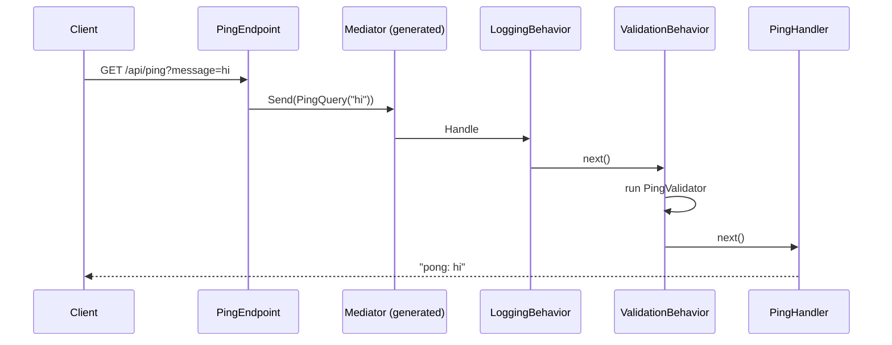

# Lesson 03 — The Mediator: One Door for Every Request

Good day, developer! Last time, we built the solution and put up the module walls. Today we'll teach our
endpoints a better way to get work done: instead of calling the code that does the work, they'll send a
message, and a mediator will deliver it. Along the way, every request will get logged and validated
automatically, without a single endpoint asking for it. It takes about an hour. Are you ready? Let's begin!

## What we'll build

- Commands and queries as small message types, each with exactly one handler.
- A **mediator** that delivers each message to its handler. We use `martinothamar/Mediator`, which writes
  the delivery code at compile time.
- Two **pipeline behaviors** that wrap every handler: one logs, one validates.
- Carter endpoints that do just one thing: turn an HTTP request into a message and send it.
- A throwaway `GET /api/ping` feature, and a page in the app that calls it, to prove it all works. We'll
  delete both in [lesson 07](07-create-order.md).
- The first **unit tests** (the validator and the handler, alone), and the first **architecture tests**
  (the module walls, checked on every build).

## Why we build it this way

### The pain

Here's the obvious design. Each endpoint injects the class that does the work, and calls it:

```csharp
app.MapPost("/sales-orders", async (CreateOrderRequest body, CreateOrderService service) =>
{
    // validate the body...
    // log that we started...
    var id = await service.CreateAsync(body);
    // log how long it took...
    return Results.Created($"/sales-orders/{id}", new { id });
});
```

For one endpoint, that's fine. By the tenth, "validate, log, time it" has been copied ten times, each copy a
little different. The day you need tracing, you edit every endpoint again. And each endpoint knows exactly
which class does its work, so changing that class means touching HTTP code.

### The fix

Instead, the endpoint builds a **message**, like "create this order", and hands it to a **mediator**. The
mediator finds the one **handler** for that kind of message and runs it, wrapped in **behaviors** that apply
to every message: validation, logging, and later, tracing. Written once, used everywhere.

To remember it easily: think of a post office. You address the envelope and drop it in the box. You don't
drive it to the recipient yourself, and you don't care which van carries it. The post office delivers it
(the mediator), and stamps it along the way (the behaviors).

There are two kinds of message, so the intent is always clear:

| Kind | What it does | Example |
|---|---|---|
| **Command** | Changes something | `CreateSalesOrderCommand` |
| **Query** | Only reads | `GetSalesOrderQuery` |

Handling commands and queries separately like this is called **CQRS-lite**.

### Why this library

`martinothamar/Mediator` is a **source generator**. While your code compiles, it finds every handler and
writes the delivery code as plain C#. Nothing is looked up at runtime, and a message with no handler shows
up as a warning when you build, not as a surprise in production. It's MIT-licensed and free. MediatR, the
older and more famous one, now needs a paid license for larger companies.

Now, let's be honest about the cost: indirection. If you press "Go to definition" on a message, you land on
the message, not on its handler. We soften that by always keeping the handler in the same file as its
message, inside the feature's folder.

## 1. BuildingBlocks gets the mediator's interfaces

Our first packages. Each one earns its place:

```bash
dotnet add src/Shared/Erp.Shared.BuildingBlocks package Mediator.Abstractions --version 3.0.2
dotnet add src/Shared/Erp.Shared.BuildingBlocks package FluentValidation --version 12.1.1
dotnet add src/Shared/Erp.Shared.BuildingBlocks package Microsoft.Extensions.Logging.Abstractions --version 10.0.14
```

| Package | What it gives us | License |
|---|---|---|
| `Mediator.Abstractions` | The message and handler interfaces: `ICommand`, `IQuery`, `IPipelineBehavior`, `ISender` | MIT |
| `FluentValidation` | A clean way to write validation rules, used by the validation behavior below | Apache-2.0 |
| `Microsoft.Extensions.Logging.Abstractions` | `ILogger`, so the logging behavior can write log lines | MIT |

Open `Directory.Packages.props` now. You'll see three `PackageVersion` lines that weren't there before. The
command put them there.

## 2. Two behaviors

```csharp
// src/Shared/Erp.Shared.BuildingBlocks/Messaging/Behaviors.cs
using System.Diagnostics;
using FluentValidation;
using Mediator;
using Microsoft.Extensions.Logging;

namespace Erp.Shared.BuildingBlocks;

public sealed class LoggingBehavior<TMessage, TResponse>(ILogger<LoggingBehavior<TMessage, TResponse>> log)
    : IPipelineBehavior<TMessage, TResponse>
    where TMessage : IMessage
{
    public async ValueTask<TResponse> Handle(
        TMessage message, MessageHandlerDelegate<TMessage, TResponse> next, CancellationToken ct)
    {
        var name = typeof(TMessage).Name;
        var sw = Stopwatch.StartNew();
        try
        {
            var response = await next(message, ct);
            log.LogInformation("{Request} handled in {ElapsedMs} ms", name, sw.ElapsedMilliseconds);
            return response;
        }
        catch (Exception ex)
        {
            log.LogWarning(ex, "{Request} failed after {ElapsedMs} ms", name, sw.ElapsedMilliseconds);
            throw;   // observe, never swallow
        }
    }
}

public sealed class ValidationBehavior<TMessage, TResponse>(IEnumerable<IValidator<TMessage>> validators)
    : IPipelineBehavior<TMessage, TResponse>
    where TMessage : IMessage
{
    public async ValueTask<TResponse> Handle(
        TMessage message, MessageHandlerDelegate<TMessage, TResponse> next, CancellationToken ct)
    {
        var failures = new List<FluentValidation.Results.ValidationFailure>();
        foreach (var validator in validators)
            failures.AddRange((await validator.ValidateAsync(message, ct)).Errors);

        if (failures.Count != 0)
            throw new ValidationException(failures);

        return await next(message, ct);
    }
}
```

The key word here is `next`. It means "the rest of the pipeline": the next behavior, or finally the handler
itself. A behavior can do something before `next`, after it, or instead of it. The validation behavior does
the last one: when a message is invalid, it throws and never calls `next`, so the handler never runs.

## 3. Our first feature: message, validator, handler, endpoint

Each feature is two files in its own folder: `XxxHandler.cs` (the message, its validator and its handler)
and `XxxEndpoint.cs` (the HTTP part). First, the packages Sales needs:

```bash
dotnet add src/Modules/Sales/Erp.Modules.Sales package Carter --version 10.0.0
dotnet add src/Modules/Sales/Erp.Modules.Sales package FluentValidation.DependencyInjectionExtensions --version 12.1.1
```

| Package | What it gives us | License |
|---|---|---|
| `Carter` | `ICarterModule`: each feature declares its own routes in its own file, instead of one giant `Program.cs` | MIT |
| `FluentValidation.DependencyInjectionExtensions` | `AddValidatorsFromAssembly`, which finds and registers every validator for us | Apache-2.0 |

```csharp
// src/Modules/Sales/Erp.Modules.Sales/Features/Ping/PingHandler.cs
using FluentValidation;
using Mediator;

namespace Erp.Modules.Sales.Features;

internal sealed record PingQuery(string Message) : IQuery<string>;

internal sealed class PingValidator : AbstractValidator<PingQuery>
{
    public PingValidator() => RuleFor(x => x.Message).NotEmpty();
}

internal sealed class PingHandler : IQueryHandler<PingQuery, string>
{
    public ValueTask<string> Handle(PingQuery query, CancellationToken ct) =>
        ValueTask.FromResult($"pong: {query.Message}");
}
```

```csharp
// src/Modules/Sales/Erp.Modules.Sales/Features/Ping/PingEndpoint.cs
using Carter;
using Mediator;
using Microsoft.AspNetCore.Builder;
using Microsoft.AspNetCore.Http;
using Microsoft.AspNetCore.Routing;

namespace Erp.Modules.Sales.Features;

internal sealed class PingEndpoint : ICarterModule
{
    public void AddRoutes(IEndpointRouteBuilder app) =>
        app.MapGet("/ping", async (string? message, ISender sender, CancellationToken ct) =>
            Results.Ok(await sender.Send(new PingQuery(message ?? ""), ct)));
}
```

Everything is `internal`. And notice that the endpoint knows the message, but never the handler.

If you came from WebForms, here's the translation: `PingEndpoint` is your `[WebMethod]`, and `PingHandler`
is the code that used to live in the code-behind. Only now, the two don't know each other.

## 4. Register the module's internal pieces

Now we meet the first price of `internal`. Read this part slowly, because both problems fail *silently*:

| Problem | What happens if you ignore it |
|---|---|
| Carter's `AddCarter()` only finds **public** endpoint classes | It finds none of ours, and every route returns 404 with no error |
| `AddValidatorsFromAssembly` skips **internal** validators unless told otherwise | Validation simply never runs, again with no error |

So the module registers both itself, from inside its own assembly, where `internal` is visible:

```csharp
// src/Modules/Sales/Erp.Modules.Sales/SalesModule.cs
using Carter;
using FluentValidation;
using Microsoft.Extensions.DependencyInjection;

namespace Erp.Modules.Sales;

public static class SalesModule
{
    public static IServiceCollection AddSalesModule(this IServiceCollection services)
    {
        var assembly = typeof(SalesModule).Assembly;

        // AddCarter() only finds public endpoint classes; ours are internal.
        foreach (var endpoint in assembly.GetTypes().Where(t => !t.IsAbstract && typeof(ICarterModule).IsAssignableFrom(t)))
            services.AddSingleton(typeof(ICarterModule), endpoint);

        // Without includeInternalTypes no validator is found, and validation silently stops.
        services.AddValidatorsFromAssembly(assembly, includeInternalTypes: true);
        return services;
    }
}
```

## 5. The host runs the generator

The source generator runs in whichever project calls `AddMediator`, and that's the host:

```bash
dotnet add src/Erp.Api package Carter --version 10.0.0
dotnet add src/Erp.Api package Mediator.Abstractions --version 3.0.2
dotnet add src/Erp.Api package Mediator.SourceGenerator --version 3.0.2
```

The host needs Carter to map every module's routes, and the generator to write the mediator. The generator
(MIT, same author as the abstractions) only runs while compiling; it isn't part of the app that ships. So in
`Erp.Api.csproj`, mark it build-only:

```xml
<PackageReference Include="Mediator.SourceGenerator" PrivateAssets="all" />
```

```csharp
// src/Erp.Api/Program.cs
using Carter;
using Erp.Modules.Sales;
using Erp.Shared.BuildingBlocks;
using Mediator;

var builder = WebApplication.CreateBuilder(args);

builder.Services.AddMediator((MediatorOptions options) =>
{
    options.ServiceLifetime = ServiceLifetime.Scoped;   // handlers will use scoped database contexts
    options.Assemblies = [typeof(SalesModule)];
    options.PipelineBehaviors = [typeof(LoggingBehavior<,>), typeof(ValidationBehavior<,>)];   // outermost first
});

builder.Services.AddSalesModule();
builder.Services.AddCarter();

var app = builder.Build();

// The browser app is served from the same host, so the API gets a prefix of its own.
var api = app.MapGroup("/api");
api.MapCarter();
api.MapFallback(() => Results.NotFound());   // an unknown API address is a 404, never the app's page

app.MapStaticAssets();
app.MapFallbackToFile("index.html");          // any other address is a page of the app: let it route

app.Run();

public partial class Program { }   // lets the integration tests start the app
```

`AddCarter()` registers Carter's own services, and `api.MapCarter()` asks every registered `ICarterModule` to
add its routes, inside the `/api` group from lesson 01. So `PingEndpoint` maps `/ping`, and it answers at
`/api/ping`, without the endpoint knowing about the prefix. The `ServiceLifetime.Scoped` line means each HTTP request gets its own handlers. That's the
default you want for anything that will talk to a database.

Now build it. You'll get this:

```
error CS0122: 'PingQuery' is inaccessible due to its protection level
```

Here's what happened. The generator wrote code *inside Erp.Api* that mentions `PingQuery` and
`PingHandler`, and those are internal to Sales. The fix is to let the host, and only the host, see Sales'
internals. In `Erp.Modules.Sales.csproj`:

```xml
<!-- Erp.Api: the Mediator source generator runs there. Never grant this to another module. -->
<ItemGroup>
  <InternalsVisibleTo Include="Erp.Api" />
</ItemGroup>
```

Does this weaken the module wall? No. The host already references every module; wiring them together is
its job. What must never happen is a *module* seeing another module's internals, and at the end of this lesson
we write a test that fails if one ever does. Not so hard, right?

## 6. Call it from a screen

A small page in the app: type a message, press the button, see the answer.

```razor
@* src/Erp.Web/Pages/Ping.razor *@
@page "/ping"
@inject HttpClient Http

<PageTitle>Ping · ERP</PageTitle>

<MudText Typo="Typo.h4" GutterBottom="true">Ping</MudText>

<MudStack Row="true" AlignItems="AlignItems.Center" Spacing="3" Class="mb-4">
    <MudTextField @bind-Value="_message" Label="Message" Immediate="true" />
    <MudButton OnClick="Send" Variant="Variant.Filled" Color="Color.Primary">Send</MudButton>
</MudStack>

@if (_answer is not null)
{
    <MudAlert Severity="@(_ok ? Severity.Success : Severity.Error)">@_answer</MudAlert>
}

@code {
    private string _message = "hello";
    private string? _answer;
    private bool _ok;

    private async Task Send()
    {
        var response = await Http.GetAsync($"api/ping?message={Uri.EscapeDataString(_message)}");
        _ok = response.IsSuccessStatusCode;
        _answer = _ok
            ? await response.Content.ReadFromJsonAsync<string>()
            : $"The server answered {(int)response.StatusCode}.";
    }
}
```

- **`@inject HttpClient Http`** asks dependency injection for the `HttpClient` lesson 01 registered, the one
  whose base address is the server that served the app. So `api/ping` goes to `/api/ping` on our host.
- **`@bind-Value` with `Immediate="true"`** updates `_message` on every keystroke, not only when you leave
  the box.
- **`@if (_answer is not null)`** shows the answer only once there is one. Blazor redraws the page by itself
  after `Send` finishes.

Then a way to get there, in `NavMenu.razor`, under Home:

```razor
<MudNavLink Href="ping" Icon="@Icons.Material.Filled.NetworkCheck">Ping</MudNavLink>
```

## 7. Prove it: the first unit tests, and a test for the walls

Last lesson's tests went through the front door, over HTTP. Today we have pieces small enough to test on
their own: a validator and a handler are plain classes. And we have a rule that no compiler checks: nothing
but the host and the tests may see a module's internals. Let's prove all three.

### Unit tests: the pieces, alone

A **unit test** creates one class with `new`, calls it, and checks the answer. No web server, no mediator,
no database. It runs in well under a millisecond, and when it fails, there's only one place to look.

```bash
dotnet new classlib -n Erp.Modules.Sales.UnitTests -o tests/Erp.Modules.Sales.UnitTests
rm tests/Erp.Modules.Sales.UnitTests/Class1.cs
dotnet sln add tests/Erp.Modules.Sales.UnitTests
dotnet add tests/Erp.Modules.Sales.UnitTests reference src/Modules/Sales/Erp.Modules.Sales
dotnet add tests/Erp.Modules.Sales.UnitTests package Microsoft.NET.Test.Sdk --version 17.14.1
dotnet add tests/Erp.Modules.Sales.UnitTests package xunit --version 2.9.3
dotnet add tests/Erp.Modules.Sales.UnitTests package xunit.runner.visualstudio --version 3.1.4
dotnet add tests/Erp.Modules.Sales.UnitTests package AwesomeAssertions --version 9.6.0
```

The same four packages as last lesson, minus the web host. As before, delete the `<PropertyGroup>`, then add
`<IsPackable>false</IsPackable>` and `<Using Include="Xunit" />`.

Everything in Sales is `internal`, so the test project can't see `PingHandler` yet. Let it in, next to the
`Erp.Api` line in `Erp.Modules.Sales.csproj`:

```xml
<InternalsVisibleTo Include="Erp.Modules.Sales.UnitTests" />
```

```csharp
// tests/Erp.Modules.Sales.UnitTests/PingTests.cs
using AwesomeAssertions;
using Erp.Modules.Sales.Features;

namespace Erp.Modules.Sales.UnitTests;

public class PingTests
{
    [Fact]
    public async Task The_handler_answers_pong_and_the_message() =>
        (await new PingHandler().Handle(new PingQuery("hi"), default)).Should().Be("pong: hi");

    [Theory]
    [InlineData("")]
    [InlineData("   ")]   // NotEmpty also refuses whitespace: a message of spaces says nothing
    public void An_empty_message_is_refused(string message) =>
        new PingValidator().Validate(new PingQuery(message)).IsValid.Should().BeFalse();

    [Fact]
    public void Any_real_message_passes() =>
        new PingValidator().Validate(new PingQuery("a")).IsValid.Should().BeTrue();
}
```

### The same thing through the front door

The unit tests prove the validator works. They can't prove it *runs*: that depends on `includeInternalTypes:
true` in `SalesModule`, and on the behavior being in the pipeline. Forget either one, and the unit tests stay
green while the API happily answers `pong: ` to an empty message. Only a real request shows it:

```csharp
// tests/Erp.Integration.Tests/PingTests.cs
using System.Net;
using System.Net.Http.Json;
using AwesomeAssertions;

namespace Erp.Integration.Tests;

public class PingTests(CustomWebAppFactory factory) : IClassFixture<CustomWebAppFactory>
{
    [Fact]
    public async Task Ping_answers_through_the_mediator() =>
        (await factory.CreateClient().GetFromJsonAsync<string>("/api/ping?message=hello")).Should().Be("pong: hello");

    // Regression guard: validators are internal. Without includeInternalTypes: true they silently never run.
    [Fact]
    public async Task An_empty_message_never_reaches_the_handler()
    {
        var response = await factory.CreateClient().GetAsync("/api/ping?message=");

        response.StatusCode.Should().NotBe(HttpStatusCode.OK);
        (await response.Content.ReadAsStringAsync()).Should().NotContain("pong");
    }
}
```

That second test is loose on purpose: today an invalid request is a 500. In [lesson 07](07-create-order.md) it
becomes a proper 400, and we'll tighten the test to say so.

Make both fail once: remove `includeInternalTypes: true` and watch the integration test go red while the unit
tests stay green. That's exactly why we have both kinds. Then put it back.

### Architecture tests: the walls themselves

Some of our rules aren't about what the code does, but about how it's built: a module shows one public class;
its internals are visible to the host and the tests, never to another module; features live in feature
folders. The compiler doesn't check any of that. A reviewer might miss it in a big change. An
**architecture test** reads the compiled assemblies with reflection and fails the build when a rule breaks.

```bash
dotnet new classlib -n Erp.Architecture.Tests -o tests/Erp.Architecture.Tests
rm tests/Erp.Architecture.Tests/Class1.cs
dotnet sln add tests/Erp.Architecture.Tests
dotnet add tests/Erp.Architecture.Tests reference src/Erp.Api
dotnet add tests/Erp.Architecture.Tests package Microsoft.NET.Test.Sdk --version 17.14.1
dotnet add tests/Erp.Architecture.Tests package xunit --version 2.9.3
dotnet add tests/Erp.Architecture.Tests package xunit.runner.visualstudio --version 3.1.4
dotnet add tests/Erp.Architecture.Tests package AwesomeAssertions --version 9.6.0
```

It references the host, which references every module, so every module is in reach. Same `.csproj` clean-up
as the others.

```csharp
// tests/Erp.Architecture.Tests/ModuleBoundaryTests.cs
using System.Reflection;
using System.Runtime.CompilerServices;
using AwesomeAssertions;
using Erp.Modules.Sales;

namespace Erp.Architecture.Tests;

// The module rules as tests: a reviewer can miss a stray `public` class; these can't.
public class ModuleBoundaryTests
{
    // Every new module joins this list.
    private static readonly Assembly[] Modules = [typeof(SalesModule).Assembly];

    [Fact]
    public void A_module_exposes_only_its_entry_class()
    {
        foreach (var module in Modules)
            module.GetExportedTypes().Select(t => t.FullName)
                .Should().ContainSingle($"{module.GetName().Name} should expose only its AddXModule entry class")
                .Which.Should().EndWith("Module");
    }

    [Fact]
    public void Internals_are_shared_only_with_the_host_and_tests()
    {
        foreach (var module in Modules)
            module.GetCustomAttributes<InternalsVisibleToAttribute>().Select(a => a.AssemblyName)
                .Should().OnlyContain(f => f == "Erp.Api" || f.EndsWith("Tests"),
                    $"{module.GetName().Name} may grant InternalsVisibleTo to Erp.Api (the Mediator generator) and tests, never another module");
    }

    // Vertical slices: a feature's files sit together. Folders named after a technical layer pull them apart again.
    [Fact]
    public void Code_is_grouped_by_feature_not_by_technical_layer()
    {
        string[] layers = [".Commands", ".Queries", ".Handlers", ".Validators", ".Endpoints", ".Repositories", ".Services"];

        Modules.SelectMany(m => m.GetTypes())
            .Select(t => t.Namespace ?? "")
            .Distinct()
            .Where(ns => layers.Any(ns.EndsWith))
            .Should().BeEmpty("a feature folder holds its handler and endpoint together");
    }
}
```

- **`GetExportedTypes()`** returns only the public types: exactly the ones another project could use.
- **`InternalsVisibleToAttribute`** is what the `<InternalsVisibleTo>` lines in the `.csproj` turn into. The
  test reads them back out of the compiled module.

Make the first one fail once: add a file to Sales with `public static class SalesHelpers { }`, the kind of
"just a little helper" that slips in.

```
Expected module.GetExportedTypes().Select(t => t.FullName) to contain a single item because Erp.Modules.Sales
should expose only its AddXModule entry class, but found {"Erp.Modules.Sales.SalesHelpers", "Erp.Modules.Sales.SalesModule"}.
```

Delete it again. These tests grow with the course: the [domain model](04-domain-model.md) adds two, the
second module in [lesson 09](09-submit.md) adds three, and [lesson 13](13-events-outbox.md) adds the one that
catches an event nobody handles.

### Edge cases covered in this lesson

| Test | The edge | Why it matters |
|---|---|---|
| `An_empty_message_is_refused` | Nothing: empty and whitespace | "Required" must mean more than "not null" |
| `Any_real_message_passes` | The smallest valid input | A rule that's too strict is a bug too |
| `An_empty_message_never_reaches_the_handler` | Configuration, not code | The silent failure the unit test can't see |
| `A_module_exposes_only_its_entry_class` | One `public` too many | The wall gets a hole and nobody notices |
| `Internals_are_shared_only_with_the_host_and_tests` | A shortcut between modules | One `InternalsVisibleTo` turns two islands into one |

## How a request flows



The order matters. Logging is the outermost behavior, so it also records the requests that fail
validation.

## Mistakes to avoid

- Calling `AddCarter()` and expecting it to find internal endpoints. It won't, and the routes 404 silently.
- Forgetting `includeInternalTypes: true`. Your validators exist, compile, and never run.
- Granting `InternalsVisibleTo` to another module "just to share one class". Use a contract instead.
- Putting logic in the endpoint. An endpoint turns HTTP into a message, and a result back into HTTP.
  Nothing else.
- Testing only the validator with a unit test. It proves the rule, not that the rule runs; keep the one
  request that proves it.
- Adding a project's `InternalsVisibleTo` for a test project and forgetting the architecture test allows
  only names ending in `Tests`. Name test projects `...Tests`.
- Sharing one handler between two features. If two features need the same logic, it belongs in the domain
  ([lesson 04](04-domain-model.md)).

## Let's run it!

```bash
dotnet run --project src/Erp.Api
```

Open the app, click **Ping**, and press **Send**. The green box says `pong: hello`. That's a full trip: the
browser called the API, the endpoint sent a message, the mediator ran both behaviors and the handler, and the
answer came back to the screen.

Now clear the box and press **Send** again. The red box says "The server answered 500." The same from the
terminal shows why:

```bash
curl "http://localhost:5264/api/ping?message=hello"
# "pong: hello"

curl -i "http://localhost:5264/api/ping?message="
# HTTP/1.1 500 ... FluentValidation.ValidationException: Validation failed: 'Message' must not be empty.
```

That 500 is good news for now: it proves the validator ran *before* the handler. It should really be a
`400 Bad Request` with a tidy body, and [lesson 07](07-create-order.md) will make it one. In the API's
console you'll see the logging behavior's lines: `PingQuery handled in 0 ms`, then
`PingQuery failed after 2 ms`.

Finally, the tests:

```bash
dotnet test
```

```
Passed!  - Failed: 0, Passed:  4, ... Erp.Modules.Sales.UnitTests.dll
Passed!  - Failed: 0, Passed:  3, ... Erp.Architecture.Tests.dll
Passed!  - Failed: 0, Passed: 15, ... Erp.Integration.Tests.dll
```

## Let's check!

1. Why does the generator need `InternalsVisibleTo("Erp.Api")`? Why is granting it to the host safe, but
   granting it to another module not?
2. You forget `includeInternalTypes: true`. What happens when you send an empty message from the Ping page?
3. Why is `LoggingBehavior` registered before `ValidationBehavior`?
4. What's the difference between a command and a query, and why bother telling them apart?
5. Name one real cost of the mediator pattern.
6. The unit test for `PingValidator` passes, but the API still answers `pong: ` to an empty message. What's
   wrong, and which test catches it?
7. What does an architecture test check that the compiler doesn't? Give two examples.

And that's where this lesson ends. Our endpoints now send messages, every message is logged and
validated on its way, and the walls are checked by a test. Next time, we write the most important code in the whole course: the business rules
themselves. Good luck, developer!

---

← [Lesson 02 — Testing](02-testing.md) · Next: [Lesson 04 — Domain model](04-domain-model.md) →
