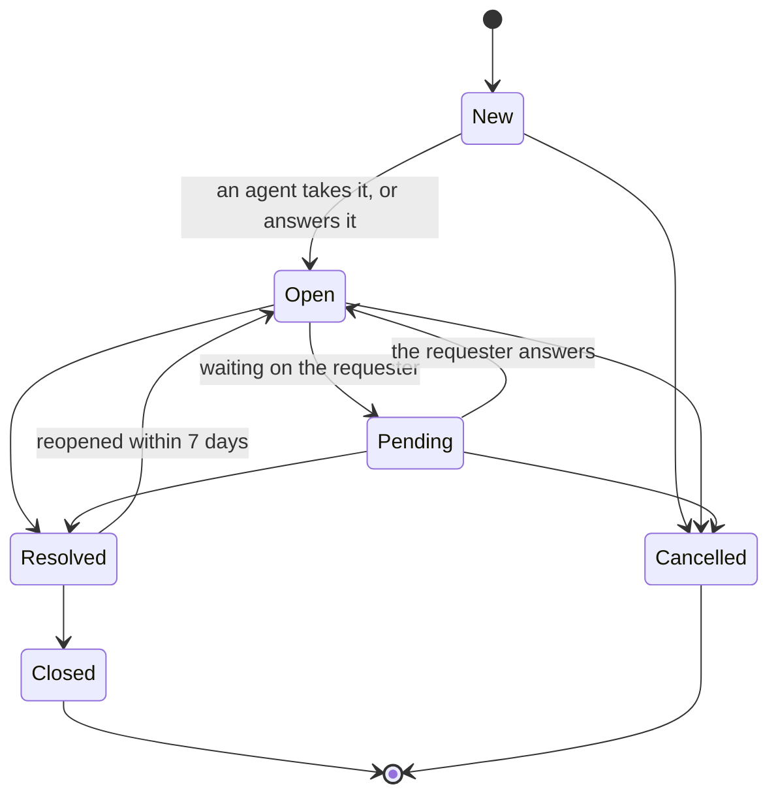

# Lesson 04 — The Domain Model: The Rules, in Plain C#

Good day, developer! Today is the most important lesson in the whole course. We'll write the business rules
themselves: who may take a ticket, when a ticket can be resolved, how long a resolved one can be reopened, and
why nobody can reply to a closed one. And we'll do it with no database and no HTTP, just plain C#, so we can
prove every rule with tests that run in milliseconds. Give yourself about two hours. Are you ready? Let's
begin!

## What we'll build

| Piece | What it is |
|---|---|
| **Base types** | `Entity`, `AggregateRoot`, `DomainException` and `ErrorCode`, shared by every module |
| **Typed ids** | `TicketId` and `UserId`, so a ticket's number can never be used where a person's goes |
| **Tickets' error catalog** | One stable code for every rule the ticket can refuse with |
| **The aggregate** | `Ticket` with its conversation (`TicketMessage`), a status state machine and the reopen window |
| **Unit and property tests** | Thirty-one tests that need no database, one of them checking hundreds of random action sequences |
| **Two more architecture tests** | The domain stays free of web and data code, and changes only through its methods |

## Why we build it this way

### The pain: rules scattered across handlers

Here's the obvious version. You put the checks right where the data is loaded:

```csharp
// inside some handler
if (ticket.Status == "Closed") throw ...;
if (ticket.AssigneeId != null && ticket.AssigneeId != agentId) throw ...;
ticket.Status = "Open";
ticket.AssigneeId = agentId;
```

Now "take" has the ownership check, "assign" copies it, and the copy slowly drifts. Someone sets
`ticket.Status = "Resolved"` straight from a brand-new ticket, because nothing stops them. And testing the
ownership rule means starting a database, because the rule lives next to the query.

### The fix: put each rule on the thing it's about

| The question | Where the answer lives |
|---|---|
| Can an agent take this ticket? | A method on `Ticket` |
| Can this ticket move from New to Resolved? | A method on `Ticket`, guarded by a state machine |
| Is this id a ticket's or a person's? | The type itself: `TicketId` is not `UserId` |

The data can only change through those methods, because the setters are private. So the rules can't be skipped.
And since none of this touches a database, every rule can be unit-tested.

Here's the one table to remember from the whole course. Every rule you'll ever write fits in one of these rows:

| The question | Where it lives |
|---|---|
| Is the request well-formed? (a subject, a known priority) | A validator, as in lesson 03 |
| Is this operation allowed? (taking a ticket someone has, replying to a closed one) | **The domain**: this lesson |
| Load, act, save | A handler, with no business `if`s (lesson 07) |
| Two people acting at once | The database, atomically (lesson 09) |

To remember it easily: if the question is "is this allowed?", the answer lives in the domain.

### Three words you need

- A **value object** is defined only by its value, and never changes. Think of a ₱1,000 bill: any one is as
  good as any other. You don't care *which* bill you have, only its value. Our typed ids are value objects:
  `new TicketId(7)` equals any other `new TicketId(7)`.
- An **entity** has an identity that stays the same while its data changes. Ticket #7 is still ticket #7 after
  it changes hands.
- An **aggregate** is a group of objects changed as one unit, with one **root** that the outside world talks
  to. A ticket and its messages are one aggregate: you never add a message except through its ticket.

### The ticket's statuses

Every ticket moves through these statuses, and only along these arrows:



Closed and Cancelled are final. Everything this lesson codes is on this picture.

## 1. The shared building blocks

Every module's domain will need the same few pieces, so they go in `Yasda.Shared.BuildingBlocks`, the project
lesson 01 left empty:

```csharp
// src/Shared/Yasda.Shared.BuildingBlocks/Domain/BuildingBlocks.cs
namespace Yasda.Shared.BuildingBlocks;

// Base types every module's domain reuses. `where TId : struct` must be repeated on derived classes (CS0453).
public abstract class Entity<TId> where TId : struct
{
    public TId Id { get; protected set; }
}

public abstract class AggregateRoot<TId> : Entity<TId> where TId : struct;

// A business rule said no. Later it becomes HTTP 422, with the error's code. The message adds the specifics ("Alan Reyes already has ticket #7").
public class DomainException(ErrorCode error, string? message = null) : Exception(message ?? error.Title)
{
    public ErrorCode Error { get; } = error;
}
```

- **`Entity<TId>`** is anything with an identity. `TId` is a small struct like `TicketId`, never a plain `long`;
  you'll see why in a moment.
- **`AggregateRoot<TId>`** marks the one entity the outside world talks to. It's empty for now. In lesson 13 it
  learns to record events.
- **`DomainException`** is how a business rule says no. It always carries an **error code**, below.
- **`where TId : struct`** appears on both classes. Leave it off `AggregateRoot` and the compiler stops you with
  `CS0453`: a derived generic class must repeat its base class's constraints.

### Every refusal has a code

When a compiler refuses your code, it says `CS0122` along with the message. You can look `CS0122` up and learn
what causes it and how to fix it, and so can the colleague you ask for help. Our business rules will refuse
things all day ("Alan Reyes already has ticket #7"), so we give them the same courtesy: every kind of refusal
gets a stable **error code**, with a title and a fix, written once.

```csharp
// src/Shared/Yasda.Shared.BuildingBlocks/Abstractions/ErrorCode.cs
namespace Yasda.Shared.BuildingBlocks;

// One kind of failure with a stable ID, like the compiler's CS0122: the code names the problem, the catalog says how
// to fix it. A published code never changes meaning, and its number is never reused.
public sealed record ErrorCode(string Code, string Title, string Fix);
```

- **`Code`** is what people say and search for: `TICKETS-0007`. A module's own codes start with its name, so you
  know at a glance where to look.
- **`Title`** names the problem in a few words. **`Fix`** says what to do about it. The exception's message
  still carries the specifics of *this* time.
- **The promise:** a code never changes meaning, and a number is never reused, even if its rule is deleted.
  Someone may have written `TICKETS-0007` in a message two years ago. New codes go at the end.

Lesson 07 puts the code into every error the API sends, and gives the app a page that explains each one.

You might wonder why all of BuildingBlocks shares one namespace, whatever the folder. Folders are for people
browsing the project; one namespace means one `using` line in every module.

## 2. Typed ids, statuses and messages

Folder: `src/Modules/Tickets/Yasda.Modules.Tickets/Domain/`. Everything here is `internal`.

```csharp
// src/Modules/Tickets/Yasda.Modules.Tickets/Domain/Ids.cs
namespace Yasda.Modules.Tickets.Domain;

internal readonly record struct TicketId(long Value);

// Owned by the Identity module, referenced by id only.
internal readonly record struct UserId(long Value);
```

Why not plain `long`s? Because then this compiles, and is wrong:

```csharp
ticket.Take(ticket.Id, "Alan Reyes", now);   // a ticket's number where a person's belongs
```

With two types, the compiler refuses it. A `readonly record struct` is a value object for free: compared by
value, immutable, and no heap allocation. The comment on `UserId` is the first sighting of the module rule:
people belong to Identity, so Tickets keeps only their number.

```csharp
// src/Modules/Tickets/Yasda.Modules.Tickets/Domain/TicketStatus.cs
namespace Yasda.Modules.Tickets.Domain;

// New → Open ⇄ Pending → Resolved → Closed. Resolved can reopen for a while; Closed and Cancelled are final.
internal enum TicketStatus { New, Open, Pending, Resolved, Closed, Cancelled }

internal enum TicketPriority { Low, Normal, High, Critical }
```

An `enum` is a short list of named values. `TicketStatus` is the picture above as code. And one message in the
conversation:

```csharp
// src/Modules/Tickets/Yasda.Modules.Tickets/Domain/TicketMessage.cs
namespace Yasda.Modules.Tickets.Domain;

// One entry in a ticket's conversation: the first request, a reply, or an internal note only staff can see.
internal sealed class TicketMessage
{
    internal TicketMessage(UserId authorId, string authorName, string body, bool isInternal, DateTime createdUtc)
    {
        AuthorId = authorId;
        AuthorName = authorName;
        Body = body;
        IsInternal = isInternal;
        CreatedUtc = createdUtc;
    }

    public long Id { get; private set; }
    public UserId AuthorId { get; private set; }
    public string AuthorName { get; private set; } = "";
    public string Body { get; private set; } = "";
    public bool IsInternal { get; private set; }
    public DateTime CreatedUtc { get; private set; }
}
```

The constructor is `internal`, so only the domain can add a message, and `Ticket` is the only one that does. The
setters are `private`: once written, a message never changes. `Id` is filled in by the database later.

## 3. Tickets' error catalog

One code for each rule this lesson writes:

```csharp
// src/Modules/Tickets/Yasda.Modules.Tickets/Domain/TicketsErrors.cs
using Yasda.Shared.BuildingBlocks;

namespace Yasda.Modules.Tickets.Domain;

// Every business rule Tickets can refuse with. Add new codes at the end; never renumber or reuse one.
internal static class TicketsErrors
{
    public static readonly ErrorCode SubjectRequired = new("TICKETS-0001", "A ticket needs a subject",
        "Write one line saying what the problem is, such as \"Printer on the 3rd floor won't print\".");
    public static readonly ErrorCode SubjectTooLong = new("TICKETS-0002", "The subject is too long",
        "Keep the subject to 200 characters; put the details in the message.");
    public static readonly ErrorCode MessageRequired = new("TICKETS-0003", "The message is empty",
        "Write something before sending.");
    public static readonly ErrorCode MessageTooLong = new("TICKETS-0004", "The message is too long",
        "Keep a message to 10,000 characters. Split a long one into two replies.");
    public static readonly ErrorCode TicketFinished = new("TICKETS-0005", "This ticket is closed",
        "A closed or cancelled ticket can't change any more. File a new ticket and mention this one's number.");
    public static readonly ErrorCode InvalidTransition = new("TICKETS-0006", "The ticket can't move to that status from where it is",
        "Reload to see its current status. The message says which statuses allow this step.");
    public static readonly ErrorCode TakenBySomeoneElse = new("TICKETS-0007", "Someone else already has this ticket",
        "Ask them or your team lead to reassign it if you should take it over.");
    public static readonly ErrorCode RequesterCannotWriteNotes = new("TICKETS-0008", "Only staff can write internal notes",
        "Send a normal reply instead. Internal notes are for agents to talk among themselves.");
    public static readonly ErrorCode ReopenWindowPassed = new("TICKETS-0009", "Too late to reopen this ticket",
        "A resolved ticket can be reopened for 7 days. After that, file a new ticket and mention this one's number.");
    public static readonly ErrorCode CancelReasonRequired = new("TICKETS-0010", "A reason is needed to cancel",
        "Say in a few words why the ticket is cancelled, such as \"duplicate of #1042\" (up to 500 characters).");
}
```

Read the fixes: they're written for the person at the screen, not for us. "Ask them or your team lead to
reassign it" helps; "ownership conflict" doesn't. Later lessons add codes at the end of this list as they add
rules.

## 4. The ticket

The aggregate is the longest file in the module, so we build it in four passes, and it compiles after each one.

### Filing a ticket

```csharp
// src/Modules/Tickets/Yasda.Modules.Tickets/Domain/Ticket.cs
using Yasda.Shared.BuildingBlocks;

namespace Yasda.Modules.Tickets.Domain;

// A request for help and its whole conversation. Every rule about what may happen to a ticket lives here.
internal sealed class Ticket : AggregateRoot<TicketId>
{
    public const int SubjectMaxLength = 200;
    public const int MessageMaxLength = 10_000;

    private readonly List<TicketMessage> _messages = [];

    private Ticket() { }

    public string Subject { get; private set; } = "";
    public TicketPriority Priority { get; private set; }
    public TicketStatus Status { get; private set; }
    public UserId RequesterId { get; private set; }
    public string RequesterName { get; private set; } = "";
    public UserId? AssigneeId { get; private set; }
    public string? AssigneeName { get; private set; }
    public DateTime CreatedUtc { get; private set; }
    public DateTime UpdatedUtc { get; private set; }
    public DateTime? FirstResponseUtc { get; private set; }
    public DateTime? ResolvedUtc { get; private set; }
    public DateTime? ClosedUtc { get; private set; }
    public string? CancelReason { get; private set; }
    public IReadOnlyList<TicketMessage> Messages => _messages;

    // The request itself is the conversation's first message, written by the requester.
    public static Ticket Create(string subject, string message, TicketPriority priority, UserId requester, string requesterName, DateTime nowUtc)
    {
        var ticket = new Ticket
        {
            Subject = CheckedSubject(subject),
            Priority = priority,
            Status = TicketStatus.New,
            RequesterId = requester,
            RequesterName = requesterName,
            CreatedUtc = nowUtc,
            UpdatedUtc = nowUtc,
        };
        ticket._messages.Add(new TicketMessage(requester, requesterName, CheckedMessage(message), isInternal: false, nowUtc));
        return ticket;
    }

    private static string CheckedSubject(string subject)
    {
        var text = subject?.Trim() ?? "";
        if (text.Length == 0) throw new DomainException(TicketsErrors.SubjectRequired);
        if (text.Length > SubjectMaxLength) throw new DomainException(TicketsErrors.SubjectTooLong);
        return text;
    }

    private static string CheckedMessage(string body)
    {
        var text = body?.Trim() ?? "";
        if (text.Length == 0) throw new DomainException(TicketsErrors.MessageRequired);
        if (text.Length > MessageMaxLength) throw new DomainException(TicketsErrors.MessageTooLong);
        return text;
    }
}
```

Let's read it:

- **`private Ticket() { }`** and the private setters mean the only way to get a `Ticket` is `Ticket.Create`, and
  the only way to change one is through the methods we add next.
- **`Create`** checks the subject and message *before* anything is built. A ticket with no subject can never
  exist, so nothing downstream has to check again.
- **The request is the conversation's first message**, written by the requester. A ticket always has one
  message.
- **`CheckedSubject` and `CheckedMessage`** trim the text and refuse empty or too-long text, each with its own
  code. `subject?.Trim() ?? ""` reads "if there's a subject, trim it, otherwise use an empty text". The
  validator from lesson 03 will also refuse these at the door; the domain refuses them again because the domain
  cannot know who calls it.
- **Time comes in as a parameter** (`nowUtc`). The domain never asks the clock, so a test can say exactly when
  things happen.

### Taking and assigning

Two ways to give a ticket an owner: an agent **takes** one nobody has, and a team lead **assigns** one to
someone, whoever had it before. Add this property under `Messages`:

```csharp
    public bool IsFinished => Status is TicketStatus.Closed or TicketStatus.Cancelled;
```

Add these two methods after `Create`:

```csharp
    // An agent picks up a ticket nobody has. Taking your own ticket again changes nothing.
    public void Take(UserId agent, string agentName, DateTime nowUtc)
    {
        EnsureIn("take", TicketStatus.New, TicketStatus.Open, TicketStatus.Pending);
        if (AssigneeId is not null && AssigneeId != agent)
            throw new DomainException(TicketsErrors.TakenBySomeoneElse, $"{AssigneeName} already has ticket #{Id.Value}.");
        AssignTo(agent, agentName, nowUtc);
    }

    // A team lead hands a ticket to someone, whoever had it before.
    public void Assign(UserId agent, string agentName, DateTime nowUtc)
    {
        EnsureIn("assign", TicketStatus.New, TicketStatus.Open, TicketStatus.Pending);
        AssignTo(agent, agentName, nowUtc);
    }
```

And these three private helpers, above `CheckedSubject`:

```csharp
    private void AssignTo(UserId agent, string agentName, DateTime nowUtc)
    {
        AssigneeId = agent;
        AssigneeName = agentName;
        if (Status == TicketStatus.New) Status = TicketStatus.Open;
        UpdatedUtc = nowUtc;
    }

    private void EnsureNotFinished()
    {
        if (IsFinished)
            throw new DomainException(TicketsErrors.TicketFinished, $"Ticket #{Id.Value} is {Status.ToString().ToLowerInvariant()}.");
    }

    private void EnsureIn(string action, params TicketStatus[] allowed)
    {
        EnsureNotFinished();
        if (!allowed.Contains(Status))
            throw new DomainException(TicketsErrors.InvalidTransition,
                $"Can't {action} a ticket that is {Status.ToString().ToLowerInvariant()}; only one that is " +
                $"{string.Join(" or ", allowed.Select(s => s.ToString().ToLowerInvariant()))}.");
    }
```

- **`EnsureIn`** is the state machine. Each action names the statuses it allows, and anything else is refused
  with `TICKETS-0006`, naming what *would* have worked. `params` lets a call list the statuses one after the
  other.
- **`EnsureNotFinished`** comes first inside it, so a Closed or Cancelled ticket always answers with the same
  clear `TICKETS-0005`, whatever you asked.
- **`Take` by the person who already has it** changes nothing and isn't an error: a double click is not a
  mistake.
- **`AssignTo`** moves a New ticket to Open. An open ticket always has an owner; that rule comes back in the
  tests.

### The ticket's life

Waiting on the requester, resolving, closing, reopening, cancelling, and changing the priority. Add these after
`Assign`, and `Move` after `AssignTo`:

```csharp
    // Waiting on the requester: an agent asked something and can't go on without the answer.
    public void MarkPending(DateTime nowUtc)
    {
        EnsureIn("wait on the requester", TicketStatus.Open);
        Move(TicketStatus.Pending, nowUtc);
    }

    public void Resolve(DateTime nowUtc)
    {
        EnsureIn("resolve", TicketStatus.Open, TicketStatus.Pending);
        Move(TicketStatus.Resolved, nowUtc);
        ResolvedUtc = nowUtc;
    }

    public void Close(DateTime nowUtc)
    {
        EnsureIn("close", TicketStatus.Resolved);
        Move(TicketStatus.Closed, nowUtc);
        ClosedUtc = nowUtc;
    }

    // A resolved ticket comes back to life for a week, if the fix didn't hold.
    public void Reopen(DateTime nowUtc)
    {
        EnsureIn("reopen", TicketStatus.Resolved);
        if (nowUtc - ResolvedUtc!.Value > ReopenWindow)
            throw new DomainException(TicketsErrors.ReopenWindowPassed,
                $"Ticket #{Id.Value} was resolved on {ResolvedUtc:yyyy-MM-dd}; it can be reopened for 7 days.");
        Move(TicketStatus.Open, nowUtc);
        ResolvedUtc = null;
    }

    public void Cancel(string reason, DateTime nowUtc)
    {
        EnsureIn("cancel", TicketStatus.New, TicketStatus.Open, TicketStatus.Pending);
        var text = reason?.Trim() ?? "";
        if (text.Length is 0 or > ReasonMaxLength)
            throw new DomainException(TicketsErrors.CancelReasonRequired);
        CancelReason = text;
        Move(TicketStatus.Cancelled, nowUtc);
    }

    public void ChangePriority(TicketPriority priority, DateTime nowUtc)
    {
        EnsureNotFinished();
        Priority = priority;
        UpdatedUtc = nowUtc;
    }
```

```csharp
    private void Move(TicketStatus to, DateTime nowUtc)
    {
        Status = to;
        UpdatedUtc = nowUtc;
    }
```

The two missing constants go next to the others at the top of the class:

```csharp
    public const int ReasonMaxLength = 500;
    public static readonly TimeSpan ReopenWindow = TimeSpan.FromDays(7);
```

- **`Reopen`** is the reopen window: a resolved ticket comes back for exactly 7 days. A moment after that, it's
  refused with `TICKETS-0009`.
- **`Cancel`** needs a reason and keeps it.
- **Only a Resolved ticket can be closed**, and only an Open one can wait on the requester.

### The conversation

An agent's public reply, an internal note only staff see, and the requester's answer. Add `Reply` after
`Assign`, and `IsVisibleTo` after `ChangePriority`:

```csharp
    public void Reply(UserId author, string authorName, string body, bool isInternal, bool authorIsStaff, DateTime nowUtc)
    {
        EnsureNotFinished();
        var text = CheckedMessage(body);
        if (isInternal && !authorIsStaff)
            throw new DomainException(TicketsErrors.RequesterCannotWriteNotes);

        if (!isInternal && !authorIsStaff)
        {
            // The requester answered: the ball is back with the agents.
            if (Status == TicketStatus.Pending) Status = TicketStatus.Open;
            else if (Status == TicketStatus.Resolved) Reopen(nowUtc);
        }
        else if (!isInternal)
        {
            // An agent answering a ticket nobody has takes it: an open ticket always has an owner.
            if (FirstResponseUtc is null) FirstResponseUtc = nowUtc;
            if (AssigneeId is null) AssignTo(author, authorName, nowUtc);
            if (Status == TicketStatus.New) Status = TicketStatus.Open;
        }

        _messages.Add(new TicketMessage(author, authorName, text, isInternal, nowUtc));
        UpdatedUtc = nowUtc;
    }
```

```csharp
    // Requesters see their own tickets; staff who handle tickets see them all.
    public bool IsVisibleTo(UserId user, bool userIsStaff) => userIsStaff || RequesterId == user;
```

`Reply` is where the rules meet, so read it slowly:

- **A requester can't write an internal note** (`TICKETS-0008`).
- **A requester's answer** takes a Pending ticket back to Open (the ball is with the agents again), and reopens
  a Resolved one if it's within the week.
- **An agent's public reply** records the time of the first response (we'll use it for SLAs later) and, on a
  ticket nobody has, takes it. An internal note is *not* a response to the requester, so it does neither.
- **`IsVisibleTo`** says who may see a ticket: staff see all, a requester only their own. Lesson 07 puts it to
  work.

Now, let's be honest about the cost here: one class with this many rules is long, and it will grow. That's the
price of keeping every rule where the data is. The alternative, rules spread over handlers, is shorter per
file and much longer to understand.

## 5. Prove it: the ticket's rules, and the walls around them

### Unit tests: every rule, in milliseconds

The unit test project from lesson 03 is ready. First, one package for the other half of testing a domain: tests
that check a rule against hundreds of inputs we never thought of.

```bash
dotnet add tests/Yasda.Modules.Tickets.UnitTests package FsCheck.Xunit.v3 --version 3.6.0
```

| Package | What it's for | License |
|---|---|---|
| `FsCheck.Xunit.v3` | **Property-based tests**: you state a rule that must always hold, and FsCheck tries it on hundreds of generated inputs | BSD-3-Clause |

A test helper first, then the tests. Every test builds a ticket in memory and pokes it:

```csharp
// tests/Yasda.Modules.Tickets.UnitTests/TicketTests.cs
using AwesomeAssertions;
using Yasda.Modules.Tickets.Domain;
using Yasda.Shared.BuildingBlocks;

namespace Yasda.Modules.Tickets.UnitTests;

// The ticket's rules, with no database and no web server: each test builds a ticket in memory and pokes it.
public class TicketTests
{
    private static readonly DateTime Now = new(2026, 11, 19, 9, 0, 0, DateTimeKind.Utc);
    private static readonly UserId Requester = new(5), Agent = new(3), OtherAgent = new(8);

    private static Ticket NewTicket() =>
        Ticket.Create("Printer won't print", "It says paper jam.", TicketPriority.Normal, Requester, "Rita Cruz", Now);

    private static Ticket OpenTicket()
    {
        var ticket = NewTicket();
        ticket.Take(Agent, "Alan Reyes", Now);
        return ticket;
    }

    private static Ticket ResolvedTicket()
    {
        var ticket = OpenTicket();
        ticket.Resolve(Now);
        return ticket;
    }

    private static ErrorCode CodeOf(Action act)
    {
        var exception = FluentActions.Invoking(act).Should().Throw<DomainException>().Which;
        return exception.Error;
    }

    // ... one test per rule follows ...
}
```

`CodeOf` runs an action that must be refused and hands back its error code, so a test can say *which* rule said
no, not only that something did. Now the tests that teach something new:

```csharp
    [Fact]
    public void A_new_ticket_starts_with_the_request_as_its_first_message()
    {
        var ticket = NewTicket();

        ticket.Status.Should().Be(TicketStatus.New);
        ticket.AssigneeId.Should().BeNull();
        ticket.Messages.Should().ContainSingle();
        ticket.Messages[0].Body.Should().Be("It says paper jam.");
        ticket.Messages[0].IsInternal.Should().BeFalse();
    }

    [Fact]
    public void A_subject_of_exactly_200_characters_is_fine_and_201_is_too_long()
    {
        Ticket.Create(new string('a', 200), "Help", TicketPriority.Low, Requester, "Rita Cruz", Now).Subject.Should().HaveLength(200);
        CodeOf(() => Ticket.Create(new string('a', 201), "Help", TicketPriority.Low, Requester, "Rita Cruz", Now))
            .Should().Be(TicketsErrors.SubjectTooLong);
    }

    [Fact]
    public void Reopening_a_moment_after_seven_days_is_too_late() =>
        CodeOf(() => ResolvedTicket().Reopen(Now.Add(Ticket.ReopenWindow).AddTicks(1))).Should().Be(TicketsErrors.ReopenWindowPassed);
```

- **`A_new_ticket_starts_with_the_request_as_its_first_message`** is the plain shape: build, act, check.
- **`A_subject_of_exactly_200_characters_is_fine_and_201_is_too_long`** tests both sides of an edge in one
  place, as lesson 02's checklist asks ("the limit itself, and one past it").
- **`Reopening_a_moment_after_seven_days_is_too_late`** passes `AddTicks(1)`, one hundred-nanosecond tick past
  the window. That's as close to the edge as a clock gets.

Every other rule has a test with the same shape, and all of them are in the reference build. Here they are, so
you can write each one the same way:

| Test | The edge | Why it matters |
|---|---|---|
| `The_subject_is_trimmed` | Spaces around the text | What's stored is what a reader should see |
| `A_ticket_needs_a_subject` | Nothing: empty and whitespace | "Required" must mean more than "not null" |
| `A_ticket_needs_a_message` | A blank message | A ticket with no words can't be answered |
| `A_message_over_10000_characters_is_refused` | One past the limit | Limits that aren't tested drift |
| `Taking_a_new_ticket_assigns_it_and_opens_it` | The first step of every ticket | The one status change taking triggers |
| `Taking_your_own_ticket_again_changes_nothing` | Twice | A double click is not an error |
| `Nobody_takes_a_ticket_someone_else_has` | Who | The rule lesson 09's race test depends on |
| `A_team_lead_can_reassign_a_ticket_someone_has` | The same step, a different actor | Assign differs from Take on purpose |
| `A_resolved_ticket_cant_be_taken` | The wrong status | The state machine, from the assigning side |
| `An_agents_first_public_reply_records_the_first_response_time` | Twice | Only the first reply counts, for SLAs later |
| `An_agent_answering_an_unassigned_ticket_takes_it` | A reply nobody owns | Found by the property test below |
| `A_new_ticket_cant_be_resolved_before_anyone_works_on_it` | The wrong status | Nothing skips Open |
| `An_internal_note_is_not_a_response_to_the_requester` | A note, not a reply | The requester never heard from us |
| `A_requester_cant_write_internal_notes` | Who | The one thing a requester can't send |
| `The_requesters_answer_takes_a_pending_ticket_back_to_open` | The requester's turn | The ball is back with the agents |
| `An_agents_reply_leaves_a_pending_ticket_pending` | The agent's turn | Only the requester ends the waiting |
| `The_requesters_reply_reopens_a_resolved_ticket_within_the_week` | The last day | A reply is also a reopen |
| `A_reply_to_a_closed_ticket_is_refused` | After the end | Closed means closed |
| `Reopening_works_up_to_exactly_seven_days_after_resolving` | The window itself | The edge, from the inside |
| `Only_a_resolved_ticket_can_be_closed` | Each wrong status | Three rows: New, Open, Pending |
| `Only_an_open_ticket_can_wait_on_the_requester` | The wrong status | Waiting needs a question |
| `Cancelling_needs_a_reason_and_keeps_it` | Blank, then real | The reason is the audit trail |
| `A_cancelled_ticket_changes_no_more` | After the end | Nothing edits a finished ticket |
| `A_requester_sees_only_their_own_ticket_and_staff_see_all` | Whose | The base of "requesters see only their own" |

Run `dotnet test tests/Yasda.Modules.Tickets.UnitTests`, then make a rule fail once. In `Ticket.cs`, change
`ReopenWindow` to `TimeSpan.FromDays(6)`. The two edge tests still pass, because they read the same constant.
The safety net is `The_requesters_reply_reopens_a_resolved_ticket_within_the_week`, which writes `Now.AddDays(7)`
in plain days and goes red. Put it back to 7.

### Property tests: let the computer pick the sequences

The tests above check the sequences we thought of. A **property-based test** states a rule that must hold
whatever happens, then lets FsCheck generate hundreds of cases, hunting for one that breaks it. Ours: whatever
an agent does, in whatever order, a ticket never ends in a state the rules forbid.

```csharp
// tests/Yasda.Modules.Tickets.UnitTests/TicketPropertyTests.cs
using AwesomeAssertions;
using FsCheck;
using FsCheck.Fluent;
using FsCheck.Xunit;
using Yasda.Modules.Tickets.Domain;
using Yasda.Shared.BuildingBlocks;

namespace Yasda.Modules.Tickets.UnitTests;

// Rules checked against hundreds of generated inputs, not only the ones we thought of.
public class TicketPropertyTests
{
    private static readonly DateTime Now = new(2026, 11, 19, 9, 0, 0, DateTimeKind.Utc);

    // Whatever an agent does, in whatever order, a ticket never ends up in a state the rules forbid: an Open or
    // Pending ticket always has someone assigned, only a resolved or closed one has a resolved date, and nothing
    // changes once it's finished.
    [Property(MaxTest = 300)]
    public Property No_sequence_of_actions_breaks_the_tickets_rules()
    {
        var actions = Gen.Elements("take", "reply", "note", "requester-reply", "pending", "resolve", "close", "reopen", "cancel")
            .ListOf()
            .ToArbitrary();

        return Prop.ForAll(actions, steps =>
        {
            var ticket = Ticket.Create("Printer", "Help", TicketPriority.Normal, new UserId(5), "Rita Cruz", Now);
            foreach (var step in steps)
            {
                var finishedBefore = ticket.IsFinished;
                var statusBefore = ticket.Status;
                try
                {
                    Do(ticket, step);
                }
                catch (DomainException)
                {
                    // A refused step is fine. What matters is the state it leaves behind.
                }

                if (finishedBefore) ticket.Status.Should().Be(statusBefore, "a closed or cancelled ticket never changes");
                if (ticket.Status is TicketStatus.Open or TicketStatus.Pending)
                    ticket.AssigneeId.HasValue.Should().BeTrue($"an {ticket.Status} ticket after '{step}' needs an owner");
                if (ticket.Status is TicketStatus.Resolved or TicketStatus.Closed)
                    ticket.ResolvedUtc.HasValue.Should().BeTrue("a resolved or closed ticket knows when it was resolved");
                if (ticket.Status is TicketStatus.New or TicketStatus.Open or TicketStatus.Pending)
                    ticket.ResolvedUtc.HasValue.Should().BeFalse("a ticket being worked on isn't resolved");
            }
        });
    }

    private static void Do(Ticket ticket, string step)
    {
        var agent = new UserId(3);
        switch (step)
        {
            case "take": ticket.Take(agent, "Alan Reyes", Now); break;
            case "reply": ticket.Reply(agent, "Alan Reyes", "Hi", isInternal: false, authorIsStaff: true, Now); break;
            case "note": ticket.Reply(agent, "Alan Reyes", "Note", isInternal: true, authorIsStaff: true, Now); break;
            case "requester-reply": ticket.Reply(new UserId(5), "Rita Cruz", "Still broken", isInternal: false, authorIsStaff: false, Now); break;
            case "pending": ticket.MarkPending(Now); break;
            case "resolve": ticket.Resolve(Now); break;
            case "close": ticket.Close(Now); break;
            case "reopen": ticket.Reopen(Now); break;
            case "cancel": ticket.Cancel("No longer needed", Now); break;
        }
    }
}
```

- **`Gen.Elements(...).ListOf()`** generates random lists of action names: `["take", "close", "reply", ...]`.
- **`Do`** performs one action on the ticket. A step the rules refuse throws `DomainException`, which the test
  swallows: a refused step is fine. What matters is the state it leaves behind.
- **The four checks** are the rules that must always hold: a finished ticket never changes, an Open or Pending
  ticket always has an owner, only a Resolved or Closed one has a resolved date, and a ticket being worked on
  isn't resolved.

Now make it fail once. In `Reply`, delete the line `if (AssigneeId is null) AssignTo(author, authorName, nowUtc);`
and run the tests:

```
failed Yasda.Modules.Tickets.UnitTests.TicketPropertyTests.No_sequence_of_actions_breaks_the_tickets_rules
  Falsifiable, after 7 tests (0 shrinks)
  Expected ticket.AssigneeId.HasValue to be True because an Open ticket after 'reply' needs an owner, but found False.
```

Your number of tests will differ: FsCheck picks different sequences every run, and finds this one after a few tries.

This is a real bug: the first draft of `Reply` let an agent answer a New ticket, which opened it and left it with
nobody responsible. FsCheck found it in two tries. That's why `An_agent_answering_an_unassigned_ticket_takes_it`
also exists, and it fails too with the line gone: once a property finds a bug, you pin it with a plain test as
well. Put the line back.

### Architecture tests: the domain stays plain

Add two tests to `ModuleBoundaryTests`, with the two helpers they share. Put the tests above the closing brace
of the class, and `using System.Runtime.CompilerServices;` is already there from lesson 03:

```csharp
    // Domain code is plain C#: no database, no web. This reads what each domain class uses and fails on a forbidden one.
    [Fact]
    public void The_domain_does_not_depend_on_data_access_or_web()
    {
        string[] forbidden = ["Microsoft.EntityFrameworkCore", "Npgsql", "Dapper", "Microsoft.AspNetCore"];

        foreach (var module in Modules)
        {
            foreach (var type in module.GetTypes())
            {
                if (!IsInNamespace(type, ".Domain")) continue;

                var usedAssemblies = new List<string>();
                foreach (var usedType in TypesUsedBy(type))
                {
                    var assemblyName = usedType.Assembly.GetName().Name!;
                    foreach (var prefix in forbidden)
                    {
                        if (assemblyName.StartsWith(prefix, StringComparison.Ordinal))
                            usedAssemblies.Add(assemblyName);
                    }
                }

                usedAssemblies.Should().BeEmpty($"{type.FullName} is domain code and must stay free of data access and web types");
            }
        }
    }

    // A rich domain changes state through methods that check the rules. A public setter would let anyone skip them.
    [Fact]
    public void Domain_state_changes_only_through_its_methods()
    {
        var setters = new List<string>();
        foreach (var module in Modules)
        {
            foreach (var type in module.GetTypes())
            {
                if (!IsInNamespace(type, ".Domain")) continue;

                foreach (var property in type.GetProperties(BindingFlags.Instance | BindingFlags.Public | BindingFlags.DeclaredOnly))
                {
                    var setter = property.SetMethod;
                    if (setter is null || !setter.IsPublic) continue;

                    // A record's init-only property also has a public setter, marked IsExternalInit; those are fine.
                    var isInitOnly = setter.ReturnParameter.GetRequiredCustomModifiers().Contains(typeof(IsExternalInit));
                    if (!isInitOnly)
                        setters.Add($"{type.Name}.{property.Name}");
                }
            }
        }

        setters.Should().BeEmpty("domain properties have private setters; records' init-only properties are fine");
    }

    private static bool IsInNamespace(Type type, string suffix)
    {
        return (type.Namespace ?? "").EndsWith(suffix, StringComparison.Ordinal);
    }

    // Every type a class names in its fields, constructors and method signatures.
    private static List<Type> TypesUsedBy(Type type)
    {
        const BindingFlags everything = BindingFlags.Instance | BindingFlags.Static | BindingFlags.Public | BindingFlags.NonPublic;
        var used = new List<Type>();
        foreach (var field in type.GetFields(everything))
            used.Add(field.FieldType);

        foreach (var constructor in type.GetConstructors(BindingFlags.Instance | BindingFlags.Public | BindingFlags.NonPublic))
        {
            foreach (var parameter in constructor.GetParameters())
                used.Add(parameter.ParameterType);
        }

        foreach (var method in type.GetMethods(everything | BindingFlags.DeclaredOnly))
        {
            foreach (var parameter in method.GetParameters())
                used.Add(parameter.ParameterType);
            used.Add(method.ReturnType);
        }
        return used;
    }
```

- **`The_domain_does_not_depend_on_data_access_or_web`** reads every type in each module's `.Domain` namespace
  and fails if one mentions EF Core, Npgsql, Dapper or ASP.NET Core. The domain is plain C#, or it isn't
  unit-testable.
- **`Domain_state_changes_only_through_its_methods`** fails on a public setter. A public setter would let any
  caller skip the rules we just wrote.
- **`TypesUsedBy`** collects every type a class names in its fields, constructors and method signatures. It's
  the one helper in the file that reads like reflection, because it is.

Make each fail once. Change `public string Subject { get; private set; }` to `{ get; set; }` and the second goes
red, naming `Ticket.Subject`. Add the field `private Microsoft.AspNetCore.Http.HttpContext? _context;` to
`Ticket` and the first goes red, naming `Microsoft.AspNetCore.Http.Abstractions`. Undo both.

### Edge cases covered in this lesson

| Test | The edge | Why it matters |
|---|---|---|
| `No_sequence_of_actions_breaks_the_tickets_rules` | Every order of every action | The cases nobody thought of |
| `The_domain_does_not_depend_on_data_access_or_web` | A web or EF Core type creeping in | The domain stays testable without a server |
| `Domain_state_changes_only_through_its_methods` | A public setter | The rules can't be skipped |

## Mistakes to avoid

- Setting a property from outside the domain. The setters are private so this doesn't compile; keep it that way.
- Putting a business `if` in a handler "just this once". Add a method on `Ticket` instead.
- Asking the clock inside the domain (`DateTime.UtcNow`). Pass the time in, and a test can pick it.
- Using a plain `long` for an id. `TicketId` and `UserId` exist so the compiler catches the mix-up.
- Renumbering or reusing an error code. Someone has already written it down.
- Writing only the tests you thought of. Add a property test where rules combine in many orders.
- Throwing a general `Exception` for a business refusal. Throw `DomainException` with a code from the catalog.

## Let's run it!

```bash
dotnet build
dotnet test
```

The build shows **0 warnings and 0 errors**. With every test from the table above written (the reference build has them
all), the tests report 56 passed: lesson 03's 23, plus 31 domain tests (counting each `[InlineData]` row of a theory) and
two architecture tests. Run `dotnet test tests/Yasda.Modules.Tickets.UnitTests` alone and you see 35: those 31 and lesson
03's four Ping tests. If you wrote only the three tests shown in full, the counts are lower: 29 in all, and 8 for that project.

There's nothing to see in the browser today: no screen shows a ticket yet. That's the point. Every rule is
already proved, and not one needed a server. Save the moment in Git:

```bash
git add .
git commit -m "Lesson 04: the Ticket aggregate and its rules"
```

## Let's check!

1. Why are `Ticket`'s setters private, and what test makes sure of it?
2. What does `Reply` do differently for a requester's answer and an agent's reply?
3. Why does `Ticket.Create` take the time as a parameter instead of reading the clock?
4. What's the difference between a validator's refusal and a `DomainException`? Give a ticket example of each.
5. Why do ids have their own types (`TicketId`, `UserId`) and not plain `long`?
6. What does a property-based test do that an ordinary test doesn't? What did ours find?
7. A teammate wants to reuse `TICKETS-0007` for a new rule because the old one is no longer used. What do you tell
   them?
8. Why must the domain not reference ASP.NET Core or EF Core, and what test says so?

And that's where this lesson ends. The Ticket knows its own rules, thirty-one tests prove them, and not one
needed a database. Next time, we give the Tickets module its memory: PostgreSQL, installed on your machine, with
EF Core saving and loading the ticket we just wrote. Good luck, developer!

---

← [Lesson 03 — Features](03-features.md) · Next: [Lesson 05 — Database](05-database.md) →
