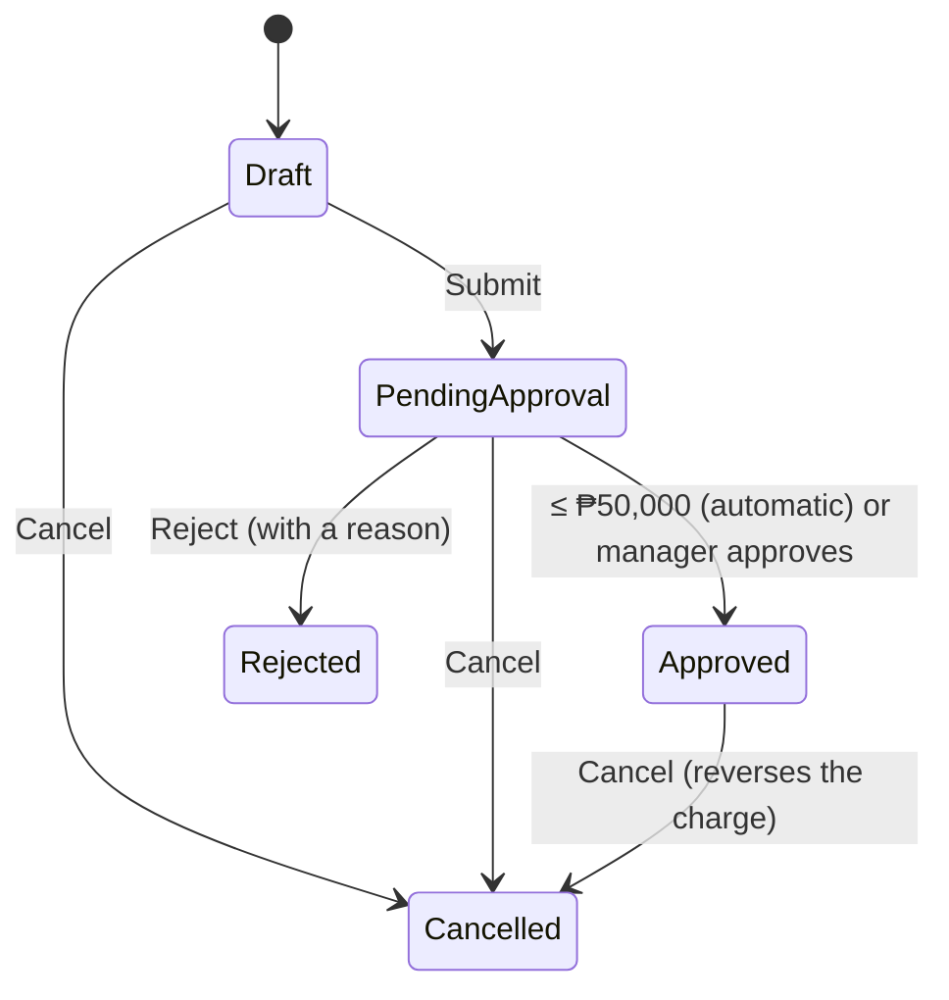

# Lesson 04 — The Domain Model: The Rules, in Plain C#

Good day, developer! Today is the most important lesson in the whole course. We'll write the business rules
themselves: when a customer is blocked, how much credit is left, who may sell a controlled item, when an
order needs a manager, and why nobody may approve their own order. And we'll do it with no database and no
HTTP, just plain C#, so we can prove every rule with tests that run in milliseconds. Give yourself about two
hours. Are you ready? Let's begin!

## What we'll build

| Piece | What it is |
|---|---|
| **Base types** | `Entity`, `AggregateRoot`, `DomainException`, `Roles`: shared by every module |
| **Value objects** | `Money` and `Quantity`, also shared, plus typed ids like `SalesOrderId` |
| **Sales' entities** | `Customer`, `ItemCategory`, `SalesItem` |
| **The aggregate** | `SalesOrder` with its lines, a status state machine, and the approval workflow |
| **A test project** | Eighteen tests that need no database |

## Why we build it this way

### The pain: rules scattered across handlers

Here's the obvious version. You put the checks right where the data is loaded:

```csharp
// inside some handler
if (customer.IsBlocked) throw ...;
if (customer.Balance + total > customer.CreditLimit) throw ...;
order.Status = "PendingApproval";
```

Now "submit" has the credit check, "update" copies it, and the copy slowly drifts. Someone sets
`order.Status = "Approved"` straight from a draft, because nothing stops them. And testing the credit rule
means starting a database, because the rule lives next to the query.

### The fix: put each rule on the thing it's about

| The question | Where the answer lives |
|---|---|
| May this customer order? | A method on `Customer` |
| Can this order move from Draft to Approved? | A method on `SalesOrder`, guarded by a state machine |
| Is this amount valid? | `Money` itself: it refuses to exist if it isn't |

The data can only change through those methods, because the setters are private. So the rules can't be
skipped. And since none of this touches a database, every rule can be unit-tested.

Here's the one table to remember from the whole course. Every rule you'll ever write fits in one of these
rows:

| The question | Where it lives |
|---|---|
| Is the request well-formed? (positive ids, at least one line) | A validator ([lesson 07](07-create-order.md)) |
| Is this operation allowed? (blocked, credit, status, approval) | **The domain** — this lesson |
| Load, act, save | A handler ([lesson 07](07-create-order.md)), with no business `if`s |
| Two people acting at once | The database, atomically ([lessons 09](09-submit.md) and [10](10-approve-reject-cancel.md)) |

To remember it easily: if the question is "is this allowed?", the answer lives in the domain.

### Three words you need

- A **value object** is defined only by its value, and never changes. Think of money: any ₱1,000 bill is as
  good as any other. You don't care *which* bill you have, only its value. `Money` and `Quantity` are value
  objects.
- An **entity** has an identity that stays the same while its data changes. Customer #1 is still customer
  #1 after they change their name.
- An **aggregate** is a group of objects changed as one unit, with one **root** that the outside world
  talks to. An order and its lines are one aggregate: you never change a line except through its order.

## 1. The shared building blocks

Every module's domain will need the same few pieces, so they go in `Erp.Shared.BuildingBlocks`:

```csharp
// src/Shared/Erp.Shared.BuildingBlocks/Domain/BuildingBlocks.cs
namespace Erp.Shared.BuildingBlocks;

public abstract class Entity<TId> where TId : struct
{
    public TId Id { get; protected set; }
}

public abstract class AggregateRoot<TId> : Entity<TId> where TId : struct;

// A business rule said no. Becomes HTTP 422.
public class DomainException(string message) : Exception(message);
```

- **`Entity<TId>`** is anything with an identity. `TId` is a small struct like `SalesOrderId`, never a
  plain `long`; you'll see why in a moment.
- **`AggregateRoot<TId>`** marks the one entity the outside world talks to. It's empty for now. In
  [lesson 13](13-events-outbox.md) it learns to record events.
- **`DomainException`** is how a business rule says no.
- **`where TId : struct`** appears on both classes. Leave it off `AggregateRoot` and the compiler stops you
  with `CS0453`: a derived generic class must repeat its base class's constraints.

Pesos and quantities will appear in every module that touches an order, a purchase or an invoice, so they
live here too:

```csharp
// src/Shared/Erp.Shared.BuildingBlocks/Domain/Money.cs
namespace Erp.Shared.BuildingBlocks;

// Philippine pesos, never negative, always rounded to centavos.
public readonly record struct Money
{
    public static readonly Money Zero = new(0m);

    public decimal Amount { get; }

    public Money(decimal amount) =>
        Amount = amount >= 0
            ? Math.Round(amount, 2, MidpointRounding.AwayFromZero)
            : throw new DomainException("An amount of money cannot be negative.");

    public static Money operator +(Money a, Money b) => new(a.Amount + b.Amount);
    public static Money operator -(Money a, Money b) => new(a.Amount - b.Amount);
    public static Money operator *(Money price, Quantity qty) => new(price.Amount * qty.Value);
    public static bool operator >(Money a, Money b) => a.Amount > b.Amount;
    public static bool operator <(Money a, Money b) => a.Amount < b.Amount;
    public static bool operator >=(Money a, Money b) => a.Amount >= b.Amount;
    public static bool operator <=(Money a, Money b) => a.Amount <= b.Amount;

    public static Money Min(Money a, Money b) => a <= b ? a : b;
    public override string ToString() => $"₱{Amount:N2}";
}
```

```csharp
// src/Shared/Erp.Shared.BuildingBlocks/Domain/Quantity.cs
namespace Erp.Shared.BuildingBlocks;

// Greater than zero, at most three decimal places (2.5 kg). Whether fractions are allowed at all depends on the
// item's unit, which only the item knows.
public readonly record struct Quantity
{
    public decimal Value { get; }

    public Quantity(decimal value)
    {
        if (value <= 0) throw new DomainException("Quantity must be greater than zero.");
        if (decimal.Round(value, 3) != value) throw new DomainException("Quantity allows at most three decimal places.");
        Value = value;
    }

    public bool IsWhole => decimal.Truncate(Value) == Value;

    public static Quantity operator +(Quantity a, Quantity b) => new(a.Value + b.Value);
    public static bool operator >(Quantity a, Quantity b) => a.Value > b.Value;
    public static bool operator <(Quantity a, Quantity b) => a.Value < b.Value;
    public override string ToString() => Value.ToString("0.###");
}
```

| Detail | Why |
|---|---|
| `readonly record struct` | Immutable, compared by value, and cheap: no allocation |
| The constructor throws | An invalid `Money` or `Quantity` can't exist, so nothing downstream has to check |
| `Money` rounds to centavos | ₱620.50 × 1.5 kg is ₱930.75, not ₱930.750; every total adds up the same way everywhere |
| `Quantity` is a `decimal` | A business sells 2.5 kg of wire as well as 2 pieces. Whether *this* item allows fractions is a rule on the item |

And the role names, written once so nobody ever types one:

```csharp
// src/Shared/Erp.Shared.BuildingBlocks/Abstractions/Roles.cs
namespace Erp.Shared.BuildingBlocks;

// The role names, defined once. A typo in a role string silently breaks an auth check, so nobody types them.
public static class Roles
{
    public const string SalesRep = "SalesRep";
    public const string SalesManager = "SalesManager";
    public const string Admin = "Admin";

    public static readonly string[] All = [SalesRep, SalesManager, Admin];
}
```

Three roles are all Sales needs. [Lesson 16](16-users-email.md) adds the warehouse, purchasing and
accounting roles, when their screens arrive.

You might wonder why all of BuildingBlocks shares one namespace, whatever the folder. Folders like
`Domain/` are for people browsing the project; one namespace means one `using` line in every module.

## 2. Typed ids

Folder: `src/Modules/Sales/Erp.Modules.Sales/Domain/`. Everything here is `internal`.

```csharp
// Domain/Ids.cs
namespace Erp.Modules.Sales.Domain;

internal readonly record struct SalesOrderId(long Value);
internal readonly record struct CustomerId(long Value);
internal readonly record struct CategoryId(long Value);
internal readonly record struct ItemId(long Value);

// Owned by the Identity module, referenced by id only.
internal readonly record struct UserId(long Value);
```

Why not plain `long`s? Because then this compiles, and is wrong:

```csharp
var item = await db.SalesItems.FindAsync(customerId);   // a customer id where an item id belongs
```

With typed ids, the compiler refuses it. It costs one line per id type.

## 3. The customer

```csharp
// Domain/Customer.cs
using Erp.Shared.BuildingBlocks;

namespace Erp.Modules.Sales.Domain;

internal sealed class Customer : Entity<CustomerId>
{
    public string Name { get; private set; } = default!;
    public bool IsBlocked { get; private set; }
    public Money CreditLimit { get; private set; }
    public Money OutstandingBalance { get; private set; }   // approved orders not yet paid for

    private Customer() { }

    public static Customer Create(string name, Money creditLimit)
    {
        if (string.IsNullOrWhiteSpace(name)) throw new DomainException("A customer needs a name.");
        return new Customer { Name = name.Trim(), CreditLimit = creditLimit };
    }

    public void Block() => IsBlocked = true;
    public void Unblock() => IsBlocked = false;

    public void EnsureNotBlocked()
    {
        if (IsBlocked)
            throw new DomainException($"Customer '{Name}' is blocked and cannot place orders.");
    }

    // Exposure = what they owe + what's awaiting approval + this order.
    public void EnsureWithinCreditLimit(Money orderTotal, Money otherPendingTotal)
    {
        if (OutstandingBalance + otherPendingTotal + orderTotal <= CreditLimit) return;

        var available = Math.Max(0, CreditLimit.Amount - OutstandingBalance.Amount - otherPendingTotal.Amount);
        throw new DomainException(
            $"Order total ₱{orderTotal.Amount:N2} would exceed the credit limit. Available credit: ₱{available:N2}.");
    }

    public void AddToBalance(Money amount) => OutstandingBalance += amount;

    // A cancelled order, or money received. Never below zero.
    public void DeductFromBalance(Money amount) =>
        OutstandingBalance = OutstandingBalance - Money.Min(amount, OutstandingBalance);
}
```

Look closely at `EnsureWithinCreditLimit`. It doesn't only add this order to what the customer owes; it
also adds `otherPendingTotal`, the customer's other orders still waiting for a manager. Without that, a
customer with ₱100,000 of credit could submit three ₱90,000 orders before anyone approves the first. Each
would pass on its own, and once all three were approved, they'd owe ₱270,000.

The private parameterless constructor and the `Create` factory are a pair you'll see everywhere. `Create`
checks the rules for a new customer; the private constructor is for the database to use later, in
[lesson 05](05-database.md). [Lesson 15](15-customers.md) gives customers a TIN, an address and payment
terms, and puts `Block` behind a button; until then, the seed data sets them up.

## 4. Categories and items

A **category** holds sales rules for a group of items: who may sell them, and how many one order may hold.

```csharp
// Domain/ItemCategory.cs
using Erp.Shared.BuildingBlocks;

namespace Erp.Modules.Sales.Domain;

// Sales rules that apply to a group of items: who may sell them, and how much per order.
internal sealed class ItemCategory : Entity<CategoryId>
{
    public string Name { get; private set; } = default!;
    public decimal MaxQuantityPerOrder { get; private set; }
    public string? RequiredRole { get; private set; }   // null = anyone who may sell

    private ItemCategory() { }

    public static ItemCategory Create(string name, decimal maxQuantityPerOrder, string? requiredRole)
    {
        if (string.IsNullOrWhiteSpace(name)) throw new DomainException("A category needs a name.");
        if (maxQuantityPerOrder <= 0) throw new DomainException("The maximum quantity per order must be greater than zero.");
        if (requiredRole is not null && !Roles.All.Contains(requiredRole))
            throw new DomainException($"'{requiredRole}' is not a role.");
        return new ItemCategory { Name = name.Trim(), MaxQuantityPerOrder = maxQuantityPerOrder, RequiredRole = requiredRole };
    }

    public void EnsureRoleAllowed(string callerRole)
    {
        if (RequiredRole is not null && callerRole != RequiredRole && callerRole != Roles.Admin)
            throw new DomainException($"Category '{Name}' requires role '{RequiredRole}'.");
    }

    public void EnsureQuantityAllowed(decimal quantityOnOrder)
    {
        if (quantityOnOrder > MaxQuantityPerOrder)
            throw new DomainException(
                $"Category '{Name}' allows at most {MaxQuantityPerOrder:0.###} per order (requested {quantityOnOrder:0.###}).");
    }
}
```

An **item**, as far as Sales is concerned, is something with a price that it may sell. Sales doesn't own the
list of items: that's the warehouse's catalog, which arrives with the Inventory module in
[lesson 17](17-item-catalog.md). Sales keeps its own copy of what it needs from the catalog (SKU, name,
unit, whether fractions are allowed, whether the item is active), plus the three things only Sales decides:
the price, the category, and whether it's on sale.

```csharp
// Domain/SalesItem.cs
using Erp.Shared.BuildingBlocks;

namespace Erp.Modules.Sales.Domain;

// Sales' copy of a catalog item, plus what only Sales decides: the price, the category, and whether it's for sale.
internal sealed class SalesItem : Entity<ItemId>
{
    public string Sku { get; private set; } = default!;
    public string Name { get; private set; } = default!;
    public string Unit { get; private set; } = default!;
    public bool AllowsFractions { get; private set; }
    public bool IsActive { get; private set; }
    public Money UnitPrice { get; private set; }
    public CategoryId? CategoryId { get; private set; }
    public ItemCategory? Category { get; private set; }
    public bool IsForSale { get; private set; }

    private SalesItem() { }

    // A new catalog item arrives unpriced and not for sale.
    public static SalesItem FromCatalog(ItemId id, string sku, string name, string unit, bool allowsFractions, bool isActive)
    {
        var item = new SalesItem { Id = id };
        item.ApplyCatalog(sku, name, unit, allowsFractions, isActive);
        return item;
    }

    public void ApplyCatalog(string sku, string name, string unit, bool allowsFractions, bool isActive)
    {
        Sku = sku; Name = name; Unit = unit; AllowsFractions = allowsFractions; IsActive = isActive;
    }

    public void SetPricing(Money unitPrice, ItemCategory category, bool isForSale)
    {
        if (isForSale && unitPrice == Money.Zero) throw new DomainException($"Set a price for {Sku} before putting it on sale.");
        if (isForSale && !IsActive) throw new DomainException($"{Sku} is inactive in the catalog and can't be sold.");
        UnitPrice = unitPrice;
        CategoryId = category.Id;
        Category = category;
        IsForSale = isForSale;
    }

    public ItemCategory EnsureSellable()
    {
        if (!IsActive || !IsForSale || Category is null)
            throw new DomainException($"Item {Sku} is not for sale.");
        return Category;
    }

    public void EnsureQuantityFits(Quantity quantity)
    {
        if (!AllowsFractions && !quantity.IsWhole)
            throw new DomainException($"Item {Sku} is sold in whole {Unit}; {quantity} is not allowed.");
    }
}
```

Until lesson 17, the development seed puts the items in directly. The rules don't care where an item came
from.

## 5. The sales order

An order moves through a small, fixed set of statuses. Every legal move is written down in one place:



```csharp
// Domain/SalesOrder.cs
using Erp.Shared.BuildingBlocks;

namespace Erp.Modules.Sales.Domain;

// Stored as numbers: never renumber.
internal enum SalesOrderStatus
{
    Draft = 0,
    PendingApproval = 1,
    Approved = 2,
    Cancelled = 3,
    Rejected = 4
}

internal static class SalesOrderStatusRules
{
    private static readonly Dictionary<SalesOrderStatus, SalesOrderStatus[]> Allowed = new()
    {
        [SalesOrderStatus.Draft]           = [SalesOrderStatus.PendingApproval, SalesOrderStatus.Cancelled],
        [SalesOrderStatus.PendingApproval] = [SalesOrderStatus.Approved, SalesOrderStatus.Rejected, SalesOrderStatus.Cancelled],
        [SalesOrderStatus.Approved]        = [SalesOrderStatus.Cancelled],
        [SalesOrderStatus.Cancelled]       = [],
        [SalesOrderStatus.Rejected]        = [],
    };

    public static bool CanTransitionTo(this SalesOrderStatus from, SalesOrderStatus to) => Allowed[from].Contains(to);
}

internal static class ApprovalPolicy
{
    // Orders above this need a manager; at or below it they're approved on submit.
    public static readonly Money Threshold = new(50_000m);
}

// The line keeps the item's name and unit as they were when ordered, like a printed order would.
internal sealed class SalesOrderLine
{
    public ItemId ItemId { get; private set; }
    public string ItemName { get; private set; } = default!;
    public string Unit { get; private set; } = default!;
    public Quantity Quantity { get; private set; }
    public Money UnitPrice { get; private set; }
    public Money LineTotal => UnitPrice * Quantity;

    private SalesOrderLine() { }

    public SalesOrderLine(ItemId itemId, string itemName, string unit, Quantity quantity, Money unitPrice)
    { ItemId = itemId; ItemName = itemName; Unit = unit; Quantity = quantity; UnitPrice = unitPrice; }

    public void IncreaseQuantity(Quantity extra) => Quantity += extra;
}

internal sealed class SalesOrder : AggregateRoot<SalesOrderId>
{
    private readonly List<SalesOrderLine> _lines = new();
    public IReadOnlyList<SalesOrderLine> Lines => _lines;

    public string OrderNumber { get; private set; } = default!;
    public CustomerId CustomerId { get; private set; }
    public SalesOrderStatus Status { get; private set; }
    public UserId CreatedBy { get; private set; }
    public DateTime CreatedUtc { get; private set; }
    public DateTime? SubmittedUtc { get; private set; }
    public UserId? ApprovedBy { get; private set; }   // null = approved automatically
    public DateTime? ApprovedUtc { get; private set; }
    public UserId? RejectedBy { get; private set; }
    public DateTime? RejectedUtc { get; private set; }
    public string? RejectionReason { get; private set; }

    public Money Total => _lines.Aggregate(Money.Zero, (sum, l) => sum + l.LineTotal);
    public bool RequiresApproval => Total > ApprovalPolicy.Threshold;
    public bool HoldsStock => Status is SalesOrderStatus.PendingApproval or SalesOrderStatus.Approved;

    private SalesOrder() { }

    public static SalesOrder Create(string orderNumber, CustomerId customerId, UserId createdBy, DateTime nowUtc) => new()
    {
        OrderNumber = orderNumber,
        CustomerId = customerId,
        CreatedBy = createdBy,
        CreatedUtc = nowUtc,
        Status = SalesOrderStatus.Draft
    };

    // Replaces every line. The category caps count across the whole order, so they're checked on the full set.
    public void SetLines(IReadOnlyList<(SalesItem Item, Quantity Quantity)> lines, string callerRole)
    {
        EnsureDraft();
        if (lines.Count == 0) throw new DomainException("An order needs at least one line.");

        // Built aside and swapped in at the end, so a refused line leaves the order exactly as it was.
        var newLines = new List<SalesOrderLine>();
        var perCategory = new Dictionary<CategoryId, decimal>();
        foreach (var (item, quantity) in lines)
        {
            var category = item.EnsureSellable();
            category.EnsureRoleAllowed(callerRole);
            item.EnsureQuantityFits(quantity);
            perCategory[category.Id] = perCategory.GetValueOrDefault(category.Id) + quantity.Value;
            category.EnsureQuantityAllowed(perCategory[category.Id]);

            var existing = newLines.FirstOrDefault(l => l.ItemId == item.Id);
            if (existing is not null) existing.IncreaseQuantity(quantity);
            else newLines.Add(new SalesOrderLine(item.Id, item.Name, item.Unit, quantity, item.UnitPrice));
        }
        _lines.Clear();
        _lines.AddRange(newLines);
    }

    // otherPendingTotal: the customer's other submitted-but-unapproved orders, which already count against credit.
    public void Submit(Customer customer, Money otherPendingTotal, DateTime nowUtc)
    {
        EnsureBelongsTo(customer);
        if (_lines.Count == 0)
            throw new DomainException("Cannot submit an order with no lines.");
        customer.EnsureNotBlocked();
        customer.EnsureWithinCreditLimit(Total, otherPendingTotal);

        Transition(SalesOrderStatus.PendingApproval);
        SubmittedUtc = nowUtc;

        if (!RequiresApproval)
            MarkApproved(approver: null, customer, nowUtc);
    }

    public void Approve(UserId approver, Customer customer, DateTime nowUtc)
    {
        EnsureBelongsTo(customer);
        if (approver == CreatedBy)
            throw new DomainException("An order can't be approved by the person who created it.");
        MarkApproved(approver, customer, nowUtc);
    }

    // Returns the lines whose reserved stock must be released.
    public IReadOnlyList<SalesOrderLine> Reject(UserId rejectedBy, string reason, DateTime nowUtc)
    {
        if (string.IsNullOrWhiteSpace(reason))
            throw new DomainException("A rejection needs a reason.");
        Transition(SalesOrderStatus.Rejected);
        RejectedBy = rejectedBy;
        RejectedUtc = nowUtc;
        RejectionReason = reason.Trim();
        return _lines;
    }

    // Returns the lines whose reserved stock must be released (none for a draft).
    public IReadOnlyList<SalesOrderLine> Cancel(Customer customer)
    {
        EnsureBelongsTo(customer);
        var heldStock = HoldsStock;
        var wasCharged = Status == SalesOrderStatus.Approved;

        Transition(SalesOrderStatus.Cancelled);

        if (wasCharged)
            customer.DeductFromBalance(Total);
        return heldStock ? _lines : [];
    }

    private void MarkApproved(UserId? approver, Customer customer, DateTime nowUtc)
    {
        Transition(SalesOrderStatus.Approved);
        ApprovedBy = approver;
        ApprovedUtc = nowUtc;
        customer.AddToBalance(Total);
    }

    private void EnsureDraft()
    {
        if (Status != SalesOrderStatus.Draft)
            throw new DomainException("Lines can only be changed on a draft order.");
    }

    private void EnsureBelongsTo(Customer customer)
    {
        if (customer.Id != CustomerId)
            throw new InvalidOperationException($"Customer {customer.Id.Value} does not own order {OrderNumber}.");
    }

    private void Transition(SalesOrderStatus to)
    {
        if (!Status.CanTransitionTo(to))
            throw new DomainException($"Cannot move a {Status} order to {to}.");
        Status = to;
    }
}
```

That's a lot of code, so let's walk through what each part protects:

- **`Total` is computed** from the lines. It can never disagree with them, because it's never stored.
- **`SetLines` replaces the whole list** and checks every rule on the complete set: the item is for sale,
  the caller's role may sell its category, whole-unit items get whole quantities, and the category cap
  counts across all lines, so five Controlled items split over two lines are still five.
- **The same item twice becomes one line.** Adding 2 Widgets and then 3 Widgets is one line of 5.
- **The line keeps the item's name and unit** as they were when ordered. Rename the item next year, and
  this order still says what was ordered.
- **`Submit`** checks the customer and moves the order to `PendingApproval`. If the order is ₱50,000 or
  less, it approves it on the spot. Small orders don't wait for a manager.
- **`Approve`** refuses the person who created the order. Businesses call this *segregation of duties*:
  nobody signs off on their own big sale.
- **Approving charges the customer** (`AddToBalance`), and **cancelling an approved order takes it back**.
  The domain does both, so no handler can forget one.
- **`Reject` and `Cancel` return the lines to release.** The order knows whether it was holding stock; the
  handler just does what it's told ([lesson 10](10-approve-reject-cancel.md)). No business `if` leaks out.
- **The time comes in as a parameter** (`nowUtc`) instead of `DateTime.UtcNow`, so tests can control it.
- `EnsureBelongsTo` throws `InvalidOperationException`, not `DomainException`. Passing the wrong customer is
  a programming bug, not a business rule a user can break.

Clear so far? Good. Now let's prove all of it.

## 6. The unit tests

The test project has been waiting since [lesson 03](03-mediator.md), and it can already see Sales' internals.
The domain is exactly what unit tests are for: plain classes, no database, no web. Let's prove every rule
we just wrote.

```csharp
// tests/Erp.Modules.Sales.UnitTests/DomainTests.cs
using AwesomeAssertions;
using Erp.Modules.Sales.Domain;
using Erp.Shared.BuildingBlocks;

namespace Erp.Modules.Sales.UnitTests;

internal static class Make
{
    public static readonly DateTime Now = new(2026, 11, 5, 9, 0, 0, DateTimeKind.Utc);
    public static readonly UserId Rep = new(1);
    public static readonly UserId Manager = new(2);

    public static readonly ItemCategory General = ItemCategory.Create("General", 1000, null);
    public static readonly ItemCategory Controlled = ItemCategory.Create("Controlled", 5, Roles.SalesManager);

    public static Customer Customer(decimal limit = 1_000_000, decimal balance = 0, bool blocked = false)
    {
        var customer = Domain.Customer.Create("Acme", new Money(limit));
        if (balance > 0) customer.AddToBalance(new Money(balance));
        if (blocked) customer.Block();
        return customer;
    }

    public static SalesItem Item(long id, decimal price, ItemCategory? category = null, bool fractions = false, string unit = "pc")
    {
        var item = SalesItem.FromCatalog(new ItemId(id), $"SKU-{id}", $"Item {id}", unit, fractions, isActive: true);
        item.SetPricing(new Money(price), category ?? General, isForSale: true);
        return item;
    }

    public static SalesOrder Order(Customer customer, decimal unitPrice, decimal qty = 1, UserId? createdBy = null)
    {
        var order = SalesOrder.Create("SO-1", customer.Id, createdBy ?? Rep, Now);
        order.SetLines([(Item(1, unitPrice), new Quantity(qty))], Roles.SalesRep);
        return order;
    }
}

public class CustomerRuleTests
{
    [Fact]
    public void Blocked_customer_cannot_order() =>
        Make.Customer(blocked: true).Invoking(c => c.EnsureNotBlocked())
            .Should().Throw<DomainException>().WithMessage("*blocked*");

    [Fact]
    public void Order_over_available_credit_is_rejected() =>
        Make.Customer(limit: 5000, balance: 4500).Invoking(c => c.EnsureWithinCreditLimit(new Money(600), Money.Zero))
            .Should().Throw<DomainException>().WithMessage("*credit limit*");

    [Fact]
    public void Orders_awaiting_approval_count_against_credit() =>
        Make.Customer(limit: 200_000).Invoking(c => c.EnsureWithinCreditLimit(new Money(75_000), new Money(150_000)))
            .Should().Throw<DomainException>().WithMessage("*Available credit: ₱50,000.00*");
}

public class OrderLineTests
{
    [Fact]
    public void Controlled_items_need_a_manager()
    {
        var order = SalesOrder.Create("SO-1", new CustomerId(0), Make.Rep, Make.Now);
        var kit = Make.Item(3, 500, Make.Controlled);

        order.Invoking(o => o.SetLines([(kit, new Quantity(1))], Roles.SalesRep)).Should().Throw<DomainException>();
        order.Invoking(o => o.SetLines([(kit, new Quantity(1))], Roles.SalesManager)).Should().NotThrow();
    }

    [Fact]
    public void Category_cap_counts_across_the_whole_order()
    {
        var order = SalesOrder.Create("SO-1", new CustomerId(0), Make.Manager, Make.Now);
        var kitA = Make.Item(3, 500, Make.Controlled);
        var kitB = Make.Item(4, 500, Make.Controlled);

        order.Invoking(o => o.SetLines([(kitA, new Quantity(3)), (kitB, new Quantity(3))], Roles.SalesManager))
            .Should().Throw<DomainException>().WithMessage("*at most 5*");
    }

    [Fact]
    public void Whole_unit_items_refuse_fractions_but_bulk_items_allow_them()
    {
        var order = SalesOrder.Create("SO-1", new CustomerId(0), Make.Rep, Make.Now);

        order.Invoking(o => o.SetLines([(Make.Item(1, 25), new Quantity(1.5m))], Roles.SalesRep))
            .Should().Throw<DomainException>().WithMessage("*whole*");
        order.SetLines([(Make.Item(5, 620.50m, fractions: true, unit: "kg"), new Quantity(1.5m))], Roles.SalesRep);
        order.Total.Should().Be(new Money(930.75m));
    }

    [Fact]
    public void An_item_not_for_sale_cannot_be_ordered()
    {
        var unpriced = SalesItem.FromCatalog(new ItemId(9), "NEW-1", "New", "pc", false, isActive: true);
        SalesOrder.Create("SO-1", new CustomerId(0), Make.Rep, Make.Now)
            .Invoking(o => o.SetLines([(unpriced, new Quantity(1))], Roles.SalesRep))
            .Should().Throw<DomainException>().WithMessage("*not for sale*");
    }

    [Fact]
    public void An_item_cannot_go_on_sale_without_a_price() =>
        SalesItem.FromCatalog(new ItemId(9), "NEW-1", "New", "pc", false, isActive: true)
            .Invoking(i => i.SetPricing(Money.Zero, Make.General, isForSale: true))
            .Should().Throw<DomainException>().WithMessage("*price*");

    [Fact]
    public void The_same_item_twice_becomes_one_line()
    {
        var order = SalesOrder.Create("SO-1", new CustomerId(0), Make.Rep, Make.Now);
        var widget = Make.Item(1, 25);
        order.SetLines([(widget, new Quantity(2)), (widget, new Quantity(3))], Roles.SalesRep);
        order.Lines.Should().ContainSingle().Which.Quantity.Should().Be(new Quantity(5));
    }
}

public class SubmitAndApproveTests
{
    [Fact]
    public void Small_order_is_approved_automatically_and_charged()
    {
        var customer = Make.Customer();
        var order = Make.Order(customer, unitPrice: 25, qty: 2);

        order.Submit(customer, Money.Zero, Make.Now);

        order.Status.Should().Be(SalesOrderStatus.Approved);
        order.ApprovedBy.Should().BeNull();
        customer.OutstandingBalance.Should().Be(new Money(50));
    }

    [Fact]
    public void High_value_order_waits_for_a_manager()
    {
        var customer = Make.Customer();
        var order = Make.Order(customer, unitPrice: 60_000);

        order.Submit(customer, Money.Zero, Make.Now);

        order.Status.Should().Be(SalesOrderStatus.PendingApproval);
        customer.OutstandingBalance.Should().Be(Money.Zero);
    }

    [Fact]
    public void Creator_cannot_approve_their_own_order()
    {
        var customer = Make.Customer();
        var order = Make.Order(customer, unitPrice: 60_000);
        order.Submit(customer, Money.Zero, Make.Now);

        order.Invoking(o => o.Approve(Make.Rep, customer, Make.Now))
            .Should().Throw<DomainException>().WithMessage("*person who created it*");
        order.Approve(Make.Manager, customer, Make.Now);
        customer.OutstandingBalance.Should().Be(new Money(60_000));
    }

    [Fact]
    public void Lines_are_frozen_after_submitting()
    {
        var customer = Make.Customer();
        var order = Make.Order(customer, unitPrice: 25);
        order.Submit(customer, Money.Zero, Make.Now);

        order.Invoking(o => o.SetLines([(Make.Item(2, 40), new Quantity(1))], Roles.SalesRep))
            .Should().Throw<DomainException>().WithMessage("*draft*");
    }
}

public class RejectAndCancelTests
{
    [Fact]
    public void Rejecting_needs_a_reason_and_releases_the_stock()
    {
        var customer = Make.Customer();
        var order = Make.Order(customer, unitPrice: 60_000);
        order.Submit(customer, Money.Zero, Make.Now);

        order.Invoking(o => o.Reject(Make.Manager, " ", Make.Now)).Should().Throw<DomainException>();
        order.Reject(Make.Manager, "Customer asked for a quote first", Make.Now).Should().HaveCount(1);
        order.Status.Should().Be(SalesOrderStatus.Rejected);
    }

    [Fact]
    public void Cancelling_an_approved_order_reverses_the_charge_and_releases_stock()
    {
        var customer = Make.Customer();
        var order = Make.Order(customer, unitPrice: 25, qty: 2);
        order.Submit(customer, Money.Zero, Make.Now);

        order.Cancel(customer).Should().HaveCount(1);
        customer.OutstandingBalance.Should().Be(Money.Zero);
    }

    [Fact]
    public void Cancelling_a_draft_releases_nothing()
    {
        var customer = Make.Customer();
        Make.Order(customer, unitPrice: 25).Cancel(customer).Should().BeEmpty();
    }
}

public class ValueObjectTests
{
    [Fact]
    public void Quantity_must_be_positive_with_at_most_three_decimals()
    {
        FluentActions.Invoking(() => new Quantity(0)).Should().Throw<DomainException>();
        FluentActions.Invoking(() => new Quantity(1.2345m)).Should().Throw<DomainException>();
        new Quantity(1.234m).Value.Should().Be(1.234m);
    }

    [Fact]
    public void Money_cannot_be_negative_and_rounds_to_centavos()
    {
        FluentActions.Invoking(() => new Money(-1)).Should().Throw<DomainException>();
        (new Money(620.50m) * new Quantity(1.333m)).Should().Be(new Money(827.13m));
    }
}
```

`Make` builds the objects the tests need, so each test only states what's special about it. A new customer
has an id of 0 until the database gives it one, so `Make.Order` uses `customer.Id` rather than inventing
one. Each test reads like a sentence from the business rules; when a rule changes, the test that names it is
the first thing you update.

## 7. Hunting for edges

The tests above prove each rule with one comfortable example: ₱600 over a ₱500 headroom, an order of ₱60,000.
Bugs don't live there. They live at the edges: an order of *exactly* ₱50,000, credit used to the last
centavo, five kits when the cap is five. Take the checklist from [lesson 02](02-testing.md) and walk it over
the domain:

```csharp
// tests/Erp.Modules.Sales.UnitTests/BoundaryTests.cs
using AwesomeAssertions;
using Erp.Modules.Sales.Domain;
using Erp.Shared.BuildingBlocks;

namespace Erp.Modules.Sales.UnitTests;

// Bugs live at the edges: exactly at a limit, one centavo past it, zero, the smallest step.
public class MoneyAndQuantityBoundaryTests
{
    [Theory]
    [InlineData("0.005", "0.01")]   // half a centavo rounds up, away from zero
    [InlineData("0.004", "0.00")]
    [InlineData("1.005", "1.01")]
    [InlineData("2.675", "2.68")]   // the classic double-rounding trap; decimal gets it right
    [InlineData("0", "0.00")]
    public void Money_rounds_half_a_centavo_away_from_zero(string amount, string expected) =>
        new Money(decimal.Parse(amount)).Amount.Should().Be(decimal.Parse(expected));

    [Fact]
    public void Taking_away_more_money_than_there_is_fails() =>
        FluentActions.Invoking(() => new Money(5) - new Money(5.01m)).Should().Throw<DomainException>();

    [Theory]
    [InlineData("0")]
    [InlineData("-1")]
    [InlineData("-0.001")]
    [InlineData("0.0001")]
    [InlineData("1.0005")]
    public void A_quantity_that_is_not_positive_or_has_four_decimals_is_refused(string value) =>
        FluentActions.Invoking(() => new Quantity(decimal.Parse(value))).Should().Throw<DomainException>();
}

public class LimitBoundaryTests
{
    [Fact]
    public void Credit_up_to_exactly_the_limit_is_allowed() =>
        Make.Customer(limit: 5000, balance: 4500).Invoking(c => c.EnsureWithinCreditLimit(new Money(500), Money.Zero))
            .Should().NotThrow();

    [Fact]
    public void One_centavo_over_the_limit_is_refused() =>
        Make.Customer(limit: 5000, balance: 4500).Invoking(c => c.EnsureWithinCreditLimit(new Money(500.01m), Money.Zero))
            .Should().Throw<DomainException>().WithMessage("*Available credit: ₱500.00*");

    [Fact]
    public void An_order_of_exactly_50000_is_approved_on_submit()
    {
        var customer = Make.Customer();
        var order = Make.Order(customer, unitPrice: 50_000);

        order.Submit(customer, Money.Zero, Make.Now);

        order.Status.Should().Be(SalesOrderStatus.Approved);
    }

    [Fact]
    public void One_centavo_over_50000_waits_for_a_manager()
    {
        var customer = Make.Customer();
        var order = Make.Order(customer, unitPrice: 50_000.01m);

        order.Submit(customer, Money.Zero, Make.Now);

        order.Status.Should().Be(SalesOrderStatus.PendingApproval);
    }

    // SetLines builds the new lines aside and swaps them in at the end. This proves why.
    [Fact]
    public void A_failed_change_of_lines_keeps_the_old_lines()
    {
        var order = Make.Order(Make.Customer(), unitPrice: 25, qty: 2);

        order.Invoking(o => o.SetLines([(Make.Item(3, 500, Make.Controlled), new Quantity(1))], Roles.SalesRep))
            .Should().Throw<DomainException>();

        order.Lines.Should().ContainSingle().Which.Quantity.Should().Be(new Quantity(2));
    }
}
```

Notice how a `[Theory]` takes the numbers as strings and parses them: C# attributes can't hold a `decimal`,
and a `double` would bring back exactly the rounding errors we're testing for.

That last test is worth a closer look. An early version of `SetLines` cleared the lines first and then
added the new ones, checking each as it went. A refused third line left the order with two lines, or none:
half-changed. The handler would throw and never save, so nobody noticed. The test noticed. That's why
`SetLines` builds `newLines` aside, and only replaces `_lines` once every line has passed.

### Every status change that isn't allowed

The state machine has five statuses and four actions so far. That's twenty combinations, and only a handful
are allowed. One `[Theory]` tries the forbidden ones and checks that each fails *and changes nothing*:

```csharp
// tests/Erp.Modules.Sales.UnitTests/StatusTransitionTests.cs
using AwesomeAssertions;
using Erp.Modules.Sales.Domain;
using Erp.Shared.BuildingBlocks;

namespace Erp.Modules.Sales.UnitTests;

// Every status change that isn't on the list must fail, and leave the order and the customer as they were.
public class StatusTransitionTests
{
    public enum Step { Submit, Approve, Reject, Cancel }

    private static (SalesOrder Order, Customer Customer) OrderIn(SalesOrderStatus status)
    {
        var customer = Make.Customer();
        var order = Make.Order(customer, unitPrice: 60_000);   // over the threshold, so it waits for a manager
        if (status == SalesOrderStatus.Draft) return (order, customer);

        order.Submit(customer, Money.Zero, Make.Now);
        switch (status)
        {
            case SalesOrderStatus.Approved: order.Approve(Make.Manager, customer, Make.Now); break;
            case SalesOrderStatus.Rejected: order.Reject(Make.Manager, "No", Make.Now); break;
            case SalesOrderStatus.Cancelled: order.Cancel(customer); break;
        }
        return (order, customer);
    }

    private static void Do(Step step, SalesOrder order, Customer customer)
    {
        switch (step)
        {
            case Step.Submit: order.Submit(customer, Money.Zero, Make.Now); break;
            case Step.Approve: order.Approve(Make.Manager, customer, Make.Now); break;
            case Step.Reject: order.Reject(Make.Manager, "No", Make.Now); break;
            case Step.Cancel: order.Cancel(customer); break;
        }
    }

    [Theory]
    [InlineData("Draft", Step.Approve)]
    [InlineData("Draft", Step.Reject)]
    [InlineData("PendingApproval", Step.Submit)]
    [InlineData("Approved", Step.Submit)]
    [InlineData("Approved", Step.Approve)]
    [InlineData("Approved", Step.Reject)]
    [InlineData("Rejected", Step.Approve)]
    [InlineData("Rejected", Step.Cancel)]
    [InlineData("Cancelled", Step.Submit)]
    [InlineData("Cancelled", Step.Cancel)]
    public void A_step_not_allowed_from_a_status_is_refused_and_changes_nothing(string status, Step step)
    {
        var from = Enum.Parse<SalesOrderStatus>(status);   // the status enum is internal; a public test can't take it
        var (order, customer) = OrderIn(from);
        var balance = customer.OutstandingBalance;

        order.Invoking(o => Do(step, o, customer)).Should().Throw<DomainException>();

        order.Status.Should().Be(from);
        customer.OutstandingBalance.Should().Be(balance);
    }
}
```

`SalesOrderStatus` is `internal`, and a public test method can't take an internal type as a parameter, so
the status travels as its name. `Step` is the test's own enum, so it can be public. When
[lesson 18](18-shipping.md) adds shipping, it adds a `Ship` step and four more rows.

The rest of the edges follow the same patterns. Here's every one this lesson's tests cover; the ones not
shown above are in the reference build's `BoundaryTests.cs`:

| Test | The edge | Why it matters |
|---|---|---|
| `Money_rounds_half_a_centavo_away_from_zero` | Half a centavo | Rounding the wrong way loses a centavo per line, thousands a year |
| `Taking_away_more_money_than_there_is_fails` | Below zero | Money is never negative; a refund is its own document |
| `A_quantity_that_is_not_positive_or_has_four_decimals_is_refused` | Zero, negative, too precise | The database holds three decimals; a fourth would vanish silently |
| `The_smallest_and_largest_sensible_quantities_are_accepted` | 0.001 and 999,999.999 | A rule that's too strict is a bug too |
| `Credit_up_to_exactly_the_limit_is_allowed` | Exactly at the limit | `<` where `<=` belongs refuses a customer who's within their rights |
| `One_centavo_over_the_limit_is_refused` | One step over | The other side of the same boundary |
| `A_customer_already_over_the_limit_shows_zero_available_not_a_negative` | Already over | "Available credit: -₱500.00" confuses everyone |
| `Exactly_the_category_cap_is_allowed` | At the cap | Same `<` versus `<=` question |
| `The_same_item_twice_counts_toward_the_cap` | Twice | Splitting six kits over two lines must not dodge the cap of five |
| `An_order_of_exactly_50000_is_approved_on_submit` | At the threshold | The policy says *above* ₱50,000 needs a manager |
| `One_centavo_over_50000_waits_for_a_manager` | One step over | The other side |
| `An_order_needs_at_least_one_line` | Nothing | An empty order is no order |
| `An_admin_may_sell_controlled_items` | Who | The exception to the category's role rule |
| `A_failed_change_of_lines_keeps_the_old_lines` | Half-done | A refused change must leave the order exactly as it was |
| `A_step_not_allowed_from_a_status_is_refused_and_changes_nothing` (10 cases) | When | The whole state machine, not just the happy path |
| `Cancelling_an_order_awaiting_approval_releases_stock_but_reverses_no_charge` | When | It was never charged, so nothing is taken back |
| `A_rejection_reason_is_kept_without_its_surrounding_spaces` | Odd input | `"  Price  "` is stored as `"Price"` |

## 8. Property-based tests: let the computer pick the numbers

Every example above was picked by us. But we can only think of the numbers we think of. What about
₱13,617.37 × 0.731 kg? A **property-based test** states a rule that must hold for *every* input, and a library
makes up a hundred inputs to try. If one fails, it shrinks it down to the simplest input that still fails,
and shows you that.

```bash
dotnet add tests/Erp.Modules.Sales.UnitTests package FsCheck.Xunit --version 3.6.0
```

`FsCheck.Xunit` (BSD-3-Clause) gives us the `[Property]` attribute. A property is a method that takes
generated values and returns `true` when the rule holds:

```csharp
// tests/Erp.Modules.Sales.UnitTests/PropertyTests.cs
using Erp.Modules.Sales.Domain;
using Erp.Shared.BuildingBlocks;
using FsCheck;
using FsCheck.Xunit;

namespace Erp.Modules.Sales.UnitTests;

// A [Fact] checks the examples we thought of; a [Property] checks a rule against a hundred inputs FsCheck makes up.
public class MoneyProperties
{
    [Property]
    public bool Money_always_holds_whole_centavos(NonNegativeInt pesos, NonNegativeInt thousandths)
    {
        var amount = pesos.Get + thousandths.Get % 1000 / 1000m;
        var money = new Money(amount);
        return money.Amount * 100 == decimal.Truncate(money.Amount * 100) && Math.Abs(money.Amount - amount) <= 0.005m;
    }

    [Property]
    public bool Adding_amounts_never_drifts_a_centavo(NonNegativeInt[] centavos)
    {
        var sum = centavos.Aggregate(Money.Zero, (total, c) => total + new Money(c.Get / 100m));
        return sum.Amount == centavos.Sum(c => (decimal)c.Get) / 100m;
    }

    [Property]
    public bool Subtracting_what_was_added_gives_back_the_start(NonNegativeInt start, NonNegativeInt added)
    {
        var a = new Money(start.Get / 100m);
        var b = new Money(added.Get / 100m);
        return a + b - b == a;
    }
}

public class OrderTotalProperties
{
    // The C# total and, from lesson 08, the SQL functions' SUM(ROUND(quantity * unit_price, 2)) must agree, or
    // the list and the detail page show different totals.
    [Property]
    public bool An_order_total_is_the_sum_of_its_lines_rounded_one_by_one(PositiveInt[] priceCentavos, PositiveInt[] gramsSeed)
    {
        var count = Math.Min(Math.Min(priceCentavos.Length, gramsSeed.Length), 5);
        if (count == 0) return true;

        var lines = Enumerable.Range(0, count).Select(i =>
        {
            var price = priceCentavos[i].Get % 10_000_000 / 100m + 0.01m;
            var quantity = gramsSeed[i].Get % 200_000 / 1000m + 0.001m;   // up to 200 kg, gram by gram
            return (Item: Make.Item(i + 1, price, fractions: true, unit: "kg"), Price: price, Quantity: quantity);
        }).ToList();

        var order = SalesOrder.Create("SO-1", new CustomerId(0), Make.Rep, Make.Now);
        order.SetLines(lines.Select(l => (l.Item, new Quantity(l.Quantity))).ToList(), Roles.SalesRep);

        return order.Total.Amount == lines.Sum(l => Math.Round(l.Price * l.Quantity, 2, MidpointRounding.AwayFromZero));
    }
}
```

Here's what each piece does:

- **`NonNegativeInt`, `PositiveInt`** are FsCheck's types for "any whole number, 0 or more" and "1 or more".
  `.Get` is the number. Arrays of them come in any length, including empty, which is an edge for free.
- **The `%` and `+ 0.001m`** squeeze the made-up numbers into the shape we need: prices up to ₱100,000, weights
  up to 200 kg, never zero.
- **The order total property** pins down a decision: each line rounds to centavos *first*, then the lines add
  up. Round only the sum, and a ten-line order can differ by a few centavos from the invoice a customer
  adds up by hand.

Run the tests and you'll see each property counted once, but it ran a hundred times. Now break `Money`: in its
constructor, replace `Math.Round(amount, 2, MidpointRounding.AwayFromZero)` with just `amount`, and run again.
Among the failures:

```
Failed Erp.Modules.Sales.UnitTests.MoneyProperties.Money_always_holds_whole_centavos
Falsifiable, after 1 test (1 shrink)
Original:
(NonNegativeInt 1, NonNegativeInt 1)
Shrunk:
(NonNegativeInt 0, NonNegativeInt 1)
```

FsCheck found ₱1.001 on its first try, then **shrank** it to the simplest amount that still fails: ₱0.001, a
tenth of a centavo that our `Money` would now happily keep. Put the rounding back.

Try one more break: change `AwayFromZero` to `ToEven`. This time the properties stay green, because ₱0.005
rounded down is still a whole centavo, and still within half a centavo. Only the boundary theory from step 7
catches it. That's the honest picture: properties and examples catch different bugs, so we keep both.

Now, let's be honest about the cost here: a property is harder to write than an example, and a badly
squeezed generator can test nothing interesting a hundred times. Use properties for math and rules over
many values (money, tax, totals), and examples for everything else.

## 9. Two more walls to test

Two rules from this lesson are about how the code is built, so they get architecture tests:

- **The domain stays pure.** No EF Core, no SQL, no web types in `Domain/`. If one sneaks in, the domain can't
  be unit-tested without a database any more.
- **State changes only through methods.** A public setter lets any handler write `order.Status = Approved`,
  and the whole state machine becomes decoration.

Add both to `ModuleBoundaryTests`:

```csharp
// tests/Erp.Architecture.Tests/ModuleBoundaryTests.cs (two more tests)
[Fact]
public void The_domain_does_not_depend_on_data_access_or_web()
{
    string[] forbidden = ["Microsoft.EntityFrameworkCore", "Npgsql", "Dapper", "Microsoft.AspNetCore", "Carter"];

    foreach (var module in Modules)
    {
        var domainTypes = module.GetTypes().Where(t => (t.Namespace ?? "").EndsWith(".Domain"));
        foreach (var type in domainTypes)
        {
            var used = type.GetFields(BindingFlags.Instance | BindingFlags.Static | BindingFlags.Public | BindingFlags.NonPublic)
                .Select(f => f.FieldType)
                .Concat(type.GetConstructors(BindingFlags.Instance | BindingFlags.Public | BindingFlags.NonPublic)
                    .SelectMany(c => c.GetParameters()).Select(p => p.ParameterType))
                .Concat(type.GetMethods(BindingFlags.Instance | BindingFlags.Static | BindingFlags.Public | BindingFlags.NonPublic | BindingFlags.DeclaredOnly)
                    .SelectMany(m => m.GetParameters().Select(p => p.ParameterType).Append(m.ReturnType)));

            used.Select(t => t.Assembly.GetName().Name!)
                .Where(a => forbidden.Any(a.StartsWith))
                .Should().BeEmpty($"{type.FullName} is domain code and must stay free of data access and web types");
        }
    }
}

// A rich domain changes state through methods that check the rules. A public setter would let anyone skip them.
[Fact]
public void Domain_state_changes_only_through_its_methods()
{
    var setters = Modules.SelectMany(m => m.GetTypes())
        .Where(t => (t.Namespace ?? "").EndsWith(".Domain"))
        .SelectMany(t => t.GetProperties(BindingFlags.Instance | BindingFlags.Public | BindingFlags.DeclaredOnly))
        .Where(p => p.SetMethod is { IsPublic: true } setter
                    && !setter.ReturnParameter.GetRequiredCustomModifiers().Contains(typeof(IsExternalInit)))
        .Select(p => $"{p.DeclaringType!.Name}.{p.Name}");

    setters.Should().BeEmpty("domain properties have private setters; records' init-only properties are fine");
}
```

The first looks at every field, constructor and method a domain type has, and asks which assembly each type
comes from. The second finds every public setter, except `init` ones: a record's properties are set once,
when it's created, which is fine. `IsExternalInit` is the marker the compiler puts on an `init` setter.

Make it fail once: change `public string OrderNumber { get; private set; }` to `{ get; set; }`.

```
Expected setters to be empty because domain properties have private setters; records' init-only properties
are fine, but found at least one item {"SalesOrder.OrderNumber"}.
```

## Mistakes to avoid

- Public setters "for convenience". One `order.Status = Approved` anywhere, and the state machine is just
  decoration.
- Storing `Total`. A stored total can disagree with the lines; a computed one can't.
- Checking the category cap per line. Five Controlled items over two lines must still be five.
- `DateTime.UtcNow` inside the domain. You can't test it. Pass the time in.
- Throwing `DomainException` for programmer mistakes. It becomes a 422 the user sees, when a bug should be
  a loud 500.
- Testing only the comfortable middle. Test exactly at each limit, and one step either side.
- Using `double` in a test's numbers. Pass decimals as strings and parse them.
- Vague method names. Use one method per business verb (`Submit`, `Approve`, `Reject`, `Cancel`), named in
  the business's own words.

## Let's run it!

```bash
dotnet test
```

```
Passed!  - Failed: 0, Passed: 52, ... Erp.Modules.Sales.UnitTests.dll
Passed!  - Failed: 0, Passed:  5, ... Erp.Architecture.Tests.dll
Passed!  - Failed: 0, Passed: 15, ... Erp.Integration.Tests.dll
```

Every business rule, its edges, and four properties tried a hundred times each, proven in about a second,
with no database in sight. (If you also wrote the tests from the edge-case table that aren't shown, your
count is higher.) That's the reward for keeping the domain pure.

## Let's check!

1. Why does `Customer.EnsureWithinCreditLimit` take `otherPendingTotal`? Describe the bug without it.
2. Where is "an order over ₱50,000 needs a manager" enforced, and how does a small order skip the manager?
3. Why does `Reject` return the order's lines, instead of the handler deciding what to release?
4. What stops a handler from setting `order.Status = SalesOrderStatus.Approved` on a draft?
5. Why does `SetLines` check the category cap across the whole order, not line by line?
6. Why does an order line keep the item's name, instead of looking it up when needed?
7. Name three edges of "an order over ₱50,000 needs a manager", and what each test checks.
8. What does a property-based test give you that a `[Theory]` with ten cases doesn't? What does it cost?
9. Why does `SetLines` build the new lines aside before replacing the old ones? Which test proves it?

And that's where this lesson ends. You now have every rule of a sales order, in plain C#, with tests to
prove them. Next time, we give the module its memory: a PostgreSQL database. Good luck, developer!

---

← [Lesson 03 — Mediator](03-mediator.md) · Next: [Lesson 05 — Database](05-database.md) →
