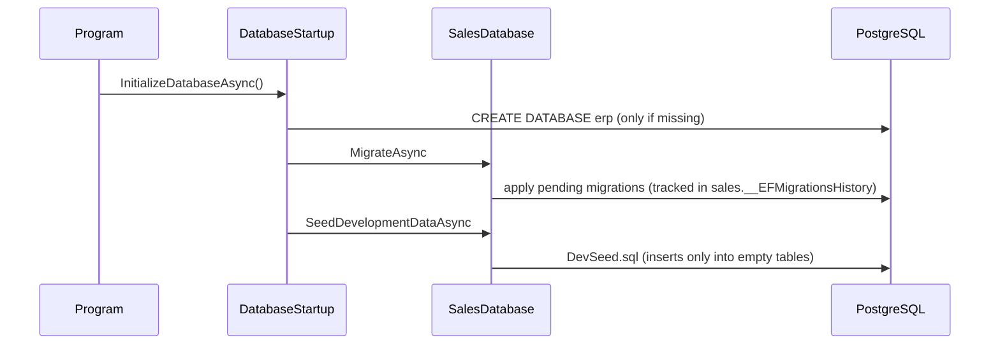

# Lesson 05 — The Database: PostgreSQL and EF Core

Good day, developer! Last time, we wrote every business rule of the Sales module in plain C#. But right now,
nothing is remembered: stop the app, and every customer and order is gone. Today we give the module its
memory. We'll install PostgreSQL, map our domain to tables with EF Core, and let the app create and fill its
own database when it starts. Give yourself about an hour and a half. Are you ready? Let's begin!

## What we'll build

- PostgreSQL, running on your machine.
- A `SalesDbContext` that maps the Sales domain to tables in a `sales` schema.
- A **migration** that creates those tables, applied automatically when the app starts in development.
- **Seed data** for development: customers, categories and items that exercise every rule.

## Why we build it this way

### Why PostgreSQL

PostgreSQL is free for any use, mature and fast. That matters when you sell what you build: your buyer pays
nothing for the database. With SQL Server's paid editions, the license would be a line on every quote.

### Why EF Core for saving data

Saving in our system always looks the same: load an aggregate, call domain methods, save whatever changed.
EF Core does exactly that. It loads a `SalesOrder` together with its lines, **tracks** every change your
domain methods make, and on `SaveChangesAsync` writes only those changes, in one transaction.

That tracking is what keeps our domain pure. `order.Submit(...)` only changes fields; EF Core works out the
SQL. The domain never sees a database.

Reading data for a screen is a different job, and [lesson 08](08-find-orders.md) uses a different tool for it.
Now, let's be honest about the cost: that's two data tools to learn. The rule that keeps it simple is this:
**commands save with EF Core, queries read with Dapper.**

### One DbContext per module, one schema each

Each module gets its own `DbContext` mapped to its own **schema**, a named group of tables. Sales' context
maps only `sales.*` tables, and Inventory's (in [lesson 09](09-submit.md)) only `inventory.*`. A module can't
query another module's tables, because its context doesn't even know they exist. The module wall reaches all
the way into the database.

## 1. Install PostgreSQL

On Windows, in PowerShell (you'll get one admin prompt):

```powershell
winget install -e --id PostgreSQL.PostgreSQL.18 --silent `
  --override "--mode unattended --unattendedmodeui none --superpassword erp_dev_only --serverport 5432 --disable-components stackbuilder"
```

Check that it answers:

```bash
PGPASSWORD=erp_dev_only "/c/Program Files/PostgreSQL/18/bin/psql.exe" -h localhost -U postgres -c "select version();"
```

One thing to watch out for: `erp_dev_only` is a password for *your machine*, for development only. In
production, the app gets its own account with far fewer rights; [lesson 23](23-security-hardening.md) sets
that up.

## 2. What the host needs from a module's database

When the app starts, the host should be able to say to every module: "bring your tables up to date, and fill
in your development data." The modules can't see each other, so the host needs one interface they all
implement. It goes in BuildingBlocks:

```csharp
// src/Shared/Erp.Shared.BuildingBlocks/Abstractions/Data.cs
using System.Data;
using System.Data.Common;
using System.Reflection;

namespace Erp.Shared.BuildingBlocks;

public interface IModuleDatabase
{
    string Module { get; }
    Task MigrateAsync(CancellationToken ct);
    Task SeedDevelopmentDataAsync(CancellationToken ct);
}

public static class EmbeddedSql
{
    public static string Read(Assembly assembly, string fileName)
    {
        var name = assembly.GetManifestResourceNames()
            .SingleOrDefault(n => n.EndsWith("." + fileName, StringComparison.OrdinalIgnoreCase))
            ?? throw new InvalidOperationException($"Embedded SQL '{fileName}' not found in {assembly.GetName().Name}.");
        using var stream = assembly.GetManifestResourceStream(name)!;
        using var reader = new StreamReader(stream);
        return reader.ReadToEnd();
    }

    // Not EF's ExecuteSqlRaw: that treats { and } as placeholders and breaks on any brace in the script.
    public static async Task ExecuteAsync(DbConnection connection, string sql, CancellationToken ct)
    {
        var wasOpen = connection.State == ConnectionState.Open;
        if (!wasOpen) await connection.OpenAsync(ct);
        try
        {
            await using var command = connection.CreateCommand();
            command.CommandText = sql;
            await command.ExecuteNonQueryAsync(ct);
        }
        finally
        {
            if (!wasOpen) await connection.CloseAsync();
        }
    }
}
```

- **`IModuleDatabase`** is the contract: apply your migrations, seed your dev data.
- **`EmbeddedSql`** reads a `.sql` file that's compiled *into* a module's assembly, and runs it. Seed data
  will be a plain SQL file, and embedding it means it travels with the module wherever it's deployed.

## 3. The connection pool

The packages first. `Npgsql` is the PostgreSQL driver for .NET (PostgreSQL license, free and permissive):

```bash
dotnet add src/Shared/Erp.Shared.Infrastructure package Npgsql --version 10.0.3
```

Infrastructure also needs `IServiceCollection` and `IConfiguration`, like Sales did in lesson 01, so give it
the same shared framework. In `Erp.Shared.Infrastructure.csproj`:

```xml
<!-- Referenced only by Erp.Api, so no module can reach a connection string or HttpContext. -->
<ItemGroup>
  <FrameworkReference Include="Microsoft.AspNetCore.App" />
</ItemGroup>
```

```csharp
// src/Shared/Erp.Shared.Infrastructure/DependencyInjection.cs
using Microsoft.Extensions.Configuration;
using Microsoft.Extensions.DependencyInjection;
using Npgsql;

namespace Erp.Shared.Infrastructure;

public static class DependencyInjection
{
    public static IServiceCollection AddSharedInfrastructure(this IServiceCollection services, IConfiguration config)
    {
        var connectionString = config.GetConnectionString("ErpDb")
            ?? throw new InvalidOperationException("ConnectionStrings:ErpDb is not configured.");

        services.AddSingleton(_ => NpgsqlDataSource.Create(connectionString));
        return services;
    }
}
```

This is the `NpgsqlDataSource`. It owns the **connection pool**: opening a database connection is slow, so
the pool keeps a few open and lends them out. We create exactly one for the whole app. And notice where the
connection string is read: here, in Infrastructure, which only the host can see.

```csharp
// src/Shared/Erp.Shared.Infrastructure/Data/PostgresDatabase.cs
using Npgsql;

namespace Erp.Shared.Infrastructure;

public static class PostgresDatabase
{
    public static async Task EnsureExistsAsync(string connectionString, CancellationToken ct = default)
    {
        var target = new NpgsqlConnectionStringBuilder(connectionString);
        var admin = new NpgsqlConnectionStringBuilder(connectionString) { Database = "postgres", Pooling = false };

        await using var conn = new NpgsqlConnection(admin.ConnectionString);
        await conn.OpenAsync(ct);

        await using var exists = new NpgsqlCommand("SELECT 1 FROM pg_database WHERE datname = @name", conn);
        exists.Parameters.AddWithValue("name", target.Database!);
        if (await exists.ExecuteScalarAsync(ct) is not null) return;

        // A database name can't be a parameter, so quote it as an identifier.
        var quoted = "\"" + target.Database!.Replace("\"", "\"\"") + "\"";
        await using var create = new NpgsqlCommand($"CREATE DATABASE {quoted}", conn);
        await create.ExecuteNonQueryAsync(ct);
    }
}
```

This creates the database the first time the app runs. It connects to `postgres`, the maintenance database
every PostgreSQL server has, asks whether ours exists, and creates it if not.

## 4. Why the domain already has private constructors

Remember the private parameterless constructors we gave `Customer`, `ItemCategory`, `SalesItem`,
`SalesOrder` and `SalesOrderLine` in lesson 04? This is who they're for. When EF Core loads a saved
customer, it has to create a `Customer` object *without* running our rules, because loading history isn't a
new business event. It calls the private constructor, then fills the properties through their private
setters. The rest of the code still can't do either.

## 5. The Sales DbContext

Three packages, all for the Sales module:

```bash
dotnet add src/Modules/Sales/Erp.Modules.Sales package Npgsql.EntityFrameworkCore.PostgreSQL --version 10.0.3
dotnet add src/Modules/Sales/Erp.Modules.Sales package EFCore.NamingConventions --version 10.0.1
dotnet add src/Modules/Sales/Erp.Modules.Sales package Microsoft.EntityFrameworkCore.Design --version 10.0.14
```

| Package | What it gives us | License |
|---|---|---|
| `Npgsql.EntityFrameworkCore.PostgreSQL` | EF Core itself, plus its PostgreSQL provider | PostgreSQL |
| `EFCore.NamingConventions` | Table and column names in `snake_case`, the PostgreSQL habit | Apache-2.0 |
| `Microsoft.EntityFrameworkCore.Design` | What the `dotnet ef` command needs to generate migrations | MIT |

The design package only matters while you develop, so mark it build-only in the `.csproj`:

```xml
<PackageReference Include="Microsoft.EntityFrameworkCore.Design" PrivateAssets="all" />
```

There's one wrinkle to fix right away. The PostgreSQL provider asks for EF Core "version 10.0.4 or newer".
When a package gives a range like that, NuGet picks the **lowest** version that fits, so some projects would
end up on EF Core 10.0.4 while the design package pulls 10.0.14. Mixing two versions of the same library in
one app is asking for strange runtime errors. So we pin it. In `Directory.Packages.props`, add a second line
to the `PropertyGroup`, and one `PackageVersion`:

```xml
<!-- A version pinned here also wins for transitive dependencies (security patches). -->
<CentralPackageTransitivePinningEnabled>true</CentralPackageTransitivePinningEnabled>
```

```xml
<PackageVersion Include="Microsoft.EntityFrameworkCore.Relational" Version="10.0.14" /> <!-- MIT; pinned so the Npgsql provider (needs ≥ 10.0.4) uses the same EF Core as everything else -->
```

**Transitive pinning** means a version you list here also wins for packages that other packages pull in.
It's also how you'd force a security fix into a dependency of a dependency.

Now the context itself:

```csharp
// src/Modules/Sales/Erp.Modules.Sales/Infrastructure/SalesDbContext.cs
using Erp.Modules.Sales.Domain;
using Erp.Shared.BuildingBlocks;
using Microsoft.EntityFrameworkCore;
using Microsoft.EntityFrameworkCore.Design;
using Microsoft.EntityFrameworkCore.Storage.ValueConversion;
using Npgsql;

namespace Erp.Modules.Sales.Infrastructure;

internal sealed class SalesDbContext(DbContextOptions<SalesDbContext> options) : DbContext(options)
{
    public const string Schema = "sales";

    public DbSet<SalesOrder> SalesOrders => Set<SalesOrder>();
    public DbSet<Customer> Customers => Set<Customer>();
    public DbSet<SalesItem> SalesItems => Set<SalesItem>();
    public DbSet<ItemCategory> ItemCategories => Set<ItemCategory>();

    // Shared by the app and `dotnet ef`, so the two can't drift apart.
    public static DbContextOptionsBuilder Configure(DbContextOptionsBuilder o, NpgsqlDataSource dataSource) =>
        o.UseNpgsql(dataSource, npg => npg.MigrationsHistoryTable("__EFMigrationsHistory", Schema))
         .UseSnakeCaseNamingConvention();

    protected override void ConfigureConventions(ModelConfigurationBuilder c)
    {
        c.Properties<SalesOrderId>().HaveConversion<SalesOrderIdConverter>();
        c.Properties<CustomerId>().HaveConversion<CustomerIdConverter>();
        c.Properties<CategoryId>().HaveConversion<CategoryIdConverter>();
        c.Properties<ItemId>().HaveConversion<ItemIdConverter>();
        c.Properties<UserId>().HaveConversion<UserIdConverter>();
        c.Properties<Money>().HaveConversion<MoneyConverter>().HavePrecision(18, 2);
        c.Properties<Quantity>().HaveConversion<QuantityConverter>().HavePrecision(18, 3);
        c.Properties<decimal>().HavePrecision(18, 3);
    }

    protected override void OnModelCreating(ModelBuilder b)
    {
        b.HasDefaultSchema(Schema);

        b.Entity<Customer>(e =>
        {
            e.ToTable("customer", t =>
            {
                t.HasCheckConstraint("ck_customer_credit_limit", "credit_limit >= 0");
                t.HasCheckConstraint("ck_customer_balance", "outstanding_balance >= 0");
            });
            e.HasKey(x => x.Id);
            e.Property(x => x.Id).UseIdentityColumn();
            e.Property(x => x.Name).HasMaxLength(200);
            e.HasIndex(x => x.Name);
        });

        b.Entity<ItemCategory>(e =>
        {
            e.ToTable("item_category", t => t.HasCheckConstraint("ck_item_category_max_qty", "max_quantity_per_order > 0"));
            e.HasKey(x => x.Id);
            e.Property(x => x.Id).UseIdentityColumn();
            e.HasIndex(x => x.Name).IsUnique();
            e.Property(x => x.Name).HasMaxLength(100);
            e.Property(x => x.RequiredRole).HasMaxLength(50);
        });

        b.Entity<SalesItem>(e =>
        {
            e.ToTable("item", t => t.HasCheckConstraint("ck_item_unit_price", "unit_price >= 0"));
            e.HasKey(x => x.Id);
            e.Property(x => x.Id).ValueGeneratedNever();   // Inventory's id
            e.Property(x => x.Sku).HasMaxLength(50);
            e.Property(x => x.Name).HasMaxLength(200);
            e.Property(x => x.Unit).HasMaxLength(10);
            e.HasOne(x => x.Category).WithMany().HasForeignKey(x => x.CategoryId).OnDelete(DeleteBehavior.Restrict);
        });

        b.Entity<SalesOrder>(e =>
        {
            e.ToTable("sales_order", t => t.HasCheckConstraint("ck_sales_order_status", "status BETWEEN 0 AND 4"));
            e.HasKey(x => x.Id);
            e.Property(x => x.Id).UseIdentityColumn();
            e.HasIndex(x => x.OrderNumber).IsUnique();
            e.Property(x => x.OrderNumber).HasMaxLength(30);
            e.Property(x => x.RejectionReason).HasMaxLength(500);
            e.HasIndex(x => new { x.CustomerId, x.Status });
            e.HasIndex(x => x.CreatedBy);
            e.HasOne<Customer>().WithMany().HasForeignKey(x => x.CustomerId).OnDelete(DeleteBehavior.Restrict);
            e.Ignore(x => x.Total);
            e.Ignore(x => x.RequiresApproval);
            e.Ignore(x => x.HoldsStock);

            e.OwnsMany(x => x.Lines, l =>
            {
                l.ToTable("sales_order_line", t =>
                {
                    t.HasCheckConstraint("ck_sales_order_line_qty", "quantity > 0");
                    t.HasCheckConstraint("ck_sales_order_line_price", "unit_price >= 0");
                });
                l.WithOwner().HasForeignKey("SalesOrderId");
                l.Property<long>("Id");
                l.HasKey("Id");
                l.Property(x => x.ItemName).HasMaxLength(200);
                l.Property(x => x.Unit).HasMaxLength(10);
                l.Ignore(x => x.LineTotal);
            });
            e.Navigation(x => x.Lines).HasField("_lines").UsePropertyAccessMode(PropertyAccessMode.Field);
        });
    }
}

internal sealed class SalesOrderIdConverter() : ValueConverter<SalesOrderId, long>(v => v.Value, v => new SalesOrderId(v));
internal sealed class CustomerIdConverter() : ValueConverter<CustomerId, long>(v => v.Value, v => new CustomerId(v));
internal sealed class CategoryIdConverter() : ValueConverter<CategoryId, long>(v => v.Value, v => new CategoryId(v));
internal sealed class ItemIdConverter() : ValueConverter<ItemId, long>(v => v.Value, v => new ItemId(v));
internal sealed class UserIdConverter() : ValueConverter<UserId, long>(v => v.Value, v => new UserId(v));
internal sealed class MoneyConverter() : ValueConverter<Money, decimal>(v => v.Amount, v => new Money(v));
internal sealed class QuantityConverter() : ValueConverter<Quantity, decimal>(v => v.Value, v => new Quantity(v));

// For `dotnet ef migrations add`; never connects.
internal sealed class SalesDbContextFactory : IDesignTimeDbContextFactory<SalesDbContext>
{
    public SalesDbContext CreateDbContext(string[] args)
    {
        var o = new DbContextOptionsBuilder<SalesDbContext>();
        SalesDbContext.Configure(o, NpgsqlDataSource.Create("Host=localhost;Database=erp_design_time"));
        return new SalesDbContext(o.Options);
    }
}
```

That's a lot of configuration, so let's walk through it piece by piece:

| Piece | What it does |
|---|---|
| `Configure(...)` | The one place the context is configured. The running app and the `dotnet ef` tool (through the factory at the bottom) both call it, so they can never disagree |
| `UseSnakeCaseNamingConvention()` | `OrderNumber` becomes the column `order_number`, so hand-written SQL stays pleasant |
| `MigrationsHistoryTable(..., Schema)` | Each module records its applied migrations inside its own schema |
| `ConfigureConventions` | Tells EF once how to store each value object and id: a `Money` is a `numeric(18,2)` column, a `Quantity` a `numeric(18,3)`, a `CustomerId` a `bigint`. The domain never mentions a column type |
| `ValueGeneratedNever()` on the item | An item's id will come from the warehouse's catalog ([lesson 17](17-item-catalog.md)), so the database must not invent one |
| `ItemName` and `Unit` on the line | The snapshot from lesson 04, stored with the line |
| `OwnsMany(Lines)` | The lines *belong* to the order: loaded with it, saved with it, deleted with it. `HasField("_lines")` lets EF fill the private list, so `Lines` stays read-only |
| `Ignore(Total)` and friends | Computed in C#, never stored |
| `HasCheckConstraint` | The database's own last line of defense. The domain already refuses negative money; the constraint catches anything that sneaks around it |
| No foreign key on `created_by` | Those users will live in another module's schema. Store the id, never a foreign key across a module wall |

To remember it easily: the domain says *what* the rules are, and the DbContext says *where* the data goes.
Neither knows the other's job.

If you came from WebForms, this replaces the `CREATE TABLE` script you'd keep in a folder and run by hand.
The model is now the source of truth, and the database script is generated from it.

## 6. Register it, and let the module migrate and seed itself

```csharp
// src/Modules/Sales/Erp.Modules.Sales/Infrastructure/SalesDatabase.cs
using Erp.Shared.BuildingBlocks;
using Microsoft.EntityFrameworkCore;

namespace Erp.Modules.Sales.Infrastructure;

internal sealed class SalesDatabase(SalesDbContext db) : IModuleDatabase
{
    public string Module => "Sales";

    public Task MigrateAsync(CancellationToken ct) => db.Database.MigrateAsync(ct);

    public Task SeedDevelopmentDataAsync(CancellationToken ct) =>
        EmbeddedSql.ExecuteAsync(db.Database.GetDbConnection(), EmbeddedSql.Read(typeof(SalesDatabase).Assembly, "DevSeed.sql"), ct);
}
```

In `SalesModule.AddSalesModule`, before the handler registrations, register the context and the database:

```csharp
services.AddDbContext<SalesDbContext>((sp, o) =>
    SalesDbContext.Configure(o, sp.GetRequiredService<NpgsqlDataSource>()));
services.AddScoped<IModuleDatabase, SalesDatabase>();
```

(Add `using Erp.Modules.Sales.Infrastructure;`, `using Erp.Shared.BuildingBlocks;`,
`using Microsoft.EntityFrameworkCore;` and `using Npgsql;` at the top.)

The seed data is plain SQL, embedded into the assembly. In the Sales `.csproj`:

```xml
<ItemGroup>
  <EmbeddedResource Include="Infrastructure\Sql\**\*.sql" />
</ItemGroup>
```

```sql
-- src/Modules/Sales/Erp.Modules.Sales/Infrastructure/Sql/DevSeed.sql
-- Development and test data; never runs in production. Ids are 1, 2, 3... in insert order on a fresh database.

INSERT INTO sales.customer (name, is_blocked, credit_limit, outstanding_balance)
SELECT v.name, v.is_blocked, v.credit_limit, v.outstanding_balance
FROM (VALUES ('Acme Corp',       FALSE,   50000, 10000),   -- ₱40,000 headroom
             ('Beta Industries', FALSE,    5000,  4500),   -- only ₱500 left
             ('Gamma Traders',   TRUE,    20000,     0),   -- blocked
             ('Delta Holdings',  FALSE,  200000,     0),   -- two high-value orders, not three
             ('Epsilon Retail',  FALSE, 5000000,     0))   -- large account for approvals
     AS v(name, is_blocked, credit_limit, outstanding_balance)
WHERE NOT EXISTS (SELECT 1 FROM sales.customer);

INSERT INTO sales.item_category (name, max_quantity_per_order, required_role)
SELECT v.name, v.max_quantity_per_order, v.required_role
FROM (VALUES ('General',    1000, NULL),
             ('Controlled',    5, 'SalesManager'))
     AS v(name, max_quantity_per_order, required_role)
WHERE NOT EXISTS (SELECT 1 FROM sales.item_category);

-- Same ids as the Inventory dev seed. In real use these rows arrive through ItemCatalogChanged.
INSERT INTO sales.item (id, sku, name, unit, allows_fractions, is_active, category_id, unit_price, is_for_sale)
SELECT v.id, v.sku, v.name, v.unit, v.allows_fractions, TRUE, v.category_id, v.unit_price, TRUE
FROM (VALUES (1, 'GEN-001', 'Widget',         'pc', FALSE, 1,    25.00),
             (2, 'GEN-002', 'Gadget',         'pc', FALSE, 1,    40.00),
             (3, 'CTL-001', 'Restricted Kit', 'pc', FALSE, 2,   500.00),
             (4, 'GEN-003', 'Server Rack',    'pc', FALSE, 1, 75000.00),   -- one rack is over the ₱50,000 threshold
             (5, 'BLK-001', 'Copper Wire',    'kg', TRUE,  1,   620.50))
     AS v(id, sku, name, unit, allows_fractions, category_id, unit_price)
WHERE NOT EXISTS (SELECT 1 FROM sales.item);
```

The `WHERE NOT EXISTS` lines make it safe to run every time the app starts: the second run inserts nothing.
Each customer is there to trigger a rule, so keep their names in mind. You'll meet Beta and Gamma again
soon. The items carry explicit ids because those ids will belong to the warehouse's catalog, as the comment
says. And Copper Wire is sold by the kilogram, so 2.5 of it is a fine order.

## 7. The host brings every module's database up to date

```csharp
// src/Erp.Api/DatabaseStartup.cs
using Erp.Shared.BuildingBlocks;
using Erp.Shared.Infrastructure;

namespace Erp.Api;

// Off by default (appsettings.json); on in Development. Production applies migrations as a deployment step
// instead, so a bad migration can't take the site down on a routine restart.
internal static class DatabaseStartup
{
    public static async Task InitializeDatabaseAsync(this WebApplication app, CancellationToken ct = default)
    {
        var settings = app.Configuration.GetSection("Database");
        if (!settings.GetValue<bool>("MigrateOnStartup")) return;

        await PostgresDatabase.EnsureExistsAsync(app.Configuration.GetConnectionString("ErpDb")!, ct);

        await using var scope = app.Services.CreateAsyncScope();
        var log = scope.ServiceProvider.GetRequiredService<ILoggerFactory>().CreateLogger("DatabaseStartup");
        var modules = scope.ServiceProvider.GetServices<IModuleDatabase>().ToList();

        foreach (var module in modules)
        {
            await module.MigrateAsync(ct);
            log.LogInformation("{Module} schema is up to date", module.Module);
        }

        if (!settings.GetValue<bool>("SeedDevelopmentData")) return;

        foreach (var module in modules)
            await module.SeedDevelopmentDataAsync(ct);
        log.LogInformation("Development data seeded");
    }
}
```

The **scope** is there because the module databases are scoped services (each one holds a DbContext). A
startup task has no HTTP request to provide a scope, so we make one.

In `Program.cs`, call `builder.Services.AddSharedInfrastructure(builder.Configuration);` before
`AddSalesModule()`, and `await app.InitializeDatabaseAsync();` right after `builder.Build()`.

These are the app's first log lines, and the analyzers from lesson 01 have an opinion: CA1848 suggests
source-generated `[LoggerMessage]` methods instead of `log.LogInformation(...)`, and CA1873 warns that an
argument is worked out even when that level is switched off. Both matter on a *hot path*, code that runs
thousands of times a second. Ours log at startup, on failures and once per approval, so we keep the plain,
readable calls, and say so in `.editorconfig`:

```ini
# CA1848, CA1873: source-generated logging pays off on hot paths. Ours log at startup, on failures and once per approval.
dotnet_diagnostic.CA1848.severity = none
dotnet_diagnostic.CA1873.severity = none
```

Then configuration. `appsettings.json` holds the production defaults: everything off, no secrets.

```json
{
  "ConnectionStrings": { "ErpDb": "" },
  "Database": { "MigrateOnStartup": false, "SeedDevelopmentData": false },
  "Logging": {
    "LogLevel": { "Default": "Information", "Microsoft.AspNetCore": "Warning", "Microsoft.EntityFrameworkCore": "Warning" }
  },
  "AllowedHosts": "*"
}
```

`appsettings.Development.json` turns it on for your machine:

```json
{
  "ConnectionStrings": {
    "ErpDb": "Host=localhost;Port=5432;Database=erp;Username=postgres;Password=erp_dev_only"
  },
  "Database": { "MigrateOnStartup": true, "SeedDevelopmentData": true }
}
```

## 8. Generate the first migration

`dotnet ef` is a command-line tool. Let's pin it inside the repository, so everyone who clones it gets the
same version:

```bash
dotnet new tool-manifest
dotnet tool install dotnet-ef --version 10.0.14

dotnet ef migrations add InitialCreate \
  --project src/Modules/Sales/Erp.Modules.Sales \
  --startup-project src/Modules/Sales/Erp.Modules.Sales \
  --output-dir Infrastructure/Migrations
```

`tool-manifest` creates `.config/dotnet-tools.json`, and `tool install` records `dotnet-ef` in it. Then open
the generated `..._InitialCreate.cs`. It's plain C# that creates the `sales` schema, the tables and their
constraints. Read through it once; it's the clearest picture of what your model became.

Build now and the analyzers complain about it (CA1861, "prefer static readonly fields over constant arrays").
That's EF Core's code, not ours, and we keep a migration exactly as it was generated. So tell the analyzers
it's generated code, at the end of `.editorconfig`:

```ini
# EF Core writes migrations; they're generated code, kept exactly as generated.
[**/Migrations/*.cs]
generated_code = true
```

One thing to know before you compare your work with the reference build: your migration history will grow
lesson by lesson (`InitialCreate`, then more as features arrive), while the reference build squashes each
module's history into one `InitialCreate`. The tables that come out are the same.

## 9. Prove it: tests against a real database

The app now needs a database to start, so our integration tests do too. They must never touch your
development data: a test that deletes a customer would delete *your* customer. So the tests get a database
of their own, `erp_test`, dropped at the start of every run so every run begins from the migrations and the
seed, and yesterday's leftovers can't change today's results.

### The test host gets a database

```bash
dotnet add tests/Erp.Integration.Tests package Npgsql --version 10.0.3
dotnet add tests/Erp.Integration.Tests package Dapper --version 2.1.79
```

Npgsql lets a test open its own connection and look inside the database. **Dapper** (Apache-2.0) is a tiny
library that runs a SQL query and turns the rows into objects; the tests use it today to read the catalog,
and in [lesson 08](08-find-orders.md) the app itself starts using it for every screen's reads.

```csharp
// tests/Erp.Integration.Tests/CustomWebAppFactory.cs
using Microsoft.AspNetCore.Hosting;
using Microsoft.AspNetCore.Mvc.Testing;
using Npgsql;

namespace Erp.Integration.Tests;

// The whole API in memory against its own database, dropped first so every run starts from migrations + seed.
public sealed class CustomWebAppFactory : WebApplicationFactory<Program>
{
    public static readonly string TestConnectionString =
        Environment.GetEnvironmentVariable("ERP_TEST_DB")
        ?? "Host=localhost;Port=5432;Database=erp_test;Username=postgres;Password=erp_dev_only";

    public CustomWebAppFactory() => DropDatabase(TestConnectionString);

    protected override void ConfigureWebHost(IWebHostBuilder builder)
    {
        builder.UseEnvironment("Development");
        builder.UseSetting("ConnectionStrings:ErpDb", TestConnectionString);
    }

    // Starts the app first if no test has yet: the app is what creates and migrates the database.
    public NpgsqlConnection OpenDatabase()
    {
        _ = Server;
        return new(TestConnectionString);
    }

    public static void DropDatabase(string connectionString)
    {
        var target = new NpgsqlConnectionStringBuilder(connectionString);
        var admin = new NpgsqlConnectionStringBuilder(connectionString) { Database = "postgres", Pooling = false };
        using var conn = new NpgsqlConnection(admin.ConnectionString);
        conn.Open();
        using var drop = new NpgsqlCommand($"DROP DATABASE IF EXISTS \"{target.Database}\" WITH (FORCE)", conn);
        drop.ExecuteNonQuery();
    }
}
```

| Choice | Why |
|---|---|
| Its own database, `erp_test` | Tests never touch your development data |
| Dropped when the factory is created | Every run starts from the migrations and the seed; the app creates it again on startup |
| `UseSetting("ConnectionStrings:ErpDb", ...)` | Overrides `appsettings.Development.json` for the tests only |
| `ERP_TEST_DB` | Point the suite at another server without touching the code |
| `OpenDatabase()` | Tests look inside through one method; when the database moves into a container in [lesson 12](12-containers-ci.md), the tests don't change |
| `_ = Server` in `OpenDatabase()` | The factory starts the app lazily, on the first request. A test that only reads the database, run on its own, would otherwise find no database at all |

Now a catch. xUnit runs test *classes* in parallel, and each `IClassFixture` makes its own factory. Two
factories means two apps, each dropping `erp_test` while the other is using it. So all the classes that use
the database join one **collection**: xUnit starts the app once for the whole collection and runs its
classes one after another.

```csharp
// tests/Erp.Integration.Tests/IntegrationCollection.cs
namespace Erp.Integration.Tests;

// One shared test database: one collection boots the app once and runs the classes in series.
[CollectionDefinition("Integration")]
public sealed class IntegrationCollection : ICollectionFixture<CustomWebAppFactory> { }
```

In `HostTests` and `PingTests`, swap the fixture for the collection. Before:

```csharp
public class HostTests(CustomWebAppFactory factory) : IClassFixture<CustomWebAppFactory>
```

After:

```csharp
[Collection("Integration")]
public class HostTests(CustomWebAppFactory factory)
```

One test will look inside Sales with its own `SalesDbContext`, which is internal. Lesson 03 already let the
integration tests in, with `<InternalsVisibleTo Include="Erp.Integration.Tests" />`.

### What the migrations built

```csharp
// tests/Erp.Integration.Tests/DatabaseTests.cs
using AwesomeAssertions;
using Dapper;
using Erp.Modules.Sales.Domain;
using Erp.Modules.Sales.Infrastructure;
using Erp.Shared.BuildingBlocks;
using Microsoft.EntityFrameworkCore;
using Microsoft.Extensions.DependencyInjection;

namespace Erp.Integration.Tests;

// What the migrations built, checked in the database itself.
[Collection("Integration")]
public class DatabaseTests(CustomWebAppFactory factory)
{
    // Every module that registered a database, so the tests grow with the app without being edited.
    // A module's schema is its name in lower case: Sales → sales.
    private string[] Schemas
    {
        get
        {
            using var scope = factory.Services.CreateScope();
            return scope.ServiceProvider.GetServices<IModuleDatabase>().Select(m => m.Module.ToLowerInvariant()).ToArray();
        }
    }

    [Fact]
    public async Task Every_module_has_its_own_schema_and_migration_history()
    {
        await using var conn = factory.OpenDatabase();
        var histories = (await conn.QueryAsync<string>(
            "SELECT table_schema FROM information_schema.tables WHERE table_name = '__EFMigrationsHistory'")).ToList();

        histories.Should().BeEquivalentTo(Schemas).And.Contain("sales");
    }

    [Fact]
    public async Task Tables_and_columns_are_snake_case()
    {
        await using var conn = factory.OpenDatabase();
        var names = await conn.QueryAsync<string>(
            """
            SELECT table_schema || '.' || table_name || '.' || column_name FROM information_schema.columns
            WHERE table_schema = ANY(@Schemas) AND table_name <> '__EFMigrationsHistory'
              AND (table_name ~ '[A-Z]' OR column_name ~ '[A-Z]')
            """, new { Schemas });

        names.Should().BeEmpty("EFCore.NamingConventions maps every name to snake_case");
    }

    // Modules are islands: a foreign key into another module's schema would tie them together in the database.
    [Fact]
    public async Task No_foreign_key_crosses_a_module_boundary()
    {
        await using var conn = factory.OpenDatabase();
        var crossing = await conn.QueryAsync<string>(
            """
            SELECT c.conname FROM pg_constraint c
            JOIN pg_class src ON src.oid = c.conrelid   JOIN pg_namespace s ON s.oid = src.relnamespace
            JOIN pg_class dst ON dst.oid = c.confrelid  JOIN pg_namespace d ON d.oid = dst.relnamespace
            WHERE c.contype = 'f' AND s.nspname <> d.nspname
            """);

        crossing.Should().BeEmpty();
    }

    // The app seeds on every development start, so the seed must be safe to run again.
    [Fact]
    public async Task Seeding_twice_changes_nothing()
    {
        await using var conn = factory.OpenDatabase();
        // Every row in every module's tables: what the seed could possibly have added to.
        var counts = "SELECT 0" + string.Concat((await conn.QueryAsync<string>(
            """
            SELECT quote_ident(table_schema) || '.' || quote_ident(table_name) FROM information_schema.tables
            WHERE table_schema = ANY(@Schemas) AND table_type = 'BASE TABLE'
            """, new { Schemas })).Select(t => $" + (SELECT COUNT(*) FROM {t})"));
        var before = await conn.ExecuteScalarAsync<long>(counts);

        await using (var scope = factory.Services.CreateAsyncScope())
            foreach (var module in scope.ServiceProvider.GetServices<IModuleDatabase>())
                await module.SeedDevelopmentDataAsync(default);

        (await conn.ExecuteScalarAsync<long>(counts)).Should().Be(before);
    }

    // Value converters turn ids, Money and Quantity into columns and back. A wrong one corrupts silently.
    [Fact]
    public async Task Ids_money_and_quantities_survive_the_trip_to_the_database_and_back()
    {
        SalesOrderId id;
        await using (var scope = factory.Services.CreateAsyncScope())
        {
            var db = scope.ServiceProvider.GetRequiredService<SalesDbContext>();
            var order = SalesOrder.Create("SO-ROUNDTRIP", new CustomerId(5), new UserId(1), DateTime.UtcNow);
            var wire = await db.SalesItems.Include(i => i.Category).SingleAsync(i => i.Id == new ItemId(5));   // by the kg
            order.SetLines([(wire, new Quantity(1.234m))], Roles.SalesRep);
            db.SalesOrders.Add(order);
            await db.SaveChangesAsync();
            id = order.Id;
        }

        await using (var scope = factory.Services.CreateAsyncScope())
        {
            var db = scope.ServiceProvider.GetRequiredService<SalesDbContext>();
            var loaded = await db.SalesOrders.SingleAsync(o => o.Id == id);

            loaded.CustomerId.Should().Be(new CustomerId(5));
            loaded.Lines.Single().Quantity.Should().Be(new Quantity(1.234m));
            loaded.Lines.Single().UnitPrice.Should().Be(new Money(620.50m));
            loaded.Total.Should().Be(new Money(765.70m));   // 620.50 × 1.234 = 765.697, rounded to centavos
        }
    }
}
```

A few things worth knowing:

- **`information_schema` and `pg_catalog`** are PostgreSQL's own description of the database: every table,
  column and constraint is a row you can query. The tests ask the database what it really has, not what we
  hoped the migration would make.
- **`~ '[A-Z]'`** is PostgreSQL's regular-expression match: "contains a capital letter". The migration history
  table is EF's own and keeps its name.
- **The round trip uses two scopes.** In one scope, EF would hand back the very object it just saved, from
  memory, and the test would prove nothing. A new scope means a new `DbContext`, which really reads the rows.
- **`Seeding_twice_changes_nothing`** counts every row in every module table, runs the seed again, and counts
  again. That's the `WHERE NOT EXISTS` in the seed script, proven.

Why `SO-ROUNDTRIP`, an order number nobody else would use? Tests share one database, so a test makes its own
data and never counts on another test's.

### A wall test that just went red

Run the architecture tests now:

```
Expected module.GetExportedTypes().Select(t => t.FullName) to contain a single item because Erp.Modules.Sales
should expose only its AddXModule entry class, but found {"Erp.Modules.Sales.SalesModule",
"Erp.Modules.Sales.Infrastructure.Migrations.InitialCreate", ...}.
```

The test did its job: Sales has new public types. EF Core generates migrations as `public` classes, and they
must stay that way for the tools to find them. They're not part of the module's surface, though; nobody calls
them. So the test learns about them. Before:

```csharp
module.GetExportedTypes().Select(t => t.FullName)
```

After:

```csharp
module.GetExportedTypes()
    // EF generates migrations as public classes.
    .Where(t => !(t.Namespace ?? "").EndsWith(".Migrations"))
    .Select(t => t.FullName)
```

That's how an architecture test should evolve: a rule meets a real exception, and the exception gets written
down, with its reason, in one place.

### Edge cases covered in this lesson

| Test | The edge | Why it matters |
|---|---|---|
| `Every_module_has_its_own_schema_and_migration_history` | One module's tables in another's place | Each module migrates on its own; a shared history table would tangle them |
| `Tables_and_columns_are_snake_case` | A capital letter | `"SalesOrder"` needs quotes in every SQL query forever |
| `No_foreign_key_crosses_a_module_boundary` | A shortcut in the database | The cleanest module walls in C# mean nothing if the tables are tied together |
| `Seeding_twice_changes_nothing` | Twice | The app seeds on every start; a non-idempotent seed doubles the customers each restart |
| `Ids_money_and_quantities_survive_the_trip_to_the_database_and_back` | Three decimals, centavos, typed ids | A wrong converter or a `numeric(18,2)` quantity column loses data without an error |

## How it fits together at startup



## Mistakes to avoid

- Editing a migration that has already run somewhere. Add a new one instead; a shipped migration is history.
- One DbContext for the whole app. The schemas blur together, and so do the modules.
- A foreign key from `sales` into another module's schema. It welds the modules together at the database
  level.
- Seeding development data in production. It only runs when `SeedDevelopmentData` is `true`, and the
  default is `false`.
- Running a script with `ExecuteSqlRaw`. It treats `{` and `}` as placeholders and fails at the first brace,
  even in a comment. That's why `EmbeddedSql.ExecuteAsync` exists.
- Pointing the tests at your development database. One test that deletes a row deletes your row.
- Letting test classes that share a database run in parallel. Put them all in the `Integration` collection.
- Reading back in the same `DbContext` you saved with. You get the object from memory and prove nothing.

## Let's run it!

```bash
dotnet run --project src/Erp.Api
```

The log shows:

```
info: DatabaseStartup[0]  Sales schema is up to date
info: DatabaseStartup[0]  Development data seeded
```

Now let's look inside:

```bash
PGPASSWORD=erp_dev_only "/c/Program Files/PostgreSQL/18/bin/psql.exe" -h localhost -U postgres -d erp \
  -c "SELECT id, name, credit_limit, outstanding_balance, is_blocked FROM sales.customer;"
```

Five customers, just as the seed promised. Restart the app: migrations report up to date, and the seed adds
nothing new.

Then the tests, which now build and drop a database of their own:

```bash
dotnet test
```

```
Passed!  - Failed: 0, Passed: 52, ... Erp.Modules.Sales.UnitTests.dll
Passed!  - Failed: 0, Passed:  7, ... Erp.Architecture.Tests.dll
Passed!  - Failed: 0, Passed: 21, ... Erp.Integration.Tests.dll
```

Look in pgAdmin or `psql`: `erp_test` is there, holding whatever the last run left behind, and the next run
drops it again.

## Let's check!

1. Why does each module get its own DbContext and its own schema?
2. What does `Configure(...)` protect you from, and who calls it?
3. Who calls `Customer`'s private parameterless constructor, and why can't it use `Create`?
4. NuGet resolves the range "10.0.4 or newer" to which version, and why did we pin EF Core?
5. Why does the seed script use `WHERE NOT EXISTS`?
6. Why is there no foreign key from `sales_order.created_by` to a users table? Which test would catch one?
7. Why do the tests use their own database, and why is it dropped at the start of every run?
8. Why does the round-trip test read the order back in a second scope?
9. The architecture test failed after the first migration. Was that a bug? What changed in the test, and why?

And that's where this lesson ends. The Sales module now remembers everything, and the app builds its own
database. Next time, we decide who's allowed in: sign-in, with ASP.NET Core Identity. Good luck, developer!

---

← [Lesson 04 — Domain model](04-domain-model.md) · Next: [Lesson 06 — Sign-in](06-sign-in.md) →
