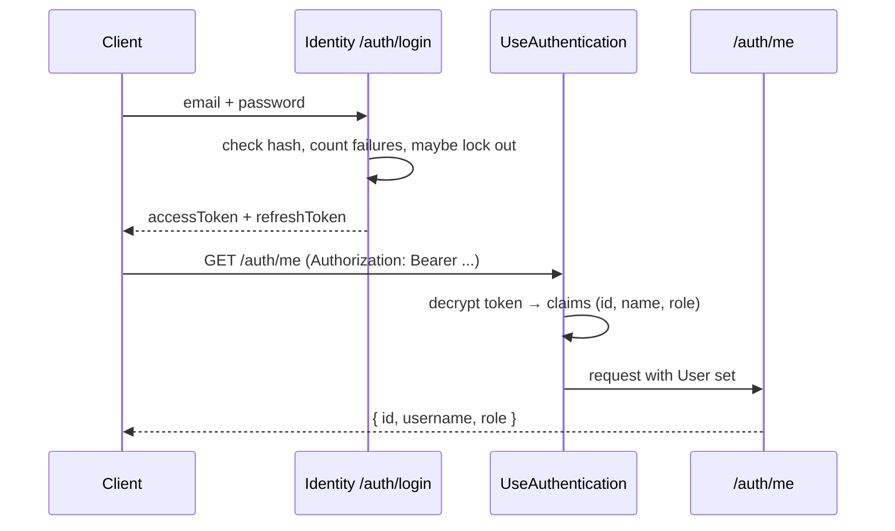

# Lesson 05 — Sign-in: ASP.NET Core Identity

Good day, developer! Our Sales module can now remember customers and orders. But right now, anyone who can
reach the API can do anything. Today we decide who's allowed in. We'll add a whole module for it, Identity,
and we'll let a well-tested library do the dangerous parts: storing passwords, issuing tokens, locking out
password guessers. Give yourself about an hour and a half. Are you ready? Let's begin!

## What we'll build

| Endpoint | What it does |
|---|---|
| `POST /auth/login` | Check the email and password; answer with an access token and a refresh token |
| `POST /auth/refresh` | Trade a refresh token for a new access token |
| `POST /auth/manage/info` | Change your password |
| `GET /auth/me` | Who am I, and what's my role |
| `POST /auth/logout` | Sign out of this browser |
| `POST /auth/logout-everywhere` | End every session you have, on every device |

Plus three dev users to sign in with, one per role, and a way for any handler to ask "who's calling?"
without touching HTTP.

## Why we build it this way

### The pain of writing your own

You could write sign-in yourself. Hash the passwords, compare them, issue tokens. It looks like an
afternoon's work. Now count what a production system really needs:

- password hashing that's slow on purpose, salted, and upgradable later;
- comparing hashes in constant time, so response timing can't leak anything;
- locking an account after repeated wrong passwords;
- signing everyone out when a password changes;
- short-lived tokens, plus refresh tokens to get new ones;
- cookies for the browser, done safely;
- password reset links that expire.

Every one of those is a place to make a quiet security mistake. And nothing tells you that you made it,
until somebody else finds it. That's why sign-in is the one place this course says: **don't write it
yourself; use a library everyone else is hammering on too.**

### Which library

| Library | License | Why or why not |
|---|---|---|
| **ASP.NET Core Identity** | MIT, part of .NET | Users, roles, hashing, lockout, cookies, bearer tokens and refresh, all built in. **We use this.** |
| OpenIddict | Apache-2.0 | A full OAuth server. Excellent if you later need single sign-on across many apps; far more than we need now |
| Duende IdentityServer | Paid above US$1M revenue | Great product, but the license would follow your source to every buyer |
| Keycloak | Apache-2.0 | A separate Java server to install and run. Too much for one ERP |

Since .NET 8, Identity comes with ready-made **API endpoints**. One line maps login, refresh, password
changes, password reset and more.

Now, let's be honest about the costs:

- Its tokens aren't the JWTs you may have read about. They're encrypted blobs only this app can read. For an
  ERP that talks only to itself, that's fine.
- You can't cancel one single refresh token. Instead, "sign out everywhere" (or a password change) cancels
  *all* of a user's sessions at once.
- It maps a public `/register` endpoint, and an ERP must not let strangers sign up. We'll block it.
- Its login asks for an `email` field. So our staff sign in with their email addresses.

### Two ways to stay signed in

| Who | How they stay signed in |
|---|---|
| A browser (our future web app) | A **cookie** the browser sends automatically. JavaScript can't read it, so a script injected into the page can't steal it |
| Anything else (a mobile app, an integration, `curl`) | A **bearer token** in the `Authorization` header, plus a **refresh token** to get a new one when it expires |

Identity does both. If a request carries an `Authorization: Bearer ...` header, it checks the token;
otherwise, it looks for the cookie. To remember it easily: a browser shows its wristband (the cookie), and
everyone else shows their ticket (the bearer token).

## 1. The Identity module

```bash
dotnet new classlib -n Erp.Modules.Identity -o src/Modules/Identity/Erp.Modules.Identity
rm src/Modules/Identity/Erp.Modules.Identity/Class1.cs
dotnet sln add src/Modules/Identity/Erp.Modules.Identity
dotnet add src/Modules/Identity/Erp.Modules.Identity reference src/Shared/Erp.Shared.BuildingBlocks
dotnet add src/Erp.Api reference src/Modules/Identity/Erp.Modules.Identity

dotnet add src/Modules/Identity/Erp.Modules.Identity package Microsoft.AspNetCore.Identity.EntityFrameworkCore --version 10.0.14
dotnet add src/Modules/Identity/Erp.Modules.Identity package Npgsql.EntityFrameworkCore.PostgreSQL --version 10.0.3
dotnet add src/Modules/Identity/Erp.Modules.Identity package EFCore.NamingConventions --version 10.0.1
dotnet add src/Modules/Identity/Erp.Modules.Identity package Microsoft.EntityFrameworkCore.Design --version 10.0.14
dotnet add src/Modules/Identity/Erp.Modules.Identity package Carter --version 10.0.0
```

`Microsoft.AspNetCore.Identity.EntityFrameworkCore` (MIT) is Identity itself, storing its users and roles
with EF Core. The other packages you know from lessons 02 and 04. As before, delete the `.csproj`'s
`<PropertyGroup>`, mark the design package `PrivateAssets="all"`, and add:

```xml
<ItemGroup>
  <FrameworkReference Include="Microsoft.AspNetCore.App" />
</ItemGroup>

<!-- Erp.Api: the Mediator source generator runs there. Never grant this to another module. -->
<ItemGroup>
  <InternalsVisibleTo Include="Erp.Api" />
</ItemGroup>
```

## 2. Users, roles and their tables

```csharp
// src/Modules/Identity/Erp.Modules.Identity/Infrastructure/AppUser.cs
using Microsoft.AspNetCore.Identity;

namespace Erp.Modules.Identity.Infrastructure;

internal sealed class AppUser : IdentityUser<long>;
```

`IdentityUser<long>` already has everything: the user name, email, password hash, lockout fields and a
**security stamp**, a random value that changes whenever something about the user's security changes. Our
`AppUser` adds nothing yet; it exists so we have our own type to grow later. The `<long>` makes ids numbers,
like the rest of our database.

```csharp
// src/Modules/Identity/Erp.Modules.Identity/Infrastructure/ErpIdentityDbContext.cs
using Microsoft.AspNetCore.Identity;
using Microsoft.AspNetCore.Identity.EntityFrameworkCore;
using Microsoft.EntityFrameworkCore;
using Microsoft.EntityFrameworkCore.Design;
using Npgsql;
using AppRoles = Erp.Shared.BuildingBlocks.Roles;   // "Roles" alone is IdentityDbContext.Roles, the table

namespace Erp.Modules.Identity.Infrastructure;

internal sealed class ErpIdentityDbContext(DbContextOptions<ErpIdentityDbContext> options)
    : IdentityDbContext<AppUser, IdentityRole<long>, long>(options)
{
    public const string Schema = "identity";

    public static DbContextOptionsBuilder Configure(DbContextOptionsBuilder o, NpgsqlDataSource dataSource) =>
        o.UseNpgsql(dataSource, npg => npg.MigrationsHistoryTable("__EFMigrationsHistory", Schema))
         .UseSnakeCaseNamingConvention();

    protected override void OnModelCreating(ModelBuilder b)
    {
        base.OnModelCreating(b);
        b.HasDefaultSchema(Schema);

        b.Entity<AppUser>().ToTable("users");
        b.Entity<IdentityUserClaim<long>>().ToTable("user_claims");
        b.Entity<IdentityUserLogin<long>>().ToTable("user_logins");
        b.Entity<IdentityUserToken<long>>().ToTable("user_tokens");
        b.Entity<IdentityUserRole<long>>().ToTable("user_roles");
        b.Entity<IdentityRoleClaim<long>>().ToTable("role_claims");
        b.Entity<IdentityRole<long>>().ToTable("roles").HasData(
            Role(1, AppRoles.SalesRep), Role(2, AppRoles.SalesManager), Role(3, AppRoles.Admin));
    }

    // Fixed stamps: seed data must be identical on every build, or each migration would "change" the roles.
    private static IdentityRole<long> Role(long id, string name) => new()
    {
        Id = id, Name = name, NormalizedName = name.ToUpperInvariant(), ConcurrencyStamp = $"role-{id}"
    };
}

// For `dotnet ef migrations add`; never connects.
internal sealed class ErpIdentityDbContextFactory : IDesignTimeDbContextFactory<ErpIdentityDbContext>
{
    public ErpIdentityDbContext CreateDbContext(string[] args)
    {
        var o = new DbContextOptionsBuilder<ErpIdentityDbContext>();
        ErpIdentityDbContext.Configure(o, NpgsqlDataSource.Create("Host=localhost;Database=erp_design_time"));
        return new ErpIdentityDbContext(o.Options);
    }
}
```

Let's walk through it:

- **`IdentityDbContext<...>`** is a DbContext that Identity wrote for us: it already maps users, roles and
  the links between them. We call `base.OnModelCreating` first so all of that gets set up.
- **The `ToTable` lines** only rename Identity's tables from `AspNetUsers` and friends to short,
  snake_case names in our `identity` schema.
- **`HasData`** puts the three roles into the first migration. Unlike dev users, roles belong in production
  too: the app can't work without them.
- **`AppRoles`** is an alias. Inside this class, plain `Roles` would mean Identity's roles *table*, so we
  give our constants another name.

## 3. Dev users, created the way real ones will be

```csharp
// src/Modules/Identity/Erp.Modules.Identity/Infrastructure/IdentityDatabase.cs
using Erp.Shared.BuildingBlocks;
using Microsoft.AspNetCore.Identity;
using Microsoft.EntityFrameworkCore;

namespace Erp.Modules.Identity.Infrastructure;

internal sealed class IdentityDatabase(ErpIdentityDbContext db, UserManager<AppUser> users) : IModuleDatabase
{
    public const string DevPassword = "Password123!";

    public string Module => "Identity";

    public Task MigrateAsync(CancellationToken ct) => db.Database.MigrateAsync(ct);

    // Through UserManager rather than SQL, so passwords are hashed exactly as in real use.
    public async Task SeedDevelopmentDataAsync(CancellationToken ct)
    {
        (string Email, string Role)[] devUsers =
            [("rep@erp.local", Roles.SalesRep), ("manager@erp.local", Roles.SalesManager), ("admin@erp.local", Roles.Admin)];

        foreach (var (email, role) in devUsers)
        {
            if (await users.FindByEmailAsync(email) is not null) continue;
            var user = new AppUser { UserName = email, Email = email, EmailConfirmed = true };
            ThrowIfFailed(await users.CreateAsync(user, DevPassword));
            ThrowIfFailed(await users.AddToRoleAsync(user, role));
        }
    }

    private static void ThrowIfFailed(IdentityResult result)
    {
        if (!result.Succeeded)
            throw new InvalidOperationException(string.Join("; ", result.Errors.Select(e => e.Description)));
    }
}
```

**`UserManager<AppUser>`** is Identity's front desk for users: create one, find one, add a role, change a
password. We don't write SQL for users at all. Using it here means the dev users get their passwords hashed
exactly the way real users will.

## 4. Plug Identity in

```csharp
// src/Modules/Identity/Erp.Modules.Identity/IdentityModule.cs
using Carter;
using Erp.Modules.Identity.Infrastructure;
using Erp.Shared.BuildingBlocks;
using Microsoft.AspNetCore.Authentication.BearerToken;
using Microsoft.AspNetCore.Builder;
using Microsoft.AspNetCore.Http;
using Microsoft.AspNetCore.Identity;
using Microsoft.AspNetCore.Routing;
using Microsoft.Extensions.Configuration;
using Microsoft.Extensions.DependencyInjection;
using Npgsql;

namespace Erp.Modules.Identity;

// Sign-in is ASP.NET Core Identity: password hashing, lockout, cookies for the browser, bearer + refresh tokens
// for other clients. This module only configures it and adds what it lacks.
public static class IdentityModule
{
    public static IServiceCollection AddIdentityModule(this IServiceCollection services, IConfiguration config)
    {
        services.AddDbContext<ErpIdentityDbContext>((sp, o) =>
            ErpIdentityDbContext.Configure(o, sp.GetRequiredService<NpgsqlDataSource>()));
        services.AddScoped<IModuleDatabase, IdentityDatabase>();

        services.AddIdentityApiEndpoints<AppUser>(o =>
            {
                o.User.RequireUniqueEmail = true;
                // Length beats composition rules (NIST SP 800-63B).
                o.Password.RequiredLength = 12;
                o.Password.RequireDigit = false;
                o.Password.RequireLowercase = false;
                o.Password.RequireUppercase = false;
                o.Password.RequireNonAlphanumeric = false;
                o.Lockout.MaxFailedAccessAttempts = 5;
                o.Lockout.DefaultLockoutTimeSpan = TimeSpan.FromMinutes(15);
            })
            .AddRoles<IdentityRole<long>>()
            .AddEntityFrameworkStores<ErpIdentityDbContext>();

        var auth = config.GetSection("Auth");
        services.Configure<BearerTokenOptions>(IdentityConstants.BearerScheme, o =>
        {
            o.BearerTokenExpiration = TimeSpan.FromMinutes(auth.GetValue("AccessTokenMinutes", 15));
            o.RefreshTokenExpiration = TimeSpan.FromDays(auth.GetValue("RefreshTokenDays", 7));
        });
        services.ConfigureApplicationCookie(o =>
        {
            o.Cookie.SameSite = SameSiteMode.Strict;
            o.ExpireTimeSpan = TimeSpan.FromHours(auth.GetValue("CookieHours", 8));
            o.SlidingExpiration = true;
            // An API answers 401/403; it never redirects to a login page.
            o.Events.OnRedirectToLogin = ctx => { ctx.Response.StatusCode = StatusCodes.Status401Unauthorized; return Task.CompletedTask; };
            o.Events.OnRedirectToAccessDenied = ctx => { ctx.Response.StatusCode = StatusCodes.Status403Forbidden; return Task.CompletedTask; };
        });

        // AddCarter() only finds public endpoint classes; ours are internal.
        foreach (var endpoint in typeof(IdentityModule).Assembly.GetTypes()
                     .Where(t => !t.IsAbstract && typeof(ICarterModule).IsAssignableFrom(t)))
            services.AddSingleton(typeof(ICarterModule), endpoint);

        return services;
    }

    // /auth/login, /auth/refresh, /auth/manage/info (change password), /auth/forgotPassword, ...
    public static IEndpointRouteBuilder MapIdentityModule(this IEndpointRouteBuilder app)
    {
        app.MapGroup("/auth")
            .MapIdentityApi<AppUser>()
            .AddEndpointFilter(async (ctx, next) =>
                // Staff accounts are created by an administrator, never by self sign-up.
                ctx.HttpContext.Request.Path.StartsWithSegments("/auth/register")
                    ? Results.NotFound()
                    : await next(ctx));
        return app;
    }
}
```

Here's what each part decides:

| Setting | Why |
|---|---|
| `RequiredLength = 12`, no "must contain a digit" rules | Long passwords beat clever ones. Current guidance (NIST SP 800-63B) says length matters most, and composition rules push people toward `Password1!` |
| No forced password expiry | The same guidance says don't force changes every 90 days; people respond with weaker, predictable passwords |
| Lockout after 5 tries, for 15 minutes | Stops someone guessing one account's password |
| `BearerTokenExpiration` 15 minutes | A stolen access token is only useful briefly |
| `RefreshTokenExpiration` 7 days | How long you stay signed in without typing your password |
| Cookie `SameSite = Strict` | The browser won't send the cookie on requests started by another site, which blocks cross-site request forgery |
| `OnRedirectToLogin` → 401 | Without it, an unauthenticated call gets redirected to a login *page*, which an API doesn't have |
| The `/auth/register` filter | `MapIdentityApi` always maps it; this filter turns it into a 404 |

The tokens and cookies are encrypted with keys that ASP.NET Core keeps in your user profile. On your machine,
that's fine. On a real server it's a problem, and [lesson 13](13-security-hardening.md) moves the keys into
the database.

And one honest gap: `/auth/forgotPassword` needs a way to send email, and we haven't given it one yet. For
now it quietly sends nothing. Admins can still reset a password for a user.

## 5. Who's calling?

Handlers will need to know the current user: who created this order, what's their role. But handlers must
not touch `HttpContext`. So we put a small interface in BuildingBlocks:

```csharp
// src/Shared/Erp.Shared.BuildingBlocks/Abstractions/ICurrentUser.cs
namespace Erp.Shared.BuildingBlocks;

public interface ICurrentUser
{
    long UserId { get; }
    string Username { get; }
    string Role { get; }
    bool IsInRole(string role);
}
```

and its implementation in Infrastructure, the only place allowed to read the HTTP request:

```csharp
// src/Shared/Erp.Shared.Infrastructure/Security/CurrentUser.cs
using System.Security.Claims;
using Erp.Shared.BuildingBlocks;
using Microsoft.AspNetCore.Http;

namespace Erp.Shared.Infrastructure;

public sealed class CurrentUser(IHttpContextAccessor accessor) : ICurrentUser
{
    private ClaimsPrincipal User => accessor.HttpContext?.User
        ?? throw new InvalidOperationException("No HTTP context.");

    public long UserId => long.Parse(User.FindFirstValue(ClaimTypes.NameIdentifier)!);
    public string Username => User.FindFirstValue(ClaimTypes.Name)!;
    public string Role => User.FindFirstValue(ClaimTypes.Role)!;   // staff have exactly one role
    public bool IsInRole(string role) => User.IsInRole(role);
}
```

When Identity signs someone in, it attaches **claims** to the request: small facts like "user id is 2" or
"role is SalesManager". `CurrentUser` just reads them. In `AddSharedInfrastructure`, register it:

```csharp
services.AddHttpContextAccessor();
services.AddScoped<ICurrentUser, CurrentUser>();
```

## 6. Two small endpoints Identity doesn't have

Identity's `/auth/manage/info` tells you your email, but not your role, and a client needs the role to decide
what to show. So let's add `/auth/me`:

```csharp
// src/Modules/Identity/Erp.Modules.Identity/Features/Me/GetCurrentUserHandler.cs
using Erp.Shared.BuildingBlocks;
using Mediator;

namespace Erp.Modules.Identity.Features;

internal sealed record GetCurrentUserQuery : IQuery<CurrentUserDto>;

internal sealed record CurrentUserDto(long Id, string Username, string Role);

internal sealed class GetCurrentUserHandler(ICurrentUser user) : IQueryHandler<GetCurrentUserQuery, CurrentUserDto>
{
    public ValueTask<CurrentUserDto> Handle(GetCurrentUserQuery query, CancellationToken ct) =>
        ValueTask.FromResult(new CurrentUserDto(user.UserId, user.Username, user.Role));
}
```

```csharp
// src/Modules/Identity/Erp.Modules.Identity/Features/Me/GetCurrentUserEndpoint.cs
using Carter;
using Mediator;
using Microsoft.AspNetCore.Builder;
using Microsoft.AspNetCore.Http;
using Microsoft.AspNetCore.Routing;

namespace Erp.Modules.Identity.Features;

// Identity's own /auth/manage/info has no role; a client needs it to decide what to show.
internal sealed class GetCurrentUserEndpoint : ICarterModule
{
    public void AddRoutes(IEndpointRouteBuilder app) =>
        app.MapGet("/auth/me", async (ISender sender, CancellationToken ct) =>
            Results.Ok(await sender.Send(new GetCurrentUserQuery(), ct)))
        .RequireAuthorization();
}
```

`RequireAuthorization()` means "signed-in users only". Without a valid token or cookie, the answer is 401.

And signing out. For a browser, that's clearing the cookie. For "every device", it's changing the user's
security stamp: every token and cookie remembers the stamp it was issued with, and from then on they no
longer match.

```csharp
// src/Modules/Identity/Erp.Modules.Identity/Features/SignOut/SignOutHandler.cs
using Erp.Modules.Identity.Infrastructure;
using Erp.Shared.BuildingBlocks;
using Mediator;
using Microsoft.AspNetCore.Identity;

namespace Erp.Modules.Identity.Features;

internal sealed record SignOutCommand : ICommand;

internal sealed class SignOutHandler(SignInManager<AppUser> signIn) : ICommandHandler<SignOutCommand>
{
    public async ValueTask<Unit> Handle(SignOutCommand cmd, CancellationToken ct)
    {
        await signIn.SignOutAsync();   // clears the browser's sign-in cookie
        return Unit.Value;
    }
}

// A new security stamp invalidates every cookie and refresh token the user holds, on every device.
internal sealed record SignOutEverywhereCommand : ICommand;

internal sealed class SignOutEverywhereHandler(UserManager<AppUser> users, SignInManager<AppUser> signIn, ICurrentUser currentUser)
    : ICommandHandler<SignOutEverywhereCommand>
{
    public async ValueTask<Unit> Handle(SignOutEverywhereCommand cmd, CancellationToken ct)
    {
        var user = await users.FindByIdAsync(currentUser.UserId.ToString())
            ?? throw new InvalidOperationException("The signed-in user no longer exists.");
        await users.UpdateSecurityStampAsync(user);
        await signIn.SignOutAsync();
        return Unit.Value;
    }
}
```

```csharp
// src/Modules/Identity/Erp.Modules.Identity/Features/SignOut/SignOutEndpoint.cs
using Carter;
using Mediator;
using Microsoft.AspNetCore.Builder;
using Microsoft.AspNetCore.Http;
using Microsoft.AspNetCore.Routing;

namespace Erp.Modules.Identity.Features;

internal sealed class SignOutEndpoint : ICarterModule
{
    public void AddRoutes(IEndpointRouteBuilder app)
    {
        app.MapPost("/auth/logout", async (ISender sender, CancellationToken ct) =>
        {
            await sender.Send(new SignOutCommand(), ct);
            return Results.NoContent();
        }).RequireAuthorization();

        app.MapPost("/auth/logout-everywhere", async (ISender sender, CancellationToken ct) =>
        {
            await sender.Send(new SignOutEverywhereCommand(), ct);
            return Results.NoContent();
        }).RequireAuthorization();
    }
}
```

`SignInManager<AppUser>` is Identity's other front desk: it signs people in and out. `ICommand` with no type
means a command with no result; its handler returns `Unit.Value`, Mediator's way of saying "nothing".

## 7. Wire it into the host

In `Program.cs`:

```csharp
// after AddSharedInfrastructure, add Identity to the mediator's assemblies:
options.Assemblies = [typeof(IdentityModule), typeof(SalesModule)];

// register the modules, Identity first (it's also the migration order):
builder.Services.AddIdentityModule(builder.Configuration);
builder.Services.AddSalesModule();
builder.Services.AddCarter();
builder.Services.AddAuthorization();

// ...after InitializeDatabaseAsync:
app.UseAuthentication();   // who are you?
app.UseAuthorization();    // are you allowed?

app.MapIdentityModule();
app.MapCarter();
```

Order matters for the last four lines: a request must be identified before anyone can check what it's
allowed to do, and both must happen before it reaches an endpoint.

Add the `Auth` settings to `appsettings.json`:

```json
"Auth": { "AccessTokenMinutes": 15, "RefreshTokenDays": 7, "CookieHours": 8 }
```

And create the Identity tables:

```bash
dotnet ef migrations add InitialCreate \
  --project src/Modules/Identity/Erp.Modules.Identity \
  --startup-project src/Modules/Identity/Erp.Modules.Identity \
  --output-dir Infrastructure/Migrations
```

## How a request flows



## Mistakes to avoid

- Writing your own password hashing or token code. That's exactly what the library is for.
- Leaving `/auth/register` open. Anyone could create an account in your ERP.
- Forgetting the 401/403 cookie events. Unauthenticated API calls then get redirected to a page that doesn't
  exist.
- Calling `UseAuthorization` before `UseAuthentication`. Nobody is identified yet, so everybody is denied.
- Reading `HttpContext` in a handler. Use `ICurrentUser`.

## Let's run it!

```bash
dotnet run --project src/Erp.Api
```

Sign in as the manager and keep the token:

```bash
TOKEN=$(curl -s -X POST http://localhost:5264/auth/login -H "Content-Type: application/json" \
  -d '{"email":"manager@erp.local","password":"Password123!"}' | jq -r .accessToken)

curl -s http://localhost:5264/auth/me -H "Authorization: Bearer $TOKEN"
# {"id":2,"username":"manager@erp.local","role":"SalesManager"}
```

Now the doors that should stay shut:

```bash
curl -i http://localhost:5264/auth/me                       # 401: no token
curl -i -X POST http://localhost:5264/auth/register -H "Content-Type: application/json" \
  -d '{"email":"intruder@example.com","password":"LongEnoughPassword1"}'   # 404: sign-up is blocked
curl -i -X POST http://localhost:5264/auth/login -H "Content-Type: application/json" \
  -d '{"email":"rep@erp.local","password":"wrong"}'          # 401: wrong password
```

Five wrong passwords in a row would lock `rep@erp.local` for 15 minutes, so don't try that on a user you
still need. [Lesson 14](14-testing.md) proves lockout with a throwaway user instead.

## Let's check!

1. Name three things production sign-in needs that a quick hand-written version usually forgets.
2. Why do we block `/auth/register`, and how?
3. A browser and a mobile app both call the API. How does each one stay signed in?
4. Why a 12-character minimum with no "must contain a digit" rule?
5. What does "sign out everywhere" change, and why does that end every session?
6. Why does `CurrentUser` live in Infrastructure, while `ICurrentUser` lives in BuildingBlocks?

And that's where this lesson ends. People can now sign in, and the app knows who they are and what role
they have. Next time, we build our first real feature from end to end: creating a sales order. Good luck,
developer!

---

← [Lesson 04 — Database](04-database.md) · Next: [Lesson 06 — Create an order](06-create-order.md) →
