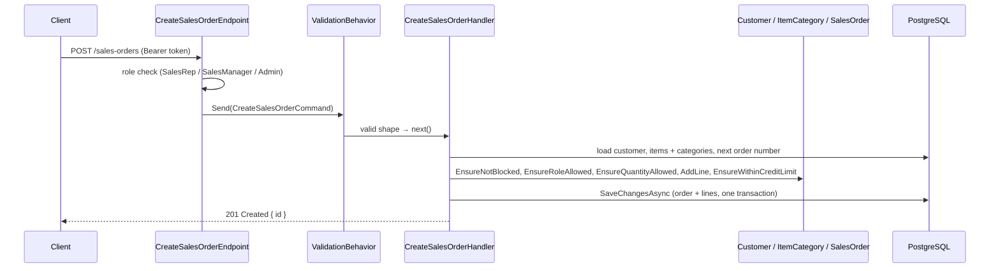

# Lesson 06 — Create an Order: The First Real Feature

Good day, developer! Everything we've built so far has been foundation: walls, a mediator, the rules, a
database, sign-in. Today it all meets in one place. A sales rep will send an order, and the system will check
the customer, the items, the categories and the credit limit, then save it with a proper order number. And
when something's wrong, the caller will get a clear answer instead of a crash. About two hours. Are you
ready? Let's begin!

## What we'll build

- `POST /sales-orders`: create a draft order, for SalesRep, SalesManager and Admin.
- Order numbers like `SO-2026-000042`, which no two orders can ever share.
- Proper error responses: 400 for a malformed request, 404 for something missing, 422 for a broken business
  rule.
- Swagger, a page in the browser where you can try every endpoint.

We'll also say goodbye to `/ping`. It did its job.

## Why we build it this way

### A handler with no business `if`s

The handler coordinates; the domain decides. Here's the whole job, in order:

1. Load the customer, and ask the customer whether it may order.
2. Load the items with their categories.
3. Create the order and add each line, asking each category whether this role and this quantity are allowed.
4. Ask the customer whether the total fits its credit.
5. Save.

Every "is this allowed?" is a method call on a domain object. If a rule changes, the handler doesn't.

### Errors the caller can understand

Run lesson 02's checkpoint again and you'll remember the problem: a failed validation came back as a
**500 Internal Server Error**, with a stack trace. That's wrong in two ways. A 500 means "the server broke",
when really the caller sent a bad request. And a stack trace tells an attacker far too much.

There's a standard for error responses, **Problem Details** (RFC 9457): a small JSON body with a `status`,
a `title` and a `detail`. We'll write one exception handler that turns each kind of exception into the right
status, once, for every endpoint.

| What went wrong | Exception | HTTP status |
|---|---|---|
| The request is malformed (no lines, a negative quantity) | `ValidationException` | 400 Bad Request |
| Something it refers to doesn't exist | `NotFoundException` | 404 Not Found |
| A business rule said no (blocked customer, over the credit limit) | `DomainException` | 422 Unprocessable Content |
| Anything else: a real bug | any other | 500, with no internals shown in production |

## 1. Two small additions to BuildingBlocks

A handler shouldn't call `DateTime.UtcNow` directly, for the same reason the domain doesn't: you can't control
it in a test. So handlers ask for a clock:

```csharp
// src/Shared/Erp.Shared.BuildingBlocks/Abstractions/IClock.cs
namespace Erp.Shared.BuildingBlocks;

// Inject instead of DateTime.UtcNow so time-based rules can be tested with a fixed clock.
public interface IClock
{
    DateTime UtcNow { get; }
}
```

```csharp
// src/Shared/Erp.Shared.Infrastructure/SystemClock.cs
using Erp.Shared.BuildingBlocks;

namespace Erp.Shared.Infrastructure;

public sealed class SystemClock : IClock
{
    public DateTime UtcNow => DateTime.UtcNow;
}
```

Register it in `AddSharedInfrastructure`: `services.AddSingleton<IClock, SystemClock>();`

And a way to say "that doesn't exist":

```csharp
// src/Shared/Erp.Shared.BuildingBlocks/Abstractions/Exceptions.cs
namespace Erp.Shared.BuildingBlocks;

// Mapped to HTTP 404 by GlobalExceptionHandler.
public class NotFoundException(string message) : Exception(message);
```

## 2. Order numbers no two orders can share

The naive way to number orders is "find the highest number and add one". Picture two reps clicking Save at
the same instant: both read 41, both write 42. A **sequence** fixes that. It's a counter inside PostgreSQL,
and `nextval()` hands each caller a different number, even when a thousand ask at once.

In `SalesDbContext.OnModelCreating`, right after `HasDefaultSchema`:

```csharp
b.HasSequence<long>("sales_order_number_seq");
```

And add a method that takes the next number and formats it:

```csharp
public async Task<string> NextOrderNumberAsync(DateTime nowUtc, CancellationToken ct)
{
    // ToList, not Single(): EF would wrap Single() in a subquery.
    var next = (await Database
        .SqlQuery<long>($"SELECT nextval('sales.sales_order_number_seq') AS \"Value\"")
        .ToListAsync(ct)).Single();
    return OrderNumbering.Format(next, nowUtc);
}
```

`SqlQuery<long>` runs a raw query and reads a single column named `Value`. The database supplies the number;
`OrderNumbering` from [lesson 03](03-domain-model.md) decides how it looks.

One more method, for the credit rule. The customer's limit has to cover their orders still awaiting
approval. Nothing can be awaiting approval yet (submitting comes next lesson), but the rule is already in the
domain, so we honor it from the start:

```csharp
// The customer's other submitted orders still waiting for a manager. They already count against credit.
public async Task<Money> PendingTotalAsync(CustomerId customerId, SalesOrderId excluding, CancellationToken ct)
{
    var pending = await SalesOrders.AsNoTracking()
        .Where(o => o.CustomerId == customerId && o.Status == SalesOrderStatus.PendingApproval && o.Id != excluding)
        .ToListAsync(ct);
    return pending.Aggregate(Money.Zero, (sum, o) => sum + o.Total);
}
```

`AsNoTracking()` tells EF we're only reading these orders, so it doesn't need to watch them for changes. The
total is computed in C# by the domain's own `Total`, so it can't disagree with how the domain counts.

Create a migration for the sequence:

```bash
dotnet ef migrations add AddOrderNumberSequence \
  --project src/Modules/Sales/Erp.Modules.Sales --startup-project src/Modules/Sales/Erp.Modules.Sales \
  --output-dir Infrastructure/Migrations
```

## 3. The slice

Delete the `Features/Ping` folder. Then create `Features/CreateSalesOrder/`:

```csharp
// src/Modules/Sales/Erp.Modules.Sales/Features/CreateSalesOrder/CreateSalesOrderHandler.cs
using Erp.Modules.Sales.Domain;
using Erp.Modules.Sales.Infrastructure;
using Erp.Shared.BuildingBlocks;
using FluentValidation;
using Mediator;
using Microsoft.EntityFrameworkCore;

namespace Erp.Modules.Sales.Features;

internal sealed record CreateSalesOrderLineDto(long ItemId, int Quantity);

internal sealed record CreateSalesOrderCommand(long CustomerId, IReadOnlyList<CreateSalesOrderLineDto> Lines) : ICommand<long>;

internal sealed class CreateSalesOrderValidator : AbstractValidator<CreateSalesOrderCommand>
{
    public CreateSalesOrderValidator()
    {
        RuleFor(x => x.CustomerId).GreaterThan(0);
        RuleFor(x => x.Lines).NotEmpty().WithMessage("An order needs at least one line.");
        RuleForEach(x => x.Lines).ChildRules(line =>
        {
            line.RuleFor(l => l.ItemId).GreaterThan(0);
            line.RuleFor(l => l.Quantity).GreaterThan(0);
        });
    }
}

internal sealed class CreateSalesOrderHandler(SalesDbContext db, ICurrentUser currentUser, IClock clock)
    : ICommandHandler<CreateSalesOrderCommand, long>
{
    public async ValueTask<long> Handle(CreateSalesOrderCommand cmd, CancellationToken ct)
    {
        var customerId = new CustomerId(cmd.CustomerId);
        var customer = await db.Customers.SingleOrDefaultAsync(c => c.Id == customerId, ct)
            ?? throw new NotFoundException($"Customer {cmd.CustomerId} not found.");
        customer.EnsureNotBlocked();

        var itemIds = cmd.Lines.Select(l => l.ItemId).Distinct().ToList();
        var items = await db.Items.Include(i => i.Category)
            .Where(i => itemIds.Contains(i.Id)).ToDictionaryAsync(i => i.Id, ct);

        var now = clock.UtcNow;
        var order = SalesOrder.Create(await db.NextOrderNumberAsync(now, ct), customer.Id, new UserId(currentUser.UserId), now);

        var qtyByCategory = new Dictionary<long, int>();
        foreach (var line in cmd.Lines)
        {
            if (!items.TryGetValue(line.ItemId, out var item) || !item.IsActive)
                throw new NotFoundException($"Item {line.ItemId} not found or inactive.");

            item.Category.EnsureRoleAllowed(currentUser.Role);
            qtyByCategory[item.CategoryId] = qtyByCategory.GetValueOrDefault(item.CategoryId) + line.Quantity;
            item.Category.EnsureQuantityAllowed(qtyByCategory[item.CategoryId]);   // cap is per order, not per line

            order.AddLine(new ItemId(item.Id), new Quantity(line.Quantity), item.UnitPrice);
        }

        // Early feedback only; Submit re-checks under a lock.
        customer.EnsureWithinCreditLimit(order.Total, await db.PendingTotalAsync(customer.Id, order.Id, ct));

        db.SalesOrders.Add(order);
        await db.SaveChangesAsync(ct);
        return order.Id.Value;
    }
}
```

Three things to notice:

- **The validator checks shape only**: positive ids, at least one line. Whether this *customer* may order is
  a business rule, so it's the domain's job, not the validator's.
- **`Include(i => i.Category)`** loads each item with its category in the same query, so checking the rules
  doesn't cost one database trip per line.
- **`order.Id.Value` after `SaveChangesAsync`**: the database assigns the id, and EF writes it back into the
  object.

```csharp
// src/Modules/Sales/Erp.Modules.Sales/Features/CreateSalesOrder/CreateSalesOrderEndpoint.cs
using Carter;
using Erp.Shared.BuildingBlocks;
using Mediator;
using Microsoft.AspNetCore.Builder;
using Microsoft.AspNetCore.Http;
using Microsoft.AspNetCore.Routing;

namespace Erp.Modules.Sales.Features;

internal sealed record CreateSalesOrderRequest(long CustomerId, IReadOnlyList<CreateSalesOrderLineDto> Lines);

internal sealed class CreateSalesOrderEndpoint : ICarterModule
{
    public void AddRoutes(IEndpointRouteBuilder app) =>
        app.MapPost("/sales-orders", async (CreateSalesOrderRequest body, ISender sender, CancellationToken ct) =>
        {
            var id = await sender.Send(new CreateSalesOrderCommand(body.CustomerId, body.Lines), ct);
            return Results.Created($"/sales-orders/{id}", new { id });
        })
        .RequireAuthorization(p => p.RequireRole(Roles.SalesRep, Roles.SalesManager, Roles.Admin));
}
```

You might wonder why there's a `CreateSalesOrderRequest` *and* a `CreateSalesOrderCommand` with the same
fields. The request is the **HTTP contract**, what callers send over the wire; the command is the **internal
message**. Today they match. The day you rename a field for the API, or add one the command shouldn't trust
from the caller, they can differ without either side breaking.

`RequireRole(...)` is the endpoint saying "these roles only, full stop". A role check that depends on the
data, like "only managers may order Controlled items", lives in the domain instead, as you saw in
`EnsureRoleAllowed`.

## 4. One handler for every error

The handler needs `ValidationException` from FluentValidation, so the host references it directly:

```bash
dotnet add src/Erp.Api package FluentValidation --version 12.1.1
```

```csharp
// src/Erp.Api/GlobalExceptionHandler.cs
using System.Diagnostics;
using Erp.Shared.BuildingBlocks;
using Microsoft.AspNetCore.Diagnostics;
using Microsoft.AspNetCore.Mvc;
using ValidationException = FluentValidation.ValidationException;

namespace Erp.Api;

// One place that maps exceptions to HTTP statuses, answering with RFC 9457 problem+json.
internal sealed class GlobalExceptionHandler(ILogger<GlobalExceptionHandler> log, IHostEnvironment env) : IExceptionHandler
{
    public async ValueTask<bool> TryHandleAsync(HttpContext ctx, Exception ex, CancellationToken ct)
    {
        var (status, title) = ex switch
        {
            ValidationException => (StatusCodes.Status400BadRequest, "Validation failed"),
            NotFoundException   => (StatusCodes.Status404NotFound, "Resource not found"),
            DomainException     => (StatusCodes.Status422UnprocessableEntity, "Business rule violated"),
            _                   => (StatusCodes.Status500InternalServerError, "Unexpected error")
        };

        if (status == StatusCodes.Status500InternalServerError)
            log.LogError(ex, "Unhandled exception");

        var errors = (ex as ValidationException)?.Errors.Select(e => e.ErrorMessage).ToArray();

        // Never leak a stack trace outside development.
        var detail = status switch
        {
            StatusCodes.Status500InternalServerError when env.IsDevelopment() => ex.ToString(),
            StatusCodes.Status500InternalServerError                          => "An unexpected error occurred.",
            _ when errors is not null                                         => string.Join(" ", errors),
            _                                                                 => ex.Message
        };

        var problem = new ProblemDetails { Status = status, Title = title, Detail = detail, Instance = ctx.Request.Path };
        problem.Extensions["traceId"] = Activity.Current?.TraceId.ToString() ?? ctx.TraceIdentifier;
        if (errors is not null)
            problem.Extensions["errors"] = errors;

        ctx.Response.StatusCode = status;
        // charset spelled out: some clients (Windows PowerShell 5.1) don't assume UTF-8, and ₱ arrives garbled.
        await ctx.Response.WriteAsJsonAsync(problem, options: null, contentType: "application/problem+json; charset=utf-8", ct);
        return true;
    }
}
```

`IExceptionHandler` is ASP.NET Core's hook for exactly this. The **`traceId`** in every error body is the
request's id; when a user reports a problem, they can quote it, and you can find that exact request in your
logs. Business messages (404, 422) are meant for people, so they're shown as they are. A validation failure
lists its messages twice: joined into one sentence in `detail`, for a person to read, and one by one in
`errors`, for a program to show next to each field. FluentValidation's own exception message is written for
developers, with field names and severities, so it never reaches the caller. A 500's details stay on the
server in production.

In `Program.cs`, register it and turn it on as the first thing in the pipeline, so it catches everything
after it:

```csharp
builder.Services.AddExceptionHandler<GlobalExceptionHandler>();
builder.Services.AddProblemDetails();
// ...
var app = builder.Build();
app.UseExceptionHandler();
```

## 5. Swagger: try your endpoints in the browser

From now on, there'll be more endpoints than you'll want to type `curl` for. **Swagger** reads your
endpoints and builds a page where you can call them. Swashbuckle (MIT) does it:

```bash
dotnet add src/Erp.Api package Swashbuckle.AspNetCore --version 10.2.3
```

```csharp
// in Program.cs, with the other services
builder.Services.AddEndpointsApiExplorer();
builder.Services.AddSwaggerGen(options =>
{
    options.SwaggerDoc("v1", new OpenApiInfo { Title = "Erp API", Version = "v1" });
    options.AddSecurityDefinition("Bearer", new OpenApiSecurityScheme
    {
        Name = "Authorization", Type = SecuritySchemeType.Http, Scheme = "bearer",
        In = ParameterLocation.Header, Description = "The accessToken from POST /auth/login."
    });
    options.AddSecurityRequirement(doc => new OpenApiSecurityRequirement
    {
        { new OpenApiSecuritySchemeReference("Bearer", doc, null), new List<string>() }
    });
});

// after UseExceptionHandler
if (app.Environment.IsDevelopment())
{
    app.UseSwagger();
    app.UseSwaggerUI();
}
```

(Add `using Microsoft.OpenApi;` at the top.) The security definition adds an **Authorize** button: paste an
access token there once, and every call you make from the page carries it. Swagger only runs in
Development; a production server doesn't advertise its API to strangers.

## How a request flows



If any domain check throws, nothing is saved, and the exception handler turns the `DomainException` into a
422. Easy, right?

## Mistakes to avoid

- Putting "is this customer blocked?" in the validator. Validators check shape; the domain checks rules.
- Generating order numbers with `MAX(...) + 1`. Two people at once get the same number.
- Loading items one at a time inside the loop. That's one database trip per line; `Include` and `Contains`
  make it one.
- Returning stack traces to the caller in production.
- Forgetting `UseExceptionHandler()` must come first. Anything registered before it isn't covered.

## Let's run it!

```bash
dotnet run --project src/Erp.Api
TOKEN=$(curl -s -X POST http://localhost:5264/auth/login -H "Content-Type: application/json" \
  -d '{"email":"rep@erp.local","password":"Password123!"}' | jq -r .accessToken)
```

A good order: two Widgets for Acme.

```bash
curl -s -X POST http://localhost:5264/sales-orders -H "Authorization: Bearer $TOKEN" \
  -H "Content-Type: application/json" -d '{"customerId":1,"lines":[{"itemId":1,"quantity":2}]}'
# {"id":1}
```

Now each kind of "no":

| Try this body | You get | Because |
|---|---|---|
| `{"customerId":1,"lines":[]}` | **400** "An order needs at least one line." | The validator |
| `{"customerId":99,"lines":[{"itemId":1,"quantity":1}]}` | **404** "Customer 99 not found." | The handler |
| `{"customerId":3,"lines":[{"itemId":1,"quantity":1}]}` | **422** "Customer 'Gamma Traders' is blocked..." | `Customer.EnsureNotBlocked` |
| `{"customerId":2,"lines":[{"itemId":1,"quantity":100}]}` | **422** "...exceed the credit limit. Available credit: ₱500.00." | `Customer.EnsureWithinCreditLimit` |
| `{"customerId":1,"lines":[{"itemId":3,"quantity":1}]}` | **422** "Category 'Controlled' requires role 'SalesManager'." | `ItemCategory.EnsureRoleAllowed` |

Each answer is a `application/problem+json` body with a `traceId`. Then open
`http://localhost:5264/swagger`, click **Authorize**, paste your token, and try the same calls from the
browser.

Check the order number in the database:

```bash
PGPASSWORD=erp_dev_only "/c/Program Files/PostgreSQL/18/bin/psql.exe" -h localhost -U postgres -d erp \
  -c "SELECT id, order_number, status FROM sales.sales_order;"
#  1 | SO-2026-000001 | 0
```

## Let's check!

1. Which of these belongs in the validator, and which in the domain: "quantity is positive", "customer isn't
   blocked", "at most 5 Controlled items per order"?
2. Why does `MAX(order_number) + 1` go wrong, and how does a sequence avoid it?
3. Why is there a `CreateSalesOrderRequest` *and* a `CreateSalesOrderCommand`?
4. What status does each of these produce, and why: a blocked customer, an empty order, an unknown item?
5. Why does the error body include a `traceId`?
6. Why is Swagger only turned on in Development?

And that's where this lesson ends. You've built your first real feature, from the HTTP request all the way to
a saved order, with every rule in its proper place. Next time, we submit that order: reserving stock in a
second module, inside one transaction. Good luck, developer!

---

← [Lesson 05 — Sign-in](05-sign-in.md) · Next: [Lesson 07 — Submit](07-submit.md) →
