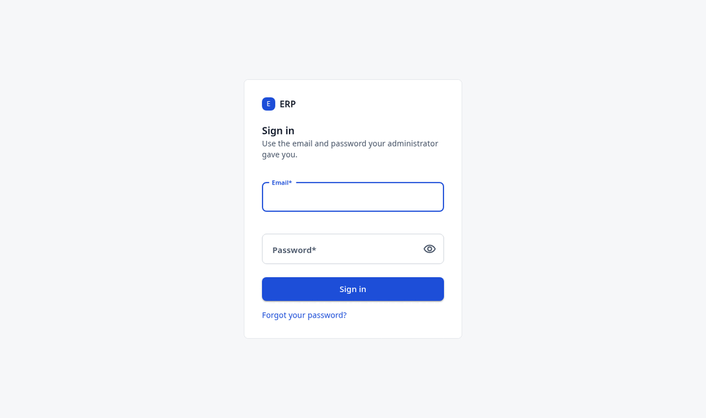
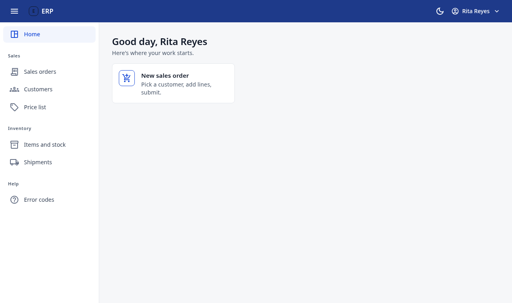
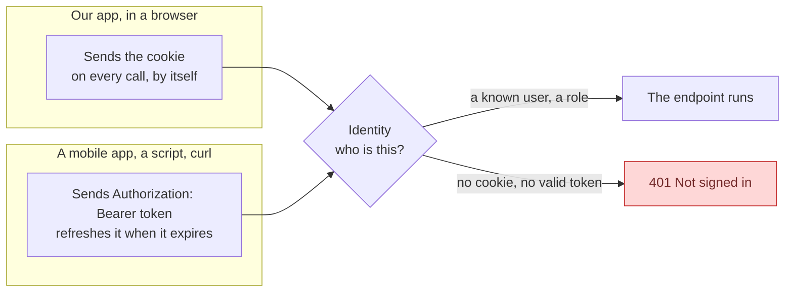
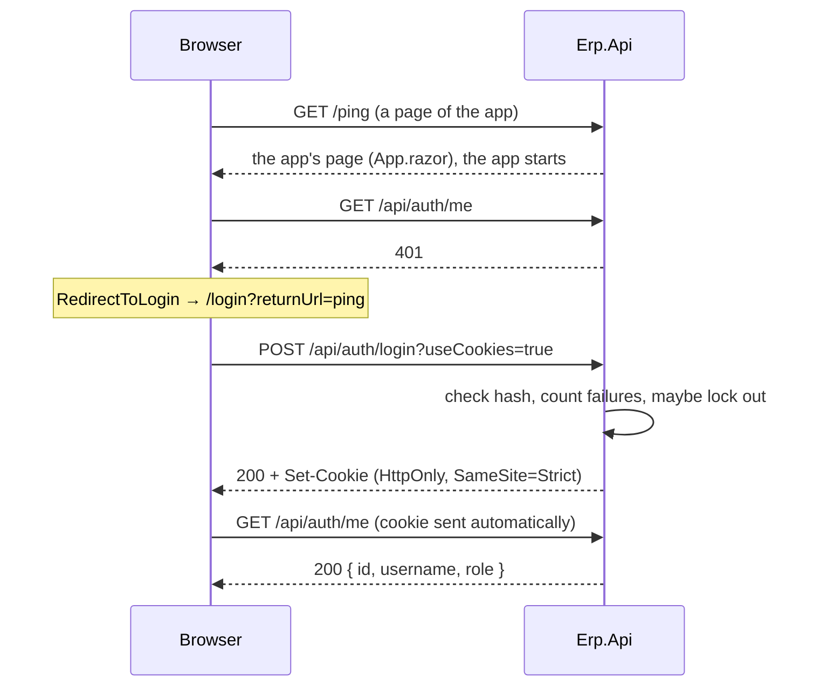

# Lesson 06 — Sign-in: ASP.NET Core Identity

Good day, developer! Our Sales module can now remember customers and orders. But right now, anyone who can
reach the API can do anything. Today we decide who's allowed in. We'll add a whole module for it, Identity,
and we'll let a well-tested library do the dangerous parts: storing passwords, issuing tokens, locking out
password guessers. Give yourself about an hour and a half. Are you ready? Let's begin!

## What we'll build

| Endpoint | What it does |
|---|---|
| `POST /api/auth/login` | Check the email and password; answer with an access token and a refresh token |
| `POST /api/auth/refresh` | Trade a refresh token for a new access token |
| `POST /api/auth/manage/info` | Change your password |
| `GET /api/auth/me` | Who am I, and what's my role |
| `POST /api/auth/logout` | Sign out of this browser |
| `POST /api/auth/logout-everywhere` | End every session you have, on every device |

Plus three dev users to sign in with, one per role, a way for any handler to ask "who's calling?" without
touching HTTP, and the screens: a **sign-in page**, an account menu with "sign out" and "sign out
everywhere", and a rule that every page needs a signed-in user.

By the end, the app has its sign-in page, and greets each person by name with a menu that shows only what
their role may use:





Every picture in this course is taken from the finished app, so now and then a screen shows a menu item or
a button that a later lesson adds. The part the lesson builds always looks like this.

## Why we build it this way

### The pain of writing your own

You could write sign-in yourself. Hash the passwords, compare them, issue tokens. It looks like an
afternoon's work. Now count what a production system really needs:

- password hashing that's slow on purpose, salted, and upgradable later;
- comparing hashes in constant time, so response timing can't leak anything;
- locking an account after repeated wrong passwords;
- signing everyone out when a password changes;
- short-lived tokens, plus refresh tokens to get new ones;
- cookies for the browser, done safely;
- password reset links that expire.

Every one of those is a place to make a quiet security mistake. And nothing tells you that you made it,
until somebody else finds it. That's why sign-in is the one place this course says: **don't write it
yourself; use a library everyone else is hammering on too.**

### Which library

| Library | License | Why or why not |
|---|---|---|
| **ASP.NET Core Identity** | MIT, part of .NET | Users, roles, hashing, lockout, cookies, bearer tokens and refresh, all built in. **We use this.** |
| OpenIddict | Apache-2.0 | A full OAuth server. Excellent if you later need single sign-on across many apps; far more than we need now |
| Duende IdentityServer | Paid above US$1M revenue | Great product, but the license would follow your source to every buyer |
| Keycloak | Apache-2.0 | A separate Java server to install and run. Too much for one ERP |

Since .NET 8, Identity comes with ready-made **API endpoints**. One line maps login, refresh, password
changes, password reset and more.

Now, let's be honest about the costs:

- Its tokens aren't the JWTs you may have read about. They're encrypted blobs only this app can read. For an
  ERP that talks only to itself, that's fine.
- You can't cancel one single refresh token. Instead, "sign out everywhere" (or a password change) cancels
  *all* of a user's sessions at once.
- It maps a public `/register` endpoint, and an ERP must not let strangers sign up. We'll block it.
- Its login asks for an `email` field. So our staff sign in with their email addresses.

### Two ways to stay signed in

| Who | How they stay signed in |
|---|---|
| A browser (our app) | A **cookie** the browser sends automatically. JavaScript can't read it, so a script injected into the page can't steal it |
| Anything else (a mobile app, an integration, `curl`) | A **bearer token** in the `Authorization` header, plus a **refresh token** to get a new one when it expires |

Identity does both. If a request carries an `Authorization: Bearer ...` header, it checks the token;
otherwise, it looks for the cookie. To remember it easily: a browser shows its wristband (the cookie), and
everyone else shows their ticket (the bearer token).



Our app and API share one address (lesson 01), so the browser sends the cookie with every API call on its
own. There's no token for the app to store, refresh or leak. And `SameSite=Strict` (step 4) means another
website can't make the browser send it.

You might wonder about API keys, a common way to "protect" an API. A key that ships inside a browser app is
public: anyone can open the browser's developer tools and copy it. So we use none. Every call is protected
by who's signed in. To remember it easily: in a browser, the user is the key.

## 1. The Identity module

```bash
dotnet new classlib -n Erp.Modules.Identity -o src/Modules/Identity/Erp.Modules.Identity
rm src/Modules/Identity/Erp.Modules.Identity/Class1.cs
dotnet sln add src/Modules/Identity/Erp.Modules.Identity
dotnet add src/Modules/Identity/Erp.Modules.Identity reference src/Shared/Erp.Shared.BuildingBlocks
dotnet add src/Erp.Api reference src/Modules/Identity/Erp.Modules.Identity

dotnet add src/Modules/Identity/Erp.Modules.Identity package Microsoft.AspNetCore.Identity.EntityFrameworkCore --version 10.0.14
dotnet add src/Modules/Identity/Erp.Modules.Identity package Npgsql.EntityFrameworkCore.PostgreSQL --version 10.0.3
dotnet add src/Modules/Identity/Erp.Modules.Identity package EFCore.NamingConventions --version 10.0.1
dotnet add src/Modules/Identity/Erp.Modules.Identity package Microsoft.EntityFrameworkCore.Design --version 10.0.14
```

`Microsoft.AspNetCore.Identity.EntityFrameworkCore` (MIT) is Identity itself, storing its users and roles
with EF Core. The other packages you know from lessons 03 and 04. As before, delete the `.csproj`'s
`<PropertyGroup>`, mark the design package `PrivateAssets="all"`, and add:

```xml
<ItemGroup>
  <FrameworkReference Include="Microsoft.AspNetCore.App" />
</ItemGroup>
```

No `InternalsVisibleTo` yet: nothing outside the module needs its insides. The architecture tests will hold
it to that.

## 2. Users, roles and their tables

```csharp
// src/Modules/Identity/Erp.Modules.Identity/Infrastructure/AppUser.cs
using Microsoft.AspNetCore.Identity;

namespace Erp.Modules.Identity.Infrastructure;

internal sealed class AppUser : IdentityUser<long>;
```

`IdentityUser<long>` already has everything: the user name, email, password hash, lockout fields and a
**security stamp**, a random value that changes whenever something about the user's security changes. Our
`AppUser` adds nothing yet; it exists so we have our own type to grow later. The `<long>` makes ids numbers,
like the rest of our database.

```csharp
// src/Modules/Identity/Erp.Modules.Identity/Infrastructure/ErpIdentityDbContext.cs
using Microsoft.AspNetCore.Identity;
using Microsoft.AspNetCore.Identity.EntityFrameworkCore;
using Microsoft.EntityFrameworkCore;
using Microsoft.EntityFrameworkCore.Design;
using Npgsql;
using AppRoles = Erp.Shared.BuildingBlocks.Roles;   // "Roles" alone is IdentityDbContext.Roles, the table

namespace Erp.Modules.Identity.Infrastructure;

internal sealed class ErpIdentityDbContext(DbContextOptions<ErpIdentityDbContext> options)
    : IdentityDbContext<AppUser, IdentityRole<long>, long>(options)
{
    public const string Schema = "identity";

    public static DbContextOptionsBuilder Configure(DbContextOptionsBuilder o, NpgsqlDataSource dataSource) =>
        o.UseNpgsql(dataSource, npg => npg.MigrationsHistoryTable("__EFMigrationsHistory", Schema))
         .UseSnakeCaseNamingConvention();

    protected override void OnModelCreating(ModelBuilder b)
    {
        base.OnModelCreating(b);
        b.HasDefaultSchema(Schema);

        b.Entity<AppUser>().ToTable("users");
        b.Entity<IdentityUserClaim<long>>().ToTable("user_claims");
        b.Entity<IdentityUserLogin<long>>().ToTable("user_logins");
        b.Entity<IdentityUserToken<long>>().ToTable("user_tokens");
        b.Entity<IdentityUserRole<long>>().ToTable("user_roles");
        b.Entity<IdentityRoleClaim<long>>().ToTable("role_claims");
        b.Entity<IdentityRole<long>>().ToTable("roles").HasData(
            Role(1, AppRoles.SalesRep), Role(2, AppRoles.SalesManager), Role(3, AppRoles.Admin));
    }

    // Fixed stamps: seed data must be identical on every build, or each migration would "change" the roles.
    private static IdentityRole<long> Role(long id, string name) => new()
    {
        Id = id, Name = name, NormalizedName = name.ToUpperInvariant(), ConcurrencyStamp = $"role-{id}"
    };
}

// For `dotnet ef migrations add`; never connects.
internal sealed class ErpIdentityDbContextFactory : IDesignTimeDbContextFactory<ErpIdentityDbContext>
{
    public ErpIdentityDbContext CreateDbContext(string[] args)
    {
        var o = new DbContextOptionsBuilder<ErpIdentityDbContext>();
        ErpIdentityDbContext.Configure(o, NpgsqlDataSource.Create("Host=localhost;Database=erp_design_time"));
        return new ErpIdentityDbContext(o.Options);
    }
}
```

Let's walk through it:

- **`IdentityDbContext<...>`** is a DbContext that Identity wrote for us: it already maps users, roles and
  the links between them. We call `base.OnModelCreating` first so all of that gets set up.
- **The `ToTable` lines** only rename Identity's tables from `AspNetUsers` and friends to short,
  snake_case names in our `identity` schema.
- **`HasData`** puts the three roles into the first migration. Unlike dev users, roles belong in production
  too: the app can't work without them.
- **`AppRoles`** is an alias. Inside this class, plain `Roles` would mean Identity's roles *table*, so we
  give our constants another name.

## 3. Dev users, created the way real ones will be

```csharp
// src/Modules/Identity/Erp.Modules.Identity/Infrastructure/IdentityDatabase.cs
using Erp.Shared.BuildingBlocks;
using Microsoft.AspNetCore.Identity;
using Microsoft.EntityFrameworkCore;

namespace Erp.Modules.Identity.Infrastructure;

internal sealed class IdentityDatabase(ErpIdentityDbContext db, UserManager<AppUser> users) : IModuleDatabase
{
    public const string DevPassword = "Password123!";

    public string Module => "Identity";

    public Task MigrateAsync(CancellationToken ct) => db.Database.MigrateAsync(ct);

    // Through UserManager rather than SQL, so passwords are hashed exactly as in real use.
    public async Task SeedDevelopmentDataAsync(CancellationToken ct)
    {
        (string Email, string Role)[] devUsers =
            [("rep@erp.local", Roles.SalesRep), ("manager@erp.local", Roles.SalesManager), ("admin@erp.local", Roles.Admin)];

        foreach (var (email, role) in devUsers)
        {
            if (await users.FindByEmailAsync(email) is not null) continue;
            var user = new AppUser { UserName = email, Email = email, EmailConfirmed = true };
            ThrowIfFailed(await users.CreateAsync(user, DevPassword));
            ThrowIfFailed(await users.AddToRoleAsync(user, role));
        }
    }

    private static void ThrowIfFailed(IdentityResult result)
    {
        if (!result.Succeeded)
            throw new InvalidOperationException(string.Join("; ", result.Errors.Select(e => e.Description)));
    }
}
```

**`UserManager<AppUser>`** is Identity's front desk for users: create one, find one, add a role, change a
password. We don't write SQL for users at all. Using it here means the dev users get their passwords hashed
exactly the way real users will.

## 4. Plug Identity in

```csharp
// src/Modules/Identity/Erp.Modules.Identity/IdentityModule.cs
using Erp.Modules.Identity.Features;
using Erp.Modules.Identity.Infrastructure;
using Erp.Shared.BuildingBlocks;
using Microsoft.AspNetCore.Authentication.BearerToken;
using Microsoft.AspNetCore.Builder;
using Microsoft.AspNetCore.Http;
using Microsoft.AspNetCore.Identity;
using Microsoft.AspNetCore.Routing;
using Microsoft.Extensions.Configuration;
using Microsoft.Extensions.DependencyInjection;
using Npgsql;

namespace Erp.Modules.Identity;

// Sign-in is ASP.NET Core Identity: password hashing, lockout, cookies for the browser, bearer + refresh tokens
// for other clients. This module only configures it and adds what it lacks.
public static class IdentityModule
{
    public static IServiceCollection AddIdentityModule(this IServiceCollection services, IConfiguration config)
    {
        services.AddDbContext<ErpIdentityDbContext>((sp, o) =>
            ErpIdentityDbContext.Configure(o, sp.GetRequiredService<NpgsqlDataSource>()));
        services.AddScoped<IModuleDatabase, IdentityDatabase>();

        services.AddIdentityApiEndpoints<AppUser>(o =>
            {
                o.User.RequireUniqueEmail = true;
                // Length beats composition rules (NIST SP 800-63B).
                o.Password.RequiredLength = 12;
                o.Password.RequireDigit = false;
                o.Password.RequireLowercase = false;
                o.Password.RequireUppercase = false;
                o.Password.RequireNonAlphanumeric = false;
                o.Lockout.MaxFailedAccessAttempts = 5;
                o.Lockout.DefaultLockoutTimeSpan = TimeSpan.FromMinutes(15);
            })
            .AddRoles<IdentityRole<long>>()
            .AddEntityFrameworkStores<ErpIdentityDbContext>();

        var auth = config.GetSection("Auth");
        services.Configure<BearerTokenOptions>(IdentityConstants.BearerScheme, o =>
        {
            o.BearerTokenExpiration = TimeSpan.FromMinutes(auth.GetValue("AccessTokenMinutes", 15));
            o.RefreshTokenExpiration = TimeSpan.FromDays(auth.GetValue("RefreshTokenDays", 7));
        });
        services.ConfigureApplicationCookie(o =>
        {
            o.Cookie.SameSite = SameSiteMode.Strict;
            o.ExpireTimeSpan = TimeSpan.FromHours(auth.GetValue("CookieHours", 8));
            o.SlidingExpiration = true;
            // An API answers 401/403; it never redirects to a login page.
            o.Events.OnRedirectToLogin = ctx => { ctx.Response.StatusCode = StatusCodes.Status401Unauthorized; return Task.CompletedTask; };
            o.Events.OnRedirectToAccessDenied = ctx => { ctx.Response.StatusCode = StatusCodes.Status403Forbidden; return Task.CompletedTask; };
        });

        // Handlers: plain classes, injected straight into the endpoints that use them.
        services.AddScoped<GetCurrentUserHandler>();
        services.AddScoped<SignOutHandler>();
        services.AddScoped<SignOutEverywhereHandler>();

        return services;
    }

    // /auth/login, /auth/refresh, /auth/manage/info (change password), /auth/forgotPassword, ...
    public static IEndpointRouteBuilder MapIdentityModule(this IEndpointRouteBuilder app)
    {
        app.MapGroup("/auth")
            .MapIdentityApi<AppUser>()
            .AddEndpointFilter(async (ctx, next) =>
                // Staff accounts are created by an administrator, never by self sign-up.
                ctx.HttpContext.Request.Path.Value?.EndsWith("/auth/register", StringComparison.OrdinalIgnoreCase) == true
                    ? TypedResults.NotFound()
                    : await next(ctx));

        GetCurrentUserEndpoint.Map(app);
        SignOutEndpoint.Map(app);
        return app;
    }
}
```

Here's what each part decides:

| Setting | Why |
|---|---|
| `RequiredLength = 12`, no "must contain a digit" rules | Long passwords beat clever ones. Current guidance (NIST SP 800-63B) says length matters most, and composition rules push people toward `Password1!` |
| No forced password expiry | The same guidance says don't force changes every 90 days; people respond with weaker, predictable passwords |
| Lockout after 5 tries, for 15 minutes | Stops someone guessing one account's password |
| `BearerTokenExpiration` 15 minutes | A stolen access token is only useful briefly |
| `RefreshTokenExpiration` 7 days | How long you stay signed in without typing your password |
| Cookie `SameSite = Strict` | The browser won't send the cookie on requests started by another site, which blocks cross-site request forgery |
| `OnRedirectToLogin` → 401 | Without it, an unauthenticated call gets redirected to a login *page*, which an API doesn't have |
| The `/auth/register` filter | `MapIdentityApi` always maps it; this filter turns it into a 404. It checks the *end* of the path, because the group will sit under `/api` |

The tokens and cookies are encrypted with keys that ASP.NET Core keeps in your user profile. On your machine,
that's fine. On a real server it's a problem, and [lesson 23](23-security-hardening.md) moves the keys into
the database.

And one honest gap: `/auth/forgotPassword` needs a way to send email, and we haven't given it one yet. For
now it quietly sends nothing; [lesson 16](16-users-email.md) gives it real email, and gives admins a screen
to reset a password.

## 5. Who's calling?

Handlers will need to know the current user: who created this order, what's their role. But handlers must
not touch `HttpContext`. So we put a small interface in BuildingBlocks:

```csharp
// src/Shared/Erp.Shared.BuildingBlocks/Abstractions/ICurrentUser.cs
namespace Erp.Shared.BuildingBlocks;

public interface ICurrentUser
{
    long UserId { get; }
    string Username { get; }
    string Role { get; }
    bool IsInRole(string role);
}
```

and its implementation in Infrastructure, the only place allowed to read the HTTP request:

```csharp
// src/Shared/Erp.Shared.Infrastructure/Security/CurrentUser.cs
using System.Globalization;
using System.Security.Claims;
using Erp.Shared.BuildingBlocks;
using Microsoft.AspNetCore.Http;

namespace Erp.Shared.Infrastructure;

public sealed class CurrentUser(IHttpContextAccessor accessor) : ICurrentUser
{
    private ClaimsPrincipal User => accessor.HttpContext?.User
        ?? throw new InvalidOperationException("No HTTP context.");

    public long UserId => long.Parse(User.FindFirstValue(ClaimTypes.NameIdentifier)!, CultureInfo.InvariantCulture);
    public string Username => User.FindFirstValue(ClaimTypes.Name)!;
    public string Role => User.FindFirstValue(ClaimTypes.Role)!;   // staff have exactly one role
    public bool IsInRole(string role) => User.IsInRole(role);
}
```

When Identity signs someone in, it attaches **claims** to the request: small facts like "user id is 2" or
"role is SalesManager". `CurrentUser` just reads them. In `AddSharedInfrastructure`, register it:

```csharp
services.AddHttpContextAccessor();
services.AddScoped<ICurrentUser, CurrentUser>();
```

## 6. Two small endpoints Identity doesn't have

Identity's `/auth/manage/info` tells you your email, but not your role, and a client needs the role to decide
what to show. So let's add `/auth/me`:

```csharp
// src/Modules/Identity/Erp.Modules.Identity/Features/Me/GetCurrentUserHandler.cs
using Erp.Shared.BuildingBlocks;

namespace Erp.Modules.Identity.Features;

internal sealed record CurrentUserDto(long Id, string Username, string Role);

internal sealed class GetCurrentUserHandler(ICurrentUser user)
{
    public Task<CurrentUserDto> HandleAsync(CancellationToken ct) =>
        Task.FromResult(new CurrentUserDto(user.UserId, user.Username, user.Role));
}
```

```csharp
// src/Modules/Identity/Erp.Modules.Identity/Features/Me/GetCurrentUserEndpoint.cs
using Microsoft.AspNetCore.Builder;
using Microsoft.AspNetCore.Http;
using Microsoft.AspNetCore.Routing;

namespace Erp.Modules.Identity.Features;

// Identity's own /auth/manage/info has no role; a client needs it to decide what to show.
internal static class GetCurrentUserEndpoint
{
    public static void Map(IEndpointRouteBuilder app) =>
        app.MapGet("/auth/me", async (GetCurrentUserHandler handler, CancellationToken ct) =>
                TypedResults.Ok(await handler.HandleAsync(ct)))
            .RequireAuthorization();
}
```

`RequireAuthorization()` means "signed-in users only". Without a valid token or cookie, the answer is 401.

And signing out. For a browser, that's clearing the cookie. For "every device", it's changing the user's
security stamp: every token and cookie remembers the stamp it was issued with, and from then on they no
longer match.

```csharp
// src/Modules/Identity/Erp.Modules.Identity/Features/SignOut/SignOutHandler.cs
using System.Globalization;
using Erp.Modules.Identity.Infrastructure;
using Erp.Shared.BuildingBlocks;
using Microsoft.AspNetCore.Identity;

namespace Erp.Modules.Identity.Features;

internal sealed class SignOutHandler(SignInManager<AppUser> signIn)
{
    public async Task HandleAsync(CancellationToken ct)
    {
        await signIn.SignOutAsync();   // clears the browser's sign-in cookie
    }
}

// A new security stamp invalidates every cookie and refresh token the user holds, on every device.
internal sealed class SignOutEverywhereHandler(UserManager<AppUser> users, SignInManager<AppUser> signIn, ICurrentUser currentUser)
{
    public async Task HandleAsync(CancellationToken ct)
    {
        var user = await users.FindByIdAsync(currentUser.UserId.ToString(CultureInfo.InvariantCulture))
            ?? throw new InvalidOperationException("The signed-in user no longer exists.");
        await users.UpdateSecurityStampAsync(user);
        await signIn.SignOutAsync();
    }
}
```

```csharp
// src/Modules/Identity/Erp.Modules.Identity/Features/SignOut/SignOutEndpoint.cs
using Microsoft.AspNetCore.Builder;
using Microsoft.AspNetCore.Http;
using Microsoft.AspNetCore.Http.HttpResults;
using Microsoft.AspNetCore.Routing;

namespace Erp.Modules.Identity.Features;

internal static class SignOutEndpoint
{
    public static void Map(IEndpointRouteBuilder app)
    {
        app.MapPost("/auth/logout", async Task<NoContent> (SignOutHandler handler, CancellationToken ct) =>
            {
                await handler.HandleAsync(ct);
                return TypedResults.NoContent();
            })
            .RequireAuthorization();

        app.MapPost("/auth/logout-everywhere", async Task<NoContent> (SignOutEverywhereHandler handler, CancellationToken ct) =>
            {
                await handler.HandleAsync(ct);
                return TypedResults.NoContent();
            })
            .RequireAuthorization();
    }
}
```

`SignInManager<AppUser>` is Identity's other front desk: it signs people in and out. Notice that none of these
handlers takes a message: "who am I?" and "sign me out" need nothing but who's asking, and `ICurrentUser` and
the cookie already know that. A record with no fields would only be noise.

## 7. Wire it into the host

In `Program.cs`:

```csharp
// register the modules, Identity first (it's also the migration order):
builder.Services.AddIdentityModule(builder.Configuration);
builder.Services.AddSalesModule();
builder.Services.AddAuthorization();

// ...after InitializeDatabaseAsync, and after UseRouting:
app.UseAuthentication();   // who are you?
app.UseAuthorization();    // are you allowed?
app.UseAntiforgery();      // moves down here: it must come after the two above

var api = app.MapGroup("/api").ValidateRequests();
api.MapIdentityModule();   // /api/auth/...
api.MapSalesEndpoints();
```

Order matters for the middleware lines: a request must be identified before anyone can check what it's
allowed to do, and both must happen before it reaches an endpoint. `UseAntiforgery` checks the signed-in user's
form tokens, so it goes after them; move it from where lesson 01 put it.

Add the `Auth` settings to `appsettings.json`:

```json
"Auth": { "AccessTokenMinutes": 15, "RefreshTokenDays": 7, "CookieHours": 8 }
```

And create the Identity tables:

```bash
dotnet ef migrations add InitialCreate \
  --project src/Modules/Identity/Erp.Modules.Identity \
  --startup-project src/Modules/Identity/Erp.Modules.Identity \
  --output-dir Infrastructure/Migrations
```

## 8. Sign in through the app

Time for the screens. The app needs to know who's signed in, and `<AuthorizeView>` and `[Authorize]` for
pages. One more package:

```bash
dotnet add src/Erp.Web package Microsoft.AspNetCore.Components.Authorization --version 10.0.14
```

### Who's signed in, according to the API

The browser can't read the cookie (it's `HttpOnly`), so how does the app know who's signed in? It asks:
`GET /api/auth/me`. A 200 means signed in, and says as whom; a 401 means not. Blazor wants that answer from
an **`AuthenticationStateProvider`**, the one class every `<AuthorizeView>` and `[Authorize]` consults:

```csharp
// src/Erp.Web/Services/CookieAuthenticationStateProvider.cs
using System.Globalization;
using System.Net.Http.Json;
using System.Security.Claims;
using Microsoft.AspNetCore.Components.Authorization;

namespace Erp.Web.Services;

public sealed record CurrentUser(long Id, string Username, string Role);

// Who is signed in, according to the API. The cookie itself is HttpOnly: the browser app never sees it, it only
// asks /api/auth/me. Signing in and out go through Identity's own endpoints.
public sealed class CookieAuthenticationStateProvider(HttpClient http) : AuthenticationStateProvider
{
    private static readonly AuthenticationState SignedOut = new(new ClaimsPrincipal(new ClaimsIdentity()));
    private CurrentUser? _user;
    private bool _loaded;

    public CurrentUser? User => _user;

    public override async Task<AuthenticationState> GetAuthenticationStateAsync()
    {
        if (!_loaded)
        {
            var response = await http.GetAsync("api/auth/me");
            _user = response.IsSuccessStatusCode ? await response.Content.ReadFromJsonAsync<CurrentUser>() : null;
            _loaded = true;
        }
        return _user is null ? SignedOut : new AuthenticationState(Principal(_user));
    }

    // null = signed in; otherwise the reason, in words a person can act on.
    public async Task<string?> SignInAsync(string email, string password)
    {
        var response = await http.PostAsJsonAsync("api/auth/login?useCookies=true", new { email, password });
        if (!response.IsSuccessStatusCode)
        {
            var body = await response.Content.ReadAsStringAsync();
            return body.Contains("LockedOut")
                ? "This account is locked for 15 minutes after too many wrong passwords."
                : "Wrong email or password.";
        }
        Refresh();
        return null;
    }

    public async Task SignOutAsync(bool everywhere = false)
    {
        await http.PostAsync(everywhere ? "api/auth/logout-everywhere" : "api/auth/logout", null);
        Refresh();
    }

    // Forget what we knew and ask the API again (after sign-in, sign-out, or a 401).
    public void Refresh()
    {
        _loaded = false;
        NotifyAuthenticationStateChanged(GetAuthenticationStateAsync());
    }

    private static ClaimsPrincipal Principal(CurrentUser user) => new(new ClaimsIdentity(
    [
        new Claim(ClaimTypes.NameIdentifier, user.Id.ToString(CultureInfo.InvariantCulture)),
        new Claim(ClaimTypes.Name, user.Username),
        new Claim(ClaimTypes.Role, user.Role),
    ], authenticationType: "cookie", ClaimTypes.Name, ClaimTypes.Role));
}
```

- **`?useCookies=true`** tells Identity's login endpoint to answer with a cookie instead of tokens.
- **It asks once**, then remembers (`_loaded`). `Refresh()` forgets and asks again, and
  `NotifyAuthenticationStateChanged` tells every `<AuthorizeView>` on screen to redraw.
- **The claims** turn the API's answer into the same shape the server uses, so `<AuthorizeView
  Roles="...">` works.
- **Wrong password and unknown email get the same message.** Saying "no such user" would tell an attacker
  which emails are real.

Register it in `Erp.Web/Program.cs`, before `AddMudServices`:

```csharp
builder.Services.AddAuthorizationCore();
builder.Services.AddCascadingAuthenticationState();
builder.Services.AddScoped<CookieAuthenticationStateProvider>();
builder.Services.AddScoped<AuthenticationStateProvider>(sp => sp.GetRequiredService<CookieAuthenticationStateProvider>());
```

(add `using Erp.Web.Services;` and `using Microsoft.AspNetCore.Components.Authorization;`). The provider is
registered twice on purpose: once as itself, so the sign-in page can call `SignInAsync`, and once as the
`AuthenticationStateProvider` Blazor looks for. Both hand out the same object.

### Every page needs a signed-in user

Add these lines to `_Imports.razor`:

```razor
@using Microsoft.AspNetCore.Authorization
@using Microsoft.AspNetCore.Components.Authorization
@using Erp.Web.Services
@attribute [Authorize]
```

The last line is the important one: **every page requires a signed-in user** unless it says otherwise with
`[AllowAnonymous]`. Forgetting to protect a page is impossible; forgetting to *unprotect* the sign-in page is
a mistake you'll notice in seconds.

The router learns to check it. In `Routes.razor`, `RouteView` becomes `AuthorizeRouteView`:

```razor
@* src/Erp.Web/Routes.razor *@
@* Every page needs a signed-in user (the [Authorize] in _Imports), unless it says [AllowAnonymous]. *@
@attribute [AllowAnonymous]
<Router AppAssembly="typeof(Routes).Assembly" NotFoundPage="typeof(Pages.NotFound)">
    <Found Context="routeData">
        <AuthorizeRouteView RouteData="routeData" DefaultLayout="typeof(MainLayout)">
            <NotAuthorized>
                @if (context.User.Identity?.IsAuthenticated == true)
                {
                    <MudAlert Severity="Severity.Warning" Class="ma-6">You don't have access to this page.</MudAlert>
                }
                else
                {
                    <RedirectToLogin />
                }
            </NotAuthorized>
            <Authorizing>
                <MudProgressLinear Indeterminate="true" Color="Color.Primary" />
            </Authorizing>
        </AuthorizeRouteView>
        <FocusOnNavigate RouteData="routeData" Selector="h1" />
    </Found>
</Router>
```

Not signed in? Off to the sign-in page. Signed in but the wrong role? A polite "no access" message.

```razor
@* src/Erp.Web/Shared/RedirectToLogin.razor *@
@attribute [AllowAnonymous]
@inject NavigationManager Nav

@code {
    protected override void OnInitialized()
    {
        var back = Nav.ToBaseRelativePath(Nav.Uri);
        Nav.NavigateTo(string.IsNullOrEmpty(back) ? "login" : $"login?returnUrl={Uri.EscapeDataString(back)}");
    }
}
```

It remembers where you were going, so after signing in you land there instead of on the home page. The
"not found" page should work for everyone, so add `@attribute [AllowAnonymous]` to `NotFound.razor`, and to
`App.razor` and `Routes.razor` too: they wrap every page, the sign-in page included.

One more line, on the server. The host turns each page into an address of its own, and it reads the same
`[Authorize]`: without help, it would refuse a signed-out visitor the sign-in page itself. But the server
only sends the page; the data on it comes from the API, which checks the user on every call. So tell the
server to let anyone have the page, in `Program.cs`:

```csharp
// The pages guard themselves in the browser (AuthorizeRouteView sends a signed-out user to sign in). The server
// only serves the page; every piece of data still comes from the API, which checks the user on each call.
app.MapRazorComponents<Erp.Web.App>()
    .AddInteractiveWebAssemblyRenderMode()
    .AllowAnonymous();
```

### The sign-in page

The sign-in page shows the product's mark too, but on a white card, not on the blue bar. So lesson 01's `Brand`
learns to draw itself both ways. Before:

```razor
<MudAvatar Color="Color.Inherit" Variant="Variant.Outlined" Rounded="true" Size="Size.Small" aria-hidden="true">E</MudAvatar>
```

After, with a parameter that says where it sits:

```razor
@* src/Erp.Web/Shared/Brand.razor *@
@* The product's name and mark: in the top bar (on blue, so drawn in white) and on the sign-in pages. *@
<MudStack Row="true" AlignItems="AlignItems.Center" Spacing="2" Class="@Class">
    <MudAvatar Color="@(OnBar ? Color.Inherit : Color.Primary)" Variant="@(OnBar ? Variant.Outlined : Variant.Filled)"
               Rounded="true" Size="Size.Small" aria-hidden="true">E</MudAvatar>
    <MudText Typo="Typo.h6">ERP</MudText>
</MudStack>

@code {
    [Parameter] public string? Class { get; set; }
    [Parameter] public bool OnBar { get; set; }
}
```

and `MainLayout` passes it: `<Brand OnBar="true" />`.

The form has the app's first password field, and a password field has one need of its own: people type it blind,
and a typo in a hidden field is the commonest reason a sign-in fails. So it gets an eye button that shows what was
typed. Several pages and dialogs will need it, so it's a component of our own: a `MudTextField` inside, with the
eye button and the "shown or hidden" state around it.

```razor
@* src/Erp.Web/Shared/PasswordField.razor *@
@* A password field with an eye button: people can check what they typed, because typos in a hidden field are the
   commonest reason a sign-in fails. Whether the text shows is this component's own state. *@
<MudTextField T="string" Value="Value" ValueChanged="ValueChanged" Label="@Label" Required="Required"
              HelperText="@HelperText" Error="Error" ErrorText="@ErrorText"
              Variant="Variant.Outlined" Margin="Margin.Normal"
              InputType="@(_shown ? InputType.Text : InputType.Password)" Adornment="Adornment.End"
              AdornmentIcon="@(_shown ? Icons.Material.Outlined.VisibilityOff : Icons.Material.Outlined.Visibility)"
              AdornmentAriaLabel="@(_shown ? "Hide password" : "Show password")" OnAdornmentClick="() => _shown = !_shown" />

@code {
    [Parameter] public string? Value { get; set; }
    [Parameter] public EventCallback<string?> ValueChanged { get; set; }
    [Parameter] public string? Label { get; set; }
    [Parameter] public bool Required { get; set; }
    [Parameter] public string? HelperText { get; set; }
    [Parameter] public bool Error { get; set; }
    [Parameter] public string? ErrorText { get; set; }

    private bool _shown;
}
```

- **It holds a `MudTextField`, it doesn't extend one.** Whether the password shows is the component's own state
  (`_shown`), and the field is drawn from it on every render. MudBlazor's rule for components is never to rewrite
  their own parameters, and this way nothing does.
- **The parameters it takes are the ones our pages use**: the value (so `@bind-Value` works), the label, and the
  help and error text. Anything else would be added when a page needs it.
- **`AdornmentAriaLabel`** names the eye button "Show password" or "Hide password", for screen readers, and for the
  browser test that clicks it.

An **adornment** is MudBlazor's word for an icon inside a field; clicking it calls `Toggle`, which switches the
field between hidden and plain text. The `AdornmentAriaLabel` gives the eye a name for screen readers: "Show
password", then "Hide password".

```razor
@* src/Erp.Web/Pages/Login.razor *@
@page "/login"
@attribute [AllowAnonymous]
@inject CookieAuthenticationStateProvider Auth
@inject NavigationManager Nav

<PageTitle>Sign in · ERP</PageTitle>

<MudContainer MaxWidth="MaxWidth.ExtraSmall" Class="d-flex align-center justify-center" Style="min-height:100vh">
    <MudPaper Outlined="true" Class="pa-8 rounded-lg" Width="100%">
        <Brand Class="mb-6" />
        <MudText Typo="Typo.h5">Sign in</MudText>
        <MudText Typo="Typo.body2" Class="mud-text-secondary mb-6">Use the email and password your administrator gave you.</MudText>
        <EditForm Model="this" OnSubmit="SignIn">
            <MudStack Spacing="4">
                <MudTextField @bind-Value="_email" Label="Email" InputType="InputType.Email" AutoFocus="true" Required="true"
                              Variant="Variant.Outlined" Margin="Margin.Normal" />
                <PasswordField @bind-Value="_password" Label="Password" Required="true" />
                @if (_error is not null)
                {
                    <MudAlert Severity="Severity.Error" Dense="true" role="alert">@_error</MudAlert>
                }
                <MudButton ButtonType="ButtonType.Submit" Variant="Variant.Filled" Color="Color.Primary" FullWidth="true"
                           Size="Size.Large" Disabled="_busy">Sign in</MudButton>
            </MudStack>
        </EditForm>
    </MudPaper>
</MudContainer>

@code {
    [SupplyParameterFromQuery] public string? ReturnUrl { get; set; }

    private string _email = "", _password = "";
    private string? _error;
    private bool _busy;

    private async Task SignIn()
    {
        _busy = true;
        _error = await Auth.SignInAsync(_email.Trim(), _password);
        _busy = false;
        // Only ever go back inside this app: an outside returnUrl would make this page an open redirect.
        if (_error is null)
            Nav.NavigateTo(ReturnUrl is { } back && !back.Contains("//") && !back.Contains(':') ? back : "");
    }
}
```

One card, centered on the quiet background: `d-flex align-center justify-center` are MudBlazor's layout classes,
and `min-height:100vh` makes the container as tall as the window, so "centered" means the middle of the screen.
One clear button, as wide as the form. The subtitle tells a new employee where their password comes from,
because nobody signs themselves up here.

`EditForm` with a submit button means pressing Enter signs in. And look at the last line. Without that
check, an attacker could send someone a link to `/login?returnUrl=https://evil.example`, and after a real
sign-in on our real site, the user would land on the attacker's look-alike page. That trick is called an
**open redirect**. We only follow paths inside our own app.

### The account menu

`MainLayout.razor` wraps everything in `<AuthorizeView>`: the menu and top bar for a signed-in user, and the
bare page (the sign-in form) for everyone else. The top bar gets an account menu:

```razor
@* src/Erp.Web/Layout/MainLayout.razor *@
@inherits LayoutComponentBase
@inject CookieAuthenticationStateProvider Auth
@inject NavigationManager Nav
@inject IJSRuntime Js

<MudThemeProvider @ref="_themeProvider" Theme="AppTheme.Theme" @bind-IsDarkMode="_dark" ObserveSystemDarkModeChange="_followSystem" />
<MudPopoverProvider />

<AuthorizeView>
    <Authorized Context="auth">
        <MudLayout>
            <MudAppBar Elevation="0">
                <MudIconButton Icon="@Icons.Material.Outlined.Menu" Color="Color.Inherit" Edge="Edge.Start"
                               OnClick="() => _drawerOpen = !_drawerOpen" aria-label="Menu" />
                <MudButton Href="" Variant="Variant.Text" Color="Color.Inherit" Class="ml-1 px-2" aria-label="Home"><Brand OnBar="true" /></MudButton>
                <MudSpacer />
                <MudTooltip Text="@(_dark ? "Light mode" : "Dark mode")">
                    <MudIconButton Icon="@(_dark ? Icons.Material.Outlined.LightMode : Icons.Material.Outlined.DarkMode)" Color="Color.Inherit"
                                   OnClick="ToggleDarkMode" aria-label="@(_dark ? "Light mode" : "Dark mode")" />
                </MudTooltip>
                <MudMenu Label="@auth.User.Identity?.Name" StartIcon="@Icons.Material.Outlined.AccountCircle"
                         EndIcon="@Icons.Material.Outlined.ExpandMore" Color="Color.Inherit" Variant="Variant.Text"
                         AnchorOrigin="Origin.BottomRight" TransformOrigin="Origin.TopRight">
                    <MudText Typo="Typo.body2" Class="px-4 pt-3">@auth.User.Identity?.Name</MudText>
                    <MudText Typo="Typo.caption" Color="Color.Secondary" Class="px-4 pb-3">@RoleOf(auth)</MudText>
                    <MudDivider />
                    <MudMenuItem OnClick="() => SignOut(false)" Icon="@Icons.Material.Outlined.Logout">Sign out</MudMenuItem>
                    <MudMenuItem OnClick="() => SignOut(true)" Icon="@Icons.Material.Outlined.DevicesOther">Sign out everywhere</MudMenuItem>
                </MudMenu>
            </MudAppBar>
            <MudDrawer @bind-Open="_drawerOpen" ClipMode="DrawerClipMode.Always" Elevation="0" Variant="DrawerVariant.Responsive"
                       Class="border-r border-solid mud-border-lines-default">
                <NavMenu />
            </MudDrawer>
            @* role="main": the page's main landmark, so a screen reader (and a test) can go straight to the content. *@
            <MudMainContent role="main">
                <MudContainer MaxWidth="MaxWidth.ExtraLarge" Class="pt-8 pb-12 px-4 px-sm-8">
                    @Body
                </MudContainer>
            </MudMainContent>
        </MudLayout>
    </Authorized>
    <NotAuthorized>
        @Body
    </NotAuthorized>
</AuthorizeView>

@code {
    private const string ThemeKey = "erp.theme";
    private MudThemeProvider _themeProvider = default!;
    private bool _drawerOpen = true;
    private bool _dark;
    private bool _followSystem = true;

    // Light or dark: the person's own choice if they made one (kept in this browser), otherwise the computer's setting.
    protected override async Task OnAfterRenderAsync(bool firstRender)
    {
        if (!firstRender) return;
        var saved = await Js.InvokeAsync<string?>("localStorage.getItem", ThemeKey);
        _followSystem = saved is null;
        _dark = saved is null ? await _themeProvider.GetSystemDarkModeAsync() : saved == "dark";
        StateHasChanged();
    }

    private async Task ToggleDarkMode()
    {
        _dark = !_dark;
        _followSystem = false;
        await Js.InvokeVoidAsync("localStorage.setItem", ThemeKey, _dark ? "dark" : "light");
    }

    private static string RoleOf(AuthenticationState state) =>
        state.User.FindFirst(System.Security.Claims.ClaimTypes.Role)?.Value ?? "";

    private async Task SignOut(bool everywhere)
    {
        await Auth.SignOutAsync(everywhere);
        Nav.NavigateTo("login");
    }
}
```

Inside `<AuthorizeView>`, `auth` is the signed-in user (`Context="auth"` names it). The account button is
MudBlazor's own menu button: `Label` shows the person's name, so everyone can see who's signed in on this
computer, and the menu opens in lesson 01's `MudPopoverProvider` layer with the role at the top. And **Sign out
everywhere** is the endpoint from step 6, one click away.

A word on that button, because it's tempting to build your own. MudBlazor's `MudMenu` also takes an
`ActivatorContent` for a custom trigger, and putting a `MudButton` with an avatar inside it looks nice. Don't:
MudBlazor wraps that content in an element that's already a button, so you get a button inside a button (two
stops for the Tab key, and a screen reader announcing it twice), and in MudBlazor 9 the trigger must also open
the menu itself (`context.ToggleAsync`), or clicking it does nothing. `Label`, `StartIcon` and `EndIcon` give one
real button that just works.

Last, the home page greets the person by name. In `Home.razor`:

```razor
<AuthorizeView Context="auth">
    <MudText Typo="Typo.h4" GutterBottom="true">Good day, @auth.User.Identity?.Name</MudText>
    <MudText Class="mb-6 mud-text-secondary">Here's where your work starts.</MudText>
</AuthorizeView>
```

## 9. Prove it: who gets in, and who doesn't

Sign-in is where an untested edge becomes a security hole. So this lesson gets two kinds of tests: requests
through the API, and, for the first time, a real browser clicking through the sign-in page.

### Signed-in test clients

Most tests from now on act as someone. The factory learns to sign in the way any client does, through
`/api/auth/login`, and to make a throwaway user when a test needs one. In `CustomWebAppFactory`, add these
`using` lines at the top:

```csharp
using System.Net.Http.Headers;
using System.Net.Http.Json;
using Erp.Modules.Identity.Infrastructure;
using Microsoft.AspNetCore.Identity;
using Microsoft.Extensions.DependencyInjection;
```

and inside the class:

```csharp
// tests/Erp.Integration.Tests/CustomWebAppFactory.cs (inside the class)
public const string Password = "Password123!";   // every dev user's password (lesson 06's seed)

public sealed record Tokens(string AccessToken, string RefreshToken);

public static async Task<Tokens> LoginAsync(HttpClient client, string email, string password = Password)
{
    var response = await client.PostAsJsonAsync("/api/auth/login", new { email, password });
    response.EnsureSuccessStatusCode();
    return (await response.Content.ReadFromJsonAsync<Tokens>())!;
}

public async Task<HttpClient> ClientFor(string email)
{
    var client = CreateClient();
    var tokens = await LoginAsync(client, email);
    client.DefaultRequestHeaders.Authorization = new AuthenticationHeaderValue("Bearer", tokens.AccessToken);
    return client;
}

// A throwaway staff member, for tests that lock, disable or sign out a user, or need a second person in a role.
public async Task<string> CreateUserAsync(string role)
{
    await using var scope = Services.CreateAsyncScope();
    var users = scope.ServiceProvider.GetRequiredService<UserManager<AppUser>>();
    var email = $"user-{Guid.NewGuid():N}@erp.local";
    var user = new AppUser { UserName = email, Email = email, EmailConfirmed = true };
    var created = await users.CreateAsync(user, Password);
    if (!created.Succeeded) throw new InvalidOperationException(string.Join(" ", created.Errors.Select(e => e.Description)));
    await users.AddToRoleAsync(user, role);
    return email;
}
```

(with `using System.Net.Http.Headers;`, `using System.Net.Http.Json;`, `using Erp.Modules.Identity.Infrastructure;`,
`using Microsoft.AspNetCore.Identity;` and `using Microsoft.Extensions.DependencyInjection;` at the top).

A test is a program, not a browser, so it signs in with a **bearer token**: lesson 06's second way to stay
signed in. `AppUser` is internal to Identity, so give the test project the same access Sales gave it, in
`Erp.Modules.Identity.csproj`:

```xml
<InternalsVisibleTo Include="Erp.Integration.Tests" />
```

Why throwaway users? The lockout test locks an account for fifteen minutes. If it locked `rep@erp.local`,
every test after it that signs in as the rep would fail, for a reason that has nothing to do with them.
Tests must not step on each other.

### The doors, tested

First, a one-line change you'll make for every new module from now on: Identity has handlers of its own, so
it joins the list in `WiringTests` from lesson 03, and a forgotten `AddScoped` in Identity gets caught too:

```csharp
private static readonly Type[] Modules = [typeof(IdentityModule), typeof(SalesModule)];
```

(with `using Erp.Modules.Identity;` at the top). Then the doors themselves:

```csharp
// tests/Erp.Integration.Tests/AuthTests.cs
using System.Net;
using System.Net.Http.Headers;
using System.Net.Http.Json;
using AwesomeAssertions;
using Erp.Shared.BuildingBlocks;

namespace Erp.Integration.Tests;

[Collection("Integration")]
public class AuthTests(CustomWebAppFactory factory)
{
    private sealed record Me(long Id, string Username, string Role);
    private sealed record LoginProblem(string? Title, int Status, string? Detail);

    [Fact]
    public async Task Wrong_password_is_401()
    {
        var response = await factory.CreateClient().PostAsJsonAsync("/api/auth/login",
            new { email = "rep@erp.local", password = "not-the-password" });
        response.StatusCode.Should().Be(HttpStatusCode.Unauthorized);
    }

    // Same status, same body: an attacker must not learn which emails are staff accounts.
    [Fact]
    public async Task An_unknown_email_gets_the_same_answer_as_a_wrong_password()
    {
        var client = factory.CreateClient();
        var unknown = await client.PostAsJsonAsync("/api/auth/login", new { email = "nobody@erp.local", password = "whatever-123" });
        var wrong = await client.PostAsJsonAsync("/api/auth/login", new { email = "rep@erp.local", password = "whatever-123" });

        unknown.StatusCode.Should().Be(wrong.StatusCode);
        (await unknown.Content.ReadFromJsonAsync<LoginProblem>()).Should().Be(await wrong.Content.ReadFromJsonAsync<LoginProblem>(),
            "only the trace id may differ");
    }

    [Fact]
    public async Task The_email_is_not_case_sensitive()
    {
        var response = await factory.CreateClient().PostAsJsonAsync("/api/auth/login",
            new { email = "REP@ERP.LOCAL", password = CustomWebAppFactory.Password });
        response.StatusCode.Should().Be(HttpStatusCode.OK);
    }

    [Fact]
    public async Task Me_returns_the_signed_in_user_and_role()
    {
        var me = await (await factory.ClientFor("manager@erp.local")).GetFromJsonAsync<Me>("/api/auth/me");

        me!.Username.Should().Be("manager@erp.local");
        me.Role.Should().Be(Roles.SalesManager);
    }

    [Fact]
    public async Task Refresh_issues_a_new_access_token()
    {
        var client = factory.CreateClient();
        var tokens = await CustomWebAppFactory.LoginAsync(client, "rep@erp.local");

        var refreshed = await client.PostAsJsonAsync("/api/auth/refresh", new { tokens.RefreshToken });

        refreshed.StatusCode.Should().Be(HttpStatusCode.OK);
    }

    [Fact]
    public async Task A_made_up_refresh_token_is_refused()
    {
        var response = await factory.CreateClient().PostAsJsonAsync("/api/auth/refresh", new { refreshToken = "not-a-token" });
        response.StatusCode.Should().Be(HttpStatusCode.Unauthorized);
    }

    [Fact]
    public async Task Self_registration_is_disabled()
    {
        var response = await factory.CreateClient().PostAsJsonAsync("/api/auth/register",
            new { email = "intruder@example.com", password = "LongEnoughPassword1" });
        response.StatusCode.Should().Be(HttpStatusCode.NotFound);
    }

    [Fact]
    public async Task Five_wrong_passwords_lock_the_account()
    {
        var email = await factory.CreateUserAsync(Roles.SalesRep);
        var client = factory.CreateClient();
        for (var i = 0; i < 5; i++)
            await client.PostAsJsonAsync("/api/auth/login", new { email, password = "wrong-password!" });

        var withRightPassword = await client.PostAsJsonAsync("/api/auth/login", new { email, password = CustomWebAppFactory.Password });

        withRightPassword.StatusCode.Should().Be(HttpStatusCode.Unauthorized);
    }

    [Fact]
    public async Task A_successful_sign_in_resets_the_count_of_failures()
    {
        var email = await factory.CreateUserAsync(Roles.SalesRep);
        var client = factory.CreateClient();
        async Task Fail(int times)
        {
            for (var i = 0; i < times; i++)
                await client.PostAsJsonAsync("/api/auth/login", new { email, password = "wrong-password!" });
        }

        await Fail(4);
        await CustomWebAppFactory.LoginAsync(client, email);
        await Fail(4);

        (await client.PostAsJsonAsync("/api/auth/login", new { email, password = CustomWebAppFactory.Password }))
            .StatusCode.Should().Be(HttpStatusCode.OK, "4 + 4 failures with a success between is not 5 in a row");
    }

    [Fact]
    public async Task Signing_out_everywhere_kills_existing_refresh_tokens()
    {
        var email = await factory.CreateUserAsync(Roles.SalesRep);
        var client = factory.CreateClient();
        var tokens = await CustomWebAppFactory.LoginAsync(client, email);
        client.DefaultRequestHeaders.Authorization = new AuthenticationHeaderValue("Bearer", tokens.AccessToken);

        (await client.PostAsync("/api/auth/logout-everywhere", null)).StatusCode.Should().Be(HttpStatusCode.NoContent);

        var refresh = await client.PostAsJsonAsync("/api/auth/refresh", new { tokens.RefreshToken });
        refresh.StatusCode.Should().Be(HttpStatusCode.Unauthorized);
    }

    // The browser app gets a 401 to react to, never a redirect to a login page the API doesn't have.
    [Theory]
    [InlineData("/api/auth/me")]
    public async Task Calling_the_api_without_signing_in_is_401_not_a_redirect(string path)
    {
        var client = factory.CreateClient(new() { AllowAutoRedirect = false });
        (await client.GetAsync(path)).StatusCode.Should().Be(HttpStatusCode.Unauthorized);
    }

    [Fact]
    public async Task The_browser_signs_in_with_a_cookie()
    {
        var client = factory.CreateClient();   // keeps cookies, like a browser
        var login = await client.PostAsJsonAsync("/api/auth/login?useCookies=true",
            new { email = "rep@erp.local", password = CustomWebAppFactory.Password });
        login.StatusCode.Should().Be(HttpStatusCode.OK);

        (await client.GetAsync("/api/auth/me")).StatusCode.Should().Be(HttpStatusCode.OK);
    }
}
```

`Calling_the_api_without_signing_in_is_401_not_a_redirect` is a `[Theory]` with a single row today: every
lesson that adds a protected endpoint adds its address. `AllowAutoRedirect = false` matters: without it, the
`HttpClient` would quietly follow a redirect, and the test would see the page it landed on, not the redirect.

Here's every edge the file covers:

| Test | The edge | Why it matters |
|---|---|---|
| `Wrong_password_is_401` | Broken input | The basic door |
| `An_unknown_email_gets_the_same_answer_as_a_wrong_password` | Who | Different answers let an attacker list your staff's emails |
| `The_email_is_not_case_sensitive` | Odd characters | `REP@ERP.LOCAL` is the same person; Identity normalizes it |
| `Me_returns_the_signed_in_user_and_role` | Who | The app's menu depends on it |
| `Refresh_issues_a_new_access_token` | When | A user isn't thrown out every fifteen minutes |
| `A_made_up_refresh_token_is_refused` | Broken input | A guessed token gets nothing |
| `Self_registration_is_disabled` | Who | Staff accounts are made by an admin, never by a stranger |
| `Five_wrong_passwords_lock_the_account` | At the limit | Guessing passwords stops at five |
| `A_successful_sign_in_resets_the_count_of_failures` | Just under the limit, twice | Four mistakes on Monday and four on Friday don't lock anyone out |
| `Signing_out_everywhere_kills_existing_refresh_tokens` | After it changed | A stolen phone stops working the moment you sign out everywhere |
| `Calling_the_api_without_signing_in_is_401_not_a_redirect` | Who: nobody | An API never answers with an HTML login page |
| `The_browser_signs_in_with_a_cookie` | The other client | The browser's way in, not just the token's |

### A real browser

Some bugs only a browser sees: a page that crashes while loading, a button that never appears, a message
that never shows. **Playwright** (Microsoft, MIT) drives a real browser from C#: open a page, type, click,
and check what's on the screen.

```bash
dotnet new classlib -n Erp.Web.UiTests -o tests/Erp.Web.UiTests
rm tests/Erp.Web.UiTests/Class1.cs
dotnet sln add tests/Erp.Web.UiTests
dotnet add tests/Erp.Web.UiTests package xunit.v3 --version 4.0.2
dotnet add tests/Erp.Web.UiTests package Microsoft.Playwright --version 1.64.1
```

Same `.csproj` clean-up as the others. Notice it references no project at all: it only knows the app's
address, like a real user. And no AwesomeAssertions: Playwright brings its own checks, made for pages, and
they're the reason these tests don't flake (more on that below).

```csharp
// tests/Erp.Web.UiTests/BusinessFlowUiTests.cs
using System.Runtime.CompilerServices;
using System.Text.RegularExpressions;
using Microsoft.Playwright;
using static Microsoft.Playwright.Assertions;

namespace Erp.Web.UiTests;

// Runs only against a running app with the development seed: set ERP_UI_URL (e.g. http://localhost:5264).
// ERP_UI_SCREENSHOTS, if set, is a folder that receives a screenshot of every step.
// ERP_UI_HEADED, if set, shows the browser window, slowed down.
// ERP_UI_BROWSER picks the browser: msedge (Windows default), chrome (elsewhere), or chromium for the one
// `playwright install chromium` downloads, on a machine with neither.
public sealed class UiFactAttribute : FactAttribute
{
    // xUnit v3 records where each test is written; an attribute built on Fact passes that location on.
    public UiFactAttribute([CallerFilePath] string? sourceFilePath = null, [CallerLineNumber] int sourceLineNumber = -1)
        : base(sourceFilePath, sourceLineNumber)
    {
        if (string.IsNullOrEmpty(Environment.GetEnvironmentVariable("ERP_UI_URL")))
            Skip = "Set ERP_UI_URL to a running ERP to run browser tests.";
    }
}

public sealed class BusinessFlowUiTests : IAsyncLifetime
{
    private static readonly string BaseUrl = Environment.GetEnvironmentVariable("ERP_UI_URL")?.TrimEnd('/') ?? "";
    private static readonly string? Screenshots = Environment.GetEnvironmentVariable("ERP_UI_SCREENSHOTS");
    private readonly List<IBrowserContext> _contexts = [];
    private IPlaywright _playwright = default!;
    private IBrowser _browser = default!;
    private int _shot;

    public async ValueTask InitializeAsync()
    {
        if (BaseUrl.Length == 0) return;
        // A first visit downloads and starts the whole app in the browser; on a busy build machine that can take
        // longer than Expect's 5 seconds. Still a wait for something on screen, just a more patient one.
        SetDefaultExpectTimeout(15_000);
        _playwright = await Playwright.CreateAsync();
        // By default the Edge (or Chrome) already on the machine: nothing to download.
        var channel = Environment.GetEnvironmentVariable("ERP_UI_BROWSER") ?? (OperatingSystem.IsWindows() ? "msedge" : "chrome");
        // ERP_UI_HEADED=1 shows the browser window, slowed down, to watch a test while debugging it.
        var headed = Environment.GetEnvironmentVariable("ERP_UI_HEADED") is not null;
        _browser = await _playwright.Chromium.LaunchAsync(new()
        {
            Channel = channel == "chromium" ? null : channel,
            Headless = !headed,
            SlowMo = headed ? 300 : 0
        });
    }

    // A failed test leaves a trace: every step, with the page as it looked, the network and the console.
    // Open it with `pwsh bin/Debug/net10.0/playwright.ps1 show-trace <file>`, or drop it on trace.playwright.dev.
    public async ValueTask DisposeAsync()
    {
        if (BaseUrl.Length == 0) return;
        var failed = TestContext.Current.TestState?.Result == TestResult.Failed;
        for (var i = 0; i < _contexts.Count; i++)
        {
            var path = Path.Combine("playwright-traces", $"{TestContext.Current.Test?.TestDisplayName}-{i + 1}.zip");
            await _contexts[i].Tracing.StopAsync(failed ? new() { Path = path } : null);
            await _contexts[i].CloseAsync();
        }
        await _browser.DisposeAsync();
        _playwright.Dispose();
    }

    // Each person gets their own browser context: their own cookie, like their own computer.
    private async Task<IPage> NewPage()
    {
        var context = await _browser.NewContextAsync(new() { BaseURL = BaseUrl, ViewportSize = new() { Width = 1366, Height = 820 } });
        await context.Tracing.StartAsync(new() { Screenshots = true, Snapshots = true, Sources = true });
        _contexts.Add(context);
        return await context.NewPageAsync();
    }

    private async Task<IPage> SignIn(string email)
    {
        var page = await NewPage();
        await page.GotoAsync("/login");
        await page.GetByLabel("Email").FillAsync(email);
        await page.GetByLabel("Password", new() { Exact = true }).FillAsync("Password123!");
        await page.GetByRole(AriaRole.Button, new() { Name = "Sign in" }).ClickAsync();
        await Expect(page.GetByText("Good day,")).ToBeVisibleAsync();
        return page;
    }

    private async Task Shot(IPage page, string name)
    {
        if (Screenshots is null) return;
        Directory.CreateDirectory(Screenshots);
        await page.ScreenshotAsync(new() { Path = Path.Combine(Screenshots, $"{++_shot:00}-{name}.png"), FullPage = true });
    }

    [UiFact]
    public async Task Signing_in_greets_you_by_name()
    {
        var page = await SignIn("rep@erp.local");
        await Shot(page, "signed-in");
        await Expect(page).ToHaveURLAsync(BaseUrl + "/");
    }

    [UiFact]
    public async Task A_wrong_password_shows_a_message_and_stays_on_the_sign_in_page()
    {
        var page = await NewPage();
        await page.GotoAsync("/login");
        await page.GetByLabel("Email").FillAsync("rep@erp.local");
        await page.GetByLabel("Password", new() { Exact = true }).FillAsync("not-the-password");
        await page.GetByRole(AriaRole.Button, new() { Name = "Sign in" }).ClickAsync();

        await Expect(page.GetByRole(AriaRole.Alert)).ToHaveTextAsync("Wrong email or password.");
        await Expect(page).ToHaveURLAsync(new Regex("/login$"));
    }

    [UiFact]
    public async Task A_page_opened_before_signing_in_asks_for_sign_in()
    {
        var page = await NewPage();
        await page.GotoAsync("/sales-orders");

        await Expect(page.GetByRole(AriaRole.Button, new() { Name = "Sign in" })).ToBeVisibleAsync();
    }
}
```

It reads like what a person does: open the sign-in page, type into **Email**, click **Sign in**, expect the
greeting. Before the tests themselves, the rules they follow, because a browser test written any other way
passes on your machine and fails on the build server.

#### Five rules for browser tests that don't flake

| Rule | In code | Why |
|---|---|---|
| **1. Find things the way a person does** | `GetByRole(AriaRole.Button, new() { Name = "Sign in" })`, then `GetByLabel("Email")`, then `GetByText(...)` | A role and a name are what a screen reader announces, so they only change when the screen really changes. A CSS class like `.mud-chip` is MudBlazor's internal detail, and can change in any update |
| **2. Check with `Expect`, never by reading once** | `await Expect(page).ToHaveURLAsync(...)`, `await Expect(field).ToHaveValueAsync(...)` | `Expect` keeps checking until it's true (up to 5 seconds). Reading a value once (`IsVisibleAsync()`, `InnerTextAsync()`, then comparing) races the page: Blazor may not have drawn it yet |
| **3. Never wait for a clock** | No `WaitForTimeoutAsync(1000)`, no `LoadState.NetworkIdle` | A fixed wait is too long on a fast machine and too short on a slow one. Wait for what a person waits for: the text, the button, the address |
| **4. One person, one browser context** | `NewPage()` | A context is a fresh browser profile: its own cookies, its own storage. Two people in one test are really two sign-ins, and no test sees another's leftovers |
| **5. Make a failure explain itself** | `Tracing.StartAsync`, saved only when a test fails | A failed run leaves a file showing every step, the page at that moment, the network calls and the console. You see what the browser saw instead of guessing |

Here's the order Playwright's documentation recommends for finding things, best first:

| Locator | Finds | Use it for |
|---|---|---|
| `GetByRole(role, Name)` | A button, link, field, row, dialog, tab... by what it is and what it's called | Almost everything you click or check |
| `GetByLabel("Email")` | A field by its label | Text fields |
| `GetByText("Good day,")` | Text on the screen | Messages and headings that aren't controls |
| `GetByTestId(...)` | An attribute added only for tests | A last resort; this course never needs it |
| `Locator(".css")` | Anything, by CSS | Only for things that are ours, like `#blazor-error-ui`. Never for MudBlazor's classes |

A few details in the code:

- **`using static Microsoft.Playwright.Assertions`** brings in `Expect`. It's part of the Playwright package; the
  NUnit and MSTest base classes use the same one.
- **`Exact = true`** on the password field, because the eye button is labeled "Show password", and without it
  Playwright matches any label that *contains* "Password".
- **Strict by default.** If a locator matches two elements, clicking it fails instead of picking one. That's a
  feature: the fix is a more precise locator (inside the dialog, inside the menu, inside a row), not `.First`.
- **`GetByRole(AriaRole.Alert)`** finds the sign-in error because the page gives its `MudAlert` `role="alert"`.
  That attribute is what makes a screen reader read the message out the moment it appears; the test relies on the
  same thing a blind user does.
- **No "wait until the app has started" step.** The app runs in the browser (WebAssembly) and doesn't prerender, so
  there's nothing to click until it's ready, and every locator waits for its element. (With server prerendering,
  a page shows before it responds; a test would first wait for something only the live page shows.)
- **It uses a browser you already have**: Edge on Windows, Chrome elsewhere. On a machine with neither, set
  `ERP_UI_BROWSER=chromium` and download Playwright's own Chromium once:
  `pwsh tests/Erp.Web.UiTests/bin/Debug/net10.0/playwright.ps1 install chromium`.

These tests need a running app, so `UiFact` skips them unless `ERP_UI_URL` says where it is. Start the app in
one terminal and run them from another:

```bash
dotnet run --project src/Erp.Api
```

```bash
ERP_UI_URL=http://localhost:5264 ERP_UI_SCREENSHOTS=./screens dotnet test --project tests/Erp.Web.UiTests
```

Open the `screens` folder afterwards: each step is a picture. The browser runs *headless* (no window), so
the screenshots are how you see what it saw. When a test fails, open its trace:

```bash
pwsh tests/Erp.Web.UiTests/bin/Debug/net10.0/playwright.ps1 show-trace tests/Erp.Web.UiTests/bin/Debug/net10.0/playwright-traces/<the test>-1.zip
```

(or drop the file on trace.playwright.dev, which opens it in your own browser without uploading it). The flow
through orders, approvals and invoices grows in later lessons, one step per feature.

Three more prove what this lesson built into the frame: the account button opens and signs out, the password can
be shown, and the dark mode choice survives a reload:

```csharp
// The account button opens its menu, and signing out from it lands on the sign-in page.
[UiFact]
public async Task The_account_menu_opens_and_signs_out()
{
    var rep = await SignIn("rep@erp.local");
    await rep.GetByRole(AriaRole.Button, new() { Name = "Rita Reyes" }).ClickAsync();
    await rep.GetByRole(AriaRole.Menuitem, new() { Name = "Sign out", Exact = true }).ClickAsync();

    await Expect(rep.GetByRole(AriaRole.Button, new() { Name = "Sign in" })).ToBeVisibleAsync();
}

// The eye button shows what was typed, so a typo can be seen before signing in.
[UiFact]
public async Task The_password_can_be_shown_before_signing_in()
{
    var page = await NewPage();
    await page.GotoAsync("/login");
    var password = page.GetByLabel("Password", new() { Exact = true });
    await password.FillAsync("Secret-1234");

    await page.GetByRole(AriaRole.Button, new() { Name = "Show password" }).ClickAsync();

    await Expect(password).ToHaveAttributeAsync("type", "text");
}

// The choice of dark mode is remembered in this browser: a reload keeps it.
[UiFact]
public async Task Dark_mode_is_remembered_after_a_reload()
{
    var rep = await SignIn("rep@erp.local");
    await rep.GetByRole(AriaRole.Button, new() { Name = "Dark mode" }).ClickAsync();
    await Expect(rep.GetByRole(AriaRole.Button, new() { Name = "Light mode" })).ToBeVisibleAsync();

    await rep.ReloadAsync();

    await Expect(rep.GetByRole(AriaRole.Button, new() { Name = "Light mode" })).ToBeVisibleAsync();
}
```

The first one exists because of a real bug: an earlier version of the account button looked right and did
nothing when clicked, and no test had ever clicked it. Notice it clicks **Sign out** as a `Menuitem`: MudBlazor
gives menu items that role, so "the Sign out *in the menu*" is exactly what the test says.

Every MudBlazor control has its own way to be driven: a select opens a list of options, a date field commits when
you leave it, a dialog is a `Dialog`. The [MudBlazor guide](MUDBLAZOR.md#testing-mudblazor-screens-with-playwright)
has a recipe for each one; come back to it whenever a new control appears in a test.

Now, let's be honest about the cost here: browser tests are the slowest and the most fragile tests we have.
They need a running app, and a slow machine can make them time out. So we keep only a few: the main flows,
and one that opens every page. The rules are tested underneath, where it's fast.

## How a request flows



## Mistakes to avoid

- Writing your own password hashing or token code. That's exactly what the library is for.
- Leaving `/auth/register` open. Anyone could create an account in your ERP.
- Forgetting the 401/403 cookie events. Unauthenticated API calls then get redirected to a page that doesn't
  exist.
- Calling `UseAuthorization` before `UseAuthentication`. Nobody is identified yet, so everybody is denied.
- Reading `HttpContext` in a handler. Use `ICurrentUser`.
- An API key in the browser app. Anything shipped to a browser is public.
- Treating a hidden button as security. The API must check every call; hiding is for convenience.
- Trusting `returnUrl`. Only follow paths inside your own app.
- Testing lockout on a dev user. Every later test that signs in as that user fails for fifteen minutes.
- Letting a browser test sleep for a fixed time. Wait for the text a person would wait for.
- Checking a page by reading a value once (`IsVisibleAsync()`, `InputValueAsync()`) and comparing it. Use `Expect`,
  which waits until the page agrees.
- Finding MudBlazor parts by their CSS classes (`.mud-chip`). Find them by role and name; if there is none, the
  screen has an accessibility gap to fix.
- Writing dozens of browser tests. They're slow and fragile; test the rules underneath.

## Let's run it!

```bash
dotnet run --project src/Erp.Api
```

Open **http://localhost:5264/ping**. You land on the sign-in page instead: the address bar says
`login?returnUrl=ping`. Sign in as `rep@erp.local` with `Password123!`, and you're back on the Ping page.
Open the account menu at the top right: `rep@erp.local`, `SalesRep`. Click **Sign out**, and you're at the
sign-in page again. Try a wrong password: "Wrong email or password."

The same from the terminal, the way a program would do it:

Sign in as the manager and keep the token:

```bash
TOKEN=$(curl -s -X POST http://localhost:5264/api/auth/login -H "Content-Type: application/json" \
  -d '{"email":"manager@erp.local","password":"Password123!"}' | jq -r .accessToken)

curl -s http://localhost:5264/api/auth/me -H "Authorization: Bearer $TOKEN"
# {"id":2,"username":"manager@erp.local","role":"SalesManager"}
```

Now the doors that should stay shut:

```bash
curl -i http://localhost:5264/api/auth/me                       # 401: no token
curl -i -X POST http://localhost:5264/api/auth/register -H "Content-Type: application/json" \
  -d '{"email":"intruder@example.com","password":"LongEnoughPassword1"}'   # 404: sign-up is blocked
curl -i -X POST http://localhost:5264/api/auth/login -H "Content-Type: application/json" \
  -d '{"email":"rep@erp.local","password":"wrong"}'          # 401: wrong password
```

Five wrong passwords in a row would lock `rep@erp.local` for 15 minutes, so don't try that on a user you
still need. The tests prove lockout with a throwaway user instead:

```bash
dotnet test
```

```
Test run summary: Passed!
  total: 95
  failed: 0
  succeeded: 92
  skipped: 3
```

The browser tests skip until you point them at a running app, as in step 9.

## Let's check!

1. Name three things production sign-in needs that a quick hand-written version usually forgets.
2. Why do we block `/auth/register`, and how?
3. A browser and a mobile app both call the API. How does each one stay signed in?
4. Why a 12-character minimum with no "must contain a digit" rule?
5. What does "sign out everywhere" change, and why does that end every session?
6. Why does `CurrentUser` live in Infrastructure, while `ICurrentUser` lives in BuildingBlocks?
7. The browser app can't read the sign-in cookie. How does it know who's signed in?
8. What is an open redirect, and which line on the sign-in page prevents it?
9. Why does the lockout test use a throwaway user instead of `rep@erp.local`?
10. Why must an unknown email get exactly the same answer as a wrong password?
11. How does a browser test find the "Sign in" button, and why not by its CSS class?
12. Why `await Expect(field).ToHaveValueAsync("Acme")` and not `(await field.InputValueAsync()).Should().Be("Acme")`?

And that's where this lesson ends. People can now sign in, and the app knows who they are and what role
they have, in the app and through the API. Next time, we build our first real feature from end to end, from
the handler to its screen: creating a sales order. Good luck, developer!

---

← [Lesson 05 — Database](05-database.md) · Next: [Lesson 07 — Create an order](07-create-order.md) →
