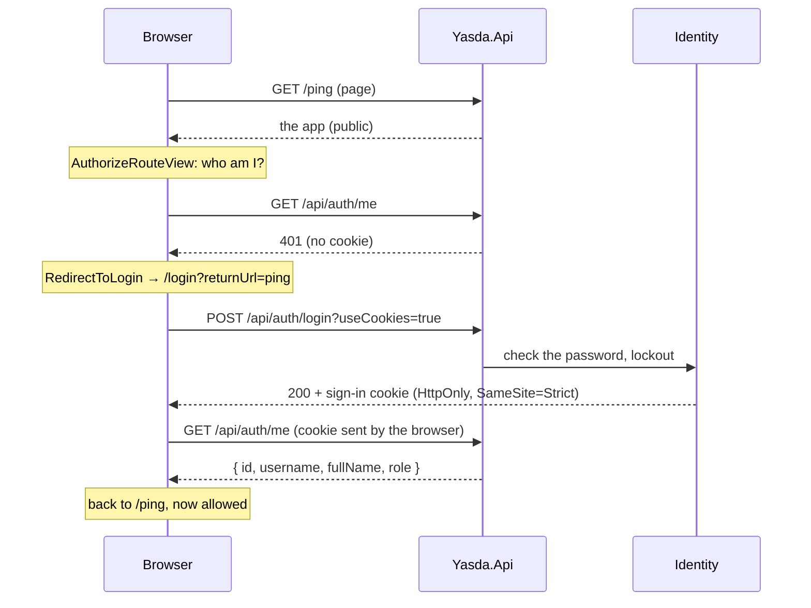

# Lesson 06 — Sign-in: ASP.NET Core Identity

Good day, developer! Until today, anyone who reaches the app can do anything. Today we put a door on it. We add
the Identity module, which owns the accounts, the five roles and the sign-in; we write the sign-in page; and we
make every page and every API address ask "who are you?" first. We also write our first **browser tests**, which
open a real browser and sign in like a person would. It takes about three hours. Are you ready? Let's begin!

## What we'll build

| Piece | What it is |
|---|---|
| **The Identity module** | A second module, `Yasda.Modules.Identity`: accounts, roles, sign-in and sign-out |
| **Five roles** | `Admin`, `TeamLead`, `Agent`, `KbEditor`, `Requester`, defined once and stored in the database |
| **Development users** | One account per role, created the way real ones will be |
| **`ICurrentUser`** | How any handler asks "who is calling?" without touching HTTP |
| **The sign-in page** | With a Show button on the password, a "back to where you were" link, and sign-out |
| **Route guards** | Every page needs a signed-in user unless it says otherwise |
| **Tests** | The doors, tested over HTTP, and the first tests that drive a real browser |

## Why we build it this way

### The pain of writing your own

Sign-in looks easy: look up the email, compare the password, remember that you did. Then the details arrive.
Passwords must be stored so that a stolen database doesn't reveal them: **hashed** with a slow, salted
algorithm, never encrypted and never plain. Someone will try a thousand passwords on one account, so you need
**lockout**. A cookie must not be forgeable, must expire, and must stop working when an administrator disables
the account. Each of these has a famous way to get it wrong, and the mistakes are invisible until someone
exploits them.

So the rule for this course is: **authentication comes from a library, never from our own code.** We don't write
password hashing, token handling or cookie signing.

### Which library

**ASP.NET Core Identity** ships with .NET, is free and MIT-licensed, and covers exactly this: users, roles,
password hashing, lockout, cookies, and ready-made sign-in endpoints (`MapIdentityApi`). It stores its data
through EF Core, so it lives in PostgreSQL next to everything else, in the schema of the module that owns it:
`identity`. If a day comes when you need single sign-on with an outside provider, the answer is another
*library* (OpenIddict), still not our own code.

### Cookies, not keys

A browser app can't keep a secret: anything shipped to the browser is public. So the app doesn't carry an API
key or a token it has to hide. After you sign in, the server sets a **cookie** marked `HttpOnly` (the page's own
code can't read it) and `SameSite=Strict` (the browser won't send it from another site). The browser attaches it
to every call by itself. The app learns who you are by asking the server: `GET /api/auth/me`.

### Who may have an account

Accounts are made by an administrator. `MapIdentityApi` includes a self-service `register` endpoint, and we turn
it off: a service desk where strangers can create accounts isn't a service desk. (Making accounts is lesson 16.
Today, development users are created for us.)

## 1. The Identity module

A new project, an island like Tickets. Registered **before** Tickets, because registration order is also
migration order, and Tickets will soon need to know people.

```bash
dotnet new classlib -n Yasda.Modules.Identity -o src/Modules/Identity/Yasda.Modules.Identity
rm src/Modules/Identity/Yasda.Modules.Identity/Class1.cs
dotnet sln add src/Modules/Identity/Yasda.Modules.Identity
dotnet add src/Modules/Identity/Yasda.Modules.Identity reference src/Shared/Yasda.Shared.BuildingBlocks
dotnet add src/Yasda.Api reference src/Modules/Identity/Yasda.Modules.Identity
```

As with every project, delete the `<PropertyGroup>` the template wrote. Then the module's file:

```xml
<Project Sdk="Microsoft.NET.Sdk">

  <ItemGroup>
    <FrameworkReference Include="Microsoft.AspNetCore.App" />
  </ItemGroup>

  <ItemGroup>
    <InternalsVisibleTo Include="Yasda.Integration.Tests" />
  </ItemGroup>

</Project>
```

The `FrameworkReference` and `InternalsVisibleTo` lines work as in Tickets, and the project reference to
BuildingBlocks is already there from the `dotnet add ... reference` command. The packages come from commands:

```bash
dotnet add src/Modules/Identity/Yasda.Modules.Identity package Microsoft.AspNetCore.Identity.EntityFrameworkCore --version 10.0.14
dotnet add src/Modules/Identity/Yasda.Modules.Identity package Microsoft.AspNetCore.DataProtection.EntityFrameworkCore --version 10.0.14
dotnet add src/Modules/Identity/Yasda.Modules.Identity package Npgsql.EntityFrameworkCore.PostgreSQL --version 10.0.3
dotnet add src/Modules/Identity/Yasda.Modules.Identity package EFCore.NamingConventions --version 10.0.1
dotnet add src/Modules/Identity/Yasda.Modules.Identity package Microsoft.EntityFrameworkCore.Relational --version 10.0.14
dotnet add src/Modules/Identity/Yasda.Modules.Identity package Microsoft.EntityFrameworkCore.Design --version 10.0.14
dotnet add src/Modules/Identity/Yasda.Modules.Identity package FluentValidation.DependencyInjectionExtensions --version 12.1.1
```

| Package | What it's for | License |
|---|---|---|
| `Microsoft.AspNetCore.Identity.EntityFrameworkCore` | Identity's users, roles and sign-in, stored through EF Core | MIT |
| `Microsoft.AspNetCore.DataProtection.EntityFrameworkCore` | Keeps the keys that sign cookies in the database, so sessions survive a restart | MIT |

The other five are the same ones Tickets uses. As in lesson 05, make sure the `Microsoft.EntityFrameworkCore.Design`
line says `PrivateAssets="all"`.

One more change, in the shared project. `Yasda.Shared.Infrastructure` will read the signed-in user
from the HTTP request, so it needs ASP.NET Core's shared framework, as Tickets does. In
`Yasda.Shared.Infrastructure.csproj`:

```xml
<ItemGroup>
  <FrameworkReference Include="Microsoft.AspNetCore.App" />
</ItemGroup>
```

## 2. The roles, and "who is calling?"

Roles are names, and a typo in a name silently breaks a check (`"Agnet"` is just a different string). So they're
defined once, in the shared project that every module may use:

```csharp
// src/Shared/Yasda.Shared.BuildingBlocks/Abstractions/Roles.cs
namespace Yasda.Shared.BuildingBlocks;

// The role names, defined once. A typo in a role string silently breaks an auth check, so nobody types them.
public static class Roles
{
    public const string Admin = "Admin";
    public const string TeamLead = "TeamLead";
    public const string Agent = "Agent";
    public const string KbEditor = "KbEditor";
    public const string Requester = "Requester";

    public static readonly string[] All = [Admin, TeamLead, Agent, KbEditor, Requester];
}
```

Every account has **exactly one** role. Roles in one line each:

| Role | Who |
|---|---|
| `Requester` | Anyone who files tickets and sees only their own |
| `Agent` | Works tickets from the queues |
| `TeamLead` | An agent who also assigns tickets and manages routing |
| `KbEditor` | Reviews and publishes knowledge-base articles |
| `Admin` | Manages accounts and teams, and may do anything an agent can |

Next, how a handler learns who is calling. A handler shouldn't touch `HttpContext`: that would tie it to HTTP and
make it hard to test. So we give it an interface in the shared project:

```csharp
// src/Shared/Yasda.Shared.BuildingBlocks/Abstractions/ICurrentUser.cs
namespace Yasda.Shared.BuildingBlocks;

// Who is making this request. Handlers ask for it; they never touch HTTP.
public interface ICurrentUser
{
    long UserId { get; }
    string Username { get; }
    string Role { get; }
}
```

and the real thing, in the one project that may know about HTTP:

```csharp
// src/Shared/Yasda.Shared.Infrastructure/Security/CurrentUser.cs
using System.Globalization;
using System.Security.Claims;
using Microsoft.AspNetCore.Http;
using Yasda.Shared.BuildingBlocks;

namespace Yasda.Shared.Infrastructure;

public sealed class CurrentUser(IHttpContextAccessor accessor) : ICurrentUser
{
    private ClaimsPrincipal User
    {
        get
        {
            var context = accessor.HttpContext;
            if (context is null) throw new InvalidOperationException("No HTTP context.");
            return context.User;
        }
    }

    public long UserId => long.Parse(User.FindFirstValue(ClaimTypes.NameIdentifier)!, CultureInfo.InvariantCulture);
    public string Username => User.FindFirstValue(ClaimTypes.Name)!;
    public string Role => User.FindFirstValue(ClaimTypes.Role)!;   // every account has exactly one role
}
```

`IHttpContextAccessor` is ASP.NET Core's way to reach the current request from a class that isn't an endpoint. The
signed-in person's facts travel in the cookie as **claims** (an id, a name, a role), and `CurrentUser` reads them.
The host registers both in a moment.

## 3. Users, roles and their tables

```csharp
// src/Modules/Identity/Yasda.Modules.Identity/Infrastructure/AppUser.cs
using Microsoft.AspNetCore.Identity;

namespace Yasda.Modules.Identity.Infrastructure;

// Identity's user, plus the one thing a service desk shows everywhere: a name.
internal sealed class AppUser : IdentityUser<long>
{
    public string FullName { get; set; } = "";
}
```

`IdentityUser<long>` is Identity's user, with a `long` id like our tickets. It already has an email, a password
hash, a lockout end and more. We add one field: the person's name, because a service desk shows names everywhere.

```csharp
// src/Modules/Identity/Yasda.Modules.Identity/Infrastructure/YasdaIdentityDbContext.cs
using Microsoft.AspNetCore.DataProtection.EntityFrameworkCore;
using Microsoft.AspNetCore.Identity;
using Microsoft.AspNetCore.Identity.EntityFrameworkCore;
using Microsoft.EntityFrameworkCore;
using Microsoft.EntityFrameworkCore.Design;
using AppRoles = Yasda.Shared.BuildingBlocks.Roles;   // "Roles" alone is IdentityDbContext.Roles, the table

namespace Yasda.Modules.Identity.Infrastructure;

internal sealed class YasdaIdentityDbContext(DbContextOptions<YasdaIdentityDbContext> options)
    : IdentityDbContext<AppUser, IdentityRole<long>, long>(options), IDataProtectionKeyContext
{
    public const string Schema = "identity";

    // The keys that encrypt sign-in cookies. Stored here so sessions survive restarts.
    public DbSet<DataProtectionKey> DataProtectionKeys => Set<DataProtectionKey>();

    public static DbContextOptionsBuilder Configure(DbContextOptionsBuilder options, string connectionString)
    {
        options.UseNpgsql(connectionString, npgsql => npgsql.MigrationsHistoryTable("__EFMigrationsHistory", Schema));
        options.UseSnakeCaseNamingConvention();
        return options;
    }

    protected override void OnModelCreating(ModelBuilder builder)
    {
        base.OnModelCreating(builder);
        builder.HasDefaultSchema(Schema);

        builder.Entity<AppUser>(e =>
        {
            e.ToTable("users");
            e.Property(x => x.FullName).HasMaxLength(100);
        });
        builder.Entity<IdentityUserClaim<long>>().ToTable("user_claims");
        builder.Entity<IdentityUserLogin<long>>().ToTable("user_logins");
        builder.Entity<IdentityUserToken<long>>().ToTable("user_tokens");
        builder.Entity<IdentityUserRole<long>>().ToTable("user_roles");
        builder.Entity<IdentityRoleClaim<long>>().ToTable("role_claims");
        builder.Entity<IdentityRole<long>>().ToTable("roles").HasData(
            Role(1, AppRoles.Admin), Role(2, AppRoles.TeamLead), Role(3, AppRoles.Agent),
            Role(4, AppRoles.KbEditor), Role(5, AppRoles.Requester));
        builder.Entity<DataProtectionKey>().ToTable("data_protection_keys");
    }

    // Fixed stamps: seed data must be identical on every build, or each migration would "change" the roles.
    private static IdentityRole<long> Role(long id, string name)
    {
        return new IdentityRole<long>
        {
            Id = id,
            Name = name,
            NormalizedName = name.ToUpperInvariant(),
            ConcurrencyStamp = $"role-{id}"
        };
    }
}

// For `dotnet ef migrations add`; never connects.
internal sealed class YasdaIdentityDbContextFactory : IDesignTimeDbContextFactory<YasdaIdentityDbContext>
{
    public YasdaIdentityDbContext CreateDbContext(string[] args)
    {
        var options = new DbContextOptionsBuilder<YasdaIdentityDbContext>();
        YasdaIdentityDbContext.Configure(options, "Host=localhost;Database=yasda_design_time");
        return new YasdaIdentityDbContext(options.Options);
    }
}
```

Let's walk through it:

- **`IdentityDbContext<AppUser, IdentityRole<long>, long>`** is Identity's own `DbContext`: it brings the tables for
  users, roles, claims and logins.
- **`ToTable("users")`** and the lines like it rename Identity's default tables (`AspNetUsers`) to `snake_case`,
  all inside the `identity` schema.
- **`HasData(...)`** puts the five roles into the database as part of a migration. A role is data every
  installation needs, not a sample. The stamps are fixed text on purpose: if they were random, each new migration
  would think the roles had changed.
- **`DataProtectionKeys`** is where the keys that sign cookies are kept. In a database they survive a restart, and
  every copy of the app shares them.
- **`AppRoles`** is an alias, because inside this class the plain name `Roles` already means Identity's table.

## 4. Development users

```csharp
// src/Modules/Identity/Yasda.Modules.Identity/Infrastructure/IdentityDatabase.cs
using Microsoft.AspNetCore.Identity;
using Microsoft.EntityFrameworkCore;
using Yasda.Shared.BuildingBlocks;

namespace Yasda.Modules.Identity.Infrastructure;

internal sealed class IdentityDatabase(YasdaIdentityDbContext db, UserManager<AppUser> users) : IModuleDatabase
{
    // Public on purpose: it only exists in development, and the tests and the lessons sign in with it.
    public const string DevPassword = "Password123!";

    public string Module => "Identity";

    public async Task MigrateAsync(CancellationToken ct)
    {
        await db.Database.MigrateAsync(ct);
    }

    // Through UserManager rather than SQL, so passwords are hashed exactly as in real use.
    public async Task SeedDevelopmentDataAsync(CancellationToken ct)
    {
        (string Email, string Name, string Role)[] devUsers =
        [
            ("admin@yasda.local", "Ada Mendoza", Roles.Admin),
            ("lead@yasda.local", "Lea Torres", Roles.TeamLead),
            ("agent@yasda.local", "Alan Reyes", Roles.Agent),
            ("editor@yasda.local", "Kira Santos", Roles.KbEditor),
            ("requester@yasda.local", "Rita Cruz", Roles.Requester),
        ];

        foreach (var (email, name, role) in devUsers)
        {
            var existing = await users.FindByEmailAsync(email);
            if (existing is not null) continue;

            var user = new AppUser { UserName = email, Email = email, EmailConfirmed = true, FullName = name };
            ThrowIfFailed(await users.CreateAsync(user, DevPassword));
            ThrowIfFailed(await users.AddToRoleAsync(user, role));
        }
    }

    private static void ThrowIfFailed(IdentityResult result)
    {
        if (result.Succeeded) return;
        var problems = result.Errors.Select(e => e.Description);
        throw new InvalidOperationException(string.Join("; ", problems));
    }
}
```

It implements the same `IModuleDatabase` as Tickets. It creates one user per role through `UserManager`, not with
SQL, so the password is hashed exactly as in real life. The password, `Password123!`, is a development password
and public on purpose: this method only runs in Development and tests.

One thing to watch out for: the password policy we set next demands 12 characters, and that's the whole policy.
`Password123!` has 12. A shorter one would make `CreateAsync` fail, and the seed would throw.

## 5. Plug Identity in

```csharp
// src/Modules/Identity/Yasda.Modules.Identity/IdentityModule.cs
using FluentValidation;
using Microsoft.AspNetCore.Builder;
using Microsoft.AspNetCore.DataProtection;
using Microsoft.AspNetCore.Http;
using Microsoft.AspNetCore.Identity;
using Microsoft.AspNetCore.Routing;
using Microsoft.EntityFrameworkCore;
using Microsoft.Extensions.Configuration;
using Microsoft.Extensions.DependencyInjection;
using Yasda.Modules.Identity.Features;
using Yasda.Modules.Identity.Infrastructure;
using Yasda.Shared.BuildingBlocks;

namespace Yasda.Modules.Identity;

// Sign-in is ASP.NET Core Identity: password hashing, lockout, cookies for the browser. This module only configures
// it and adds what it lacks.
public static class IdentityModule
{
    public static IServiceCollection AddIdentityModule(this IServiceCollection services)
    {
        services.AddDbContext<YasdaIdentityDbContext>((provider, options) =>
        {
            var configuration = provider.GetRequiredService<IConfiguration>();
            YasdaIdentityDbContext.Configure(options, configuration.GetConnectionString("YasdaDb")!);
        });
        services.AddScoped<IModuleDatabase, IdentityDatabase>();

        services.AddIdentityApiEndpoints<AppUser>(options =>
            {
                options.User.RequireUniqueEmail = true;
                // Length beats composition rules (NIST SP 800-63B).
                options.Password.RequiredLength = 12;
                options.Password.RequireDigit = false;
                options.Password.RequireLowercase = false;
                options.Password.RequireUppercase = false;
                options.Password.RequireNonAlphanumeric = false;
                options.Lockout.MaxFailedAccessAttempts = 5;
                options.Lockout.DefaultLockoutTimeSpan = TimeSpan.FromMinutes(15);
            })
            .AddRoles<IdentityRole<long>>()
            .AddEntityFrameworkStores<YasdaIdentityDbContext>();

        services.ConfigureApplicationCookie(options =>
        {
            options.Cookie.SameSite = SameSiteMode.Strict;
            options.ExpireTimeSpan = TimeSpan.FromHours(8);
            options.SlidingExpiration = true;
            // An API answers 401/403; it never redirects to a login page.
            options.Events.OnRedirectToLogin = context =>
            {
                context.Response.StatusCode = StatusCodes.Status401Unauthorized;
                return Task.CompletedTask;
            };
            options.Events.OnRedirectToAccessDenied = context =>
            {
                context.Response.StatusCode = StatusCodes.Status403Forbidden;
                return Task.CompletedTask;
            };
        });

        services.AddDataProtection()
            .SetApplicationName("Yasda")
            .PersistKeysToDbContext<YasdaIdentityDbContext>();

        services.AddValidatorsFromAssembly(typeof(IdentityModule).Assembly, includeInternalTypes: true);
        services.AddScoped<GetCurrentUserHandler>();
        services.AddScoped<SignOutHandler>();
        return services;
    }

    // /auth/login, /auth/refresh, ... and our own /auth/me and /auth/logout.
    public static IEndpointRouteBuilder MapIdentityModule(this IEndpointRouteBuilder app)
    {
        app.MapGroup("/auth")
            .MapIdentityApi<AppUser>()
            .AddEndpointFilter(async (context, next) =>
            {
                // Accounts are created by an administrator, never by self sign-up.
                var path = context.HttpContext.Request.Path.Value ?? "";
                if (path.EndsWith("/auth/register", StringComparison.OrdinalIgnoreCase))
                    return TypedResults.NotFound();
                return await next(context);
            });

        var identity = app.MapGroup("").WithTags("Identity");
        GetCurrentUserEndpoint.Map(identity);
        SignOutEndpoint.Map(identity);
        return app;
    }
}
```

Every part of this is one decision:

| Part | What it does and why |
|---|---|
| `AddIdentityApiEndpoints<AppUser>` | Registers Identity and the endpoints `login`, `refresh`, `forgotPassword` and others under `/api/auth` |
| `RequiredLength = 12`, no composition rules | Length beats "one capital and one digit" (NIST's own advice): a long phrase is stronger and easier to remember |
| `MaxFailedAccessAttempts = 5`, 15 minutes | **Lockout**: five wrong passwords lock the account for 15 minutes, even for the right one afterwards |
| `ConfigureApplicationCookie` | `SameSite=Strict`, an 8-hour sliding expiry, and, importantly, **401 and 403 instead of redirects**: an API answers with a status, it never sends a browser to a login page |
| `AddDataProtection().PersistKeysToDbContext` | Keys in PostgreSQL, as above |
| The `/auth/register` filter | Answers 404 for the sign-up endpoint: accounts are made by an administrator |

Now, let's be honest about the cost here: `AddIdentityApiEndpoints` is a lot of behavior from one call, and we
rely on it. That's the point of using a library, and the price is that we read its documentation instead of our
own code. Two small endpoints it doesn't give us, we write ourselves, in our usual two files each:

```csharp
// src/Modules/Identity/Yasda.Modules.Identity/Features/Me/GetCurrentUserHandler.cs
using System.Globalization;
using Microsoft.AspNetCore.Identity;
using Yasda.Modules.Identity.Infrastructure;
using Yasda.Shared.BuildingBlocks;

namespace Yasda.Modules.Identity.Features;

internal sealed record CurrentUserDto(long Id, string Username, string FullName, string Role);

internal sealed class GetCurrentUserHandler(ICurrentUser current, UserManager<AppUser> users)
{
    public async Task<CurrentUserDto> HandleAsync(CancellationToken ct)
    {
        var user = await users.FindByIdAsync(current.UserId.ToString(CultureInfo.InvariantCulture));
        if (user is null) throw new InvalidOperationException("The signed-in user no longer exists.");
        return new CurrentUserDto(user.Id, user.UserName!, user.FullName, current.Role);
    }
}
```

```csharp
// src/Modules/Identity/Yasda.Modules.Identity/Features/Me/GetCurrentUserEndpoint.cs
using Microsoft.AspNetCore.Builder;
using Microsoft.AspNetCore.Http;
using Microsoft.AspNetCore.Routing;

namespace Yasda.Modules.Identity.Features;

// Identity's own /auth/manage/info has no role; a client needs it to decide what to show.
internal static class GetCurrentUserEndpoint
{
    public static void Map(IEndpointRouteBuilder app)
    {
        app.MapGet("/auth/me", async (GetCurrentUserHandler handler, CancellationToken ct) =>
        {
            var me = await handler.HandleAsync(ct);
            return TypedResults.Ok(me);
        })
        .RequireAuthorization();
    }
}
```

```csharp
// src/Modules/Identity/Yasda.Modules.Identity/Features/SignOut/SignOutHandler.cs
using Microsoft.AspNetCore.Identity;
using Yasda.Modules.Identity.Infrastructure;

namespace Yasda.Modules.Identity.Features;

internal sealed class SignOutHandler(SignInManager<AppUser> signIn)
{
    public async Task HandleAsync(CancellationToken ct)
    {
        await signIn.SignOutAsync();   // clears the browser's sign-in cookie
    }
}
```

```csharp
// src/Modules/Identity/Yasda.Modules.Identity/Features/SignOut/SignOutEndpoint.cs
using Microsoft.AspNetCore.Builder;
using Microsoft.AspNetCore.Http;
using Microsoft.AspNetCore.Http.HttpResults;
using Microsoft.AspNetCore.Routing;

namespace Yasda.Modules.Identity.Features;

internal static class SignOutEndpoint
{
    public static void Map(IEndpointRouteBuilder app)
    {
        app.MapPost("/auth/logout", async Task<NoContent> (SignOutHandler handler, CancellationToken ct) =>
        {
            await handler.HandleAsync(ct);
            return TypedResults.NoContent();
        })
        .RequireAuthorization();
    }
}
```

- **`/auth/me`** exists because Identity's own `/auth/manage/info` has no role in it, and the browser app needs
  the role to decide what to show.
- **`/auth/logout`** exists because Identity's API has no sign-out. `SignOutAsync` clears the cookie.
- **`.RequireAuthorization()`** is the door: with no valid cookie, the endpoint answers 401 before the handler runs.

## 6. Wire it into the host

Three changes to `Program.cs`. Before, the services section:

```csharp
builder.Services.AddSingleton(TimeProvider.System);
builder.Services.AddTicketsModule();
```

After:

```csharp
builder.Services.AddSingleton(TimeProvider.System);
builder.Services.AddHttpContextAccessor();
builder.Services.AddScoped<ICurrentUser, CurrentUser>();

// Registration order is migration and seed order: Identity first.
builder.Services.AddIdentityModule();
builder.Services.AddTicketsModule();
builder.Services.AddAuthorization();
```

Add `using Yasda.Modules.Identity;`, `using Yasda.Shared.BuildingBlocks;` and `using Yasda.Shared.Infrastructure;`
at the top. Then the request pipeline. Before:

```csharp
app.UseRouting();
app.UseAntiforgery();
```

After:

```csharp
app.UseRouting();
app.UseAuthentication();
app.UseAuthorization();
app.UseAntiforgery();
```

`UseAuthentication` reads the cookie and works out who the caller is; `UseAuthorization` then checks that person
against the endpoint's rules. They must come after `UseRouting` and in this order. And the endpoints. Before:

```csharp
api.MapTicketsEndpoints();
```

After:

```csharp
api.MapIdentityModule();
api.MapTicketsEndpoints();
```

Last, the page server. The browser app's own page (`App.razor`) must stay public, or nobody could even reach the
sign-in page. Before:

```csharp
app.MapRazorComponents<Yasda.Web.App>()
    .AddInteractiveWebAssemblyRenderMode();
```

After:

```csharp
// The pages guard themselves in the browser (AuthorizeRouteView sends a signed-out user to sign in). The server
// only serves the page; every piece of data still comes from the API, which checks the user on each call.
app.MapRazorComponents<Yasda.Web.App>()
    .AddInteractiveWebAssemblyRenderMode()
    .AllowAnonymous();
```

Every call still needs a signed-in user, so Ping gets its door too. In `PingEndpoint.cs`, after the closing of the
lambda, before:

```csharp
        });
```

After:

```csharp
        })
        .RequireAuthorization();
```

Now create Identity's tables. The same command as lesson 05, for the other module:

```bash
dotnet ef migrations add InitialCreate \
  --project src/Modules/Identity/Yasda.Modules.Identity \
  --startup-project src/Yasda.Api \
  --output-dir Infrastructure/Migrations
```

Run the app, and the log now says `Identity schema is up to date` before `Tickets schema is up to date`: the order
you registered them in.

## 7. Sign in through the app

### Who's signed in, according to the API

Add the package that gives the browser app its notion of "signed in":

```bash
dotnet add src/Yasda.Web package Microsoft.AspNetCore.Components.Authorization --version 10.0.14
```

| Package | What it's for | License |
|---|---|---|
| `Microsoft.AspNetCore.Components.Authorization` | `AuthorizeView`, `AuthorizeRouteView` and the authentication state the pages react to | MIT |

```csharp
// src/Yasda.Web/Services/CookieAuthenticationStateProvider.cs
using System.Globalization;
using System.Net.Http.Json;
using System.Security.Claims;
using Microsoft.AspNetCore.Components.Authorization;

namespace Yasda.Web.Services;

public sealed record CurrentUser(long Id, string Username, string FullName, string Role);

// Who is signed in, according to the API. The sign-in cookie is HttpOnly: the browser app never sees it, it only
// asks /api/auth/me. Signing in and out go through Identity's own endpoints.
public sealed class CookieAuthenticationStateProvider(HttpClient http) : AuthenticationStateProvider
{
    private static readonly AuthenticationState SignedOut = new(new ClaimsPrincipal(new ClaimsIdentity()));
    private CurrentUser? _user;
    private bool _loaded;

    public override async Task<AuthenticationState> GetAuthenticationStateAsync()
    {
        if (!_loaded)
        {
            var response = await http.GetAsync("api/auth/me");
            if (response.IsSuccessStatusCode)
                _user = await response.Content.ReadFromJsonAsync<CurrentUser>();
            else
                _user = null;
            _loaded = true;
        }

        if (_user is null) return SignedOut;
        return new AuthenticationState(PrincipalOf(_user));
    }

    // null = signed in; otherwise the reason, in words a person can act on.
    public async Task<string?> SignInAsync(string email, string password)
    {
        var response = await http.PostAsJsonAsync("api/auth/login?useCookies=true", new { email, password });
        if (!response.IsSuccessStatusCode)
        {
            var body = await response.Content.ReadAsStringAsync();
            if (body.Contains("LockedOut", StringComparison.Ordinal))
                return "This account is locked for 15 minutes after too many wrong passwords.";
            return "Wrong email or password.";
        }

        Refresh();
        return null;
    }

    public async Task SignOutAsync()
    {
        await http.PostAsync("api/auth/logout", null);
        Refresh();
    }

    // Forget what we knew and ask the API again (after sign-in or sign-out).
    public void Refresh()
    {
        _loaded = false;
        NotifyAuthenticationStateChanged(GetAuthenticationStateAsync());
    }

    private static ClaimsPrincipal PrincipalOf(CurrentUser user)
    {
        var claims = new List<Claim>
        {
            new(ClaimTypes.NameIdentifier, user.Id.ToString(CultureInfo.InvariantCulture)),
            new(ClaimTypes.Name, user.FullName),
            new(ClaimTypes.Email, user.Username),
            new(ClaimTypes.Role, user.Role),
        };
        var identity = new ClaimsIdentity(claims, authenticationType: "cookie", ClaimTypes.Name, ClaimTypes.Role);
        return new ClaimsPrincipal(identity);
    }
}
```

This class is the browser app's one source of truth for "who am I?".

- **`GetAuthenticationStateAsync`** asks `/api/auth/me` once, remembers the answer, and turns it into a
  `ClaimsPrincipal` that Blazor's own `AuthorizeView` and `[Authorize]` understand.
- **`SignInAsync`** posts to Identity's `login` endpoint with `useCookies=true`, so the answer sets the cookie. It
  returns `null` when it worked, otherwise a sentence a person can act on. It never says whether the email or the
  password was wrong: that would tell an attacker which emails have accounts.
- **`Refresh`** forgets what we knew, so the next question goes to the server again.

Register it, and the authorization pieces, in `Yasda.Web/Program.cs`. Replace the file with:

```csharp
// src/Yasda.Web/Program.cs
using Microsoft.AspNetCore.Components.Authorization;
using Microsoft.AspNetCore.Components.WebAssembly.Hosting;
using Yasda.Web.Services;

// The browser half of the app. The server sends the page (App.razor); what runs here is Routes and everything below.
var builder = WebAssemblyHostBuilder.CreateDefault(args);

// Same origin as the API, so the browser sends the sign-in cookie with every call on its own.
builder.Services.AddScoped(_ => new HttpClient { BaseAddress = new Uri(builder.HostEnvironment.BaseAddress) });

builder.Services.AddAuthorizationCore();
builder.Services.AddCascadingAuthenticationState();
builder.Services.AddScoped<CookieAuthenticationStateProvider>();
builder.Services.AddScoped<AuthenticationStateProvider>(provider => provider.GetRequiredService<CookieAuthenticationStateProvider>());

await builder.Build().RunAsync();
```

### Every page needs a signed-in user

In `_Imports.razor`, add the authorization namespaces and, after the `@using` lines, one attribute. Replace the
file with:

```razor
@* src/Yasda.Web/_Imports.razor *@
@using System.Net.Http
@using System.Net.Http.Json
@using Microsoft.AspNetCore.Authorization
@using Microsoft.AspNetCore.Components.Authorization
@using Microsoft.AspNetCore.Components.Forms
@using Microsoft.AspNetCore.Components.Routing
@using Microsoft.AspNetCore.Components.Web
@using Microsoft.AspNetCore.Components.WebAssembly.Http
@using Microsoft.JSInterop
@using Yasda.Web
@using Yasda.Web.Layout
@using Yasda.Web.Services
@using Yasda.Web.Shared
@attribute [Authorize]
```

`@attribute [Authorize]` in `_Imports.razor` applies to every page in the project: **every page needs a signed-in
user, unless it says `[AllowAnonymous]`.** That's the safe default: a new page you forget to think about is
protected. (`@using Yasda.Web.Shared` is back, because today we add that folder.)

The router turns the attribute into behavior:

```razor
@* src/Yasda.Web/Routes.razor *@
@attribute [AllowAnonymous]
@* Every page needs a signed-in user (the [Authorize] in _Imports), unless it says [AllowAnonymous]. *@
<Router AppAssembly="typeof(Routes).Assembly" NotFoundPage="typeof(Pages.NotFound)">
    <Found Context="routeData">
        <AuthorizeRouteView RouteData="routeData" DefaultLayout="typeof(MainLayout)">
            <NotAuthorized>
                @if (context.User.Identity?.IsAuthenticated == true)
                {
                    <h1>No access</h1>
                    <p class="status-line error" role="alert">Error: You don't have access to this page. <a href="">Go home</a></p>
                }
                else
                {
                    <RedirectToLogin />
                }
            </NotAuthorized>
            <Authorizing>
                <p role="status">Loading…</p>
            </Authorizing>
        </AuthorizeRouteView>
        <FocusOnNavigate RouteData="routeData" Selector="h1" />
    </Found>
</Router>
```

- **`AuthorizeRouteView`** replaces `RouteView`. It checks the page's rules before showing it.
- **`NotAuthorized`** has two cases: a signed-in person told "no" sees a short message, and a signed-out visitor is
  sent to sign in.
- **`Authorizing`** is what shows for the instant while we ask the server who you are.

`Routes.razor` and `App.razor` themselves must be public, or the router could never start. Add
`@attribute [AllowAnonymous]` to the second line of `App.razor` (after its path comment):

```razor
@attribute [AllowAnonymous]
```

and `NotFound.razor`, and the helper that sends visitors to sign in:

```razor
@* src/Yasda.Web/Shared/RedirectToLogin.razor *@
@attribute [AllowAnonymous]
@inject NavigationManager Nav

@code {
    // Sends a signed-out visitor to the sign-in page, remembering where they were going.
    protected override void OnInitialized()
    {
        var back = Nav.ToBaseRelativePath(Nav.Uri);
        if (string.IsNullOrEmpty(back))
            Nav.NavigateTo("login");
        else
            Nav.NavigateTo($"login?returnUrl={Uri.EscapeDataString(back)}");
    }
}
```

```razor
@* src/Yasda.Web/Pages/NotFound.razor *@
@page "/not-found"
@attribute [AllowAnonymous]

<PageTitle>Not found · YASDA</PageTitle>

<h1>Not found</h1>
<p>There's nothing at this address. <a href="">Go home</a></p>
```

`RedirectToLogin` remembers where the visitor was going (`returnUrl`), so after sign-in they land there.

### The sign-in page

```razor
@* src/Yasda.Web/Shared/PasswordField.razor *@
@* A password field with a Show button: people can check what they typed, because typos in a hidden field are the
   commonest reason a sign-in fails. Whether the text shows is this component's own state. *@
<div class="field">
    <label for="@_id">@Label</label>
    <input id="@_id" type="@(_shown ? "text" : "password")" value="@Value" required="@Required"
           autocomplete="@Autocomplete"
           @oninput="e => ValueChanged.InvokeAsync(e.Value?.ToString())" />
    <button type="button" aria-label="@($"{(_shown ? "Hide" : "Show")} {Label.ToLowerInvariant()}")"
            @onclick="() => _shown = !_shown">@(_shown ? "Hide" : "Show")</button>
</div>

@code {
    private readonly string _id = $"pw-{Guid.NewGuid():N}";
    private bool _shown;

    [Parameter] public string? Value { get; set; }
    [Parameter] public EventCallback<string?> ValueChanged { get; set; }
    [Parameter, EditorRequired] public string Label { get; set; } = "";
    [Parameter] public bool Required { get; set; }
    [Parameter] public string Autocomplete { get; set; } = "current-password";
}
```

A password field with a Show button, as its own component. Typos in a hidden field are the commonest reason a
sign-in fails, so people may check what they typed. The button's accessible name says *which* field it shows
("Show password"), so a screen reader and a test can find it.

```razor
@* src/Yasda.Web/Pages/Login.razor *@
@page "/login"
@attribute [AllowAnonymous]
@inject CookieAuthenticationStateProvider Auth
@inject NavigationManager Nav

<PageTitle>Sign in · YASDA</PageTitle>

<h1>Sign in</h1>
<p class="muted">Use the email and password your administrator gave you.</p>

@if (_error is not null)
{
    <p class="status-line error" role="alert">Error: @_error</p>
}

<EditForm Model="this" OnSubmit="SignIn">
    <div class="field">
        <label for="email">Email</label>
        <InputText id="email" type="email" @bind-Value="_email" required autocomplete="username" />
    </div>
    <PasswordField @bind-Value="_password" Label="Password" Required="true" />
    <div class="actions">
        <button type="submit" disabled="@_busy">Sign in</button>
    </div>
</EditForm>

@code {
    [SupplyParameterFromQuery] public string? ReturnUrl { get; set; }

    private string _email = "";
    private string? _password = "";
    private string? _error;
    private bool _busy;

    private async Task SignIn()
    {
        _busy = true;
        _error = await Auth.SignInAsync(_email.Trim(), _password ?? "");
        _busy = false;
        if (_error is not null) return;

        // Only ever go back inside this app: an outside returnUrl would make this page an open redirect.
        var stayInsideTheApp = ReturnUrl is not null && !ReturnUrl.Contains("//") && !ReturnUrl.Contains(':');
        if (stayInsideTheApp)
            Nav.NavigateTo(ReturnUrl!);
        else
            Nav.NavigateTo("");
    }
}
```

Three things to see:

- **`[AllowAnonymous]`** is what lets a signed-out person reach this page at all.
- **`stayInsideTheApp`** accepts a `returnUrl` only if it points inside this app. Without that check, a link
  like `/login?returnUrl=https://evil.example` would send a freshly signed-in person to another site: an **open
  redirect**.
- **The error is one sentence in one place**, `role="alert"`, so it's announced to screen readers and found by tests.

Add the button style the layout uses for "Sign out", at the end of `app.css`. It's a button that reads as a link,
so a row of links stays a row of words:

```css
/* A button that reads as a link (sign out), so a row of links stays a row of words. */
button.link {
    border: 0;
    padding: 0;
    color: var(--link);
    text-decoration: underline;
}
```

### The shell for signed-in people

The navigation is only for people who are signed in. The layout wraps it in `AuthorizeView`, which shows its
content only to an authorized visitor:

```razor
@* src/Yasda.Web/Layout/MainLayout.razor *@
@inherits LayoutComponentBase

@* DESIGN.md's shell: one header line (logo and name, then the navigation), a rule, then the page. The navigation
   is for signed-in people only. *@
<div class="page">
    <header class="site-head">
        <p class="brand"> YASDA</p>
        <AuthorizeView>
            <NavMenu />
        </AuthorizeView>
    </header>
    <hr />
    <main>
        @Body
    </main>
</div>
```

```razor
@* src/Yasda.Web/Layout/NavMenu.razor *@
@inject CookieAuthenticationStateProvider Auth
@inject NavigationManager Nav

<nav aria-label="Main">
    <ul class="links">
        <li><NavItem Href="">Home</NavItem></li>
        <li><NavItem Href="ping">Ping</NavItem></li>
        <li><button type="button" class="link" @onclick="SignOut">Sign out</button></li>
    </ul>
</nav>

@code {
    private async Task SignOut()
    {
        await Auth.SignOutAsync();
        Nav.NavigateTo("login");
    }
}
```

and Home greets by name, from the claims:

```razor
@* src/Yasda.Web/Pages/Home.razor *@
@page "/"

<PageTitle>Home · YASDA</PageTitle>

<AuthorizeView>
    <h1>Good day, @context.User.Identity?.Name!</h1>
    <p class="muted">You're signed in as @context.User.FindFirst(System.Security.Claims.ClaimTypes.Role)?.Value.</p>
</AuthorizeView>
```

Run the app: `dotnet run --project src/Yasda.Api`. Open the address. You land on the sign-in page, without the
navigation. Sign in as `agent@yasda.local` with `Password123!`, and Home says "Good day, Alan Reyes!" Type `/ping`
after the address while signed out in a private window: you're sent to sign in first, then back to Ping.

## 8. Prove it: who gets in, and who doesn't

### Signed-in test clients

The integration tests from before call `/api/ping` without signing in. Now they'd get a 401. We need a client that
has signed in, and each test needs its own.

There are two ways to stay signed in, and we use both. A **browser** keeps a cookie (`useCookies=true`). A
**program**, such as a test, signs in without that option and gets back two **tokens** in the answer: an access
token to send as `Authorization: Bearer ...` with every call, and a refresh token to get a new access token when
it expires, 15 minutes later. Both come from the same Identity endpoint. Tests use tokens, because a header is
easier to carry than a cookie jar. Add four things to `CustomWebAppFactory`, before `OpenDatabase`:

```csharp
    public sealed record Tokens(string AccessToken, string RefreshToken);

    public static async Task<Tokens> LoginAsync(HttpClient client, string email, string password = Password)
    {
        var response = await client.PostAsJsonAsync("/api/auth/login", new { email, password });
        response.EnsureSuccessStatusCode();
        return (await response.Content.ReadFromJsonAsync<Tokens>())!;
    }

    // A client that has signed in as someone and sends their bearer token with every call. Without
    // useCookies, Identity's login answers with tokens instead of a cookie: the way a program signs in.
    public async Task<HttpClient> ClientFor(string email)
    {
        var client = CreateClient();
        var tokens = await LoginAsync(client, email);
        client.DefaultRequestHeaders.Authorization = new AuthenticationHeaderValue("Bearer", tokens.AccessToken);
        return client;
    }

    // A throwaway account, for tests that lock someone out or need a person nobody else uses.
    public async Task<string> CreateUserAsync(string role)
    {
        await using var scope = Services.CreateAsyncScope();
        var users = scope.ServiceProvider.GetRequiredService<UserManager<AppUser>>();
        var email = $"user-{Guid.NewGuid():N}@yasda.local";
        var user = new AppUser { UserName = email, Email = email, EmailConfirmed = true, FullName = "Test User" };
        var created = await users.CreateAsync(user, Password);
        if (!created.Succeeded) throw new InvalidOperationException(string.Join(" ", created.Errors.Select(e => e.Description)));
        await users.AddToRoleAsync(user, role);
        return email;
    }
```

and the usings and the constant they need. The usings go at the top of the file:

```csharp
using System.Net.Http.Headers;
using System.Net.Http.Json;
using Microsoft.AspNetCore.Identity;
using Microsoft.Extensions.DependencyInjection;
using Yasda.Modules.Identity.Infrastructure;
```

and the constant goes in the class, above `ConnectionString`:

```csharp
    // The password every development user has.
    public const string Password = IdentityDatabase.DevPassword;
```

- **`ClientFor("agent@yasda.local")`** returns a client that has signed in as that person. Each call gets its own
  client, so two clients are two people at two computers.
- **`CreateUserAsync`** makes a throwaway account, for tests that would otherwise damage a shared development user
  (the lockout test, below).

In `PingTests`, the two tests change one line each. Before:

```csharp
var client = factory.CreateClient();
```

After:

```csharp
var client = await factory.ClientFor("requester@yasda.local");
```

`WiringTests` and `ModuleBoundaryTests` each have a list of modules. Identity joins both. In `WiringTests`:

```csharp
private static readonly Type[] Modules = [typeof(IdentityModule), typeof(TicketsModule)];
```

and in `ModuleBoundaryTests`:

```csharp
private static readonly Assembly[] Modules = [typeof(IdentityModule).Assembly, typeof(TicketsModule).Assembly];
```

with `using Yasda.Modules.Identity;` in both. And `DatabaseTests` needs no change at all: it asks the app which
modules registered a database, so it checks Identity's schema too.

### The doors, tested

```csharp
// tests/Yasda.Integration.Tests/AuthTests.cs
using System.Net;
using System.Net.Http.Json;
using AwesomeAssertions;
using Yasda.Shared.BuildingBlocks;

namespace Yasda.Integration.Tests;

// Who gets in, and who doesn't.
[Collection("Integration")]
public class AuthTests(CustomWebAppFactory factory)
{
    private sealed record Me(long Id, string Username, string FullName, string Role);

    [Fact]
    public async Task Wrong_password_is_401()
    {
        var response = await factory.CreateClient().PostAsJsonAsync("/api/auth/login",
            new { email = "agent@yasda.local", password = "not-the-password" });

        response.StatusCode.Should().Be(HttpStatusCode.Unauthorized);
    }

    [Fact]
    public async Task Me_returns_the_signed_in_user_and_role()
    {
        var client = await factory.ClientFor("agent@yasda.local");

        var me = await client.GetFromJsonAsync<Me>("/api/auth/me");

        me!.Username.Should().Be("agent@yasda.local");
        me.FullName.Should().Be("Alan Reyes");
        me.Role.Should().Be(Roles.Agent);
    }

    [Theory]
    [InlineData("admin@yasda.local", Roles.Admin)]
    [InlineData("lead@yasda.local", Roles.TeamLead)]
    [InlineData("agent@yasda.local", Roles.Agent)]
    [InlineData("editor@yasda.local", Roles.KbEditor)]
    [InlineData("requester@yasda.local", Roles.Requester)]
    public async Task Each_development_user_has_the_role_their_address_says(string email, string role)
    {
        var client = await factory.ClientFor(email);

        var me = await client.GetFromJsonAsync<Me>("/api/auth/me");

        me!.Role.Should().Be(role);
    }

    // Accounts are made by an administrator. The sign-up endpoint Identity ships with must not exist.
    [Fact]
    public async Task Self_registration_is_disabled()
    {
        var response = await factory.CreateClient().PostAsJsonAsync("/api/auth/register",
            new { email = "intruder@example.com", password = "LongEnoughPassword1" });

        response.StatusCode.Should().Be(HttpStatusCode.NotFound);
    }

    [Fact]
    public async Task Five_wrong_passwords_lock_the_account()
    {
        var email = await factory.CreateUserAsync(Roles.Agent);
        var client = factory.CreateClient();
        for (var attempt = 0; attempt < 5; attempt++)
            await client.PostAsJsonAsync("/api/auth/login", new { email, password = "wrong-password!" });

        var withRightPassword = await client.PostAsJsonAsync("/api/auth/login",
            new { email, password = CustomWebAppFactory.Password });

        withRightPassword.StatusCode.Should().Be(HttpStatusCode.Unauthorized);
    }

    // The browser app gets a 401 to react to, never a redirect to a login page the API doesn't have.
    [Theory]
    [InlineData("/api/auth/me")]
    [InlineData("/api/ping?message=hi")]
    public async Task Calling_the_api_without_signing_in_is_401_not_a_redirect(string path)
    {
        var client = factory.CreateClient(new() { AllowAutoRedirect = false });

        var response = await client.GetAsync(path);

        response.StatusCode.Should().Be(HttpStatusCode.Unauthorized);
    }

    [Fact]
    public async Task The_browser_signs_in_with_a_cookie()
    {
        var client = factory.CreateClient();   // keeps cookies, like a browser
        var login = await client.PostAsJsonAsync("/api/auth/login?useCookies=true",
            new { email = "agent@yasda.local", password = CustomWebAppFactory.Password });
        login.StatusCode.Should().Be(HttpStatusCode.OK);

        var me = await client.GetAsync("/api/auth/me");

        me.StatusCode.Should().Be(HttpStatusCode.OK);
    }
}
```

- **`Calling_the_api_without_signing_in_is_401_not_a_redirect`** is the door itself, for an Identity address and a
  Tickets address. `AllowAutoRedirect = false` makes sure a redirect would show up as a failure, not be followed.
- **`Each_development_user_has_the_role_their_address_says`** proves the seed and the roles, five rows.
- **`Self_registration_is_disabled`** is a test for something that must *not* exist.
- **`Five_wrong_passwords_lock_the_account`** is lockout. It locks a throwaway account from `CreateUserAsync`: a
  test that locked a shared development user would break every test that signs in as them afterwards.
- **`The_browser_signs_in_with_a_cookie`** is the other way to stay signed in: the cookie jar of a plain client.

Make one fail once. In `IdentityModule`, delete the `/auth/register` filter and run the tests:
`Self_registration_is_disabled` goes red, because the answer is no longer a 404. Put it back. Then remove
`.AllowAnonymous()` from `MapRazorComponents` in `Program.cs`: `HostTests.The_home_page_is_the_app` answers 401
instead of 200. That one is a good reminder of why the browser app's own page has to be public. Put it back.

### A real browser

The API tests prove the doors. They can't prove that the *page* works: that the sign-in form sends what it
should, that a wrong password shows a message, that the Show button works, that a deep link survives sign-in.
For that, a test has to drive a real browser. We use **Playwright**, Microsoft's browser automation library: free,
Apache-2.0, and it finds things on the page the way a person (or a screen reader) does: by role and name.

A browser test needs a *running* app, since it loads real pages. So these tests run against an address you give
them, and skip themselves if you don't. They use the Edge (Windows) or Chrome (elsewhere) you already have, so
there's nothing extra to download.

```bash
dotnet new classlib -n Yasda.Web.UiTests -o tests/Yasda.Web.UiTests
rm tests/Yasda.Web.UiTests/Class1.cs
dotnet sln add tests/Yasda.Web.UiTests
dotnet add tests/Yasda.Web.UiTests package xunit.v3 --version 4.0.2
dotnet add tests/Yasda.Web.UiTests package Microsoft.Playwright --version 1.64.1
```

| Package | What it's for | License |
|---|---|---|
| `Microsoft.Playwright` | Drives a real browser: open pages, fill fields, click, and wait for what should appear | Apache-2.0 |

As with the other test projects, replace the `.csproj` template's `<PropertyGroup>` with `IsPackable` and
`OutputType` and add `<Using Include="Xunit" />`.

The base class every browser test inherits:

```csharp
// tests/Yasda.Web.UiTests/UiTest.cs
using System.Runtime.CompilerServices;
using Microsoft.Playwright;
using static Microsoft.Playwright.Assertions;

namespace Yasda.Web.UiTests;

// Runs only against a running app with the development seed: set YASDA_UI_URL (for example http://localhost:5264).
// YASDA_UI_BROWSER picks the browser: msedge (the Windows default), chrome (elsewhere), or chromium for the one
// `playwright install chromium` downloads, on a machine with neither.
public sealed class UiFactAttribute : FactAttribute
{
    // xUnit v3 records where each test is written; an attribute built on Fact passes that location on.
    public UiFactAttribute([CallerFilePath] string? sourceFilePath = null, [CallerLineNumber] int sourceLineNumber = -1)
        : base(sourceFilePath, sourceLineNumber)
    {
        if (string.IsNullOrEmpty(Environment.GetEnvironmentVariable("YASDA_UI_URL")))
            Skip = "Set YASDA_UI_URL to a running YASDA to run browser tests.";
    }
}

// What every browser test needs: a browser, one context per person, a sign-in, and a trace when a test fails.
public abstract class UiTest : IAsyncLifetime
{
    protected const string Password = "Password123!";
    protected static readonly string BaseUrl = Environment.GetEnvironmentVariable("YASDA_UI_URL")?.TrimEnd('/') ?? "";
    private readonly List<IBrowserContext> _contexts = [];
    private IPlaywright _playwright = default!;
    private IBrowser _browser = default!;

    public async ValueTask InitializeAsync()
    {
        if (BaseUrl.Length == 0) return;
        // A first visit downloads and starts the whole app in the browser; that can take longer than Expect's
        // 5 seconds. Still a wait for something on screen, just a more patient one.
        SetDefaultExpectTimeout(15_000);
        _playwright = await Playwright.CreateAsync();
        // By default the Edge (or Chrome) already on the machine: nothing to download.
        var channel = Environment.GetEnvironmentVariable("YASDA_UI_BROWSER");
        if (channel is null)
            channel = OperatingSystem.IsWindows() ? "msedge" : "chrome";
        _browser = await _playwright.Chromium.LaunchAsync(new()
        {
            Channel = channel == "chromium" ? null : channel,
            Headless = true
        });
    }

    // A failed test leaves a trace: every step, with the page as it looked, the network and the console.
    // Drop the file on trace.playwright.dev to look through it.
    public async ValueTask DisposeAsync()
    {
        if (BaseUrl.Length == 0) return;
        var failed = TestContext.Current.TestState?.Result == TestResult.Failed;
        for (var i = 0; i < _contexts.Count; i++)
        {
            var path = Path.Combine("playwright-traces", $"{TestContext.Current.Test?.TestDisplayName}-{i + 1}.zip");
            await _contexts[i].Tracing.StopAsync(failed ? new() { Path = path } : null);
            await _contexts[i].CloseAsync();
        }
        await _browser.DisposeAsync();
        _playwright.Dispose();
        GC.SuppressFinalize(this);
    }

    // Each person gets their own browser context: their own cookie, like their own computer. A phone-sized viewport
    // is the narrow case DESIGN.md's single column must handle.
    protected async Task<IPage> NewPage(int width = 1366)
    {
        var context = await _browser.NewContextAsync(new() { BaseURL = BaseUrl, ViewportSize = new() { Width = width, Height = 820 } });
        await context.Tracing.StartAsync(new() { Screenshots = true, Snapshots = true, Sources = true });
        _contexts.Add(context);
        return await context.NewPageAsync();
    }

    protected static async Task FillSignIn(IPage page, string email, string password)
    {
        await page.GetByLabel("Email").FillAsync(email);
        await page.GetByLabel("Password", new() { Exact = true }).FillAsync(password);
        await page.GetByRole(AriaRole.Button, new() { Name = "Sign in" }).ClickAsync();
    }

    // Signed in once Home shows with its own entry in the navigation marked as the current page.
    protected async Task<IPage> SignIn(string email, int width = 1366)
    {
        var page = await NewPage(width);
        await page.GotoAsync("/login");
        await FillSignIn(page, email, Password);
        await Expect(MainNav(page).Locator("[aria-current=page]")).ToHaveTextAsync("Home");
        return page;
    }

    protected static ILocator MainNav(IPage page)
    {
        return page.GetByRole(AriaRole.Navigation, new() { Name = "Main" });
    }
}
```

- **`UiFact`** is a `[Fact]` that skips itself unless `YASDA_UI_URL` is set, so `dotnet test` stays green on a
  machine with no running app.
- **`NewPage`** gives each person their own browser **context**: their own cookies, like their own computer.
- **A failed test leaves a trace**: a zip of every step, with screenshots, the network and the console. Drop it on
  [trace.playwright.dev](https://trace.playwright.dev) to step through what the browser saw.
- **`SignIn`** signs in through the real form, and waits until the navigation shows Home as the current page.

The tests:

```csharp
// tests/Yasda.Web.UiTests/SignInUiTests.cs
using Microsoft.Playwright;
using static Microsoft.Playwright.Assertions;

namespace Yasda.Web.UiTests;

public sealed class SignInUiTests : UiTest
{
    [UiFact]
    public async Task Signing_in_greets_you_by_name()
    {
        var page = await SignIn("agent@yasda.local");

        await Expect(page).ToHaveURLAsync(BaseUrl + "/");
        await Expect(page.GetByRole(AriaRole.Heading, new() { Name = "Good day, Alan Reyes!" })).ToBeVisibleAsync();
    }

    // DESIGN.md §3: the page you're on is bold text in the navigation, not a link to itself.
    [UiFact]
    public async Task The_current_page_is_marked_and_not_a_link()
    {
        var page = await SignIn("agent@yasda.local");
        await MainNav(page).GetByRole(AriaRole.Link, new() { Name = "Ping" }).ClickAsync();

        await Expect(MainNav(page).Locator("[aria-current=page]")).ToHaveTextAsync("Ping");
        await Expect(MainNav(page).GetByRole(AriaRole.Link, new() { Name = "Ping", Exact = true })).ToHaveCountAsync(0);
        await Expect(MainNav(page).GetByRole(AriaRole.Link, new() { Name = "Home" })).ToBeVisibleAsync();
    }

    [UiFact]
    public async Task A_wrong_password_shows_a_message_and_stays_on_the_sign_in_page()
    {
        var page = await NewPage();
        await page.GotoAsync("/login");
        await FillSignIn(page, "agent@yasda.local", "not-the-password");

        await Expect(page.GetByRole(AriaRole.Alert)).ToHaveTextAsync("Error: Wrong email or password.");
        await Expect(page).ToHaveURLAsync(BaseUrl + "/login");
    }

    [UiFact]
    public async Task The_password_can_be_shown_to_check_it()
    {
        var page = await NewPage();
        await page.GotoAsync("/login");
        var password = page.GetByLabel("Password", new() { Exact = true });
        await password.FillAsync("typed-this");

        await Expect(password).ToHaveAttributeAsync("type", "password");
        await page.GetByRole(AriaRole.Button, new() { Name = "Show password" }).ClickAsync();
        await Expect(password).ToHaveAttributeAsync("type", "text");
    }

    // A deep link while signed out goes through sign-in and lands where it pointed.
    [UiFact]
    public async Task A_link_opened_while_signed_out_returns_there_after_sign_in()
    {
        var page = await NewPage();
        await page.GotoAsync("/ping");
        await Expect(page).ToHaveURLAsync(BaseUrl + "/login?returnUrl=ping");

        await FillSignIn(page, "requester@yasda.local", Password);

        await Expect(page.GetByRole(AriaRole.Heading, new() { Name = "Ping" })).ToBeVisibleAsync();
    }

    [UiFact]
    public async Task Signing_out_returns_to_the_sign_in_page()
    {
        var page = await SignIn("agent@yasda.local");

        await page.GetByRole(AriaRole.Button, new() { Name = "Sign out", Exact = true }).ClickAsync();

        await Expect(page.GetByRole(AriaRole.Heading, new() { Name = "Sign in" })).ToBeVisibleAsync();
        await page.GotoAsync("/");
        await Expect(page).ToHaveURLAsync(BaseUrl + "/login");
    }

    // DESIGN.md §3: works at 320px with no sideways page scroll.
    [UiFact]
    public async Task The_page_fits_a_phone_without_sideways_scrolling()
    {
        var page = await NewPage(width: 320);
        await page.GotoAsync("/login");
        await Expect(page.GetByRole(AriaRole.Heading, new() { Name = "Sign in" })).ToBeVisibleAsync();

        var wider = await page.EvaluateAsync<bool>("document.documentElement.scrollWidth > document.documentElement.clientWidth");

        Assert.False(wider, "the page is wider than the phone");
    }
}
```

Five rules keep browser tests from flaking, and the code above follows them:

1. **Find things by role and name** (`GetByRole(AriaRole.Button, new() { Name = "Sign in" })`), like a person or a
   screen reader. If you can't find a control that way, the page has an accessibility bug: fix the page, not the
   test. Never find things by CSS class.
2. **Check with `Expect(...)`**, which retries until the thing appears or time runs out. Never read something once
   and compare.
3. **Never `WaitForTimeout` or "wait for network idle".** Sleeping guesses; `Expect` waits for exactly what you need.
4. **One browser context per person.**
5. **Keep a trace of failures**, because "it failed on the build machine" is useless without a recording.

Run them. Start the app in one terminal, with its own `yasda_test`-style database if you like, then in another:

```bash
YASDA_UI_URL=http://localhost:5264 dotnet test tests/Yasda.Web.UiTests
```

```
Test run summary: Passed!
  total: 7
  failed: 0
  succeeded: 7
  skipped: 0
```

The first run is slow: the browser downloads the whole app. Make one fail once: in `CookieAuthenticationStateProvider`, change
`"Wrong email or password."` to something else and run again. The wrong-password
test goes red, and `playwright-traces` holds a recording of it. Put the sentence back.

### Edge cases covered in this lesson

| Test | The edge | Why it matters |
|---|---|---|
| `Calling_the_api_without_signing_in_is_401_not_a_redirect` | No cookie or token at all | The door, for both modules |
| `Me_returns_the_signed_in_user_and_role` | The token, then `/auth/me` | The browser app relies on exactly this |
| `The_browser_signs_in_with_a_cookie` | The cookie way | What the browser app does |
| `Wrong_password_is_401` | The wrong secret | 401, not 200 |
| `Each_development_user_has_the_role_their_address_says` | Five users | Seed and roles agree |
| `Self_registration_is_disabled` | An endpoint that must not exist | Strangers can't make accounts |
| `Five_wrong_passwords_lock_the_account` | The sixth, correct try | Lockout beats guessing |
| `Signing_in_greets_you_by_name` | The whole trip, in a browser | Form, cookie, `/auth/me` and page agree |
| `The_current_page_is_marked_and_not_a_link` | Where you are | DESIGN.md's navigation rule |
| `A_wrong_password_shows_a_message_and_stays_on_the_sign_in_page` | A failed sign-in, on screen | A person must see why |
| `The_password_can_be_shown_to_check_it` | The Show button | Typos are the commonest failure |
| `A_link_opened_while_signed_out_returns_there_after_sign_in` | A deep link | Sign-in must not lose your place |
| `Signing_out_returns_to_the_sign_in_page` | After the end | Signed out means signed out |
| `The_page_fits_a_phone_without_sideways_scrolling` | 320px wide | DESIGN.md's single column |

## How a request flows



## Mistakes to avoid

- Writing your own password hashing, token or cookie code. Use the library.
- Putting a role name in a string. Use `Roles.Agent`.
- Redirecting an API call to a login page. An API answers 401 or 403.
- Leaving `/auth/register` on. Anyone could then make an account.
- Trusting a `returnUrl` blindly: it's an open redirect.
- Telling the visitor which of the email and password was wrong.
- Forgetting `[AllowAnonymous]` on the page server, the router, the sign-in page or the not-found page: the app
  then asks you to sign in to see the sign-in page.
- A test that locks a shared development user. Make a throwaway one.
- Finding browser-test controls by CSS class, and "fixing" flakiness with `WaitForTimeout`.
- Committing the development password to a production setting. It exists only because the seed only runs in
  Development.

## Let's run it!

```bash
dotnet build
dotnet test
```

The build shows **0 warnings and 0 errors**, and the tests report 74 passed and 7 skipped (the browser tests, with
no app running). Now start the app and run the browser tests too:

```bash
dotnet run --project src/Yasda.Api
```

In a second terminal:

```bash
YASDA_UI_URL=http://localhost:5264 dotnet test tests/Yasda.Web.UiTests
```

Seven passed. Check one thing by hand with `curl`: a signed-out call to a protected address is refused, and a
sign-in gives a cookie that opens it:

```bash
curl -i http://localhost:5264/api/auth/me
# HTTP/1.1 401 Unauthorized

curl -c cookies.txt -X POST "http://localhost:5264/api/auth/login?useCookies=true" \
  -H "Content-Type: application/json" -d '{"email":"agent@yasda.local","password":"Password123!"}'
curl -b cookies.txt http://localhost:5264/api/auth/me
# {"id":3,"username":"agent@yasda.local","fullName":"Alan Reyes","role":"Agent"}
```

Delete `cookies.txt`, and save the moment in Git:

```bash
git add .
git commit -m "Lesson 06: Identity, sign-in, route guards, the first browser tests"
```

## Let's check!

1. Why do we keep a browser app's sign-in in an `HttpOnly` cookie instead of a token in the page's own code?
2. What does lockout protect against, and what does the user experience after the fifth wrong password?
3. Why does the API answer 401 instead of redirecting to the sign-in page?
4. Why is `/auth/register` switched off, and what test proves it?
5. What is an open redirect, and which line of `Login.razor` prevents one?
6. Why does `_Imports.razor` carry `@attribute [Authorize]`? What happens to a new page you forget to think about?
7. Why must `App.razor` and the page server be `AllowAnonymous`?
8. Why does a browser test find a button by its role and name instead of its CSS class, and what does
   `Expect(...)` do that reading a value once doesn't?

And that's where this lesson ends. People can sign in, the pages and the API both ask who they are, and a real
browser has proved it. Next time, we put it all together: the first real feature, filing a ticket, from the
requester's form to the database. Good luck, developer!

---

← [Lesson 05 — The database](05-database.md) · Next: [Lesson 07 — File a ticket](07-file-a-ticket.md) →
