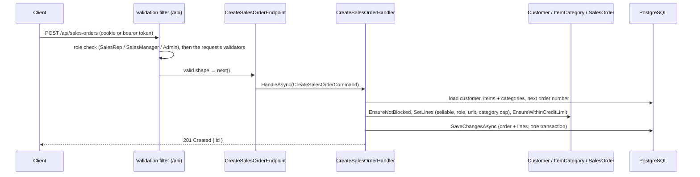

# Lesson 07 — Create an Order: The First Real Feature

Good day, developer! Everything we've built so far has been foundation: walls, features with their
handlers, the rules, a database, sign-in, and an app to put it all in. Today it all meets in one place. A sales rep will send an order, and the system will check
the customer, the items, the categories and the credit limit, then save it with a proper order number. And
when something's wrong, the caller will get a clear answer instead of a crash. About two hours. Are you
ready? Let's begin!

## What we'll build

- `POST /api/sales-orders`: create a draft order, for SalesRep, SalesManager and Admin.
- Order numbers like `SO-2026-000042`, which no two orders can ever share.
- Proper error responses, each with a **code** a person can look up: 422 for a broken business rule, a tidy
  500 for a bug, and a code on every error the framework writes too.
- An **error catalog**: `/api/errors`, and a page in the app that explains every code and how to fix it.
- An **API description** (OpenAPI), and a page in the browser where you can try every endpoint.
- The first screen: a **New sales order** form in the app.

We'll also say goodbye to `/ping`. It did its job.

## Why we build it this way

### A handler with no business `if`s

The handler coordinates; the domain decides. Here's the whole job, in order:

1. Load the customer, and ask the customer whether it may order.
2. Load the items with their categories.
3. Create the order and hand it the lines. `SetLines` from lesson 04 checks every item, role and category
   cap.
4. Ask the customer whether the total fits its credit.
5. Save.

Every "is this allowed?" is a method call on a domain object. If a rule changes, the handler doesn't.

### Errors the caller can understand

Lesson 03 already answers a malformed request properly: a 400 with the field that's wrong. Today the domain
starts saying no, and right now a `DomainException` would come back as a **500 Internal Server Error**, with a
stack trace. That's wrong in two ways. A 500 means "the server broke", when really the caller asked for
something the rules don't allow. And a stack trace tells an attacker far too much.

Every error uses the standard shape from lesson 03, **Problem Details** (RFC 9457), and from today every one
carries the **error code** from lesson 04, so a person can look it up:

| What went wrong | Who answers | HTTP status | Code |
|---|---|---|---|
| The request is malformed (no lines, a negative quantity) | The validation filter (lesson 03) | 400 Bad Request | `ERP-0001` |
| The thing in the address doesn't exist (`/sales-orders/999`) | The endpoint itself, from [lesson 08](08-find-orders.md) | 404 Not Found | `ERP-0002` |
| An id *inside* the request doesn't exist (an unknown customer) | The handler, with a `DomainException` | 422 Unprocessable Content | `SALES-0018` |
| A business rule said no (blocked customer, over the credit limit) | The domain, with a `DomainException` | 422 Unprocessable Content | the rule's own: `SALES-0002` |
| Anything else: a real bug | Any other exception | 500, with no internals shown in production | `ERP-0008` |

Why is an unknown customer a 422 and not a 404? The HTTP standard (RFC 9110) defines 404 as "the address you
asked for doesn't exist". `POST /api/sales-orders` exists; what's wrong is an id inside the request. The
server understood the request but can't carry it out: that's exactly what 422 means. And notice that only
two rows are exceptions: a bad request and a missing order are everyday events, so they're answered without
throwing anything.

## 1. The clock, and a document number

A handler shouldn't call `DateTime.UtcNow` directly, for the same reason the domain doesn't: you can't control
it in a test. So handlers ask for a clock. .NET has one built in since .NET 8, `TimeProvider`: in the app it's
the real clock, and in a test you hand over a `FakeTimeProvider` you can set and move forward yourself.
Register the real one in `AddSharedInfrastructure`:

```csharp
services.AddSingleton(TimeProvider.System);
```

A handler asks for `TimeProvider time` and reads `time.GetUtcNow().UtcDateTime`. Older code often wraps the
clock in its own `IClock` interface; you'd be writing what the framework already ships.

And one for document numbers. Sales orders need them today; purchase orders and invoices will want the same
shape later, so it lives where every module can use it:

```csharp
// src/Shared/Erp.Shared.BuildingBlocks/Domain/DocumentNumber.cs
namespace Erp.Shared.BuildingBlocks;

// SO-2026-000042: a prefix people recognize, the year, and a counter that only goes up.
public static class DocumentNumber
{
    public static string Format(string prefix, long sequenceValue, DateTime nowUtc) =>
        $"{prefix}-{nowUtc:yyyy}-{sequenceValue:D6}";
}
```

## 2. Order numbers no two orders can share

The naive way to number orders is "find the highest number and add one". Picture two reps clicking Save at
the same instant: both read 41, both write 42. A **sequence** fixes that. It's a counter inside PostgreSQL,
and `nextval()` hands each caller a different number, even when a thousand ask at once.

In `SalesDbContext.OnModelCreating`, right after `HasDefaultSchema`:

```csharp
b.HasSequence<long>("sales_order_number_seq");
```

And add a method that takes the next number and formats it:

```csharp
public async Task<string> NextOrderNumberAsync(DateTime nowUtc, CancellationToken ct)
{
    // ToList, not Single(): EF would wrap Single() in a subquery.
    var next = (await Database
        .SqlQuery<long>($"SELECT nextval('sales.sales_order_number_seq') AS \"Value\"")
        .ToListAsync(ct)).Single();
    return DocumentNumber.Format("SO", next, nowUtc);
}
```

`SqlQuery<long>` runs a raw query and reads a single column named `Value`. The database supplies the number;
`DocumentNumber` decides how it looks.

The handler also needs to turn "item 1, quantity 2" from the request into a real `SalesItem` for
`SetLines`. Creating an order needs it, and so will editing one, so it's a method on the context too:

```csharp
// Pairs each requested line with its item. An unknown item is refused with its code; whether it may be sold is the order's call.
public async Task<IReadOnlyList<(SalesItem Item, Quantity Quantity)>> ResolveLinesAsync(
    IEnumerable<(long ItemId, decimal Quantity)> lines, CancellationToken ct)
{
    var requested = lines.ToList();
    var ids = requested.Select(l => new ItemId(l.ItemId)).Distinct().ToList();
    var items = await SalesItems.Include(i => i.Category).Where(i => ids.Contains(i.Id)).ToDictionaryAsync(i => i.Id.Value, ct);
    return requested
        .Select(l => (items.TryGetValue(l.ItemId, out var item) ? item : throw new DomainException(SalesErrors.ItemNotFound, $"Item {l.ItemId} doesn't exist."),
                      new Quantity(l.Quantity)))
        .ToList();
}
```

One query loads every item on the order with its category (`Include`), instead of one trip per line. Notice
what it *doesn't* check: whether the item is for sale, or whether you may sell it. Those are business rules,
and `SetLines` already asks the item and its category.

One more method, for the credit rule. The customer's limit has to cover their orders still awaiting
approval. Nothing can be awaiting approval yet (submitting comes next lesson), but the rule is already in the
domain, so we honor it from the start:

```csharp
// The customer's other submitted orders still waiting for a manager. They already count against credit.
public async Task<Money> PendingTotalAsync(CustomerId customerId, SalesOrderId excluding, CancellationToken ct)
{
    var pending = await SalesOrders.AsNoTracking()
        .Where(o => o.CustomerId == customerId && o.Status == SalesOrderStatus.PendingApproval && o.Id != excluding)
        .ToListAsync(ct);
    return pending.Aggregate(Money.Zero, (sum, o) => sum + o.Total);
}
```

`AsNoTracking()` tells EF we're only reading these orders, so it doesn't need to watch them for changes. The
total is computed in C# by the domain's own `Total`, so it can't disagree with how the domain counts.

Create a migration for the sequence:

```bash
dotnet ef migrations add AddOrderNumberSequence \
  --project src/Modules/Sales/Erp.Modules.Sales --startup-project src/Modules/Sales/Erp.Modules.Sales \
  --output-dir Infrastructure/Migrations
```

## 3. The slice

The ping feature has done its job: delete the `Features/Ping` folder, its `AddScoped<PingHandler>()` and
`PingEndpoint.Map(...)` lines in `SalesModule`, the app's `Pages/Ping.razor`, and its link in `NavMenu.razor`.
Then create `Features/CreateSalesOrder/`.

Two new codes join the end of `SalesErrors`, for an id in the request that doesn't exist:

```csharp
    public static readonly ErrorCode CustomerNotFound = new("SALES-0018", "The customer doesn't exist",
        "Choose a customer from the list. If you just created one, reload the page.");
    public static readonly ErrorCode ItemNotFound = new("SALES-0019", "An item on the order doesn't exist",
        "Choose items from the list. A new catalog item appears in Sales a few seconds after it's created.");
```

Two small helpers first. Many requests will carry quantities and page numbers, so their shape rules are
written once, in BuildingBlocks:

```csharp
// src/Shared/Erp.Shared.BuildingBlocks/Messaging/ValidationRules.cs
using FluentValidation;

namespace Erp.Shared.BuildingBlocks;

// Shape rules that many requests share, written once.
public static class ValidationRules
{
    // Up to three decimal places; whether fractions are allowed at all is the item's business, not the request's.
    public static IRuleBuilderOptions<T, decimal> ValidQuantity<T>(this IRuleBuilder<T, decimal> rule) =>
        rule.GreaterThan(0).Must(q => decimal.Round(q, 3) == q).WithMessage("Quantity allows at most three decimal places.");
}
```

And who may sell, decided once for every Sales endpoint:

```csharp
// src/Modules/Sales/Erp.Modules.Sales/Features/SalesRoles.cs
using Erp.Shared.BuildingBlocks;

namespace Erp.Modules.Sales.Features;

// Who may do what in Sales, decided once for every endpoint.
internal static class SalesRoles
{
    public static readonly string[] Sellers = [Roles.SalesRep, Roles.SalesManager, Roles.Admin];
}
```

Now the slice itself:

```csharp
// src/Modules/Sales/Erp.Modules.Sales/Features/CreateSalesOrder/CreateSalesOrderHandler.cs
using Erp.Modules.Sales.Domain;
using Erp.Modules.Sales.Infrastructure;
using Erp.Shared.BuildingBlocks;
using Microsoft.EntityFrameworkCore;

namespace Erp.Modules.Sales.Features;

internal sealed record OrderLineInput(long ItemId, decimal Quantity);

internal sealed record CreateSalesOrderCommand(long CustomerId, IReadOnlyList<OrderLineInput> Lines);

internal sealed class CreateSalesOrderHandler(SalesDbContext db, ICurrentUser currentUser, TimeProvider time)
{
    public async Task<long> HandleAsync(CreateSalesOrderCommand cmd, CancellationToken ct)
    {
        var customerId = new CustomerId(cmd.CustomerId);
        var customer = await db.Customers.SingleOrDefaultAsync(c => c.Id == customerId, ct)
            ?? throw new DomainException(SalesErrors.CustomerNotFound, $"Customer {cmd.CustomerId} doesn't exist.");
        customer.EnsureNotBlocked();

        var lines = await db.ResolveLinesAsync(cmd.Lines.Select(l => (l.ItemId, l.Quantity)), ct);

        var now = time.GetUtcNow().UtcDateTime;
        var order = SalesOrder.Create(await db.NextOrderNumberAsync(now, ct), customer.Id, new UserId(currentUser.UserId), now);
        order.SetLines(lines, currentUser.Role);

        // Early feedback only; Submit re-checks under a lock.
        customer.EnsureWithinCreditLimit(order.Total, await db.PendingTotalAsync(customer.Id, order.Id, ct));

        db.SalesOrders.Add(order);
        await db.SaveChangesAsync(ct);
        return order.Id.Value;
    }
}
```

Three things to notice:

- **An unknown customer is refused with a code**, `SALES-0018`, like any other "no". It's not an exception to
  the rule; it's a rule.
- **The handler has no business `if`.** It loads, it hands things to the domain, it saves. Every "no" comes
  from `EnsureNotBlocked`, `SetLines` or `EnsureWithinCreditLimit`.
- **`order.Id.Value` after `SaveChangesAsync`**: the database assigns the id, and EF writes it back into the
  object.

```csharp
// src/Modules/Sales/Erp.Modules.Sales/Features/CreateSalesOrder/CreateSalesOrderEndpoint.cs
using Erp.Shared.BuildingBlocks;
using FluentValidation;
using Microsoft.AspNetCore.Builder;
using Microsoft.AspNetCore.Http;
using Microsoft.AspNetCore.Http.HttpResults;
using Microsoft.AspNetCore.Routing;

namespace Erp.Modules.Sales.Features;

internal sealed record CreateSalesOrderRequest(long CustomerId, IReadOnlyList<OrderLineInput> Lines);

internal sealed class OrderLineInputValidator : AbstractValidator<OrderLineInput>
{
    public OrderLineInputValidator()
    {
        RuleFor(l => l.ItemId).GreaterThan(0);
        RuleFor(l => l.Quantity).ValidQuantity();
    }
}

internal sealed class CreateSalesOrderRequestValidator : AbstractValidator<CreateSalesOrderRequest>
{
    public CreateSalesOrderRequestValidator()
    {
        RuleFor(x => x.CustomerId).GreaterThan(0);
        RuleFor(x => x.Lines).NotEmpty().WithMessage("An order needs at least one line.");
        RuleForEach(x => x.Lines).SetValidator(new OrderLineInputValidator());
    }
}

internal static class CreateSalesOrderEndpoint
{
    public static void Map(IEndpointRouteBuilder app) =>
        app.MapPost("/sales-orders",
                async Task<Created<CreatedId>> (CreateSalesOrderRequest body, CreateSalesOrderHandler handler, CancellationToken ct) =>
                {
                    var id = await handler.HandleAsync(new CreateSalesOrderCommand(body.CustomerId, body.Lines), ct);
                    return TypedResults.Created($"/api/sales-orders/{id}", new CreatedId(id));
                })
            .RequireAuthorization(p => p.RequireRole(SalesRoles.Sellers));
}
```

The validators sit next to the request they check, because the request is what the endpoint receives and
the filter from lesson 03 checks. They check **shape only**: positive ids, at least one line, a sensible
quantity. Whether this *customer* may order, or whether 1.5 Widgets makes sense, are business rules, so
they're the domain's job. And register the handler in `SalesModule`: `services.AddScoped<CreateSalesOrderHandler>();`,
and its endpoint in `MapSalesEndpoints`: `CreateSalesOrderEndpoint.Map(api);`.

You might wonder why there's a `CreateSalesOrderRequest` *and* a `CreateSalesOrderCommand` with the same
fields. The request is the **HTTP contract**, what callers send over the wire; the command is the **internal
message**. Today they match. The day you rename a field for the API, or add one the command shouldn't trust
from the caller, they can differ without either side breaking.

`RequireRole(SalesRoles.Sellers)` is the endpoint saying "these roles only, full stop". A role check that depends on the
data, like "only managers may order Controlled items", lives in the domain instead, as you saw in
`EnsureRoleAllowed`.

## 4. One handler for every exception, a code on every error

First, the catalog grows up. `ErrorCode.cs` gets a class that collects one catalog's codes, so each module
can hand its own to the host:

```csharp
// src/Shared/Erp.Shared.BuildingBlocks/Abstractions/ErrorCode.cs (below the ErrorCode record)
// The codes one module can answer with. Each module registers its own; the host serves them all at /api/errors.
public sealed class ErrorCatalog(IReadOnlyList<ErrorCode> codes)
{
    public IReadOnlyList<ErrorCode> Codes { get; } = codes;

    // Every public static ErrorCode field of a catalog class such as SalesErrors.
    public static ErrorCatalog From(Type catalogClass) =>
        new(catalogClass.GetFields(BindingFlags.Public | BindingFlags.Static)
            .Where(f => f.FieldType == typeof(ErrorCode))
            .Select(f => (ErrorCode)f.GetValue(null)!)
            .ToList());
}
```

and `CommonErrors` gets the codes for the errors HTTP itself can produce, at the top:

```csharp
    public static readonly ErrorCode ValidationFailed = new("ERP-0001", "The request has invalid fields",
        "Correct the fields listed in the message and send it again.");
    public static readonly ErrorCode NotFound = new("ERP-0002", "Not found",
        "Check the number or link. If it was created a moment ago on another screen, such as a new catalog item, wait a few seconds and reload.");
    public static readonly ErrorCode ChangedBySomeoneElse = new("ERP-0003", "Someone else changed this first",
        "Reload to see their change, then make yours again.");
    public static readonly ErrorCode UnreadableRequest = new("ERP-0004", "The request could not be read",
        "The request body is missing or isn't valid JSON. If you're calling the API directly, check the body and the Content-Type header.");
    public static readonly ErrorCode NotSignedIn = new("ERP-0005", "Not signed in",
        "Sign in again. Sessions end after a period without use, or when an admin signs you out everywhere.");
    public static readonly ErrorCode NotAllowed = new("ERP-0006", "Not allowed",
        "Your role can't do this. Ask an admin if you need it.");
    public static readonly ErrorCode TooManyRequests = new("ERP-0007", "Too many requests",
        "Wait a minute and try again. Repeated failed sign-ins are limited on purpose.");
    public static readonly ErrorCode Unexpected = new("ERP-0008", "Unexpected error",
        "Try again. If it keeps happening, send the trace id from the message to support: it finds this exact failure in the logs.");
```

You won't meet a 409 or a 429 for a few lessons yet, but these eight are one set: every way the HTTP layer
can say no. `using System.Reflection;` goes at the top of the file, for `BindingFlags`.

Each module hands its catalog to the host, in `AddSalesModule`:

```csharp
services.AddSingleton(ErrorCatalog.From(typeof(SalesErrors)));
```

and the shared one in `AddSharedInfrastructure`: `services.AddSingleton(ErrorCatalog.From(typeof(CommonErrors)));`.

Now the host's side. One small class decides how a code goes into a problem body:

```csharp
// src/Erp.Api/ErrorProblems.cs
using Erp.Shared.BuildingBlocks;
using Microsoft.AspNetCore.Mvc;

namespace Erp.Api;

// Puts the error code into a problem response: "code" for programs, "type" as the link to its catalog page.
internal static class ErrorProblems
{
    // The framework's own errors (a bare 401, 403, 404, 429) carry no code of their own: their status decides it.
    public static ErrorCode ForStatus(int status) => status switch
    {
        StatusCodes.Status400BadRequest => CommonErrors.ValidationFailed,
        StatusCodes.Status401Unauthorized => CommonErrors.NotSignedIn,
        StatusCodes.Status403Forbidden => CommonErrors.NotAllowed,
        StatusCodes.Status404NotFound => CommonErrors.NotFound,
        StatusCodes.Status409Conflict => CommonErrors.ChangedBySomeoneElse,
        StatusCodes.Status429TooManyRequests => CommonErrors.TooManyRequests,
        _ => CommonErrors.Unexpected
    };

    // The framework writes "application/problem+json" with no charset. Some clients (Windows PowerShell 5.1) then don't
    // assume UTF-8, and ₱ arrives garbled, so every problem body says it plainly.
    public static IApplicationBuilder UseUtf8ProblemBodies(this IApplicationBuilder app) =>
        app.Use((ctx, next) =>
        {
            ctx.Response.OnStarting(() =>
            {
                if (ctx.Response.ContentType == "application/problem+json")
                    ctx.Response.ContentType = "application/problem+json; charset=utf-8";
                return Task.CompletedTask;
            });
            return next(ctx);
        });

    public static void Apply(ProblemDetails problem, ErrorCode error)
    {
        problem.Type = $"/errors/{error.Code}";
        problem.Title = error.Title;
        problem.Extensions["code"] = error.Code;
    }
}
```

- **`type`** is a link: `/errors/SALES-0002`. The standard calls it the problem's identifier and says it
  should lead to documentation, and it does: the page we build below.
- **`code`** is the same thing for a program, short enough to read out over the phone.
- **`ForStatus`** covers the errors the framework writes itself: a bare 404, a 401 from sign-in.
- **`UseUtf8ProblemBodies`** adds what the framework leaves out of the header, `charset=utf-8`. Windows
  PowerShell 5.1, for one, doesn't assume UTF-8, and ₱ arrives garbled.

And the one place that turns an exception into an answer:

```csharp
// src/Erp.Api/GlobalExceptionHandler.cs
using System.Diagnostics;
using Erp.Shared.BuildingBlocks;
using Microsoft.AspNetCore.Diagnostics;
using Microsoft.AspNetCore.Mvc;

namespace Erp.Api;

// One place that maps exceptions to HTTP statuses, answering with RFC 9457 problem+json. Only what is thrown lands
// here: a business rule refused, two people changing the same thing, or a bug. A bad request or a missing record is
// answered by its endpoint without an exception.
internal sealed class GlobalExceptionHandler(ILogger<GlobalExceptionHandler> log, IHostEnvironment env) : IExceptionHandler
{
    public async ValueTask<bool> TryHandleAsync(HttpContext ctx, Exception ex, CancellationToken ct)
    {
        var (status, error) = ex switch
        {
            // Malformed JSON, a missing body: the request never reached a handler.
            BadHttpRequestException bad  => (bad.StatusCode, CommonErrors.UnreadableRequest),
            DomainException domain       => (StatusCodes.Status422UnprocessableEntity, domain.Error),
            _                            => (StatusCodes.Status500InternalServerError, CommonErrors.Unexpected)
        };

        if (status == StatusCodes.Status500InternalServerError)
            log.LogError(ex, "Unhandled exception");

        // Never leak a stack trace outside development.
        var detail = status switch
        {
            StatusCodes.Status500InternalServerError when env.IsDevelopment() => ex.ToString(),
            StatusCodes.Status500InternalServerError                          => "An unexpected error occurred.",
            _                                                                 => ex.Message
        };

        var problem = new ProblemDetails { Status = status, Detail = detail, Instance = ctx.Request.Path };
        ErrorProblems.Apply(problem, error);
        problem.Extensions["traceId"] = Activity.Current?.TraceId.ToString() ?? ctx.TraceIdentifier;

        ctx.Response.StatusCode = status;
        // charset spelled out: some clients (Windows PowerShell 5.1) don't assume UTF-8, and ₱ arrives garbled.
        await ctx.Response.WriteAsJsonAsync(problem, options: null, contentType: "application/problem+json; charset=utf-8", ct);
        return true;
    }
}
```

`IExceptionHandler` is ASP.NET Core's hook for exactly this. **`BadHttpRequestException`** is what ASP.NET Core
throws when it can't even read the request, say a body that isn't JSON; without its line, a typo in a
client's JSON would look like a server crash. The **`traceId`** in every error body is the request's id; when
a user reports a problem, they can quote it, and you can find that exact request in your logs. So a person
reporting a problem gives you two things: the **code** says what kind of problem it was, the **trace id**
finds this one. Business messages (422) are meant for people, so they're shown as they are. A 500's details
stay on the server in production.

In `Program.cs`, register it, and give every problem body the framework writes the same code and trace id:

```csharp
builder.Services.AddExceptionHandler<GlobalExceptionHandler>();
// Every problem body, ours or the framework's, carries an error code.
builder.Services.AddProblemDetails(o => o.CustomizeProblemDetails = c =>
{
    if (!c.ProblemDetails.Extensions.ContainsKey("code"))
        ErrorProblems.Apply(c.ProblemDetails, ErrorProblems.ForStatus(c.ProblemDetails.Status ?? c.HttpContext.Response.StatusCode));
});
// ...
var app = builder.Build();
app.UseUtf8ProblemBodies();
app.UseExceptionHandler();
app.UseStatusCodePages();   // an error with no body (a bare 404, 401, 403) gets a problem+json body too
```

`UseStatusCodePages` covers the errors that never throw: an endpoint that returns `TypedResults.NotFound()`, a 401 from sign-in, the `/api` fallback.
Without it, those answer with an empty body, and a client that reads every error the same way finds nothing to
read. With it, they get the same kind of body as every other error, code included. And the validation filter
from lesson 03 now gets its `ERP-0001` from `CustomizeProblemDetails` too.

### The catalog, for anyone to read

The codes are only useful if people can look them up. The host serves the whole catalog:

```csharp
// src/Erp.Api/ErrorCatalogEndpoints.cs
using Erp.Shared.BuildingBlocks;
using Microsoft.AspNetCore.Http.HttpResults;

namespace Erp.Api;

// The error catalog every module contributes to. Public on purpose: the "type" link in an error must open even for
// someone whose session just ended.
internal static class ErrorCatalogEndpoints
{
    public static IEndpointRouteBuilder MapErrorCatalog(this IEndpointRouteBuilder api)
    {
        var errors = api.MapGroup("/errors").AllowAnonymous().WithTags("Errors");

        errors.MapGet("/", (IEnumerable<ErrorCatalog> catalogs) =>
            TypedResults.Ok(catalogs.SelectMany(c => c.Codes).OrderBy(c => c.Code, StringComparer.Ordinal).ToList()));

        errors.MapGet("/{code}", Results<Ok<ErrorCode>, NotFound> (string code, IEnumerable<ErrorCatalog> catalogs) =>
            catalogs.SelectMany(c => c.Codes).FirstOrDefault(c => c.Code.Equals(code, StringComparison.OrdinalIgnoreCase)) is { } error
                ? TypedResults.Ok(error)
                : TypedResults.NotFound());

        return api;
    }
}
```

Map it in `Program.cs`, inside the `/api` group: `api.MapErrorCatalog();`.

## 5. The API description, and a page to try it

From now on, there'll be more endpoints than you'll want to type `curl` for. ASP.NET Core can describe every
endpoint in a standard format, **OpenAPI**, and a small page can read that description and let you call each
one. Since .NET 9 the description comes from Microsoft's own package; the page is **Scalar** (MIT):

```bash
dotnet add src/Erp.Api package Microsoft.AspNetCore.OpenApi --version 10.0.14
dotnet add src/Erp.Api package Scalar.AspNetCore --version 2.18.7
```

```csharp
// in Program.cs, with the other services
// The API's description, generated from the endpoints themselves: /openapi/v1.json, browsed at /scalar (development).
builder.Services.AddOpenApi(o => o.AddDocumentTransformer<BearerSecurityScheme>());

// after UseExceptionHandler
if (app.Environment.IsDevelopment())
{
    app.MapOpenApi();
    app.MapScalarApiReference();
}
```

(`using Scalar.AspNetCore;` at the top.) Programs other than our app sign in with a bearer token, so the
description says so, and the page offers a box for one:

```csharp
// src/Erp.Api/BearerSecurityScheme.cs
using Microsoft.AspNetCore.OpenApi;
using Microsoft.OpenApi;

namespace Erp.Api;

// Tells the API browser that a client other than the web app signs in with a bearer token, so it offers a box for one.
// The web app itself uses the sign-in cookie, which the browser sends to /scalar too.
internal sealed class BearerSecurityScheme : IOpenApiDocumentTransformer
{
    public Task TransformAsync(OpenApiDocument document, OpenApiDocumentTransformerContext context, CancellationToken ct)
    {
        document.Components ??= new OpenApiComponents();
        document.Components.SecuritySchemes ??= new Dictionary<string, IOpenApiSecurityScheme>();
        document.Components.SecuritySchemes["Bearer"] = new OpenApiSecurityScheme
        {
            Type = SecuritySchemeType.Http, Scheme = "bearer", Description = "The accessToken from POST /api/auth/login."
        };
        document.Security ??= [];
        document.Security.Add(new OpenApiSecurityRequirement { [new OpenApiSecuritySchemeReference("Bearer", document)] = [] });
        return Task.CompletedTask;
    }
}
```

Here's where lesson 03's `TypedResults` pay off: open `/openapi/v1.json` and `POST /api/sales-orders` lists
its `201` answer, with the `CreatedId` body, without anyone having described it. And group each module's
endpoints under its name: in `MapSalesEndpoints`, map into `var sales = api.MapGroup("").WithTags("Sales");`
instead of `api`.

The description and the page only run in Development; a production server doesn't advertise its API to
strangers. If you meet older tutorials using Swashbuckle (`AddSwaggerGen`, `/swagger`): that's how it was done
before .NET 9, when Microsoft took it out of the project templates.

## 6. The first screen

Every page will call the API, and every page must handle the answers the same way: a 422 becomes a message
the user can read, a 401 means the session ended. So all calls go through one class:

```csharp
// src/Erp.Web/Services/ApiClient.cs
using System.Net;
using System.Net.Http.Json;
using System.Text.Json;
using Microsoft.AspNetCore.Components;
using MudBlazor;

namespace Erp.Web.Services;

// Every call to the API goes through here, so every page handles errors the same way: the API's problem details
// become a message on screen, and a 401 (session ended) sends the user back to sign in.
public sealed class ApiClient(HttpClient http, ISnackbar snackbar, CookieAuthenticationStateProvider auth, NavigationManager nav)
{
    private sealed record Problem(string? Title, string? Detail, int? Status, string? Code);
    private sealed record Created(long Id);

    public async Task<T?> Get<T>(string url)
    {
        var response = await http.GetAsync(url);
        return response.IsSuccessStatusCode ? await response.Content.ReadFromJsonAsync<T>() : await Fail<T>(response);
    }

    public Task<bool> Post(string url, object? body = null, string? success = null) => Send(HttpMethod.Post, url, body, success);
    public Task<bool> Put(string url, object body, string? success = null) => Send(HttpMethod.Put, url, body, success);

    // For "create" calls: the API answers 201 with { id }.
    public async Task<long?> Create(string url, object body, string? success = null)
    {
        var response = await http.PostAsJsonAsync(url, body);
        if (!response.IsSuccessStatusCode) return await Fail<long?>(response);
        if (success is not null) snackbar.Add(success, Severity.Success);
        return (await response.Content.ReadFromJsonAsync<Created>())!.Id;
    }

    private async Task<bool> Send(HttpMethod method, string url, object? body, string? success)
    {
        using var request = new HttpRequestMessage(method, url) { Content = body is null ? null : JsonContent.Create(body) };
        var response = await http.SendAsync(request);
        if (!response.IsSuccessStatusCode) return await Fail<bool>(response);
        if (success is not null) snackbar.Add(success, Severity.Success);
        return true;
    }

    private async Task<T?> Fail<T>(HttpResponseMessage response)
    {
        if (response.StatusCode == HttpStatusCode.Unauthorized)
        {
            auth.Refresh();   // the session ended; the layout sends them to the sign-in page
            return default;
        }

        var problem = await ReadProblem(response);
        var message = response.StatusCode switch
        {
            HttpStatusCode.Forbidden => "You don't have permission to do that.",
            HttpStatusCode.TooManyRequests => "Too many requests. Wait a moment and try again.",
            _ => problem?.Detail ?? problem?.Title ?? $"The server answered {(int)response.StatusCode}."
        };
        // The code goes with the message, and its catalog entry is one click away (see Pages/Errors.razor).
        if (problem?.Code is { } code)
            message = $"{message} ({code})";
        snackbar.Add(message, response.StatusCode == HttpStatusCode.Conflict ? Severity.Warning : Severity.Error, options =>
        {
            if (problem?.Code is not { } code) return;
            options.Action = "What does this mean?";
            options.OnClick = _ => { nav.NavigateTo($"errors/{code}"); return Task.CompletedTask; };
        });
        return default;
    }

    private static async Task<Problem?> ReadProblem(HttpResponseMessage response)
    {
        try
        {
            return await response.Content.ReadFromJsonAsync<Problem>();
        }
        catch (JsonException)
        {
            return null;   // not a problem body (a proxy's error page, say)
        }
    }
}
```

This is where the Problem Details from step 4 pay off. The API already wrote a sentence for people
("Customer 'Gamma Traders' is blocked and cannot place orders."), so the app just shows `detail` in a
**snackbar**, the small message that slides up at the bottom of the screen, with the code after it:
"(SALES-0002)". The snackbar's button, **What does this mean?**, opens that code's page. The page itself never
deals with status codes: a call either returns what it asked for, or `null`/`false` after the user has been
told why.

The page that button opens, open to anyone, because the link must work even after the session has ended:

```razor
@* src/Erp.Web/Pages/Errors.razor *@
@page "/errors"
@page "/errors/{Code}"
@attribute [AllowAnonymous]
@inject HttpClient Http

@* Every error the app shows carries a code, like a compiler's CS0122. This page says what each one means and what to
   do about it. Open to anyone: the link in an error message must work even after the session has ended. *@

<PageTitle>@(Code is null ? "Error codes" : Code) · ERP</PageTitle>

<MudContainer MaxWidth="MaxWidth.Medium" Class="py-6">
    <MudText Typo="Typo.h4" GutterBottom="true">Error codes</MudText>

    @if (_codes is null)
    {
        <MudProgressLinear Indeterminate="true" Color="Color.Primary" />
    }
    else
    {
        if (Selected is { } selected)
        {
            <MudPaper Class="pa-4 mb-6" Elevation="2">
                <MudText Typo="Typo.overline">@selected.Code</MudText>
                <MudText Typo="Typo.h6" GutterBottom="true">@selected.Title</MudText>
                <MudText Typo="Typo.body1"><strong>What to do:</strong> @selected.Fix</MudText>
                <MudText Typo="Typo.body2" Class="mt-3">
                    If this doesn't solve it, send support the code and the trace id from the message.
                </MudText>
            </MudPaper>
        }
        else if (Code is not null)
        {
            <MudAlert Severity="Severity.Warning" Class="mb-6">There is no error code @Code.</MudAlert>
        }

        <MudTextField @bind-Value="_search" Label="Search" Immediate="true" Adornment="Adornment.Start"
                      AdornmentIcon="@Icons.Material.Filled.Search" Class="mb-4" />
        <MudSimpleTable Dense="true" Hover="true">
            <thead><tr><th>Code</th><th>Meaning</th></tr></thead>
            <tbody>
                @foreach (var error in Filtered)
                {
                    <tr>
                        <td><MudLink Href="@($"errors/{error.Code}")">@error.Code</MudLink></td>
                        <td>@error.Title</td>
                    </tr>
                }
            </tbody>
        </MudSimpleTable>
    }
</MudContainer>

@code {
    [Parameter] public string? Code { get; set; }

    private sealed record ErrorCode(string Code, string Title, string Fix);

    private List<ErrorCode>? _codes;
    private string _search = "";

    private ErrorCode? Selected => _codes?.FirstOrDefault(c => string.Equals(c.Code, Code, StringComparison.OrdinalIgnoreCase));

    private IEnumerable<ErrorCode> Filtered => (_codes ?? []).Where(c =>
        c.Code.Contains(_search, StringComparison.OrdinalIgnoreCase) || c.Title.Contains(_search, StringComparison.OrdinalIgnoreCase));

    protected override async Task OnInitializedAsync() => _codes = await Http.GetFromJsonAsync<List<ErrorCode>>("api/errors");
}
```

It fetches the whole catalog once and shows one code on top when the address names one. And a way to find it
without an error, at the bottom of `NavMenu.razor`:

```razor
<MudNavLink Href="errors" Icon="@Icons.Material.Filled.HelpOutline">Error codes</MudNavLink>
```

Register it in `Erp.Web/Program.cs`, after the `HttpClient`:

```csharp
builder.Services.AddScoped<ApiClient>();
```

and give the snackbar somewhere to appear, in `MainLayout.razor` under `<MudPopoverProvider />`:

```razor
<MudSnackbarProvider />
```

The page will be for sellers only, and that check needs the role names. The app must not reference
BuildingBlocks (that would pull FluentValidation and the domain's types into the browser), so it compiles just
the one file. In `Erp.Web.csproj`:

```xml
<!-- Role names are defined once, in BuildingBlocks. The file is compiled in here too, not copied. -->
<ItemGroup>
  <Compile Include="..\Shared\Erp.Shared.BuildingBlocks\Abstractions\Roles.cs" Link="Shared\Roles.cs" />
</ItemGroup>
```

and `@using Erp.Shared.BuildingBlocks` in `_Imports.razor`. The names still live in exactly one place.

Build now, and the compiler refuses with `CS0433`: `Roles` reaches `Erp.Api` twice, once from BuildingBlocks
and once from `Erp.Web`. The host's reference to the app needs one more attribute. Before:

```xml
<!-- PrivateAssets: the browser app's classes stop here; the test projects that reference the host never see them. -->
<ProjectReference Include="..\Erp.Web\Erp.Web.csproj" PrivateAssets="all" />
```

After:

```xml
<!-- The alias keeps the app's classes (and its copy of Roles) out of this project's code; PrivateAssets stops the
     app from flowing on to projects that reference the host, like the tests. -->
<ProjectReference Include="..\Erp.Web\Erp.Web.csproj" Aliases="ErpWeb" PrivateAssets="all" />
```

An alias puts a referenced assembly's classes behind a name, so `Roles` means BuildingBlocks' one again. The
reference stays a normal one, so MudBlazor's files are still served. The one place the host does name an app
class is `App`, the page it sends. So `Program.cs` asks for the alias by name, at the very top, before the
`using` lines:

```csharp
extern alias ErpWeb;
```

and the page is named through it:

```csharp
app.MapRazorComponents<ErpWeb::Erp.Web.App>()
    .AddInteractiveWebAssemblyRenderMode()
    .AllowAnonymous();
```

Is the browser app allowed to hide things by role? Yes, as a courtesy. A hidden button isn't security: the
API checks every call on its own, and a rep who builds the URL by hand still gets a 403.

Now the page. We can't search customers or items yet (reading lists is next lesson), so for today the
form asks for ids. It's plain on purpose; [lesson 08](08-find-orders.md) gives it search boxes.

```razor
@* src/Erp.Web/Pages/Sales/OrderEditor.razor *@
@page "/sales-orders/new"
@attribute [Authorize(Roles = $"{Roles.SalesRep},{Roles.SalesManager},{Roles.Admin}")]
@inject ApiClient Api
@inject ISnackbar Snackbar

<PageTitle>New order · ERP</PageTitle>

<MudText Typo="Typo.h4" Class="mb-4">New sales order</MudText>

<MudPaper Class="pa-4 mb-4" Outlined="true">
    <MudNumericField T="long" Label="Customer id" @bind-Value="_customerId" Min="1" Style="max-width:200px" />
</MudPaper>

<MudPaper Class="pa-4 mb-4" Outlined="true">
    <MudText Typo="Typo.h6" GutterBottom="true">Lines</MudText>
    @foreach (var line in _lines)
    {
        <MudStack Row="true" AlignItems="AlignItems.Center" Spacing="3" Class="mb-2">
            <MudNumericField T="long" Label="Item id" @bind-Value="line.ItemId" Min="1" Style="max-width:160px" />
            <MudNumericField T="decimal" Label="Quantity" @bind-Value="line.Quantity" Min="0" Style="max-width:160px" />
            <MudIconButton Icon="@Icons.Material.Filled.Delete" OnClick="() => _lines.Remove(line)" aria-label="Remove line" />
        </MudStack>
    }
    <MudButton OnClick="() => _lines.Add(new Line())" StartIcon="@Icons.Material.Filled.Add" Variant="Variant.Text">Add line</MudButton>
</MudPaper>

<MudButton OnClick="Save" Variant="Variant.Filled" Color="Color.Primary" Disabled="!CanSave">Save draft</MudButton>

@code {
    private sealed class Line
    {
        public long ItemId { get; set; } = 1;
        public decimal Quantity { get; set; } = 1;
    }

    private long _customerId = 1;
    private List<Line> _lines = [new()];

    private bool CanSave => _customerId > 0 && _lines.Count > 0;

    private async Task Save()
    {
        var lines = _lines.Select(l => new { itemId = l.ItemId, quantity = l.Quantity }).ToList();
        if (await Api.Create("api/sales-orders", new { customerId = _customerId, lines }) is { } id)
        {
            _lines = [new()];
            Snackbar.Add($"Draft saved as order {id}.", Severity.Success);
        }
    }
}
```

- **Look at the two addresses.** `sales-orders/new` is a page of the app; `api/sales-orders` is the API. That's the `/api` prefix from lesson 01 earning its keep.
- **`[Authorize(Roles = ...)]`** hides the page from roles that can't use it. The API checks again on
  every call. The `$"{Roles.SalesRep},..."` string is built from the constants, so a role name is never
  typed by hand.
- **No `try`/`catch` anywhere.** If the API says no, `Create` returns `null`, and the user has already seen
  the reason.

Last, a way to get there. In `NavMenu.razor`, under the Home link:

```razor
<AuthorizeView Roles="@Sales">
    <MudNavGroup Title="Sales" Icon="@Icons.Material.Filled.PointOfSale" Expanded="true">
        <MudNavLink Href="sales-orders/new">New sales order</MudNavLink>
    </MudNavGroup>
</AuthorizeView>

@code {
    private static readonly string Sales = Join(Roles.SalesRep, Roles.SalesManager, Roles.Admin);

    private static string Join(params string[] roles) => string.Join(",", roles);
}
```

## 7. Prove it: every kind of "no"

The ping feature is gone, and so are its tests: delete `PingTests.cs` from both test projects. Its most
important test guarded `includeInternalTypes: true`; the create slice takes over that job.

### The validator, alone

```csharp
// tests/Erp.Modules.Sales.UnitTests/ValidatorTests.cs
using System.Globalization;
using AwesomeAssertions;
using Erp.Modules.Sales.Features;

namespace Erp.Modules.Sales.UnitTests;

// Validators are plain classes: test the shape rules directly, no HTTP, no database.
public class CreateSalesOrderRequestValidatorTests
{
    private static readonly CreateSalesOrderRequestValidator Validator = new();

    private static CreateSalesOrderRequest Order(long customerId = 1, long itemId = 1, decimal quantity = 1) =>
        new(customerId, [new OrderLineInput(itemId, quantity)]);

    [Fact]
    public void A_well_formed_order_passes() => Validator.Validate(Order()).IsValid.Should().BeTrue();

    [Theory]
    [InlineData(0, 1, "1")]
    [InlineData(-1, 1, "1")]
    [InlineData(1, 0, "1")]
    [InlineData(1, -5, "1")]
    [InlineData(1, 1, "0")]
    [InlineData(1, 1, "-1")]
    [InlineData(1, 1, "1.2345")]
    public void A_bad_id_or_quantity_is_refused(long customerId, long itemId, string quantity) =>
        Validator.Validate(Order(customerId, itemId, decimal.Parse(quantity, CultureInfo.InvariantCulture))).IsValid.Should().BeFalse();

    [Fact]
    public void An_order_without_lines_is_refused_with_a_readable_message() =>
        Validator.Validate(new CreateSalesOrderRequest(1, [])).Errors
            .Should().ContainSingle().Which.ErrorMessage.Should().Be("An order needs at least one line.");

    [Fact]
    public void Every_bad_line_is_reported_not_just_the_first()
    {
        var result = Validator.Validate(new CreateSalesOrderRequest(1, [new(0, 1), new(1, 0), new(1, 1)]));
        result.Errors.Should().HaveCount(2);
    }
}
```

`Every_bad_line_is_reported_not_just_the_first` checks something easy to get wrong: a form with three bad
lines should hear about all of them at once, not fix one, submit, and discover the next.

### Through the front door

Two files, which the next four lessons keep growing. The first holds the main path of an order's life:

```csharp
// tests/Erp.Integration.Tests/SalesOrderWorkflowTests.cs
using System.Net;
using System.Net.Http.Json;
using AwesomeAssertions;

namespace Erp.Integration.Tests;

// Seed: customers 1 Acme, 2 Beta (₱500 left), 3 Gamma (blocked), 4 Delta (₱200k limit), 5 Epsilon (large);
// items 1 Widget ₱25, 2 Gadget ₱40, 3 Restricted Kit ₱500, 4 Server Rack ₱75,000, 5 Copper Wire ₱620.50/kg.
[Collection("Integration")]
public class SalesOrderWorkflowTests(CustomWebAppFactory factory)
{
    private const string Rep = "rep@erp.local", Manager = "manager@erp.local";

    private sealed record Created(long Id);
    private sealed record Problem(string Detail, string[] Errors);

    private static async Task<long> CreateOrder(HttpClient client, long customerId, long itemId, int quantity)
    {
        var response = await client.PostAsJsonAsync("/api/sales-orders",
            new { customerId, lines = new[] { new { itemId, quantity } } });
        response.StatusCode.Should().Be(HttpStatusCode.Created);
        return (await response.Content.ReadFromJsonAsync<Created>())!.Id;
    }

    [Fact]
    public async Task Blocked_customer_is_rejected_with_422()
    {
        var manager = await factory.ClientFor(Manager);
        var create = await manager.PostAsJsonAsync("/api/sales-orders",
            new { customerId = 3, lines = new[] { new { itemId = 1, quantity = 1 } } });
        create.StatusCode.Should().Be(HttpStatusCode.UnprocessableEntity);
    }

    [Fact]
    public async Task Over_credit_limit_is_rejected_with_422()
    {
        var manager = await factory.ClientFor(Manager);
        var create = await manager.PostAsJsonAsync("/api/sales-orders",
            new { customerId = 2, lines = new[] { new { itemId = 1, quantity = 100 } } });   // ₱2,500 > ₱500 left
        create.StatusCode.Should().Be(HttpStatusCode.UnprocessableEntity);
    }

    // Regression guard: validators are internal; without includeInternalTypes: true they silently never run.
    [Fact]
    public async Task Order_with_no_lines_is_rejected_by_the_internal_validator()
    {
        var manager = await factory.ClientFor(Manager);
        var create = await manager.PostAsJsonAsync("/api/sales-orders", new { customerId = 1, lines = Array.Empty<object>() });
        create.StatusCode.Should().Be(HttpStatusCode.BadRequest);

        create.Content.Headers.ContentType!.ToString().Should().Be("application/problem+json; charset=utf-8");
        var problem = await create.Content.ReadFromJsonAsync<Problem>();
        problem!.Detail.Should().Be("An order needs at least one line.");
        problem.Code.Should().Be("ERP-0001");
        problem.Errors["Lines"].Should().Equal("An order needs at least one line.");   // keyed by field, so a form can mark it
    }

    private sealed record Problem(string Detail, string Code, Dictionary<string, string[]> Errors);
}
```

The second holds the edges. Each test makes **its own customer**, straight through `SalesDbContext` (the
customers screen arrives in [lesson 15](15-customers.md)), so no test's credit or balance depends on what
an earlier test did:

```csharp
// tests/Erp.Integration.Tests/SalesOrderEdgeCaseTests.cs
using System.Globalization;
using System.Net;
using System.Net.Http.Json;
using System.Text;
using System.Text.Json;
using AwesomeAssertions;
using Erp.Modules.Sales.Domain;
using Erp.Modules.Sales.Infrastructure;
using Erp.Shared.BuildingBlocks;
using Microsoft.Extensions.DependencyInjection;

namespace Erp.Integration.Tests;

// The edges of the order's life: wrong input, wrong person, wrong moment, and two people at once.
// Each test makes its own customer, so earlier tests' balances can't change the answer.
[Collection("Integration")]
public class SalesOrderEdgeCaseTests(CustomWebAppFactory factory)
{
    private const string Rep = "rep@erp.local", Manager = "manager@erp.local";

    private sealed record Created(long Id);
    private sealed record Problem(string Title, string? Detail);

    // Straight into the database: the customers screen and its API only arrive in lesson 15.
    private async Task<long> NewCustomer(string? name = null, decimal creditLimit = 1_000_000)
    {
        await using var scope = factory.Services.CreateAsyncScope();
        var db = scope.ServiceProvider.GetRequiredService<SalesDbContext>();
        var customer = Customer.Create(name ?? $"Edge {Guid.NewGuid():N}", new Money(creditLimit));
        db.Customers.Add(customer);
        await db.SaveChangesAsync();
        return customer.Id.Value;
    }

    private static Task<HttpResponseMessage> PostOrder(HttpClient client, long customerId, long itemId, decimal quantity) =>
        client.PostAsJsonAsync("/api/sales-orders", new { customerId, lines = new[] { new { itemId, quantity } } });

    private static async Task<long> CreateOrder(HttpClient client, long customerId, long itemId, decimal quantity)
    {
        var response = await PostOrder(client, customerId, itemId, quantity);
        response.StatusCode.Should().Be(HttpStatusCode.Created, await response.Content.ReadAsStringAsync());
        return (await response.Content.ReadFromJsonAsync<Created>())!.Id;
    }

    // 404 means the address (POST /api/sales-orders) doesn't exist. It does: what's wrong is an id inside the body,
    // so the request is understood but can't be processed: 422, with a code that says which id.
    [Fact]
    public async Task An_unknown_customer_or_item_is_422_with_its_code()
    {
        var rep = await factory.ClientFor(Rep);

        var noCustomer = await PostOrder(rep, customerId: 999_999, itemId: 1, quantity: 1);
        noCustomer.StatusCode.Should().Be(HttpStatusCode.UnprocessableEntity);
        (await noCustomer.Content.ReadFromJsonAsync<JsonElement>()).GetProperty("code").GetString().Should().Be("SALES-0018");

        var noItem = await PostOrder(rep, await NewCustomer(), itemId: 999_999, quantity: 1);
        noItem.StatusCode.Should().Be(HttpStatusCode.UnprocessableEntity);
        (await noItem.Content.ReadFromJsonAsync<JsonElement>()).GetProperty("code").GetString().Should().Be("SALES-0019");
    }

    [Theory]
    [InlineData("0")]
    [InlineData("-3")]
    [InlineData("1.2345")]
    public async Task A_quantity_that_is_zero_negative_or_too_precise_is_400(string quantity)
    {
        var rep = await factory.ClientFor(Rep);
        (await PostOrder(rep, await NewCustomer(), 1, decimal.Parse(quantity, CultureInfo.InvariantCulture))).StatusCode.Should().Be(HttpStatusCode.BadRequest);
    }

    // Shape is fine (400 rules pass), but widgets are counted in whole pieces: that's the item's rule, so 422.
    [Fact]
    public async Task Half_a_widget_is_a_business_rule_not_a_bad_request()
    {
        var rep = await factory.ClientFor(Rep);
        (await PostOrder(rep, await NewCustomer(), itemId: 1, quantity: 1.5m)).StatusCode.Should().Be(HttpStatusCode.UnprocessableEntity);
    }

    [Fact]
    public async Task Broken_json_is_400_with_problem_details_not_500()
    {
        var rep = await factory.ClientFor(Rep);
        var response = await rep.PostAsync("/api/sales-orders", new StringContent("{ \"customerId\": ", Encoding.UTF8, "application/json"));

        response.StatusCode.Should().Be(HttpStatusCode.BadRequest);
        (await response.Content.ReadFromJsonAsync<Problem>())!.Title.Should().Be("The request could not be read");
    }
}
```

And a third file, for the codes themselves: a refusal carries its code, its link and the trace id; the errors the
framework writes get a code too; and the catalog explains a code to anyone, signed in or not:

```csharp
// tests/Erp.Integration.Tests/ErrorCodeTests.cs
using System.Net;
using System.Net.Http.Json;
using System.Text.Json;
using AwesomeAssertions;

namespace Erp.Integration.Tests;

// Every error a person can see carries a stable code, and the code's link opens its entry in the catalog.
[Collection("Integration")]
public class ErrorCodeTests(CustomWebAppFactory factory)
{
    private const string Manager = "manager@erp.local";

    [Fact]
    public async Task A_refused_business_rule_answers_with_its_code_its_link_and_the_trace_id()
    {
        var manager = await factory.ClientFor(Manager);

        var response = await manager.PostAsJsonAsync("/api/sales-orders",
            new { customerId = 3, lines = new[] { new { itemId = 1, quantity = 1 } } });   // customer 3 is blocked

        response.StatusCode.Should().Be(HttpStatusCode.UnprocessableEntity);
        var problem = await response.Content.ReadFromJsonAsync<JsonElement>();
        problem.GetProperty("code").GetString().Should().Be("SALES-0002");
        problem.GetProperty("type").GetString().Should().Be("/errors/SALES-0002");
        problem.GetProperty("title").GetString().Should().Be("The customer is blocked");
        problem.GetProperty("detail").GetString().Should().Contain("blocked");   // the specifics stay in the detail
        problem.GetProperty("traceId").GetString().Should().NotBeNullOrEmpty();
    }

    // The framework writes these responses itself; they get a code from their status.
    [Theory]
    [InlineData("/api/sales-orders", false, "ERP-0005")]          // not signed in
    [InlineData("/api/no-such-thing", true, "ERP-0002")]          // unknown address
    public async Task Errors_the_framework_writes_carry_a_code_too(string path, bool signedIn, string code)
    {
        var client = signedIn ? await factory.ClientFor(Manager) : factory.CreateClient();

        var problem = await (await client.GetAsync(path)).Content.ReadFromJsonAsync<JsonElement>();

        problem.GetProperty("code").GetString().Should().Be(code);
        problem.GetProperty("type").GetString().Should().Be($"/errors/{code}");
    }

    [Fact]
    public async Task The_catalog_explains_a_code_to_anyone_even_signed_out()
    {
        var error = await factory.CreateClient().GetFromJsonAsync<JsonElement>("/api/errors/sales-0003");

        error.GetProperty("code").GetString().Should().Be("SALES-0003");
        error.GetProperty("title").GetString().Should().NotBeNullOrWhiteSpace();
        error.GetProperty("fix").GetString().Should().NotBeNullOrWhiteSpace();
    }

    [Fact]
    public async Task The_catalog_lists_every_module_and_an_unknown_code_is_404()
    {
        var client = factory.CreateClient();

        var all = await client.GetFromJsonAsync<JsonElement[]>("/api/errors");
        all!.Select(e => e.GetProperty("code").GetString()!.Split('-')[0]).Distinct()
            .Should().BeEquivalentTo(["ERP", "SALES"]);   // each new module's catalog joins this list

        (await client.GetAsync("/api/errors/SALES-9999")).StatusCode.Should().Be(HttpStatusCode.NotFound);
    }
}
```

Make it fail once: in `ErrorProblems.Apply`, comment out the `code` line. Every test in the file goes red.

### Edge cases covered in this lesson

| Test | The edge | Why it matters |
|---|---|---|
| `A_bad_id_or_quantity_is_refused` (7 cases) | Zero, negative, too precise | The shape rules, one by one |
| `Every_bad_line_is_reported_not_just_the_first` | Many | Users fix everything in one go |
| `An_unknown_customer_or_item_is_422_with_its_code` | An id that doesn't exist | 422 with the code that names it, not a 404 for an address that exists, nor a 500 |
| `A_quantity_that_is_zero_negative_or_too_precise_is_400` | Same edges, through HTTP | The validator really runs on this endpoint |
| `Half_a_widget_is_a_business_rule_not_a_bad_request` | The line between 400 and 422 | Shape is the validator's; "is this allowed?" is the domain's |
| `Broken_json_is_400_with_problem_details_not_500` | Broken input | A client's typo isn't our crash |
| `Blocked_customer_is_rejected_with_422`, `Over_credit_limit_is_rejected_with_422` | Who, how much | The domain's rules reach the caller as 422 with the domain's words |
| `Order_with_no_lines_is_rejected_by_the_internal_validator` | Configuration | The `includeInternalTypes` guard, now on a real feature |
| `Errors_the_framework_writes_carry_a_code_too` | Not signed in, an unknown address | Errors nobody threw still say what they are |
| `The_catalog_explains_a_code_to_anyone_even_signed_out` | Who: nobody signed in | The link in an error must open after the session ended |

## How a request flows



If any domain check throws, nothing is saved, and the exception handler turns the `DomainException` into a
422 with the rule's code. Easy, right?

## Mistakes to avoid

- Putting "is this customer blocked?" in the validator. Validators check shape; the domain checks rules.
- Generating order numbers with `MAX(...) + 1`. Two people at once get the same number.
- Loading items one at a time inside the loop. That's one database trip per line; `Include` and `Contains`
  make it one.
- Catching errors on every page. `ApiClient` shows the API's own message once, for every page.
- Returning stack traces to the caller in production.
- Forgetting `UseExceptionHandler()` must come first. Anything registered before it isn't covered.
- Testing a rule only through HTTP. The domain test says *which* rule broke; the HTTP test only says
  *something* did.
- Sharing a seeded customer between tests that change its balance. Make a fresh one per test.

## Let's run it!

```bash
dotnet run --project src/Erp.Api
TOKEN=$(curl -s -X POST http://localhost:5264/api/auth/login -H "Content-Type: application/json" \
  -d '{"email":"rep@erp.local","password":"Password123!"}' | jq -r .accessToken)
```

A good order: two Widgets for Acme.

```bash
curl -s -X POST http://localhost:5264/api/sales-orders -H "Authorization: Bearer $TOKEN" \
  -H "Content-Type: application/json" -d '{"customerId":1,"lines":[{"itemId":1,"quantity":2}]}'
# {"id":1}
```

Now each kind of "no":

| Try this body | You get | Because |
|---|---|---|
| `{"customerId":1,"lines":[]}` | **400** `ERP-0001` "An order needs at least one line." | The validator |
| `{"customerId":1,"lines":` (cut off) | **400** `ERP-0004` "The request could not be read" | ASP.NET Core couldn't read the JSON |
| `{"customerId":99,"lines":[{"itemId":1,"quantity":1}]}` | **422** `SALES-0018` "Customer 99 doesn't exist." | The handler |
| `{"customerId":3,"lines":[{"itemId":1,"quantity":1}]}` | **422** `SALES-0002` "Customer 'Gamma Traders' is blocked..." | `Customer.EnsureNotBlocked` |
| `{"customerId":2,"lines":[{"itemId":1,"quantity":100}]}` | **422** `SALES-0003` "...exceed the credit limit. Available credit: ₱500.00." | `Customer.EnsureWithinCreditLimit` |
| `{"customerId":1,"lines":[{"itemId":3,"quantity":1}]}` | **422** `SALES-0007` "Category 'Controlled' requires role 'SalesManager'." | `ItemCategory.EnsureRoleAllowed` |
| `{"customerId":1,"lines":[{"itemId":1,"quantity":1.5}]}` | **422** `SALES-0012` "Item GEN-001 is sold in whole pc..." | `SalesItem.EnsureQuantityFits` |
| `{"customerId":1,"lines":[{"itemId":5,"quantity":2.5}]}` | **201**: 2.5 kg of Copper Wire is fine | |

Each answer is a `application/problem+json` body with its `code`, a `type` link to the code's page, and a
`traceId`. Look one up: `curl http://localhost:5264/api/errors/SALES-0003`. Then open
`http://localhost:5264/scalar`, put your token in the authentication box, and try the same calls from the
browser.

And now the way a sales rep will do it. Open `http://localhost:5264`, sign in as `rep@erp.local`, and click
**Sales → New sales order**. Save customer 1 with item 1, quantity 2: a green "Draft saved" appears. Change
the customer to 3 and save again: a red snackbar says Gamma Traders is blocked, word for word what the
domain wrote, with `(SALES-0002)` after it. Click **What does this mean?** and the Error codes page explains
the code and what to do about it.

Then the tests:

```bash
dotnet test
```

```
Test run summary: Passed!
  total: 110
  failed: 0
  succeeded: 110
  skipped: 0
```

Check the order number in the database:

```bash
PGPASSWORD=erp_dev_only "/c/Program Files/PostgreSQL/18/bin/psql.exe" -h localhost -U postgres -d erp \
  -c "SELECT id, order_number, status FROM sales.sales_order;"
#  1 | SO-2026-000001 | 0
#  2 | SO-2026-000002 | 0
#  ...
```

## Let's check!

1. Which of these belongs in the validator, and which in the domain: "quantity is positive", "customer isn't
   blocked", "at most 5 Controlled items per order"?
2. Why does `MAX(order_number) + 1` go wrong, and how does a sequence avoid it?
3. Why is there a `CreateSalesOrderRequest` *and* a `CreateSalesOrderCommand`?
4. What status does each of these produce, and why: a blocked customer, an empty order, an unknown item?
5. An error body has a `code` and a `traceId`. What does each one tell you, and why do you need both?
6. Why are the API description and its page only turned on in Development?
7. Half a widget is a 422, but a quantity of 1.2345 is a 400. Why the difference?
8. Why does each edge-case test create its own customer?

And that's where this lesson ends. You've built your first real feature, from a form in the browser all the
way to a saved order, with every rule in its proper place. Next time, we read orders back: a list to search,
a page for each order, and search boxes for that form. Good luck, developer!

---

← [Lesson 06 — Sign-in](06-sign-in.md) · Next: [Lesson 08 — Find orders](08-find-orders.md) →
