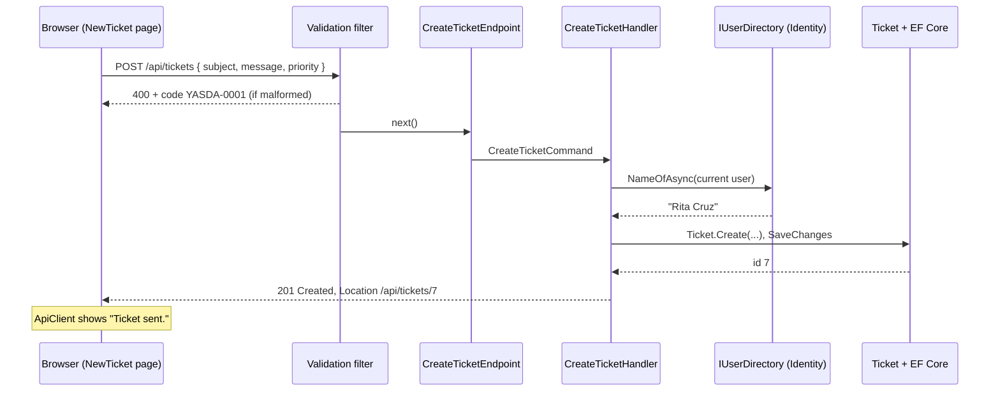

# Lesson 07 — File a Ticket: From the Form to the Database

Good day, developer! Today everything we've built meets for the first time. A requester opens a form, types what's
wrong, and presses a button. The browser calls the API, the API checks the request, the domain builds a `Ticket`,
EF Core saves it, and a status line says it worked. And when something goes wrong, the answer carries a stable
error code that explains itself. Along the way, the Tickets module meets Identity, through its **service window**,
and we say goodbye to Ping. It takes about three hours. Are you ready? Let's begin!

## What we'll build

| Piece | What it is |
|---|---|
| **`Yasda.Modules.Identity.Contracts`** | Identity's service window: one small interface other modules may call |
| **The `CreateTicket` feature** | Request, validator, command, handler and endpoint: `POST /api/tickets` answers `201 Created` |
| **Error codes everywhere** | One place that turns exceptions into problem responses with a code, a link and a trace id |
| **The error catalog** | `GET /api/errors`, and a public page in the app that explains every code |
| **An API description** | OpenAPI, plus a page to browse and try the API in development |
| **The New ticket page** | A real form, a status line, and an `ApiClient` every page will use |
| **Tests** | The module walls (references), the error catalog, the request's doors, and the form in a browser |

## Why we build it this way

### The pain: errors that say nothing, and modules that peek

Two things go wrong in a first draft of "file a ticket".

First, the **error**. A person leaves the subject empty, and the screen says "400". Or a rule is broken and the
screen says "Something went wrong". Neither tells them what to do, and neither gives you anything to search for
when they write to you. We want every error to say what happened, say what to do, and carry a **code** that never
changes: the same idea as the compiler's `CS0122`.

Second, the **name**. A ticket shows who filed it, and the name belongs to Identity, which owns people. The quick
way is to read Identity's table from the Tickets handler:

```csharp
var name = await db.Database.SqlQuery<string>($"SELECT full_name FROM identity.users WHERE id = {userId}")...
```

It works today. It also ties Tickets to Identity's table layout, forever: rename a column and Tickets breaks, and
no compiler says so. We built walls between modules in [lesson 01](01-solution-setup.md) to stop exactly this.

### The fix: a service window, and one place for errors

**A module is an island with one service window.** Identity publishes a small project, `Identity.Contracts`, with
one interface in it. Tickets may reference *that*, and nothing else of Identity's. Tickets asks "what's the name of
user 3?" and never learns how Identity stores names.

And the errors: the domain throws a `DomainException` with a code, the validation filter answers 400 with a code, and
*one* class, the **exception handler**, turns whatever is thrown into a standard problem response. No endpoint
builds an error by hand.

### Tickets copy the name

The ticket stores the requester's name itself, a copy, taken at the moment of filing. That's deliberate. A list of
five hundred tickets must show names without asking Identity five hundred times, and without a join across schemas,
which the module rules forbid. The price is that a renamed person keeps their old name on old tickets, which is
also how most service desks work.

## 1. The service window

```bash
dotnet new classlib -n Yasda.Modules.Identity.Contracts -o src/Modules/Identity/Yasda.Modules.Identity.Contracts
rm src/Modules/Identity/Yasda.Modules.Identity.Contracts/Class1.cs
dotnet sln add src/Modules/Identity/Yasda.Modules.Identity.Contracts
dotnet add src/Modules/Identity/Yasda.Modules.Identity.Contracts reference src/Shared/Yasda.Shared.BuildingBlocks
dotnet add src/Modules/Identity/Yasda.Modules.Identity reference src/Modules/Identity/Yasda.Modules.Identity.Contracts
dotnet add src/Modules/Tickets/Yasda.Modules.Tickets reference src/Modules/Identity/Yasda.Modules.Identity.Contracts
```

As always, delete the template's `<PropertyGroup>` from the new `.csproj`. A Contracts project references only
`Yasda.Shared.BuildingBlocks`: that keeps the project graph free of cycles when modules call each other. Its one file:

```csharp
// src/Modules/Identity/Yasda.Modules.Identity.Contracts/IdentityContracts.cs
namespace Yasda.Modules.Identity.Contracts;

// Identity's service window: what other modules may ask about people, and nothing more.
public interface IUserDirectory
{
    // The account with this email (any case), or null. For the development seed today; inbound email later.
    Task<long?> IdOfAsync(string email, CancellationToken ct);

    // The name to show for a user, or null if there's no such user.
    Task<string?> NameOfAsync(long userId, CancellationToken ct);
}
```

This is the only public thing in Identity besides its entry class. Identity implements it:

```csharp
// src/Modules/Identity/Yasda.Modules.Identity/Infrastructure/UserDirectory.cs
using System.Globalization;
using Microsoft.AspNetCore.Identity;
using Yasda.Modules.Identity.Contracts;

namespace Yasda.Modules.Identity.Infrastructure;

internal sealed class UserDirectory(UserManager<AppUser> users) : IUserDirectory
{
    public async Task<long?> IdOfAsync(string email, CancellationToken ct)
    {
        var user = await users.FindByEmailAsync(email);
        if (user is null) return null;
        return user.Id;
    }

    public async Task<string?> NameOfAsync(long userId, CancellationToken ct)
    {
        var user = await users.FindByIdAsync(userId.ToString(CultureInfo.InvariantCulture));
        if (user is null) return null;
        return user.FullName;
    }
}
```

and registers it in `IdentityModule.AddIdentityModule`, next to `IModuleDatabase`:

```csharp
services.AddScoped<IUserDirectory, UserDirectory>();
```

(with `using Yasda.Modules.Identity.Contracts;` at the top of the file). `UserManager` is Identity's own class for
finding users. Lesson 08 swaps this implementation for a faster, read-only one, and no caller notices: that is what
a contract buys you.

## 2. The feature: file a ticket

Three files, in the same shape as lesson 03. The handler first:

```csharp
// src/Modules/Tickets/Yasda.Modules.Tickets/Features/CreateTicket/CreateTicketHandler.cs
using Yasda.Modules.Identity.Contracts;
using Yasda.Modules.Tickets.Domain;
using Yasda.Modules.Tickets.Infrastructure;
using Yasda.Shared.BuildingBlocks;

namespace Yasda.Modules.Tickets.Features;

internal sealed record CreateTicketCommand(string Subject, string Message, TicketPriority Priority);

internal sealed class CreateTicketHandler(TicketsDbContext db, ICurrentUser currentUser, IUserDirectory users, TimeProvider time)
{
    public async Task<long> HandleAsync(CreateTicketCommand cmd, CancellationToken ct)
    {
        // The name is copied onto the ticket, so the queues can show it without reading Identity's tables.
        var name = await users.NameOfAsync(currentUser.UserId, ct) ?? currentUser.Username;
        var now = time.GetUtcNow().UtcDateTime;
        var ticket = Ticket.Create(cmd.Subject, cmd.Message, cmd.Priority, new UserId(currentUser.UserId), name, now);

        db.Tickets.Add(ticket);
        await db.SaveChangesAsync(ct);
        return ticket.Id.Value;
    }
}
```

It does exactly what the "load, act, save" row of our logic table says. It asks Identity for the name through the
contract, asks the domain to create the ticket (`Ticket.Create` is where every rule lives), adds it to the
`DbContext`, and saves. There isn't a business `if` in it. `ICurrentUser`, from lesson 06, says who is calling. And
`SaveChangesAsync` writes the ticket and its first message in one **atomic** step: both rows or neither, like a
turnstile that only lets one person through at a time.

```csharp
// src/Modules/Tickets/Yasda.Modules.Tickets/Features/CreateTicket/CreateTicketEndpoint.cs
using FluentValidation;
using Microsoft.AspNetCore.Builder;
using Microsoft.AspNetCore.Http;
using Microsoft.AspNetCore.Http.HttpResults;
using Microsoft.AspNetCore.Routing;
using Yasda.Modules.Tickets.Domain;
using Yasda.Shared.BuildingBlocks;

namespace Yasda.Modules.Tickets.Features;

internal sealed record CreateTicketRequest(string Subject, string Message, TicketPriority Priority = TicketPriority.Normal);

internal sealed class CreateTicketRequestValidator : AbstractValidator<CreateTicketRequest>
{
    public CreateTicketRequestValidator()
    {
        RuleFor(x => x.Subject).NotEmpty().MaximumLength(Ticket.SubjectMaxLength);
        RuleFor(x => x.Message).NotEmpty().MaximumLength(Ticket.MessageMaxLength);
        RuleFor(x => x.Priority).IsInEnum();
    }
}

internal static class CreateTicketEndpoint
{
    // Anyone signed in may ask for help.
    public static void Map(IEndpointRouteBuilder app)
    {
        app.MapPost("/tickets", async Task<Created<CreatedId>> (CreateTicketRequest body, CreateTicketHandler handler, CancellationToken ct) =>
        {
            var command = new CreateTicketCommand(body.Subject, body.Message, body.Priority);
            var id = await handler.HandleAsync(command, ct);
            return TypedResults.Created($"/api/tickets/{id}", new CreatedId(id));
        })
        .RequireAuthorization();
    }
}
```

- **`CreateTicketRequest`** is what the browser sends. Its priority defaults to `Normal`, so a client may leave it out.
- **The validator** repeats the length limits the domain also enforces. That's deliberate: the validator answers
  a malformed request with a friendly 400 before anything runs, and the domain refuses bad data whoever calls it.
- **`Task<Created<CreatedId>>`** declares what the endpoint answers: `201 Created`, with the new ticket's number in
  the body and its address in the `Location` header. The address (`/api/tickets/7`) doesn't exist yet; the queues
  and the ticket page arrive in the next lessons.
- **`.RequireAuthorization()`**: anyone signed in may ask for help.

Add the new type to the shared project, so every module can use it for its own "created" answers:

```csharp
// src/Shared/Yasda.Shared.BuildingBlocks/Abstractions/CreatedId.cs
namespace Yasda.Shared.BuildingBlocks;

// The body of a 201 Created: the new thing's id. Its address is in the Location header.
public sealed record CreatedId(long Id);
```

Now say goodbye to Ping. Delete the folder `Features/Ping`, the page `src/Yasda.Web/Pages/Ping.razor`, its test files
`tests/Yasda.Modules.Tickets.UnitTests/PingTests.cs` and `tests/Yasda.Integration.Tests/PingTests.cs`, and the
Ping link in the navigation (we rewrite the menu below). In `TicketsModule.cs`, replace the Ping registrations with
the new feature, and add the error catalog (step 3). Replace the whole file:

```csharp
// src/Modules/Tickets/Yasda.Modules.Tickets/TicketsModule.cs
using FluentValidation;
using Microsoft.AspNetCore.Builder;
using Microsoft.AspNetCore.Http;
using Microsoft.EntityFrameworkCore;
using Microsoft.Extensions.Configuration;
using Microsoft.Extensions.DependencyInjection;
using Microsoft.AspNetCore.Routing;
using Yasda.Modules.Tickets.Domain;
using Yasda.Modules.Tickets.Features;
using Yasda.Modules.Tickets.Infrastructure;
using Yasda.Shared.BuildingBlocks;

namespace Yasda.Modules.Tickets;

public static class TicketsModule
{
    public static IServiceCollection AddTicketsModule(this IServiceCollection services)
    {
        // One DbContext per request. Its connection string comes from configuration when the context is first needed.
        services.AddDbContext<TicketsDbContext>((provider, options) =>
        {
            var configuration = provider.GetRequiredService<IConfiguration>();
            TicketsDbContext.Configure(options, configuration.GetConnectionString("YasdaDb")!);
        });
        services.AddScoped<IModuleDatabase, TicketsDatabase>();

        // Handlers: plain classes, injected straight into the endpoints that use them.
        services.AddScoped<CreateTicketHandler>();

        // Without includeInternalTypes no validator is found, and validation silently stops.
        services.AddValidatorsFromAssembly(typeof(TicketsModule).Assembly, includeInternalTypes: true);
        services.AddSingleton(ErrorCatalog.From(typeof(TicketsErrors)));
        return services;
    }

    public static IEndpointRouteBuilder MapTicketsEndpoints(this IEndpointRouteBuilder api)
    {
        var tickets = api.MapGroup("").WithTags("Tickets");
        CreateTicketEndpoint.Map(tickets);
        return api;
    }
}
```

`api.MapGroup("")` makes a group with no prefix of its own, so the module can tag all its endpoints (`WithTags`) in
the API description. The one test that signed in with Ping, in `AuthTests`, loses its second `[InlineData]` row for
now. Lesson 08 adds a ticket address back.

### The seed learns real people

Lesson 05 promised this. The sample tickets used made-up ids for the people. Now they ask Identity, through the
window, so the seeded tickets belong to the real development users. Replace `TicketsDatabase.cs`:

```csharp
// src/Modules/Tickets/Yasda.Modules.Tickets/Infrastructure/TicketsDatabase.cs
using Microsoft.EntityFrameworkCore;
using Yasda.Modules.Identity.Contracts;
using Yasda.Modules.Tickets.Domain;
using Yasda.Shared.BuildingBlocks;

namespace Yasda.Modules.Tickets.Infrastructure;

internal sealed class TicketsDatabase(TicketsDbContext db, IUserDirectory users, TimeProvider time) : IModuleDatabase
{
    public string Module => "Tickets";

    public async Task MigrateAsync(CancellationToken ct)
    {
        await db.Database.MigrateAsync(ct);
    }

    // A few tickets to click through, built through the domain like real ones. Identity seeds first (registration
    // order), so its sample people exist; their ids come through Identity's contract, never its tables.
    public async Task SeedDevelopmentDataAsync(CancellationToken ct)
    {
        if (await db.Tickets.AnyAsync(ct)) return;

        var requesterId = await users.IdOfAsync("requester@yasda.local", ct);
        var agentId = await users.IdOfAsync("agent@yasda.local", ct);
        if (requesterId is null || agentId is null) return;

        var requesterName = (await users.NameOfAsync(requesterId.Value, ct))!;
        var agentName = (await users.NameOfAsync(agentId.Value, ct))!;
        var requester = new UserId(requesterId.Value);
        var agent = new UserId(agentId.Value);
        var now = time.GetUtcNow().UtcDateTime;

        var printer = Ticket.Create("Printer on the 3rd floor won't print",
            "It shows \"paper jam\" but there's no paper stuck. Twenty people share it.", TicketPriority.High, requester, requesterName, now.AddHours(-30));

        var vpn = Ticket.Create("Can't connect to the VPN from home",
            "It says my certificate expired. I need it for Monday's report.", TicketPriority.Normal, requester, requesterName, now.AddHours(-6));
        vpn.Take(agent, agentName, now.AddHours(-5));
        vpn.Reply(agent, agentName, "Which computer are you using: the company laptop or your own?", isInternal: false, authorIsStaff: true, now.AddHours(-5));
        vpn.Reply(agent, agentName, "Certificates were renewed last week; this may be the first of many.", isInternal: true, authorIsStaff: true, now.AddHours(-5));
        vpn.MarkPending(now.AddHours(-5));

        var mouse = Ticket.Create("New mouse, please", "My scroll wheel stopped working.", TicketPriority.Low, requester, requesterName, now.AddDays(-3));
        mouse.Take(agent, agentName, now.AddDays(-3));
        mouse.Reply(agent, agentName, "Left one on your desk. Shout if it doesn't work.", isInternal: false, authorIsStaff: true, now.AddDays(-2));
        mouse.Resolve(now.AddDays(-2));

        db.Tickets.AddRange(printer, vpn, mouse);
        await db.SaveChangesAsync(ct);
    }
}
```

The seed guards itself (`requesterId is null` returns) because Identity must have seeded first: that's the
registration order from lesson 06, doing its job.

## 3. Every error has a code

### The catalog

Lesson 04 gave us `ErrorCode`. Now the full picture: a **catalog** is the list of codes a module can answer with,
and the host serves them all. Replace `ErrorCode.cs` in BuildingBlocks:

```csharp
// src/Shared/Yasda.Shared.BuildingBlocks/Abstractions/ErrorCode.cs
using System.Reflection;

namespace Yasda.Shared.BuildingBlocks;

// One kind of failure with a stable ID, like the compiler's CS0122: the code names the problem, the catalog says how
// to fix it. A published code never changes meaning, and its number is never reused.
public sealed record ErrorCode(string Code, string Title, string Fix);

// The codes one module can answer with. Each module registers its own; the host serves them all at /api/errors.
public sealed class ErrorCatalog(IReadOnlyList<ErrorCode> codes)
{
    public IReadOnlyList<ErrorCode> Codes { get; } = codes;

    // Every public static ErrorCode field of a catalog class such as TicketsErrors.
    public static ErrorCatalog From(Type catalogClass)
    {
        var codes = new List<ErrorCode>();
        foreach (var field in catalogClass.GetFields(BindingFlags.Public | BindingFlags.Static))
        {
            if (field.FieldType == typeof(ErrorCode))
                codes.Add((ErrorCode)field.GetValue(null)!);
        }
        return new ErrorCatalog(codes);
    }
}

// Codes that belong to no module: the HTTP layer and the platform.
public static class CommonErrors
{
    public static readonly ErrorCode ValidationFailed = new("YASDA-0001", "The request has invalid fields",
        "Correct the fields listed in the message and send it again.");
    public static readonly ErrorCode NotFound = new("YASDA-0002", "Not found",
        "Check the number or link. If it was created a moment ago on another screen, wait a few seconds and reload.");
    public static readonly ErrorCode ChangedBySomeoneElse = new("YASDA-0003", "Someone else changed this first",
        "Reload to see their change, then make yours again.");
    public static readonly ErrorCode UnreadableRequest = new("YASDA-0004", "The request could not be read",
        "The request body is missing or isn't valid JSON. If you're calling the API directly, check the body and the Content-Type header.");
    public static readonly ErrorCode NotSignedIn = new("YASDA-0005", "Not signed in",
        "Sign in again. Sessions end after a period without use, or when an admin signs you out everywhere.");
    public static readonly ErrorCode NotAllowed = new("YASDA-0006", "Not allowed",
        "Your role can't do this. Ask an admin if you need it.");
    public static readonly ErrorCode TooManyRequests = new("YASDA-0007", "Too many requests",
        "Wait a minute and try again. Repeated failed sign-ins are limited on purpose.");
    public static readonly ErrorCode Unexpected = new("YASDA-0008", "Unexpected error",
        "Try again. If it keeps happening, send the trace id from the message to support: it finds this exact failure in the logs.");
    public static readonly ErrorCode AlreadyExists = new("YASDA-0009", "That already exists",
        "Someone created the same thing at the same moment. Reload and use the existing one.");
}
```

- **`ErrorCatalog.From`** reads every `public static ErrorCode` field of a catalog class, by reflection, so adding a
  code is one line in the class and nothing else.
- **`CommonErrors`** are the codes that belong to no module: the HTTP layer and the platform. `YASDA-` is their
  prefix. Some of these wait for later lessons to throw them (a conflict, a second concurrent create, too many
  requests), but the exception handler below maps them all in one place, so they live here now.

Each module registers its own catalog. `TicketsModule` already does (`ErrorCatalog.From(typeof(TicketsErrors))`).
The shared ones come from a new method in the shared infrastructure project, which will collect the platform
services every module uses:

```csharp
// src/Shared/Yasda.Shared.Infrastructure/DependencyInjection.cs
using Microsoft.Extensions.DependencyInjection;
using Yasda.Shared.BuildingBlocks;

namespace Yasda.Shared.Infrastructure;

public static class DependencyInjection
{
    // The platform services every module codes against.
    public static IServiceCollection AddSharedInfrastructure(this IServiceCollection services)
    {
        services.AddSingleton(TimeProvider.System);
        services.AddHttpContextAccessor();
        services.AddScoped<ICurrentUser, CurrentUser>();
        services.AddSingleton(ErrorCatalog.From(typeof(CommonErrors)));
        return services;
    }
}
```

(`CurrentUser`'s registration and the clock move here from `Program.cs`; you'll see that in the final file below.)

### One place that turns exceptions into answers

```csharp
// src/Yasda.Api/GlobalExceptionHandler.cs
using System.Diagnostics;
using Yasda.Shared.BuildingBlocks;
using Microsoft.AspNetCore.Diagnostics;
using Microsoft.AspNetCore.Mvc;
using Microsoft.EntityFrameworkCore;

namespace Yasda.Api;

// One place that maps exceptions to HTTP statuses, answering with RFC 9457 problem+json. Only what is thrown lands
// here: a business rule refused, two people changing the same thing, or a bug. A bad request or a missing record is
// answered by its endpoint without an exception.
internal sealed class GlobalExceptionHandler(ILogger<GlobalExceptionHandler> log, IHostEnvironment env) : IExceptionHandler
{
    public async ValueTask<bool> TryHandleAsync(HttpContext ctx, Exception ex, CancellationToken ct)
    {
        var (status, error) = ex switch
        {
            // Malformed JSON, a missing body: the request never reached a handler.
            BadHttpRequestException bad  => (bad.StatusCode, CommonErrors.UnreadableRequest),
            DbUpdateConcurrencyException => (StatusCodes.Status409Conflict, CommonErrors.ChangedBySomeoneElse),
            // A unique index caught what a check-then-insert missed: two people creating the same thing at once.
            DbUpdateException { InnerException: Npgsql.PostgresException { SqlState: "23505" } }
                                         => (StatusCodes.Status409Conflict, CommonErrors.AlreadyExists),
            DomainException domain       => (StatusCodes.Status422UnprocessableEntity, domain.Error),
            _                            => (StatusCodes.Status500InternalServerError, CommonErrors.Unexpected)
        };

        if (status == StatusCodes.Status500InternalServerError)
            log.LogError(ex, "Unhandled exception");

        // Never leak a stack trace outside development.
        var detail = status switch
        {
            StatusCodes.Status500InternalServerError when env.IsDevelopment() => ex.ToString(),
            StatusCodes.Status500InternalServerError                          => "An unexpected error occurred.",
            StatusCodes.Status409Conflict                                     => null,
            _                                                                 => ex.Message
        };

        var problem = new ProblemDetails { Status = status, Detail = detail, Instance = ctx.Request.Path };
        ErrorProblems.Apply(problem, error);
        problem.Extensions["traceId"] = Activity.Current?.TraceId.ToString() ?? ctx.TraceIdentifier;

        ctx.Response.StatusCode = status;
        // charset spelled out: some clients (Windows PowerShell 5.1) don't assume UTF-8, and an accented name (Peña) arrives garbled.
        await ctx.Response.WriteAsJsonAsync(problem, options: null, contentType: "application/problem+json; charset=utf-8", ct);
        return true;
    }
}
```

This is the whole error policy of the API, in one `switch`:

| What was thrown | The answer | Why |
|---|---|---|
| A broken JSON body | `400` + `YASDA-0004` | The request never reached a handler |
| `DomainException` | `422` + the rule's own code | The request was well-formed, but a business rule said no |
| A concurrency or duplicate-key failure | `409` | Two people acted at once (lessons 09 and 11) |
| Anything else | `500` + `YASDA-0008` | A bug. The log gets the stack trace; the person gets a trace id, never the stack |

Notice what's not here: a bad request and a missing record. Those are answered by the validation filter and the
endpoint **without** an exception, because they're an everyday event, not an exceptional one.

```csharp
// src/Yasda.Api/ErrorProblems.cs
using Yasda.Shared.BuildingBlocks;
using Microsoft.AspNetCore.Mvc;

namespace Yasda.Api;

// Puts the error code into a problem response: "code" for programs, "type" as the link to its catalog page.
internal static class ErrorProblems
{
    // The framework's own errors (a bare 401, 403, 404, 429) carry no code of their own: their status decides it.
    public static ErrorCode ForStatus(int status) => status switch
    {
        StatusCodes.Status400BadRequest => CommonErrors.ValidationFailed,
        StatusCodes.Status401Unauthorized => CommonErrors.NotSignedIn,
        StatusCodes.Status403Forbidden => CommonErrors.NotAllowed,
        StatusCodes.Status404NotFound => CommonErrors.NotFound,
        StatusCodes.Status409Conflict => CommonErrors.ChangedBySomeoneElse,
        StatusCodes.Status429TooManyRequests => CommonErrors.TooManyRequests,
        _ => CommonErrors.Unexpected
    };

    // The framework writes "application/problem+json" with no charset. Some clients (Windows PowerShell 5.1) then don't
    // assume UTF-8, and an accented name (Peña) arrives garbled, so every problem body says it plainly.
    public static IApplicationBuilder UseUtf8ProblemBodies(this IApplicationBuilder app) =>
        app.Use((ctx, next) =>
        {
            ctx.Response.OnStarting(() =>
            {
                if (ctx.Response.ContentType == "application/problem+json")
                    ctx.Response.ContentType = "application/problem+json; charset=utf-8";
                return Task.CompletedTask;
            });
            return next(ctx);
        });

    public static void Apply(ProblemDetails problem, ErrorCode error)
    {
        problem.Type = $"/errors/{error.Code}";
        problem.Title = error.Title;
        problem.Extensions["code"] = error.Code;
    }
}
```

`ErrorProblems` gives every problem response its `code`, its `type` (a link to the catalog entry) and its `title`.
The framework writes some answers itself, a bare 401 or 404 with no body; `ForStatus` gives those a code from their
status. And `UseUtf8ProblemBodies` spells out the character set on every problem body, because some clients
(Windows PowerShell 5.1 among them) don't assume UTF-8, and an accented name like Peña would arrive garbled.

The catalog's own endpoints:

```csharp
// src/Yasda.Api/ErrorCatalogEndpoints.cs
using Yasda.Shared.BuildingBlocks;
using Microsoft.AspNetCore.Http.HttpResults;

namespace Yasda.Api;

// The error catalog every module contributes to. Public on purpose: the "type" link in an error must open even for
// someone whose session just ended.
internal static class ErrorCatalogEndpoints
{
    public static IEndpointRouteBuilder MapErrorCatalog(this IEndpointRouteBuilder api)
    {
        var errors = api.MapGroup("/errors").AllowAnonymous().WithTags("Errors");

        errors.MapGet("/", (IEnumerable<ErrorCatalog> catalogs) =>
        {
            var all = AllCodes(catalogs);
            all.Sort((a, b) => string.CompareOrdinal(a.Code, b.Code));
            return TypedResults.Ok(all);
        });

        errors.MapGet("/{code}", Results<Ok<ErrorCode>, NotFound> (string code, IEnumerable<ErrorCatalog> catalogs) =>
        {
            foreach (var error in AllCodes(catalogs))
            {
                if (error.Code.Equals(code, StringComparison.OrdinalIgnoreCase))
                    return TypedResults.Ok(error);
            }
            return TypedResults.NotFound();
        });

        return api;
    }

    private static List<ErrorCode> AllCodes(IEnumerable<ErrorCatalog> catalogs)
    {
        var all = new List<ErrorCode>();
        foreach (var catalog in catalogs)
            all.AddRange(catalog.Codes);
        return all;
    }
}
```

They're `AllowAnonymous` on purpose: the link in an error message must open even for someone whose session just
ended.

### Wire it all in

Replace `Program.cs` with its new full version. The changes are marked in comments you can follow: the shared
services, the error handling, JSON enums as names, the API description, and the catalog endpoints.

```csharp
// src/Yasda.Api/Program.cs
using System.Diagnostics;
using System.Text.Json.Serialization;
using Scalar.AspNetCore;
using Yasda.Api;
using Yasda.Modules.Identity;
using Yasda.Modules.Tickets;
using Yasda.Shared.Infrastructure;

var builder = WebApplication.CreateBuilder(args);

builder.Services.AddSharedInfrastructure();

// Registration order is migration and seed order: Identity first.
builder.Services.AddIdentityModule();
builder.Services.AddTicketsModule();
builder.Services.AddAuthorization();
builder.Services.AddExceptionHandler<GlobalExceptionHandler>();
// Enums travel as their names ("High"), not numbers, in both directions.
builder.Services.ConfigureHttpJsonOptions(o => o.SerializerOptions.Converters.Add(new JsonStringEnumConverter()));
// Every problem body, ours or the framework's, carries an error code and a trace id.
builder.Services.AddProblemDetails(o => o.CustomizeProblemDetails = c =>
{
    if (!c.ProblemDetails.Extensions.ContainsKey("code"))
        ErrorProblems.Apply(c.ProblemDetails, ErrorProblems.ForStatus(c.ProblemDetails.Status ?? c.HttpContext.Response.StatusCode));
    c.ProblemDetails.Extensions["traceId"] = Activity.Current?.TraceId.ToString() ?? c.HttpContext.TraceIdentifier;
});
// The API's description, generated from the endpoints themselves: /openapi/v1.json, browsed at /scalar (development).
builder.Services.AddOpenApi(o => o.AddDocumentTransformer<BearerSecurityScheme>());
// The browser app: the server sends its page, the screens run in the browser as WebAssembly.
builder.Services.AddRazorComponents().AddInteractiveWebAssemblyComponents();

var app = builder.Build();

app.UseUtf8ProblemBodies();
app.UseExceptionHandler();
app.UseStatusCodePages();   // an error with no body (a bare 404, 401, 403) gets a problem+json body too

if (app.Environment.IsDevelopment())
{
    app.MapOpenApi();
    app.MapScalarApiReference();
}

// Development and tests: create the database, apply the migrations, add sample tickets. Does nothing when off.
await app.InitializeDatabaseAsync();

// An address that is no page of the app shows the app's own "not found" page (with a 404).
app.UseWhen(ctx => !ctx.Request.Path.StartsWithSegments("/api"),
    pages => pages.UseStatusCodePagesWithReExecute("/not-found", createScopeForStatusCodePages: true));
// Explicit, and after the status-code pages: a re-executed request ("/not-found") must be routed again.
app.UseRouting();
app.UseAuthentication();
app.UseAuthorization();
app.UseAntiforgery();

// The browser app is served from the same host, so the API gets a prefix of its own.
// Every request with a body or query record is validated here, once, before any module's endpoint runs.
var api = app.MapGroup("/api").ValidateRequests();
api.MapErrorCatalog();
api.MapIdentityModule();
api.MapTicketsEndpoints();
api.MapFallback(() => Results.NotFound());   // an unknown API address is a 404, never the app's page

app.MapStaticAssets();
app.MapRazorComponents<Yasda.Web.App>()
    .AddInteractiveWebAssemblyRenderMode()
    .AllowAnonymous();

app.Run();
public partial class Program { }
```

- **`AddExceptionHandler` + `UseExceptionHandler`** put `GlobalExceptionHandler` in the pipeline. It must come
  first, to catch whatever the rest throws.
- **`UseStatusCodePages`** gives bodiless errors a problem body too. `AddProblemDetails` with `CustomizeProblemDetails`
  stamps each of them with a code and a trace id.
- **`JsonStringEnumConverter`** makes enums travel as names (`"High"`), in both directions. The browser sends the
  priority as the word.
- **`api.MapErrorCatalog()`** goes before the modules, and `public partial class Program { }` is still at the very
  end.

## 4. The API description

An API a client can't read is a puzzle. **OpenAPI** is the standard way to describe one: a JSON document that lists
every address and every answer it can give. ASP.NET Core generates it from the endpoints themselves, and because
we return `TypedResults`, the possible answers (`201`, here) are in it without anyone writing them down.

```bash
dotnet add src/Yasda.Api package Microsoft.AspNetCore.OpenApi --version 10.0.14
dotnet add src/Yasda.Api package Scalar.AspNetCore --version 2.18.7
```

| Package | What it's for | License |
|---|---|---|
| `Microsoft.AspNetCore.OpenApi` | Generates the OpenAPI document from the endpoints | MIT |
| `Scalar.AspNetCore` | A page to browse the document and try calls, in development only | MIT |

```csharp
// src/Yasda.Api/BearerSecurityScheme.cs
using Microsoft.AspNetCore.OpenApi;
using Microsoft.OpenApi;

namespace Yasda.Api;

// Tells the API browser that a client other than the web app signs in with a bearer token, so it offers a box for one.
// The web app itself uses the sign-in cookie, which the browser sends to /scalar too.
internal sealed class BearerSecurityScheme : IOpenApiDocumentTransformer
{
    public Task TransformAsync(OpenApiDocument document, OpenApiDocumentTransformerContext context, CancellationToken ct)
    {
        if (document.Components is null) document.Components = new OpenApiComponents();
        if (document.Components.SecuritySchemes is null) document.Components.SecuritySchemes = new Dictionary<string, IOpenApiSecurityScheme>();
        document.Components.SecuritySchemes["Bearer"] = new OpenApiSecurityScheme
        {
            Type = SecuritySchemeType.Http, Scheme = "bearer", Description = "The accessToken from POST /api/auth/login."
        };
        if (document.Security is null) document.Security = [];
        document.Security.Add(new OpenApiSecurityRequirement { [new OpenApiSecuritySchemeReference("Bearer", document)] = [] });
        return Task.CompletedTask;
    }
}
```

This tells the document that a client other than the app signs in with a bearer token (lesson 06), so the browser
page offers a box to paste one. Run the app and open `/scalar`: your API, listed. The page only exists in
Development; production serves the JSON at `/openapi/v1.json` only if you map it.

## 5. The browser: a form, and a status line

### The status line

A message has to survive one thing a plain page doesn't: the page changing underneath it. So messages live in a
small service, and a component shows them.

```csharp
// src/Yasda.Web/Services/Notices.cs
using Microsoft.AspNetCore.Components;
using Microsoft.AspNetCore.Components.Routing;

namespace Yasda.Web.Services;

public sealed record Notice(string Text, bool IsError, string? Code);

// The status line under the navigation: what just happened ("User saved.") or what went wrong, with its error code.
// It stays through the page change a save makes by itself (code calling NavigateTo), and clears when the person
// follows a link somewhere else.
public sealed class Notices : IDisposable
{
    private readonly NavigationManager _nav;

    public Notices(NavigationManager nav)
    {
        _nav = nav;
        _nav.LocationChanged += OnLocationChanged;
    }

    public Notice? Current { get; private set; }
    public event Action? Changed;

    public void Success(string text) => Set(new Notice(text, false, null));
    public void Error(string text, string? code = null) => Set(new Notice(text, true, code));
    public void Clear() => Set(null);

    private void Set(Notice? notice)
    {
        Current = notice;
        Changed?.Invoke();
    }

    private void OnLocationChanged(object? sender, LocationChangedEventArgs e)
    {
        if (e.IsNavigationIntercepted && Current is not null) Clear();
    }

    public void Dispose() => _nav.LocationChanged -= OnLocationChanged;
}
```

```razor
@* src/Yasda.Web/Shared/NoticeArea.razor *@
@implements IDisposable
@inject Notices Notices

@* The status line, beside the page's title. The status element is always there, so a screen reader is already
   listening when a message lands in it. An error carries its code, linked to the page that explains it and its fix. *@
<div>
    @if (Notices.Current is not null && Notices.Current.IsError)
    {
        <p class="status-line error" role="alert">
            Error: @Notices.Current.Text
            @if (Notices.Current.Code is not null)
            {
                <text> </text><a href="@($"errors/{Notices.Current.Code}")">What does @Notices.Current.Code mean?</a>
            }
        </p>
    }
    <p class="status-line" role="status">
        @if (Notices.Current is not null && !Notices.Current.IsError)
        {
            @Notices.Current.Text
        }
    </p>
</div>

@code {
    protected override void OnInitialized() => Notices.Changed += Refresh;

    private void Refresh() => InvokeAsync(StateHasChanged);

    public void Dispose() => Notices.Changed -= Refresh;
}
```

```razor
@* src/Yasda.Web/Shared/PageHeader.razor *@
@* The top of every page: its title with the status line beside it, then a sentence on what the page is for. *@
<div class="page-head">
    <h1>@Title</h1>
    <NoticeArea />
</div>
@if (Description is not null)
{
    <p>@Description</p>
}

@code {
    [Parameter, EditorRequired] public string Title { get; set; } = "";
    [Parameter] public RenderFragment? Description { get; set; }
}
```

- **`Notices`** holds the current message and raises `Changed` when it changes. Success has no color; an error
  does. A message clears when the person follows a link to somewhere else.
- **`NoticeArea`** shows it beside the page's title. The `role="status"` element is *always* on the page, even
  when empty, so a screen reader is already listening when a message lands in it. An error is `role="alert"`, and
  carries its code, linked to the page that explains it.
- **`PageHeader`** is the top of every page from now on: a title, the status line beside it, and one sentence on
  what the page is for.

### One way to talk to the API

```csharp
// src/Yasda.Web/Services/ApiClient.cs
using System.Net;
using System.Net.Http.Json;
using System.Text.Json;

namespace Yasda.Web.Services;

// Every call to the API goes through here, so every page handles errors the same way: the API's problem details
// become the status line's message, and a 401 (session ended) sends the user back to sign in.
public sealed class ApiClient(HttpClient http, Notices notices, CookieAuthenticationStateProvider auth)
{
    private sealed record Problem(string? Title, string? Detail, int? Status, string? Code);
    private sealed record Created(long Id);
    private int _saving;

    // True while a change is on its way to the server. Pages disable their action buttons meanwhile, so a double
    // click can't send the same change twice.
    public bool Busy => _saving > 0;

    // For "create" calls: the API answers 201 with { id }.
    public async Task<long?> Create(string url, object body, string? success = null)
    {
        notices.Clear();   // a new change replaces the last message: an old error must not sit next to a change that worked
        _saving++;
        HttpResponseMessage response;
        try
        {
            response = await http.PostAsJsonAsync(url, body);
        }
        finally
        {
            _saving--;
        }

        if (!response.IsSuccessStatusCode)
        {
            await Fail(response);
            return null;
        }

        if (success is not null) notices.Success(success);
        var created = await response.Content.ReadFromJsonAsync<Created>();
        return created!.Id;
    }

    private async Task Fail(HttpResponseMessage response)
    {
        if (response.StatusCode == HttpStatusCode.Unauthorized)
        {
            auth.Refresh();   // the session ended; the router sends them to the sign-in page
            return;
        }

        var problem = await ReadProblem(response);

        // The server's own words, when it sent any.
        var message = $"The server answered {(int)response.StatusCode}.";
        string? code = null;
        if (problem is not null)
        {
            if (problem.Detail is not null) message = problem.Detail;
            else if (problem.Title is not null) message = problem.Title;
            code = problem.Code;
        }

        if (response.StatusCode == HttpStatusCode.Forbidden) message = "You don't have permission to do that.";
        if (response.StatusCode == HttpStatusCode.TooManyRequests) message = "Too many requests. Wait a moment and try again.";

        // The status line links the code to its catalog entry (see Pages/Errors.razor).
        notices.Error(message, code);
    }

    private static async Task<Problem?> ReadProblem(HttpResponseMessage response)
    {
        try
        {
            return await response.Content.ReadFromJsonAsync<Problem>();
        }
        catch (JsonException)
        {
            return null;   // not a problem body (a proxy's error page, say)
        }
    }
}
```

Every page calls the API through this class, so every page handles a failure the same way. Today it knows one
call, `Create`; later lessons add the others as they need them.

- **`Busy`** is true while a change is on its way. A button that says `disabled="@Api.Busy"` can't be double-clicked
  into filing the ticket twice.
- **`Fail`** turns a failed answer into a status line: the server's own words when it sent any, its code, and a
  plain sentence for the two answers that carry no body of ours (403 and 429). A 401 means the session ended, so it
  asks the sign-in state to refresh, and the router sends the person to sign in.
- **`ReadProblem`** forgives an answer that isn't JSON, such as an error page from a proxy in front of the app.

Register both services in `Yasda.Web/Program.cs` (they're already in this lesson's file, below), and add the
folder's namespace to `_Imports.razor` so every page sees `Notices` and the choices:

```razor
@using Yasda.Web.Models
```

### The form

```csharp
// src/Yasda.Web/Models/Models.cs
namespace Yasda.Web.Models;

// The choices the API accepts, in the order people think of them. The server's own types are internal to each
// module, so the browser app keeps its own copies: the HTTP contract is the only thing the two share.
public static class TicketChoices
{
    public static readonly string[] Priorities = ["Low", "Normal", "High", "Critical"];
}
```

The browser app keeps its own copy of the lists the API accepts. The server's own types are `internal` to each
module, so the HTTP contract is the only thing the two sides share, as it should be.

```razor
@* src/Yasda.Web/Pages/Tickets/NewTicket.razor *@
@page "/tickets/new"
@inject ApiClient Api

<PageTitle>New ticket · YASDA</PageTitle>

<PageHeader Title="New ticket">
    <Description>Your ticket goes to the service desk, and every answer will appear on the ticket's own page.</Description>
</PageHeader>

<EditForm Model="this" OnSubmit="Send">
    <div class="field">
        <label for="subject">Subject</label>
        <InputText id="subject" @bind-Value="_subject" maxlength="200" required aria-describedby="subject-hint" />
        <span class="hint" id="subject-hint">What's wrong, in one line. For example: Printer on the 3rd floor won't print.</span>
    </div>
    <div class="field">
        <label for="message">Details</label>
        <InputTextArea id="message" @bind-Value="_message" rows="8" maxlength="10000" required aria-describedby="message-hint" />
        <span class="hint" id="message-hint">What you tried, and since when.</span>
    </div>
    <div class="field">
        <label for="priority">Priority</label>
        <InputSelect id="priority" @bind-Value="_priority">
            @foreach (var priority in TicketChoices.Priorities)
            {
                <option value="@priority">@priority</option>
            }
        </InputSelect>
    </div>
    <div class="actions">
        <button type="submit" disabled="@Api.Busy">Send ticket</button>
    </div>
</EditForm>

@code {
    private string _subject = "";
    private string _message = "";
    private string _priority = "Normal";

    private async Task Send()
    {
        var body = new { subject = _subject.Trim(), message = _message.Trim(), priority = _priority };
        var id = await Api.Create("api/tickets", body, "Ticket sent. We'll answer here.");
        if (id is null) return;

        // Sent: the form is empty again, ready for the next one.
        _subject = "";
        _message = "";
        _priority = "Normal";
    }
}
```

This is the first real form, and it follows the screen rules:

- **Each field has a `<label for>` above it**, joined to its input by `id`. That makes the page readable with CSS
  off, and findable by role and name in a test.
- **`required` and `maxlength`** are the browser's own first line of defense. The validator is the real one.
- **A hint** (`.hint`, tied by `aria-describedby`) tells a person what a good subject looks like.
- **`disabled="@Api.Busy"`** on the button, as above.
- **After a successful send, the form empties itself.** The ticket exists and has a number; the page that shows it
  arrives in lesson 08, and then this page will go there instead.

The pages that explain errors and say hello:

```razor
@* src/Yasda.Web/Pages/Errors.razor *@
@page "/errors"
@page "/errors/{Code}"
@attribute [AllowAnonymous]
@inject HttpClient Http
@inject NavigationManager Nav

@* Every error the app shows carries a code, like a compiler's CS0122. This page says what each one means and what to
   do about it. Open to anyone: the link in an error message must work even after the session has ended. *@

<PageTitle>@(Code is null ? "Error codes" : Code) · YASDA</PageTitle>

<PageHeader Title="Error codes" />

@if (_codes is null)
{
    <p role="status">Loading…</p>
}
else
{
    var selected = Selected;
    if (selected is not null)
    {
        <section aria-labelledby="selected-code">
            <h2 id="selected-code">@selected.Code: @selected.Title</h2>
            <p><strong>What to do:</strong> @selected.Fix</p>
            <p class="muted">If this doesn't solve it, send support the code and the trace id from the message.</p>
        </section>
        <hr />
    }
    else if (Code is not null)
    {
        <p>There is no error code @Code. Find the one you saw in the list below.</p>
    }

    <EditForm Model="this" OnSubmit="Find" class="search" role="search">
        <div class="field">
            <label for="search">Code or meaning</label>
            <InputText id="search" type="search" @bind-Value="_search" />
        </div>
        <button type="submit">Search</button>
        <a href="errors">Clear</a>
    </EditForm>
    <TableBox Label="Error codes">
        <table>
            <thead>
                <tr><th scope="col">Code</th><th scope="col">Meaning</th></tr>
            </thead>
            <tbody>
                @foreach (var c in Filtered)
                {
                    <tr>
                        <td><a href="@($"errors/{c.Code}")">@c.Code</a></td>
                        <td>@c.Title</td>
                    </tr>
                }
            </tbody>
        </table>
    </TableBox>
    @if (!Filtered.Any())
    {
        <p>No code matches. <a href="errors">Clear the search</a> to see them all.</p>
    }
}

@code {
    [Parameter] public string? Code { get; set; }
    [SupplyParameterFromQuery] public string? Search { get; set; }

    private sealed record ErrorCode(string Code, string Title, string Fix);

    private List<ErrorCode>? _codes;
    private string? _search;

    private ErrorCode? Selected => _codes?.FirstOrDefault(c => string.Equals(c.Code, Code, StringComparison.OrdinalIgnoreCase));

    private List<ErrorCode> Filtered
    {
        get
        {
            var matches = new List<ErrorCode>();
            if (_codes is null) return matches;
            if (string.IsNullOrWhiteSpace(Search)) return _codes;

            var search = Search.Trim();
            foreach (var code in _codes)
            {
                var codeMatches = code.Code.Contains(search, StringComparison.OrdinalIgnoreCase);
                var titleMatches = code.Title.Contains(search, StringComparison.OrdinalIgnoreCase);
                if (codeMatches || titleMatches)
                    matches.Add(code);
            }
            return matches;
        }
    }

    protected override async Task OnInitializedAsync() => _codes = await Http.GetFromJsonAsync<List<ErrorCode>>("api/errors");

    protected override void OnParametersSet() => _search = Search;

    // DESIGN.md §6.1: search runs on submit, and lives in the address.
    private void Find() => Nav.NavigateTo(Nav.GetUriWithQueryParameter("search", string.IsNullOrWhiteSpace(_search) ? null : _search.Trim()));
}
```

```razor
@* src/Yasda.Web/Shared/TableBox.razor *@
@* The box a table sits in: it scrolls sideways on a phone so the page never does, and a keyboard can scroll it too,
   so it's a named, focusable region. *@
<div class="table-box" role="region" aria-label="@Label" tabindex="0">
    @ChildContent
</div>

@code {
    [Parameter, EditorRequired] public string Label { get; set; } = "";
    [Parameter] public RenderFragment? ChildContent { get; set; }
}
```

`Errors.razor` is `[AllowAnonymous]`, for the reason above. It's also our first **list**: a table of every code, with
a search box. `TableBox` is the box a table sits in: it scrolls sideways on a phone, so the page never does, and it
is a named, focusable region so a keyboard can scroll it too. The search lives in the address
(`/errors?search=closed`), so a result can be bookmarked.

The navigation and Home, replacing lesson 06's:

```razor
@* src/Yasda.Web/Layout/NavMenu.razor *@
@inject CookieAuthenticationStateProvider Auth
@inject NavigationManager Nav

<nav aria-label="Main">
    <ul class="links">
        <li><NavItem Href="">Home</NavItem></li>
        <li><NavItem Href="tickets/new">New ticket</NavItem></li>
        <li><NavItem Href="errors">Error codes</NavItem></li>
        <li><button type="button" class="link" @onclick="SignOut">Sign out</button></li>
    </ul>
</nav>

@code {
    private async Task SignOut()
    {
        await Auth.SignOutAsync();
        Nav.NavigateTo("login");
    }
}
```

```razor
@* src/Yasda.Web/Pages/Home.razor *@
@page "/"

<PageTitle>Home · YASDA</PageTitle>

<AuthorizeView>
    <h1>Good day, @context.User.Identity?.Name!</h1>
    <p class="muted">You're signed in as @context.User.FindFirst(System.Security.Claims.ClaimTypes.Role)?.Value.</p>
    <p><a class="button" href="tickets/new">Submit a ticket</a></p>
</AuthorizeView>
```

And `Yasda.Web/Program.cs`, which now registers the two services:

```csharp
// src/Yasda.Web/Program.cs
using Microsoft.AspNetCore.Components.Authorization;
using Microsoft.AspNetCore.Components.WebAssembly.Hosting;
using Yasda.Web.Services;

// The browser half of the app. The server sends the page (App.razor); what runs here is Routes and everything below.
var builder = WebAssemblyHostBuilder.CreateDefault(args);

// Same origin as the API, so the browser sends the sign-in cookie with every call on its own.
builder.Services.AddScoped(_ => new HttpClient { BaseAddress = new Uri(builder.HostEnvironment.BaseAddress) });

builder.Services.AddScoped<Notices>();
builder.Services.AddScoped<ApiClient>();

builder.Services.AddAuthorizationCore();
builder.Services.AddCascadingAuthenticationState();
builder.Services.AddScoped<CookieAuthenticationStateProvider>();
builder.Services.AddScoped<AuthenticationStateProvider>(provider => provider.GetRequiredService<CookieAuthenticationStateProvider>());

await builder.Build().RunAsync();
```

At the end of `app.css` add what the new pages use (the page head, tables, the search row, selects and text areas,
and a link drawn as a button). In the `:root` block add one color for a hovered table row:

```css
    --row-hover: #FAEBC2;
```

and at the end of the file:

```css
/* The page's title with the status line beside it; below it on a narrow screen. */
.page-head {
    display: flex;
    flex-wrap: wrap;
    justify-content: space-between;
    align-items: baseline;
    gap: var(--gap-s) var(--gap-m);
    margin-bottom: var(--gap-s);
}

main p, main ul, main ol {
    max-width: var(--measure);
}

.hint {
    display: block;
    color: var(--text-muted);
}

select, textarea {
    font: inherit;
    color: inherit;
    background: var(--surface-input);
    border: var(--border);
    border-radius: var(--radius);
    box-shadow: var(--shadow);
    min-height: var(--target);
    padding: 0 var(--gap-s);
    box-sizing: border-box;
    width: 100%;
}

textarea {
    padding: var(--gap-s);
}

/* Tables: collapsed 1px black borders, bold header, no stripes. A wide table scrolls inside its own box, never the page. */
.table-box {
    overflow-x: auto;
    margin-bottom: var(--gap-m);
}

table {
    border-collapse: collapse;
    width: 100%;
}

th, td {
    border: var(--border);
    padding: var(--gap-s);
    text-align: left;
    vertical-align: top;
}

th {
    font-weight: bold;
}

tbody tr:hover {
    background: var(--row-hover);
}

.search {
    display: flex;
    flex-wrap: wrap;
    align-items: end;
    gap: var(--gap-s) var(--gap-m);
    margin-bottom: var(--gap-m);
}

.search .field {
    margin: 0;
    flex: 0 1 20rem;
}

.search > a {
    display: inline-flex;
    align-items: center;
    min-height: var(--target);
}
```

```css
/* A link that starts a main task, drawn like a button: same border and size, no underline. */
a.button, a.button:visited {
    display: inline-flex;
    align-items: center;
    min-height: var(--target);
    padding: 0 var(--gap-m);
    border: var(--border);
    color: var(--text);
    text-decoration: none;
}
```

Run the app, sign in as `requester@yasda.local`, press **Submit a ticket**, fill the form and send it. The status line
says "Ticket sent. We'll answer here." Check the database:

```bash
psql "host=localhost dbname=yasda user=yasda_dev password=yasda_dev_only" \
  -c "SELECT id, subject, requester_name, status FROM tickets.ticket ORDER BY id DESC LIMIT 1"
```

Clear the subject, remove the `required` attribute in your browser's developer tools, and send again: the status
line turns into an error, "'Subject' must not be empty.", with a link "What does YASDA-0001 mean?". Follow it.

## 6. Prove it: the walls, the codes, the doors and the form

### The walls between modules

Tickets now references Identity, so the reference rules need tests. Add three to `ModuleBoundaryTests`, with their
list of Contracts assemblies and the reflection flags they share:

```csharp
    // Each module's .Contracts project joins this list when it is created.
    private static readonly Assembly[] ContractsAssemblies = [typeof(IUserDirectory).Assembly];

    private const BindingFlags Everything =
        BindingFlags.Instance | BindingFlags.Static | BindingFlags.Public | BindingFlags.NonPublic;

    [Fact]
    public void A_module_references_other_modules_only_through_their_Contracts()
    {
        foreach (var module in Modules)
        {
            var illegal = new List<string>();
            foreach (var reference in module.GetReferencedAssemblies())
            {
                var name = reference.Name!;
                var isModule = name.StartsWith("Yasda.Modules.", StringComparison.Ordinal);
                var isContracts = name.EndsWith(".Contracts", StringComparison.Ordinal);
                if (isModule && !isContracts)
                    illegal.Add(name);
            }

            illegal.Should().BeEmpty($"{module.GetName().Name} may reference another module's .Contracts only");
        }
    }

    [Fact]
    public void Contracts_reference_no_module_so_no_cycle_can_form()
    {
        foreach (var contracts in ContractsAssemblies)
        {
            var names = contracts.GetReferencedAssemblies().Select(a => a.Name!);
            var modules = names.Where(n => n.StartsWith("Yasda.Modules.", StringComparison.Ordinal));

            modules.Should().BeEmpty($"{contracts.GetName().Name} must not depend on any module");
        }
    }

    [Fact]
    public void Only_the_host_references_shared_infrastructure()
    {
        var checkedAssemblies = new List<Assembly>();
        checkedAssemblies.AddRange(Modules);
        checkedAssemblies.AddRange(ContractsAssemblies);

        foreach (var assembly in checkedAssemblies)
        {
            var names = assembly.GetReferencedAssemblies().Select(a => a.Name);

            names.Should().NotContain("Yasda.Shared.Infrastructure",
                $"{assembly.GetName().Name} must code against BuildingBlocks interfaces, never their implementations");
        }
    }
```

Add `using Yasda.Modules.Identity.Contracts;` to the file.

- **`A_module_references_other_modules_only_through_their_Contracts`** reads each module's references and fails on
  another module's main project.
- **`Contracts_reference_no_module_so_no_cycle_can_form`** keeps the service windows from depending on any island.
- **`Only_the_host_references_shared_infrastructure`** keeps the real implementations out of modules.

Make the first fail once. In `Yasda.Modules.Tickets.csproj`, add a reference to the Identity module itself:
`dotnet add src/Modules/Tickets/Yasda.Modules.Tickets reference src/Modules/Identity/Yasda.Modules.Identity`. Nothing
fails yet, because an unused reference doesn't reach the compiled module. So *use* it, in `CreateTicketHandler`:
`var wrong = typeof(Yasda.Modules.Identity.IdentityModule).Name;`. Now:

```
Expected illegal to be empty because Yasda.Modules.Tickets may reference another module's .Contracts only,
but found {"Yasda.Modules.Identity"}.
```

Take both lines out again.

### The catalog is a promise

```csharp
// tests/Yasda.Architecture.Tests/ErrorCatalogTests.cs
using System.Reflection;
using System.Text.RegularExpressions;
using AwesomeAssertions;
using Yasda.Modules.Tickets;
using Yasda.Shared.BuildingBlocks;

namespace Yasda.Architecture.Tests;

// The error catalog is a promise to the people who look codes up: unique, documented, and never a dead entry.
public class ErrorCatalogTests
{
    // Every new module's catalog joins this list, with its prefix.
    private static readonly Dictionary<Type, string> Catalogs = new()
    {
        [typeof(CommonErrors)] = "YASDA",
        [CatalogIn(typeof(TicketsModule))] = "TICKETS",
    };

    // The module's one XxxErrors class in its Domain folder.
    private static Type CatalogIn(Type moduleEntry)
    {
        var catalogs = new List<Type>();
        foreach (var type in moduleEntry.Assembly.GetTypes())
        {
            var isErrors = type.Name.EndsWith("Errors", StringComparison.Ordinal);
            var isDomain = (type.Namespace ?? "").EndsWith(".Domain", StringComparison.Ordinal);
            if (isErrors && isDomain)
                catalogs.Add(type);
        }
        return catalogs.Single();
    }

    private static List<(Type Catalog, FieldInfo Field, ErrorCode Error)> AllCodes()
    {
        var all = new List<(Type, FieldInfo, ErrorCode)>();
        foreach (var catalog in Catalogs.Keys)
        {
            foreach (var field in catalog.GetFields(BindingFlags.Public | BindingFlags.Static))
            {
                if (field.FieldType == typeof(ErrorCode))
                    all.Add((catalog, field, (ErrorCode)field.GetValue(null)!));
            }
        }
        return all;
    }

    [Fact]
    public void Every_code_is_unique_well_formed_and_documented()
    {
        var codes = AllCodes();

        codes.Select(c => c.Error.Code).Should().OnlyHaveUniqueItems("a code names one problem, forever");
        foreach (var (catalog, field, error) in codes)
        {
            error.Code.Should().MatchRegex($"^{Catalogs[catalog]}-[0-9]{{4}}$", $"{catalog.Name}.{field.Name} uses its module's prefix");
            error.Title.Should().NotBeNullOrWhiteSpace($"{error.Code} needs a title");
            error.Fix.Should().NotBeNullOrWhiteSpace($"{error.Code} needs a fix: the catalog exists to say what to do");
        }
    }

    // A code nobody throws is a promise nobody keeps: someone would look it up for an error that can't happen.
    [Fact]
    public void Every_code_is_used_somewhere()
    {
        var catalogFileNames = new HashSet<string>();
        foreach (var catalog in Catalogs.Keys)
            catalogFileNames.Add(catalog.Name);

        // All source code except build output and the catalog files themselves (a code is "used" outside them).
        var objFolder = $"{Path.DirectorySeparatorChar}obj{Path.DirectorySeparatorChar}";
        var source = new System.Text.StringBuilder();
        foreach (var file in Directory.EnumerateFiles(Path.Combine(RepositoryRoot(), "src"), "*.cs", SearchOption.AllDirectories))
        {
            if (file.Contains(objFolder, StringComparison.Ordinal)) continue;
            if (catalogFileNames.Contains(Path.GetFileNameWithoutExtension(file))) continue;
            source.AppendLine(File.ReadAllText(file));
        }
        var allSource = source.ToString();

        var unused = new List<string>();
        foreach (var (catalog, field, error) in AllCodes())
        {
            if (!Regex.IsMatch(allSource, $@"\b{catalog.Name}\.{field.Name}\b"))
                unused.Add($"{error.Code} ({catalog.Name}.{field.Name})");
        }

        unused.Should().BeEmpty("every code in the catalog must be thrown or returned somewhere");
    }

    private static string RepositoryRoot()
    {
        var dir = new DirectoryInfo(AppContext.BaseDirectory);
        while (dir is not null)
        {
            if (File.Exists(Path.Combine(dir.FullName, "Yasda.slnx"))) return dir.FullName;
            dir = dir.Parent;
        }
        throw new InvalidOperationException("Yasda.slnx not found above the test output folder.");
    }
}
```

The two tests it adds:

- **`Every_code_is_unique_well_formed_and_documented`** fails on a duplicated code, a code outside its module's prefix
  (`TICKETS-` for Tickets), or an entry with no title or no fix.
- **`Every_code_is_used_somewhere`** searches the source code for each code, outside the catalogs. A code nobody
  throws is a promise nobody keeps: someone would look it up for an error that can't happen.

Make the second fail once: add a code to `TicketsErrors` that nothing uses.

```csharp
public static readonly ErrorCode Spare = new("TICKETS-0011", "A spare", "Nobody throws me.");
```

```
Expected unused to be empty because every code in the catalog must be thrown or returned somewhere,
but found at least one item {"TICKETS-0011 (TicketsErrors.Spare)"}.
```

Delete the line. (It also shows why a code's number is never reused: `TICKETS-0011` is reserved for what lesson 09 adds.)

### The doors, over HTTP

```csharp
// tests/Yasda.Integration.Tests/TicketTests.cs
using System.Net;
using System.Net.Http.Json;
using System.Text;
using System.Text.Json;
using AwesomeAssertions;
using Microsoft.EntityFrameworkCore;
using Microsoft.Extensions.DependencyInjection;
using Yasda.Modules.Tickets.Domain;
using Yasda.Modules.Tickets.Infrastructure;
using Yasda.Shared.BuildingBlocks;

namespace Yasda.Integration.Tests;

// Filing a ticket through the real API and a real database. (Reading tickets back comes with the queues, in lesson 08,
// so for now these tests look at the table itself.)
[Collection("Integration")]
public class TicketTests(CustomWebAppFactory factory)
{
    private const string Requester = "requester@yasda.local";

    private static StringContent Json(string json)
    {
        return new StringContent(json, Encoding.UTF8, "application/json");
    }

    [Fact]
    public async Task A_requester_files_a_ticket_and_it_is_saved_with_their_name()
    {
        var requester = await factory.ClientFor(Requester);

        var response = await requester.PostAsJsonAsync("/api/tickets",
            new { subject = "Projector in room 2 is blank", message = "It says no signal.", priority = "High" });

        response.StatusCode.Should().Be(HttpStatusCode.Created);
        var created = await response.Content.ReadFromJsonAsync<CreatedId>();
        response.Headers.Location!.ToString().Should().Be($"/api/tickets/{created!.Id}");

        await using var scope = factory.Services.CreateAsyncScope();
        var db = scope.ServiceProvider.GetRequiredService<TicketsDbContext>();
        var ticket = await db.Tickets.SingleAsync(t => t.Id == new TicketId(created.Id));
        ticket.Subject.Should().Be("Projector in room 2 is blank");
        ticket.Priority.Should().Be(TicketPriority.High);
        ticket.Status.Should().Be(TicketStatus.New);
        ticket.RequesterName.Should().Be("Rita Cruz", "the name is copied from Identity, through its contract");
        ticket.Messages.Should().ContainSingle().Which.Body.Should().Be("It says no signal.");
    }

    [Fact]
    public async Task The_priority_is_normal_when_the_request_leaves_it_out()
    {
        var requester = await factory.ClientFor(Requester);

        var response = await requester.PostAsJsonAsync("/api/tickets", new { subject = "No priority given", message = "Help" });

        response.StatusCode.Should().Be(HttpStatusCode.Created);
        var created = await response.Content.ReadFromJsonAsync<CreatedId>();
        await using var scope = factory.Services.CreateAsyncScope();
        var db = scope.ServiceProvider.GetRequiredService<TicketsDbContext>();
        var ticket = await db.Tickets.SingleAsync(t => t.Id == new TicketId(created!.Id));
        ticket.Priority.Should().Be(TicketPriority.Normal);
    }

    [Fact]
    public async Task Filing_a_ticket_without_signing_in_is_401()
    {
        var response = await factory.CreateClient().PostAsJsonAsync("/api/tickets", new { subject = "Hello", message = "Anyone?" });

        response.StatusCode.Should().Be(HttpStatusCode.Unauthorized);
    }

    [Theory]
    [InlineData("""{ "subject": "", "message": "Help" }""")]
    [InlineData("""{ "subject": "Printer", "message": "" }""")]
    [InlineData("""{ "subject": "Printer", "message": "Help", "priority": "Whenever" }""")]
    public async Task A_malformed_ticket_is_refused_before_it_reaches_the_handler(string json)
    {
        var requester = await factory.ClientFor(Requester);

        var response = await requester.PostAsync("/api/tickets", Json(json));

        response.StatusCode.Should().Be(HttpStatusCode.BadRequest);
    }

    [Fact]
    public async Task A_refused_request_names_the_field_and_carries_the_validation_code()
    {
        var requester = await factory.ClientFor(Requester);

        var response = await requester.PostAsync("/api/tickets", Json("""{ "subject": "", "message": "Help" }"""));

        var problem = await response.Content.ReadFromJsonAsync<JsonElement>();
        problem.GetProperty("code").GetString().Should().Be("YASDA-0001");
        problem.GetProperty("errors").GetProperty("Subject")[0].GetString().Should().Contain("must not be empty");
    }

    [Fact]
    public async Task A_subject_over_200_characters_is_refused()
    {
        var requester = await factory.ClientFor(Requester);

        var response = await requester.PostAsJsonAsync("/api/tickets", new { subject = new string('a', 201), message = "Help" });

        response.StatusCode.Should().Be(HttpStatusCode.BadRequest);
    }

    [Fact]
    public async Task A_body_that_is_not_json_is_a_400_with_its_own_code()
    {
        var requester = await factory.ClientFor(Requester);

        var response = await requester.PostAsync("/api/tickets", Json("{ this is not json"));

        response.StatusCode.Should().Be(HttpStatusCode.BadRequest);
        var problem = await response.Content.ReadFromJsonAsync<JsonElement>();
        problem.GetProperty("code").GetString().Should().Be("YASDA-0004");
    }
}
```

There's no `GET` for a ticket yet, so these tests look at the table itself: `A_requester_files_a_ticket_and_it_is_saved_with_their_name`
reads the ticket back through a fresh `DbContext` and checks the name came from Identity, through the contract.
`A_malformed_ticket_is_refused_before_it_reaches_the_handler` is a `[Theory]` of three bad requests, which all
stop at the door. The doors, in one table:

| Test | The edge | Why it matters |
|---|---|---|
| `A_requester_files_a_ticket_and_it_is_saved_with_their_name` | The happy path, and the copied name | The whole slice, from request to row |
| `The_priority_is_normal_when_the_request_leaves_it_out` | A field left out | The default belongs to the request, not the browser |
| `Filing_a_ticket_without_signing_in_is_401` | No session | The door |
| `A_malformed_ticket_is_refused_before_it_reaches_the_handler` | Empty subject, empty message, a made-up priority | Three ways to fail validation |
| `A_refused_request_names_the_field_and_carries_the_validation_code` | What the person sees | A form needs the field's name, and a code to look up |
| `A_subject_over_200_characters_is_refused` | One past the limit | Limits that aren't tested drift |
| `A_body_that_is_not_json_is_a_400_with_its_own_code` | Not even JSON | The answer comes from the exception handler |

Now the error answers themselves:

```csharp
// tests/Yasda.Integration.Tests/ErrorCodeTests.cs
using System.Net;
using System.Net.Http.Json;
using System.Text.Json;
using AwesomeAssertions;
using Microsoft.AspNetCore.Http;
using Microsoft.Extensions.DependencyInjection;
using Microsoft.Extensions.Hosting;
using Microsoft.Extensions.Logging.Abstractions;
using Yasda.Api;
using Yasda.Modules.Tickets.Domain;
using Yasda.Shared.BuildingBlocks;

namespace Yasda.Integration.Tests;

// Every error a person can see carries a stable code, and the code's link opens its entry in the catalog.
[Collection("Integration")]
public class ErrorCodeTests(CustomWebAppFactory factory)
{
    // No endpoint can break a business rule yet (the validator stops a bad ticket first), so this feeds the exception
    // handler a refused rule directly. Lesson 09 shows the same answer through a real request.
    [Fact]
    public async Task A_refused_business_rule_answers_with_its_code_its_link_and_the_trace_id()
    {
        var handler = new GlobalExceptionHandler(NullLogger<GlobalExceptionHandler>.Instance,
            factory.Services.GetRequiredService<IHostEnvironment>());
        var context = new DefaultHttpContext();
        context.Response.Body = new MemoryStream();

        var handled = await handler.TryHandleAsync(context,
            new DomainException(TicketsErrors.TicketFinished, "Ticket #7 is closed."), CancellationToken.None);

        handled.Should().BeTrue();
        context.Response.StatusCode.Should().Be(StatusCodes.Status422UnprocessableEntity);
        context.Response.Body.Position = 0;
        var problem = await JsonSerializer.DeserializeAsync<JsonElement>(context.Response.Body);
        problem.GetProperty("code").GetString().Should().Be("TICKETS-0005");
        problem.GetProperty("type").GetString().Should().Be("/errors/TICKETS-0005");
        problem.GetProperty("title").GetString().Should().Be("This ticket is closed");
        problem.GetProperty("detail").GetString().Should().Be("Ticket #7 is closed.");
        problem.GetProperty("traceId").GetString().Should().NotBeNullOrEmpty();
    }

    // The framework writes these responses itself; they get a code from their status.
    [Theory]
    [InlineData("/api/auth/me", false, "YASDA-0005")]          // not signed in
    [InlineData("/api/no-such-thing", true, "YASDA-0002")]     // unknown address
    public async Task Errors_the_framework_writes_carry_a_code_too(string path, bool signedIn, string code)
    {
        var client = signedIn ? await factory.ClientFor("admin@yasda.local") : factory.CreateClient();

        var problem = await (await client.GetAsync(path)).Content.ReadFromJsonAsync<JsonElement>();

        problem.GetProperty("code").GetString().Should().Be(code);
        problem.GetProperty("type").GetString().Should().Be($"/errors/{code}");
    }

    [Fact]
    public async Task The_catalog_explains_a_code_to_anyone_even_signed_out()
    {
        var error = await factory.CreateClient().GetFromJsonAsync<JsonElement>("/api/errors/tickets-0005");

        error.GetProperty("code").GetString().Should().Be("TICKETS-0005");
        error.GetProperty("title").GetString().Should().NotBeNullOrWhiteSpace();
        error.GetProperty("fix").GetString().Should().NotBeNullOrWhiteSpace();
    }

    [Fact]
    public async Task The_catalog_lists_every_module_and_an_unknown_code_is_404()
    {
        var client = factory.CreateClient();

        var all = await client.GetFromJsonAsync<JsonElement[]>("/api/errors");
        // "TICKETS-0001" becomes "TICKETS": the module each code belongs to.
        var codes = all!.Select(e => e.GetProperty("code").GetString()!).ToList();
        var prefixes = codes.Select(c => c.Split('-')[0]).Distinct();
        prefixes.Should().BeEquivalentTo(["YASDA", "TICKETS"]);

        (await client.GetAsync("/api/errors/TICKETS-9999")).StatusCode.Should().Be(HttpStatusCode.NotFound);
    }
}
```

`A_refused_business_rule_answers_with_its_code_its_link_and_the_trace_id` feeds the exception handler a
`DomainException` directly. No endpoint can break a business rule yet (the validator stops a bad ticket first), so
this is the one place where we can see the `422` shape before lesson 09 shows it through a real request. It needs the
handler visible to the test project: add this to `Yasda.Api.csproj`, as you did for the modules, for tests only:

```xml
<ItemGroup>
  <InternalsVisibleTo Include="Yasda.Integration.Tests" />
</ItemGroup>
```

And the API description, with its two tests:

```csharp
// tests/Yasda.Integration.Tests/ApiDescriptionTests.cs
using System.Net;
using System.Net.Http.Json;
using System.Text.Json;
using AwesomeAssertions;

namespace Yasda.Integration.Tests;

// The OpenAPI document is generated from the endpoints themselves. TypedResults put every possible answer into it,
// so a client knows a created ticket is a 201 without reading our code.
[Collection("Integration")]
public class ApiDescriptionTests(CustomWebAppFactory factory)
{
    [Fact]
    public async Task The_api_description_lists_each_endpoints_possible_answers()
    {
        var document = await factory.CreateClient().GetFromJsonAsync<JsonElement>("/openapi/v1.json");

        var createTicket = document.GetProperty("paths").GetProperty("/api/tickets").GetProperty("post").GetProperty("responses");
        createTicket.EnumerateObject().Select(r => r.Name).Should().Contain("201");

        document.GetProperty("components").GetProperty("securitySchemes").TryGetProperty("Bearer", out _).Should().BeTrue();
    }

    [Fact]
    public async Task The_api_browser_page_is_served_in_development()
    {
        var response = await factory.CreateClient().GetAsync("/scalar");

        response.StatusCode.Should().Be(HttpStatusCode.OK);
        (await response.Content.ReadAsStringAsync()).Should().Contain("scalar", "it's the API browser, not the app's fallback page");
    }
}
```

### The form, in a real browser

```csharp
// tests/Yasda.Web.UiTests/TicketUiTests.cs
using Microsoft.Playwright;
using static Microsoft.Playwright.Assertions;

namespace Yasda.Web.UiTests;

public sealed class TicketUiTests : UiTest
{
    private static ILocator Field(IPage page, string label)
    {
        return page.GetByLabel(label, new() { Exact = true });
    }

    [UiFact]
    public async Task A_requester_files_a_ticket_and_the_form_empties()
    {
        var page = await SignIn("requester@yasda.local");
        await MainNav(page).GetByRole(AriaRole.Link, new() { Name = "New ticket" }).ClickAsync();

        await Field(page, "Subject").FillAsync($"Printer {Guid.NewGuid():N}");
        await Field(page, "Details").FillAsync("It shows paper jam, but there's no paper stuck.");
        await Field(page, "Priority").SelectOptionAsync("High");
        await page.GetByRole(AriaRole.Button, new() { Name = "Send ticket" }).ClickAsync();

        await Expect(page.GetByRole(AriaRole.Status).Filter(new() { HasText = "Ticket sent. We'll answer here." })).ToBeVisibleAsync();
        await Expect(Field(page, "Subject")).ToHaveValueAsync("");
        await Expect(Field(page, "Priority")).ToHaveValueAsync("Normal");
    }

    [UiFact]
    public async Task The_home_page_offers_to_submit_a_ticket()
    {
        var page = await SignIn("requester@yasda.local");

        await page.GetByRole(AriaRole.Link, new() { Name = "Submit a ticket" }).ClickAsync();

        await Expect(page.GetByRole(AriaRole.Heading, new() { Name = "New ticket" })).ToBeVisibleAsync();
    }

    // The link in an error message must work even for someone whose session just ended, so the page is public.
    [UiFact]
    public async Task The_error_code_page_explains_a_code_to_anyone()
    {
        var page = await NewPage();

        await page.GotoAsync("/errors/TICKETS-0005");

        await Expect(page.GetByRole(AriaRole.Heading, new() { Name = "TICKETS-0005: This ticket is closed" })).ToBeVisibleAsync();
        await Expect(page.GetByText("What to do:")).ToBeVisibleAsync();
    }
}
```

`A_requester_files_a_ticket_and_the_form_empties` uses a made-up subject (`Printer` and a fresh `Guid`) so a re-run never
collides with an old ticket. It checks the status line with `AriaRole.Status`, and the form's fields by their labels.
Lesson 08 rewrites this test, when filing a ticket starts to land on the ticket's page.

Two edits to lesson 06's browser tests, now that Ping is gone. In `SignInUiTests`, the test that clicked **Ping** clicks
**New ticket** instead, and `A_link_opened_while_signed_out_returns_there_after_sign_in` opens `/tickets/new`: its
address becomes `/login?returnUrl=tickets%2Fnew`, and it ends on the "New ticket" heading.

### Edge cases covered in this lesson

| Test | The edge | Why it matters |
|---|---|---|
| `A_module_references_other_modules_only_through_their_Contracts` | A reference to another island | The service window is the only way in |
| `Every_code_is_used_somewhere` | A code nobody throws | The catalog stays honest |
| `Errors_the_framework_writes_carry_a_code_too` | A bare 401 or 404 | Even the framework's answers have codes |
| `The_catalog_explains_a_code_to_anyone_even_signed_out` | A session that just ended | The error's own link must open |
| `The_api_description_lists_each_endpoints_possible_answers` | A client reading the description | `TypedResults` put `201` in it |
| `The_error_code_page_explains_a_code_to_anyone` | A signed-out visitor | Same, in the app |

## How a request flows



## Mistakes to avoid

- Reading another module's table "just this once". Add a method to its Contracts instead.
- Putting anything but interfaces and plain data in a Contracts project.
- Building an error response by hand in an endpoint. Throw a `DomainException`, or let the validator answer.
- Reusing or renumbering an error code, or adding one nobody throws.
- Leaking a stack trace to the browser. The log gets it; the person gets a trace id.
- Forgetting `[AllowAnonymous]` on the error pages: the link in an error then asks you to sign in to read why you
  were signed out.
- Letting a page call `HttpClient` directly for a change. `ApiClient` handles the errors, the busy state and the 401.
- A status line that only appears when there's a message. Keep the `role="status"` element on the page always.
- Trusting the browser's `required` and `maxlength`. They're a convenience; the validator and the domain decide.

## Let's run it!

```bash
dotnet build
dotnet test
```

The build shows **0 warnings and 0 errors**. The tests report 87 passed and 10 skipped (the browser tests). Start the
app and run those too:

```bash
dotnet run --project src/Yasda.Api
```

```bash
YASDA_UI_URL=http://localhost:5264 dotnet test tests/Yasda.Web.UiTests
```

Ten passed. Then try the API like another program would: sign in for a token, and file a ticket.

```bash
TOKEN=$(curl -s -X POST http://localhost:5264/api/auth/login -H "Content-Type: application/json" \
  -d '{"email":"requester@yasda.local","password":"Password123!"}' | sed -E 's/.*"accessToken":"([^"]+)".*/\1/')

curl -i -X POST http://localhost:5264/api/tickets -H "Authorization: Bearer $TOKEN" -H "Content-Type: application/json" \
  -d '{"subject":"Scanner jams","message":"Every third page.","priority":"Low"}'
# HTTP/1.1 201 Created
# Location: /api/tickets/4
# {"id":4}

curl -i -X POST http://localhost:5264/api/tickets -H "Authorization: Bearer $TOKEN" -H "Content-Type: application/json" \
  -d '{"subject":"","message":"x"}'
# HTTP/1.1 400 Bad Request
# {"type":"/errors/YASDA-0001","title":"The request has invalid fields","status":400,
#  "detail":"'Subject' must not be empty.","errors":{"Subject":["'Subject' must not be empty."]},
#  "code":"YASDA-0001","traceId":"..."}
```

Save the moment in Git:

```bash
git add .
git commit -m "Lesson 07: file a ticket, the Identity contract, error codes, the API description"
```

## Let's check!

1. Why does Tickets copy the requester's name onto the ticket instead of reading it from Identity each time?
2. What is in a Contracts project, and what may it reference? Why that last part?
3. Which two kinds of failure are answered *without* an exception, and which kind is thrown as a
   `DomainException`?
4. What does the exception handler answer for a `DomainException`, and where does the code in the answer come from?
5. Why must the error catalog's endpoints be open to a signed-out visitor?
6. What does `Every_code_is_used_somewhere` protect the people who read the catalog from?
7. Why does `ApiClient` disable the Send button while a change is on its way?
8. A test needs to prove the architecture test for module references can fail. Why isn't adding a project reference
   enough?

And that's where this lesson ends. A requester files a ticket from the browser into the database, every error says what
to do, and the modules meet only at their service windows. Next time, the agents' side: reading tickets back, with
Dapper, SQL functions, and a queue you can filter, sort and page through the address. Good luck, developer!

---

← [Lesson 06 — Sign-in](06-sign-in.md) · Next: [Lesson 08 — Queues](08-queues.md) →
