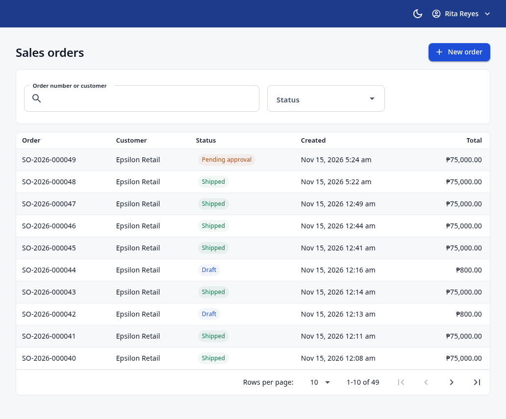
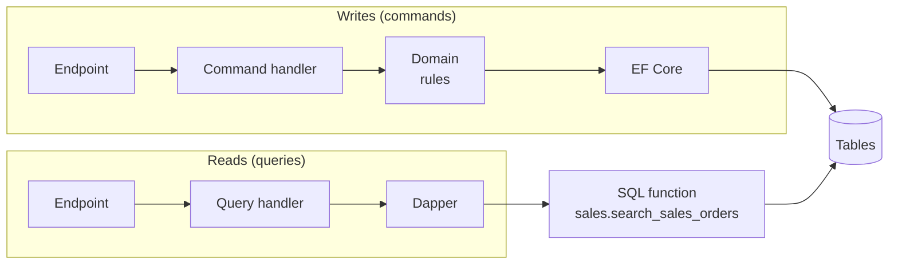
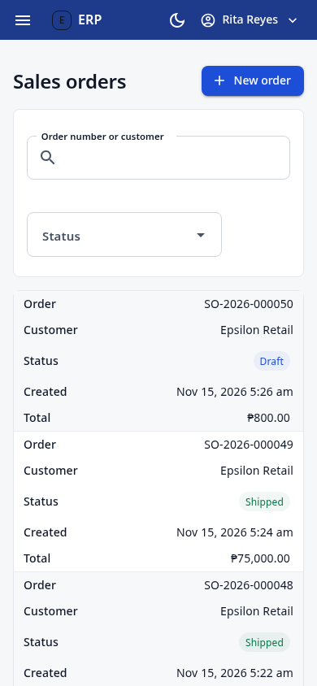
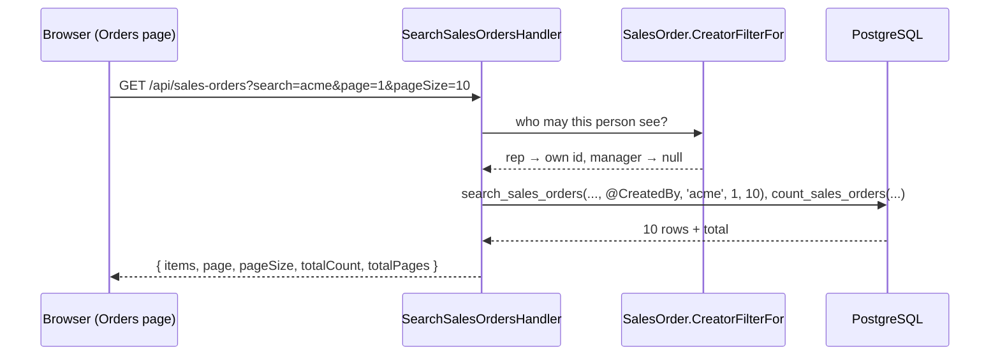

# Lesson 08 — Find Orders: Dapper, SQL Functions, and Who Sees What

Good day, developer! Last time we saved our first order, through a form that made you type ids. Today we
read. A list of orders you can search and page through, a page for each order, and search boxes for that
form, so nobody ever types an id again. Reading looks easy, and that's exactly why it gets done badly, so
we'll use a different tool for it, one that lets the database do what it's best at. And we'll settle a
question every ERP must answer: who is allowed to see which orders? About two hours. Are you ready? Let's
begin!

## What we'll build

| Endpoint | What it returns |
|---|---|
| `GET /api/sales-orders?status=&search=&page=&pageSize=` | A filtered, paged list, newest first |
| `GET /api/sales-orders/{id}` | One order, with its customer's name and its lines |
| `GET /api/customers?search=` and `/api/customers/{id}` | Customers, with the credit they have left |
| `GET /api/price-list?search=&forSaleOnly=` | Items Sales can put on an order, with their prices |

Plus the SQL functions behind them, **Dapper** to call them, the rule that a sales rep sees only their own
orders, and three screens: the order list, the order page, and the new-order form with search boxes.

The order list at the end of this lesson, as a sales rep sees it (only their own orders):



## Why we build it this way

### Why not EF Core for reads too?

You could load orders with EF Core, the way the command handlers do. For a list of 20 orders, that means EF
loads 20 full `SalesOrder` aggregates, with every line of every order, tracks all of them for changes that
will never come, and then you copy them into the shape the screen wants. Meanwhile the screen wanted 6
columns and a total.

A read wants a **shape**, not an aggregate. SQL is the best language there is for "join these, sum that,
filter, sort, give me page 3". So reads skip the domain entirely:

| | Commands (writes) | Queries (reads) |
|---|---|---|
| Goal | Change data safely | Show data quickly |
| Goes through | The domain, with all its rules | Straight to the database |
| Tool | EF Core | Dapper + SQL functions |
| Returns | Usually nothing, or an id | A shape made for one screen |



Two roads into the same tables: the write road goes through every rule; the read road goes straight to SQL,
which hands back exactly the columns one screen needs.

This is the "query" half of CQRS-lite, and it's where it pays off. Now, let's be honest about the cost:
the same idea ("an order's total") is now written twice, once in C# and once in SQL. A test at the end of this
lesson is what keeps the two in agreement.

### Why functions in the database

We could write the `SELECT` statements as strings inside C#. Putting them in the database as **functions**
instead has three benefits: a database administrator can read and tune them without touching C#, PostgreSQL
checks them when they're created, and every caller runs exactly the same query.

You might wonder why functions and not stored procedures. In PostgreSQL, a procedure can't hand back rows;
a function can. So a function declared `RETURNS TABLE (...)` is how PostgreSQL does "a stored query".

### Shipped by a migration, never edited

The functions live as `.sql` files in the module, and a migration creates them. That way, every database that
has the tables also has the queries; you can't forget to run a script. And one rule keeps that safe: **once a
script has been released, it's never edited.** A changed function gets a new file, `.v2.sql`, and a new
migration. Otherwise, a fresh database would get the *new* function from the *old* migration, and the two
would quietly disagree. You'll do exactly that in later lessons, when orders learn to ship and customers
gain a tax number.

### Who sees which orders

A sales rep's orders are their pipeline, and often their commission. Most businesses don't want every rep
reading every other rep's deals. So:

| Role | Sees |
|---|---|
| SalesRep | Only the orders they created |
| SalesManager, Admin | Every order |

And when a rep asks for someone else's order, the answer is **404, not 403**. A 403 would say "that order
exists, you just can't have it", which already leaks something. A 404 says nothing at all.

This is a rule about the business, so it lives in the domain, and every read and write asks the domain.

## 1. Dapper, and a connection for each read

```bash
dotnet add src/Modules/Sales/Erp.Modules.Sales package Dapper --version 2.1.79
dotnet add src/Shared/Erp.Shared.Infrastructure package Dapper --version 2.1.79
```

Dapper (Apache-2.0) adds methods like `QueryAsync<T>` to any database connection. You give it SQL and
parameters; it gives you back objects. Infrastructure needs it for one setting, coming up in a moment.

A read doesn't change anything and doesn't join anyone's transaction. It just needs a connection of its
own, briefly. In BuildingBlocks' `Data.cs`:

```csharp
// A new connection per Dapper read; the caller disposes it.
public interface IDbConnectionFactory
{
    DbConnection Create();
}
```

In Infrastructure:

```csharp
// src/Shared/Erp.Shared.Infrastructure/Data/PostgresConnections.cs
using System.Data.Common;
using Erp.Shared.BuildingBlocks;
using Npgsql;

namespace Erp.Shared.Infrastructure;

public sealed class PostgresConnectionFactory(NpgsqlDataSource dataSource) : IDbConnectionFactory
{
    public DbConnection Create() => dataSource.CreateConnection();
}
```

And in `AddSharedInfrastructure`:

```csharp
services.AddSingleton<IDbConnectionFactory, PostgresConnectionFactory>();

// PostgreSQL names columns in snake_case (order_number); our DTOs use PascalCase (OrderNumber).
// This tells Dapper that the two are the same name, for every read query in every module.
Dapper.DefaultTypeMap.MatchNamesWithUnderscores = true;
```

That last line is why Infrastructure needed Dapper: it's a global setting, so it's set once, in one place.

A paged list needs a standard envelope: the items, plus enough to draw the page buttons. In BuildingBlocks:

```csharp
// src/Shared/Erp.Shared.BuildingBlocks/Abstractions/PagedResult.cs
namespace Erp.Shared.BuildingBlocks;

public sealed record PagedResult<T>(IReadOnlyList<T> Items, int Page, int PageSize, int TotalCount)
{
    public int TotalPages => (int)Math.Ceiling(TotalCount / (double)PageSize);
}

```

And every list validates its paging the same way, so add two rules next to `ValidQuantity` in
`ValidationRules`:

```csharp
public static IRuleBuilderOptions<T, int> ValidPage<T>(this IRuleBuilder<T, int> rule) => rule.GreaterThan(0);

public static IRuleBuilderOptions<T, int> ValidPageSize<T>(this IRuleBuilder<T, int> rule) => rule.InclusiveBetween(1, 100);
```

The cap of 100 means nobody can ask for a million rows in one request.

## 2. Who sees what, in the domain

Two small methods on `SalesOrder`:

```csharp
// in Domain/SalesOrder.cs, above SetLines

// A sales rep sees only the orders they created; everyone else who may see orders sees them all.
public static UserId? CreatorFilterFor(UserId user, string role) => role == Roles.SalesRep ? user : null;

public bool IsVisibleTo(UserId user, string role) => CreatorFilterFor(user, role) is not { } only || only == CreatedBy;
```

- **`CreatorFilterFor`** answers "whose orders may this person see?" as a filter: a user id ("only these"),
  or `null` ("no filter"). It's `static` because a *list* needs the answer before it has any order in hand.
- **`IsVisibleTo`** asks the same question about one order. It's built on the first, so the two can't
  disagree.

A test in `DomainTests.cs` pins the rule down:

```csharp
public class VisibilityTests
{
    [Fact]
    public void A_rep_sees_only_their_own_orders_and_a_manager_sees_all()
    {
        var order = Make.Order(Make.Customer(), unitPrice: 25, createdBy: Make.Rep);

        order.IsVisibleTo(Make.Rep, Roles.SalesRep).Should().BeTrue();
        order.IsVisibleTo(new UserId(99), Roles.SalesRep).Should().BeFalse();
        order.IsVisibleTo(Make.Manager, Roles.SalesManager).Should().BeTrue();
    }
}
```

The command handlers in the next lessons ask `IsVisibleTo`. The SQL functions below take the filter as a
parameter. Both come from these two lines.

## 3. The SQL functions

Create the folder `src/Modules/Sales/Erp.Modules.Sales/Infrastructure/Sql/Functions/`. The `.sql` files are
already embedded by the `EmbeddedResource` line from [lesson 05](05-database.md). One file per read, named
`schema.function.vN.sql`, holding the function and its companion: the lines for a "get", the count for a
"search".

```sql
-- sales.get_sales_order.v1.sql
-- Released scripts are never edited: change a function with a .v2 file and a new migration.
-- p_created_by: NULL = any order; otherwise only that user's (a rep sees only their own).
CREATE OR REPLACE FUNCTION sales.get_sales_order(p_order_id bigint, p_created_by bigint)
RETURNS TABLE (id bigint, order_number text, customer_id bigint, customer_name text, status integer, total numeric,
               created_by bigint, created_utc timestamptz, submitted_utc timestamptz, approved_by bigint,
               approved_utc timestamptz, rejected_by bigint, rejection_reason text)
LANGUAGE sql STABLE
AS $$
    SELECT o.id, o.order_number::text, o.customer_id, c.name::text, o.status,
           COALESCE((SELECT SUM(ROUND(l.quantity * l.unit_price, 2))
                     FROM sales.sales_order_line l WHERE l.sales_order_id = o.id), 0),
           o.created_by, o.created_utc, o.submitted_utc, o.approved_by, o.approved_utc, o.rejected_by,
           o.rejection_reason::text
    FROM sales.sales_order o
    JOIN sales.customer c ON c.id = o.customer_id
    WHERE o.id = p_order_id
      AND (p_created_by IS NULL OR o.created_by = p_created_by);
$$;

CREATE OR REPLACE FUNCTION sales.get_sales_order_lines(p_order_id bigint)
RETURNS TABLE (item_id bigint, item_name text, unit text, quantity numeric, unit_price numeric)
LANGUAGE sql STABLE
AS $$
    SELECT l.item_id, l.item_name::text, l.unit::text, l.quantity, l.unit_price
    FROM sales.sales_order_line l
    WHERE l.sales_order_id = p_order_id
    ORDER BY l.id;
$$;
```

```sql
-- sales.search_sales_orders.v1.sql
-- Released scripts are never edited: change a function with a .v2 file and a new migration.
-- p_created_by: NULL = everyone's orders; otherwise only that user's (a rep sees only their own).
CREATE OR REPLACE FUNCTION sales.search_sales_orders(
    p_customer_id bigint, p_status integer, p_created_by bigint, p_search text, p_page integer, p_page_size integer)
RETURNS TABLE (id bigint, order_number text, customer_id bigint, customer_name text, status integer, total numeric,
               created_by bigint, created_utc timestamptz)
LANGUAGE sql STABLE
AS $$
    SELECT o.id, o.order_number::text, o.customer_id, c.name::text, o.status,
           COALESCE((SELECT SUM(ROUND(l.quantity * l.unit_price, 2))
                     FROM sales.sales_order_line l WHERE l.sales_order_id = o.id), 0),
           o.created_by, o.created_utc
    FROM sales.sales_order o
    JOIN sales.customer c ON c.id = o.customer_id
    WHERE (p_customer_id IS NULL OR o.customer_id = p_customer_id)
      AND (p_status      IS NULL OR o.status      = p_status)
      AND (p_created_by  IS NULL OR o.created_by  = p_created_by)
      AND (p_search      IS NULL OR o.order_number ILIKE '%' || p_search || '%' OR c.name ILIKE '%' || p_search || '%')
    ORDER BY o.created_utc DESC, o.id DESC
    OFFSET (p_page - 1) * p_page_size
    LIMIT p_page_size;
$$;

-- Separate from the search so the count is right even for a page past the end.
CREATE OR REPLACE FUNCTION sales.count_sales_orders(p_customer_id bigint, p_status integer, p_created_by bigint, p_search text)
RETURNS bigint
LANGUAGE sql STABLE
AS $$
    SELECT COUNT(*)
    FROM sales.sales_order o
    JOIN sales.customer c ON c.id = o.customer_id
    WHERE (p_customer_id IS NULL OR o.customer_id = p_customer_id)
      AND (p_status      IS NULL OR o.status      = p_status)
      AND (p_created_by  IS NULL OR o.created_by  = p_created_by)
      AND (p_search      IS NULL OR o.order_number ILIKE '%' || p_search || '%' OR c.name ILIKE '%' || p_search || '%');
$$;
```

A few things worth knowing in there:

| You see | It means |
|---|---|
| `LANGUAGE sql STABLE` | A plain SQL function that only reads, so PostgreSQL may optimize it freely |
| `::text` | Converts `varchar` to `text`, because the declared result types must match exactly |
| `SUM(ROUND(quantity * unit_price, 2))` | The same arithmetic as `Money`: each line rounded to centavos, then added |
| `(p_status IS NULL OR ...)` | A filter that's skipped when the caller didn't ask for it |
| `ILIKE '%' \|\| p_search \|\| '%'` | "Contains", ignoring case: `acme` finds Acme Corp, `0042` finds SO-2026-000042 |
| `OFFSET ... LIMIT ...` | Skip the earlier pages, take one page |
| A separate count function | So a page past the end still reports the real total, not zero |

The order form needs two more reads: customers to pick from, with the credit they have left, and the items
Sales may sell.

```sql
-- sales.search_customers.v1.sql
-- Released scripts are never edited: change a function with a .v2 file and a new migration.
-- p_customer_id set: that one customer. Pending = submitted orders still waiting for a manager.
CREATE OR REPLACE FUNCTION sales.search_customers(p_customer_id bigint, p_search text, p_page integer, p_page_size integer)
RETURNS TABLE (id bigint, name text, is_blocked boolean, credit_limit numeric, outstanding_balance numeric,
               pending_total numeric, available_credit numeric)
LANGUAGE sql STABLE
AS $$
    WITH pending AS (
        SELECT o.customer_id, SUM(ROUND(l.quantity * l.unit_price, 2)) AS total
        FROM sales.sales_order o
        JOIN sales.sales_order_line l ON l.sales_order_id = o.id
        WHERE o.status = 1
        GROUP BY o.customer_id
    )
    SELECT c.id, c.name::text, c.is_blocked, c.credit_limit, c.outstanding_balance, COALESCE(p.total, 0),
           GREATEST(c.credit_limit - c.outstanding_balance - COALESCE(p.total, 0), 0)
    FROM sales.customer c
    LEFT JOIN pending p ON p.customer_id = c.id
    WHERE (p_customer_id IS NULL OR c.id = p_customer_id)
      AND (p_search IS NULL OR c.name ILIKE '%' || p_search || '%')
    ORDER BY c.name, c.id
    OFFSET (p_page - 1) * p_page_size
    LIMIT p_page_size;
$$;

CREATE OR REPLACE FUNCTION sales.count_customers(p_search text)
RETURNS bigint
LANGUAGE sql STABLE
AS $$
    SELECT COUNT(*) FROM sales.customer c
    WHERE p_search IS NULL OR c.name ILIKE '%' || p_search || '%';
$$;
```

```sql
-- sales.search_price_list.v1.sql
-- Released scripts are never edited: change a function with a .v2 file and a new migration.
CREATE OR REPLACE FUNCTION sales.search_price_list(p_search text, p_for_sale_only boolean, p_page integer, p_page_size integer)
RETURNS TABLE (id bigint, sku text, name text, unit text, allows_fractions boolean, is_active boolean,
               unit_price numeric, category_id bigint, category_name text, is_for_sale boolean)
LANGUAGE sql STABLE
AS $$
    SELECT i.id, i.sku::text, i.name::text, i.unit::text, i.allows_fractions, i.is_active,
           i.unit_price, i.category_id, c.name::text, i.is_for_sale
    FROM sales.item i
    LEFT JOIN sales.item_category c ON c.id = i.category_id
    WHERE (p_search IS NULL OR i.sku ILIKE '%' || p_search || '%' OR i.name ILIKE '%' || p_search || '%')
      AND (NOT p_for_sale_only OR (i.is_for_sale AND i.is_active))
    ORDER BY i.name, i.id
    OFFSET (p_page - 1) * p_page_size
    LIMIT p_page_size;
$$;

CREATE OR REPLACE FUNCTION sales.count_price_list(p_search text, p_for_sale_only boolean)
RETURNS bigint
LANGUAGE sql STABLE
AS $$
    SELECT COUNT(*) FROM sales.item i
    WHERE (p_search IS NULL OR i.sku ILIKE '%' || p_search || '%' OR i.name ILIKE '%' || p_search || '%')
      AND (NOT p_for_sale_only OR (i.is_for_sale AND i.is_active));
$$;
```

Look at `available_credit`. It's the same sum the domain's credit check makes (limit, minus what they owe,
minus what's awaiting approval), so the form can warn a rep *before* they save. The domain still decides
on save; the number on screen is a courtesy.

Now generate an empty migration, and fill it in by hand:

```bash
dotnet ef migrations add AddReadFunctions \
  --project src/Modules/Sales/Erp.Modules.Sales --startup-project src/Modules/Sales/Erp.Modules.Sales \
  --output-dir Infrastructure/Migrations
```

```csharp
// src/Modules/Sales/Erp.Modules.Sales/Infrastructure/Migrations/<timestamp>_AddReadFunctions.cs
using Erp.Shared.BuildingBlocks;
using Microsoft.EntityFrameworkCore.Migrations;

#nullable disable

namespace Erp.Modules.Sales.Infrastructure.Migrations
{
    // The read-side SQL functions ship with the schema. Never point a released migration at a changed file.
    public partial class AddReadFunctions : Migration
    {
        private static string Sql(string file) => EmbeddedSql.Read(typeof(AddReadFunctions).Assembly, file);

        protected override void Up(MigrationBuilder migrationBuilder)
        {
            migrationBuilder.Sql(Sql("sales.get_sales_order.v1.sql"));
            migrationBuilder.Sql(Sql("sales.search_sales_orders.v1.sql"));
            migrationBuilder.Sql(Sql("sales.search_customers.v1.sql"));
            migrationBuilder.Sql(Sql("sales.search_price_list.v1.sql"));
        }

        protected override void Down(MigrationBuilder migrationBuilder)
        {
            migrationBuilder.Sql("DROP FUNCTION IF EXISTS sales.count_price_list(text, boolean);");
            migrationBuilder.Sql("DROP FUNCTION IF EXISTS sales.search_price_list(text, boolean, integer, integer);");
            migrationBuilder.Sql("DROP FUNCTION IF EXISTS sales.count_customers(text);");
            migrationBuilder.Sql("DROP FUNCTION IF EXISTS sales.search_customers(bigint, text, integer, integer);");
            migrationBuilder.Sql("DROP FUNCTION IF EXISTS sales.count_sales_orders(bigint, integer, bigint, text);");
            migrationBuilder.Sql("DROP FUNCTION IF EXISTS sales.search_sales_orders(bigint, integer, bigint, text, integer, integer);");
            migrationBuilder.Sql("DROP FUNCTION IF EXISTS sales.get_sales_order_lines(bigint);");
            migrationBuilder.Sql("DROP FUNCTION IF EXISTS sales.get_sales_order(bigint, bigint);");
        }
    }
}
```

`Up` creates the functions; `Down` removes them, in case you ever roll this migration back.

## 4. Get one order

```csharp
// src/Modules/Sales/Erp.Modules.Sales/Features/GetSalesOrder/GetSalesOrderHandler.cs
using Dapper;
using Erp.Modules.Sales.Domain;
using Erp.Shared.BuildingBlocks;

namespace Erp.Modules.Sales.Features;

internal sealed record GetSalesOrderQuery(long OrderId);

internal sealed record SalesOrderDetailDto(
    long Id, string OrderNumber, long CustomerId, string CustomerName, string Status, decimal Total,
    long CreatedBy, DateTime CreatedUtc, DateTime? SubmittedUtc, long? ApprovedBy, DateTime? ApprovedUtc,
    long? RejectedBy, string? RejectionReason, IReadOnlyList<SalesOrderLineDto> Lines);

internal sealed record SalesOrderLineDto(long ItemId, string ItemName, string Unit, decimal Quantity, decimal UnitPrice, decimal LineTotal);

internal sealed record SalesOrderHeaderRow(
    long Id, string OrderNumber, long CustomerId, string CustomerName, int Status, decimal Total, long CreatedBy,
    DateTime CreatedUtc, DateTime? SubmittedUtc, long? ApprovedBy, DateTime? ApprovedUtc, long? RejectedBy,
    string? RejectionReason);

internal sealed record SalesOrderLineRow(long ItemId, string ItemName, string Unit, decimal Quantity, decimal UnitPrice);

internal sealed class GetSalesOrderHandler(IDbConnectionFactory connections, ICurrentUser currentUser)
{
    public async Task<SalesOrderDetailDto?> HandleAsync(GetSalesOrderQuery q, CancellationToken ct)
    {
        var createdBy = SalesOrder.CreatorFilterFor(new UserId(currentUser.UserId), currentUser.Role)?.Value;

        await using var conn = connections.Create();
        using var multi = await conn.QueryMultipleAsync(new CommandDefinition(
            """
            SELECT * FROM sales.get_sales_order(@OrderId, @CreatedBy);
            SELECT * FROM sales.get_sales_order_lines(@OrderId);
            """, new { q.OrderId, CreatedBy = createdBy }, cancellationToken: ct));

        var h = await multi.ReadSingleOrDefaultAsync<SalesOrderHeaderRow>();
        if (h is null) return null;
        var lines = (await multi.ReadAsync<SalesOrderLineRow>())
            .Select(l => new SalesOrderLineDto(l.ItemId, l.ItemName, l.Unit, l.Quantity, l.UnitPrice,
                Math.Round(l.Quantity * l.UnitPrice, 2, MidpointRounding.AwayFromZero)))
            .ToList();

        return new SalesOrderDetailDto(
            h.Id, h.OrderNumber, h.CustomerId, h.CustomerName, ((SalesOrderStatus)h.Status).ToString(), h.Total,
            h.CreatedBy, h.CreatedUtc, h.SubmittedUtc, h.ApprovedBy, h.ApprovedUtc, h.RejectedBy, h.RejectionReason, lines);
    }
}
```

There are two kinds of records here, and the difference matters:

- **`...Row` records** match the function's columns exactly. Dapper fills them. (`order_number` fills
  `OrderNumber`, thanks to `MatchNamesWithUnderscores`.)
- **`...Dto` records** are what the caller receives. Here the status becomes a readable word like
  `"Approved"`, and each line gets its line total.

`QueryMultipleAsync` sends both `SELECT`s in **one round trip** and reads two result sets back.
`@OrderId` is a parameter, filled from `new { q.OrderId }`, never pasted into the SQL text, so SQL
injection can't happen.

And look at the first line of `HandleAsync`. A rep's own id goes in as `@CreatedBy`, so someone else's order
simply isn't found. The handler returns `null`, the endpoint turns that into a 404, and the rep learns
nothing.

```csharp
// src/Modules/Sales/Erp.Modules.Sales/Features/GetSalesOrder/GetSalesOrderEndpoint.cs
using Microsoft.AspNetCore.Builder;
using Microsoft.AspNetCore.Http;
using Microsoft.AspNetCore.Http.HttpResults;
using Microsoft.AspNetCore.Routing;

namespace Erp.Modules.Sales.Features;

internal static class GetSalesOrderEndpoint
{
    public static void Map(IEndpointRouteBuilder app) =>
        app.MapGet("/sales-orders/{id:long}",
                async Task<Results<Ok<SalesOrderDetailDto>, NotFound>> (long id, GetSalesOrderHandler handler, CancellationToken ct) =>
                    await handler.HandleAsync(new GetSalesOrderQuery(id), ct) is { } order ? TypedResults.Ok(order) : TypedResults.NotFound())
            .RequireAuthorization(p => p.RequireRole(SalesRoles.Sellers));
}
```

## 5. Search orders

```csharp
// src/Modules/Sales/Erp.Modules.Sales/Features/SearchSalesOrders/SearchSalesOrdersHandler.cs
using Dapper;
using Erp.Modules.Sales.Domain;
using Erp.Shared.BuildingBlocks;
using FluentValidation;

namespace Erp.Modules.Sales.Features;

internal sealed record SearchSalesOrdersQuery(long? CustomerId = null, string? Status = null, string? Search = null, int Page = 1, int PageSize = 20);

internal sealed record SalesOrderSummaryDto(
    long Id, string OrderNumber, long CustomerId, string CustomerName, string Status, decimal Total, long CreatedBy, DateTime CreatedUtc);

internal sealed record SalesOrderSummaryRow(
    long Id, string OrderNumber, long CustomerId, string CustomerName, int Status, decimal Total, long CreatedBy, DateTime CreatedUtc);

internal sealed class SearchSalesOrdersValidator : AbstractValidator<SearchSalesOrdersQuery>
{
    public SearchSalesOrdersValidator()
    {
        RuleFor(x => x.Page).ValidPage();
        RuleFor(x => x.PageSize).ValidPageSize();
        RuleFor(x => x.Status)
            .Must(s => s is null || Enum.GetNames<SalesOrderStatus>().Contains(s, StringComparer.OrdinalIgnoreCase))
            .WithMessage(x => $"Unknown status '{x.Status}'.");
    }
}

internal sealed class SearchSalesOrdersHandler(IDbConnectionFactory connections, ICurrentUser currentUser)
{
    public async Task<PagedResult<SalesOrderSummaryDto>> HandleAsync(SearchSalesOrdersQuery q, CancellationToken ct)
    {
        int? status = q.Status is null ? null : (int)Enum.Parse<SalesOrderStatus>(q.Status, ignoreCase: true);
        var args = new
        {
            q.CustomerId, Status = status, Search = string.IsNullOrWhiteSpace(q.Search) ? null : q.Search.Trim(),
            CreatedBy = SalesOrder.CreatorFilterFor(new UserId(currentUser.UserId), currentUser.Role)?.Value,
            q.Page, q.PageSize
        };

        await using var conn = connections.Create();
        using var multi = await conn.QueryMultipleAsync(new CommandDefinition(
            """
            SELECT * FROM sales.search_sales_orders(@CustomerId, @Status, @CreatedBy, @Search, @Page, @PageSize);
            SELECT sales.count_sales_orders(@CustomerId, @Status, @CreatedBy, @Search);
            """, args, cancellationToken: ct));

        var items = (await multi.ReadAsync<SalesOrderSummaryRow>())
            .Select(r => new SalesOrderSummaryDto(r.Id, r.OrderNumber, r.CustomerId, r.CustomerName,
                ((SalesOrderStatus)r.Status).ToString(), r.Total, r.CreatedBy, r.CreatedUtc))
            .ToList();
        return new PagedResult<SalesOrderSummaryDto>(items, q.Page, q.PageSize, (int)await multi.ReadSingleAsync<long>());
    }
}
```

Queries go through the validation filter too. Here it caps the page size, and rejects a status that
doesn't exist with a clear 400 instead of an empty list. Notice where this validator lives: in the handler
file, next to the query. The endpoint below receives the query itself, straight from the address, so the
validator sits with the type it checks, as lesson 03's did.

```csharp
// src/Modules/Sales/Erp.Modules.Sales/Features/SearchSalesOrders/SearchSalesOrdersEndpoint.cs
using Microsoft.AspNetCore.Builder;
using Microsoft.AspNetCore.Http;
using Microsoft.AspNetCore.Routing;

namespace Erp.Modules.Sales.Features;

internal static class SearchSalesOrdersEndpoint
{
    // The query string binds straight onto the query record; its defaults make every parameter optional.
    public static void Map(IEndpointRouteBuilder app) =>
        app.MapGet("/sales-orders", async ([AsParameters] SearchSalesOrdersQuery query, SearchSalesOrdersHandler handler, CancellationToken ct) =>
                TypedResults.Ok(await handler.HandleAsync(query, ct)))
            .RequireAuthorization(p => p.RequireRole(SalesRoles.Sellers));
}
```

`[AsParameters]` fills the query's fields from the query string: `?status=Approved&page=2`. The defaults in
the record are what make each one optional. That points at a real trap: without `Page = 1`, minimal APIs
treat a plain `int` as *required*, and `GET /api/sales-orders`, with no `?page=`, would fail with a 400 before
your handler ever ran.

## 6. Customers and the price list

Two more slices, the same pattern, shorter. When the result columns already match what the caller should
receive, there's no need for a separate `Row` record: Dapper fills the DTO directly.

```csharp
// src/Modules/Sales/Erp.Modules.Sales/Features/SearchCustomers/SearchCustomersHandler.cs
using Dapper;
using Erp.Shared.BuildingBlocks;
using FluentValidation;

namespace Erp.Modules.Sales.Features;

internal sealed record SearchCustomersQuery(string? Search = null, int Page = 1, int PageSize = 20);

internal sealed record GetCustomerQuery(long CustomerId);

// Available credit is what the next order may use: the limit, minus what they owe, minus what's awaiting approval.
internal sealed record CustomerDto(
    long Id, string Name, bool IsBlocked, decimal CreditLimit, decimal OutstandingBalance, decimal PendingTotal, decimal AvailableCredit);

internal sealed class SearchCustomersValidator : AbstractValidator<SearchCustomersQuery>
{
    public SearchCustomersValidator()
    {
        RuleFor(x => x.Page).ValidPage();
        RuleFor(x => x.PageSize).ValidPageSize();
    }
}

internal sealed class SearchCustomersHandler(IDbConnectionFactory connections)
{
    public async Task<PagedResult<CustomerDto>> HandleAsync(SearchCustomersQuery q, CancellationToken ct)
    {
        var search = string.IsNullOrWhiteSpace(q.Search) ? null : q.Search.Trim();
        await using var conn = connections.Create();
        using var multi = await conn.QueryMultipleAsync(new CommandDefinition(
            """
            SELECT * FROM sales.search_customers(NULL, @Search, @Page, @PageSize);
            SELECT sales.count_customers(@Search);
            """, new { Search = search, q.Page, q.PageSize }, cancellationToken: ct));

        var rows = (await multi.ReadAsync<CustomerDto>()).ToList();
        return new PagedResult<CustomerDto>(rows, q.Page, q.PageSize, (int)await multi.ReadSingleAsync<long>());
    }

    public async Task<CustomerDto?> HandleAsync(GetCustomerQuery q, CancellationToken ct)
    {
        await using var conn = connections.Create();
        return await conn.QuerySingleOrDefaultAsync<CustomerDto>(new CommandDefinition(
            "SELECT * FROM sales.search_customers(@CustomerId, NULL, 1, 1);", new { q.CustomerId }, cancellationToken: ct));
    }
}
```

One handler class answers two queries, "search" and "get one", because they share one SQL function. That's
still one feature, in one file.

```csharp
// src/Modules/Sales/Erp.Modules.Sales/Features/SearchCustomers/SearchCustomersEndpoint.cs
using Microsoft.AspNetCore.Builder;
using Microsoft.AspNetCore.Http;
using Microsoft.AspNetCore.Http.HttpResults;
using Microsoft.AspNetCore.Routing;

namespace Erp.Modules.Sales.Features;

internal static class SearchCustomersEndpoint
{
    public static void Map(IEndpointRouteBuilder app)
    {
        app.MapGet("/customers", async ([AsParameters] SearchCustomersQuery query, SearchCustomersHandler handler, CancellationToken ct) =>
                TypedResults.Ok(await handler.HandleAsync(query, ct)))
            .RequireAuthorization(p => p.RequireRole(SalesRoles.Sellers));

        app.MapGet("/customers/{id:long}",
                async Task<Results<Ok<CustomerDto>, NotFound>> (long id, SearchCustomersHandler handler, CancellationToken ct) =>
                    await handler.HandleAsync(new GetCustomerQuery(id), ct) is { } customer ? TypedResults.Ok(customer) : TypedResults.NotFound())
            .RequireAuthorization(p => p.RequireRole(SalesRoles.Sellers));
    }
}
```

```csharp
// src/Modules/Sales/Erp.Modules.Sales/Features/SearchPriceList/SearchPriceListHandler.cs
using Dapper;
using Erp.Shared.BuildingBlocks;
using FluentValidation;

namespace Erp.Modules.Sales.Features;

internal sealed record SearchPriceListQuery(string? Search = null, bool ForSaleOnly = false, int Page = 1, int PageSize = 20);

internal sealed record PriceListItemDto(
    long Id, string Sku, string Name, string Unit, bool AllowsFractions, bool IsActive,
    decimal UnitPrice, long? CategoryId, string? CategoryName, bool IsForSale);

internal sealed class SearchPriceListValidator : AbstractValidator<SearchPriceListQuery>
{
    public SearchPriceListValidator()
    {
        RuleFor(x => x.Page).ValidPage();
        RuleFor(x => x.PageSize).ValidPageSize();
    }
}

internal sealed class SearchPriceListHandler(IDbConnectionFactory connections)
{
    public async Task<PagedResult<PriceListItemDto>> HandleAsync(SearchPriceListQuery q, CancellationToken ct)
    {
        var args = new { Search = string.IsNullOrWhiteSpace(q.Search) ? null : q.Search.Trim(), q.ForSaleOnly, q.Page, q.PageSize };
        await using var conn = connections.Create();
        using var multi = await conn.QueryMultipleAsync(new CommandDefinition(
            """
            SELECT * FROM sales.search_price_list(@Search, @ForSaleOnly, @Page, @PageSize);
            SELECT sales.count_price_list(@Search, @ForSaleOnly);
            """, args, cancellationToken: ct));

        var rows = (await multi.ReadAsync<PriceListItemDto>()).ToList();
        return new PagedResult<PriceListItemDto>(rows, q.Page, q.PageSize, (int)await multi.ReadSingleAsync<long>());
    }
}
```

```csharp
// src/Modules/Sales/Erp.Modules.Sales/Features/SearchPriceList/SearchPriceListEndpoint.cs
using Microsoft.AspNetCore.Builder;
using Microsoft.AspNetCore.Http;
using Microsoft.AspNetCore.Routing;

namespace Erp.Modules.Sales.Features;

internal static class SearchPriceListEndpoint
{
    public static void Map(IEndpointRouteBuilder app) =>
        app.MapGet("/price-list", async ([AsParameters] SearchPriceListQuery query, SearchPriceListHandler handler, CancellationToken ct) =>
                TypedResults.Ok(await handler.HandleAsync(query, ct)))
            .RequireAuthorization(p => p.RequireRole(SalesRoles.Sellers));
}
```

Register the three new handlers in `AddSalesModule`, as in lesson 03, and map their endpoints in
`MapSalesEndpoints`:

```csharp
services.AddScoped<GetSalesOrderHandler>();
services.AddScoped<SearchSalesOrdersHandler>();
services.AddScoped<SearchCustomersHandler>();
services.AddScoped<SearchPriceListHandler>();
```

```csharp
GetSalesOrderEndpoint.Map(sales);
SearchSalesOrdersEndpoint.Map(sales);
SearchCustomersEndpoint.Map(sales);
SearchPriceListEndpoint.Map(sales);
```

(Four lines, one per handler class: `SearchCustomersHandler` answers both of its queries.)

## 7. The screens

The browser app can't use the server's DTOs: they're `internal` to the Sales module, and the app must not
reference a module anyway. So it keeps its own copies of the shapes it receives:

```csharp
// src/Erp.Web/Models/Models.cs
namespace Erp.Web.Models;

// The API's JSON shapes, as the browser sees them. The server's own types are internal to each module, so the
// browser app keeps its own copies: the HTTP contract is the only thing the two share.

public sealed record SalesOrderSummary(long Id, string OrderNumber, long CustomerId, string CustomerName, string Status,
    decimal Total, long CreatedBy, DateTime CreatedUtc);

public sealed record SalesOrderLine(long ItemId, string ItemName, string Unit, decimal Quantity, decimal UnitPrice, decimal LineTotal);

public sealed record SalesOrderDetail(long Id, string OrderNumber, long CustomerId, string CustomerName, string Status, decimal Total,
    long CreatedBy, DateTime CreatedUtc, DateTime? SubmittedUtc, long? ApprovedBy, DateTime? ApprovedUtc, long? RejectedBy,
    string? RejectionReason, List<SalesOrderLine> Lines);

public sealed record Customer(long Id, string Name, bool IsBlocked, decimal CreditLimit, decimal OutstandingBalance,
    decimal PendingTotal, decimal AvailableCredit);

public sealed record PriceListItem(long Id, string Sku, string Name, string Unit, bool AllowsFractions, bool IsActive,
    decimal UnitPrice, long? CategoryId, string? CategoryName, bool IsForSale);
```

Add `@using Erp.Web.Models` to `_Imports.razor`. Every later lesson adds its shapes to this file.

Now, let's be honest about the cost: these are copies, and a copy can drift. If the API renames a field,
the app shows a blank where the value used to be. The browser test at the end of this lesson catches
that, because it looks at real screens.

A few helpers every screen will use:

```csharp
// src/Erp.Web/Shared/Format.cs
using System.Globalization;

namespace Erp.Web.Shared;

public static class Format
{
    private static readonly CultureInfo Ph = CultureInfo.GetCultureInfo("en-PH");

    public static string Peso(decimal amount) => "₱" + amount.ToString("N2", Ph);
    public static string Qty(decimal quantity) => quantity.ToString("0.###", Ph);
    public static string Date(DateTime? utc) => utc is { } d ? d.ToLocalTime().ToString("MMM d, yyyy h:mm tt", Ph) : "";

    // "PendingApproval" -> "Pending approval"
    public static string Words(string pascal) =>
        string.Concat(pascal.Select((c, i) => i > 0 && char.IsUpper(c) ? " " + char.ToLowerInvariant(c) : c.ToString()));
}
```

```csharp
// src/Erp.Web/Shared/Url.cs
namespace Erp.Web.Shared;

public static class Url
{
    // api/sales-orders?status=Approved&search=acme, leaving out anything empty: the API would reject "status=".
    public static string With(string path, params (string Name, object? Value)[] query)
    {
        var parts = query
            .Where(q => q.Value is not null && q.Value.ToString() is { Length: > 0 })
            .Select(q => $"{q.Name}={Uri.EscapeDataString(Convert.ToString(q.Value, System.Globalization.CultureInfo.InvariantCulture)!)}");
        var queryString = string.Join("&", parts);
        return queryString.Length == 0 ? path : $"{path}?{queryString}";
    }
}
```

`InvariantCulture` matters more than it looks: on a computer set to a language that writes 2,5 for two and
a half, a quantity would otherwise reach the API with a comma.

```razor
@* src/Erp.Web/Shared/StatusChip.razor *@
@* One look for a status everywhere: green when done, amber when someone must act, grey when over.
   Live: the page's own status, a role="status" region, so a screen reader announces it when an action changes it. *@
<MudChip T="string" Size="Size.Small" Color="ColorOf(Status)" Variant="Variant.Text" role="@(Live ? "status" : null)">@Format.Words(Status)</MudChip>

@code {
    [Parameter, EditorRequired] public string Status { get; set; } = "";
    [Parameter] public bool Live { get; set; }

    private static Color ColorOf(string status) => status switch
    {
        "Approved" => Color.Success,
        "PendingApproval" => Color.Warning,
        "Rejected" => Color.Error,
        "Cancelled" => Color.Default,
        _ => Color.Info
    };
}
```

Later modules add their own statuses to that `switch`. `Live` is for the chip at the top of an order's own page.
There, `role="status"` makes it a **live region**: when Submit turns "Draft" into "Pending approval", a screen
reader says so without being asked, the way a sighted person sees the chip change. (Only there: in a list of ten
orders, ten live regions would talk over each other.) MudBlazor passes any attribute it doesn't know, like
`role`, on to the chip's outer element, and Blazor leaves the attribute out entirely when its value is `null`.

And amounts line up best right-aligned in equal-width
digits, so add this to `app.css`:

```css
.money {
    text-align: right;
    font-variant-numeric: tabular-nums;
    white-space: nowrap;
}

/* Numbers in tables line up digit under digit. */
.mud-table-root {
    font-variant-numeric: tabular-nums;
}

/* An amount column's heading sits over its amounts, on the right. (A grid heading is a flex box, so text-align on
   the cell isn't enough.) */
.mud-table-cell.money .column-header {
    justify-content: flex-end;
}

/* Short values (ids, dates, amounts) stay on one line, so a row reads straight across; on a narrow screen the
   table scrolls sideways inside its card instead. A cell of free text opts out with Class="wrap". */
.mud-table-cell {
    white-space: nowrap;
}

.mud-table-cell.wrap {
    white-space: normal;
    min-width: 16rem;
}

/* MudBlazor gives each compact cell 40px of side padding; 24px keeps rows airy and lets a nine-column list fit a
   laptop screen. */
.mud-table-dense * .mud-table-row .mud-table-cell {
    padding-inline: 12px;
}
```

**Tabular numbers** give every digit the same width, so ₱75,000.00 and ₱1,120.00 line up column by column
and the eye compares them at a glance. And a row should read straight across: an invoice number broken over two lines is
read as two things. So table cells don't wrap; when the window is too narrow, MudBlazor's table scrolls sideways
inside its own card, and the page around it stays still.

`ApiClient` learns to fetch one page for a grid. In `Services/ApiClient.cs`, add the envelope above the
class, and one method inside it:

```csharp
public sealed record PagedResult<T>(List<T> Items, int Page, int PageSize, int TotalCount);
```

```csharp
// One page of a list for a grid: the grid counts pages from 0, the API from 1.
public async Task<GridData<T>> Page<T>(string url, GridState<T> state)
{
    var separator = url.Contains('?') ? '&' : '?';
    var result = await Get<PagedResult<T>>($"{url}{separator}page={state.Page + 1}&pageSize={state.PageSize}");
    return new GridData<T> { Items = result?.Items ?? [], TotalItems = result?.TotalCount ?? 0 };
}
```

### The order list

Two new kinds of field arrive today: a drop-down list (`MudSelect`) and a search box with suggestions
(`MudAutocomplete`). Both take the same two settings as every field, `Variant="Variant.Outlined"
Margin="Margin.Normal"`.

Lesson 07's grid showed a list it already had (`Items`). This one pages through the server, and needs one small
helper of its own. It's an **extension method**: a method you write for a class you don't own, called as if it
were the class's own (`_table.FirstPage()`). It adds behaviour to `MudDataGrid` without wrapping or replacing it:

```csharp
// src/Erp.Web/Shared/GridPaging.cs
using MudBlazor;

namespace Erp.Web.Shared;

public static class GridPaging
{
    // After a search or filter changes: page 1 of the new results (page 3 of the old ones may not exist).
    public static Task FirstPage<T>(this MudDataGrid<T> grid)
    {
        if (grid.CurrentPage == 0) return grid.ReloadServerData();
        grid.NavigateTo(Page.First);
        return Task.CompletedTask;
    }
}
```

`FirstPage` fixes a quiet trap: you're on page 3, you type a new search, and the grid asks for page 3 of results
that have only one page. It shows "No orders match.", which is a lie.

Amounts appear in almost every grid from now on, so they get a column of their own: a component that holds a
`TemplateColumn` already set up for pesos.

```razor
@* src/Erp.Web/Shared/MoneyColumn.razor *@
@typeparam T
@* A column of pesos for any MudDataGrid: right-aligned, ₱ and two decimals (Format.Peso), and the grid's mobile
   label from Title. One definition, so every amount in the app lines up and reads the same. It holds a
   TemplateColumn rather than inheriting from one, so it sets the column's parameters instead of rewriting them. *@
<TemplateColumn T="T" Title="@Title" HeaderClass="money" FooterClass="money" CellClassFunc="CellClass" FooterTemplate="Footer">
    <CellTemplate>@Format.Peso(Amount(context.Item))</CellTemplate>
</TemplateColumn>

@code {
    [Parameter, EditorRequired] public string Title { get; set; } = "";
    [Parameter, EditorRequired] public Func<T, decimal> Amount { get; set; } = default!;

    // A total under the column, in the grid's footer row. Leave it out and the grid has no footer.
    [Parameter] public decimal? Total { get; set; }

    // Amounts above zero in the error colour: money overdue, a certificate missing.
    [Parameter] public bool Warn { get; set; }

    private string CellClass(T item) => Warn && Amount(item) > 0 ? "money mud-error-text" : "money";

    private RenderFragment<FooterContext<T>>? Footer =>
        Total is { } total ? _ => @<text>@Format.Peso(total)</text> : null;
}
```

- **`@typeparam T`** makes it generic, like the grid. It picks up the grid's row type by itself, the same way the
  grid's own columns do.
- **It holds a `TemplateColumn`, it doesn't extend one.** The column registers with the grid around it, as any
  column does, and gets its settings from our parameters.
- **`Footer`** is a piece of markup written in C# (`@<text>...</text>`), or `null` when there's no total, so a grid
  without totals has no footer row.

In a page it's one line: `<MoneyColumn Title="Total" Amount="x => x.Total" />`. `Total` and `Warn` wait for the
reports in lessons 20 and 21.

A list has one more need. You search for "Acme", go to page 2, open an order, and come back: the list should
still say "Acme", page 2. And a link to that view, pasted to a colleague, should open it. Both work if the view
lives in the **address**: `/sales-orders?search=Acme&page=2`. This helper keeps it there:

```csharp
// src/Erp.Web/Shared/ListAddress.cs
using Microsoft.AspNetCore.Components;
using MudBlazor;

namespace Erp.Web.Shared;

// Keeps a list's view in the address: its search, filters, page and page size. Back, a breadcrumb, a bookmark or a
// link pasted to a colleague opens the list exactly as it was. One per list page (registered as transient).
public sealed class ListAddress(NavigationManager nav, ListMemory memory)
{
    public const int DefaultPageSize = 10;
    private string? _written;

    // Changes when the address changed from outside (the menu, a home tile, Back): the page uses it as the grid's
    // @key, so the grid starts again from the new address.
    public int Version { get; private set; }

    // ?page= counts from 1, like people do; the grid counts from 0.
    public static int PageIndex(int? page) => page is > 1 ? page.Value - 1 : 0;

    // Called on every load: writes the view into the address without adding a step to the browser's history.
    public void Save<T>(GridState<T> state, params (string Name, object? Value)[] filters)
    {
        var values = new Dictionary<string, object?>();
        foreach (var (name, value) in filters)
            values[name] = value is null or "" or false ? null : value;
        values["page"] = state.Page > 0 ? state.Page + 1 : null;
        values["size"] = state.PageSize != DefaultPageSize ? state.PageSize : null;

        _written = nav.GetUriWithQueryParameters(values);
        memory.Remember(nav.ToBaseRelativePath(_written));
        if (_written != nav.Uri) nav.NavigateTo(_written, replace: true);
    }

    // Called from the page's OnParametersSet: an address this list didn't write means "show this instead".
    public void Check()
    {
        if (_written is null || nav.Uri == _written) return;
        _written = null;
        Version++;
    }
}

// The last address of each list in this browser tab, for the breadcrumbs: "Sales orders" goes back to the list as
// you left it, not to an empty one.
public sealed class ListMemory
{
    private readonly Dictionary<string, string> _last = new(StringComparer.OrdinalIgnoreCase);

    public void Remember(string relativeUri) => _last[relativeUri.Split('?')[0]] = relativeUri;

    public string Last(string path) => _last.GetValueOrDefault(path, path);
}
```

Register both in `Erp.Web/Program.cs`, after `ApiClient`:

```csharp
builder.Services.AddScoped<ListMemory>();
builder.Services.AddTransient<ListAddress>();
```

| Piece | What it does |
|---|---|
| `[SupplyParameterFromQuery]` on the page | Blazor fills a property from the address: `?search=Acme` sets `Search` |
| `View.Save(state, ...)` in `Load` | After every load, writes the search, the filters, the page and the page size back into the address |
| `replace: true` | Changes the address without adding a step to the browser's history, so Back still means "the page before" |
| `GetUriWithQueryParameters` | Blazor's own way to set query values; `null` removes one, so an empty search leaves no `?search=` behind |
| `@key="View.Version"` | When the address changes from outside (the menu, a home tile, Back), the grid is rebuilt from it |
| `ListMemory` | The last address of each list in this tab, for the breadcrumbs. `Transient` makes a fresh `ListAddress` for each page; `Scoped` keeps one memory for the whole tab |

The page keeps a reference to its grid (`@ref="_table"`, a `MudDataGrid<SalesOrderSummary>`) and calls
`FirstPage()` on it when a filter changes.

```razor
@* src/Erp.Web/Pages/Sales/Orders.razor *@
@page "/sales-orders"
@inject ApiClient Api
@inject ListAddress View
@inject NavigationManager Nav

<PageTitle>Sales orders · ERP</PageTitle>

<PageHeader Title="Sales orders">
    <Actions>
        <AuthorizeView Roles="@Sellers">
            <MudButton Href="sales-orders/new" Variant="Variant.Filled" Color="Color.Primary" StartIcon="@Icons.Material.Filled.Add">New order</MudButton>
        </AuthorizeView>
    </Actions>
</PageHeader>

<MudPaper Class="pa-4 mb-4" Elevation="0" Outlined="true">
    <MudStack Row="true" Spacing="4" Breakpoint="Breakpoint.Xs">
        <MudTextField T="string" Value="Search" ValueChanged="OnSearch" Label="Order number or customer" DebounceInterval="400"
                      Variant="Variant.Outlined" Margin="Margin.Normal"
                      Adornment="Adornment.Start" AdornmentIcon="@Icons.Material.Filled.Search" Clearable="true" />
        <MudSelect T="string" Value="Status" ValueChanged="OnStatus" Label="Status" Clearable="true" Style="max-width:240px"
                   Variant="Variant.Outlined" Margin="Margin.Normal">
            @foreach (var s in Statuses)
            {
                <MudSelectItem Value="s">@Format.Words(s)</MudSelectItem>
            }
        </MudSelect>
    </MudStack>
</MudPaper>

<MudDataGrid T="SalesOrderSummary" @ref="_table" @key="View.Version" ServerData="Load"
             Outlined="true" Striped="true" Hover="true" Dense="true" SortMode="SortMode.None"
             CurrentPage="ListAddress.PageIndex(PageNumber)" RowsPerPage="PageSize ?? ListAddress.DefaultPageSize"
             RowClick="Open" RowStyle="cursor:pointer">
    <Columns>
        <PropertyColumn Property="x => x.OrderNumber" Title="Order" />
        <PropertyColumn Property="x => x.CustomerName" Title="Customer" />
        <TemplateColumn Title="Status"><CellTemplate><StatusChip Status="@context.Item.Status" /></CellTemplate></TemplateColumn>
        <MoneyColumn Title="Total" Amount="x => x.Total" />
        <TemplateColumn Title="Created"><CellTemplate>@Format.Date(context.Item.CreatedUtc)</CellTemplate></TemplateColumn>
    </Columns>
    <NoRecordsContent>No orders match.</NoRecordsContent>
    <PagerContent><MudDataGridPager T="SalesOrderSummary" /></PagerContent>
</MudDataGrid>

@code {
    // The list's view lives in the address (see ListAddress).
    [SupplyParameterFromQuery] public string? Status { get; set; }
    [SupplyParameterFromQuery] public string? Search { get; set; }
    [SupplyParameterFromQuery(Name = "page")] public int? PageNumber { get; set; }
    [SupplyParameterFromQuery(Name = "size")] public int? PageSize { get; set; }

    private static readonly string[] Statuses = ["Draft", "PendingApproval", "Approved", "Rejected", "Cancelled"];
    private static readonly string Sellers = $"{Roles.SalesRep},{Roles.SalesManager},{Roles.Admin}";
    private MudDataGrid<SalesOrderSummary> _table = default!;

    private Task<GridData<SalesOrderSummary>> Load(GridState<SalesOrderSummary> state, CancellationToken ct)
    {
        View.Save(state, ("status", Status), ("search", Search));
        return Api.Page<SalesOrderSummary>(Url.With("api/sales-orders", ("status", Status), ("search", Search)), state);
    }

    // A link to this list with other filters (the menu, a home tile, Back) shows them.
    protected override void OnParametersSet() => View.Check();

    private void Open(DataGridRowClickEventArgs<SalesOrderSummary> row) => Nav.NavigateTo($"sales-orders/{row.Item.Id}");

    private Task OnSearch(string? text) { Search = text; return _table.FirstPage(); }
    private Task OnStatus(string? status) { Status = status; return _table.FirstPage(); }
}
```

- **No role attribute on the page.** Any signed-in user may open it; the API answers 403 to anyone it
  shouldn't serve, and `ApiClient` says so. The **New order** button, though, only shows to people who may
  sell.
- **`ServerData="Load"`** makes the grid ask the server for each page, instead of downloading every order
  and paging in the browser. With 50,000 orders, that's the difference between instant and unusable.
  `MudDataGridPager` is the bar under it: rows per page, and the arrows.
- **Each column's `Title`** is also for phones. On a narrow screen MudBlazor turns each row into a small card, one
  value per line, and puts the column's title beside each value. Without it you'd see "₱800.00" and "Nov 14" with
  nothing to say which is which.
- **`context.Item`** is the row, inside a `TemplateColumn`. (In a `PropertyColumn`, `x => x.OrderNumber` says
  which property to show, and the column does the rest.)
- **`Breakpoint="Breakpoint.Xs"`** on the filter row does the same for the fields: side by side on a wide screen,
  stacked on a phone, where side by side would squeeze the search box to a few letters.

  

- **`DebounceInterval="400"`** waits until you stop typing for 0.4 seconds before searching, so typing
  "acme" sends one request, not four.
- **`[SupplyParameterFromQuery] Status`** reads `?status=PendingApproval` from the address, so a link can
  open the list already filtered. The home page will use that.

### One order

```razor
@* src/Erp.Web/Pages/Sales/OrderDetail.razor *@
@page "/sales-orders/{Id:long}"
@inject ApiClient Api
@inject NavigationManager Nav
@inject ListMemory Lists

<PageTitle>@(_order?.OrderNumber ?? "Order") · ERP</PageTitle>

@if (_order is null)
{
    <MudProgressLinear Indeterminate="true" />
    return;
}

<PageHeader Title="@_order.OrderNumber" Trail="@([new BreadcrumbItem("Sales orders", Lists.Last("sales-orders")), new BreadcrumbItem(_order.OrderNumber, null, disabled: true)])">
    <Status><StatusChip Status="@_order.Status" Live="true" /></Status>
</PageHeader>

<MudGrid>
    <MudItem xs="12" md="8">
        <MudPaper Class="pa-4" Outlined="true">
            <MudText Typo="Typo.h6" GutterBottom="true">@_order.CustomerName</MudText>
            <MudDataGrid T="SalesOrderLine" Items="_order.Lines"
                         Outlined="true" Striped="true" Hover="true" Dense="true" SortMode="SortMode.None">
                <Columns>
                    <PropertyColumn Property="x => x.ItemName" Title="Item" />
                    <TemplateColumn Title="Quantity" HeaderClass="money" CellClass="money"><CellTemplate>@Format.Qty(context.Item.Quantity) @context.Item.Unit</CellTemplate></TemplateColumn>
                    <MoneyColumn Title="Unit price" Amount="x => x.UnitPrice" />
                    <MoneyColumn Title="Amount" Amount="x => x.LineTotal" />
                </Columns>
            </MudDataGrid>
            <Totals>
                <TotalLine Label="Total" Amount="_order.Total" Strong="true" />
            </Totals>
        </MudPaper>
    </MudItem>
    <MudItem xs="12" md="4">
        <MudPaper Class="pa-4" Outlined="true">
            <MudText Typo="Typo.h6" GutterBottom="true">History</MudText>
            <MudText Typo="Typo.body2">Created @Format.Date(_order.CreatedUtc)</MudText>
        </MudPaper>
    </MudItem>
</MudGrid>

@code {
    [Parameter] public long Id { get; set; }

    private SalesOrderDetail? _order;

    protected override Task OnParametersSetAsync() => Load();

    private async Task Load()
    {
        _order = await Api.Get<SalesOrderDetail>($"api/sales-orders/{Id}");
        if (_order is null) Nav.NavigateTo(Lists.Last("sales-orders"));
    }
}
```

The page uses four small components, each used again by the purchase order and invoice pages later. First, the
top of the page. Every page has one: a title, sometimes a status, the things you can do here, sometimes a line
saying what the page is for, and for a page under a list, the breadcrumb back to it. The order list above is the
second page to need it, so it becomes a component now, before it's copied a third time:

```razor
@* src/Erp.Web/Shared/PageHeader.razor *@
@* The top of every page: where it sits (a breadcrumb, for a page under a list), its title and status, what can be
   done here, and a line saying what the page is for. On a phone the actions wrap under the title instead of
   squeezing it. *@
@if (Trail is not null)
{
    <Crumbs Items="Trail" />
}
<MudStack Row="true" AlignItems="AlignItems.Center" Wrap="Wrap.Wrap" Class="@(Description is null ? "mb-4" : "mb-1")">
    <MudText Typo="Typo.h4">@Title</MudText>
    @Status
    @if (Actions is not null)
    {
        <MudSpacer />
        <MudStack Row="true" AlignItems="AlignItems.Center" Wrap="Wrap.Wrap" Spacing="2">
            @Actions
        </MudStack>
    }
</MudStack>
@if (Description is not null)
{
    <MudText Typo="Typo.body2" Class="mb-4 mud-text-secondary">@Description</MudText>
}

@code {
    [Parameter, EditorRequired] public string Title { get; set; } = "";
    [Parameter] public List<BreadcrumbItem>? Trail { get; set; }
    [Parameter] public RenderFragment? Status { get; set; }
    [Parameter] public RenderFragment? Actions { get; set; }
    [Parameter] public RenderFragment? Description { get; set; }
}
```

| Slot or parameter | What goes in it |
|---|---|
| `Title` | The page's name, or the record's number |
| `Trail` | The breadcrumb, for a page under a list (the `Crumbs` component below draws it) |
| `Status` | A `StatusChip`, next to the title |
| `Actions` | The buttons, on the right. They **wrap** under the title on a phone instead of squeezing it |
| `Description` | A line under the title, in the softer text colour |

A **slot** is a `RenderFragment` parameter: markup a page passes in, written between `<Actions>` and `</Actions>`.
Each slot that isn't given is simply left out.

The two pages written before it switch over too. In `Home.razor`, the greeting becomes:

```razor
    <PageHeader Title="@($"Good day, {auth.User.Identity?.Name}")">
        <Description>Here's where your work starts.</Description>
    </PageHeader>
```

and in `Errors.razor`, the title becomes `<PageHeader Title="Error codes" />`.

The totals under the lines: an invoice has eight of them (VAT, discounts, paid, balance due), so they're not squeezed into
the grid as fake rows, but listed under it, each a label and an amount:

```razor
@* src/Erp.Web/Shared/Totals.razor *@
@* The totals under a grid of lines (an order, an invoice, a purchase order): each line a label and an amount,
   the amounts lined up on the right, under the grid's Amount column. *@
<MudStack Spacing="1" Class="mt-3 px-3 ml-auto" Style="max-width:30rem">
    @ChildContent
</MudStack>

@code {
    [Parameter, EditorRequired] public RenderFragment ChildContent { get; set; } = default!;
}
```

```razor
@* src/Erp.Web/Shared/TotalLine.razor *@
@* One line of Totals. A group named by its label, so a screen reader reads "Balance due, ₱0.00" together,
   and a browser test finds the line by its name. *@
<MudStack Row="true" Justify="Justify.SpaceBetween" Spacing="4" role="group" aria-label="@Label">
    <MudText Typo="@Typo">@Label</MudText>
    <MudText Typo="@Typo" Class="money">@Format.Peso(Amount)</MudText>
</MudStack>

@code {
    [Parameter, EditorRequired] public string Label { get; set; } = "";
    [Parameter] public decimal Amount { get; set; }
    // The lines that matter most (Total, Balance due) in the heavier type.
    [Parameter] public bool Strong { get; set; }

    private Typo Typo => Strong ? Typo.subtitle1 : Typo.body2;
}
```

```razor
@* src/Erp.Web/Shared/Crumbs.razor *@
@* The trail back to the list. MudElement renders it inside a nav landmark named "Breadcrumb", as the WAI-ARIA
   breadcrumb pattern asks: a screen reader can jump to it, and a browser test can find it by its role. *@
<MudElement HtmlTag="nav" aria-label="Breadcrumb">
    <MudBreadcrumbs Items="Items" Class="pa-0 mb-2" />
</MudElement>

@code {
    [Parameter, EditorRequired] public List<BreadcrumbItem> Items { get; set; } = [];
}
```

`MudElement` is MudBlazor's way to get one specific HTML element when no component means it: here `<nav>`, the
**landmark** a screen reader lists under "navigation".

The line above the title is a **breadcrumb**: "Sales orders / SO-2026-000012". It says where this page sits,
and the first part is a link back to the list, as you left it: `Lists.Last` gives the address `ListAddress`
last saved for it, search and page included. The browser's Back button works too, but only if you came from
the list; someone who opened the order from a link in a message has no list behind them. Usability testing
finds breadcrumbs help and never hurt, so every page that sits under a list gets one. The last part, the page
you're on, isn't a link: clicking where you already are does nothing useful. Lists themselves don't need one,
because the menu already highlights where you are.

For now the page only shows the order. The next three lessons add a button each (Submit, then Approve,
Reject and Cancel, then Edit) and the history grows a line each time. They go in the header's `Actions`,
which this page doesn't use yet.

`return;` inside the markup stops rendering there, so the rest of the page never touches a `null` order.

### The form, with search boxes

Here's the order form from lesson 07, refactored. The id boxes become **autocompletes**: you type part of a
name, and it searches as you type.

Before:

```razor
<MudNumericField T="long" Label="Customer id" @bind-Value="_customerId" Min="1" Style="max-width:200px"
                 Variant="Variant.Outlined" Margin="Margin.Normal" />
```

After, the whole page:

```razor
@* src/Erp.Web/Pages/Sales/OrderEditor.razor *@
@page "/sales-orders/new"
@attribute [Authorize(Roles = $"{Roles.SalesRep},{Roles.SalesManager},{Roles.Admin}")]
@inject ApiClient Api
@inject NavigationManager Nav
@inject ListMemory Lists
@inject IDialogService Dialogs

<PageTitle>New order · ERP</PageTitle>

<NavigationLock OnBeforeInternalNavigation="ConfirmLeave" ConfirmExternalNavigation="Unsaved" />
<PageHeader Title="New sales order" Trail="@Trail" />

<MudPaper Class="pa-4 mb-4" Outlined="true">
    <MudAutocomplete T="Customer" Label="Customer" @bind-Value="_customer" SearchFunc="FindCustomers" ToStringFunc="c => c?.Name"
                     Variant="Variant.Outlined" Margin="Margin.Normal"
                     ResetValueOnEmptyText="true" DebounceInterval="300" />
    @if (_customer is not null)
    {
        <MudText Typo="Typo.body2" Class="mt-2">
            Available credit: <MudText Inline="true" Typo="Typo.subtitle2">@Format.Peso(_customer.AvailableCredit)</MudText>
            @if (_customer.IsBlocked) { <MudChip T="string" Color="Color.Error" Size="Size.Small">Blocked</MudChip> }
        </MudText>
    }
</MudPaper>

<MudPaper Class="pa-4 mb-4" Outlined="true">
    <MudText Typo="Typo.h6" GutterBottom="true">Lines</MudText>
    @foreach (var line in _lines)
    {
        <MudStack Row="true" Spacing="3" Class="mb-2 align-start align-sm-center" Breakpoint="Breakpoint.Xs">
            <MudAutocomplete T="PriceListItem" Label="Item" @bind-Value="line.Item" SearchFunc="FindItems" Style="min-width:320px"
                             Variant="Variant.Outlined" Margin="Margin.Normal"
                             ToStringFunc="@(i => i is null ? null : $"{i.Sku} · {i.Name}")" DebounceInterval="300" />
            <MudNumericField T="decimal" Label="@($"Quantity{(line.Item is null ? "" : $" ({line.Item.Unit})")}")" @bind-Value="line.Quantity"
                             Variant="Variant.Outlined" Margin="Margin.Normal"
                             Min="0" Step="@(line.Item?.AllowsFractions == true ? 0.5m : 1m)" Style="max-width:160px" />
            <MudText Class="money" Style="min-width:140px">@Format.Peso(line.Total)</MudText>
            <MudIconButton Icon="@Icons.Material.Filled.Delete" OnClick="() => _lines.Remove(line)" aria-label="Remove line" />
        </MudStack>
    }
    <MudButton OnClick="() => _lines.Add(new Line())" StartIcon="@Icons.Material.Filled.Add" Variant="Variant.Text">Add line</MudButton>
    <MudDivider Class="my-3" />
    <MudText Typo="Typo.h6" Align="Align.Right">Total @Format.Peso(_lines.Sum(l => l.Total))</MudText>
    @if (_lines.Sum(l => l.Total) > 50_000)
    {
        <MudText Typo="Typo.body2" Align="Align.Right" Color="Color.Warning">Over ₱50,000: a manager approves it after you submit.</MudText>
    }
</MudPaper>

<MudStack Row="true" Spacing="2">
    <MudButton OnClick="Save" Variant="Variant.Filled" Color="Color.Primary" Disabled="@(!CanSave || Api.Busy)">Save draft</MudButton>
    <MudButton Href="sales-orders" Variant="Variant.Text">Back</MudButton>
</MudStack>

@code {
    private List<BreadcrumbItem> Trail => [new("Sales orders", Lists.Last("sales-orders")), new("New order", null, disabled: true)];

    private sealed class Line
    {
        public PriceListItem? Item { get; set; }
        public decimal Quantity { get; set; } = 1;
        public decimal Total => Item is null ? 0 : Math.Round(Item.UnitPrice * Quantity, 2, MidpointRounding.AwayFromZero);
    }

    private Customer? _customer;
    private List<Line> _lines = [new()];

    private string State => $"{_customer?.Id}|{string.Join(",", _lines.Select(l => $"{l.Item?.Id}x{l.Quantity}"))}";

    // What the form held when it was loaded or last saved; leaving with anything else asks first.
    private string _saved = "";
    private bool Unsaved => State != _saved;
    private Task ConfirmLeave(LocationChangingContext context) => UnsavedChanges.ConfirmLeave(Dialogs, context, Unsaved);

    protected override void OnInitialized() => _saved = State;

    private bool CanSave => _customer is not null && _lines.Count > 0 && _lines.All(l => l.Item is not null && l.Quantity > 0);

    private async Task<IEnumerable<Customer>> FindCustomers(string? text, CancellationToken ct) =>
        (await Api.Get<PagedResult<Customer>>(Url.With("api/customers", ("search", text), ("pageSize", 20))))?.Items ?? [];

    private async Task<IEnumerable<PriceListItem>> FindItems(string? text, CancellationToken ct) =>
        (await Api.Get<PagedResult<PriceListItem>>(Url.With("api/price-list", ("search", text), ("forSaleOnly", true), ("pageSize", 20))))?.Items ?? [];

    private async Task Save()
    {
        var lines = _lines.Select(l => new { itemId = l.Item!.Id, quantity = l.Quantity }).ToList();
        if (await Api.Create("api/sales-orders", new { customerId = _customer!.Id, lines }, "Draft saved.") is { } id)
        {
            _saved = State;
            Nav.NavigateTo($"sales-orders/{id}");
        }
    }
}
```

A form that's half filled in holds work. Click a menu link by mistake, and without a guard it's gone, with no way
back. Blazor's **`NavigationLock`** can stop a navigation and ask first: `OnBeforeInternalNavigation` runs before
any link inside the app is followed, and `ConfirmExternalNavigation` makes the browser itself ask before the tab
is closed or reloaded. The page decides what "unsaved" means by comparing a snapshot of its fields (`State`) with
the one it last saved. After a successful save, the snapshot is updated *before* moving on to the new order, so
that move doesn't ask. The question is the same everywhere, so it lives in one place:

```csharp
// src/Erp.Web/Shared/UnsavedChanges.cs
using Microsoft.AspNetCore.Components.Routing;
using MudBlazor;

namespace Erp.Web.Shared;

// Asks before leaving a form whose changes weren't saved. A page compares a snapshot of its fields with the last
// saved one, and hands NavigationLock this check.
public static class UnsavedChanges
{
    public static async Task ConfirmLeave(IDialogService dialogs, LocationChangingContext context, bool unsaved)
    {
        if (!unsaved) return;
        var leave = await dialogs.ShowMessageBoxAsync("Leave without saving?",
            "Your changes haven't been saved. If you leave now, they're lost.", yesText: "Leave", cancelText: "Stay");
        if (leave != true) context.PreventNavigation();
    }
}
```

"Stay" is the safe button: someone who wasn't expecting the question keeps their work.

That question is the app's first **dialog**, a small window over the page. MudBlazor draws dialogs through a
provider, like the snackbar's in lesson 07, so add it once to `MainLayout.razor`, next to the others:

```razor
<MudDialogProvider />
```

The `ISnackbar` we injected last time is gone: `ApiClient.Create` shows "Draft saved." itself, and the
page goes straight to the new order.

The form shows the total and the "a manager approves it" hint as you type. Both are computed in the
browser, from the same prices, with the same rounding, but they're only a preview: the domain decides
again on the server. If the two ever disagree, the server wins, and the user sees its message.

### The menu and the home page

In `NavMenu.razor`, the Sales link now opens the list (the list has the **New order** button). Replace the
**New sales order** link with:

```razor
<MudNavLink Href="sales-orders" Icon="@Icons.Material.Outlined.ReceiptLong">Sales orders</MudNavLink>
```

And give the home page its first shortcut. A tile is a small card, and the whole card is the link:

```razor
@* src/Erp.Web/Shared/Tile.razor *@
@* A shortcut on the home page. The whole tile is the link: a bigger target is easier to hit. *@
@attribute [AllowAnonymous]

<MudLink Href="@Href" Underline="Underline.None" Color="Color.Inherit" Class="d-block mud-height-full">
    <MudPaper Outlined="true" Class="tile pa-4 d-flex gap-4 mud-height-full">
        <MudAvatar Color="Color.Primary" Variant="Variant.Outlined" Rounded="true"><MudIcon Icon="@Icon" /></MudAvatar>
        <MudStack Spacing="0">
            <MudText Typo="Typo.subtitle1">@Title</MudText>
            <MudText Typo="Typo.body2" Color="Color.Secondary">@Text</MudText>
        </MudStack>
    </MudPaper>
</MudLink>

@code {
    [Parameter] public string Title { get; set; } = "";
    [Parameter] public string Text { get; set; } = "";
    [Parameter] public string Href { get; set; } = "";
    [Parameter] public string Icon { get; set; } = "";
}
```

Why the whole card, and not a small "Open" button inside it? A bigger target is faster to hit and easier on a
touch screen, and nobody has to wonder which part is clickable. `MudLink` makes the card a link, `MudPaper
Outlined` draws it, and `MudAvatar` puts the icon on a soft square. One line in `app.css` shows it reacts:

```css
/* A home tile shows it can be clicked. */
.tile:hover {
    border-color: var(--mud-palette-primary);
}
```

`[Parameter]` makes a property settable from the outside, like an attribute on an HTML tag. In `Home.razor`,
under the subtitle and still inside `<AuthorizeView>`:

```razor
<MudGrid>
    <AuthorizeView Roles="@SellerRoles">
        <MudItem xs="12" sm="6" md="4">
            <Tile Title="New sales order" Text="Pick a customer, add lines, submit." Href="sales-orders/new" Icon="@Icons.Material.Outlined.AddShoppingCart" />
        </MudItem>
    </AuthorizeView>
</MudGrid>

@code {
    private static readonly string SellerRoles = $"{Roles.SalesRep},{Roles.SalesManager},{Roles.Admin}";
}
```

## 8. Prove it: searching is full of edges

A search box takes anything a person types. That makes it one of the richest places for edges: odd
characters, empty boxes, page numbers that make no sense, someone else's orders.

### A bug, found by a test

Take the checklist's *odd characters* row and try it on the search box. A customer named "50% Off Hardware"
exists; a clerk types `50%`. What comes back?

```csharp
// tests/Erp.Integration.Tests/SalesOrderEdgeCaseTests.cs (add)
private sealed record Summary(long Id, string OrderNumber, string CustomerName, decimal Total);
private sealed record Page(int TotalCount, List<Summary> Items);

// ILIKE treats % and _ as wildcards. A search for "50%" must look for those characters, not match everything.
[Theory]
[InlineData("%")]
[InlineData("_")]
[InlineData("\\")]
public async Task Wildcard_characters_in_a_search_are_matched_literally(string search)
{
    var rep = await factory.ClientFor(Rep);
    await CreateOrder(rep, await NewCustomer(), 1, 1);

    var page = await rep.GetFromJsonAsync<Page>($"/api/sales-orders?search={Uri.EscapeDataString(search)}");

    page!.TotalCount.Should().Be(0, "no order number or customer name contains '{0}'", search);
}
```

Run it:

```
Failed Wildcard_characters_in_a_search_are_matched_literally(search: "%")
  Expected page!.TotalCount to be 0 because no order number or customer name contains '%', but found 7.
```

There's the bug. Our functions build `'%' || p_search || '%'`, and inside a `LIKE` pattern, `%` means "anything"
and `_` means "any one character". So a search for `%` becomes `%%%`: everything. A search for "50%" finds
every name with "50" in it. Nobody would notice in a demo; a user would, eventually, and wonder.

The fix is to **escape** them: in a `LIKE` pattern, `\%` means a real percent sign, `\_` a real underscore, and
`\\` a real backslash. Every search handler needs this, so it goes in BuildingBlocks, once:

```csharp
// src/Shared/Erp.Shared.BuildingBlocks/Abstractions/SearchText.cs
namespace Erp.Shared.BuildingBlocks;

// For the SQL functions' ILIKE '%' || p_search || '%': trimmed, null when blank, and with LIKE's own wildcards escaped,
// so a search for "50%" finds "50%" instead of everything that contains "50".
public static class SearchText
{
    public static string? ForLike(string? text) =>
        string.IsNullOrWhiteSpace(text)
            ? null
            : text.Trim().Replace(@"\", @"\\").Replace("%", @"\%").Replace("_", @"\_");
}
```

The backslash goes first, or we'd escape the backslashes we just added. In each of the three search handlers
(orders, customers, price list), the search text is cleaned the same way. Before:

```csharp
string.IsNullOrWhiteSpace(q.Search) ? null : q.Search.Trim()
```

After:

```csharp
SearchText.ForLike(q.Search)
```

Run the test again: green. Why not fix it in the SQL instead? We could, but then every function written from
now on has to remember. In one C# helper that every handler calls, it can't be forgotten. And a shipped SQL
function is never edited, so changing three of them means three `.v2` files and a migration, for a fix that
fits in one line of C#.

To remember it easily: anything a person types is data, never part of the pattern.

### A filter that accepted nonsense

The status filter has its own trap. The obvious check is `Enum.TryParse<SalesOrderStatus>(s, true, out _)`.
But `TryParse` also accepts *any number*: `"99"` parses fine, to a status that doesn't exist, and the search
quietly returns nothing. That's why the validator above compares against the status *names* with
`Enum.GetNames`. The test that proves it:

```csharp
// tests/Erp.Modules.Sales.UnitTests/ValidatorTests.cs (add)
public class SearchSalesOrdersValidatorTests
{
    private static readonly SearchSalesOrdersValidator Validator = new();

    [Theory]
    [InlineData(1, 1)]
    [InlineData(1, 100)]
    [InlineData(500, 20)]
    public void Pages_from_one_and_sizes_from_1_to_100_pass(int page, int pageSize) =>
        Validator.Validate(new SearchSalesOrdersQuery(null, null, null, page, pageSize)).IsValid.Should().BeTrue();

    [Theory]
    [InlineData(0, 20)]
    [InlineData(-1, 20)]
    [InlineData(1, 0)]
    [InlineData(1, 101)]
    public void Page_zero_negative_pages_and_sizes_outside_1_to_100_are_refused(int page, int pageSize) =>
        Validator.Validate(new SearchSalesOrdersQuery(null, null, null, page, pageSize)).IsValid.Should().BeFalse();

    [Theory]
    [InlineData("Approved", true)]
    [InlineData("approved", true)]
    [InlineData("Lost", false)]
    [InlineData("1", false)]    // Enum.TryParse accepts any number, even one that is no status at all
    [InlineData("99", false)]
    [InlineData("", false)]
    public void A_status_filter_must_name_a_real_status(string status, bool valid) =>
        Validator.Validate(new SearchSalesOrdersQuery(null, status, null)).IsValid.Should().Be(valid);
}
```

Swap `Enum.GetNames<...>().Contains(...)` for `Enum.TryParse` in the validator, run the tests, and watch `"1"`
and `"99"` go red. Then put it back.

### Two copies of one total

At the start of this lesson we were honest about a cost: an order's total is now computed in C# (for the
credit check) and in SQL (for the list). If they ever disagree, the list says one thing and the credit check
another. One test pins them together, with a quantity chosen to round awkwardly:

```csharp
// tests/Erp.Integration.Tests/SalesOrderEdgeCaseTests.cs (add)
// The total lives twice: in C# (the domain, for credit) and in SQL (the list). They must never disagree.
[Fact]
public async Task The_list_shows_the_same_total_the_domain_computes()
{
    var rep = await factory.ClientFor(Rep);
    var name = $"Totals {Guid.NewGuid():N}";
    var id = await CreateOrder(rep, await NewCustomer(name), itemId: 5, quantity: 1.333m);   // 620.50 × 1.333 = 827.1265

    var listed = (await rep.GetFromJsonAsync<Page>($"/api/sales-orders?search={name}"))!.Items.Single();

    await using var scope = factory.Services.CreateAsyncScope();
    var db = scope.ServiceProvider.GetRequiredService<SalesDbContext>();
    var order = await db.SalesOrders.FindAsync(new SalesOrderId(id));
    listed.Total.Should().Be(order!.Total.Amount).And.Be(827.13m);
}
```

### Ten orders at once

Now that an order can be read back, one more test for last lesson's sequence. `Task.WhenAll` starts all ten
requests before waiting for any of them, so they really arrive together, and the sequence must hand out ten
different numbers under pressure. `MAX(order_number) + 1` would fail this most runs.

```csharp
// tests/Erp.Integration.Tests/SalesOrderEdgeCaseTests.cs (add)
private sealed record Detail(string Status, string OrderNumber);

[Fact]
public async Task Orders_created_at_the_same_moment_get_different_numbers()
{
    var rep = await factory.ClientFor(Rep);
    var customerId = await NewCustomer();

    var ids = await Task.WhenAll(Enumerable.Range(0, 10).Select(_ => CreateOrder(rep, customerId, 1, 1)));
    var numbers = await Task.WhenAll(ids.Select(async id => (await rep.GetFromJsonAsync<Detail>($"/api/sales-orders/{id}"))!.OrderNumber));

    numbers.Should().OnlyHaveUniqueItems();
}
```

And the visibility rule, through the front door. A rep asks for another rep's order by its id. Not 403
("forbidden"), but 404: a rep can't even learn that the order exists. (It uses lesson 06's `CreateUserAsync` for
the second rep, so add `using Erp.Shared.BuildingBlocks;` for `Roles`.)

```csharp
// tests/Erp.Integration.Tests/SalesOrderEdgeCaseTests.cs (add)
// A rep can't even learn that another rep's order exists: not 403, but 404.
[Fact]
public async Task Another_reps_order_is_404_for_reading_submitting_and_editing()
{
    var mine = await factory.ClientFor(Rep);
    var other = await factory.ClientFor(await factory.CreateUserAsync(Roles.SalesRep));
    var id = await CreateOrder(mine, await NewCustomer(), 1, 1);

    (await other.GetAsync($"/api/sales-orders/{id}")).StatusCode.Should().Be(HttpStatusCode.NotFound);
}
```

The name says more than it checks today: submitting and editing join it in lessons 09 and 11.

### Commands write, queries read: a wall for CQRS

From today, Sales has both kinds of handler, and the split from lesson 03 means something concrete: commands
change state through the domain and EF Core; queries read with Dapper. A query handler holding a
`SalesDbContext` could quietly start writing, and a command handler running SQL with Dapper would skip every
rule the domain checks. An architecture test keeps them apart. Add it to `ModuleBoundaryTests`, with
`using Erp.Shared.BuildingBlocks;` at the top for `IDbConnectionFactory`:

```csharp
    // CQRS: a command changes state through the domain and EF Core; a query reads with Dapper and SQL functions. A query
    // handler holding a DbContext could write; a command handler using Dapper would skip the domain's rules.
    [Fact]
    public void Queries_read_with_Dapper_and_commands_write_with_EF_Core()
    {
        foreach (var handler in Modules.SelectMany(m => m.GetTypes()).Where(t => t.Name.EndsWith("Handler", StringComparison.Ordinal) && (t.Namespace ?? "").EndsWith(".Features", StringComparison.Ordinal)))
        {
            var messages = handler.GetMethods().Where(m => m.Name == "HandleAsync")
                .Select(m => m.GetParameters().First().ParameterType.Name).ToList();
            var dependencies = handler.GetConstructors().Single().GetParameters().Select(p => p.ParameterType).ToList();
            var isQuery = messages.Any(m => m.EndsWith("Query", StringComparison.Ordinal))
                          || handler.Name.StartsWith("Get", StringComparison.Ordinal) || handler.Name.StartsWith("List", StringComparison.Ordinal) || handler.Name.StartsWith("Search", StringComparison.Ordinal);

            if (isQuery)
                dependencies.Where(d => d.IsSubclassOf(typeof(Microsoft.EntityFrameworkCore.DbContext))).Select(d => d.Name)
                    .Should().BeEmpty($"{handler.Name} is a query: it reads with Dapper, never through a DbContext");
            else if (messages.Any(m => m.EndsWith("Command", StringComparison.Ordinal)))
                dependencies.Should().NotContain(typeof(IDbConnectionFactory),
                    $"{handler.Name} is a command: it writes through the DbContext and the domain, never with Dapper");
        }
    }
```

It tells the two kinds apart by name: a handler is a query if it handles a `...Query` (or its name starts with
`Get`, `List` or `Search`, for the few that take no message), and a command if it handles a `...Command`. The
names you've been writing since lesson 03 are what make this test possible. Make it fail once: give
`CreateSalesOrderHandler` an `IDbConnectionFactory dapper` parameter.

### And the rest of this lesson's edges

The reference build's `SalesOrderEdgeCaseTests.cs`, `SalesOrderWorkflowTests.cs` and `BusinessFlowTests.cs`
hold these; write them in the same style. Two older test files grow too, now that orders have addresses of
their own: `HostTests` gets the deep-link test (`/sales-orders` and `/sales-orders/42` are the app's page, with
a 200), and in `ErrorCodeTests` the framework theory gains `[InlineData("/api/sales-orders/999999", true, "ERP-0002")]`,
an unknown order. In `AuthTests`, the search address also joins the 401 theory with
`[InlineData("/api/sales-orders")]`, and in `DatabaseTests` one more: `Nothing_of_ours_lands_in_the_public_schema`,
which checks that no table or function was created outside a module's schema.

| Test | The edge | Why it matters |
|---|---|---|
| `Wildcard_characters_in_a_search_are_matched_literally` (`%`, `_`, `\`) | Odd characters | Found a real bug: `%` matched everything |
| `A_search_finds_names_with_quotes_and_ignores_case` | `O'Brien`, capitals | A quote must never break the SQL; parameters make sure it can't |
| `A_bad_page_or_status_is_400` (6 cases) | Zero, negative, too big, nonsense | A 400 that says why, not a 500 or a silent empty page |
| `A_status_filter_must_name_a_real_status` | A number posing as a status | `Enum.TryParse` accepts `"99"` |
| `Search_with_no_query_string_returns_the_first_page` | Nothing | Defaults on the query record, or a bare `GET` is a 400 |
| `A_page_address_is_the_app_too` (`HostTests`) | A deep link | `/sales-orders/42` typed into the address bar opens that screen |
| `A_page_past_the_end_still_reports_the_real_total` | Past the end | The count is a separate function, so the pager still knows how many pages there are |
| `A_rep_sees_only_their_own_orders` | Someone else's data | The list obeys `CreatorFilterFor` |
| `Another_reps_order_is_404_for_reading_submitting_and_editing` | Someone else's data, by id | A rep can't even learn another rep's order exists (submit and edit join it in lessons 09 and 11) |
| `The_list_shows_the_same_total_the_domain_computes` | Two copies of one rule | C# and SQL round the same way |
| `Orders_created_at_the_same_moment_get_different_numbers` | At the same instant | Duplicate order numbers break every report after |
| `Nothing_of_ours_lands_in_the_public_schema` | A function without its schema | An unqualified name lands in `public`, outside every module |

### The screens, once each

The app has real pages now, so the browser tests gain one that opens each page and checks nothing crashed.
In `BusinessFlowUiTests`:

```csharp
[UiFact]
public async Task Every_page_opens_without_an_error()
{
    var admin = await SignIn("admin@erp.local");
    string[] pages = ["/sales-orders", "/sales-orders/new"];

    foreach (var path in pages)
    {
        await admin.GotoAsync(path);
        // Loaded: the page has its heading, and no progress bar is still turning.
        var main = admin.GetByRole(AriaRole.Main);
        await Expect(main.GetByRole(AriaRole.Heading).First).ToBeVisibleAsync();
        await Expect(main.GetByRole(AriaRole.Progressbar)).ToHaveCountAsync(0);
        await Shot(admin, path.Trim('/').Replace('/', '-'));

        await Expect(admin.Locator("#blazor-error-ui"), $"{path} crashed the app").ToBeHiddenAsync();
        await Expect(admin.GetByRole(AriaRole.Alert), $"{path} showed an error").ToHaveCountAsync(0);
    }
}
```

- **"Loaded" is something you can see**: the page's heading inside the main landmark (lesson 01's
  `role="main"`), and no progress bar still turning. MudBlazor's progress bars have the `progressbar` role, so
  `ToHaveCountAsync(0)` waits until the last one is gone. That replaces "wait until the network is quiet", which
  Playwright's own documentation discourages: a page can be quiet and still wrong, or busy and already right.
- **`#blazor-error-ui`** is the bar from lesson 01's `App.razor`; if it's visible, a page threw. It's our own id,
  so a CSS locator is fine here. This test catches exactly the cost we named above: a field the API renamed,
  which the app's copy of the shape still expects.
- **No `Alert` anywhere**: errors reach the screen as MudBlazor snackbars, and a snackbar has the `alert` role.
- **The second argument to `Expect`** is the message on failure: "/sales-orders/new crashed the app" says more
  than "expected hidden".

Every later lesson that adds a screen adds its address to `pages`.

And three for this lesson's promises about getting around: the breadcrumb leads back, the list comes back as you
left it (and the menu starts it fresh), and a half-filled form asks before it's left. None needs an order to
exist, so they pass on a fresh install too. Two small helpers first. The first drives a MudBlazor autocomplete:
type, then click the suggestion. The second finds a link in the breadcrumb, which `Crumbs` put in a
navigation landmark named "Breadcrumb":

```csharp
// A MudAutocomplete: type into the box, then click the option in the list that opens under it.
private static async Task Pick(IPage page, string label, string search, string option)
{
    await page.GetByRole(AriaRole.Combobox, new() { Name = label }).FillAsync(search);
    await page.GetByRole(AriaRole.Option, new() { Name = option }).ClickAsync();
}

private static ILocator Breadcrumb(IPage page, string name) =>
    page.GetByRole(AriaRole.Navigation, new() { Name = "Breadcrumb" }).GetByRole(AriaRole.Link, new() { Name = name });
```

```csharp
// A page under a list says where it sits and leads back to the list in one click.
[UiFact]
public async Task The_breadcrumb_leads_back_to_the_list()
{
    var rep = await SignIn("rep@erp.local");
    await rep.GotoAsync("/sales-orders/new");

    await Breadcrumb(rep, "Sales orders").ClickAsync();

    await Expect(rep).ToHaveURLAsync(new Regex(@"/sales-orders$"));
}

// A list keeps its search in the address: the breadcrumb returns to it as it was, and the menu starts it fresh.
// (No data needed: a search that matches nothing is still a search to come back to.)
[UiFact]
public async Task A_list_is_remembered_when_you_come_back_to_it()
{
    var rep = await SignIn("rep@erp.local");
    await rep.GotoAsync("/sales-orders");
    var search = rep.GetByLabel("Order number or customer");
    await search.FillAsync("no such order");
    await Expect(rep).ToHaveURLAsync(new Regex("search=no"));

    await rep.GetByRole(AriaRole.Link, new() { Name = "New order" }).ClickAsync();
    await Breadcrumb(rep, "Sales orders").ClickAsync();

    await Expect(rep).ToHaveURLAsync(new Regex(@"/sales-orders\?search=no"));
    await Expect(search).ToHaveValueAsync("no such order");

    await rep.GetByRole(AriaRole.Navigation).GetByRole(AriaRole.Link, new() { Name = "Sales orders" }).ClickAsync();
    await Expect(rep).ToHaveURLAsync(new Regex(@"/sales-orders$"));
    await Expect(search).ToHaveValueAsync("");
}

// A half-filled form asks before it's left; "Stay" keeps the work.
[UiFact]
public async Task Leaving_an_unsaved_order_asks_first()
{
    var rep = await SignIn("rep@erp.local");
    await rep.GotoAsync("/sales-orders/new");
    await Pick(rep, "Customer", "Epsilon", "Epsilon Retail");

    await rep.GetByRole(AriaRole.Link, new() { Name = "Customers" }).ClickAsync();
    var dialog = rep.GetByRole(AriaRole.Dialog, new() { Name = "Leave without saving?" });
    await dialog.GetByRole(AriaRole.Button, new() { Name = "Stay" }).ClickAsync();

    await Expect(dialog).ToBeHiddenAsync();
    await Expect(rep).ToHaveURLAsync(new Regex("/sales-orders/new$"));
    await Expect(rep.GetByRole(AriaRole.Combobox, new() { Name = "Customer" })).ToHaveValueAsync("Epsilon Retail");
}
```

Look at how each finds its target:

| The test needs | Locator | Why that one |
|---|---|---|
| The "Sales orders" link in the breadcrumb, not the one in the menu | `GetByRole(Navigation, "Breadcrumb").GetByRole(Link, "Sales orders")` | Two links share the name; the landmark around each says which is which |
| The menu's "Sales orders" | `GetByRole(AriaRole.Navigation).GetByRole(Link, ...)` | The menu is the page's other navigation landmark |
| The customer box | `GetByRole(AriaRole.Combobox, new() { Name = "Customer" })` | A MudBlazor autocomplete is a combobox: a box that opens a list |
| A suggestion | `GetByRole(AriaRole.Option, new() { Name = "Epsilon Retail" })` | The list's entries are options |
| The "Leave without saving?" question | `GetByRole(AriaRole.Dialog, new() { Name = "Leave without saving?" })` | A MudBlazor dialog is named by its title |

And each checks with `Expect`: `ToHaveURLAsync` waits for the address to change, `ToHaveValueAsync` for the box
to hold the text, `ToBeHiddenAsync` for the dialog to close. None of them reads a value once and hopes.

## How a request flows



No change tracking, no transaction, one trip to the database. Easy, right?

## Mistakes to avoid

- Loading aggregates with EF Core to fill a list screen. Use a read query shaped for the screen.
- Pasting values into SQL strings. Always use parameters (`@OrderId`).
- Editing a released `.sql` file. Add `.v2` and a new migration.
- Filtering "my orders" in the browser. The browser can be bypassed; the filter belongs in the query.
- Answering 403 for someone else's order. 404 tells them nothing.
- Leaving the default off a query record's field. A plain `int` with no default is a required parameter.
- Paging in the browser. `ServerData` asks for one page at a time.
- Passing what the user typed straight into a `LIKE` pattern. Escape `%`, `_` and `\` with `SearchText.ForLike`.
- Checking an enum filter with `Enum.TryParse`. It accepts any number; compare against the names.

## Let's run it!

Restart the app so the new migration runs. Then, as a rep and as a manager:

```bash
REP=$(curl -s -X POST http://localhost:5264/api/auth/login -H "Content-Type: application/json" \
  -d '{"email":"rep@erp.local","password":"Password123!"}' | jq -r .accessToken)
MGR=$(curl -s -X POST http://localhost:5264/api/auth/login -H "Content-Type: application/json" \
  -d '{"email":"manager@erp.local","password":"Password123!"}' | jq -r .accessToken)

curl -s "http://localhost:5264/api/sales-orders?search=acme&pageSize=5" -H "Authorization: Bearer $REP" | jq '.totalCount'
curl -s "http://localhost:5264/api/sales-orders?page=9999" -H "Authorization: Bearer $REP" | jq '{items, totalCount}'
# { "items": [], "totalCount": 3 }   (your count will differ, but it's not 0)
curl -s "http://localhost:5264/api/sales-orders?status=Shipped" -H "Authorization: Bearer $REP" | jq .errors
# [ "Unknown status 'Shipped'." ]   (for now: lesson 18 adds it)
curl -s "http://localhost:5264/api/customers?search=beta" -H "Authorization: Bearer $REP" | jq '.items[0].availableCredit'
# 500.0
```

Now the visibility rule. Create an order as the manager, then try to read it as the rep:

```bash
ID=$(curl -s -X POST http://localhost:5264/api/sales-orders -H "Authorization: Bearer $MGR" \
  -H "Content-Type: application/json" -d '{"customerId":1,"lines":[{"itemId":1,"quantity":1}]}' | jq .id)
curl -s -o /dev/null -w "%{http_code}\n" http://localhost:5264/api/sales-orders/$ID -H "Authorization: Bearer $MGR"   # 200
curl -s -o /dev/null -w "%{http_code}\n" http://localhost:5264/api/sales-orders/$ID -H "Authorization: Bearer $REP"   # 404
```

And in the app: sign in as the rep, open **Sales orders**, type `acme` in the search box, and click an order.
Then **New order**: type `be` in the customer box, pick Beta Industries, and see "Available credit:
₱500.00". Add 30 Widgets and watch the total reach ₱750.00. Save it, and the red snackbar says it would
exceed the credit limit. Now pick Copper Wire, and the quantity box steps by 0.5 kg.

Then the tests:

```bash
dotnet test
```

Every project should be green. If you wrote the wildcard test before `SearchText`, you've already seen it red,
which is the point. The integration count is however many of the table's tests you wrote; the reference build
has them all.

You can also call a function straight from `psql`, which is handy when you're tuning one:

```bash
PGPASSWORD=erp_dev_only "/c/Program Files/PostgreSQL/18/bin/psql.exe" -h localhost -U postgres -d erp \
  -c "SELECT * FROM sales.search_sales_orders(NULL, NULL, NULL, NULL, 1, 5);"
```

## Let's check!

1. Why don't the query handlers load `SalesOrder` aggregates with EF Core?
2. Why are the reads PostgreSQL *functions* rather than stored procedures?
3. A function needs a new column. What files do you add, and what must you never do?
4. A rep asks for a manager's order by id. What does the API answer, and why that status?
5. Where is "a rep sees only their own orders" decided, and how do the list and the single-order read both
   use it?
6. What happens on `GET /api/sales-orders` if `page` is declared as `int` instead of `int?`?
7. Why does the browser app keep its own copies of the API's shapes? Which test catches them drifting?
8. A user searches for `50%`. What did the first version return, and how does `SearchText.ForLike` fix it?
9. Why does the status filter compare names instead of calling `Enum.TryParse`?
10. Which test keeps the C# total and the SQL total in agreement, and why pick a quantity like 1.333?

And that's where this lesson ends. Every write goes through the domain, every read goes straight to a query
built for its screen, and a rep sees only their own pipeline. Next time, we submit an order: reserving stock
in a second module, inside one transaction. Good luck, developer!

---

← [Lesson 07 — Create an order](07-create-order.md) · Next: [Lesson 09 — Submit](09-submit.md) →
