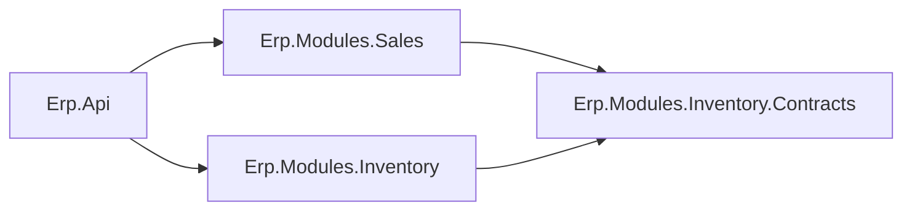

# Lesson 07 — Submit: Stock, Two Modules, One Transaction

Good day, developer! Today is the lesson where this architecture earns its keep. When a rep submits an order,
we must set its stock aside, and stock belongs to a different module: Inventory. So we'll build that module,
give it a contract Sales can call, and make sure that two reps racing for the last five units can never both
win. Take this one slowly; the ideas matter more than the typing. About two hours. Are you ready? Let's
begin!

## What we'll build

- The **Inventory module**, with its own schema and its own small public **contracts** project.
- An **atomic** stock reservation: safe even when two people submit at the same instant.
- `POST /sales-orders/{id}/submit`, which reserves stock for every line and changes the order's status in
  **one transaction** across both modules, so it all succeeds or none of it does.
- A lock that stops two submits for the same customer from both slipping past the credit limit.

## Why we build it this way

### Why reserve at submit

Because a manager shouldn't approve an order you can't fill. The moment an order is submitted, its stock is
set aside, so "pending approval" really means "we're holding this for you". If the order is later rejected
or cancelled, the stock goes back ([lesson 10](10-approve-reject-cancel.md)).

### Inventory is its own island

Stock levels are Inventory's business, not Sales'. So Inventory gets its own module and its own schema, and
Sales may not touch `inventory.*` tables or Inventory's classes. Sales may only ask, at Inventory's service
window: a public **contracts** project holding one interface.



Why a separate contracts *project*, and not just a public folder inside Inventory? Because modules will call
each other in both directions one day. If Sales referenced Inventory and Inventory referenced Sales, the
build would refuse: two projects can't reference each other. A contracts project references no module at
all, so any module can depend on it without ever making a cycle.

### The race for the last units

Here's the obvious way to reserve stock:

```csharp
var stock = await db.StockItems.FindAsync(itemId);
if (stock.OnHand - stock.Reserved >= quantity)   // 8 - 0 >= 5? yes
    stock.Reserve(quantity);                     // reserved = 5
await db.SaveChangesAsync();
```

Now picture two reps, each submitting 5 of the last 8 Restricted Kits, at the same instant. Both read
"8 available". Both pass the check. Both write. You've promised 10 kits you don't have.

The fix is to make the check and the write **one statement**, so the database does both in one step:

```sql
UPDATE inventory.stock_item
SET reserved = reserved + 5
WHERE item_id = 3 AND on_hand - reserved >= 5;
```

If the row still has room, it's updated and the database reports "1 row". If someone else got there first,
the `WHERE` no longer matches and it reports "0 rows". PostgreSQL makes the second statement wait for the
first to finish, then re-checks the `WHERE`. There's no gap between checking and writing. To remember it
easily: it's a turnstile, and only one person passes per turn.

### All or nothing, across two modules

An order has three lines, and the third item is out of stock. The first two reservations must be undone,
and the order must stay a draft. That's a **transaction**: everything inside it commits together, or rolls
back together.

Here's the catch. A transaction lives on **one database connection**. Right now, every DbContext gets its
own connection from the pool. Sales' context and Inventory's context would each have their own, and a
transaction on Sales' connection can't include Inventory's writes.

So we'll refactor: **every module's DbContext in one request shares the same connection**. Then Sales starts
the transaction, hands it to Inventory, and Inventory joins it.

### The race for the same customer's credit

One more race. A customer has room for one more big order. Two reps submit two orders for that customer at
the same instant. Each submit adds up the *other* pending orders, sees room, and passes. Now both are pending,
and together they're over the limit.

We fix this one differently, because the check spans *many* rows (all of the customer's pending orders),
not one. Inside the transaction, we **lock the customer's row** with `SELECT ... FOR UPDATE`. The second
submit for that customer waits at the lock until the first one commits, and then it sees the first order as
pending. Two submits for different customers don't wait for each other at all.

## 1. Refactor: one connection per request

First, the interface. In BuildingBlocks' `Data.cs`, add:

```csharp
// The one connection every module DbContext uses during a request, so a module can join another's transaction.
public interface ISharedConnection
{
    DbConnection Connection { get; }
}
```

Then the implementation, in a new Infrastructure file:

```csharp
// src/Shared/Erp.Shared.Infrastructure/Data/PostgresConnections.cs
using System.Data.Common;
using Erp.Shared.BuildingBlocks;
using Npgsql;

namespace Erp.Shared.Infrastructure;

public sealed class SharedPostgresConnection(NpgsqlDataSource dataSource) : ISharedConnection, IAsyncDisposable, IDisposable
{
    public DbConnection Connection { get; } = dataSource.CreateConnection();

    public ValueTask DisposeAsync() => Connection.DisposeAsync();
    public void Dispose() => Connection.Dispose();
}
```

Register it as **scoped**, which means one per HTTP request, in `AddSharedInfrastructure`:

```csharp
services.AddScoped<ISharedConnection, SharedPostgresConnection>();
```

Now each module's DbContext is built on that connection instead of on the pool. Here's the change in
`SalesDbContext`.

Before:

```csharp
public static DbContextOptionsBuilder Configure(DbContextOptionsBuilder o, NpgsqlDataSource dataSource) =>
    o.UseNpgsql(dataSource, npg => npg.MigrationsHistoryTable("__EFMigrationsHistory", Schema))
     .UseSnakeCaseNamingConvention();
```

After:

```csharp
public static DbContextOptionsBuilder Configure(DbContextOptionsBuilder o, DbConnection connection) =>
    o.UseNpgsql(connection, npg => npg.MigrationsHistoryTable("__EFMigrationsHistory", Schema))
     .UseSnakeCaseNamingConvention();
```

(add `using System.Data.Common;`). In `SalesModule`, the registration changes from
`sp.GetRequiredService<NpgsqlDataSource>()` to `sp.GetRequiredService<ISharedConnection>().Connection`. In
the design-time factory, pass `new NpgsqlConnection("Host=localhost;Database=erp_design_time")` instead of
`NpgsqlDataSource.Create(...)`. Make the same three changes in `ErpIdentityDbContext` and `IdentityModule`,
so every module follows one rule.

Run the tests and the app once now. Nothing should behave differently, and that's the point of a refactor.
EF Core opens and closes the shared connection as it needs to, and the request's end disposes it.

## 2. The Inventory projects

```bash
dotnet new classlib -n Erp.Modules.Inventory           -o src/Modules/Inventory/Erp.Modules.Inventory
dotnet new classlib -n Erp.Modules.Inventory.Contracts -o src/Modules/Inventory/Erp.Modules.Inventory.Contracts
rm src/Modules/Inventory/*/Class1.cs
dotnet sln add src/Modules/Inventory/Erp.Modules.Inventory src/Modules/Inventory/Erp.Modules.Inventory.Contracts

dotnet add src/Modules/Inventory/Erp.Modules.Inventory reference \
  src/Shared/Erp.Shared.BuildingBlocks src/Modules/Inventory/Erp.Modules.Inventory.Contracts
dotnet add src/Modules/Sales/Erp.Modules.Sales reference src/Modules/Inventory/Erp.Modules.Inventory.Contracts
dotnet add src/Erp.Api reference src/Modules/Inventory/Erp.Modules.Inventory

dotnet add src/Modules/Inventory/Erp.Modules.Inventory package Npgsql.EntityFrameworkCore.PostgreSQL --version 10.0.3
dotnet add src/Modules/Inventory/Erp.Modules.Inventory package EFCore.NamingConventions --version 10.0.1
dotnet add src/Modules/Inventory/Erp.Modules.Inventory package Microsoft.EntityFrameworkCore.Design --version 10.0.14
```

As always: delete each new `<PropertyGroup>`, mark the design package `PrivateAssets="all"`, and embed the
SQL files in `Erp.Modules.Inventory.csproj`:

```xml
<ItemGroup>
  <EmbeddedResource Include="Infrastructure\Sql\**\*.sql" />
</ItemGroup>
```

Look at the references you just made. Sales references Inventory's **contracts**, never Inventory itself.
And the contracts project references nothing at all.

## 3. The contract

```csharp
// src/Modules/Inventory/Erp.Modules.Inventory.Contracts/IStockReservation.cs
using System.Data.Common;

namespace Erp.Modules.Inventory.Contracts;

// Both calls join the caller's transaction, so stock and the caller's own change commit or roll back together.
// The caller must be on the request's ISharedConnection (every module DbContext is).
public interface IStockReservation
{
    // false = not enough available stock; nothing changed.
    Task<bool> TryReserveAsync(long itemId, int quantity, DbTransaction tx, CancellationToken ct);
    Task ReleaseAsync(long itemId, int quantity, DbTransaction tx, CancellationToken ct);
}
```

This is the only public type in Inventory's whole world. It takes the caller's transaction, `tx`, so
Inventory can join it.

Now, let's be honest about a cost here. Passing a database transaction through a contract is correct, and
simple, inside one app with one database, which is what we have. But it ties the two modules to the same
database. If Inventory ever moved to its own server, this `tx` would have to go, and "reserve, then undo if
the rest fails" would become hand-written compensation logic. The wall still saves you most of the work,
because Sales never touched Inventory's tables. Just don't imagine that move as free.

## 4. Inside Inventory

```csharp
// src/Modules/Inventory/Erp.Modules.Inventory/Domain/StockItem.cs
namespace Erp.Modules.Inventory.Domain;

// ItemId refers to an item in another module: by id only, never a cross-schema FK.
internal sealed class StockItem
{
    public long ItemId { get; private set; }
    public int OnHand { get; private set; }
    public int Reserved { get; private set; }   // promised to submitted orders
    public int Available => OnHand - Reserved;

    private StockItem() { }
}
```

```csharp
// src/Modules/Inventory/Erp.Modules.Inventory/Infrastructure/InventoryDbContext.cs
using System.Data.Common;
using Erp.Modules.Inventory.Domain;
using Microsoft.EntityFrameworkCore;
using Microsoft.EntityFrameworkCore.Design;

namespace Erp.Modules.Inventory.Infrastructure;

internal sealed class InventoryDbContext(DbContextOptions<InventoryDbContext> options) : DbContext(options)
{
    public const string Schema = "inventory";

    public DbSet<StockItem> StockItems => Set<StockItem>();

    // Shared by the app and `dotnet ef`, so the two can't drift apart.
    public static DbContextOptionsBuilder Configure(DbContextOptionsBuilder o, DbConnection connection) =>
        o.UseNpgsql(connection, npg => npg.MigrationsHistoryTable("__EFMigrationsHistory", Schema))
         .UseSnakeCaseNamingConvention();

    protected override void OnModelCreating(ModelBuilder b)
    {
        b.HasDefaultSchema(Schema);

        b.Entity<StockItem>(e =>
        {
            e.ToTable("stock_item", t =>
            {
                t.HasCheckConstraint("ck_stock_item_on_hand", "on_hand >= 0");
                t.HasCheckConstraint("ck_stock_item_reserved", "reserved >= 0");
                // Overselling is impossible at the data level, whatever the code does.
                t.HasCheckConstraint("ck_stock_item_not_over", "reserved <= on_hand");
            });
            e.HasKey(x => x.ItemId);
            e.Property(x => x.ItemId).ValueGeneratedNever();
            e.Ignore(x => x.Available);
        });
    }
}

// For `dotnet ef migrations add`; never connects.
internal sealed class InventoryDbContextFactory : IDesignTimeDbContextFactory<InventoryDbContext>
{
    public InventoryDbContext CreateDbContext(string[] args)
    {
        var o = new DbContextOptionsBuilder<InventoryDbContext>();
        InventoryDbContext.Configure(o, new Npgsql.NpgsqlConnection("Host=localhost;Database=erp_design_time"));
        return new InventoryDbContext(o.Options);
    }
}
```

`ValueGeneratedNever()` says the item id comes from outside (from Sales' item), not from a counter. And
look at `ck_stock_item_not_over`: even if every line of C# were wrong, PostgreSQL itself refuses to reserve
more than is on hand.

The reservation:

```csharp
// src/Modules/Inventory/Erp.Modules.Inventory/Infrastructure/StockReservationService.cs
using System.Data.Common;
using Erp.Modules.Inventory.Contracts;
using Microsoft.EntityFrameworkCore;

namespace Erp.Modules.Inventory.Infrastructure;

internal sealed class StockReservationService(InventoryDbContext db) : IStockReservation
{
    // Check and write in ONE statement, so two orders racing for the last units can't both win.
    public Task<bool> TryReserveAsync(long itemId, int quantity, DbTransaction tx, CancellationToken ct) =>
        InTransaction(tx, async () =>
        {
            var rows = await db.StockItems
                .Where(s => s.ItemId == itemId && s.OnHand - s.Reserved >= quantity)
                .ExecuteUpdateAsync(s => s.SetProperty(x => x.Reserved, x => x.Reserved + quantity), ct);
            return rows == 1;
        }, ct);

    public Task ReleaseAsync(long itemId, int quantity, DbTransaction tx, CancellationToken ct) =>
        InTransaction(tx, async () =>
        {
            await db.StockItems
                .Where(s => s.ItemId == itemId)
                .ExecuteUpdateAsync(s => s.SetProperty(
                    x => x.Reserved, x => x.Reserved - quantity < 0 ? 0 : x.Reserved - quantity), ct);
            return true;
        }, ct);

    // Join the caller's transaction for one operation, then let go: the caller owns the commit.
    private async Task<bool> InTransaction(DbTransaction tx, Func<Task<bool>> work, CancellationToken ct)
    {
        await db.Database.UseTransactionAsync(tx, ct);
        try { return await work(); }
        finally { await db.Database.UseTransactionAsync(null, ct); }
    }
}
```

Two EF Core tools are new here:

- **`ExecuteUpdateAsync`** turns the LINQ into exactly the one-statement `UPDATE ... WHERE ...` from earlier,
  without loading anything into memory first. It returns how many rows changed.
- **`UseTransactionAsync(tx)`** tells Inventory's context, "run your next commands inside this transaction
  someone else started". That only works because both contexts share the same connection. Afterwards we let
  go (`null`), because committing is the caller's job, not ours.

Then the rest of the module, following the same pattern as Sales:

```csharp
// src/Modules/Inventory/Erp.Modules.Inventory/Infrastructure/InventoryDatabase.cs
using Erp.Shared.BuildingBlocks;
using Microsoft.EntityFrameworkCore;

namespace Erp.Modules.Inventory.Infrastructure;

internal sealed class InventoryDatabase(InventoryDbContext db) : IModuleDatabase
{
    public string Module => "Inventory";

    public Task MigrateAsync(CancellationToken ct) => db.Database.MigrateAsync(ct);

    public Task SeedDevelopmentDataAsync(CancellationToken ct) =>
        EmbeddedSql.ExecuteAsync(db.Database.GetDbConnection(), EmbeddedSql.Read(typeof(InventoryDatabase).Assembly, "DevSeed.sql"), ct);
}
```

```sql
-- src/Modules/Inventory/Erp.Modules.Inventory/Infrastructure/Sql/DevSeed.sql
-- Development and test data; never runs in production. Item ids match the Sales dev seed.
-- Item 3 has thin stock so the reservation race is testable.
INSERT INTO inventory.stock_item (item_id, on_hand, reserved)
SELECT v.item_id, v.on_hand, v.reserved
FROM (VALUES (1, 100, 0),
             (2,  50, 0),
             (3,   8, 0),
             (4, 100, 0))
     AS v(item_id, on_hand, reserved)
WHERE NOT EXISTS (SELECT 1 FROM inventory.stock_item);
```

```csharp
// src/Modules/Inventory/Erp.Modules.Inventory/InventoryModule.cs
using Erp.Modules.Inventory.Contracts;
using Erp.Modules.Inventory.Infrastructure;
using Erp.Shared.BuildingBlocks;
using Microsoft.Extensions.DependencyInjection;

namespace Erp.Modules.Inventory;

public static class InventoryModule
{
    public static IServiceCollection AddInventoryModule(this IServiceCollection services)
    {
        // On the shared connection, so Inventory can join a transaction Sales started.
        services.AddDbContext<InventoryDbContext>((sp, o) =>
            InventoryDbContext.Configure(o, sp.GetRequiredService<ISharedConnection>().Connection));

        services.AddScoped<IModuleDatabase, InventoryDatabase>();
        services.AddScoped<IStockReservation, StockReservationService>();
        return services;
    }
}
```

The last line is the window opening: a public interface, backed by an internal class nobody outside can see.

In `Program.cs`, add `builder.Services.AddInventoryModule();` after `AddSalesModule()`, so Inventory migrates
and seeds after Sales. Then create Inventory's tables:

```bash
dotnet ef migrations add InitialCreate \
  --project src/Modules/Inventory/Erp.Modules.Inventory \
  --startup-project src/Modules/Inventory/Erp.Modules.Inventory \
  --output-dir Infrastructure/Migrations
```

## 5. Lock the customer while checking credit

Add one method to `SalesDbContext`:

```csharp
// Holds the customer's row until the transaction ends, so two submits for one customer can't both pass the
// credit check on the same stale numbers. Must be called inside a transaction.
public Task LockCustomerAsync(CustomerId id, CancellationToken ct) =>
    Database.ExecuteSqlAsync($"SELECT 1 FROM sales.customer WHERE id = {id.Value} FOR UPDATE", ct);
```

`ExecuteSqlAsync` with an interpolated string turns `{id.Value}` into a proper SQL parameter, never pasted
text, so this is safe from SQL injection. `FOR UPDATE` holds the row's lock until the transaction ends.

## 6. The submit slice

```csharp
// src/Modules/Sales/Erp.Modules.Sales/Features/SubmitSalesOrder/SubmitSalesOrderHandler.cs
using Erp.Modules.Inventory.Contracts;
using Erp.Modules.Sales.Domain;
using Erp.Modules.Sales.Infrastructure;
using Erp.Shared.BuildingBlocks;
using Mediator;
using Microsoft.EntityFrameworkCore;
using Microsoft.EntityFrameworkCore.Storage;

namespace Erp.Modules.Sales.Features;

internal sealed record SubmitSalesOrderCommand(long OrderId) : ICommand;

internal sealed class SubmitSalesOrderHandler(SalesDbContext db, IStockReservation stock, IClock clock)
    : ICommandHandler<SubmitSalesOrderCommand>
{
    public async ValueTask<Unit> Handle(SubmitSalesOrderCommand cmd, CancellationToken ct)
    {
        await using var tx = await db.Database.BeginTransactionAsync(ct);

        var orderId = new SalesOrderId(cmd.OrderId);
        var order = await db.SalesOrders.SingleOrDefaultAsync(o => o.Id == orderId, ct)
            ?? throw new NotFoundException($"Sales order {cmd.OrderId} not found.");

        await db.LockCustomerAsync(order.CustomerId, ct);
        var customer = await db.Customers.SingleAsync(c => c.Id == order.CustomerId, ct);
        var otherPending = await db.PendingTotalAsync(order.CustomerId, order.Id, ct);

        order.Submit(customer, otherPending, clock.UtcNow);   // may approve it on the spot

        foreach (var line in order.Lines)
        {
            if (!await stock.TryReserveAsync(line.ItemId.Value, line.Quantity.Value, tx.GetDbTransaction(), ct))
                throw new DomainException($"Insufficient stock for item {line.ItemId.Value}. Submission cancelled.");
        }

        await db.SaveChangesAsync(ct);
        await tx.CommitAsync(ct);
        return Unit.Value;
    }
}
```

Read it top to bottom; it's the story of a submit:

1. **Start the transaction.** `await using` means: if we leave this method without committing (because
   something threw), the transaction is rolled back automatically.
2. **Load the order, lock its customer, add up the other pending orders.** The lock makes the next submit
   for this customer wait right here.
3. **Ask the domain.** `order.Submit` checks blocked and credit, moves the order on, and approves it on the
   spot if it's ₱50,000 or less.
4. **Reserve each line through the contract**, passing our transaction. `GetDbTransaction()` unwraps EF's
   transaction into the plain `DbTransaction` the contract takes. If any line can't be reserved, we throw,
   and everything above, including earlier reservations, rolls back.
5. **Save and commit.** The status change and every reservation become permanent together.

And there's still no business `if` here. "Out of stock" is the database's answer, and the handler only turns
it into a `DomainException`.

```csharp
// src/Modules/Sales/Erp.Modules.Sales/Features/SubmitSalesOrder/SubmitSalesOrderEndpoint.cs
using Carter;
using Erp.Shared.BuildingBlocks;
using Mediator;
using Microsoft.AspNetCore.Builder;
using Microsoft.AspNetCore.Http;
using Microsoft.AspNetCore.Routing;

namespace Erp.Modules.Sales.Features;

internal sealed class SubmitSalesOrderEndpoint : ICarterModule
{
    public void AddRoutes(IEndpointRouteBuilder app) =>
        app.MapPost("/sales-orders/{id:long}/submit",
            async (long id, ISender sender, CancellationToken ct) =>
            {
                await sender.Send(new SubmitSalesOrderCommand(id), ct);
                return Results.NoContent();
            })
            .RequireAuthorization(p => p.RequireRole(Roles.SalesRep, Roles.SalesManager, Roles.Admin));
}
```

`{id:long}` in the route means "this part of the URL must be a number"; `/sales-orders/abc/submit` won't even
match.

## How a request flows

```mermaid
sequenceDiagram
  participant H as SubmitSalesOrderHandler
  participant SC as Shared connection
  participant D as SalesOrder / Customer
  participant I as StockReservationService
  H->>SC: BEGIN
  H->>SC: load order; SELECT ... FOR UPDATE (customer); sum pending
  H->>D: order.Submit(customer, pending, now)
  loop each line
    H->>I: TryReserveAsync(item, qty, tx)
    I->>SC: UPDATE stock_item ... WHERE available >= qty
  end
  H->>SC: UPDATE sales_order (status)
  H->>SC: COMMIT
```

One connection, one transaction, two modules. Clear so far?

## Mistakes to avoid

- Checking stock in C# and then writing. Two requests can both pass the check. Make it one statement.
- Giving Sales a reference to the Inventory *module*. Reference the contracts project only.
- Building a module's DbContext on its own connection. It can't join another module's transaction.
- Committing inside Inventory. The one who started the transaction commits it.
- Forgetting the customer lock. Two submits for one customer can slip past the credit limit together.

## Let's run it!

Restart the app so Inventory migrates and seeds. Then, as the manager (only managers may order Controlled
items), create two orders for 5 Restricted Kits each, for Epsilon. There are only 8 kits.

```bash
TOKEN=$(curl -s -X POST http://localhost:5264/auth/login -H "Content-Type: application/json" \
  -d '{"email":"manager@erp.local","password":"Password123!"}' | jq -r .accessToken)

A=$(curl -s -X POST http://localhost:5264/sales-orders -H "Authorization: Bearer $TOKEN" -H "Content-Type: application/json" \
  -d '{"customerId":5,"lines":[{"itemId":3,"quantity":5}]}' | jq .id)
B=$(curl -s -X POST http://localhost:5264/sales-orders -H "Authorization: Bearer $TOKEN" -H "Content-Type: application/json" \
  -d '{"customerId":5,"lines":[{"itemId":3,"quantity":5}]}' | jq .id)

curl -i -X POST http://localhost:5264/sales-orders/$A/submit -H "Authorization: Bearer $TOKEN"   # 204
curl -i -X POST http://localhost:5264/sales-orders/$B/submit -H "Authorization: Bearer $TOKEN"   # 422: Insufficient stock for item 3
```

```bash
PGPASSWORD=erp_dev_only "/c/Program Files/PostgreSQL/18/bin/psql.exe" -h localhost -U postgres -d erp \
  -c "SELECT item_id, on_hand, reserved FROM inventory.stock_item WHERE item_id = 3;" \
  -c "SELECT id, status FROM sales.sales_order WHERE customer_id = 5;"
```

Item 3 shows `reserved = 5`, not 10. Order A has status 2 (Approved: ₱2,500 is under the threshold, so it was
approved on submit), and order B is still 0 (Draft): its failed reservation rolled back everything. Those two
calls ran one after another; [lesson 13](13-testing.md) adds a test that fires them at the exact same time
and proves only one wins.

## Let's check!

1. Why is stock reserved at submit, and not at approval?
2. What goes wrong with "read the stock, check it in C#, then save"? What fixes it?
3. Why does Sales reference `Erp.Modules.Inventory.Contracts`, and not `Erp.Modules.Inventory`?
4. Why did every module's DbContext have to move onto one shared connection?
5. The third of three lines is out of stock. What happens to the first two reservations, and why?
6. Two reps submit orders for the same customer at the same instant. What does `FOR UPDATE` make the second
   one do?

And that's where this lesson ends. You've built a second module, a contract between the two, and a submit
that's safe under real-world races. Next time, managers get their say: approving, rejecting and cancelling.
Good luck, developer!

---

← [Lesson 07 — Create an order](07-create-order.md) · Next: [Lesson 10 — Approve, reject, cancel](10-approve-reject-cancel.md) →
