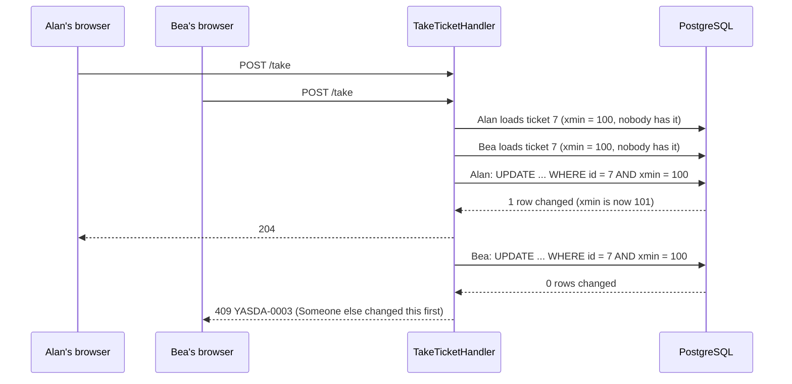

# Lesson 09 — Take a Ticket: Two Agents, One Ticket

Good day, developer! Until now, one person at a time used our system. Today, two agents click **Take it** on the same
ticket at the same instant, and the system must give it to exactly one of them. This is the lesson about the second
person: how to notice they lost, and how to tell them so politely. We'll also let a team lead hand a ticket to someone
else. It takes about three hours. Are you ready? Let's begin!

## What we'll build

| Piece | What it is |
|---|---|
| **A row version** | PostgreSQL's own `xmin` column, used so a save can tell the row changed since it was loaded |
| **`TakeTicket`** | An agent takes a ticket: `POST /api/tickets/{id}/take` |
| **`AssignTicket`** | A team lead hands a ticket to a person: `POST /api/tickets/{id}/assign` |
| **`FindStaffAsync`** | A new question Tickets may ask Identity: "is this person staff?" |
| **`TICKETS-0011`** | The error code for assigning a ticket to someone who isn't staff |
| **A "Take it" button** | On the ticket's page, for staff only |
| **Tests** | The race, both ways of losing it, and the doors |

## Why we build it this way

### The pain: check, then save

The obvious way to write "take" is to check, then save:

```csharp
var ticket = await db.Tickets.SingleAsync(t => t.Id == id);
if (ticket.AssigneeId is not null) return;   // somebody has it already
ticket.Take(me, myName, now);
await db.SaveChangesAsync();
```

On your machine, alone, it works every time. With two agents it has a hole. Alan and Bea both load ticket #7. For
both of them, `AssigneeId` is empty, so both checks pass. Alan saves. Bea saves a moment later and writes over him:
the ticket says Bea, and Alan has been working on it for ten minutes. That's a **race condition**: the result depends
on who gets there first, and nothing in the code looked wrong.

The check isn't wrong. It's just too early. By the time Bea saves, what she checked is out of date.

### The fix: let the save notice

A **row version** is a value the database changes every time the row changes. EF Core remembers the version it saw when
it loaded the ticket, and the save says, in effect: "update this row, but only if its version is still the one I saw."
If someone changed it in between, no row matches, nothing is written, and EF Core throws a
`DbUpdateConcurrencyException`. This is **optimistic concurrency**: nobody is locked out while they read, and the
conflict is caught at the moment of saving.

PostgreSQL gives every row a version for free: a hidden system column called `xmin`. We don't add a column. We just tell
EF Core to use the one that's there.

Now, the part most people miss: the second agent can lose in **two different ways**.

| What happened | Who stops it | The answer |
|---|---|---|
| Bea loaded the ticket **before** Alan saved, and saves after | The row version: her save matches no row | `409` and `YASDA-0003` ("Someone else changed this first") |
| Bea loaded the ticket **after** Alan saved | `Ticket.Take`, the rule from lesson 04: the ticket has someone | `422` and `TICKETS-0007` ("Someone else already has this ticket") |

Both are the right outcome: one winner, one clear message. We need both defenses. The domain rule alone misses the
first case, and the row version alone would make the second case look like a mystery.

Lesson 07 already turns a `DbUpdateConcurrencyException` into a `409`. So today's work is mostly making it *happen*.

Now, let's be honest about the cost here: the row version doesn't fix anything for the loser, it only tells them. Bea must
reload and look again. For a "take" that's fine, since the ticket page already shows who has it. For a long reply someone
has been typing, losing is more painful, and lesson 11 deals with that.

## 1. The row version

In `TicketsDbContext.cs`, add one line to the `Ticket` mapping, under the `AssigneeId` index:

```csharp
            e.HasIndex(x => x.AssigneeId);
            e.Property<uint>("RowVersion").IsRowVersion().HasColumnName("xmin");
```

The domain class doesn't change: `RowVersion` is a **shadow property**, one EF Core keeps for the column without a field
in `Ticket`. The domain stays free of database details. `IsRowVersion()` says "check this on every update", and
`HasColumnName("xmin")` points it at PostgreSQL's column.

Now build, and run the tests before anything else. They fail, and that's the lesson:

```
The model for context 'TicketsDbContext' has pending changes. Add a new migration before updating the database.
```

EF Core refuses to start on a database whose map has changed without a migration. It's a tripwire against forgetting one.
Add the migration:

```bash
dotnet ef migrations add AddTicketRowVersion \
  --project src/Modules/Tickets/Yasda.Modules.Tickets \
  --startup-project src/Yasda.Api \
  --output-dir Infrastructure/Migrations
```

Open the file it made. It says to add a column named `xmin`:

```csharp
migrationBuilder.AddColumn<uint>(name: "xmin", schema: "tickets", table: "ticket", type: "xid", rowVersion: true, nullable: false, defaultValue: 0u);
```

You can't add a column called `xmin` to a PostgreSQL table: it already has one. So what does this migration do? Ask for
the SQL it would run:

```bash
dotnet ef migrations script AddReadFunctions AddTicketRowVersion \
  --project src/Modules/Tickets/Yasda.Modules.Tickets \
  --startup-project src/Yasda.Api
```

```
START TRANSACTION;
INSERT INTO tickets."__EFMigrationsHistory" (migration_id, product_version)
VALUES ('...AddTicketRowVersion', '10.0.14');
COMMIT;
```

Npgsql knows `xmin` is a system column and leaves the `ALTER TABLE` out. The migration only records itself in the history
table, and updates the snapshot so the tripwire is quiet. (The migrations of the finished reference build have it
folded into `InitialCreate`, as lesson 05 said.)

## 2. Asking Identity: is this person staff?

A team lead assigns a ticket to a person by id. Tickets must refuse an id that isn't staff, such as a requester's. But
who is staff is Identity's knowledge, and Tickets may not read Identity's tables (lesson 07). So the service window grows
one question. In `IdentityContracts.cs`, replace the file:

```csharp
// src/Modules/Identity/Yasda.Modules.Identity.Contracts/IdentityContracts.cs
namespace Yasda.Modules.Identity.Contracts;

// Identity's service window: what other modules may ask about people, and nothing more.
public interface IUserDirectory
{
    // The account with this email (any case), or null. For the development seed today; inbound email later.
    Task<long?> IdOfAsync(string email, CancellationToken ct);

    // The name to show for a user, or null if there's no such user.
    Task<string?> NameOfAsync(long userId, CancellationToken ct);

    // A person who may handle tickets (Agent, TeamLead or Admin), or null.
    Task<StaffMember?> FindStaffAsync(long userId, CancellationToken ct);
}

public sealed record StaffMember(long Id, string FullName, string Role);
```

`StaffMember` is plain data, like a form that Identity fills in and hands across. Identity answers it with one more
Dapper read. Add this method to `UserDirectory`, under `NameOfAsync`:

```csharp
    public async Task<StaffMember?> FindStaffAsync(long userId, CancellationToken ct)
    {
        await using var conn = connections.Create();
        return await conn.QuerySingleOrDefaultAsync<StaffMember>(new CommandDefinition(
            """
            SELECT u.id, u.full_name, r.name AS role
            FROM identity.users u
            JOIN identity.user_roles ur ON ur.user_id = u.id
            JOIN identity.roles r ON r.id = ur.role_id
            WHERE u.id = @userId AND r.name IN (@agent, @teamLead, @admin)
            """, new { userId, agent = Roles.Agent, teamLead = Roles.TeamLead, admin = Roles.Admin }, cancellationToken: ct));
    }
```

The query joins the user to their role. `IN (...)` matches any of the three role names, each sent as a parameter. (A single array parameter looks tidier, but Dapper's way of expanding one doesn't work with Npgsql, so three plain parameters it is.) Someone with the role
`Requester` returns no row, so the answer is `null`. Add `using Yasda.Shared.BuildingBlocks;` if `Roles` isn't found.
(Lesson 16 gives accounts a "disabled" switch, and this query learns to skip disabled people then.)

Tickets needs a code to refuse with. Add this at the end of `TicketsErrors`, after `CancelReasonRequired`, never in the
middle (codes are never renumbered):

```csharp
    public static readonly ErrorCode AssigneeNotStaff = new("TICKETS-0011", "That person can't be assigned tickets",
        "Choose an active agent, team lead or admin from the list.");
```

## 3. The first feature: take a ticket

Same two files as always.

```csharp
// src/Modules/Tickets/Yasda.Modules.Tickets/Features/TakeTicket/TakeTicketHandler.cs
using Microsoft.EntityFrameworkCore;
using Yasda.Modules.Identity.Contracts;
using Yasda.Modules.Tickets.Domain;
using Yasda.Modules.Tickets.Infrastructure;
using Yasda.Shared.BuildingBlocks;

namespace Yasda.Modules.Tickets.Features;

internal sealed record TakeTicketCommand(long TicketId);

internal sealed class TakeTicketHandler(TicketsDbContext db, ICurrentUser currentUser, IUserDirectory users, TimeProvider time)
{
    // Two agents clicking "Take" at the same moment both load an unassigned ticket. The first save wins; the
    // second fails on the ticket's row version (xmin) and gets a 409, so a ticket never has two owners.
    public async Task<bool> HandleAsync(TakeTicketCommand cmd, CancellationToken ct)
    {
        var ticketId = new TicketId(cmd.TicketId);
        var ticket = await db.Tickets.SingleOrDefaultAsync(t => t.Id == ticketId, ct);
        if (ticket is null) return false;

        var me = new UserId(currentUser.UserId);
        var myName = await users.NameOfAsync(currentUser.UserId, ct) ?? currentUser.Username;
        ticket.Take(me, myName, time.GetUtcNow().UtcDateTime);

        await db.SaveChangesAsync(ct);
        return true;
    }
}
```

```csharp
// src/Modules/Tickets/Yasda.Modules.Tickets/Features/TakeTicket/TakeTicketEndpoint.cs
using Microsoft.AspNetCore.Builder;
using Microsoft.AspNetCore.Http;
using Microsoft.AspNetCore.Http.HttpResults;
using Microsoft.AspNetCore.Routing;

namespace Yasda.Modules.Tickets.Features;

internal static class TakeTicketEndpoint
{
    public static void Map(IEndpointRouteBuilder app)
    {
        app.MapPost("/tickets/{id:long}/take", async Task<Results<NoContent, NotFound>> (long id, TakeTicketHandler handler, CancellationToken ct) =>
        {
            var found = await handler.HandleAsync(new TakeTicketCommand(id), ct);
            if (!found) return TypedResults.NotFound();
            return TypedResults.NoContent();
        })
        .RequireAuthorization(policy => policy.RequireRole(TicketRoles.Handlers));
    }
}
```

Look at what is *missing*. The handler has no business `if`: no "is it already taken?", no "is it finished?". It loads,
asks the ticket to take itself, and saves. `Ticket.Take` (lesson 04) holds every rule and throws a `DomainException`
that lesson 07's handler turns into a `422` with its code. The handler's only decision is "does the ticket exist?", and
as the module rules say, that belongs to the endpoint's answer: `404`.

Two things are new:

- **`policy.RequireRole(TicketRoles.Handlers)`** is the door for a role. `RequireAuthorization()` alone (lesson 06) lets any signed-in
  person through. This one lets in only `Agent`, `TeamLead` and `Admin` (the list from lesson 08), and answers a requester
  `403` before the handler runs. "Only role X may call this endpoint" lives in the endpoint.
- **The handler loads the ticket by id, with no visibility check.** Lesson 08's page had to hide other people's tickets from a
  requester. Here the door already refuses requesters, so every caller may see every ticket. When a requester gets
  actions of their own, in lesson 10, the load grows a check.

`NoContent` is `204`: the take worked, and there's nothing to send back. The page reloads the ticket to see its new state.

## 4. The second feature: assign a ticket

Taking is for yourself. **Assigning** is a team lead handing a ticket to someone, whoever had it before.

```csharp
// src/Modules/Tickets/Yasda.Modules.Tickets/Features/AssignTicket/AssignTicketHandler.cs
using Microsoft.EntityFrameworkCore;
using Yasda.Modules.Identity.Contracts;
using Yasda.Modules.Tickets.Domain;
using Yasda.Modules.Tickets.Infrastructure;
using Yasda.Shared.BuildingBlocks;

namespace Yasda.Modules.Tickets.Features;

internal sealed record AssignTicketCommand(long TicketId, long AssigneeId);

internal sealed class AssignTicketHandler(TicketsDbContext db, IUserDirectory users, TimeProvider time)
{
    public async Task<bool> HandleAsync(AssignTicketCommand cmd, CancellationToken ct)
    {
        var ticketId = new TicketId(cmd.TicketId);
        var ticket = await db.Tickets.SingleOrDefaultAsync(t => t.Id == ticketId, ct);
        if (ticket is null) return false;

        // Only Identity knows who is staff. An id in the body that isn't, is refused with its code.
        var assignee = await users.FindStaffAsync(cmd.AssigneeId, ct);
        if (assignee is null)
            throw new DomainException(TicketsErrors.AssigneeNotStaff, $"User {cmd.AssigneeId} isn't an active agent, team lead or admin.");

        ticket.Assign(new UserId(assignee.Id), assignee.FullName, time.GetUtcNow().UtcDateTime);

        await db.SaveChangesAsync(ct);
        return true;
    }
}
```

```csharp
// src/Modules/Tickets/Yasda.Modules.Tickets/Features/AssignTicket/AssignTicketEndpoint.cs
using FluentValidation;
using Microsoft.AspNetCore.Builder;
using Microsoft.AspNetCore.Http;
using Microsoft.AspNetCore.Http.HttpResults;
using Microsoft.AspNetCore.Routing;

namespace Yasda.Modules.Tickets.Features;

internal sealed record AssignTicketRequest(long AssigneeId);

internal sealed class AssignTicketRequestValidator : AbstractValidator<AssignTicketRequest>
{
    public AssignTicketRequestValidator()
    {
        RuleFor(x => x.AssigneeId).GreaterThan(0);
    }
}

internal static class AssignTicketEndpoint
{
    // Handing work to someone else is the team lead's call.
    public static void Map(IEndpointRouteBuilder app)
    {
        app.MapPost("/tickets/{id:long}/assign",
            async Task<Results<NoContent, NotFound>> (long id, AssignTicketRequest body, AssignTicketHandler handler, CancellationToken ct) =>
        {
            var found = await handler.HandleAsync(new AssignTicketCommand(id, body.AssigneeId), ct);
            if (!found) return TypedResults.NotFound();
            return TypedResults.NoContent();
        })
        .RequireAuthorization(policy => policy.RequireRole(TicketRoles.Leads));
    }
}
```

The three kinds of "no" are in three places, as the table in lesson 03 promised:

| Question | Answer | Where |
|---|---|---|
| Is `assigneeId` a positive number? | `400` | The validator, before the handler |
| Does the ticket in the URL exist? | `404` | The handler returns `false`, the endpoint answers |
| Is the person in the body staff? | `422` + `TICKETS-0011` | The handler asks Identity, and refuses with a code |

An unknown id *in the body* is a coded `422`, and an unknown id *in the URL* is a plain `404`: the URL names the thing
you're talking to, the body is information about it. And the role door is `TicketRoles.Leads` (`TeamLead` and `Admin`)
from lesson 08, so an ordinary agent gets `403`.

Register both handlers and map both endpoints in `TicketsModule.cs`:

```csharp
        services.AddScoped<GetTicketHandler>();
        services.AddScoped<TakeTicketHandler>();
        services.AddScoped<AssignTicketHandler>();
```

```csharp
        GetTicketEndpoint.Map(tickets);
        TakeTicketEndpoint.Map(tickets);
        AssignTicketEndpoint.Map(tickets);
```

Forget a registration and `Every_feature_handler_is_registered` (lesson 03) names the handler.

## 5. The screen: a "Take it" button

The ticket's page has been read-only. Staff get an action now. First, the page needs to ask the same question the API
did, and the model has the answer. In `Models.cs`, give `TicketDetail` a body and a property, replacing its closing
`);`:

```csharp
public sealed record TicketDetail(long Id, string Subject, string Status, string Priority, long RequesterId, string RequesterName,
    long? AssigneeId, string? AssigneeName, DateTime CreatedUtc, DateTime UpdatedUtc, DateTime? FirstResponseUtc,
    DateTime? ResolvedUtc, DateTime? ClosedUtc, string? CancelReason, List<TicketMessage> Messages)
{
    public bool IsBeingWorkedOn => Status is "New" or "Open" or "Pending";
}
```

The page also needs a way to send a change: so far `ApiClient` can only create things. Add a method for a POST with no
body, under `Create`:

```csharp
    // For actions that need no body ("take this ticket"): true when the API said yes.
    public async Task<bool> Post(string url, string? success = null)
    {
        notices.Clear();
        _saving++;
        HttpResponseMessage response;
        try
        {
            response = await http.PostAsync(url, null);
        }
        finally
        {
            _saving--;
        }

        if (!response.IsSuccessStatusCode)
        {
            await Fail(response);
            return false;
        }

        if (success is not null) notices.Success(success);
        return true;
    }
```

Now, let's be honest about the cost here: this repeats the lines `Create` has for clearing the message and counting the busy
call. We'll fold them together when a third and fourth action need them, in lesson 10, rather than guess the shape now.

On the page, `TicketPage.razor` takes three edits. First, inject the sign-in state under the other `@inject` lines, so the
page knows who is looking:

```razor
@inject CookieAuthenticationStateProvider Auth
```

Second, the button, between the header and the conversation (under the `CancelReason` block):

```razor
    @* What this person can do now. The API checks every one of these again; hiding a button is only a convenience. *@
    <div class="actions">
        @if (IsStaff && _ticket.IsBeingWorkedOn && _ticket.AssigneeId != MyId)
        {
            <button type="button" @onclick="Take" disabled="@Api.Busy">Take it</button>
        }
    </div>
```

Third, the code. The `@code` block becomes:

```razor
@code {
    [Parameter] public long Id { get; set; }

    private TicketDetail? _ticket;

    private long? MyId => Auth.User?.Id;
    private bool IsStaff => TicketChoices.IsStaff(Auth.User?.Role);

    protected override async Task OnParametersSetAsync()
    {
        await Auth.GetAuthenticationStateAsync();
        await Load();
    }

    private async Task Load()
    {
        _ticket = await Api.Get<TicketDetail>($"api/tickets/{Id}");
    }

    // Whether it worked or not, show the ticket as it is now: after a lost race, that is the winner's name.
    private async Task Take()
    {
        await Api.Post($"api/tickets/{Id}/take", "You have this ticket now.");
        await Load();
    }
}
```

`Take` reloads in both cases. That is the polite way to lose: Bea clicks, sees "Someone else changed this first" in the
status line, and the page behind it now says **Assigned: Alan Reyes**. She doesn't have to guess what happened. Agents
who already have the ticket don't see the button, and neither do requesters.

There's no "Assign" form yet, only the API. A team lead needs a list of people to choose from, and the endpoint that
lists them arrives with the user screens in lesson 16. Until then, the API is how a lead assigns. Try it, with the lead's
token and an agent's id (use the `/api/auth/me` call from lesson 06 to find one):

```bash
curl -s -X POST http://localhost:5264/api/tickets/1/assign -H "Authorization: Bearer $LEAD_TOKEN" \
  -H "Content-Type: application/json" -d '{"assigneeId": 3}' -w "%{http_code}\n"
# 204
```

## 6. Prove it: one winner, every time

### The domain rules were already proven

`Ticket.Take` and `Ticket.Assign` were unit-tested in lesson 04, including `Nobody_takes_a_ticket_someone_else_has`. The
work today is the layers around them: the row version, the doors and the screen. Those need the real app and a real
database.

### The race, two ways

The trouble with testing a race is that you can't make it happen on purpose. So we write two tests. One is fast and
certain; the other is honest.

Create the test class:

```csharp
// tests/Yasda.Integration.Tests/TakeTicketTests.cs
using System.Net;
using System.Net.Http.Json;
using System.Text.Json;
using AwesomeAssertions;
using Yasda.Modules.Tickets.Domain;
using Yasda.Modules.Tickets.Infrastructure;
using Yasda.Shared.BuildingBlocks;
using Microsoft.EntityFrameworkCore;
using Microsoft.Extensions.DependencyInjection;

namespace Yasda.Integration.Tests;

// Taking and assigning tickets through the real API, and the two ways the second of two agents loses.
[Collection("Integration")]
public class TakeTicketTests(CustomWebAppFactory factory)
{
    private const string Requester = "requester@yasda.local", Agent = "agent@yasda.local", Lead = "lead@yasda.local";

    private sealed record Created(long Id);
    private sealed record TicketView(string Status, long? AssigneeId, string? AssigneeName);
    private sealed record Me(long Id);

    private static async Task<long> FileOne(HttpClient client)
    {
        var response = await client.PostAsJsonAsync("/api/tickets", new { subject = "Printer won't print", message = "It says paper jam.", priority = "High" });
        response.StatusCode.Should().Be(HttpStatusCode.Created);
        var created = await response.Content.ReadFromJsonAsync<Created>();
        return created!.Id;
    }

    private static async Task<string?> CodeOf(HttpResponseMessage response)
    {
        var problem = await response.Content.ReadFromJsonAsync<JsonElement>();
        return problem.GetProperty("code").GetString();
    }
```

The first test makes the stale copy on purpose. Two scopes are two separate requests, each with its own `DbContext`.
Both load the ticket while nobody has it. Then the first saves, and the second saves what it holds:

```csharp
    // The race, without the luck: both agents load the ticket while nobody has it, then both save. The row version lets
    // only the first save through, every time.
    [Fact]
    public async Task The_second_of_two_takes_on_the_same_stale_ticket_is_refused()
    {
        var id = await FileOne(await factory.ClientFor(Requester));

        await using var firstScope = factory.Services.CreateAsyncScope();
        await using var secondScope = factory.Services.CreateAsyncScope();
        var firstDb = firstScope.ServiceProvider.GetRequiredService<TicketsDbContext>();
        var secondDb = secondScope.ServiceProvider.GetRequiredService<TicketsDbContext>();
        var firstCopy = await firstDb.Tickets.SingleAsync(t => t.Id == new TicketId(id));
        var secondCopy = await secondDb.Tickets.SingleAsync(t => t.Id == new TicketId(id));

        firstCopy.Take(new UserId(3), "Alan Reyes", DateTime.UtcNow);
        await firstDb.SaveChangesAsync();
        secondCopy.Take(new UserId(4), "Bea Lim", DateTime.UtcNow);

        var secondSaves = () => secondDb.SaveChangesAsync();
        await secondSaves.Should().ThrowAsync<DbUpdateConcurrencyException>();
    }
```

Nothing here depends on timing, because the test arranges the order itself. It fails the same way every run if the row
version goes missing. The second test is the real thing: two real requests at once.

```csharp
    // The race itself: two agents click "Take" on the same new ticket at the same instant. Exactly one gets it; the other
    // is told no (409 if both loaded it before either saved, 422 if the first had already saved). Never both.
    [Fact]
    public async Task Two_agents_taking_the_same_ticket_at_once_never_both_get_it()
    {
        var first = await factory.ClientFor(Agent);
        var second = await factory.ClientFor(await factory.CreateUserAsync(Roles.Agent));
        var requester = await factory.ClientFor(Requester);

        for (var round = 0; round < 10; round++)
        {
            var id = await FileOne(requester);

            // Task.WhenAll on purpose: sending the two requests together is the whole test.
            var answers = await Task.WhenAll(
                first.PostAsync($"/api/tickets/{id}/take", null),
                second.PostAsync($"/api/tickets/{id}/take", null));

            answers.Count(a => a.StatusCode == HttpStatusCode.NoContent).Should().Be(1, "exactly one agent may win round {0}", round);
            answers.Select(a => a.StatusCode).Should().OnlyContain(s =>
                s == HttpStatusCode.NoContent || s == HttpStatusCode.Conflict || s == HttpStatusCode.UnprocessableEntity);
        }
    }
```

`Task.WhenAll` starts both requests before waiting for either. (Everywhere else in the course we `await` one thing at a
time; here, sending them together is the point.) It runs ten rounds, because one lucky ordering proves nothing. The test
doesn't say *which* agent wins, or which of the two losing answers comes back: that depends on the timing, and either
is correct. It insists on only the part that must always be true: exactly one `204`, and the other a `409` or a `422`.

This test is why the first one exists. If the second ever fails, it fails *sometimes*, and a test that fails sometimes is
hard to debug. The first one fails every time.

Make each fail once. Remove the row version's line from `TicketsDbContext`, then add a migration so the app starts
(you've seen why):

```bash
dotnet ef migrations add Experiment \
  --project src/Modules/Tickets/Yasda.Modules.Tickets \
  --startup-project src/Yasda.Api \
  --output-dir Infrastructure/Migrations
dotnet test tests/Yasda.Integration.Tests
```

Both tests go red: the stale-copy test says the save didn't throw, and the race test says that two agents both got a `204`.
Put it back: restore the line, then take the experiment out with `dotnet ef migrations remove --force` (same `--project` and
`--startup-project`). Without `--force`, the command first connects to a database to check the migration was never applied, and
its design-time connection has no password, so it stops with a login error. `--force` skips that check, which is safe here:
the experiment only ever touched the throwaway test database. Run again and both are green.

The other way to lose has its own test. It needs no timing either: the first agent finishes, and the second asks afterward.

```csharp
    // The other way to lose: the first agent had already saved when the second asked, so Ticket.Take itself refuses.
    [Fact]
    public async Task A_ticket_someone_else_already_has_cant_be_taken()
    {
        var id = await FileOne(await factory.ClientFor(Requester));
        var first = await factory.ClientFor(Agent);
        var second = await factory.ClientFor(await factory.CreateUserAsync(Roles.Agent));
        var firstAnswer = await first.PostAsync($"/api/tickets/{id}/take", null);
        firstAnswer.StatusCode.Should().Be(HttpStatusCode.NoContent);

        var late = await second.PostAsync($"/api/tickets/{id}/take", null);

        late.StatusCode.Should().Be(HttpStatusCode.UnprocessableEntity);
        (await CodeOf(late)).Should().Be("TICKETS-0007");
    }
```

### The doors and the happy path

Add these to the same class, then close it with a `}`:

```csharp
    [Fact]
    public async Task An_agent_takes_a_new_ticket_and_it_opens()
    {
        var id = await FileOne(await factory.ClientFor(Requester));
        var agent = await factory.ClientFor(Agent);

        var response = await agent.PostAsync($"/api/tickets/{id}/take", null);

        response.StatusCode.Should().Be(HttpStatusCode.NoContent);
        var ticket = await agent.GetFromJsonAsync<TicketView>($"/api/tickets/{id}");
        ticket!.Status.Should().Be("Open");
        ticket.AssigneeName.Should().Be("Alan Reyes");
    }

    [Fact]
    public async Task A_requester_cant_take_a_ticket()
    {
        var requester = await factory.ClientFor(Requester);
        var id = await FileOne(requester);

        var response = await requester.PostAsync($"/api/tickets/{id}/take", null);

        response.StatusCode.Should().Be(HttpStatusCode.Forbidden);
    }

    [Fact]
    public async Task Taking_a_ticket_that_does_not_exist_is_404()
    {
        var agent = await factory.ClientFor(Agent);

        var response = await agent.PostAsync("/api/tickets/999999999/take", null);

        response.StatusCode.Should().Be(HttpStatusCode.NotFound);
    }

    [Fact]
    public async Task A_lead_assigns_a_ticket_to_an_agent_and_nobody_else_does()
    {
        var id = await FileOne(await factory.ClientFor(Requester));
        var agent = await factory.ClientFor(Agent);
        var me = await agent.GetFromJsonAsync<Me>("/api/auth/me");
        var lead = await factory.ClientFor(Lead);

        var byLead = await lead.PostAsJsonAsync($"/api/tickets/{id}/assign", new { assigneeId = me!.Id });
        var byAgent = await agent.PostAsJsonAsync($"/api/tickets/{id}/assign", new { assigneeId = me.Id });

        byLead.StatusCode.Should().Be(HttpStatusCode.NoContent);
        byAgent.StatusCode.Should().Be(HttpStatusCode.Forbidden);
        var ticket = await agent.GetFromJsonAsync<TicketView>($"/api/tickets/{id}");
        ticket!.AssigneeId.Should().Be(me.Id);
    }

    [Fact]
    public async Task A_ticket_cant_be_assigned_to_someone_who_isnt_staff()
    {
        var requester = await factory.ClientFor(Requester);
        var id = await FileOne(requester);
        var me = await requester.GetFromJsonAsync<Me>("/api/auth/me");
        var lead = await factory.ClientFor(Lead);

        var response = await lead.PostAsJsonAsync($"/api/tickets/{id}/assign", new { assigneeId = me!.Id });

        response.StatusCode.Should().Be(HttpStatusCode.UnprocessableEntity);
        (await CodeOf(response)).Should().Be("TICKETS-0011");
    }

    [Fact]
    public async Task Assigning_a_ticket_that_does_not_exist_is_404()
    {
        var lead = await factory.ClientFor(Lead);

        var response = await lead.PostAsJsonAsync("/api/tickets/999999999/assign", new { assigneeId = 3 });

        response.StatusCode.Should().Be(HttpStatusCode.NotFound);
    }

    [Theory]
    [InlineData(0)]
    [InlineData(-5)]
    public async Task An_assignee_id_that_isnt_positive_is_refused_before_the_handler(long assigneeId)
    {
        var id = await FileOne(await factory.ClientFor(Requester));
        var lead = await factory.ClientFor(Lead);

        var response = await lead.PostAsJsonAsync($"/api/tickets/{id}/assign", new { assigneeId });

        response.StatusCode.Should().Be(HttpStatusCode.BadRequest);
    }
}
```

`A_ticket_cant_be_assigned_to_someone_who_isnt_staff` is the contract at work: the requester's own id goes in the body, and
Identity says "not staff" without Tickets ever seeing a role table. Make it fail once: change the `WHERE` in `FindStaffAsync`
to drop the `r.name IN (...)` condition. The test goes red (the requester is "found" and the assignment
succeeds). Put it back.

### The button, in a browser

The test needs a way to find the status line by what it says. Add this method to `UiTest`, under `MainNav`. A page can show
its own "Loading…" status at the same moment, so the helper looks for the status that contains the text, not just any status:

```csharp
// tests/Yasda.Web.UiTests/UiTest.cs (add under MainNav)
    protected static ILocator StatusSaying(IPage page, string text)
    {
        return page.GetByRole(AriaRole.Status).Filter(new() { HasText = text });
    }
```

Add this test to `TicketUiTests`, above the existing tests that take a ticket. It files a ticket as a requester, then
signs in as an agent and takes it:

```csharp
    [UiFact]
    public async Task An_agent_takes_a_ticket_and_it_becomes_theirs()
    {
        var (_, address) = await FileTicket($"Projector {Guid.NewGuid():N}");
        var agent = await SignIn("agent@yasda.local");
        await agent.GotoAsync(address);

        await agent.GetByRole(AriaRole.Button, new() { Name = "Take it" }).ClickAsync();

        await Expect(StatusSaying(agent, "You have this ticket now.")).ToBeVisibleAsync();
        await Expect(agent.GetByText("Assigned: Alan Reyes")).ToBeVisibleAsync();
        await Expect(agent.GetByText("Status: Open")).ToBeVisibleAsync();
        await Expect(agent.GetByRole(AriaRole.Button, new() { Name = "Take it" })).ToHaveCountAsync(0);
    }
```

The button is found by role and name, and the last line proves it goes away once the ticket is yours. (Lesson 08's
`A_requester_files_a_ticket_and_lands_on_it` already checks that a requester sees no "Take it".)

### Edge cases covered in this lesson

| Test | The edge | Why it matters |
|---|---|---|
| `The_second_of_two_takes_on_the_same_stale_ticket_is_refused` | Both load before either saves | The row version, with no luck involved |
| `Two_agents_taking_the_same_ticket_at_once_never_both_get_it` | Two real requests at once, ten rounds | One winner, whichever way the timing falls |
| `A_ticket_someone_else_already_has_cant_be_taken` | The second asks after the first saved | The domain rule is the second defense, with its own code |
| `A_requester_cant_take_a_ticket` | A role the door refuses | `403` before the handler runs |
| `Taking_a_ticket_that_does_not_exist_is_404` | An id with no ticket | "Does it exist?" is the endpoint's answer |
| `A_lead_assigns_a_ticket_to_an_agent_and_nobody_else_does` | An agent assigning | Only `Leads` hand work out |
| `A_ticket_cant_be_assigned_to_someone_who_isnt_staff` | A requester's id in the body | An unknown thing in the body is a coded `422` |
| `An_assignee_id_that_isnt_positive_is_refused_before_the_handler` | 0 and -5 | The validator answers `400`, and the handler never runs |
| `An_agent_takes_a_ticket_and_it_becomes_theirs` | The whole thing, in a browser | The button, the message, the page's new state |

## How a request flows



If Bea had loaded after Alan saved, she would have seen `xmin = 101` and Alan's name, and `Ticket.Take` would have thrown
`TICKETS-0007` before any `UPDATE` was sent.

## Mistakes to avoid

- Checking "is it taken?" in the handler and thinking that's safe. The check and the save are two moments, and the world
  moves between them.
- Forgetting the row version on the `Ticket`. Everything still compiles and passes one-person tests; the bug waits for two
  agents.
- Skipping the migration after changing the map. The app refuses to start on a model with pending changes, which is the
  tripwire doing its job.
- Treating the `409` as an error to hide. It is the correct answer. Show the message, and show the ticket as it is now.
- Testing a race only with `Task.WhenAll` and hoping. Write the version that arranges the order, too.
- Letting Tickets read Identity's tables to find out who is staff. Ask through the contract.
- A role check inside the handler. "Only role X may call this" belongs on the endpoint.

## Let's run it!

```bash
dotnet build
dotnet test
```

The build shows **0 warnings and 0 errors**, and the tests report 11 more passed than in lesson 08, plus one more skipped
(the new browser test). Start the app and run the browser tests too:

```bash
dotnet run --project src/Yasda.Api
```

```bash
YASDA_UI_URL=http://localhost:5264 dotnet test tests/Yasda.Web.UiTests
```

Now be both agents. Sign in as `agent@yasda.local` in one browser window and as `lead@yasda.local` in another. File a
ticket as `requester@yasda.local` in a third. Open it in both staff windows, and click **Take it** in the first. Then,
without reloading, click it in the second. You'll read "Someone else changed this first", with a link to its code, and
the page behind it now says **Assigned: Alan Reyes**. That's what the second person sees when they lose.

Save the moment in Git:

```bash
git add .
git commit -m "Lesson 09: take and assign a ticket, the row version, the race tests"
```

## Let's check!

1. Why isn't "check that nobody has it, then save" enough to stop two agents taking the same ticket?
2. What does the row version do on a save, and what does EF Core throw when it doesn't match?
3. Name the two ways the second agent can lose. For each, who stops them, and what do they get back?
4. We added no column for `xmin`, and the migration ran no SQL. Why?
5. Why does the race test run ten rounds and accept either of two losing answers? Why do we also have the stale-copy test?
6. Tickets needs to know whether a person is staff. Why does it call `FindStaffAsync` instead of reading the users table?
7. A request assigns a ticket to person `-5`, another to person `9999` who is a requester, another to ticket `0`. What
   status does each get, and what produces it?
8. Why is the role check on the endpoint, but "is the ticket taken?" in the domain?

And that's where this lesson ends. Agents can take tickets, leads can assign them, and when two people reach for the same
one, exactly one wins and the other is told why. Next time, the rest of a ticket's life: waiting on the requester,
resolved, reopened, closed and cancelled. Good luck, developer!

---

← [Lesson 08 — Queues](08-queues.md) · Next: [Lesson 10 — The ticket's life](10-the-tickets-life.md) →
