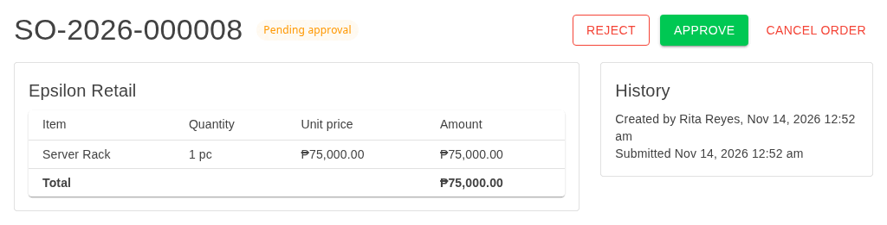
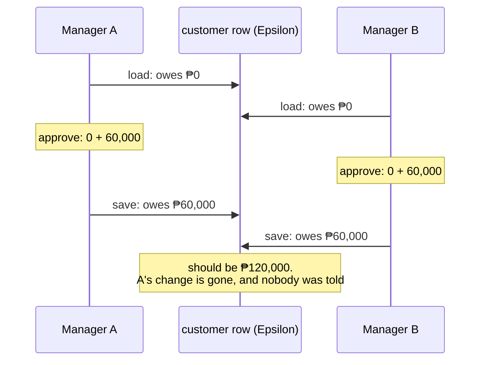
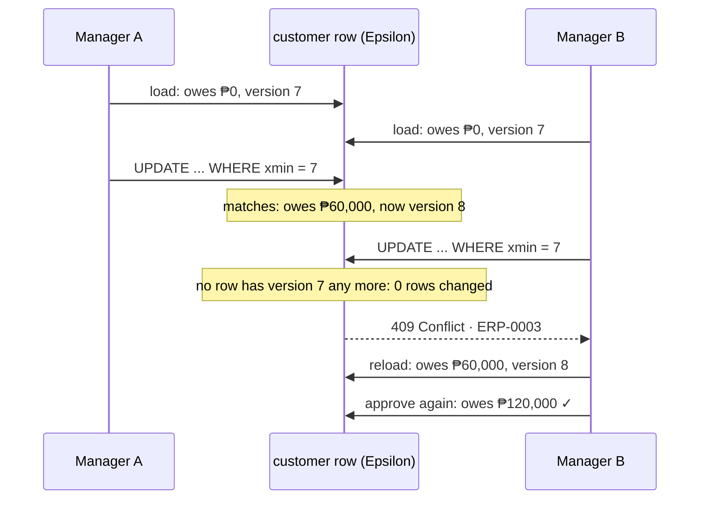
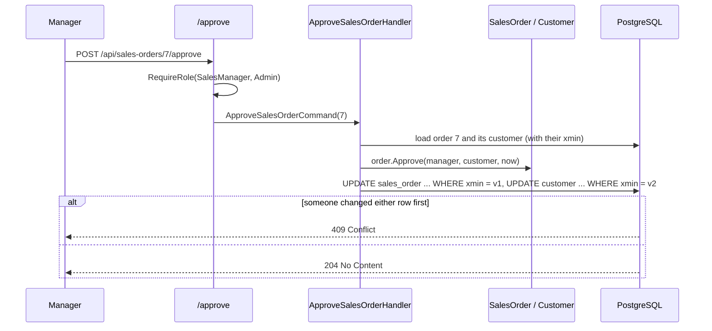

# Lesson 10 — Approve, Reject, Cancel: The Approval Workflow

Good day, developer! Orders can now be created and submitted, and small ones are approved on the spot. But a
big order just sits there, waiting for a manager. Today managers get their say: approve, or reject with a
reason. And anyone can cancel an order, giving its stock back. Along the way we'll meet a quiet bug that
loses money when two people act at once, and a hidden PostgreSQL column that stops it. About an hour and a
half. Are you ready? Let's begin!

## What we'll build

| Endpoint | Who | What happens |
|---|---|---|
| `POST /api/sales-orders/{id}/approve` | SalesManager, Admin | A pending order becomes Approved, and the customer is charged |
| `POST /api/sales-orders/{id}/reject` | SalesManager, Admin | A pending order becomes Rejected, with a reason; its stock is released |
| `POST /api/sales-orders/{id}/cancel` | SalesRep, SalesManager, Admin | The order becomes Cancelled; stock is released and any charge reversed |

Plus protection against **lost updates**: when two people change the same customer or the same order at the
same moment, the second one is told "someone else changed this, reload", instead of silently erasing the
first one's work. And the buttons for all three on the order page, with a dialog that asks for the
rejection reason.

The same order, opened by a sales manager: the Approve and Reject buttons appear only for them.



## Why we build it this way

### The rules are already written

Look back at `SalesOrder` from [lesson 04](04-domain-model.md). `Approve`, `Reject` and `Cancel` are all
there, already tested: nobody approves their own order, a rejection needs a reason, cancelling an approved
order takes the charge back, and `Reject` and `Cancel` hand back the lines whose stock must be released. So
today's handlers are short. They load, call one domain method, and save.

### The lost update

Here's a bug that only shows up when two people act at once. Epsilon Retail owes ₱0. Two managers each
approve a different ₱60,000 order for Epsilon, at the same moment.

| Time | Manager A | Manager B |
|---|---|---|
| 1 | loads Epsilon: owes ₱0 | loads Epsilon: owes ₱0 |
| 2 | approves: owes ₱60,000 | approves: owes ₱60,000 |
| 3 | saves: owes ₱60,000 | saves: owes ₱60,000 |

Epsilon should owe ₱120,000. It owes ₱60,000. Manager B's save wrote over Manager A's, and nobody got an
error. That's a **lost update**, and in an ERP it's real money.



The same thing can happen to an order: one manager approves it while another rejects it, both from the same
"pending" copy, and whoever saves last wins.

### The fix: a version number on the row

PostgreSQL keeps a hidden column on every row, called **`xmin`**, and changes it every time the row is
updated. We tell EF Core to treat it as the row's **version**. Then, when EF saves, it doesn't just write
`UPDATE customer SET ... WHERE id = 5`; it writes `... WHERE id = 5 AND xmin = <the version I loaded>`.

So at time 3, Manager A's save matches and changes the row, and with it the `xmin`. Manager B's save looks
for the *old* version, matches nothing, and EF throws a `DbUpdateConcurrencyException`. We turn that into a
**409 Conflict**: "someone else changed this; reload and try again". Manager B reloads, sees ₱60,000 owed,
approves again, and Epsilon correctly owes ₱120,000.



To remember it easily: it's like editing a shared document that warns you "this file changed since you
opened it", instead of letting you overwrite it.

This style is called **optimistic concurrency**: we don't lock anything up front, we just detect the clash
at save time. It suits approvals, where clashes are rare. (In [lesson 09](09-submit.md) we *did* lock the
customer, because a credit check across many orders needed it.)

## 1. Map the version column

In `SalesDbContext`, add one line inside the `Customer` configuration and one inside the `SalesOrder`
configuration:

```csharp
e.Property<uint>("RowVersion").IsRowVersion().HasColumnName("xmin");
```

`RowVersion` is a **shadow property**: EF knows about it and tracks it, but our domain classes don't have it.
Versions are a database concern, so they stay out of the domain.

Create the migration:

```bash
dotnet ef migrations add AddConcurrencyTokens \
  --project src/Modules/Sales/Erp.Modules.Sales --startup-project src/Modules/Sales/Erp.Modules.Sales \
  --output-dir Infrastructure/Migrations
```

Open it and you'll see an `AddColumn` for `xmin`. Don't worry: PostgreSQL already has that column on every
table, and the provider knows not to create it. Applying this migration runs no SQL at all; it only records
the change in EF's model.

Then teach the exception handler the new answer. The host needs EF Core's exception type, and only that, so
it references EF Core itself rather than the PostgreSQL provider:

```bash
dotnet add src/Erp.Api package Microsoft.EntityFrameworkCore --version 10.0.14
```

In `GlobalExceptionHandler`, add `using Microsoft.EntityFrameworkCore;`, a line to the status switch, and a
line to the detail switch:

```csharp
DbUpdateConcurrencyException => (StatusCodes.Status409Conflict, "Someone else changed this. Reload and try again."),
```

```csharp
StatusCodes.Status409Conflict                                     => null,
```

The title already says everything; EF's own message is about rows and versions, which means nothing to a
user.

## 2. Approve

Managers get their own line in `SalesRoles`:

```csharp
public static readonly string[] Managers = [Roles.SalesManager, Roles.Admin];
```

```csharp
// src/Modules/Sales/Erp.Modules.Sales/Features/ApproveSalesOrder/ApproveSalesOrderHandler.cs
using Erp.Modules.Sales.Domain;
using Erp.Modules.Sales.Infrastructure;
using Erp.Shared.BuildingBlocks;
using Microsoft.EntityFrameworkCore;

namespace Erp.Modules.Sales.Features;

internal sealed record ApproveSalesOrderCommand(long OrderId);

internal sealed class ApproveSalesOrderHandler(SalesDbContext db, ICurrentUser currentUser, TimeProvider time)
{
    public async Task<bool> HandleAsync(ApproveSalesOrderCommand cmd, CancellationToken ct)
    {
        var approver = new UserId(currentUser.UserId);
        var order = await db.GetVisibleOrderAsync(cmd.OrderId, approver, currentUser.Role, ct);
        if (order is null) return false;
        var customer = await db.Customers.SingleAsync(c => c.Id == order.CustomerId, ct);

        order.Approve(approver, customer, time.GetUtcNow().UtcDateTime);

        await db.SaveChangesAsync(ct);   // order and customer balance: one transaction
        return true;
    }
}
```

Notice there's no `BeginTransactionAsync` here. Two rows change (the order and the customer), but both are in
the same DbContext, and **one `SaveChangesAsync` is always one transaction**. We only start a transaction by
hand when another module has to join it, like Inventory did at submit.

```csharp
// src/Modules/Sales/Erp.Modules.Sales/Features/ApproveSalesOrder/ApproveSalesOrderEndpoint.cs
using Microsoft.AspNetCore.Builder;
using Microsoft.AspNetCore.Http;
using Microsoft.AspNetCore.Http.HttpResults;
using Microsoft.AspNetCore.Routing;

namespace Erp.Modules.Sales.Features;

internal static class ApproveSalesOrderEndpoint
{
    public static void Map(IEndpointRouteBuilder app) =>
        app.MapPost("/sales-orders/{id:long}/approve",
                async Task<Results<NoContent, NotFound>> (long id, ApproveSalesOrderHandler handler, CancellationToken ct) =>
                    await handler.HandleAsync(new ApproveSalesOrderCommand(id), ct) ? TypedResults.NoContent() : TypedResults.NotFound())
            .RequireAuthorization(p => p.RequireRole(SalesRoles.Managers));
}
```

Two different checks keep approval safe, and they live in two different places:

| Rule | Where | Answer when broken |
|---|---|---|
| "Only managers approve" | The endpoint, `RequireRole` | 403 Forbidden, before the handler even runs |
| "Not your own order" | The domain, `SalesOrder.Approve` | 422, because it depends on the order's data |

## 3. Reject

```csharp
// src/Modules/Sales/Erp.Modules.Sales/Features/RejectSalesOrder/RejectSalesOrderHandler.cs
using Erp.Modules.Inventory.Contracts;
using Erp.Modules.Sales.Domain;
using Erp.Modules.Sales.Infrastructure;
using Erp.Shared.BuildingBlocks;
using Microsoft.EntityFrameworkCore.Storage;

namespace Erp.Modules.Sales.Features;

internal sealed record RejectSalesOrderCommand(long OrderId, string Reason);

internal sealed class RejectSalesOrderHandler(SalesDbContext db, IStockReservation stock, ICurrentUser currentUser, TimeProvider time)
{
    public async Task<bool> HandleAsync(RejectSalesOrderCommand cmd, CancellationToken ct)
    {
        var manager = new UserId(currentUser.UserId);
        var order = await db.GetVisibleOrderAsync(cmd.OrderId, manager, currentUser.Role, ct);
        if (order is null) return false;

        var toRelease = order.Reject(manager, cmd.Reason, time.GetUtcNow().UtcDateTime);

        await using var tx = await db.Database.BeginTransactionAsync(ct);
        foreach (var line in toRelease)
            await stock.ReleaseAsync(line.ItemId.Value, line.Quantity.Value, tx.GetDbTransaction(), ct);
        await db.SaveChangesAsync(ct);
        await tx.CommitAsync(ct);
        return true;
    }
}
```

The reason is checked twice, on purpose. The validator checks its *shape*: present, and at most 500
characters, to fit the column. The domain checks the *rule*: a rejection must have a real reason, so `"  "`
won't do. Releasing stock is Inventory's job again, so we're back to a transaction that Inventory joins.

```csharp
// src/Modules/Sales/Erp.Modules.Sales/Features/RejectSalesOrder/RejectSalesOrderEndpoint.cs
using FluentValidation;
using Microsoft.AspNetCore.Builder;
using Microsoft.AspNetCore.Http;
using Microsoft.AspNetCore.Http.HttpResults;
using Microsoft.AspNetCore.Routing;

namespace Erp.Modules.Sales.Features;

internal sealed record RejectSalesOrderRequest(string Reason);

internal sealed class RejectSalesOrderRequestValidator : AbstractValidator<RejectSalesOrderRequest>
{
    public RejectSalesOrderRequestValidator() => RuleFor(x => x.Reason).NotEmpty().MaximumLength(500);
}

internal static class RejectSalesOrderEndpoint
{
    public static void Map(IEndpointRouteBuilder app) =>
        app.MapPost("/sales-orders/{id:long}/reject",
                async Task<Results<NoContent, NotFound>> (long id, RejectSalesOrderRequest body, RejectSalesOrderHandler handler, CancellationToken ct) =>
                    await handler.HandleAsync(new RejectSalesOrderCommand(id, body.Reason), ct) ? TypedResults.NoContent() : TypedResults.NotFound())
            .RequireAuthorization(p => p.RequireRole(SalesRoles.Managers));
}
```

## 4. Cancel

```csharp
// src/Modules/Sales/Erp.Modules.Sales/Features/CancelSalesOrder/CancelSalesOrderHandler.cs
using Erp.Modules.Inventory.Contracts;
using Erp.Modules.Sales.Domain;
using Erp.Modules.Sales.Infrastructure;
using Erp.Shared.BuildingBlocks;
using Microsoft.EntityFrameworkCore;
using Microsoft.EntityFrameworkCore.Storage;

namespace Erp.Modules.Sales.Features;

internal sealed record CancelSalesOrderCommand(long OrderId);

internal sealed class CancelSalesOrderHandler(SalesDbContext db, IStockReservation stock, ICurrentUser currentUser)
{
    public async Task<bool> HandleAsync(CancelSalesOrderCommand cmd, CancellationToken ct)
    {
        var order = await db.GetVisibleOrderAsync(cmd.OrderId, new UserId(currentUser.UserId), currentUser.Role, ct);
        if (order is null) return false;
        var customer = await db.Customers.SingleAsync(c => c.Id == order.CustomerId, ct);

        var toRelease = order.Cancel(customer);

        await using var tx = await db.Database.BeginTransactionAsync(ct);
        foreach (var line in toRelease)
            await stock.ReleaseAsync(line.ItemId.Value, line.Quantity.Value, tx.GetDbTransaction(), ct);
        await db.SaveChangesAsync(ct);
        await tx.CommitAsync(ct);
        return true;
    }
}
```

Look at how little the handler decides. A draft held no stock, so `Cancel` returns no lines. An approved order
had charged the customer, so `Cancel` already took the charge back. The handler just releases whatever it's
handed, and saves.

```csharp
// src/Modules/Sales/Erp.Modules.Sales/Features/CancelSalesOrder/CancelSalesOrderEndpoint.cs
using Microsoft.AspNetCore.Builder;
using Microsoft.AspNetCore.Http;
using Microsoft.AspNetCore.Http.HttpResults;
using Microsoft.AspNetCore.Routing;

namespace Erp.Modules.Sales.Features;

internal static class CancelSalesOrderEndpoint
{
    public static void Map(IEndpointRouteBuilder app) =>
        app.MapPost("/sales-orders/{id:long}/cancel",
                async Task<Results<NoContent, NotFound>> (long id, CancelSalesOrderHandler handler, CancellationToken ct) =>
                    await handler.HandleAsync(new CancelSalesOrderCommand(id), ct) ? TypedResults.NoContent() : TypedResults.NotFound())
            .RequireAuthorization(p => p.RequireRole(SalesRoles.Sellers));
}
```

As with submit, each handler returns `false` when the order isn't there (or isn't this person's to see), and
its endpoint answers 404. Register the three handlers in `AddSalesModule` (`services.AddScoped<ApproveSalesOrderHandler>();`
and the same for `RejectSalesOrderHandler` and `CancelSalesOrderHandler`) and map the three endpoints in
`MapSalesEndpoints`. The wiring test from lesson 03 notices if you forget one.

A rep can cancel only an order they can see, so only their own: `GetVisibleOrderAsync` makes a rep's
attempt on anyone else's order a 404, without a line of extra code.

## 5. The buttons

Rejecting asks for a reason, and a reason needs somewhere to type it. A **dialog** is a small window over
the page; MudBlazor draws dialogs through a provider, so add it once to `MainLayout.razor`, next to the
others:

```razor
<MudDialogProvider />
```

Then a dialog we can reuse whenever a step needs a reason (voiding an invoice will need one too):

```razor
@* src/Erp.Web/Shared/ReasonDialog.razor *@
@* Asks for a reason before a step that needs one: reject, void, cancel. Returns the text, or nothing if cancelled. *@
<MudDialog>
    <DialogContent>
        <MudText Class="mb-3">@Message</MudText>
        <MudTextField @bind-Value="_reason" Label="Reason" Lines="3" MaxLength="500" Immediate="true" AutoFocus="true" />
    </DialogContent>
    <DialogActions>
        <MudButton OnClick="() => Dialog.Cancel()">Back</MudButton>
        <MudButton Color="Color.Error" Variant="Variant.Filled" Disabled="string.IsNullOrWhiteSpace(_reason)"
                   OnClick="() => Dialog.Close(DialogResult.Ok(_reason.Trim()))">@Confirm</MudButton>
    </DialogActions>
</MudDialog>

@code {
    [CascadingParameter] private IMudDialogInstance Dialog { get; set; } = default!;
    [Parameter] public string Message { get; set; } = "";
    [Parameter] public string Confirm { get; set; } = "Confirm";
    private string _reason = "";

    public static async Task<string?> Ask(IDialogService dialogs, string title, string message, string confirm)
    {
        var parameters = new DialogParameters<ReasonDialog> { { d => d.Message, message }, { d => d.Confirm, confirm } };
        var result = await (await dialogs.ShowAsync<ReasonDialog>(title, parameters)).Result;
        return result is { Canceled: false, Data: string reason } ? reason : null;
    }
}
```

`MaxLength="500"` matches the validator, so the user can't type more than the API accepts. The `Ask`
helper hides MudBlazor's dialog plumbing: a page calls one line and gets the reason back, or `null` if the
user changed their mind.

On the order page, add `@inject IDialogService Dialogs` at the top, and the buttons under Submit:

```razor
@if (_order.Status == "PendingApproval")
{
    <AuthorizeView Roles="@Managers">
        <MudButton OnClick="Reject" Variant="Variant.Outlined" Color="Color.Error">Reject</MudButton>
        <MudButton OnClick="Approve" Variant="Variant.Filled" Color="Color.Success">Approve</MudButton>
    </AuthorizeView>
}
@if (_order.Status is "Draft" or "PendingApproval" or "Approved")
{
    <AuthorizeView Roles="@Sellers">
        <MudButton OnClick="Cancel" Variant="Variant.Text" Color="Color.Error">Cancel order</MudButton>
    </AuthorizeView>
}
```

A rejection belongs in the history, under the approval line:

```razor
@if (_order.RejectionReason is not null)
{
    <MudAlert Severity="Severity.Error" Dense="true" Class="mt-2">Rejected: @_order.RejectionReason</MudAlert>
}
```

And in `@code`:

```csharp
private static readonly string Managers = $"{Roles.SalesManager},{Roles.Admin}";

private Task Approve() => Act("approve", "Approved.");

private async Task Reject()
{
    if (await ReasonDialog.Ask(Dialogs, "Reject order", "Tell the sales rep why. The reserved stock is released.", "Reject") is { } reason
        && await Api.Post($"api/sales-orders/{Id}/reject", new { reason }, "Rejected."))
        await Load();
}

private async Task Cancel()
{
    var confirmed = await Dialogs.ShowMessageBoxAsync("Cancel order", "Cancel this order? Reserved stock is released and any charge is reversed.",
        yesText: "Cancel order", cancelText: "Keep it");
    if (confirmed == true) await Act("cancel", "Cancelled.");
}
```

Cancelling can't be undone, so it asks first. `ShowMessageBoxAsync` is MudBlazor's built-in yes/no box;
`true` means the user clicked "Cancel order".

Managers need to find the orders waiting for them. On the home page, next to the "New sales order" tile:

```razor
<AuthorizeView Roles="@ManagerRoles">
    <MudItem xs="12" sm="6" md="4">
        <Tile Title="Waiting for approval" Text="Orders above ₱50,000 that need you." Href="sales-orders?status=PendingApproval" Icon="@Icons.Material.Filled.HowToReg" />
    </MudItem>
</AuthorizeView>
```

with `private static readonly string ManagerRoles = $"{Roles.SalesManager},{Roles.Admin}";` in its `@code`.
That link opens the order list already filtered, thanks to the `[SupplyParameterFromQuery]` from lesson 08.

## 6. Prove it: the workflow, and two managers at once

The rules were proven in [lesson 04](04-domain-model.md), state machine and all. What's new today is the
plumbing around them: roles on the endpoints, stock released through the contract, and the `xmin` version
that stops a lost update.

### Two managers, one order

The lost update from the start of this lesson, as a test. Both the manager and the admin click **Approve** on
the same order at the same moment:

```csharp
// tests/Erp.Integration.Tests/SalesOrderEdgeCaseTests.cs (add)
private const string Admin = "admin@erp.local";

[Fact]
public async Task Two_managers_approving_at_once_charge_the_customer_once()
{
    var rep = await factory.ClientFor(Rep);
    var customerId = await NewCustomer();
    var id = await CreateOrder(rep, customerId, 4, 1);   // a ₱75,000 rack: waits for a manager
    await rep.PostAsync($"/api/sales-orders/{id}/submit", null);

    var manager = await factory.ClientFor(Manager);
    var admin = await factory.ClientFor(Admin);
    var responses = await Task.WhenAll(
        manager.PostAsync($"/api/sales-orders/{id}/approve", null),
        admin.PostAsync($"/api/sales-orders/{id}/approve", null));

    responses.Count(r => r.StatusCode == HttpStatusCode.NoContent).Should().Be(1);
    responses.Select(r => r.StatusCode).Should().Contain(s => s == HttpStatusCode.Conflict || s == HttpStatusCode.UnprocessableEntity);
    (await Balance(customerId)).Should().Be(75_000);
}
```

Why "409 *or* 422"? It depends on timing, and both are right. If both requests load the order before either
saves, the second save finds the `xmin` changed: **409**, someone else changed this. If the first commits
before the second even loads, the second sees an approved order and the domain refuses: **422**. Either way,
exactly one approval, one charge of ₱75,000. A test about a race must accept every correct outcome, and only
those.

Make it fail once: comment out the `xmin` mapping from step 1 (the column is PostgreSQL's own, so no
migration is needed either way), and run the test a few times. Sometimes both managers win, and
the customer owes ₱150,000. Put the mapping back.

### The rest of the workflow

The reference build's `SalesOrderWorkflowTests.cs` and `SalesOrderEdgeCaseTests.cs` hold these:

| Test | The edge | Why it matters |
|---|---|---|
| `Small_order_is_approved_on_submit` | Under the threshold | No manager's time spent on a ₱50 order |
| `High_value_order_waits_for_a_manager_who_did_not_create_it` | Over the threshold | The second pair of eyes, end to end |
| `Creator_cannot_approve_their_own_order` | Who: yourself | Even a manager can't approve their own order (422) |
| `SalesRep_cannot_approve` | Who: the wrong role | The endpoint's role check (403) |
| `Rejecting_records_the_reason_and_releases_the_stock` | Across modules | A rejected order gives its stock back |
| `A_step_out_of_order_is_422` | When | Approving a draft, cancelling twice |
| `A_rejection_without_a_reason_is_refused` (empty, spaces) | Nothing | "Rejected" with no reason helps nobody; and the order stays pending |
| `Two_managers_approving_at_once_charge_the_customer_once` | At the same instant | The lost update, closed by `xmin` |

### The flow in a real browser

The browser tests get their first walk through a real business flow: a rep writes and submits a big order, a
manager approves it. Add a helper for MudBlazor's search boxes, and the test, to `BusinessFlowUiTests`:

```csharp
private static async Task Pick(IPage page, string label, string search, string option)
{
    await page.GetByLabel(label).First.FillAsync(search);
    await page.GetByText(option).First.ClickAsync();
}

[UiFact]
public async Task From_order_to_paid_invoice_through_the_screens()
{
    // A rep writes an order over ₱50,000 for Epsilon Retail and submits it.
    var rep = await SignIn("rep@erp.local");
    await Shot(rep, "rep-home");
    await rep.GotoAsync("/sales-orders/new");
    await Pick(rep, "Customer", "Epsilon", "Epsilon Retail");
    await Pick(rep, "Item", "Rack", "GEN-003 · Server Rack");
    await rep.GetByRole(AriaRole.Button, new() { Name = "Save draft" }).ClickAsync();
    await rep.WaitForURLAsync(new Regex(@"/sales-orders/\d+$"));
    var orderUrl = new Uri(rep.Url).AbsolutePath;
    await rep.GetByRole(AriaRole.Button, new() { Name = "Submit" }).ClickAsync();
    await rep.Locator(".mud-chip").Filter(new() { HasText = "Pending approval" }).WaitForAsync();
    await Shot(rep, "rep-submitted");

    // The manager approves it.
    var manager = await SignIn("manager@erp.local");
    await manager.GotoAsync(orderUrl);
    await manager.GetByRole(AriaRole.Button, new() { Name = "Approve" }).ClickAsync();
    await manager.Locator(".mud-chip").Filter(new() { HasText = "Approved" }).WaitForAsync();
    await Shot(manager, "manager-approved");
}
```

The name is a promise about where it's going: [shipping](18-shipping.md), [invoicing](20-invoicing.md) and
[payments](21-payments.md) each add their steps, until it really walks from a new order to a paid invoice.

## How a request flows



## Mistakes to avoid

- Checking "not your own order" in the endpoint. It depends on the order's data, so it's a domain rule.
- Starting a transaction by hand when one `SaveChangesAsync` already covers everything.
- Releasing stock outside the transaction that changes the order's status. If the save fails, the stock is
  gone but the order still holds it.
- Showing EF's concurrency message to users. "Reload and try again" is all they need.
- Locking rows for every update "to be safe". Optimistic checks are cheaper, and right whenever clashes are
  rare.
- An irreversible button with no "are you sure?". Cancel asks first.
- Asserting one exact status in a race test. Accept every correct outcome (409 or 422 here), and only those.

## Let's run it!

The approval rules need two different people, so sign in as both:

```bash
login() { curl -s -X POST http://localhost:5264/api/auth/login -H "Content-Type: application/json" \
  -d "{\"email\":\"$1\",\"password\":\"Password123!\"}" | jq -r .accessToken; }
REP=$(login rep@erp.local); MGR=$(login manager@erp.local)
```

The rep creates and submits a big order: one Server Rack, ₱75,000, for Epsilon.

```bash
ID=$(curl -s -X POST http://localhost:5264/api/sales-orders -H "Authorization: Bearer $REP" -H "Content-Type: application/json" \
  -d '{"customerId":5,"lines":[{"itemId":4,"quantity":1}]}' | jq .id)
curl -s -o /dev/null -w "%{http_code}\n" -X POST http://localhost:5264/api/sales-orders/$ID/submit -H "Authorization: Bearer $REP"
# 204 — and it stays PendingApproval, because it's over ₱50,000
```

Now try every door:

```bash
curl -s -o /dev/null -w "%{http_code}\n" -X POST http://localhost:5264/api/sales-orders/$ID/approve -H "Authorization: Bearer $REP"   # 403: reps can't approve
curl -s -o /dev/null -w "%{http_code}\n" -X POST http://localhost:5264/api/sales-orders/$ID/approve -H "Authorization: Bearer $MGR"   # 204: approved
curl -s -o /dev/null -w "%{http_code}\n" -X POST http://localhost:5264/api/sales-orders/$ID/approve -H "Authorization: Bearer $MGR"   # 422: already approved
```

And the other paths: create and submit another rack order as the rep, then reject it as the manager with
`-d '{"reason":"Price not agreed"}'` (204), or cancel the approved one (204). In the database, Epsilon's
`outstanding_balance` goes up by ₱75,000 on approval and back down on cancel, and item 4's `reserved` goes up
on submit and back down on reject or cancel.

One more to try: as the manager, create *and submit* a rack order yourself, then approve it. You get a 422:
"An order can't be approved by the person who created it."

Now the way managers will really do it. Sign in to the app as `manager@erp.local` in one browser and as
`rep@erp.local` in another (or in a private window). As the rep, create a Server Rack order for Epsilon and
submit it. As the manager, click the **Waiting for approval** tile on the home page, open the order, and
click **Reject**. The dialog's Reject button stays grey until you type a reason. Type one and confirm; the
rep reloads the order and sees your reason in red.

Finally the tests: `dotnet test` for everything, and with the app running, the browser flow:

```bash
ERP_UI_URL=http://localhost:5264 ERP_UI_SCREENSHOTS=./screens dotnet test --project tests/Erp.Web.UiTests
```

Open `screens`: the rep's order, submitted, then the manager's approval, picture by picture.

## Let's check!

1. Describe a lost update in your own words, using two approvals for the same customer.
2. What does EF Core add to its `UPDATE` statement once `xmin` is a row version, and what happens when it
   matches no row?
3. Why does `ApproveSalesOrderHandler` need no `BeginTransactionAsync`, while `CancelSalesOrderHandler` does?
4. "Only managers approve" and "not your own order" live in different places. Where, and why?
5. Why is the rejection reason checked by both the validator and the domain?
6. When would you lock a row up front instead of using a version check?
7. Two managers approve at once. Why does the test accept either 409 or 422 for the loser?
8. How would you know the `xmin` mapping really protects anything?

And that's where this lesson ends. The full approval workflow works, and two people can no longer quietly
erase each other's changes. Next time, we let reps edit a draft, and find one more lost update hiding in the
order lines. Good luck, developer!

---

← [Lesson 09 — Submit](09-submit.md) · Next: [Lesson 11 — Update an order](11-update-order.md) →
