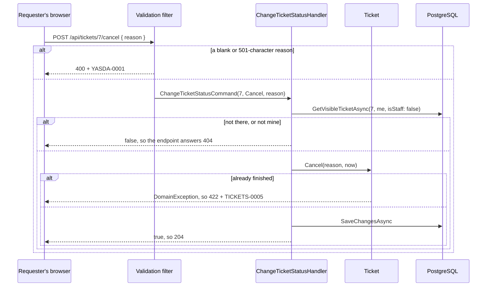

# Lesson 10 — The Ticket's Life: Waiting, Resolving, Reopening, Closing, Cancelling

Good day, developer! A ticket that can only be taken is a ticket nobody can finish. Today we give it the rest of its
life: an agent waits on the requester, resolves it and closes it, the requester reopens it when the fix didn't hold, or
cancels it when the problem fixed itself. The rules for all of this are already written, in lesson 04's `Ticket`. So
today's lesson is about everything *around* the rules: five steps, three kinds of person, and one handler that keeps the
five from becoming twenty files. It takes about three hours. Are you ready? Let's begin!

## What we'll build

| Piece | What it is |
|---|---|
| **`GetVisibleTicketAsync`** | One way for every command to load a ticket, so "not yours" and "not there" look the same |
| **`ChangeTicketStatus`** | One feature folder for five steps: wait on the requester, resolve, close, reopen, cancel |
| **Five endpoints** | `POST /api/tickets/{id}/pending`, `/resolve`, `/close`, `/reopen` and `/cancel` |
| **`ApiClient.Post`, tidied** | One place for the lines every action on a screen repeats |
| **The ticket page's actions** | Buttons for each step, and a cancel that asks first |
| **Tests** | The whole life in one test, who may take each step, and the steps a status refuses |

## Why we build it this way

### The pain: five features that are one feature

The obvious way is the way lesson 09 went: for each step, a handler and an endpoint. Five steps means ten files, and
open any two of the handlers and they're the same:

```csharp
var ticket = await db.Tickets.SingleOrDefaultAsync(t => t.Id == id, ct);
if (ticket is null) return false;
ticket.Resolve(now);          // the only line that differs
await db.SaveChangesAsync(ct);
return true;
```

Copy that five times and the day someone fixes a bug in one, they forget the other four.

### The fix: one handler, with the step as data

The step becomes a value: an `enum` called `StatusChange` with five names. One handler loads the ticket, calls the
method that matches, and saves. The five endpoints stay separate, because each has its own address and its own door.
CLAUDE.md allows it: closely related actions on one thing may share a folder.

Now, let's be honest about the cost here: the handler has a `switch` with five branches, and a new step means a new branch.
That's dispatch, not a business rule. Every *rule* ("only a resolved ticket can be closed", "a week to reopen") stays in
`Ticket`, where lesson 04 tested it. If a branch ever grows an `if` that decides something, it has moved to the wrong place.

### Three kinds of person, two kinds of door

| Step | Who | Where that's decided |
|---|---|---|
| Wait on the requester, resolve, close | Staff only | The endpoint's role door: a requester gets `403` |
| Reopen, cancel | The requester of that ticket, and staff | The handler's load: someone else's ticket is `404` |
| Is the step allowed *now*? | Nobody can force it | `Ticket`: a closed ticket refuses everything, with `422` and a code |

The middle row is the new one. A requester may cancel their own ticket, so the endpoint can't just say "staff only". The
question depends on *whose ticket it is*, and as the table in lesson 03 says, access that depends on the data is the
handler's job.

## 1. One way to load a ticket

Lesson 08's `GetTicketHandler` already hid other people's tickets from a requester, in SQL. A command needs the same rule
in C#, and `Ticket.IsVisibleTo` (lesson 04) holds it. Add one method to `TicketsDbContext`, under the `Tickets` property:

```csharp
    // null when there is no such ticket, and when the caller may not see it: a requester can't even learn that
    // someone else's ticket exists.
    public async Task<Ticket?> GetVisibleTicketAsync(long ticketId, UserId user, bool userIsStaff, CancellationToken ct)
    {
        var id = new TicketId(ticketId);
        var ticket = await Tickets.SingleOrDefaultAsync(t => t.Id == id, ct);
        if (ticket is null) return null;
        if (!ticket.IsVisibleTo(user, userIsStaff)) return null;
        return ticket;
    }
```

Both "no such ticket" and "not yours" return `null`, so the endpoint answers `404` for both. That's lesson 08's reasoning
again: a `403` would tell a stranger that ticket #7 exists.

Lesson 09's two handlers loaded by id on their own. Now they use the shared method. In `TakeTicketHandler`, before:

```csharp
        var ticketId = new TicketId(cmd.TicketId);
        var ticket = await db.Tickets.SingleOrDefaultAsync(t => t.Id == ticketId, ct);
        if (ticket is null) return false;

        var me = new UserId(currentUser.UserId);
```

After:

```csharp
        var me = new UserId(currentUser.UserId);
        var ticket = await db.GetVisibleTicketAsync(cmd.TicketId, me, userIsStaff: true, ct);
        if (ticket is null) return false;
```

`userIsStaff: true` is a fact, not a guess: the endpoint's door already let only staff in. In `AssignTicketHandler` the
same change, and since it now needs to know who is calling, the constructor gains `ICurrentUser`:

```csharp
internal sealed class AssignTicketHandler(TicketsDbContext db, ICurrentUser currentUser, IUserDirectory users, TimeProvider time)
{
    public async Task<bool> HandleAsync(AssignTicketCommand cmd, CancellationToken ct)
    {
        var me = new UserId(currentUser.UserId);
        var ticket = await db.GetVisibleTicketAsync(cmd.TicketId, me, userIsStaff: true, ct);
        if (ticket is null) return false;
```

You can delete the `using Microsoft.EntityFrameworkCore;` lines in both handlers if the compiler says they're unused.

## 2. The feature: change a ticket's status

```csharp
// src/Modules/Tickets/Yasda.Modules.Tickets/Features/ChangeTicketStatus/ChangeTicketStatusHandler.cs
using Yasda.Modules.Tickets.Domain;
using Yasda.Modules.Tickets.Infrastructure;
using Yasda.Shared.BuildingBlocks;

namespace Yasda.Modules.Tickets.Features;

// The steps in a ticket's life after it's filed. Which step is allowed from which status is the ticket's call.
internal enum StatusChange { WaitOnRequester, Resolve, Close, Reopen, Cancel }

internal sealed record ChangeTicketStatusCommand(long TicketId, StatusChange Change, string? Reason = null);

internal sealed class ChangeTicketStatusHandler(TicketsDbContext db, ICurrentUser currentUser, TimeProvider time)
{
    public async Task<bool> HandleAsync(ChangeTicketStatusCommand cmd, CancellationToken ct)
    {
        var isStaff = TicketRoles.IsHandler(currentUser.Role);
        var ticket = await db.GetVisibleTicketAsync(cmd.TicketId, new UserId(currentUser.UserId), isStaff, ct);
        if (ticket is null) return false;

        var now = time.GetUtcNow().UtcDateTime;
        switch (cmd.Change)
        {
            case StatusChange.WaitOnRequester:
                ticket.MarkPending(now);
                break;
            case StatusChange.Resolve:
                ticket.Resolve(now);
                break;
            case StatusChange.Close:
                ticket.Close(now);
                break;
            case StatusChange.Reopen:
                ticket.Reopen(now);
                break;
            case StatusChange.Cancel:
                ticket.Cancel(cmd.Reason ?? "", now);
                break;
        }

        await db.SaveChangesAsync(ct);
        return true;
    }
}
```

Read it as a sentence: find the ticket this person may see, make the one change, save. `TicketRoles.IsHandler` (lesson 08)
says whether the caller is staff, and `GetVisibleTicketAsync` does the rest. A requester asking for their own ticket gets
it; asking for anyone else's gets `null`.

The ticket methods you met in lesson 04 do the thinking. `Resolve` on a `New` ticket throws `TICKETS-0006`. `Close` on a
`Cancelled` one throws `TICKETS-0005`. `Reopen` eight days after resolving throws `TICKETS-0009`. `Cancel` with a blank
reason throws `TICKETS-0010`. The handler doesn't know any of that, and lesson 07's exception handler turns each into a
`422` with its code.

Now the endpoints. Five of them, and the three that move a ticket forward require staff:

```csharp
// src/Modules/Tickets/Yasda.Modules.Tickets/Features/ChangeTicketStatus/ChangeTicketStatusEndpoint.cs
using Yasda.Modules.Tickets.Domain;
using FluentValidation;
using Microsoft.AspNetCore.Builder;
using Microsoft.AspNetCore.Http;
using Microsoft.AspNetCore.Http.HttpResults;
using Microsoft.AspNetCore.Routing;

namespace Yasda.Modules.Tickets.Features;

internal sealed record CancelTicketRequest(string Reason);

internal sealed class CancelTicketRequestValidator : AbstractValidator<CancelTicketRequest>
{
    public CancelTicketRequestValidator()
    {
        RuleFor(x => x.Reason).NotEmpty().MaximumLength(Ticket.ReasonMaxLength);
    }
}

internal static class ChangeTicketStatusEndpoint
{
    public static void Map(IEndpointRouteBuilder app)
    {
        // Only staff move a ticket forward.
        app.MapPost("/tickets/{id:long}/pending", async Task<Results<NoContent, NotFound>> (long id, ChangeTicketStatusHandler handler, CancellationToken ct) =>
        {
            var found = await handler.HandleAsync(new ChangeTicketStatusCommand(id, StatusChange.WaitOnRequester), ct);
            return Answer(found);
        })
        .RequireAuthorization(policy => policy.RequireRole(TicketRoles.Handlers));

        app.MapPost("/tickets/{id:long}/resolve", async Task<Results<NoContent, NotFound>> (long id, ChangeTicketStatusHandler handler, CancellationToken ct) =>
        {
            var found = await handler.HandleAsync(new ChangeTicketStatusCommand(id, StatusChange.Resolve), ct);
            return Answer(found);
        })
        .RequireAuthorization(policy => policy.RequireRole(TicketRoles.Handlers));

        app.MapPost("/tickets/{id:long}/close", async Task<Results<NoContent, NotFound>> (long id, ChangeTicketStatusHandler handler, CancellationToken ct) =>
        {
            var found = await handler.HandleAsync(new ChangeTicketStatusCommand(id, StatusChange.Close), ct);
            return Answer(found);
        })
        .RequireAuthorization(policy => policy.RequireRole(TicketRoles.Handlers));

        // The requester may also reopen or cancel their own ticket: the handler only finds tickets they may see.
        app.MapPost("/tickets/{id:long}/reopen", async Task<Results<NoContent, NotFound>> (long id, ChangeTicketStatusHandler handler, CancellationToken ct) =>
        {
            var found = await handler.HandleAsync(new ChangeTicketStatusCommand(id, StatusChange.Reopen), ct);
            return Answer(found);
        })
        .RequireAuthorization();

        app.MapPost("/tickets/{id:long}/cancel", async Task<Results<NoContent, NotFound>> (long id, CancelTicketRequest body, ChangeTicketStatusHandler handler, CancellationToken ct) =>
        {
            var found = await handler.HandleAsync(new ChangeTicketStatusCommand(id, StatusChange.Cancel, body.Reason), ct);
            return Answer(found);
        })
        .RequireAuthorization();
    }

    private static Results<NoContent, NotFound> Answer(bool found)
    {
        if (!found) return TypedResults.NotFound();
        return TypedResults.NoContent();
    }
}
```

`Answer` is the one helper: all five endpoints end the same way, and writing the two lines five times invites a typo.
`RequireAuthorization()` with no role means "anyone signed in", and the handler's load decides the rest.

The validator is the third kind of "no" again: the cancel body must carry a reason, up to 500 characters
(`Ticket.ReasonMaxLength`, lesson 04). It answers `400` before the handler runs. The domain checks the reason too, because
the domain can't trust that every caller used the API.

Register and map them in `TicketsModule.cs`:

```csharp
        services.AddScoped<AssignTicketHandler>();
        services.AddScoped<ChangeTicketStatusHandler>();
```

```csharp
        AssignTicketEndpoint.Map(tickets);
        ChangeTicketStatusEndpoint.Map(tickets);
```

Nothing here closes a resolved ticket by itself after seven days, though the rules say a resolved ticket is closed for
good after that. Nothing in this course closes anything by itself yet. Reopening is refused after the window, but the
ticket stays `Resolved` until an agent closes it. Automatic closing arrives with the scheduler in a later milestone, as a
setting an admin turns on.

## 3. The screen: tidy the client, then add the actions

### One place for the lines every action repeats

Lesson 09's `Post` and lesson 07's `Create` both clear the message, count the busy call and read the answer. The page is
about to grow five more actions, so we fold the shared lines into two small private methods, `Change` and `Send`. Replace
the whole file:

```csharp
// src/Yasda.Web/Services/ApiClient.cs
using System.Net;
using System.Net.Http.Json;
using System.Text.Json;

namespace Yasda.Web.Services;

public sealed record PagedResult<T>(List<T> Items, int Page, int PageSize, int TotalCount);

// Every call to the API goes through here, so every page handles errors the same way: the API's problem details
// become the status line's message, and a 401 (session ended) sends the user back to sign in.
public sealed class ApiClient(HttpClient http, Notices notices, CookieAuthenticationStateProvider auth)
{
    private sealed record Problem(string? Title, string? Detail, int? Status, string? Code);
    private sealed record Created(long Id);
    private int _saving;

    // True while a change is on its way to the server. Pages disable their action buttons meanwhile, so a double
    // click can't send the same change twice.
    public bool Busy => _saving > 0;

    public async Task<T?> Get<T>(string url)
    {
        var response = await http.GetAsync(url);
        if (!response.IsSuccessStatusCode) return await Fail<T>(response);
        return await response.Content.ReadFromJsonAsync<T>();
    }

    // For actions: true when the API said yes. The body is optional ("take this ticket" has none).
    public async Task<bool> Post(string url, object? body = null, string? success = null)
    {
        using var request = new HttpRequestMessage(HttpMethod.Post, url);
        if (body is not null) request.Content = JsonContent.Create(body);

        var response = await Change(() => http.SendAsync(request));
        if (!response.IsSuccessStatusCode) return await Fail<bool>(response);
        if (success is not null) notices.Success(success);
        return true;
    }

    // For "create" calls: the API answers 201 with { id }.
    public async Task<long?> Create(string url, object body, string? success = null)
    {
        var response = await Change(() => http.PostAsJsonAsync(url, body));
        if (!response.IsSuccessStatusCode) return await Fail<long?>(response);
        if (success is not null) notices.Success(success);
        var created = await response.Content.ReadFromJsonAsync<Created>();
        return created!.Id;
    }

    // A new change replaces the last message: an old error must not sit next to a change that worked.
    private async Task<HttpResponseMessage> Change(Func<Task<HttpResponseMessage>> send)
    {
        notices.Clear();
        _saving++;
        try
        {
            return await send();
        }
        finally
        {
            _saving--;
        }
    }

    // Shows what went wrong, and answers "nothing" in whatever type the caller asked for.
    private async Task<T?> Fail<T>(HttpResponseMessage response)
    {
        if (response.StatusCode == HttpStatusCode.Unauthorized)
        {
            auth.Refresh();   // the session ended; the router sends them to the sign-in page
            return default;
        }

        var problem = await ReadProblem(response);

        // The server's own words, when it sent any.
        var serverMessage = $"The server answered {(int)response.StatusCode}.";
        string? code = null;
        if (problem is not null)
        {
            if (problem.Detail is not null) serverMessage = problem.Detail;
            else if (problem.Title is not null) serverMessage = problem.Title;
            code = problem.Code;
        }

        var message = response.StatusCode switch
        {
            HttpStatusCode.Forbidden => "You don't have permission to do that.",
            HttpStatusCode.TooManyRequests => "Too many requests. Wait a moment and try again.",
            _ => serverMessage
        };
        // The status line links the code to its catalog entry (see Pages/Errors.razor).
        notices.Error(message, code);
        return default;
    }

    private static async Task<Problem?> ReadProblem(HttpResponseMessage response)
    {
        try
        {
            return await response.Content.ReadFromJsonAsync<Problem>();
        }
        catch (JsonException)
        {
            return null;   // not a problem body (a proxy's error page, say)
        }
    }
}
```

Three things changed, and none of them is visible on screen:

- **`Change`** holds the lines that were written twice: clear the old message, count the call as busy, send, stop counting.
  The `try`/`finally` is what makes the page's buttons come back to life even when the request throws.
- **`Post`** takes an optional body, and `Create` shares `Change` with it.
- **`Fail<T>`** is now generic, so a failed `Get<TicketDetail>` answers `null`, a failed `Post` answers `false` and a failed
  `Create` answers `null`, all from one method. Before, `Fail` answered nothing and each caller wrote `return default`.

One thing to watch out for: `Post`'s second parameter is now the body, not the message. Lesson 09's
`Api.Post(url, "You have this ticket now.")` would send that sentence as a body. We rewrite that call below, with the
message named.

### The ticket page's buttons

Each person sees only the buttons that mean something to them. The API checks every one again; hiding a button is a
convenience, never the lock. Replace `TicketPage.razor`:

```razor
@* src/Yasda.Web/Pages/Tickets/TicketPage.razor *@
@page "/tickets/{Id:long}"
@inject ApiClient Api
@inject ListMemory Memory
@inject CookieAuthenticationStateProvider Auth

<PageTitle>@(_ticket is null ? "Ticket" : $"#{_ticket.Id} {_ticket.Subject}") · YASDA</PageTitle>

@if (_ticket is null)
{
    <PageHeader Title="Ticket" Trail="@([("Tickets", Memory.Last("tickets"))])" />
    <p role="status">Loading…</p>
}
else
{
    <PageHeader Title="@($"#{_ticket.Id} {_ticket.Subject}")" Trail="@([("Tickets", Memory.Last("tickets"))])">
        <Description>
            Status: @_ticket.Status · Priority: <PriorityText Value="@_ticket.Priority" /> ·
            Assigned: @(_ticket.AssigneeName ?? "Nobody yet") · Requester: @_ticket.RequesterName ·
            Filed <TimeAgo Utc="_ticket.CreatedUtc" /> · Updated <TimeAgo Utc="_ticket.UpdatedUtc" />
        </Description>
    </PageHeader>

    @if (_ticket.CancelReason is not null)
    {
        <p>Cancelled because: @_ticket.CancelReason</p>
    }

    @* What this person can do now. The API checks every one of these again; hiding a button is only a convenience. *@
    <div class="actions">
        @if (IsStaff && _ticket.IsBeingWorkedOn && _ticket.AssigneeId != MyId)
        {
            <button type="button" @onclick="Take" disabled="@Api.Busy">Take it</button>
        }
        @if (IsStaff && _ticket.Status == "Open")
        {
            <button type="button" @onclick="WaitOnRequester" disabled="@Api.Busy">Wait on requester</button>
        }
        @if (IsStaff && (_ticket.Status == "Open" || _ticket.Status == "Pending"))
        {
            <button type="button" @onclick="Resolve" disabled="@Api.Busy">Resolve</button>
        }
        @if (IsStaff && _ticket.Status == "Resolved")
        {
            <button type="button" @onclick="Close" disabled="@Api.Busy">Close</button>
        }
        @if (_ticket.Status == "Resolved")
        {
            <button type="button" @onclick="Reopen" disabled="@Api.Busy">Reopen</button>
        }
        @if (_ticket.IsBeingWorkedOn && !_cancelling)
        {
            <button type="button" @onclick="StartCancelling">Cancel ticket</button>
        }
    </div>

    @if (_cancelling)
    {
        <EditForm Model="this" OnSubmit="Cancel">
            <p role="alert">Cancel #@_ticket.Id? Nobody will work on it any more, and it can't be reopened.</p>
            <div class="field">
                <label for="reason">Why?</label>
                <InputText id="reason" @bind-Value="_reason" maxlength="500" required aria-describedby="reason-hint" />
                <span class="hint" id="reason-hint">For example: duplicate of #1042, or fixed itself.</span>
            </div>
            <div class="actions">
                <button type="submit" disabled="@Api.Busy">Cancel ticket</button>
                <button type="button" @onclick="StopCancelling">Not yet</button>
            </div>
        </EditForm>
    }

    <section class="thread" aria-labelledby="conversation">
        <h2 id="conversation">Conversation</h2>
        @foreach (var message in _ticket.Messages)
        {
            <article class="message">
                <h3>@message.AuthorName, <TimeAgo Utc="message.CreatedUtc" /></h3>
                @if (message.IsInternal)
                {
                    <p><strong>Internal note:</strong> only staff see this.</p>
                }
                <p class="message-body">@message.Body</p>
            </article>
        }
    </section>
}

@code {
    [Parameter] public long Id { get; set; }

    private TicketDetail? _ticket;
    private string _reason = "";
    private bool _cancelling;

    private long? MyId => Auth.User?.Id;
    private bool IsStaff => TicketChoices.IsStaff(Auth.User?.Role);

    protected override async Task OnParametersSetAsync()
    {
        await Auth.GetAuthenticationStateAsync();
        await Load();
    }

    private async Task Load()
    {
        _ticket = await Api.Get<TicketDetail>($"api/tickets/{Id}");
        _cancelling = false;
    }

    private async Task Take()
    {
        await Step("take", "You have this ticket now.");
    }

    private async Task WaitOnRequester()
    {
        await Step("pending", "Waiting on the requester.");
    }

    private async Task Resolve()
    {
        await Step("resolve", "Resolved.");
    }

    private async Task Close()
    {
        await Step("close", "Closed.");
    }

    private async Task Reopen()
    {
        await Step("reopen", "Reopened.");
    }

    // One status step. Whether it worked or not, show the ticket as it is now: after a lost race, or a step the
    // status no longer allows, that is the truth the person needs.
    private async Task Step(string action, string success)
    {
        await Api.Post($"api/tickets/{Id}/{action}", success: success);
        await Load();
    }

    private void StartCancelling()
    {
        _cancelling = true;
    }

    private void StopCancelling()
    {
        _cancelling = false;
    }

    private async Task Cancel()
    {
        await Api.Post($"api/tickets/{Id}/cancel", new { reason = _reason.Trim() }, "Cancelled.");
        _reason = "";
        await Load();
    }
}
```

`TicketDetail.IsBeingWorkedOn` is new, and it's the page's way of asking the question the domain answered with
`EnsureIn`. In `Models.cs`, give `TicketDetail` a body, replacing its closing `);`:

```csharp
public sealed record TicketDetail(long Id, string Subject, string Status, string Priority, long RequesterId, string RequesterName,
    long? AssigneeId, string? AssigneeName, DateTime CreatedUtc, DateTime UpdatedUtc, DateTime? FirstResponseUtc,
    DateTime? ResolvedUtc, DateTime? ClosedUtc, string? CancelReason, List<TicketMessage> Messages)
{
    public bool IsBeingWorkedOn => Status is "New" or "Open" or "Pending";
}
```

The cancel button is the one step that **can't be undone**, so it asks first, inline: a `role="alert"` sentence naming the
ticket and what cancelling means, a field for the reason and two buttons, "Cancel ticket" and "Not yet". There are no
pop-up dialogs in this course (DESIGN.md says why: they steal focus and break the back button). The two buttons on the
form are *both* named by what they do, so a person never wonders which is which.

Every step reloads the ticket afterward, win or lose. That's the same polite loss as lesson 09: the status line says what
happened, and the page behind it shows the ticket as it is now.

## 4. Prove it: who may do what, and what a status refuses

### The whole life in one test

Create a new test class. Its helpers do what lesson 09's did: file a ticket, read a problem's code, read a status.

```csharp
// tests/Yasda.Integration.Tests/TicketLifeTests.cs
using System.Net;
using System.Net.Http.Json;
using System.Text.Json;
using AwesomeAssertions;
using Yasda.Shared.BuildingBlocks;

namespace Yasda.Integration.Tests;

// A ticket's life after it's filed (wait, resolve, reopen, close, cancel), through the real API and a real database:
// who may take each step, and what the ticket says when a step isn't allowed.
[Collection("Integration")]
public class TicketLifeTests(CustomWebAppFactory factory)
{
    private const string Requester = "requester@yasda.local", Agent = "agent@yasda.local";

    private sealed record Created(long Id);
    private sealed record TicketView(string Status, string? CancelReason);

    private static async Task<long> FileOne(HttpClient client)
    {
        var response = await client.PostAsJsonAsync("/api/tickets", new { subject = "Printer won't print", message = "It says paper jam.", priority = "High" });
        response.StatusCode.Should().Be(HttpStatusCode.Created);
        var created = await response.Content.ReadFromJsonAsync<Created>();
        return created!.Id;
    }

    private static async Task<string?> CodeOf(HttpResponseMessage response)
    {
        var problem = await response.Content.ReadFromJsonAsync<JsonElement>();
        return problem.GetProperty("code").GetString();
    }

    private static async Task<string> StatusOf(HttpClient client, long id)
    {
        var ticket = await client.GetFromJsonAsync<TicketView>($"/api/tickets/{id}");
        return ticket!.Status;
    }

    [Fact]
    public async Task A_ticket_goes_from_new_to_closed_and_then_refuses_every_step()
    {
        var requester = await factory.ClientFor(Requester);
        var agent = await factory.ClientFor(Agent);
        var id = await FileOne(requester);

        (await agent.PostAsync($"/api/tickets/{id}/take", null)).EnsureSuccessStatusCode();
        (await StatusOf(agent, id)).Should().Be("Open");
        (await agent.PostAsync($"/api/tickets/{id}/pending", null)).EnsureSuccessStatusCode();
        (await StatusOf(agent, id)).Should().Be("Pending");
        (await agent.PostAsync($"/api/tickets/{id}/resolve", null)).EnsureSuccessStatusCode();
        (await StatusOf(agent, id)).Should().Be("Resolved");
        (await requester.PostAsync($"/api/tickets/{id}/reopen", null)).EnsureSuccessStatusCode();
        (await StatusOf(agent, id)).Should().Be("Open");
        (await agent.PostAsync($"/api/tickets/{id}/resolve", null)).EnsureSuccessStatusCode();
        (await agent.PostAsync($"/api/tickets/{id}/close", null)).EnsureSuccessStatusCode();
        (await StatusOf(agent, id)).Should().Be("Closed");

        var late = await agent.PostAsync($"/api/tickets/{id}/pending", null);
        late.StatusCode.Should().Be(HttpStatusCode.UnprocessableEntity);
        (await CodeOf(late)).Should().Be("TICKETS-0005");
    }
```

This walks lesson 04's whole diagram through the real API: take, wait, resolve, reopen by the *requester*, resolve again,
close, and then a step on the closed ticket, refused with its code. It's the one test that proves the pieces connect: the
doors, the handler's load, the domain's rules and the database. (The requester's reopen happens at the right moment,
because the test never leaves the 7-day window.)

Now the edges, which are short. Add these to the same class, then close it with a `}`:

```csharp
    [Fact]
    public async Task A_step_the_status_doesnt_allow_is_refused_with_its_code()
    {
        var id = await FileOne(await factory.ClientFor(Requester));
        var agent = await factory.ClientFor(Agent);

        var response = await agent.PostAsync($"/api/tickets/{id}/resolve", null);

        response.StatusCode.Should().Be(HttpStatusCode.UnprocessableEntity);
        (await CodeOf(response)).Should().Be("TICKETS-0006");
        (await StatusOf(agent, id)).Should().Be("New");
    }

    [Theory]
    [InlineData("pending")]
    [InlineData("resolve")]
    [InlineData("close")]
    public async Task A_requester_cant_work_on_tickets(string action)
    {
        var requester = await factory.ClientFor(Requester);
        var id = await FileOne(requester);

        var response = await requester.PostAsync($"/api/tickets/{id}/{action}", null);

        response.StatusCode.Should().Be(HttpStatusCode.Forbidden);
    }

    [Fact]
    public async Task A_requester_can_cancel_their_own_ticket_with_a_reason()
    {
        var requester = await factory.ClientFor(Requester);
        var id = await FileOne(requester);

        var withoutReason = await requester.PostAsJsonAsync($"/api/tickets/{id}/cancel", new { reason = "" });
        var withReason = await requester.PostAsJsonAsync($"/api/tickets/{id}/cancel", new { reason = "Fixed itself" });

        withoutReason.StatusCode.Should().Be(HttpStatusCode.BadRequest);
        withReason.StatusCode.Should().Be(HttpStatusCode.NoContent);
        var ticket = await requester.GetFromJsonAsync<TicketView>($"/api/tickets/{id}");
        ticket!.Status.Should().Be("Cancelled");
        ticket.CancelReason.Should().Be("Fixed itself");
    }

    [Fact]
    public async Task A_cancel_reason_over_500_characters_is_refused_before_the_handler()
    {
        var requester = await factory.ClientFor(Requester);
        var id = await FileOne(requester);

        var response = await requester.PostAsJsonAsync($"/api/tickets/{id}/cancel", new { reason = new string('x', 501) });

        response.StatusCode.Should().Be(HttpStatusCode.BadRequest);
    }

    [Fact]
    public async Task Someone_elses_ticket_cant_be_cancelled_or_reopened_by_a_requester()
    {
        var id = await FileOne(await factory.ClientFor(Requester));
        var stranger = await factory.ClientFor(await factory.CreateUserAsync(Roles.Requester));

        var cancel = await stranger.PostAsJsonAsync($"/api/tickets/{id}/cancel", new { reason = "Not mine" });
        var reopen = await stranger.PostAsync($"/api/tickets/{id}/reopen", null);

        cancel.StatusCode.Should().Be(HttpStatusCode.NotFound);
        reopen.StatusCode.Should().Be(HttpStatusCode.NotFound);
        var owner = await factory.ClientFor(Requester);
        (await StatusOf(owner, id)).Should().Be("New");
    }

    [Theory]
    [InlineData("pending")]
    [InlineData("resolve")]
    [InlineData("close")]
    [InlineData("reopen")]
    public async Task A_step_on_a_ticket_that_does_not_exist_is_404(string action)
    {
        var agent = await factory.ClientFor(Agent);

        var response = await agent.PostAsync($"/api/tickets/999999999/{action}", null);

        response.StatusCode.Should().Be(HttpStatusCode.NotFound);
    }
}
```

Look at what two of them prove. `A_requester_cant_work_on_tickets` is the role door: `403` before any handler runs.
`Someone_elses_ticket_cant_be_cancelled_or_reopened_by_a_requester` is the other door, the one in the handler, and it also
checks the stranger *changed nothing*: the owner's ticket is still `New`. A `404` that quietly cancelled the ticket would
be a bad `404`.

Make each door fail once. First the role door: in the `/resolve` endpoint, change `.RequireAuthorization(policy => ...)`
to `.RequireAuthorization()` and run the tests. `A_requester_cant_work_on_tickets` goes red for `resolve`: the requester
gets past the door and meets `422` from the domain instead of `403`. Put it back. Then the handler's door: in
`GetVisibleTicketAsync`, delete the `if (!ticket.IsVisibleTo(...)) return null;` line. `Someone_elses_ticket_cant_be_cancelled_or_reopened_by_a_requester`
goes red, because the stranger's cancel now succeeds with `204`. Put it back.

### A real person in a real browser

Lesson 09's browser test files a ticket, and the agent takes it. This one follows it further, with two people at once: the
agent works the ticket to resolved, and the requester, who is still looking at the page from when they filed it, reloads
and reopens it. Add it to `TicketUiTests`:

```csharp
    [UiFact]
    public async Task An_agent_works_a_ticket_to_resolved_and_the_requester_reopens_it()
    {
        var (requester, address) = await FileTicket($"Keyboard {Guid.NewGuid():N}");
        var agent = await SignIn("agent@yasda.local");
        await agent.GotoAsync(address);

        await agent.GetByRole(AriaRole.Button, new() { Name = "Take it" }).ClickAsync();
        await Expect(agent.GetByText("Status: Open")).ToBeVisibleAsync();
        await agent.GetByRole(AriaRole.Button, new() { Name = "Wait on requester" }).ClickAsync();
        await Expect(agent.GetByText("Status: Pending")).ToBeVisibleAsync();
        await agent.GetByRole(AriaRole.Button, new() { Name = "Resolve" }).ClickAsync();
        await Expect(agent.GetByText("Status: Resolved")).ToBeVisibleAsync();
        await Expect(agent.GetByRole(AriaRole.Button, new() { Name = "Close" })).ToBeVisibleAsync();

        await requester.ReloadAsync();
        await requester.GetByRole(AriaRole.Button, new() { Name = "Reopen" }).ClickAsync();
        await Expect(requester.GetByText("Status: Open")).ToBeVisibleAsync();
        await Expect(requester.GetByRole(AriaRole.Button, new() { Name = "Reopen" })).ToHaveCountAsync(0);
    }
```

Every wait is an `Expect`, which retries until the page shows it, so the test never guesses how long a click takes. The
cancel flow's browser test, `Cancelling_asks_for_a_reason_first_and_not_yet_backs_out`, is in the build too: it clicks
**Cancel ticket**, reads the warning, backs out with **Not yet**, and then cancels for real with a reason.

### Edge cases covered in this lesson

The domain's own edges (the seven-day window to the minute, a blank reason, a cancelled ticket changing no more) were
tested in lesson 04, and aren't repeated here.

| Test | The edge | Why it matters |
|---|---|---|
| `A_ticket_goes_from_new_to_closed_and_then_refuses_every_step` | The whole diagram, and a step after the end | The pieces connect, and a closed ticket stays closed |
| `A_step_the_status_doesnt_allow_is_refused_with_its_code` | Resolving a ticket nobody has worked on | The domain's refusal arrives as `422` and its code, and changes nothing |
| `A_requester_cant_work_on_tickets` | Three staff-only steps | The role door answers `403` before the handler |
| `A_requester_can_cancel_their_own_ticket_with_a_reason` | An empty reason, then a real one | The validator's `400`, and the reason kept on the ticket |
| `A_cancel_reason_over_500_characters_is_refused_before_the_handler` | 501 characters | The limit is checked at the door |
| `Someone_elses_ticket_cant_be_cancelled_or_reopened_by_a_requester` | A stranger's cancel and reopen | `404`, and the owner's ticket is untouched |
| `A_step_on_a_ticket_that_does_not_exist_is_404` | Four steps, an id with no ticket | "Does it exist?" is the endpoint's answer |
| `An_agent_works_a_ticket_to_resolved_and_the_requester_reopens_it` | Two people on one ticket, in browsers | The buttons follow the status and the person |
| `Cancelling_asks_for_a_reason_first_and_not_yet_backs_out` | An action that can't be undone | It asks inline first, and backing out leaves the ticket alone |

## How a request flows



## Mistakes to avoid

- Writing a handler per step, and fixing a bug in four of the five.
- Putting a rule in the handler's `switch`. A branch that decides something belongs in `Ticket`.
- Answering `403` for a ticket someone may not see. It tells a stranger the ticket exists. Say `404`.
- Putting the requester's "my own ticket" check in the endpoint's role door. Roles can't know whose ticket it is.
- A cancel that happens on the first click. An action that can't be undone asks first, and names what it will do.
- Hiding a button and calling it security. The API checks every step again.
- A pop-up dialog for the confirmation. It's inline, with verbs on its buttons.
- Forgetting to reload the ticket after a step that failed. The person is looking at stale facts.

## Let's run it!

```bash
dotnet build
dotnet test
```

The build shows **0 warnings and 0 errors**. The integration tests have moved from lesson 09's count by the new
`TicketLifeTests` cases, and the browser tests are skipped without a running app. Start the app and run them too:

```bash
dotnet run --project src/Yasda.Api
```

```bash
YASDA_UI_URL=http://localhost:5264 dotnet test tests/Yasda.Web.UiTests
```

Now walk a ticket from end to end. As `requester@yasda.local`, file one. As `agent@yasda.local`, open it, **Take it**, then
**Wait on requester**, then **Resolve**. Switch to the requester and reload: a **Reopen** button, and no buttons from the
agent's side. Reopen it, then try **Cancel ticket**: it asks why, and **Not yet** puts it away. Finally, as the agent,
resolve and **Close** it. Open the page again as the requester: no buttons left at all, because a closed ticket changes no more.

Save the moment in Git:

```bash
git add .
git commit -m "Lesson 10: the ticket's life, wait, resolve, reopen, close, cancel"
```

## Let's check!

1. Why is there one `ChangeTicketStatusHandler` for five endpoints, and what is the cost of that choice?
2. A requester calls `/resolve` on their own ticket, and another requester cancels it. What does each get, and which door answered?
3. Why does `GetVisibleTicketAsync` return `null` for both "no such ticket" and "not yours"?
4. Lesson 09's handlers loaded a ticket by id. What changed, and why did `userIsStaff: true` stay safe there?
5. A resolved ticket is eight days old, and its requester clicks Reopen. What happens, and which code does the person see?
6. Why does the cancel button ask first, and why inline instead of in a pop-up?
7. What does `Fail<T>` do for `Get`, `Post` and `Create`, and what did each of them do before?
8. Nothing closes a resolved ticket after seven days. Why is that honest, and when will it change?

And that's where this lesson ends. A ticket can now be worked from the moment it's filed to the moment it's closed or
cancelled, each person sees the buttons that are theirs, and a step the status doesn't allow is refused with a reason you
can read. Next time, the part of a ticket's life that is *talking*: replies, internal notes, and what happens when two
people change the same ticket at once. Good luck, developer!

---

← [Lesson 09 — Take a ticket](09-take-a-ticket.md) · Next: Lesson 11 — Replies and notes (coming with milestone Y3) →
