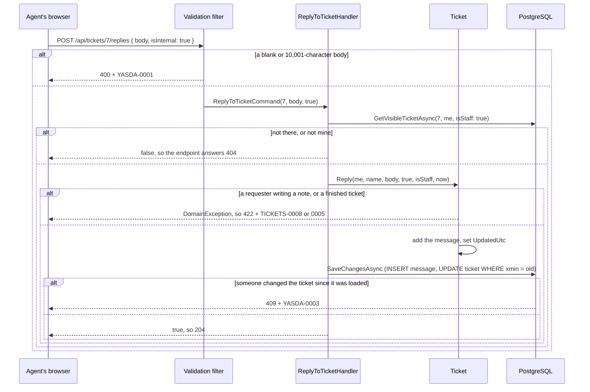

# Lesson 11 — Replies and Notes: the Conversation, the Priority, and a Version Check That Depends on One Line

Good day, developer! A ticket that can be taken, worked and closed is still a ticket with nobody talking. Today the
conversation starts: the requester and the agent answer each other, the agent leaves notes only staff can read, and staff
can change how urgent the ticket is. Along the way we meet a trap that lesson 09's row version doesn't catch by itself:
a reply is a *new row*, not a change to the ticket. It takes about two hours. Are you ready? Let's begin!

## What we'll build

| Piece | What it is |
|---|---|
| **`ReplyToTicket`** | One feature for two things: a reply the requester sees, and an internal note only staff see |
| **`ChangePriority`** | The one thing staff edit on a ticket after it's filed |
| **`POST /api/tickets/{id}/replies`** and **`PUT /api/tickets/{id}/priority`** | The two endpoints |
| **`ApiClient.Put`** | The client's first call that changes something that already exists |
| **The ticket page's forms** | A reply box with an "Internal note" checkbox, and a priority list for staff |
| **Tests** | Who may write what, who sees which message, and the stale-copy test that guards the version check |

## Why we build it this way

### What "edit" means here

The roadmap's name for this lesson says "edits". Let's be precise about what we edit. A ticket's subject and every message
are what people *said*. If an agent could rewrite them, a requester could never trust the history, so nothing edits them.
What staff do change afterward is the priority: the requester suggested one when filing, and now the people who know the
queue decide. That is today's only edit, and the rule for it already exists: lesson 04's `ChangePriority`.

### One feature for a reply and a note

A reply and an internal note are the same thing with one difference: who may read it. So there is one handler, one
endpoint and one `isInternal` flag in the request, and `Ticket.Reply` (lesson 04) already decides everything that depends
on it: a requester can't write a note (`TICKETS-0008`), a note isn't an answer to the requester, a closed ticket takes no
more messages. The handler stays a loader and a saver.

### The pain: a reply is a new row, so who checks the ticket's version?

Lesson 09 gave the ticket a **row version**, PostgreSQL's `xmin`. EF Core adds it to every `UPDATE ... WHERE`: if the row
changed since you loaded it, nothing matches, and you get a `409`. That protects every save that *changes the ticket's
row*.

Now think about what a reply does to the database. It inserts a row into `ticket_message`. If the ticket's own row isn't
touched, there is no `UPDATE ticket`, so no version check, and this happens:

1. Alice loads ticket #7, which is `Open`.
2. Bob closes it. The ticket's row changes.
3. Alice, still looking at the old page, sends a reply. The save is only an `INSERT` into `ticket_message`. Nothing
   checks the version. The reply lands on a closed ticket.

The same hole lets Bob change the priority based on a conversation that has moved on, after Alice added a note he never saw.

### The fix: every reply also changes the ticket

The fix is one line, and it is already in lesson 04's `Ticket.Reply`:

```csharp
_messages.Add(new TicketMessage(author, authorName, text, isInternal, nowUtc));
UpdatedUtc = nowUtc;
```

Setting `UpdatedUtc` makes the ticket's row part of the save, so EF writes an `UPDATE ticket ... WHERE id = @id AND xmin = @version`.
The version check now covers replies, with no special code in the handler or the `DbContext`. (The queue sorts by "last
updated" too, so a ticket with a new reply rightly moves up.)

Now, let's be honest about the cost here. Two agents replying to the same ticket at the same moment now conflict, and the
slower one gets a `409`: "Someone else changed this first". That is the price of guaranteeing nobody answers a ticket whose
state they didn't see. The page reloads, the person sees what the other wrote, and sends their reply again. It's a little
annoying and never wrong.

To remember it easily: a child row can't check the parent's version, so the parent has to change too.

One thing to watch out for: this protection is a *habit of the domain*, not a feature of EF Core. Nothing stops a future
method from adding a message and forgetting to touch `UpdatedUtc`. That is why today ends with a test that fails if
anyone does.

## 1. The feature: reply to a ticket

Create the feature folder. The handler loads the ticket the way lesson 10 taught, asks the ticket to take the message, and
saves:

```csharp
// src/Modules/Tickets/Yasda.Modules.Tickets/Features/ReplyToTicket/ReplyToTicketHandler.cs
using Yasda.Modules.Identity.Contracts;
using Yasda.Modules.Tickets.Domain;
using Yasda.Modules.Tickets.Infrastructure;
using Yasda.Shared.BuildingBlocks;

namespace Yasda.Modules.Tickets.Features;

internal sealed record ReplyToTicketCommand(long TicketId, string Body, bool IsInternal);

internal sealed class ReplyToTicketHandler(TicketsDbContext db, ICurrentUser currentUser, IUserDirectory users, TimeProvider time)
{
    public async Task<bool> HandleAsync(ReplyToTicketCommand cmd, CancellationToken ct)
    {
        var me = new UserId(currentUser.UserId);
        var isStaff = TicketRoles.IsHandler(currentUser.Role);
        var ticket = await db.GetVisibleTicketAsync(cmd.TicketId, me, isStaff, ct);
        if (ticket is null) return false;

        var myName = await users.NameOfAsync(currentUser.UserId, ct) ?? currentUser.Username;
        ticket.Reply(me, myName, cmd.Body, cmd.IsInternal, isStaff, time.GetUtcNow().UtcDateTime);

        await db.SaveChangesAsync(ct);
        return true;
    }
}
```

Three things deserve a word:

- **Who is writing.** `isStaff` comes from the signed-in role, never from the request. The request can claim `isInternal`,
  but the ticket refuses it unless the *author* is staff. A requester can't talk their way into writing a note.
- **The name is copied onto the message.** Lesson 09's `NameOfAsync` asks Identity once, and the message keeps it. Reading
  a conversation later never crosses into Identity's tables (rule 4.2).
- **No role door.** Requesters reply to their own tickets and staff to any, so the endpoint only asks for a signed-in
  user, and `GetVisibleTicketAsync` answers the rest: someone else's ticket is `null`, and the endpoint says `404`.

Now the endpoint and its validator. The body can't be empty and can't pass the limit lesson 04 set, 10,000 characters:

```csharp
// src/Modules/Tickets/Yasda.Modules.Tickets/Features/ReplyToTicket/ReplyToTicketEndpoint.cs
using Yasda.Modules.Tickets.Domain;
using FluentValidation;
using Microsoft.AspNetCore.Builder;
using Microsoft.AspNetCore.Http;
using Microsoft.AspNetCore.Http.HttpResults;
using Microsoft.AspNetCore.Routing;

namespace Yasda.Modules.Tickets.Features;

internal sealed record ReplyToTicketRequest(string Body, bool IsInternal = false);

internal sealed class ReplyToTicketRequestValidator : AbstractValidator<ReplyToTicketRequest>
{
    public ReplyToTicketRequestValidator()
    {
        RuleFor(x => x.Body).NotEmpty().MaximumLength(Ticket.MessageMaxLength);
    }
}

internal static class ReplyToTicketEndpoint
{
    public static void Map(IEndpointRouteBuilder app)
    {
        // Requesters reply to their own tickets and staff to any; the handler's load decides which. Whether an
        // internal note is allowed is the ticket's call.
        app.MapPost("/tickets/{id:long}/replies", async Task<Results<NoContent, NotFound>> (long id, ReplyToTicketRequest body, ReplyToTicketHandler handler, CancellationToken ct) =>
        {
            var found = await handler.HandleAsync(new ReplyToTicketCommand(id, body.Body, body.IsInternal), ct);
            if (!found) return TypedResults.NotFound();
            return TypedResults.NoContent();
        })
        .RequireAuthorization();
    }
}
```

`IsInternal = false` is a default, so a plain `{ "body": "..." }` is a public reply. The validator is the same kind of "no" as
every other: a blank body answers `400` with `YASDA-0001` before the handler runs. `NotEmpty` treats a body of only spaces as
empty too.

## 2. The feature: change the priority

This one is shorter, because the rule is already in `Ticket.ChangePriority`, and a finished ticket refuses it:

```csharp
// src/Modules/Tickets/Yasda.Modules.Tickets/Features/ChangePriority/ChangePriorityHandler.cs
using Yasda.Modules.Tickets.Domain;
using Yasda.Modules.Tickets.Infrastructure;
using Yasda.Shared.BuildingBlocks;

namespace Yasda.Modules.Tickets.Features;

internal sealed record ChangePriorityCommand(long TicketId, TicketPriority Priority);

internal sealed class ChangePriorityHandler(TicketsDbContext db, ICurrentUser currentUser, TimeProvider time)
{
    public async Task<bool> HandleAsync(ChangePriorityCommand cmd, CancellationToken ct)
    {
        var me = new UserId(currentUser.UserId);
        var ticket = await db.GetVisibleTicketAsync(cmd.TicketId, me, userIsStaff: true, ct);
        if (ticket is null) return false;

        ticket.ChangePriority(cmd.Priority, time.GetUtcNow().UtcDateTime);

        await db.SaveChangesAsync(ct);
        return true;
    }
}
```

`userIsStaff: true` is safe for the same reason it was in lesson 09: the endpoint's role door lets only staff in, so by the
time the handler runs, the caller *is* staff.

```csharp
// src/Modules/Tickets/Yasda.Modules.Tickets/Features/ChangePriority/ChangePriorityEndpoint.cs
using Yasda.Modules.Tickets.Domain;
using FluentValidation;
using Microsoft.AspNetCore.Builder;
using Microsoft.AspNetCore.Http;
using Microsoft.AspNetCore.Http.HttpResults;
using Microsoft.AspNetCore.Routing;

namespace Yasda.Modules.Tickets.Features;

internal sealed record ChangePriorityRequest(TicketPriority Priority);

internal sealed class ChangePriorityRequestValidator : AbstractValidator<ChangePriorityRequest>
{
    public ChangePriorityRequestValidator()
    {
        RuleFor(x => x.Priority).IsInEnum();
    }
}

internal static class ChangePriorityEndpoint
{
    public static void Map(IEndpointRouteBuilder app)
    {
        // The requester suggests a priority when filing; after that, staff decide.
        app.MapPut("/tickets/{id:long}/priority", async Task<Results<NoContent, NotFound>> (long id, ChangePriorityRequest body, ChangePriorityHandler handler, CancellationToken ct) =>
        {
            var found = await handler.HandleAsync(new ChangePriorityCommand(id, body.Priority), ct);
            if (!found) return TypedResults.NotFound();
            return TypedResults.NoContent();
        })
        .RequireAuthorization(policy => policy.RequireRole(TicketRoles.Handlers));
    }
}
```

It's a `PUT` because it replaces one field of something that exists, where lesson 09's `POST`s start an action. `IsInEnum()`
turns `"Whenever"` into a `400` before it reaches the handler.

Register both handlers and map both endpoints in `TicketsModule.cs`, one line each, beside the ones from lesson 10:

```csharp
        services.AddScoped<ReplyToTicketHandler>();
        services.AddScoped<ChangePriorityHandler>();
```

```csharp
        ReplyToTicketEndpoint.Map(tickets);
        ChangePriorityEndpoint.Map(tickets);
```

## 3. The client: a call that changes

The status line's `Post` has been our only way to change something. A priority change is a `PUT`, so `ApiClient` learns
a second verb. The two share everything except the method, so they share a private `Send`. In
[ApiClient.cs](../course-validation/business/src/Yasda.Web/Services/ApiClient.cs), replace the `Post` method from lesson 10
with these three:

```csharp
// src/Yasda.Web/Services/ApiClient.cs (replace Post)
    // For actions: true when the API said yes. The body is optional ("take this ticket" has none).
    public async Task<bool> Post(string url, object? body = null, string? success = null)
    {
        return await Send(HttpMethod.Post, url, body, success);
    }

    // For changes to something that already exists, such as a ticket's priority.
    public async Task<bool> Put(string url, object body, string? success = null)
    {
        return await Send(HttpMethod.Put, url, body, success);
    }

    private async Task<bool> Send(HttpMethod method, string url, object? body, string? success)
    {
        using var request = new HttpRequestMessage(method, url);
        if (body is not null) request.Content = JsonContent.Create(body);

        var response = await Change(() => http.SendAsync(request));
        if (!response.IsSuccessStatusCode) return await Fail<bool>(response);
        if (success is not null) notices.Success(success);
        return true;
    }
```

`Send` is lesson 10's `Post` body with the method as a parameter. Nothing about how a call fails changed: the same
`Change` and `Fail<T>` do the work.

## 4. The screen: a reply box and a priority list

Three small changes, then the two forms.

First, a finished ticket takes no replies and no priority changes, so the page needs to ask. In `Models.cs`, add one line to
`TicketDetail`'s body, under `IsBeingWorkedOn`:

```csharp
    public bool IsFinished => Status is "Closed" or "Cancelled";
```

Second, the checkbox needs a style. Add this to the end of `app.css`. The label sits beside the box and the pair is one
full-height target, from DESIGN.md's rule that every control is easy to hit:

```css
/* src/Yasda.Web/wwwroot/css/app.css (add at the end) */
.check {
    display: flex;
    align-items: center;
    gap: var(--gap-s);
    min-height: var(--target);
}

.check input {
    width: auto;
    min-height: 0;
}
```

Third, in `TicketPage.razor`, add one `@inject` under the others. The priority form uses it to say "that's already the
priority" when nothing would change:

```razor
@inject Notices Notices
```

Now the priority form. Staff see it while the ticket isn't finished. Add it after the cancel form and before the
`<section class="thread" ...>`:

```razor
    @if (IsStaff && !_ticket.IsFinished)
    {
        <EditForm Model="this" OnSubmit="ChangePriority" class="search">
            <div class="field">
                <label for="priority">Priority</label>
                <InputSelect id="priority" @bind-Value="_priority">
                    @foreach (var p in TicketChoices.Priorities)
                    {
                        <option value="@p">@p</option>
                    }
                </InputSelect>
            </div>
            <button type="submit" disabled="@Api.Busy">Change priority</button>
        </EditForm>
    }
```

Then the reply form, inside the conversation `<section>`, right after the `@foreach` that lists the messages (after the
`@foreach`'s own closing brace, not inside the `<article>`). Everyone
sees the text box; only staff see the checkbox, and the button's name follows it, so a person always knows what a click
will do:

```razor
        @if (!_ticket.IsFinished)
        {
            <EditForm Model="this" OnSubmit="Reply">
                <div class="field">
                    <label for="reply">Your reply</label>
                    <InputTextArea id="reply" @bind-Value="_reply" rows="5" maxlength="10000" required />
                </div>
                @if (IsStaff)
                {
                    <div class="check">
                        <InputCheckbox id="internal" @bind-Value="_internal" />
                        <label for="internal">Internal note: only staff will see it</label>
                    </div>
                }
                <div class="actions">
                    <button type="submit" disabled="@Api.Busy">
                        @(_internal ? "Add note" : "Send reply")
                    </button>
                </div>
            </EditForm>
        }
```

Finally the code. In the `@code` block, replace the three field lines (`_ticket`, `_reason` and `_cancelling`) with these,
and let `Load` remember the current priority so the list starts on it:

```csharp
    private TicketDetail? _ticket;
    private string _reply = "", _reason = "", _priority = "";
    private bool _internal, _cancelling;
```

```csharp
    private async Task Load()
    {
        _ticket = await Api.Get<TicketDetail>($"api/tickets/{Id}");
        _priority = _ticket?.Priority ?? "";
        _cancelling = false;
    }
```

And add these two methods at the end of the block:

```csharp
    private async Task Reply()
    {
        var sent = await Api.Post($"api/tickets/{Id}/replies", new { body = _reply.Trim(), isInternal = _internal },
            _internal ? "Note added." : "Reply sent.");
        if (sent)
        {
            _reply = "";
            _internal = false;
        }
        await Load();
    }

    // DESIGN.md: an enabled button that says what's missing beats a disabled one that says nothing.
    private async Task ChangePriority()
    {
        if (_priority == _ticket!.Priority)
        {
            Notices.Success($"Priority is already {_priority}. Choose another one first.");
            return;
        }

        await Api.Put($"api/tickets/{Id}/priority", new { priority = _priority }, "Priority changed.");
        await Load();
    }
```

Two details matter. When the send **fails**, `_reply` keeps its text: the person typed a paragraph, and a `409` or a lost
connection must not eat it. And both methods call `Load()` whatever happened, for lesson 09's reason: after a conflict, the
page should show the ticket as it is now, including the message the other person just wrote.

The `required` on the text area is the browser's own check for an empty box. The API's validator is still the real one.

## 5. Prove it: who may write, who may read, and the one line that guards the version

### The messages, in full

The conversation tests get their own class. It has three small helpers, the same kind lessons 09 and 10 wrote: file a
ticket, read a problem's code, and a shape for the ticket as the API returns it.

```csharp
// tests/Yasda.Integration.Tests/ConversationTests.cs
using System.Net;
using System.Net.Http.Json;
using System.Text.Json;
using AwesomeAssertions;
using Yasda.Modules.Tickets.Domain;
using Yasda.Modules.Tickets.Infrastructure;
using Yasda.Shared.BuildingBlocks;
using Microsoft.EntityFrameworkCore;
using Microsoft.Extensions.DependencyInjection;

namespace Yasda.Integration.Tests;

// The conversation on a ticket and the one thing staff edit on it, through the real API and a real database: who
// may write what, who sees which message, and what happens when two people save against the same copy.
[Collection("Integration")]
public class ConversationTests(CustomWebAppFactory factory)
{
    private const string Requester = "requester@yasda.local", Agent = "agent@yasda.local";

    private sealed record Created(long Id);
    private sealed record Message(string AuthorName, string Body, bool IsInternal);
    private sealed record TicketView(string Status, string Priority, List<Message> Messages);
    private sealed record Row(long Id);
    private sealed record Page(List<Row> Items);

    private static async Task<long> File(HttpClient client)
    {
        var response = await client.PostAsJsonAsync("/api/tickets", new { subject = "Printer won't print", message = "It says paper jam.", priority = "High" });
        response.StatusCode.Should().Be(HttpStatusCode.Created);
        var created = await response.Content.ReadFromJsonAsync<Created>();
        return created!.Id;
    }

    private static async Task<string?> CodeOf(HttpResponseMessage response)
    {
        var problem = await response.Content.ReadFromJsonAsync<JsonElement>();
        return problem.GetProperty("code").GetString();
    }
```

(The test file's other usings and records are for the tests below.) The first test is the one that matters most to a
requester: a note is invisible to them, even though it sits in the same conversation.

```csharp
    [Fact]
    public async Task Internal_notes_are_hidden_from_the_requester()
    {
        var requester = await factory.ClientFor(Requester);
        var agent = await factory.ClientFor(Agent);
        var id = await File(requester);

        (await agent.PostAsJsonAsync($"/api/tickets/{id}/replies", new { body = "On my way.", isInternal = false })).EnsureSuccessStatusCode();
        (await agent.PostAsJsonAsync($"/api/tickets/{id}/replies", new { body = "Fuser again, I bet.", isInternal = true })).EnsureSuccessStatusCode();

        var asRequester = await requester.GetFromJsonAsync<TicketView>($"/api/tickets/{id}");
        var asAgent = await agent.GetFromJsonAsync<TicketView>($"/api/tickets/{id}");
        asRequester!.Messages.Select(m => m.Body).Should().Equal("It says paper jam.", "On my way.");
        asAgent!.Messages.Should().HaveCount(3).And.ContainSingle(m => m.IsInternal);
    }
```

The lock is in `get_ticket_messages` (lesson 08): the handler passes `isStaff`, and the SQL function drops internal notes when it's
false. This test proves the two halves are wired together.

Make it fail once. In `GetTicketHandler`, change `IsStaff = isStaff` to `IsStaff = true`. The requester's conversation
now has three messages, and this test goes red. Put it back.

The second one is the rule that matters most to the *ticket*: the requester can't write a note, even by sending the flag
themselves.

```csharp
    [Fact]
    public async Task A_requester_cant_send_an_internal_note_through_the_api()
    {
        var requester = await factory.ClientFor(Requester);
        var id = await File(requester);

        var response = await requester.PostAsJsonAsync($"/api/tickets/{id}/replies", new { body = "Psst.", isInternal = true });

        response.StatusCode.Should().Be(HttpStatusCode.UnprocessableEntity);
        (await CodeOf(response)).Should().Be("TICKETS-0008");
    }
```

### The stale copy: the test behind the one line

This is the test that keeps today's trap closed. Two scopes stand for two people, each with their own `DbContext`, so each holds its
own copy of the ticket. Alice saves an internal note. Bob, still holding the old copy, changes the priority. Bob's save
must fail.

We use an internal note on purpose. A public reply from an agent also takes the ticket and opens it, which changes the row
for other reasons and would hide the bug. A note changes nothing on the ticket *except* `UpdatedUtc`, so it tests exactly
the line we care about.

```csharp
    // Lost update: two people load the same ticket; the first saves an internal note, which adds a message row and
    // changes nothing else but the ticket's UpdatedUtc, and the second (still holding the old copy) tries to change
    // the priority. The second save must fail, not quietly overwrite.
    [Fact]
    public async Task A_change_based_on_a_stale_copy_of_the_ticket_is_refused()
    {
        var id = await File(await factory.ClientFor(Requester));

        await using var alice = factory.Services.CreateAsyncScope();
        await using var bob = factory.Services.CreateAsyncScope();
        var aliceDb = alice.ServiceProvider.GetRequiredService<TicketsDbContext>();
        var bobDb = bob.ServiceProvider.GetRequiredService<TicketsDbContext>();
        var aliceCopy = await aliceDb.Tickets.SingleAsync(t => t.Id == new TicketId(id));
        var bobCopy = await bobDb.Tickets.SingleAsync(t => t.Id == new TicketId(id));

        aliceCopy.Reply(new UserId(3), "Alan Reyes", "Checking the fuser.", isInternal: true, authorIsStaff: true, DateTime.UtcNow);
        await aliceDb.SaveChangesAsync();
        bobCopy.ChangePriority(TicketPriority.Critical, DateTime.UtcNow);

        var bobSaves = () => bobDb.SaveChangesAsync();
        await bobSaves.Should().ThrowAsync<DbUpdateConcurrencyException>();
    }
```

The test talks to the `DbContext` directly, not the API, because an HTTP call can't be paused halfway to hold an old copy. It is
the same trick lesson 09's stale-copy test used.

Make it fail once, and this is the important one. Open `Ticket.Reply` in the Domain and delete the line
`UpdatedUtc = nowUtc;` at the end. Run the test. It goes red: Alice's note is now only an `INSERT`, the ticket's version
never moves, and Bob's save goes through. Put the line back. This is the whole lesson in one deleted line.

### The doors

The rest follow the same shape as lesson 10's tests, and the reference build has them all, so here are their names and the
point of each.

| Test | The edge | Why it matters |
|---|---|---|
| `Another_requesters_ticket_is_404_and_missing_from_their_list` | A stranger replies to, and lists, someone else's ticket | `404`, never `403`: the ticket's existence isn't theirs to learn |
| `A_ticket_goes_from_new_to_closed_and_then_refuses_replies` | The whole life, with replies at both ends | A requester's reply to a `Pending` ticket opens it again; a reply to a closed one is `422` with `TICKETS-0005` |
| `A_reply_with_no_words_is_refused_before_the_handler` | An empty body, and one of only spaces | `400` with `YASDA-0001`: the validator, not the domain |
| `A_reply_to_a_ticket_that_does_not_exist_is_404` | An id with no ticket | "Does it exist?" is the endpoint's answer |
| `Staff_change_a_tickets_priority` | An agent sets `Critical` | The requester then sees `Critical` too |
| `A_requester_cant_change_the_priority` | A requester's `PUT` | `403` from the role door, before the handler |
| `A_priority_nobody_knows_is_refused_before_the_handler` | `"Whenever"` | `400` from `IsInEnum()` |

(The domain's own rules for messages, such as a blank message, the 10,000-character limit and a closed ticket, were tested
in lesson 04 and aren't repeated.)

### A real person in a real browser

One browser test follows a conversation from both sides. The agent takes a ticket, answers it, and leaves a note; the
requester reloads and sees the answer and nothing else. Add it to `TicketUiTests`:

```csharp
    [UiFact]
    public async Task An_agent_takes_answers_and_notes_and_the_requester_sees_only_the_answer()
    {
        var (requester, address) = await FileTicket($"Scanner {Guid.NewGuid():N}");
        var agent = await SignIn("agent@yasda.local");
        await agent.GotoAsync(address);

        await agent.GetByRole(AriaRole.Button, new() { Name = "Take it" }).ClickAsync();
        await Expect(agent.GetByText("Assigned: Alan Reyes")).ToBeVisibleAsync();

        await Field(agent, "Your reply").FillAsync("Please try again now.");
        await agent.GetByRole(AriaRole.Button, new() { Name = "Send reply" }).ClickAsync();
        await Expect(StatusSaying(agent, "Reply sent.")).ToBeVisibleAsync();

        await Field(agent, "Your reply").FillAsync("Swapped the fuser; third time this month.");
        await agent.GetByLabel("Internal note: only staff will see it").CheckAsync();
        await agent.GetByRole(AriaRole.Button, new() { Name = "Add note" }).ClickAsync();
        await Expect(agent.GetByRole(AriaRole.Article).Filter(new() { HasText = "Internal note" })).ToBeVisibleAsync();

        await requester.ReloadAsync();
        await Expect(requester.GetByRole(AriaRole.Article).Filter(new() { HasText = "Please try again now." })).ToBeVisibleAsync();
        await Expect(requester.GetByText("Swapped the fuser")).ToHaveCountAsync(0);
    }
```

Notice that the button's name changes with the checkbox: "Send reply" becomes "Add note". The test finds each by that name, which is
the same promise the page makes to a person using a screen reader. The last line is a count of zero, not "not visible":
the note must not be in the page at all.

## How a request flows



## Mistakes to avoid

- Letting the request say who the author is. The role comes from the signed-in user.
- A `403` for someone else's ticket. Say `404`.
- Adding a message without changing anything on the ticket. The version check silently stops covering it.
- Testing the version check with a public agent reply. It changes other fields too, and hides the bug. Use a note.
- Clearing the reply box when the send failed. The person loses their paragraph.
- Hiding internal notes in the page instead of in the query. The data must never leave the server for a requester.
- Letting staff edit what someone said. History you can rewrite is history nobody trusts.

## Let's run it!

```bash
dotnet build
dotnet test
```

The build shows **0 warnings and 0 errors**. The integration tests now include the new `ConversationTests` cases (136 in the
reference build). Start the app and run the browser tests too:

```bash
dotnet run --project src/Yasda.Api
```

```bash
YASDA_UI_URL=http://localhost:5264 dotnet test tests/Yasda.Web.UiTests
```

Now try it by hand. As `requester@yasda.local`, file a ticket. As `agent@yasda.local`, open it, **Take it**, write a reply, and
then tick **Internal note** and write a note. Notice the button changing from **Send reply** to **Add note**. Change the
priority to **Critical** and watch the status line. Switch to the requester and reload: the reply is there, the note isn't, and
there is no priority list, because that's staff's. Now close the ticket as the agent, and reload as the requester: no reply box
at all.

Save the moment in Git:

```bash
git add .
git commit -m "Lesson 11: replies, internal notes and priority"
```

## Let's check!

1. Why do a reply and an internal note share one handler and one endpoint? Where is the difference decided?
2. A requester sends `{ "body": "Psst", "isInternal": true }`. What do they get back, and which layer said no?
3. Why did lesson 09's version check not cover replies by itself? Which one line makes it cover them?
4. What does the stale-copy test use an internal note for, instead of an agent's public reply?
5. Two agents reply to the same ticket at the same moment. What does the slower one see, and what is the honest cost of that?
6. Why is the priority change a `PUT` and not a `POST`, and why is `userIsStaff: true` safe in its handler?
7. Why does `Reply()` in the page keep the text when the send fails, and reload the ticket either way?
8. Why can't staff edit a message or a subject?

And that's where this lesson ends. A ticket now has a conversation: requesters and agents talk, agents leave notes the
requester never sees, staff set how urgent it is, and a person acting on a ticket they didn't see in its current state is
told so instead of being quietly accepted. That finishes the Tickets module's first milestone. Next time we leave the
database on this computer and move it into a container, so that anyone can run the tests with one command. Good luck,
developer!

---

← [Lesson 10 — The ticket's life](10-the-tickets-life.md) · Next: Lesson 12 — Containers and CI (coming with milestone Y3) →
