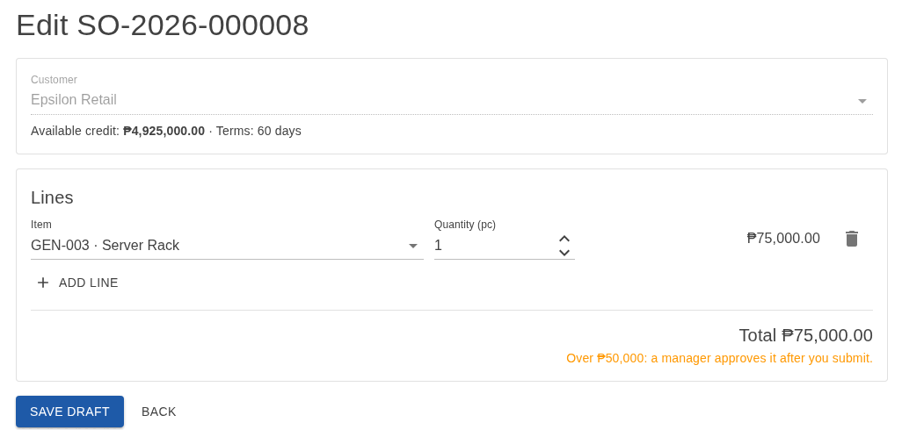
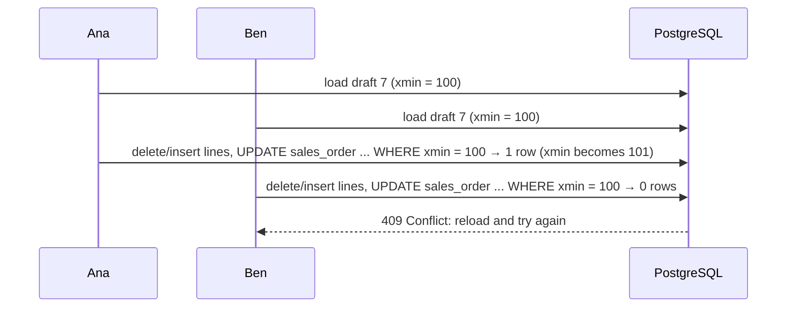

# Lesson 11 — Update an Order: The Lost Update in the Lines

Good day, developer! Reps make mistakes, and customers change their minds, so a draft order needs to be
editable. Today we'll add that, and you'll see why it's short: the domain already knows how, and so does the
form. Then we'll find a
sneaky hole in last lesson's lost-update protection, one that only shows up when you change an order's lines
and nothing else. About an hour. Are you ready? Let's begin!

## What we'll build

- `PUT /api/sales-orders/{id}`: replace a **draft** order's lines, with every create-time rule checked again.
- A small change to `SalesDbContext` so two people editing the same draft can't silently overwrite each
  other.
- An **Edit** button, and the order form learning to edit as well as create.

The edit screen is the new-order form again, filled in with the draft's lines:



## Why we build it this way

### Replace, don't patch

The request carries the order's complete new list of lines, and we replace the old ones. That's simpler and
safer than sending "add this, remove that, change the other" instructions: there's no way for the client and
server to disagree about what the order looks like afterwards.

And every rule runs again: blocked customer, category limits, credit. A draft that was fine yesterday might
not be today.

### The hole in the version check

Last lesson, we made EF Core check each row's `xmin` version when it saves. Now picture this. Ana and Ben
both open the same draft. Ana replaces its lines and saves. Ben replaces them too, and saves a second later.

What does EF Core write when the lines change? It deletes the old rows in `sales_order_line` and inserts the
new ones. **It never updates the `sales_order` row itself**, because nothing on the order changed, only its
lines. And the version check only runs on rows that get an `UPDATE`. So Ben's save goes straight through,
Ana's lines vanish, and nobody is told. Clear so far?

The fix: whenever an order's lines change, also touch the order's own row. Then the order gets an `UPDATE`,
the `xmin` check runs, and Ben gets a 409.

## 1. Touch the order when its lines change

In `SalesDbContext`, override `SaveChangesAsync`:

```csharp
public override Task<int> SaveChangesAsync(CancellationToken ct = default)
{
    // A lines-only edit never updates the order row, so its xmin would never be checked. Touch it.
    if (ChangeTracker.Entries<SalesOrderLine>().Any(l => l.State != EntityState.Unchanged))
        foreach (var order in ChangeTracker.Entries<SalesOrder>().Where(o => o.State == EntityState.Unchanged))
            order.Property(o => o.Status).IsModified = true;

    return base.SaveChangesAsync(ct);
}
```

The **change tracker** is EF Core's notebook of everything it loaded and what happened to it since. If any
line was added, deleted or modified, we mark the order's `Status` as modified. The value doesn't actually
change, but EF now writes `UPDATE sales_order SET status = ... WHERE id = ... AND xmin = ...`, and that's
all we need: the version check runs.

To remember it easily: changing a page in a book should change the book's edition number too.

## 2. The update slice

```csharp
// src/Modules/Sales/Erp.Modules.Sales/Features/UpdateSalesOrder/UpdateSalesOrderHandler.cs
using Erp.Modules.Sales.Domain;
using Erp.Modules.Sales.Infrastructure;
using Erp.Shared.BuildingBlocks;
using Microsoft.EntityFrameworkCore;

namespace Erp.Modules.Sales.Features;

internal sealed record UpdateSalesOrderCommand(long OrderId, IReadOnlyList<OrderLineInput> Lines);

internal sealed class UpdateSalesOrderHandler(SalesDbContext db, ICurrentUser currentUser)
{
    public async Task<bool> HandleAsync(UpdateSalesOrderCommand cmd, CancellationToken ct)
    {
        var order = await db.GetVisibleOrderAsync(cmd.OrderId, new UserId(currentUser.UserId), currentUser.Role, ct);
        if (order is null) return false;
        var customer = await db.Customers.SingleAsync(c => c.Id == order.CustomerId, ct);
        customer.EnsureNotBlocked();

        order.SetLines(await db.ResolveLinesAsync(cmd.Lines.Select(l => (l.ItemId, l.Quantity)), ct), currentUser.Role);
        customer.EnsureWithinCreditLimit(order.Total, await db.PendingTotalAsync(customer.Id, order.Id, ct));

        await db.SaveChangesAsync(ct);
        return true;
    }
}
```

Six lines of real work, and every one is a call you've seen before. This is where lesson 04's choice pays
off. `SetLines` replaces the whole list and checks every rule on the full set, and it's also the "drafts
only" check: on a submitted order it throws before touching anything. `ResolveLinesAsync` from lesson 07
loads the items. Create and update share both, so there's no copy of the rules to drift apart.

The validator reuses `OrderLineInputValidator` from create, for the same reason: one line, one shape.

```csharp
// src/Modules/Sales/Erp.Modules.Sales/Features/UpdateSalesOrder/UpdateSalesOrderEndpoint.cs
using FluentValidation;
using Microsoft.AspNetCore.Builder;
using Microsoft.AspNetCore.Http;
using Microsoft.AspNetCore.Http.HttpResults;
using Microsoft.AspNetCore.Routing;

namespace Erp.Modules.Sales.Features;

internal sealed record UpdateSalesOrderRequest(IReadOnlyList<OrderLineInput> Lines);

internal sealed class UpdateSalesOrderRequestValidator : AbstractValidator<UpdateSalesOrderRequest>
{
    public UpdateSalesOrderRequestValidator()
    {
        RuleFor(x => x.Lines).NotEmpty().WithMessage("An order needs at least one line.");
        RuleForEach(x => x.Lines).SetValidator(new OrderLineInputValidator());
    }
}

internal static class UpdateSalesOrderEndpoint
{
    public static void Map(IEndpointRouteBuilder app) =>
        app.MapPut("/sales-orders/{id:long}",
                async Task<Results<NoContent, NotFound>> (long id, UpdateSalesOrderRequest body, UpdateSalesOrderHandler handler, CancellationToken ct) =>
                    await handler.HandleAsync(new UpdateSalesOrderCommand(id, body.Lines), ct) ? TypedResults.NoContent() : TypedResults.NotFound())
            .RequireAuthorization(p => p.RequireRole(SalesRoles.Sellers));
}
```

The request has its own validator, next to it, reusing lesson 07's `OrderLineInputValidator` for each line.
Register `UpdateSalesOrderHandler` in `AddSalesModule` and map `UpdateSalesOrderEndpoint` in `MapSalesEndpoints`.

The order's id comes from the URL, and only the lines come in the body. That way there's never a question of
which id wins when the URL says 7 and the body says 8.

## 3. The form edits, too

The new-order page already has everything an edit needs: a customer, lines, a total. So the same page
answers a second address. Here's what changes in `OrderEditor.razor`.

Before:

```razor
@page "/sales-orders/new"
```

After:

```razor
@page "/sales-orders/new"
@page "/sales-orders/{Id:long}/edit"
```

A page may have several `@page` lines. On the second address, the router fills the `Id` parameter; on the
first, it stays `null`. So add the parameter, and let the title say which it is:

```razor
<PageTitle>@(Id is null ? "New order" : "Edit order") · ERP</PageTitle>

<MudText Typo="Typo.h4" Class="mb-4">@(Id is null ? "New sales order" : $"Edit {_orderNumber}")</MudText>
```

An order's customer never changes (a different customer is a different order), so the customer box is
locked when editing: add `Disabled="Id is not null"` to the customer `AppAutocomplete`. The Back button
goes back to wherever you came from: `Href="@(Id is null ? "sales-orders" : $"sales-orders/{Id}")"`.

Then the code. When editing, load the order and turn its lines back into form lines:

```csharp
[Parameter] public long? Id { get; set; }

private string? _orderNumber;

protected override async Task OnParametersSetAsync()
{
    if (Id is null) return;
    var order = await Api.Get<SalesOrderDetail>($"api/sales-orders/{Id}");
    if (order is null) return;
    _orderNumber = order.OrderNumber;
    _customer = await Api.Get<Customer>($"api/customers/{order.CustomerId}");
    var prices = await Api.Get<PagedResult<PriceListItem>>("api/price-list?forSaleOnly=true&pageSize=100");
    _lines = order.Lines.Select(l => new Line
    {
        Item = prices?.Items.FirstOrDefault(p => p.Id == l.ItemId), Quantity = l.Quantity
    }).ToList();
}
```

And `Save` creates or replaces:

```csharp
private async Task Save()
{
    var lines = _lines.Select(l => new { itemId = l.Item!.Id, quantity = l.Quantity }).ToList();
    if (Id is null)
    {
        if (await Api.Create("api/sales-orders", new { customerId = _customer!.Id, lines }, "Draft saved.") is { } newId)
            Nav.NavigateTo($"sales-orders/{newId}");
    }
    else if (await Api.Put($"api/sales-orders/{Id}", new { lines }, "Draft saved."))
    {
        Nav.NavigateTo($"sales-orders/{Id}");
    }
}
```

Look at how the lines are rebuilt. The order's lines carry the price *as ordered*; the form shows today's
price from the price list. If the price changed since the draft was made, the form shows the new total
before you save, and saving applies the new price. That's right for a draft, which nobody has committed to
yet.

Last, the button. On the order page, inside the `Draft` block, before Submit:

```razor
<MudButton Href="@($"sales-orders/{Id}/edit")" Variant="Variant.Outlined">Edit</MudButton>
```

## 4. Prove it: the lost update, and how good are our tests?

### Two people, one draft

The race from the start of this lesson, as a test. Ana and Bob each load the same draft, each replace its
lines, and each save. The second save must fail:

```csharp
// tests/Erp.Integration.Tests/ConcurrencyTests.cs
using AwesomeAssertions;
using Erp.Modules.Sales.Domain;
using Erp.Modules.Sales.Infrastructure;
using Erp.Shared.BuildingBlocks;
using Microsoft.EntityFrameworkCore;
using Microsoft.Extensions.DependencyInjection;

namespace Erp.Integration.Tests;

[Collection("Integration")]
public class ConcurrencyTests(CustomWebAppFactory factory)
{
    // Two people load the same draft and both replace its lines: the second save must fail, not overwrite.
    [Fact]
    public async Task Second_of_two_concurrent_line_edits_is_rejected()
    {
        var orderId = await CreateDraft();

        await using var alice = factory.Services.CreateAsyncScope();
        await using var bob = factory.Services.CreateAsyncScope();
        var aliceDb = alice.ServiceProvider.GetRequiredService<SalesDbContext>();
        var bobDb = bob.ServiceProvider.GetRequiredService<SalesDbContext>();
        var aliceOrder = await aliceDb.SalesOrders.SingleAsync(o => o.Id == orderId);
        var bobOrder = await bobDb.SalesOrders.SingleAsync(o => o.Id == orderId);

        aliceOrder.SetLines(await aliceDb.ResolveLinesAsync([(1, 3)], default), Roles.SalesRep);
        bobOrder.SetLines(await bobDb.ResolveLinesAsync([(2, 1)], default), Roles.SalesRep);

        await aliceDb.SaveChangesAsync();
        var bobSaves = () => bobDb.SaveChangesAsync();
        await bobSaves.Should().ThrowAsync<DbUpdateConcurrencyException>();
    }

    private async Task<SalesOrderId> CreateDraft()
    {
        await using var scope = factory.Services.CreateAsyncScope();
        var db = scope.ServiceProvider.GetRequiredService<SalesDbContext>();
        var now = DateTime.UtcNow;
        var order = SalesOrder.Create(await db.NextOrderNumberAsync(now, default), new CustomerId(1), new UserId(1), now);
        order.SetLines(await db.ResolveLinesAsync([(1, 1)], default), Roles.SalesRep);
        db.SalesOrders.Add(order);
        await db.SaveChangesAsync();
        return order.Id;
    }
}
```

Through HTTP, the two saves would almost never overlap. Here, two scopes are two people: each loads the
order *before* either saves, exactly the moment that matters. Delete the `SaveChangesAsync` override from
step 1 and run it: it fails, because Bob's save goes through. Put the override back: it passes. That's how you
know a test really guards the thing it's named after.

And the edges of editing, in `SalesOrderEdgeCaseTests` (the reference build has them):

| Test | The edge | Why it matters |
|---|---|---|
| `Second_of_two_concurrent_line_edits_is_rejected` | At the same instant | Ana's changes silently vanish under Bob's |
| `A_submitted_order_cannot_be_edited` | When | Stock and credit were checked for the old lines |
| `Removing_every_line_is_400_and_keeps_the_old_lines` | Nothing | An empty draft isn't a draft; and the refused edit changes nothing |
| `Another_reps_order_is_404_for_reading_submitting_and_editing` (edit) | Someone else's draft | Editing is acting on it; still a 404 |

### How much of the code do the tests run?

We have about a hundred tests now. Are there rules no test touches? **Code coverage** answers that: while the
tests run, a collector notes every line that runs. Lines no test reaches are lines no test protects.

```bash
dotnet add tests/Erp.Modules.Sales.UnitTests package coverlet.MTP --version 10.1.0
dotnet add tests/Erp.Integration.Tests package coverlet.MTP --version 10.1.0
dotnet add tests/Erp.Architecture.Tests package coverlet.MTP --version 10.1.0
dotnet add tests/Erp.Web.UiTests package coverlet.MTP --version 10.1.0
dotnet tool install dotnet-reportgenerator-globaltool --version 5.6.0
```

| Tool | What it does | License |
|---|---|---|
| `coverlet.MTP` | Records which lines and branches ran during `dotnet test`, on the Microsoft.Testing.Platform runner from lesson 02 | MIT |
| `dotnet-reportgenerator-globaltool` | Turns those records into a readable HTML report | Apache-2.0 |

Every test project gets it, even the browser tests, which have nothing to measure: `dotnet test` passes the
same options to every project, and a project that doesn't know `--coverlet` refuses to start. ReportGenerator
joins `dotnet-ef` in the tool manifest, so everyone who clones the repository gets it with
`dotnet tool restore`. Then:

```bash
dotnet test --coverlet --coverlet-output-format cobertura --results-directory TestResults
dotnet reportgenerator -reports:"TestResults/**/coverage.cobertura*.xml" -targetdir:coverage -reporttypes:Html \
  -assemblyfilters:"+Erp.*;-Erp.Web" -classfilters:"-*.Migrations.*"
```

Open `coverage/index.html`. Each class has a percentage; click one, and every line is green (ran), red
(never ran) or yellow (a branch where only one side ran). The filters leave out the browser app and the
migrations: no one writes tests for code a tool wrote. Add `TestResults/` and
`coverage/` to `.gitignore`.

Look at the Sales domain first. Most of it is green. The red lines are worth a minute each: is that a rule
nobody tested, or code nothing needs?

Now, let's be honest about the cost here: coverage only says a line *ran*. A test that calls `Submit` and
checks nothing covers every line of it and proves nothing. A high number is not the goal; the red lines are
the useful part.

### Would the tests notice a bug?

That's the real question, and **mutation testing** asks it directly. A tool makes one small change to your
code, a **mutant** (`<` becomes `<=`, a `true` becomes `false`, a line disappears), and runs the tests. If a
test fails, the mutant is *killed*: good, the tests noticed. If they all pass, the mutant *survived*: there's a
bug-shaped hole in the tests. Then the next mutant, a few hundred times.

```bash
dotnet tool install dotnet-stryker --version 5.1.0
```

**Stryker.NET** (Apache-2.0) is that tool. Tell it what to mutate, in the unit test project:

```json
// tests/Erp.Modules.Sales.UnitTests/stryker-config.json
{
  "stryker-config": {
    "project": "Erp.Modules.Sales.csproj",
    "test-runner": "mtp",
    "mutate": [ "**/Domain/**/*.cs", "!**/Domain/SalesErrors.cs" ],
    "reporters": [ "progress", "html", "cleartext" ],
    "thresholds": { "high": 90, "low": 80, "break": 75 }
  }
}
```

Only the domain: that's where the rules live, and the unit tests run in a second, so a few hundred runs take
under a minute. Two settings need a word:

- **`test-runner: mtp`** tells Stryker our tests run on Microsoft.Testing.Platform (xUnit v3). Stryker marks
  that runner as a preview and prints a warning; on these tests it gives exactly the same results as the old
  one.
- **`!**/Domain/SalesErrors.cs`** leaves the error catalog out. Stryker would change its titles and fixes,
  no test reads that text, and every changed word would "survive". Mutating help text proves nothing.

`break: 75` makes the run fail if the score drops under 75%. Then:

```bash
cd tests/Erp.Modules.Sales.UnitTests
dotnet stryker
```

```
Killed:   153
Survived:  35
The final mutation score is 75.37 %
```

Your numbers will be close to these. Open the HTML report under `StrykerOutput/` and look at the survivors.
Each one is a line Stryker changed while every test stayed green. Some of the ones we found:

| Mutant that survived | What it tells us |
|---|---|
| `if (maxQuantityPerOrder <= 0) throw ...` changed to `< 0` | No test makes a category with a cap of exactly zero |
| `if (requiredRole is not null && !Roles.All.Contains(requiredRole))` changed to `\|\|` | No test makes a category with a role that doesn't exist |
| `customer.EnsureNotBlocked();` removed from `Submit` | The handler checks it on create, so every test passed without the domain's own check |
| `EnsureBelongsTo(customer);` removed | No test passes the wrong customer |
| `if (isForSale && !IsActive) throw ...` removed | No test tries to sell an item withdrawn from the catalog |

Every one is a real rule with no test. Write them, in a file whose name says where they came from:

```csharp
// tests/Erp.Modules.Sales.UnitTests/RulesFoundByMutationTests.cs
using AwesomeAssertions;
using Erp.Modules.Sales.Domain;
using Erp.Shared.BuildingBlocks;

namespace Erp.Modules.Sales.UnitTests;

// Stryker deleted each of these checks and every test still passed: the rule was there, but nothing proved it.
public class RulesFoundByMutationTests
{
    [Theory]
    [InlineData(" ", 5, null)]
    [InlineData("Controlled", 0, null)]
    [InlineData("Controlled", -1, null)]
    [InlineData("Controlled", 5, "Janitor")]
    public void A_category_needs_a_name_a_positive_cap_and_a_real_role(string name, decimal cap, string? role) =>
        FluentActions.Invoking(() => ItemCategory.Create(name, cap, role)).Should().Throw<DomainException>();

    // The handler checks these on create, but Submit is where they count: they're checked again there.
    [Fact]
    public void Submit_checks_the_block_and_the_credit_itself()
    {
        var customer = Make.Customer(limit: 100);
        var order = Make.Order(customer, unitPrice: 25);
        customer.Block();
        order.Invoking(o => o.Submit(customer, Money.Zero, Make.Now)).Should().Throw<DomainException>().WithMessage("*blocked*");

        customer.Unblock();
        order.Invoking(o => o.Submit(customer, new Money(80), Make.Now)).Should().Throw<DomainException>().WithMessage("*credit limit*");
        order.Status.Should().Be(SalesOrderStatus.Draft);
    }

    // Passing another customer's record is a programming mistake, not a business rule, so it isn't a DomainException.
    [Fact]
    public void Passing_the_wrong_customer_is_a_bug_that_fails_loudly()
    {
        var customer = Make.Customer();
        var order = SalesOrder.Create("SO-1", new CustomerId(99), Make.Rep, Make.Now);
        order.SetLines([(Make.Item(1, 25), new Quantity(1))], Roles.SalesRep);

        order.Invoking(o => o.Submit(customer, Money.Zero, Make.Now)).Should().Throw<InvalidOperationException>();
        order.Invoking(o => o.Approve(Make.Manager, customer, Make.Now)).Should().Throw<InvalidOperationException>();
        order.Invoking(o => o.Cancel(customer)).Should().Throw<InvalidOperationException>();
    }

    [Fact]
    public void An_item_withdrawn_from_the_catalog_cannot_go_on_sale_or_be_ordered()
    {
        var inactive = SalesItem.FromCatalog(new ItemId(9), "OLD-1", "Old", "pc", false, isActive: false);
        inactive.Invoking(i => i.SetPricing(new Money(10), Make.General, isForSale: true))
            .Should().Throw<DomainException>().WithMessage("*inactive*");

        var withdrawn = Make.Item(9, 10);
        withdrawn.ApplyCatalog("OLD-1", "Old", "pc", false, isActive: false);
        withdrawn.Invoking(i => i.EnsureSellable()).Should().Throw<DomainException>().WithMessage("*not for sale*");
    }
}
```

The reference build's file has a few more, for rules that arrive in later lessons. Run Stryker again:

```
Killed:   191
Survived:  12
The final mutation score is 94.09 %
```

The dozen that still survive only change the *wording* of an error message, or remove a check that another
check already makes. Those are fine to leave: a test that pins the exact wording of every message breaks
every time you improve one.

Now, let's be honest about the cost here: mutation testing is slow, minutes where the tests take a second, so
we don't run it on every save. Run it when you've changed the domain, before you call a feature done. In
[lesson 12](12-containers-ci.md), CI runs it on request.

To remember it easily: coverage asks "did a test *run* this line?"; mutation testing asks "would a test
*notice* if this line were wrong?"

## How a request flows



## Mistakes to avoid

- Accepting "patch" instructions for lines. Replacing the whole list is simpler, and nothing can drift.
- Skipping the rules on update because they "already ran on create". The customer may be blocked today.
- Trusting the version check to cover child rows. It only checks rows that get an `UPDATE`.
- Taking the order id from the body as well as the URL.
- Letting the customer change on an existing order. A different customer is a new order.
- Chasing a coverage number. A test that checks nothing still covers every line it runs.
- Running mutation testing on everything, every time. Aim it at the domain, and run it when the rules change.

## Let's run it!

```bash
TOKEN=$(curl -s -X POST http://localhost:5264/api/auth/login -H "Content-Type: application/json" \
  -d '{"email":"rep@erp.local","password":"Password123!"}' | jq -r .accessToken)

ID=$(curl -s -X POST http://localhost:5264/api/sales-orders -H "Authorization: Bearer $TOKEN" -H "Content-Type: application/json" \
  -d '{"customerId":1,"lines":[{"itemId":1,"quantity":2}]}' | jq .id)

curl -s -o /dev/null -w "%{http_code}\n" -X PUT http://localhost:5264/api/sales-orders/$ID -H "Authorization: Bearer $TOKEN" \
  -H "Content-Type: application/json" -d '{"lines":[{"itemId":2,"quantity":3}]}'
# 204: the draft now has 3 Gadgets instead of 2 Widgets

curl -s -o /dev/null -w "%{http_code}\n" -X POST http://localhost:5264/api/sales-orders/$ID/submit -H "Authorization: Bearer $TOKEN"
curl -s -X PUT http://localhost:5264/api/sales-orders/$ID -H "Authorization: Bearer $TOKEN" \
  -H "Content-Type: application/json" -d '{"lines":[{"itemId":1,"quantity":1}]}' | jq .detail
# "Lines can only be changed on a draft order."
```

In the app: open a draft, click **Edit**, swap the Widgets for Gadgets, and save. The order page shows the
new lines. Submit it, and the Edit button disappears.

The race itself is hard to time by hand with two terminals; `Second_of_two_concurrent_line_edits_is_rejected`
times it for you. Run everything, then the coverage report and the mutation run from step 4:

```bash
dotnet test
dotnet test --coverlet --coverlet-output-format cobertura --results-directory TestResults
cd tests/Erp.Modules.Sales.UnitTests && dotnet stryker
```

All green, a coverage report to browse, and a mutation score above the 75% the configuration demands.

## Let's check!

1. Why does update replace the whole list of lines, instead of patching it?
2. Ana and Ben edit the same draft's lines. Without the `SaveChangesAsync` override, why doesn't the `xmin`
   check catch it?
3. What exactly does the override change, and why is that enough?
4. What stops the handler from changing the lines of a submitted order?
5. Create and update share `SetLines` and `ResolveLinesAsync`. Why is that sharing in the domain and the
   DbContext, rather than a helper both handlers call?
6. How do two scopes in one test act like Ana and Bob? Why not just send two HTTP requests?
7. Coverage is 95% for a class. Does that mean its rules are tested? What would tell you more?
8. A mutant survived. What does that mean, and what do you do about it? When is it fine to leave one?

And that's where this lesson ends. Drafts can be edited safely, even by two people at once, from the same
form that creates them. Next time, we put PostgreSQL in a container, so the tests can bring their own
database, and a server on GitHub runs every test on every push. Good luck, developer!

---

← [Lesson 10 — Approve, reject, cancel](10-approve-reject-cancel.md) · Next: [Lesson 12 — Containers and CI](12-containers-ci.md) →
