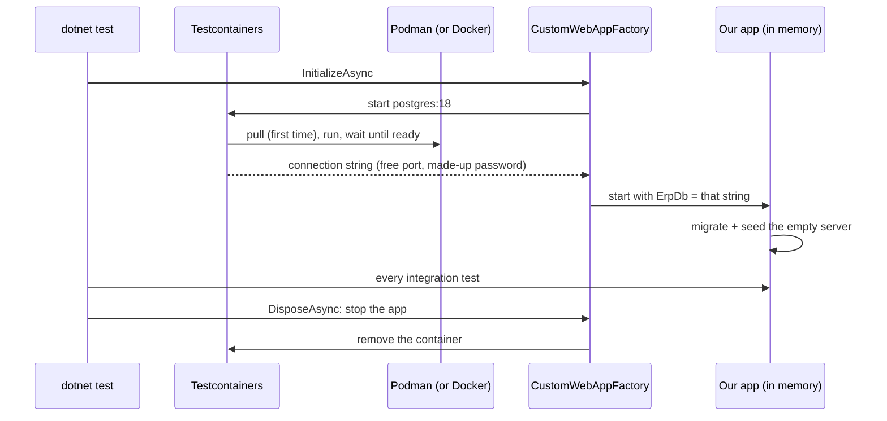

# Lesson 12 — Containers and CI: The Same Database Everywhere, Every Test on Every Push

Good day, developer! For seven lessons, our tests have shared your PostgreSQL server, dropping and
rebuilding `erp_test` on every run. It works on your machine. Today we find out what that costs, and fix it:
PostgreSQL moves into a **container**, the tests start a fresh one of their own on every run, and a server on
GitHub runs every test each time you push. About two hours, most of it installing and waiting for first
downloads. Are you ready? Let's begin!

## What we'll build

| What | Why |
|---|---|
| **Podman** on your machine | Runs containers: free, open source, no administrator rights needed to run them |
| Your development database in a container | The exact PostgreSQL version production runs, with no installer |
| **Testcontainers** in the test project | Each test run starts its own throwaway PostgreSQL, and removes it afterwards |
| A **Git** repository on **GitHub** | So a server can fetch the code |
| A **GitHub Actions** workflow | Builds and runs every test on every push; a coverage report; the mutation run on request |

## Why we build it this way

### What the shared test database costs

Look at what we've been living with since [lesson 05](05-database.md):

- **The tests drop a database on your server.** Point `ERP_TEST_DB` at the wrong server once, and they drop
  that one.
- **Two runs collide.** Run the tests in a second terminal while `dotnet watch test` runs in the first: both
  drop `erp_test` from under each other, and both fail for no reason in your code.
- **Every machine needs PostgreSQL installed**, the same version, with the same password. A teammate on
  PostgreSQL 16 passes tests you fail, or the other way round.
- **A fresh machine can't run the tests at all.** And a fresh machine is exactly what we want next: a server
  that runs every test on every push, so a broken change is caught within minutes, not when someone happens
  to run the tests.

All four have the same cure: the tests shouldn't depend on what's installed. They should bring their own
database.

### Containers

A **container image** is a program plus everything it needs to run, frozen into one file. `postgres:18` is
PostgreSQL 18 on a small Linux, configured and ready. A **container** is a running copy of an image, isolated
from the rest of the machine: its own files, its own network, its own processes. Start one, use it, throw it
away; the next one starts clean.

To remember it easily: an image is a shipping container packed at the factory. The ship doesn't care what's
inside, and nothing gets lost between the factory and the port.

Images come from a **registry**, a library of images. `docker.io/library/postgres:18` means: the Docker Hub
registry, its official `postgres` image, version 18. Download once, run as often as you like.

### Why Podman

You've probably heard of Docker. **Podman** runs the same images, the same way, and we use it for three
reasons:

| | Podman | Docker Desktop |
|---|---|---|
| License | Apache-2.0, free for any use, on every system | Free for individuals and small companies; larger companies need a paid subscription |
| How it runs | No background service; each container is a normal process of yours | A background service running as root |
| Rights | **Rootless** by default: a container can't do more than your own user can | Root, unless configured otherwise |

That last row matters. If something inside a container escapes, rootless Podman gives it the rights of your
user, not of the whole machine.

And the images are the same: both follow the **OCI** standard, so an image built with Podman runs on Docker
and the other way round. Every file in this course that describes containers (the test setup today, the
deployment in [lesson 24](24-deploy-podman.md)) works with either. If your company already uses Docker,
keep it; nothing in the course depends on which one you have.

Now, let's be honest about the cost here: on Windows and macOS, containers need a Linux kernel, so Podman
runs a small Linux virtual machine (the *Podman machine*) in the background, and that uses a gigabyte or two
of memory while it's running. The first test run also downloads the PostgreSQL image, about 150 MB. And a
test run now starts a database, which adds a few seconds.

## 1. Install Podman

| Your system | Install |
|---|---|
| Windows | `winget install -e --id RedHat.Podman-Desktop`, open Podman Desktop, and let it create and start the Podman machine. Under **Settings → Docker compatibility**, turn it on. |
| macOS | Download Podman Desktop from podman-desktop.io, create the Podman machine, and turn on Docker compatibility the same way. |
| Fedora, RHEL, Rocky | `sudo dnf install podman` (often already installed) |
| Ubuntu, Debian | `sudo apt install podman` |

**Docker compatibility** makes Podman answer on the same address Docker would, so tools written for Docker,
like Testcontainers, find it without being told. On Linux, turn on that address yourself, once:

```bash
systemctl --user enable --now podman.socket
echo 'export DOCKER_HOST=unix://$XDG_RUNTIME_DIR/podman/podman.sock' >> ~/.bashrc
```

The first line starts Podman's API for your user, now and after every restart. The second tells
Docker-minded tools where to find it. Open a new terminal, and check it all works:

```bash
podman run --rm docker.io/library/hello-world
```

```
Hello from Docker!
This message shows that your installation appears to be working correctly.
```

The image calls itself "Docker", because it was written for Docker; Podman ran it all the same. `--rm`
removes the container as soon as it stops.

## 2. The development database, in a container

Your app has used the PostgreSQL you installed in lesson 05. Let's replace it. First, stop the installed one,
so the container can use the same port:

| Your system | Stop the installed PostgreSQL and keep it from starting again |
|---|---|
| Windows (PowerShell, as administrator) | `Stop-Service postgresql-x64-18; Set-Service postgresql-x64-18 -StartupType Disabled` |
| Linux | `sudo systemctl disable --now postgresql` |
| macOS (Homebrew) | `brew services stop postgresql@18` |

Then start PostgreSQL in a container:

```bash
podman run -d --name erp-postgres \
  -e POSTGRES_PASSWORD=erp_dev_only \
  -p 5432:5432 \
  -v erp-pgdata:/var/lib/postgresql \
  docker.io/library/postgres:18
```

| Part | What it does |
|---|---|
| `-d` | Runs in the background (*detached*) |
| `--name erp-postgres` | A name to refer to it by, instead of a long id |
| `-e POSTGRES_PASSWORD=...` | The image creates the `postgres` user with this password on first start |
| `-p 5432:5432` | Your machine's port 5432 leads to the container's port 5432 |
| `-v erp-pgdata:/var/lib/postgresql` | A **volume**: the data lives outside the container, so it survives when the container is removed |
| `docker.io/library/postgres:18` | The image, spelled out in full so Podman never has to ask which registry you mean |

The address, the user and the password are what `appsettings.Development.json` already says, so the app
doesn't change at all. Start it:

```bash
dotnet run --project src/Erp.Api
```

The log says the schemas were created and the development data seeded: the container started empty, and the
app built everything it needs, exactly as on the first day of lesson 05. That's the reward for having the app
migrate and seed itself.

`psql` comes inside the image, so you don't need it installed any more:

```bash
podman exec -it erp-postgres psql -U postgres -d erp -c "SELECT name, credit_limit FROM sales.customer;"
```

`podman exec` runs a command inside a running container. From now on, every `psql` in the course looks like
this. And three commands you'll want:

| You want to | Type |
|---|---|
| Start it again after a restart of your computer | `podman start erp-postgres` |
| Start over with an empty database | `podman rm -f erp-postgres && podman volume rm erp-pgdata`, then the `podman run` above |
| See what's running | `podman ps` |

When you're happy, you may uninstall the PostgreSQL from lesson 05. Its data stays on your disk until you
do, but you won't need it: the development data is the seed, and the seed comes back on every fresh start.

## 3. The tests bring their own database

**Testcontainers** (MIT) is a library that starts a container from inside a test, waits until it's ready,
hands you its address, and removes it when the tests finish.

```bash
dotnet add tests/Erp.Integration.Tests package Testcontainers.PostgreSql --version 4.16.0
```

The factory changes from "drop a database on whatever server is configured" to "start my own server". Before:

```csharp
public sealed class CustomWebAppFactory : WebApplicationFactory<Program>
{
    public static readonly string TestConnectionString =
        Environment.GetEnvironmentVariable("ERP_TEST_DB")
        ?? "Host=localhost;Port=5432;Database=erp_test;Username=postgres;Password=erp_dev_only";

    public CustomWebAppFactory() => DropDatabase(TestConnectionString);

    protected override void ConfigureWebHost(IWebHostBuilder builder)
    {
        builder.UseEnvironment("Development");
        builder.UseSetting("ConnectionStrings:ErpDb", TestConnectionString);
    }

    public NpgsqlConnection OpenDatabase()
    {
        _ = Server;
        return new(TestConnectionString);
    }

    public static void DropDatabase(string connectionString) { ... }

    // ... LoginAsync, ClientFor, CreateUserAsync
}
```

After:

```csharp
// tests/Erp.Integration.Tests/CustomWebAppFactory.cs (the changed parts)
using Testcontainers.PostgreSql;

// The whole API in memory against a throwaway PostgreSQL in a container: every run starts from an empty server.
public sealed class CustomWebAppFactory : WebApplicationFactory<Program>, IAsyncLifetime
{
    private readonly PostgreSqlContainer _postgres = TestDatabase.Container().Build();

    public string ConnectionString => _postgres.GetConnectionString();

    public Task InitializeAsync() => _postgres.StartAsync();

    async Task IAsyncLifetime.DisposeAsync()
    {
        await DisposeAsync();
        await _postgres.DisposeAsync();
    }

    protected override void ConfigureWebHost(IWebHostBuilder builder)
    {
        builder.UseEnvironment("Development");
        builder.UseSetting("ConnectionStrings:ErpDb", ConnectionString);
    }

    // Starts the app first if no test has yet: the app is what migrates the database.
    public NpgsqlConnection OpenDatabase()
    {
        _ = Server;
        return new(ConnectionString);
    }

    // ... LoginAsync, ClientFor, CreateUserAsync, unchanged
}

public static class TestDatabase
{
    // Fully qualified, so Podman doesn't ask which registry "postgres" means. The version production runs.
    public const string Image = "docker.io/library/postgres:18";

    public static PostgreSqlBuilder Container() => new PostgreSqlBuilder(Image);
}
```

What changed, and why:

- **`IAsyncLifetime`** is xUnit's way to run `async` code before the first test and after the last.
  `InitializeAsync` starts the container; `DisposeAsync` stops the app, then the container. (The factory
  already has a `DisposeAsync` of its own from `WebApplicationFactory`, so ours is written as
  `IAsyncLifetime.DisposeAsync`, an *explicit* implementation, to keep the two apart.)
- **`GetConnectionString()`** returns the address Testcontainers picked: a free port on your machine, a
  user and password it made up. Nothing is hard-coded, so nothing can point at the wrong server.
- **`DropDatabase` and `ERP_TEST_DB` are gone.** There's nothing to drop: every run gets a brand-new server.
- **`TestDatabase.Container()`** lives in its own class because a second factory, in
  [lesson 24](24-deploy-podman.md), needs a server of its own too.

And the tests? Not one changes. Every test reached the database through `factory.OpenDatabase()` since
lesson 05, so that's the only place that knew where the database was. That's why it was written that way.

Run them:

```bash
dotnet test
```

The first run waits while Podman downloads the image. Every run after starts the container in a couple of
seconds. While it runs, look:

```bash
podman ps
```

```
CONTAINER ID  IMAGE                                   ...  NAMES
3f1c...       docker.io/library/postgres:18            ...  serene_lamport
9a07...       docker.io/testcontainers/ryuk            ...  testcontainers-ryuk-...
```

Two containers: our throwaway PostgreSQL, and **Ryuk**, Testcontainers' cleaner. If the test run crashes or
you stop it halfway, Ryuk notices and removes the containers anyway, so nothing piles up. Run `podman ps`
again after the tests: both are gone, and your `erp-postgres` is untouched.

One more test pins down the version, in `DatabaseTests`:

```csharp
// The tests' container runs the image production runs. Upgrading PostgreSQL is a decision, not an accident.
[Fact]
public async Task The_tests_run_on_the_postgresql_version_production_runs()
{
    await using var conn = factory.OpenDatabase();
    (await conn.ExecuteScalarAsync<string>("SHOW server_version")).Should().StartWith("18.");
}
```

When you upgrade PostgreSQL one day, you change the image tag in one place, and this test reminds you that
production must move too.

## 4. A repository, on GitHub

A server can only test code it can fetch. If your solution isn't in **Git** yet, make it a repository now.
From the solution folder:

```bash
git init
dotnet new gitignore
git add .
git commit -m "ERP up to lesson 12"
```

`dotnet new gitignore` writes a `.gitignore` that keeps build output (`bin/`, `obj/`) out of the repository.
Add the tool output from lesson 11 to it:

```
TestResults/
coverage/
StrykerOutput/
screens/
```

Then create an empty repository on github.com (private is fine), and push to it, using the commands GitHub
shows you:

```bash
git remote add origin https://github.com/<you>/erp.git
git push -u origin main
```

## 5. Every test, on every push

**GitHub Actions** runs a **workflow** (a list of steps in a YAML file) on GitHub's servers whenever
something happens in the repository, like a push. This one is **CI**, *continuous integration*: every change
is built and tested as soon as it arrives.

```yaml
# .github/workflows/ci.yml
# Every push and pull request: build, then run every test against a throwaway PostgreSQL.
# The runner has Docker; Testcontainers uses it the way it uses Podman on our machines.
name: CI

on:
  push:
  pull_request:
  workflow_dispatch:   # the "Run workflow" button, for the mutation run below

jobs:
  test:
    runs-on: ubuntu-24.04
    steps:
      - uses: actions/checkout@v5
      - uses: actions/setup-dotnet@v5
        with:
          dotnet-version: 10.0.x
      - run: dotnet tool restore
      - run: dotnet build Erp.slnx
      - run: dotnet test Erp.slnx --no-build --collect "XPlat Code Coverage" --results-directory TestResults
      - name: Coverage report
        if: always()
        run: >
          dotnet reportgenerator -reports:"TestResults/*/coverage.cobertura.xml" -targetdir:coverage
          -reporttypes:"Html;MarkdownSummaryGithub"
          -assemblyfilters:"+Erp.*;-Erp.Web" -classfilters:"-*.Migrations.*;-Mediator.*"
          && cat coverage/SummaryGithub.md >> "$GITHUB_STEP_SUMMARY"
      - uses: actions/upload-artifact@v5
        if: always()
        with:
          name: coverage
          path: coverage

  # Slow (minutes), so only on request: does every rule have a test that notices when it breaks?
  mutation:
    if: github.event_name == 'workflow_dispatch'
    runs-on: ubuntu-24.04
    steps:
      - uses: actions/checkout@v5
      - uses: actions/setup-dotnet@v5
        with:
          dotnet-version: 10.0.x
      - run: dotnet tool restore
      - run: dotnet stryker
        working-directory: tests/Erp.Modules.Sales.UnitTests
      - uses: actions/upload-artifact@v5
        if: always()
        with:
          name: mutation-report
          path: tests/Erp.Modules.Sales.UnitTests/StrykerOutput
```

Read it top to bottom:

| Part | What it does |
|---|---|
| `on:` | When to run: every push, every pull request, and on request (`workflow_dispatch` adds a **Run workflow** button) |
| `jobs:` | Two jobs, each on a fresh Ubuntu machine that's thrown away afterwards |
| `uses: actions/checkout@v5` | A ready-made step: fetch the repository's code |
| `uses: actions/setup-dotnet@v5` | Install the .NET 10 SDK |
| `dotnet tool restore` | Install the tools from `.config/dotnet-tools.json`: `dotnet-ef`, ReportGenerator, Stryker |
| The test step | Every test, with coverage; Testcontainers starts PostgreSQL on the machine's Docker |
| `if: always()` | Make the coverage report even when a test failed; that's when you most want it |
| `$GITHUB_STEP_SUMMARY` | A file whose text appears on the run's page: the coverage table, right there |
| `upload-artifact` | Keep the HTML report as a download on the run's page |
| `mutation:` | Only when you press **Run workflow**: the Stryker run from lesson 11 |

Notice the runner has Docker, not Podman, and the tests don't care. Testcontainers talks to whichever it
finds. That's the compatibility we chose Podman for, paying off.

Commit and push:

```bash
git add .github/workflows/ci.yml
git commit -m "Run every test on every push"
git push
```

Open the repository on GitHub and click **Actions**. The run appears within seconds: a yellow dot while it
works, a green tick when every test passes, a red cross when one fails. Click it to see each step's output,
the coverage table at the bottom, and the `coverage` download. If a push breaks a test, GitHub emails you.

The browser tests show as skipped: they need a running app, and CI doesn't start one. That's a choice, not a
gap we forgot: they're the slowest and most fragile tests, so they run on your machine before a release.

Now, let's be honest about the cost here: GitHub's machines are free for public repositories, and a private
one gets a monthly allowance of free minutes; a run of this workflow takes a few of them. And CI only helps
if you look at it: a red cross nobody fixes teaches everyone to ignore red crosses.

To remember it easily: your machine says "it works for me"; CI says "it works for anyone".

## How a test run flows now



## Mistakes to avoid

- Writing `postgres:18` instead of `docker.io/library/postgres:18`. Podman may stop and ask which registry
  you mean, and a test run can't answer.
- Forgetting the Podman socket on Linux (or Docker compatibility in Podman Desktop). Testcontainers then says
  it can't find Docker.
- Leaving the installed PostgreSQL running on port 5432. The container can't take the port.
- Removing the `erp-pgdata` volume and expecting your data back. The volume *is* the data.
- Committing `bin/`, `obj/` or `TestResults/`. Start every repository with `dotnet new gitignore`.
- Ignoring a red CI run. It means a change broke something, and the longer it stays red, the harder it is to
  say which one.

## Let's run it!

```bash
podman ps                         # erp-postgres is up
dotnet run --project src/Erp.Api  # the app, on the containerized database
dotnet test                       # every test, each run on a fresh PostgreSQL
```

All green, and after the run, `podman ps` shows only `erp-postgres`: the test containers are gone. Then
push, and watch the same tests go green on GitHub. Try one more thing: break a test on purpose, push, and
watch the run go red and the email arrive. Fix it, push again.

## Let's check!

1. Name three problems the shared `erp_test` database caused.
2. What is the difference between an image and a container? And a volume?
3. Give two reasons the course uses Podman. Would anything change if your company uses Docker?
4. Why did no test change when the factory moved to Testcontainers?
5. What does Ryuk do, and when does it matter?
6. What happens, step by step, when you push to GitHub?
7. Why does the coverage step say `if: always()`?
8. Why don't the browser tests run in CI?

And that's where this lesson ends. Your database is a container you can throw away and get back in a
minute, every test run brings its own, and a server checks every change you push. Next time, we make the
system *react*: when an order is approved, something else happens, reliably, even if the server crashes at
the worst moment. Good luck, developer!

---

← [Lesson 11 — Update an order](11-update-order.md) · Next: [Lesson 13 — Events and the outbox](13-events-outbox.md) →
