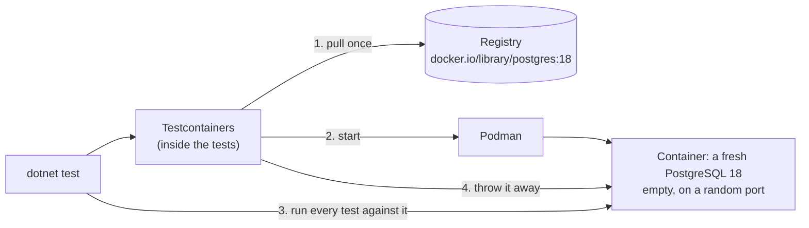
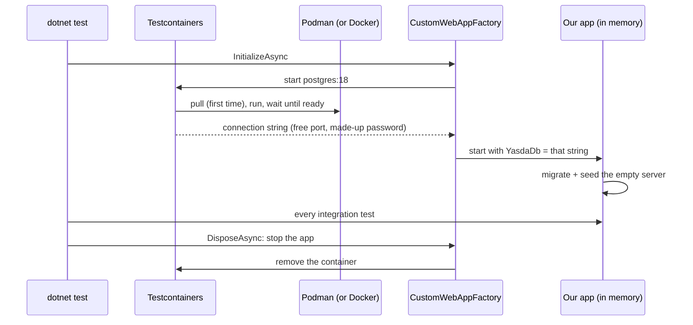

# Lesson 12 — Containers and CI: The Same Database Everywhere, Every Test on Every Push

Good day, developer! Since lesson 05, our tests have shared the PostgreSQL you installed on your own computer. It works
on your machine. Today we find out what that costs, and fix it: PostgreSQL moves into a **container**, the tests start a
fresh one of their own on every run, and a server on GitHub runs every test each time you push. We also meet two tools that
ask harder questions of the tests than "do they pass?". It takes about two hours, most of it installing and waiting for
first downloads. Are you ready? Let's begin!

## What we'll build

| What | Why |
|---|---|
| **Podman** on your machine | Runs containers: free, open source, no administrator rights needed to run them |
| Your development database in a container | The exact PostgreSQL version production runs, with no installer |
| **Testcontainers** in the test project | Each test run starts its own throwaway PostgreSQL and removes it afterwards |
| **Coverage** and **mutation testing** | Which code no test runs, and which bugs no test would notice |
| A repository on **GitHub** and a **GitHub Actions** workflow | Builds and runs every test on every push, with a coverage report and the mutation run on request |

## Why we build it this way

### What the shared test database costs

Look at what we've been living with since [lesson 05](05-database.md):

- **Yesterday's data is still there.** The tests use the database `yasda_test`, and nothing empties it between runs. A test
  that passes only because an earlier run left a row behind passes on your machine and fails on every other.
- **Two runs collide.** Run the tests in a second terminal while `dotnet watch test` runs in the first: both migrate and
  change the same tables at the same moment, and both fail for no reason in your code.
- **Every machine needs PostgreSQL installed**, the same version, with the same login. On Fedora you changed a
  configuration file to make that login work. A teammate on PostgreSQL 16 passes tests you fail, or the other way round.
- **A fresh machine can't run the tests at all.** And a fresh machine is exactly what we want next: a server that runs
  every test on every push, so a broken change is caught within minutes, not when someone happens to run the tests.

All four have the same cure: the tests shouldn't depend on what's installed. They should bring their own database.

### Containers

A **container image** is a program plus everything it needs to run, frozen into one file. `postgres:18` is PostgreSQL 18 on
a small Linux, configured and ready. A **container** is a running copy of an image, isolated from the rest of the machine:
its own files, its own network, its own processes. Start one, use it, throw it away; the next one starts clean.

To remember it easily: an image is a shipping container packed at the factory. The ship doesn't care what's inside, and
nothing gets lost between the factory and the port.

Images come from a **registry**, a library of images. `docker.io/library/postgres:18` means: the Docker Hub registry, its
official `postgres` image, version 18. You download it once and run it as often as you like.

Here's what happens when you type `dotnet test` from this lesson on:



Nothing to install, nothing left behind, and every run starts from the same clean database, on your machine and on the CI
server alike.

### Why Podman

You've probably heard of Docker. **Podman** runs the same images, the same way, and we use it for three reasons:

| | Podman | Docker Desktop |
|---|---|---|
| License | Apache-2.0, free for any use, on every system | Free for individuals and small companies; larger companies need a paid subscription |
| How it runs | No background service; each container is a normal process of yours | A background service running as root |
| Rights | **Rootless** by default: a container can't do more than your own user can | Root, unless configured otherwise |

That last row matters. If something inside a container escapes, rootless Podman gives it the rights of your user, not of
the whole machine.

And the images are the same: both follow the **OCI** standard, so an image built with Podman runs on Docker and the other
way round. Every file in this course that describes containers works with either. If your company already uses Docker,
keep it; nothing in the course depends on which one you have.

Now, let's be honest about the cost here: on Windows and macOS, containers need a Linux kernel, so Podman runs a small
Linux virtual machine (the *Podman machine*) in the background, and that uses a gigabyte or two of memory while it's
running. The first test run also downloads the PostgreSQL image, about 150 MB. And a test run now starts a database, which
adds a few seconds.

## 1. Install Podman

| Your system | Install |
|---|---|
| Windows | `winget install -e --id RedHat.Podman-Desktop`, open Podman Desktop, and let it create and start the Podman machine. Under **Settings → Docker compatibility**, turn it on. |
| macOS | `brew install --cask podman-desktop`, open Podman Desktop, create the Podman machine, and turn on Docker compatibility the same way. |
| Fedora | `sudo dnf install podman` (often already installed) |
| Ubuntu | `sudo apt install podman` |

**Docker compatibility** makes Podman answer on the same address Docker would, so tools written for Docker, like
Testcontainers, find it without being told. On Linux, turn on that address yourself, once:

```bash
systemctl --user enable --now podman.socket
echo 'export DOCKER_HOST=unix://$XDG_RUNTIME_DIR/podman/podman.sock' >> ~/.bashrc
```

The first line starts Podman's programming interface for your user, now and after every restart. The second tells
Docker-minded tools where to find it. Open a new terminal, and check it all works:

```bash
podman run --rm docker.io/library/hello-world
```

```
Hello from Docker!
This message shows that your installation appears to be working correctly.
```

The image calls itself "Docker", because it was written for Docker; Podman ran it all the same. `--rm` removes the
container as soon as it stops.

## 2. The development database, in a container

Your app has used the PostgreSQL you installed in lesson 05. Let's replace it. First, stop the installed one, so the
container can use the same port, 5432:

| Your system | Stop the installed PostgreSQL and keep it from starting again |
|---|---|
| Windows (PowerShell, as administrator) | `Stop-Service postgresql-x64-18; Set-Service postgresql-x64-18 -StartupType Disabled` |
| macOS | `brew services stop postgresql@18` |
| Fedora, Ubuntu | `sudo systemctl disable --now postgresql` |

Then start PostgreSQL in a container:

```bash
podman run -d --name yasda-postgres \
  -e POSTGRES_USER=yasda_dev \
  -e POSTGRES_PASSWORD=yasda_dev_only \
  -p 5432:5432 \
  -v yasda-pgdata:/var/lib/postgresql \
  docker.io/library/postgres:18
```

| Part | What it does |
|---|---|
| `-d` | Runs in the background (*detached*) |
| `--name yasda-postgres` | A name to refer to it by, instead of a long id |
| `-e POSTGRES_USER=...`, `-e POSTGRES_PASSWORD=...` | The image creates this login, with this password, on first start |
| `-p 5432:5432` | Your machine's port 5432 leads to the container's port 5432 |
| `-v yasda-pgdata:/var/lib/postgresql` | A **volume**: the data lives outside the container, so it survives when the container is removed |
| `docker.io/library/postgres:18` | The image, spelled out in full so Podman never has to ask which registry you mean |

The login and password are the ones lesson 05 gave `appsettings.Development.json`, so the app doesn't change at all. The
image makes `yasda_dev` an administrator, which is fine for a database that holds only development data. Start the app:

```bash
dotnet run --project src/Yasda.Api
```

The log says the schemas were created and the development data seeded: the container started empty, and the app built
everything it needs, exactly as on the first day of lesson 05. That's the reward for having the app migrate and seed
itself.

`psql` comes inside the image, so you don't need it installed any more:

```bash
podman exec -it yasda-postgres psql -U yasda_dev -d yasda -c "SELECT id, subject, status FROM tickets.ticket;"
```

`podman exec` runs a command inside a running container. From now on, every `psql` in the course looks like this. And
three commands you'll want:

| You want to | Type |
|---|---|
| Start it again after a restart of your computer | `podman start yasda-postgres` |
| Start over with an empty database | `podman rm -f yasda-postgres && podman volume rm yasda-pgdata`, then the `podman run` above |
| See what's running | `podman ps` |

When you're happy, you may uninstall the PostgreSQL from lesson 05. Its data stays on your disk until you do, but you
won't need it: the development data is the seed, and the seed comes back on every fresh start.

## 3. The tests bring their own database

**Testcontainers** (MIT) is a library that starts a container from inside a test, waits until it's ready, hands you its
address, and removes it when the tests finish.

```bash
dotnet add tests/Yasda.Integration.Tests package Testcontainers.PostgreSql --version 4.16.0
```

The factory changes from "use whatever server is configured" to "start my own server". Before, from lesson 05:

```csharp
public sealed class CustomWebAppFactory : WebApplicationFactory<Program>
{
    // The server these tests use. Set YASDA_TEST_DB to point at another one.
    private static readonly string ConnectionString =
        Environment.GetEnvironmentVariable("YASDA_TEST_DB")
        ?? "Host=localhost;Port=5432;Database=yasda_test;Username=yasda_dev;Password=yasda_dev_only";

    protected override void ConfigureWebHost(IWebHostBuilder builder)
    {
        builder.UseEnvironment("Development");
        builder.UseSetting("ConnectionStrings:YasdaDb", ConnectionString);
    }

    // ... Password, Tokens, LoginAsync, ClientFor, CreateUserAsync, OpenDatabase
}
```

After. Open `tests/Yasda.Integration.Tests/CustomWebAppFactory.cs` and change the top of the class, down to
`ConfigureWebHost`, like this:

```csharp
// tests/Yasda.Integration.Tests/CustomWebAppFactory.cs (the changed parts)
using Testcontainers.PostgreSql;

// The whole app, started in memory inside the test process, on a throwaway PostgreSQL in a container: every run starts
// from an empty server.
public sealed class CustomWebAppFactory : WebApplicationFactory<Program>, IAsyncLifetime
{
    // The password every development user has.
    public const string Password = IdentityDatabase.DevPassword;

    private readonly PostgreSqlContainer _postgres = TestDatabase.Container().Build();

    public string ConnectionString => _postgres.GetConnectionString();

    public async ValueTask InitializeAsync()
    {
        await _postgres.StartAsync();
    }

    public override async ValueTask DisposeAsync()
    {
        await base.DisposeAsync();
        await _postgres.DisposeAsync();
    }

    protected override void ConfigureWebHost(IWebHostBuilder builder)
    {
        builder.UseEnvironment("Development");
        builder.UseSetting("ConnectionStrings:YasdaDb", ConnectionString);
    }

    // ... Tokens, LoginAsync, ClientFor, CreateUserAsync, OpenDatabase: unchanged
}

public static class TestDatabase
{
    // Fully qualified, so Podman doesn't ask which registry "postgres" means. The version production runs.
    public const string Image = "docker.io/library/postgres:18";

    public static PostgreSqlBuilder Container()
    {
        return new PostgreSqlBuilder(Image);
    }
}
```

What changed, and why:

- **`IAsyncLifetime`** is xUnit's way to run `async` code before the first test and after the last. `InitializeAsync` starts
  the container; `DisposeAsync` stops the app, then the container. In xUnit v3 both return `ValueTask`.
  `WebApplicationFactory` already has a `DisposeAsync` of its own, so ours `override`s it, and `base.DisposeAsync()` stops
  the app before the container goes.
- **`GetConnectionString()`** returns the address Testcontainers picked: a free port on your machine, and a login and
  password it made up. Nothing is hard-coded, so nothing can point at the wrong server.
- **`YASDA_TEST_DB` and the hard-coded string are gone.** There's nothing to point anywhere: every run gets a brand-new
  server.
- **`TestDatabase.Container()`** lives in its own class so a later factory, in lesson 27, can start a server of its
  own too.

And the tests? Not one changes. Every test that looks at the database does it through `factory.OpenDatabase()`, so that was
the only place that knew where the database was. That's why it was written that way.

Run them:

```bash
dotnet test
```

The first run waits while Podman downloads the image. Every run after starts the container in a couple of seconds. While
it runs, look from a second terminal:

```bash
podman ps
```

```
CONTAINER ID  IMAGE                                   ...  NAMES
3f1c...       docker.io/library/postgres:18            ...  serene_lamport
9a07...       docker.io/testcontainers/ryuk@sha256:... ...  testcontainers-ryuk-...
```

Two containers besides your own `yasda-postgres`: our throwaway PostgreSQL, and **Ryuk**, Testcontainers' cleaner. If the
test run crashes or you stop it halfway, Ryuk notices and removes the containers anyway, so nothing piles up. Run `podman ps`
again a few seconds after the tests: both are gone, and your `yasda-postgres` is untouched.

One thing to watch out for: on some machines Ryuk can't start, and Testcontainers then fails with a message about it. Set
`TESTCONTAINERS_RYUK_DISABLED=true` in that terminal and run again. The tests work the same; the only loss is the cleanup
after a crash, which you'd then do yourself with `podman rm -f`.

## 4. What the tests don't tell you

A green run says every test passed. It doesn't say whether the tests are any good. Two tools ask.

**Coverage** is the share of your code's lines that ran while the tests ran. A line no test runs is a line nothing
protects. **coverlet** (MIT) measures it. For xUnit v3 on Microsoft.Testing.Platform (the runner `global.json` has chosen
since lesson 02), the package is `coverlet.MTP`, and it goes into every test project:

```bash
dotnet add tests/Yasda.Architecture.Tests package coverlet.MTP --version 10.1.0
dotnet add tests/Yasda.Integration.Tests package coverlet.MTP --version 10.1.0
dotnet add tests/Yasda.Modules.Tickets.UnitTests package coverlet.MTP --version 10.1.0
dotnet add tests/Yasda.Web.UiTests package coverlet.MTP --version 10.1.0
```

It adds the `--coverlet` option to `dotnet test`. The numbers it writes are a **cobertura** file, a plain XML format. To
read them as a page, we use a tool, **ReportGenerator** (Apache-2.0). The solution's tool manifest, `dotnet-tools.json`, has
held `dotnet-ef` since lesson 05; we add to it:

```bash
dotnet tool install dotnet-reportgenerator-globaltool --version 5.6.0
```

Now measure, and read:

```bash
dotnet test --solution Yasda.slnx --coverlet --coverlet-output-format cobertura --results-directory TestResults
dotnet reportgenerator -reports:"TestResults/**/coverage.cobertura*.xml" -targetdir:coverage -reporttypes:Html \
  -assemblyfilters:"+Yasda.*;-Yasda.Web" -classfilters:"-*.Migrations.*;-Microsoft.*;-System.*"
```

The two filters keep the report about our own code. Without them it also lists every library the tests loaded, Docker's
client among them. `-Yasda.Web` leaves out the screens, which only the browser tests run, and the generated migrations
aren't ours to judge.

Open `coverage/index.html` in a browser. Every class has a percentage, and clicking one shows its code with the lines no
test ran in red. You'll see something around 95 percent of lines. Don't chase the last five: a line can run without
anything checking what it did, and the screens aren't covered here at all.

That second problem is what **mutation testing** is for. **Stryker.NET** (Apache-2.0) changes your code in small ways, one
change at a time, and runs the tests after each: `>` becomes `>=`, `&&` becomes `||`, a line disappears. Each changed copy
is a **mutant**. If a test fails, the mutant is **killed**: good, your tests noticed. If every test still passes, the mutant
**survived**: you now know a bug that no test would catch. The **mutation score** is the share of mutants killed.

```bash
dotnet tool install dotnet-stryker --version 5.1.0
```

Stryker needs to know what to change and which tests to run. That's a small file next to the unit tests, where the rules
live:

```json
// tests/Yasda.Modules.Tickets.UnitTests/stryker-config.json
{
  "stryker-config": {
    "project": "Yasda.Modules.Tickets.csproj",
    "test-runner": "mtp",
    "mutate": [ "**/Domain/**/*.cs", "!**/Domain/TicketsErrors.cs" ],
    "reporters": [ "progress", "html", "cleartext" ],
    "thresholds": { "high": 90, "low": 80, "break": 75 }
  }
}
```

| Setting | What it says |
|---|---|
| `project` | The code to change: the Tickets module |
| `test-runner` | `mtp`: run the tests through Microsoft.Testing.Platform, as `dotnet test` does |
| `mutate` | Only the `Domain` folder: the rules, which are pure code and whose tests take milliseconds. The error-code list is left out, because changing the wording of a message isn't a bug anyone would write |
| `thresholds` | A score under `break` (75) fails the command; under `low` (80) the report shows red; over `high` (90), green |

Run it from the unit test project's folder:

```bash
cd tests/Yasda.Modules.Tickets.UnitTests
dotnet stryker
```

It builds a copy, tries about ninety mutants, and ends:

```
Killed:   72
Survived: 20

[01:01:14 INF] The final mutation score is 75.79 %
```

Your numbers will differ a little. That score is above the `break` line, so the command succeeds, and below `low`, so the
report marks it as weak. Open the HTML report it names, and look at the red ones: each is a change to a rule that no test
noticed. In lessons 04 to 11 you wrote those tests by thinking of cases; this is the tool that shows the ones you didn't
think of. A survivor is a question, not a verdict: either write the test that kills it, or decide the change doesn't matter.

Now, let's be honest about the cost here: a mutation run builds the project and runs the tests once per mutant. For this
small domain that's seconds on your machine, but it grows with the code, and a build server is slower. That's why it isn't
part of `dotnet test`, and why we'll run it on request, not on every push.

## 5. A repository, on GitHub

A server can only test code it can fetch. Your solution has been a Git repository since [lesson 01](01-solution-setup.md).
Add the tool output to the end of `.gitignore`, so reports never reach the repository:

```
TestResults/
coverage/
StrykerOutput/
```

Commit, then create an empty repository on github.com (private is fine), and push to it, using the commands GitHub shows
you:

```bash
git add .
git commit -m "Lesson 12: containers, coverage and mutation testing"
git remote add origin https://github.com/<you>/yasda.git
git push -u origin main
```

## 6. Every test, on every push

**GitHub Actions** runs a **workflow** (a list of steps in a YAML file) on GitHub's servers whenever something happens in
the repository, like a push. This one is **CI**, *continuous integration*: every change is built and tested as soon as it
arrives.

```yaml
# .github/workflows/ci.yml
# Every push and pull request: build, then run every test against a throwaway PostgreSQL.
# The runner has Docker; Testcontainers uses it the way it uses Podman on our machines.
name: CI

on:
  push:
  pull_request:
  workflow_dispatch:   # the "Run workflow" button, for the mutation run below

jobs:
  test:
    runs-on: ubuntu-24.04
    steps:
      - uses: actions/checkout@v5
      - uses: actions/setup-dotnet@v5
        with:
          dotnet-version: 10.0.x
      - run: dotnet tool restore
      - run: dotnet build Yasda.slnx
      # xUnit v3 on Microsoft.Testing.Platform (global.json opts in); coverlet.MTP adds the --coverlet options.
      - run: dotnet test --solution Yasda.slnx --no-build --coverlet --coverlet-output-format cobertura --results-directory TestResults
      - name: Coverage report
        if: always()
        run: >
          dotnet reportgenerator -reports:"TestResults/**/coverage.cobertura*.xml" -targetdir:coverage
          -reporttypes:"Html;MarkdownSummaryGithub"
          -assemblyfilters:"+Yasda.*;-Yasda.Web" -classfilters:"-*.Migrations.*;-Microsoft.*;-System.*"
          && cat coverage/SummaryGithub.md >> "$GITHUB_STEP_SUMMARY"
      - uses: actions/upload-artifact@v5
        if: always()
        with:
          name: coverage
          path: coverage

  # Slow (minutes), so only on request: does every rule have a test that notices when it breaks?
  mutation:
    if: github.event_name == 'workflow_dispatch'
    runs-on: ubuntu-24.04
    steps:
      - uses: actions/checkout@v5
      - uses: actions/setup-dotnet@v5
        with:
          dotnet-version: 10.0.x
      - run: dotnet tool restore
      - run: dotnet stryker   # stryker-config.json picks the Microsoft.Testing.Platform runner
        working-directory: tests/Yasda.Modules.Tickets.UnitTests
      - uses: actions/upload-artifact@v5
        if: always()
        with:
          name: mutation-report
          path: tests/Yasda.Modules.Tickets.UnitTests/StrykerOutput
```

Read it top to bottom:

| Part | What it does |
|---|---|
| `on:` | When to run: every push, every pull request, and on request (`workflow_dispatch` adds a **Run workflow** button) |
| `jobs:` | Two jobs, each on a fresh Ubuntu machine that's thrown away afterwards |
| `uses: actions/checkout@v5` | A ready-made step: fetch the repository's code |
| `uses: actions/setup-dotnet@v5` | Install the .NET 10 SDK |
| `dotnet tool restore` | Install the tools in `dotnet-tools.json`: `dotnet-ef`, ReportGenerator, Stryker |
| The test step | Every test, with coverage; Testcontainers starts PostgreSQL on the machine's Docker |
| `if: always()` | Make the coverage report even when a test failed; that's when you most want it |
| `-assemblyfilters`, `-classfilters` | The same filters as in step 4: the report describes our own code |
| `$GITHUB_STEP_SUMMARY` | A file whose text appears on the run's page: the coverage table, right there |
| `upload-artifact` | Keep the HTML report as a download on the run's page |
| `mutation:` | Only when you press **Run workflow**: the Stryker run from step 4 |

The course's own repository keeps the solution in a subfolder, so its copy of this file adds a `working-directory` line.
Yours doesn't need it.

One more line makes the build server stricter than your machine. In `Directory.Build.props`, inside the `<PropertyGroup>`:

```xml
<!-- On the build server (CI sets CI=true) a warning fails the build, so none slips into main. Locally they stay
     warnings, so a half-finished change still runs. -->
<TreatWarningsAsErrors Condition="'$(CI)' == 'true'">true</TreatWarningsAsErrors>
```

GitHub Actions sets `CI=true` on every run. So a warning from the analyzers you turned on in lesson 01 is a red build on
the server, while at your desk it stays a warning you can fix before you push. Try it locally with
`CI=true dotnet build Yasda.slnx`.

Notice the runner has Docker, not Podman, and the tests don't care. Testcontainers talks to whichever it finds. That's the
compatibility we chose Podman for, paying off.

Commit and push:

```bash
git add .
git commit -m "Run every test on every push"
git push
```

Open the repository on GitHub and click **Actions**. The run appears within seconds: a yellow dot while it works, a green
tick when every test passes, a red cross when one fails. Click it to see each step's output, the coverage table at the
bottom, and the `coverage` download. If a push breaks a test, GitHub emails you. To run the mutation job, open the **CI**
workflow, press **Run workflow**, and wait a few minutes.

The browser tests show as skipped: they need a running app, and CI doesn't start one. That's a choice, not a gap we forgot:
they're the slowest and most fragile tests, so they run on your machine before a release.

Now, let's be honest about the cost here: GitHub's machines are free for public repositories, and a private one gets a
monthly allowance of free minutes; a run of this workflow takes a few of them. And CI only helps if you look at it: a red
cross nobody fixes teaches everyone to ignore red crosses.

To remember it easily: your machine says "it works for me"; CI says "it works for anyone".

## 7. Prove it: the container, and a pinned version

Nothing about the tests changed, so almost nothing needs a new test. One does: the database the tests run on is now chosen by
one line, the image tag, and a person will change that line one day. This test makes that a decision, not an accident. Add it
to `DatabaseTests`:

```csharp
// tests/Yasda.Integration.Tests/DatabaseTests.cs (added)
// The tests' container runs the image production runs. Upgrading PostgreSQL is a decision, not an accident.
[Fact]
public async Task The_tests_run_on_the_postgresql_version_production_runs()
{
    await using var connection = factory.OpenDatabase();
    await using var command = new NpgsqlCommand("SHOW server_version", connection);

    var version = (string?)await command.ExecuteScalarAsync();

    version.Should().StartWith("18.");
}
```

`SHOW server_version` asks the server for its version, and the test says it must start with 18, the version we develop on
and will deploy. Now make it fail once. In `TestDatabase`, change the image to `docker.io/library/postgres:17`, and run
`dotnet test`: this test, and only this test, fails.

```
Expected version to start with the same string, but they differ at index 1:
    ↓ (actual)
  "17.12 (Debian 17.12-1.pgdg13+1)"
  "18."
    ↑ (expected).
```

Put the tag back to 18. When you upgrade PostgreSQL for real, you change the tag in one place, and this test reminds you
that production must move too.

The other proof is what you've already seen: every test from lesson 05 on passes against a database it never knew about.

| Test | Why it matters here |
|---|---|
| `The_tests_run_on_the_postgresql_version_production_runs` | The image tag is a decision, and a test notices when someone changes it |
| Every earlier `DatabaseTests` test, unchanged | They reached the database only through `factory.OpenDatabase()`, so moving it into a container touched none of them |

## How a test run flows now



## Mistakes to avoid

- Writing `postgres:18` instead of `docker.io/library/postgres:18`. Podman may stop and ask which registry you mean, and a
  test run can't answer.
- Forgetting the Podman socket on Linux (or Docker compatibility in Podman Desktop). Testcontainers then says it can't find
  Docker.
- Leaving the installed PostgreSQL running on port 5432. The container can't take the port.
- Removing the `yasda-pgdata` volume and expecting your data back. The volume *is* the data.
- Committing `TestResults/`, `coverage/` or `StrykerOutput/`. They are made again on every run.
- Chasing 100 percent coverage. It tells you which code no test ran, not whether the tests that ran check anything. That
  second question is the mutation score's.
- Ignoring a red CI run. It means a change broke something, and the longer it stays red, the harder it is to say which one.

## Let's run it!

```bash
podman ps                         # yasda-postgres is up
dotnet run --project src/Yasda.Api  # the app, on the containerized database
dotnet test                       # every test, each run on a fresh PostgreSQL
```

All green, and after the run, `podman ps` shows only `yasda-postgres`: the test containers are gone. Then run
`dotnet stryker` in the unit test project and open the report. Last, push and watch the same tests go green on GitHub. Try one
more thing: break a test on purpose, push, and watch the run go red and the email arrive. Fix it, push again.

## Let's check!

1. Name three problems the shared `yasda_test` database caused.
2. What is the difference between an image and a container? And a volume?
3. Give two reasons the course uses Podman. Would anything change if your company uses Docker?
4. Why did no test change when the factory moved to Testcontainers?
5. What does Ryuk do, and when does it matter?
6. A test run reports 95 percent coverage. What has that told you, and what hasn't it?
7. What is a surviving mutant, and what should you do about one?
8. Why does the coverage step say `if: always()`, and why doesn't the mutation job run on every push?

And that's where this lesson ends. Your database is a container you can throw away and get back in a minute, every test run
brings its own, the tests are measured by what they'd miss and not only by whether they pass, and a server checks every change
you push. Next time, we make the system *react*: when a ticket is filed, something else happens, reliably, even if the server
crashes at the worst moment. Good luck, developer!

---

← [Lesson 11 — Replies and notes](11-replies-and-notes.md) · Next: Lesson 13 — Events and the outbox (coming with milestone Y3) →
