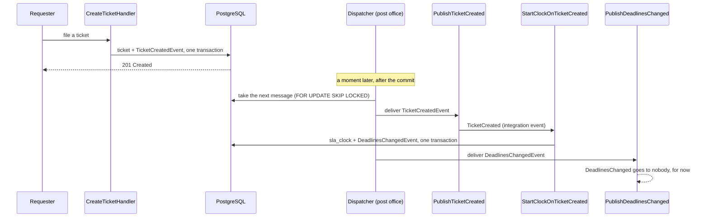

# Lesson 13 — Events and the Outbox: Tickets Tells, Sla Listens

Good day, developer! So far the Tickets module has done everything itself. Today a second module joins it: **Sla**, which starts a clock for every ticket: "respond within 4 hours, resolve within 24". The two modules must not know about each other's insides, and no clock may ever be lost, not even if the server crashes at the worst moment. That takes a new tool, the **transactional outbox**. It is a big lesson, about three hours, and the first of two: today Tickets tells and Sla listens, and next time Sla answers and the screens show it. Are you ready? Let's begin!

## What we'll build

| Piece | What it is |
|---|---|
| **Domain events** | What a `Ticket` records when something happens to it: created, replied to, resolved, reopened, cancelled, priority changed |
| **The outbox** | A table in each module, written in the same transaction as the change, so an event and the change that caused it live or die together |
| **The dispatcher** | A background service that delivers saved events after the commit, tries again when a delivery fails, and gives up only after ten tries |
| **Integration events** | The public form of an event, in a `.Contracts` project, that other modules may listen to |
| **The Sla module** | `SlaClock` (the two deadlines of one ticket) and `SlaPolicy` (how long each priority gets), with the four seeded policies as rows |
| **Tests** | Unit tests for the events and the clock, architecture tests that no event is left without a listener, and integration tests for the outbox |

## Why we build it this way

### The pain: two modules, one fact

When a requester files a ticket, Sla must start its clock. The obvious way is to call it from `CreateTicketHandler`:

```csharp
db.Tickets.Add(ticket);
await db.SaveChangesAsync(ct);
await slaService.StartClockAsync(ticket.Id.Value, ticket.Priority, ct);   // hmm
```

That hurts in two ways.

First, Tickets now knows Sla exists. Add email next month, and `CreateTicketHandler` grows another line, then another. The island rule from [lesson 01](01-solution-setup.md) says a module reaches another only through its `.Contracts` project, and "tell Sla" is the reverse of what we want: Tickets should say *what happened* and not care who listens.

Second, and worse, those are two separate writes. Look at the gap between the two lines. If the server crashes there, the ticket is saved and its clock is never started. Swap the lines and the failure flips: a clock for a ticket that doesn't exist. No transaction spans a database write and a call into another module, so there is no order of the two lines that is safe. This is the **dual write** problem.

### The fix: write the letter in the same transaction

Remember the turnstile from [lesson 07](07-file-a-ticket.md): a transaction lets everyone through, or nobody. So let's put the "letter" inside the one transaction we already have. When the `Ticket` changes, it records an **event**: a small fact in its own words, `TicketCreatedEvent`. `SaveChanges` then writes the ticket and the event into the same database transaction, the event going into a table called the **outbox**. Either both are saved, or neither.

A background service, the **dispatcher**, reads the outbox and delivers each event to whoever has subscribed. It runs after the commit, so a crash can't lose anything: an event not yet delivered is still sitting in the table when the app starts again.

To remember it easily: the aggregate writes the letter, the outbox is the mailbox, and the dispatcher is the post office. The sender never knows who reads the letter.

Two kinds of events carry the news:

| | Domain event | Integration event |
|---|---|---|
| Written in | The module's own words (`TicketCreatedEvent`) | Plain data (`TicketCreated(long TicketId, ...)`) |
| Lives in | The module, `internal` | The module's `.Contracts` project, `public` |
| Heard by | Its own module's handlers | Other modules' handlers |
| Why separate | The module may change its domain freely | Other modules depend on it, so it changes rarely |

Inside the post office, a domain event goes to the module's own small handler, whose only job is to turn it into the public integration event. Every module that listens gets that one.

### Now, let's be honest about the cost here

The outbox delivers every event **at least once**. If the app crashes after a handler did its work but before the dispatcher marked the event done, the handler runs again. So every handler must be **idempotent**: hearing the same event twice leaves the same result as hearing it once. Delivery also takes a moment (the dispatcher looks a couple of seconds apart), and events can arrive out of order. The rest of this lesson keeps meeting those three facts, and each time we'll see the plain fix.

### What Sla does with it

A clock needs two numbers per priority, and those numbers are **rows in a table**, edited on a screen (the API and the screen come next lesson). Never a setting in a file: a team lead must be able to change them without a developer. We seed these rows with the defaults the plan chose:

| Priority | Respond within | Resolve within |
|---|---|---|
| Critical | 1 hour | 4 hours |
| High | 4 hours | 24 hours |
| Normal | 8 hours | 72 hours |
| Low | 24 hours | 120 hours |

For now the clock counts 24 hours a day. Business hours, holidays and pausing come in a later lesson, and that lesson will replace one line of the clock: `StartedUtc + target`.

## 1. The words: events and a way to record them

First, the vocabulary every module shares, in `Yasda.Shared.BuildingBlocks`, the project every module may use. An aggregate needs to *record* events, so `AggregateRoot` gains a list and a `Raise` method. Replace the `AggregateRoot` line in `Domain/BuildingBlocks.cs`. Before:

```csharp
public abstract class AggregateRoot<TId> : Entity<TId> where TId : struct;
```

After:

```csharp
// What the outbox needs from any aggregate, whatever its id type: the events it recorded, and a way to forget them.
public interface IAggregateRoot
{
    IReadOnlyList<IDomainEvent> DomainEvents { get; }
    void ClearEvents();
}

public abstract class AggregateRoot<TId> : Entity<TId>, IAggregateRoot where TId : struct
{
    private readonly List<IDomainEvent> _events = new();

    public IReadOnlyList<IDomainEvent> DomainEvents => _events;

    protected void Raise(IDomainEvent domainEvent)
    {
        _events.Add(domainEvent);
    }

    public void ClearEvents()
    {
        _events.Clear();
    }
}

// A fact the domain records ("ticket resolved"), in its own module's words. Saved to the outbox in the same transaction
// as the change, then delivered to that module's IDomainEventHandler<T> classes after the commit. Never public: other
// modules hear about it only through an integration event (IIntegrationEvent) the module chooses to publish.
public interface IDomainEvent;
```

`Raise` is `protected`: only the aggregate itself can record what happened to it. `IAggregateRoot` exists because the outbox, written in a moment, must read the events of any aggregate, whatever its id type.

Next, the interfaces for the two kinds of handlers, and for publishing an integration event. This is a new file:

```csharp
// src/Shared/Yasda.Shared.BuildingBlocks/Messaging/Events.cs
namespace Yasda.Shared.BuildingBlocks;

// Runs after the change that raised the event has committed. At-least-once: it may run twice, so it must be idempotent.
public interface IDomainEventHandler<in TEvent> where TEvent : IDomainEvent
{
    Task HandleAsync(TEvent domainEvent, CancellationToken ct);
}

// A fact one module tells the others, declared in its .Contracts project. Plain data only (ids, amounts, text), so the
// publishing module can change its domain without breaking the modules that listen.
public interface IIntegrationEvent;

public interface IIntegrationEventHandler<in TEvent> where TEvent : IIntegrationEvent
{
    Task HandleAsync(TEvent integrationEvent, CancellationToken ct);
}

// Hands an integration event to every module that handles it. A module calls it from one of its domain event handlers,
// so it runs inside the outbox delivery: if any handler fails, the whole delivery is retried.
public interface IIntegrationEventPublisher
{
    Task PublishAsync<TEvent>(TEvent integrationEvent, CancellationToken ct) where TEvent : IIntegrationEvent;
}
```

Then the saved form of an event, the row of the outbox table. This is a new file too:

```csharp
// src/Shared/Yasda.Shared.BuildingBlocks/Messaging/OutboxMessage.cs
using System.Text.Json;

namespace Yasda.Shared.BuildingBlocks;

// A domain event waiting in a module's outbox table, saved in the same transaction as the change that raised it.
public sealed class OutboxMessage
{
    public Guid Id { get; private set; }
    public string Type { get; private set; } = default!;
    public string Payload { get; private set; } = default!;
    public DateTime OccurredUtc { get; private set; }
    public DateTime? ProcessedUtc { get; private set; }
    public int Attempts { get; private set; }
    public string? LastError { get; private set; }

    private OutboxMessage() { }

    public static OutboxMessage From(IDomainEvent domainEvent, DateTime nowUtc)
    {
        var type = domainEvent.GetType();
        return new OutboxMessage
        {
            Id = Guid.NewGuid(),
            // No assembly version, so messages written before an upgrade still load after it.
            Type = $"{type.FullName}, {type.Assembly.GetName().Name}",
            Payload = JsonSerializer.Serialize(domainEvent, type),
            OccurredUtc = nowUtc
        };
    }

    public static IDomainEvent Deserialize(string type, string payload)
    {
        var eventType = System.Type.GetType(type, throwOnError: true)!;
        return (IDomainEvent)JsonSerializer.Deserialize(payload, eventType)!;
    }
}
```

`From` turns an event into a row: its type name, and its content as JSON. `Deserialize` turns it back. Notice that the type name carries no version number, so a message written before an upgrade can still be read after it. The cost: every event type must survive being written as JSON and read back, and we'll write a test that checks exactly that.

The dispatcher needs to know which schemas to visit, so `IModuleDatabase` learns its module's schema. In `Abstractions/Data.cs`, add one line:

```csharp
public interface IModuleDatabase
{
    string Module { get; }
    string Schema { get; }   // new: the PostgreSQL schema, so the dispatcher can find the module's outbox
    Task MigrateAsync(CancellationToken ct);
    Task SeedDevelopmentDataAsync(CancellationToken ct);
}
```

One analyzer rule needs switching off. CA1711 says a type name must not end in `EventHandler`, and `IDomainEventHandler` is the standard name for exactly this idea. In `.editorconfig`, next to CA1716:

```ini
# CA1711: IDomainEventHandler and IIntegrationEventHandler are the standard names for these interfaces in DDD code.
dotnet_diagnostic.CA1711.severity = none
```

## 2. The post office

Three small classes in `Yasda.Shared.Infrastructure`, the project only the host references. The first writes the letters. It is an EF Core **interceptor**: a class EF Core calls at fixed moments, here just before `SaveChanges`. It collects the events of every aggregate in the change tracker and adds them to the outbox, so they commit together:

```csharp
// src/Shared/Yasda.Shared.Infrastructure/Outbox/OutboxInterceptor.cs
using Yasda.Shared.BuildingBlocks;
using Microsoft.EntityFrameworkCore;
using Microsoft.EntityFrameworkCore.Diagnostics;

namespace Yasda.Shared.Infrastructure;

// Turns the aggregates' domain events into outbox rows inside the same SaveChanges, so they commit together.
public sealed class OutboxInterceptor(TimeProvider time) : SaveChangesInterceptor
{
    public override InterceptionResult<int> SavingChanges(DbContextEventData eventData, InterceptionResult<int> result)
    {
        MoveEventsToOutbox(eventData.Context);
        return base.SavingChanges(eventData, result);
    }

    public override ValueTask<InterceptionResult<int>> SavingChangesAsync(
        DbContextEventData eventData, InterceptionResult<int> result, CancellationToken cancellationToken = default)
    {
        MoveEventsToOutbox(eventData.Context);
        return base.SavingChangesAsync(eventData, result, cancellationToken);
    }

    private void MoveEventsToOutbox(DbContext? db)
    {
        if (db is null) return;

        // Copied to a list first: adding outbox rows changes the change tracker while we'd still be reading it.
        var entries = db.ChangeTracker.Entries<IAggregateRoot>();
        var aggregates = entries.Select(e => e.Entity).Where(a => a.DomainEvents.Count > 0).ToList();

        var now = time.GetUtcNow().UtcDateTime;
        foreach (var aggregate in aggregates)
        {
            foreach (var domainEvent in aggregate.DomainEvents)
                db.Set<OutboxMessage>().Add(OutboxMessage.From(domainEvent, now));
            aggregate.ClearEvents();
        }
    }
}
```

The events are moved to a list first because adding outbox rows changes the very thing we'd still be reading, and `ClearEvents` makes sure a second `SaveChanges` doesn't write them twice.

The second hands an integration event to every handler that listens:

```csharp
// src/Shared/Yasda.Shared.Infrastructure/Outbox/IntegrationEventPublisher.cs
using Yasda.Shared.BuildingBlocks;
using Microsoft.Extensions.DependencyInjection;

namespace Yasda.Shared.Infrastructure;

internal sealed class IntegrationEventPublisher(IServiceProvider services) : IIntegrationEventPublisher
{
    public async Task PublishAsync<TEvent>(TEvent integrationEvent, CancellationToken ct) where TEvent : IIntegrationEvent
    {
        foreach (var handler in services.GetServices<IIntegrationEventHandler<TEvent>>())
            await handler.HandleAsync(integrationEvent, ct);
    }
}
```

The third is the post office itself:

```csharp
// src/Shared/Yasda.Shared.Infrastructure/Outbox/OutboxDispatcher.cs
using System.Reflection;
using System.Text.RegularExpressions;
using Dapper;
using Microsoft.Extensions.Configuration;
using Microsoft.Extensions.DependencyInjection;
using Microsoft.Extensions.Hosting;
using Microsoft.Extensions.Logging;
using Npgsql;
using Yasda.Shared.BuildingBlocks;

namespace Yasda.Shared.Infrastructure;

public sealed class OutboxOptions
{
    public int PollIntervalMs { get; set; } = 2000;
    public int BatchSize { get; set; } = 50;
    public int MaxAttempts { get; set; } = 10;
}

// Delivers outbox events to their module's IDomainEventHandler<T> classes after commit. At-least-once: a handler may see an event twice, so handlers must be
// idempotent. FOR UPDATE SKIP LOCKED keeps several app instances from taking the same message. After
// MaxAttempts failures a message is left, with its last_error, for a person to look at.
public sealed partial class OutboxDispatcher(
    IServiceScopeFactory scopes,
    NpgsqlDataSource dataSource,
    IConfiguration config,
    TimeProvider time,
    ILogger<OutboxDispatcher> log) : BackgroundService
{
    private readonly OutboxOptions _options = config.GetSection("Outbox").Get<OutboxOptions>() ?? new();

    protected override async Task ExecuteAsync(CancellationToken stoppingToken)
    {
        List<string> schemas;
        await using (var scope = scopes.CreateAsyncScope())
        {
            var modules = scope.ServiceProvider.GetServices<IModuleDatabase>();
            schemas = modules.Select(m => m.Schema).ToList();
        }

        // Once right away (events may have waited through a restart), then on every tick.
        await DispatchAllAsync(schemas, stoppingToken);

        using var timer = new PeriodicTimer(TimeSpan.FromMilliseconds(_options.PollIntervalMs));
        while (await timer.WaitForNextTickAsync(stoppingToken))
        {
            await DispatchAllAsync(schemas, stoppingToken);
        }
    }

    private async Task DispatchAllAsync(List<string> schemas, CancellationToken stoppingToken)
    {
        foreach (var schema in schemas)
        {
            try
            {
                // A full batch means more may be waiting, so go again until a batch comes back short.
                var moreWaiting = true;
                while (moreWaiting)
                {
                    var delivered = await DispatchBatchAsync(schema, stoppingToken);
                    moreWaiting = delivered == _options.BatchSize;
                }
            }
            catch (Exception ex) when (!stoppingToken.IsCancellationRequested)
            {
                log.LogError(ex, "Outbox dispatch for schema {Schema} failed; will retry next tick", schema);
            }
        }
    }

    private sealed record Row(Guid Id, string Type, string Payload);

    public async Task<int> DispatchBatchAsync(string schema, CancellationToken ct)
    {
        if (!SafeIdentifier().IsMatch(schema)) throw new ArgumentException($"Bad schema name '{schema}'.");
        var table = $"{schema}.outbox_message";

        await using var conn = await dataSource.OpenConnectionAsync(ct);
        await using var tx = await conn.BeginTransactionAsync(ct);

        var rows = await conn.QueryAsync<Row>(
            $"""
            SELECT id, type, payload FROM {table}
            WHERE processed_utc IS NULL AND attempts < @MaxAttempts
            ORDER BY occurred_utc
            LIMIT @BatchSize
            FOR UPDATE SKIP LOCKED
            """,
            new { _options.MaxAttempts, _options.BatchSize }, tx);
        var batch = rows.ToList();

        foreach (var message in batch)
        {
            try
            {
                var domainEvent = OutboxMessage.Deserialize(message.Type, message.Payload);
                await using var scope = scopes.CreateAsyncScope();
                await DeliverAsync(scope.ServiceProvider, domainEvent, ct);

                await conn.ExecuteAsync($"UPDATE {table} SET processed_utc = @Now WHERE id = @Id",
                    new { Now = time.GetUtcNow().UtcDateTime, message.Id }, tx);
            }
            catch (Exception ex) when (!ct.IsCancellationRequested)
            {
                await conn.ExecuteAsync($"UPDATE {table} SET attempts = attempts + 1, last_error = @Error WHERE id = @Id",
                    new { Error = ex.ToString(), message.Id }, tx);
                log.LogError(ex, "Outbox message {MessageId} ({Type}) failed", message.Id, message.Type);
            }
        }

        await tx.CommitAsync(ct);
        return batch.Count;
    }

    // The event's type is known only at run time (it was read from a row), so the typed method is picked by reflection.
    private static readonly MethodInfo DeliverTyped =
        typeof(OutboxDispatcher).GetMethod(nameof(DeliverToHandlersAsync), BindingFlags.NonPublic | BindingFlags.Static)!;

    private static Task DeliverAsync(IServiceProvider services, IDomainEvent domainEvent, CancellationToken ct) =>
        (Task)DeliverTyped.MakeGenericMethod(domainEvent.GetType()).Invoke(null, [services, domainEvent, ct])!;

    private static async Task DeliverToHandlersAsync<TEvent>(IServiceProvider services, TEvent domainEvent, CancellationToken ct)
        where TEvent : IDomainEvent
    {
        foreach (var handler in services.GetServices<IDomainEventHandler<TEvent>>())
            await handler.HandleAsync(domainEvent, ct);
    }

    [GeneratedRegex("^[a-z_][a-z0-9_]*$")]
    private static partial Regex SafeIdentifier();
}
```

This is the heart of the lesson, so let's read what it does, in the order it does it:

- A **`BackgroundService`** runs for as long as the app does. It looks at once on start (events may have waited through a restart), then on every tick of a timer, two seconds apart by default.
- For each module's schema it opens one transaction and selects the next unprocessed messages, oldest first. **`FOR UPDATE SKIP LOCKED`** locks the rows it takes and skips rows another dispatcher has locked. That is what lets two copies of the app run side by side without delivering the same message twice at the same time.
- For each message it reads the event back from JSON, opens a fresh scope (so the handler gets its own `DbContext`), and calls every `IDomainEventHandler<T>` for that event. If all succeed, the message is marked processed.
- If a handler throws, the message is not lost: its `attempts` goes up, the error is kept in `last_error`, and the next tick tries again. After `MaxAttempts` (10), the message is **parked**: left in the table with its error for a person to look at. One bad message never blocks the ones behind it.
- The reflection is the one place we use it: the event's type is known only at run time, because it was read from a row, so the typed method is picked with `MakeGenericMethod`. The comment in the code says so.

Now register all three. First the package, because the interceptor uses EF Core's types:

```bash
dotnet add src/Shared/Yasda.Shared.Infrastructure package Microsoft.EntityFrameworkCore
```

The version is already pinned in `Directory.Packages.props` since lesson 05, so no `--version` is needed. Then in `DependencyInjection.cs`, add the `using Microsoft.EntityFrameworkCore.Diagnostics;` line and these lines before the `TimeProvider`:

```csharp
// Every module's DbContext picks up the registered interceptors (see each module's AddXModule).
services.AddSingleton<IInterceptor, OutboxInterceptor>();
services.AddHostedService<OutboxDispatcher>();
services.AddScoped<IIntegrationEventPublisher, IntegrationEventPublisher>();
```

## 3. Every module gets an outbox

The dispatcher visits every module's schema, so every module needs an `outbox_message` table, even Identity, which has no events yet. A uniform rule is simpler than a dispatcher that must ask which modules have one. Each module's `DbContext` maps the `OutboxMessage` class to its own table, and each module adds the shared interceptors when it registers its `DbContext`.

Start with Tickets. In `TicketsDbContext`, add `using Yasda.Shared.BuildingBlocks;` and, at the top of `OnModelCreating` after `HasDefaultSchema`:

```csharp
builder.Entity<OutboxMessage>(e =>
{
    e.ToTable("outbox_message");
    e.HasKey(x => x.Id);
    e.Property(x => x.Type).HasMaxLength(500);
    e.Property(x => x.Payload).HasColumnType("jsonb");
    // The dispatcher asks "what is still waiting?" every tick, so only unprocessed rows are indexed.
    e.HasIndex(x => x.OccurredUtc).HasFilter("processed_utc IS NULL");
});
```

`jsonb` is PostgreSQL's binary JSON type; the `HasFilter` makes a **partial index**, one that holds only the rows still waiting, so it stays tiny however many events have been delivered. In `TicketsModule.cs`, the `AddDbContext` call adds the shared interceptors (add `using Microsoft.EntityFrameworkCore.Diagnostics;`):

```csharp
services.AddDbContext<TicketsDbContext>((provider, options) =>
{
    var configuration = provider.GetRequiredService<IConfiguration>();
    TicketsDbContext.Configure(options, configuration.GetConnectionString("YasdaDb")!);
    options.AddInterceptors(provider.GetServices<IInterceptor>());
});
```

And `TicketsDatabase` says its schema:

```csharp
public string Module => "Tickets";
public string Schema => TicketsDbContext.Schema;
```

Identity gets the same three changes. In `YasdaIdentityDbContext`, add `using Yasda.Shared.BuildingBlocks;` and, in `OnModelCreating` after `HasDefaultSchema`:

```csharp
// Identity has no events to send yet. Every module keeps an outbox anyway, because the dispatcher visits them all.
builder.Entity<OutboxMessage>(e =>
{
    e.ToTable("outbox_message");
    e.HasKey(x => x.Id);
    e.Property(x => x.Type).HasMaxLength(500);
    e.Property(x => x.Payload).HasColumnType("jsonb");
    e.HasIndex(x => x.OccurredUtc).HasFilter("processed_utc IS NULL");
});
```

In `IdentityModule.cs`, add `using Microsoft.EntityFrameworkCore.Diagnostics;` and one line inside the `AddDbContext` block, after `Configure`:

```csharp
options.AddInterceptors(provider.GetServices<IInterceptor>());
```

And in `IdentityDatabase`:

```csharp
public string Module => "Identity";
public string Schema => YasdaIdentityDbContext.Schema;
```

Identity's table gets its migration now, because nothing else about Identity changes in this lesson:

```bash
dotnet ef migrations add AddOutbox --project src/Modules/Identity/Yasda.Modules.Identity --startup-project src/Modules/Identity/Yasda.Modules.Identity --output-dir Infrastructure/Migrations
```

Open the new file and read it. It creates `outbox_message` and its partial index, nothing else. Tickets' migration waits until the end of the next step, because the same migration will carry more.

The reference build in this repository keeps one `InitialCreate` per module and edits it in place. Your project can't: a migration you have already run is never edited, so each change is a new one. The resulting schema is the same.

## 4. Tickets raises its events

### The id trap

Here is a trap, and it is worth meeting once. An event says "ticket #7 was created". But a ticket's number comes from PostgreSQL's **identity column**, and PostgreSQL hands it out only when the row is inserted. The interceptor writes the event *before* that moment, so a freshly created ticket still has number 0, and its `TicketCreatedEvent` would say "ticket #0". Sla would start a clock for a ticket that doesn't exist.

The fix is to take the number first. A **sequence** is PostgreSQL's own counter, and `nextval` takes the next number from it. We ask for the number, hand it to `Ticket.Create`, and the events carry the right id from the first moment. The ticket's table stops generating the number itself.

### The domain events

Six small records, one for each thing that happens to a ticket that someone else might care about. This is a new file:

```csharp
// src/Modules/Tickets/Yasda.Modules.Tickets/Domain/TicketEvents.cs
using Yasda.Shared.BuildingBlocks;

namespace Yasda.Modules.Tickets.Domain;

// What happened to a ticket, in Tickets' own words. Each is saved to the outbox in the same transaction as the change,
// then delivered after the commit. Domain events are internal: other modules hear about them only through the
// integration events the publishing classes in Features/Events send. Each carries its own time, so a late delivery
// can't move a deadline.
internal sealed record TicketCreatedEvent(TicketId TicketId, TicketPriority Priority, DateTime CreatedUtc) : IDomainEvent;

internal sealed record FirstAgentReplyEvent(TicketId TicketId, DateTime RepliedUtc) : IDomainEvent;

internal sealed record TicketResolvedEvent(TicketId TicketId, DateTime ResolvedUtc) : IDomainEvent;

internal sealed record TicketReopenedEvent(TicketId TicketId, DateTime ReopenedUtc) : IDomainEvent;

internal sealed record TicketCancelledEvent(TicketId TicketId, DateTime CancelledUtc) : IDomainEvent;

internal sealed record TicketPriorityChangedEvent(TicketId TicketId, TicketPriority Priority, DateTime ChangedUtc) : IDomainEvent;
```

Each carries the time it happened. Remember that: a delivery can arrive hours late (the server was down), and a deadline must be worked out from when the reply was *made*, never from when the news arrived. Notice the events are `internal`, so no other module can even name them.

Now `Ticket` raises them. `Create` takes the id and raises `TicketCreatedEvent`. In `Domain/Ticket.cs`, the factory changes. Before:

```csharp
public static Ticket Create(string subject, string message, TicketPriority priority, UserId requester, string requesterName, DateTime nowUtc)
{
    var ticket = new Ticket
    {
        Subject = CheckedSubject(subject),
```

After:

```csharp
// The id comes from the database sequence before the ticket exists, so the events it raises already carry it.
public static Ticket Create(TicketId id, string subject, string message, TicketPriority priority, UserId requester, string requesterName, DateTime nowUtc)
{
    var ticket = new Ticket
    {
        Id = id,
        Subject = CheckedSubject(subject),
```

And before the `return ticket;` of `Create`, add:

```csharp
ticket.Raise(new TicketCreatedEvent(id, priority, nowUtc));
```

The other five go where each change happens. In `Reply`, the first public answer from an agent now raises its event. Before:

```csharp
if (FirstResponseUtc is null) FirstResponseUtc = nowUtc;
```

After:

```csharp
if (FirstResponseUtc is null)
{
    FirstResponseUtc = nowUtc;
    Raise(new FirstAgentReplyEvent(Id, nowUtc));
}
```

Only the *first* answer counts, so `FirstResponseUtc is null` is exactly the right test. `Resolve`, `Reopen` and `Cancel` each get one line at their end:

```csharp
Raise(new TicketResolvedEvent(Id, nowUtc));    // end of Resolve
Raise(new TicketReopenedEvent(Id, nowUtc));    // end of Reopen
Raise(new TicketCancelledEvent(Id, nowUtc));   // end of Cancel
```

And `ChangePriority` raises its event only when the priority really changed:

```csharp
public void ChangePriority(TicketPriority priority, DateTime nowUtc)
{
    EnsureNotFinished();
    var changed = Priority != priority;
    Priority = priority;
    UpdatedUtc = nowUtc;
    if (changed) Raise(new TicketPriorityChangedEvent(Id, priority, nowUtc));
}
```

Choosing the same priority again is not news, so nobody is told.

### The sequence in the database

In `TicketsDbContext`, tell EF Core about the sequence, and stop the ticket's `Id` from being an identity column. At the top of `OnModelCreating`, after `HasDefaultSchema`:

```csharp
builder.HasSequence<long>("ticket_id_seq");
```

In the `Ticket` mapping, replace the identity line. Before:

```csharp
e.Property(x => x.Id).UseIdentityColumn();
```

After:

```csharp
// Not an identity column: the id is taken from the sequence before the ticket is saved (see NextTicketIdAsync).
e.Property(x => x.Id).ValueGeneratedNever();
```

And a method on the same class that takes the next number:

```csharp
// The events a ticket raises are written to the outbox before PostgreSQL would hand out an identity value, so the
// number is taken first and given to Ticket.Create.
public async Task<TicketId> NextTicketIdAsync(CancellationToken ct)
{
    var next = await Database.SqlQuery<long>($"SELECT nextval('tickets.ticket_id_seq') AS \"Value\"").SingleAsync(ct);
    return new TicketId(next);
}
```

`Database.SqlQuery<long>` runs a one-off query and maps one column to a `long`; the column must be called `Value`. Then the two places that create tickets ask for a number first. In `CreateTicketHandler`, before:

```csharp
var ticket = Ticket.Create(cmd.Subject, cmd.Message, cmd.Priority, new UserId(currentUser.UserId), name, now);
```

After:

```csharp
var id = await db.NextTicketIdAsync(ct);
var ticket = Ticket.Create(id, cmd.Subject, cmd.Message, cmd.Priority, new UserId(currentUser.UserId), name, now);
```

And in `TicketsDatabase`, each of the three seeded tickets starts the same way: `Ticket.Create(await db.NextTicketIdAsync(ct), "Printer on the 3rd floor won't print", ...`, `Ticket.Create(await db.NextTicketIdAsync(ct), "Can't connect to the VPN from home", ...` and `Ticket.Create(await db.NextTicketIdAsync(ct), "New mouse, please", ...`.

### Telling the other modules

Now the public side. A new project, `Yasda.Modules.Tickets.Contracts`, holds what other modules may know. It references only `BuildingBlocks`, so any module can depend on it without a cycle:

```bash
dotnet new classlib -o src/Modules/Tickets/Yasda.Modules.Tickets.Contracts
rm src/Modules/Tickets/Yasda.Modules.Tickets.Contracts/Class1.cs
```

Replace its project file with this:

```xml
<!-- src/Modules/Tickets/Yasda.Modules.Tickets.Contracts/Yasda.Modules.Tickets.Contracts.csproj -->
<Project Sdk="Microsoft.NET.Sdk">

  <!-- References no module, only BuildingBlocks, so any module can depend on it without creating a cycle. -->
  <ItemGroup>
    <ProjectReference Include="..\..\..\Shared\Yasda.Shared.BuildingBlocks\Yasda.Shared.BuildingBlocks.csproj" />
  </ItemGroup>

</Project>
```

The Contracts project declares a priority enum of its own. Tickets' domain keeps its own internal enum with the same four names, so that its domain depends on nothing but `BuildingBlocks`. The publishing classes map one to the other with a plain `switch`:

```csharp
// src/Modules/Tickets/Yasda.Modules.Tickets.Contracts/TicketPriority.cs
namespace Yasda.Modules.Tickets.Contracts;

// The priorities Tickets tells other modules about. Tickets' own domain keeps an internal enum with the same names, so
// its domain depends on nothing but BuildingBlocks; the publishing handlers map one to the other.
public enum TicketPriority { Low, Normal, High, Critical }
```

And the six integration events: the same facts as the domain events, as plain data. Plain data, so Tickets can change its domain without breaking whoever listens.

```csharp
// src/Modules/Tickets/Yasda.Modules.Tickets.Contracts/TicketEvents.cs
using Yasda.Shared.BuildingBlocks;

namespace Yasda.Modules.Tickets.Contracts;

// What Tickets tells the other modules about a ticket. Plain data only, so Tickets can change its domain without
// breaking the modules that listen. Each carries the time it happened, never the time it was delivered: a delivery
// can come late, and a deadline must not move because of it.
public sealed record TicketCreated(long TicketId, TicketPriority Priority, DateTime CreatedUtc) : IIntegrationEvent;

public sealed record FirstAgentReply(long TicketId, DateTime RepliedUtc) : IIntegrationEvent;

public sealed record TicketResolved(long TicketId, DateTime ResolvedUtc) : IIntegrationEvent;

public sealed record TicketReopened(long TicketId, DateTime ReopenedUtc) : IIntegrationEvent;

public sealed record TicketCancelled(long TicketId, DateTime CancelledUtc) : IIntegrationEvent;

public sealed record TicketPriorityChanged(long TicketId, TicketPriority Priority, DateTime ChangedUtc) : IIntegrationEvent;
```

Next, one small class per domain event, turning it into the public one. Their names say what they do, and none ends in `Handler`. We have a test from lesson 03 that checks every class ending in `Handler` under `Features` is registered one by one, and these are registered by interface instead, as the next listing shows. Here is the new file:

```csharp
// src/Modules/Tickets/Yasda.Modules.Tickets/Features/Events/PublishTicketEvents.cs
using Yasda.Modules.Tickets.Contracts;
using Yasda.Modules.Tickets.Domain;
using Yasda.Shared.BuildingBlocks;

namespace Yasda.Modules.Tickets.Features;

// One small class per domain event: it turns what Tickets' domain recorded into the public fact other modules hear.
// They run in the outbox delivery, after the ticket's change has committed. Their names say what they do, and none
// ends in "Handler" (those are the classes an endpoint calls, registered one by one).

internal sealed class PublishTicketCreated(IIntegrationEventPublisher publisher) : IDomainEventHandler<TicketCreatedEvent>
{
    public async Task HandleAsync(TicketCreatedEvent domainEvent, CancellationToken ct)
    {
        var priority = PublishedPriority.From(domainEvent.Priority);
        await publisher.PublishAsync(new TicketCreated(domainEvent.TicketId.Value, priority, domainEvent.CreatedUtc), ct);
    }
}

internal sealed class PublishFirstAgentReply(IIntegrationEventPublisher publisher) : IDomainEventHandler<FirstAgentReplyEvent>
{
    public async Task HandleAsync(FirstAgentReplyEvent domainEvent, CancellationToken ct)
    {
        await publisher.PublishAsync(new FirstAgentReply(domainEvent.TicketId.Value, domainEvent.RepliedUtc), ct);
    }
}

internal sealed class PublishTicketResolved(IIntegrationEventPublisher publisher) : IDomainEventHandler<TicketResolvedEvent>
{
    public async Task HandleAsync(TicketResolvedEvent domainEvent, CancellationToken ct)
    {
        await publisher.PublishAsync(new TicketResolved(domainEvent.TicketId.Value, domainEvent.ResolvedUtc), ct);
    }
}

internal sealed class PublishTicketReopened(IIntegrationEventPublisher publisher) : IDomainEventHandler<TicketReopenedEvent>
{
    public async Task HandleAsync(TicketReopenedEvent domainEvent, CancellationToken ct)
    {
        await publisher.PublishAsync(new TicketReopened(domainEvent.TicketId.Value, domainEvent.ReopenedUtc), ct);
    }
}

internal sealed class PublishTicketCancelled(IIntegrationEventPublisher publisher) : IDomainEventHandler<TicketCancelledEvent>
{
    public async Task HandleAsync(TicketCancelledEvent domainEvent, CancellationToken ct)
    {
        await publisher.PublishAsync(new TicketCancelled(domainEvent.TicketId.Value, domainEvent.CancelledUtc), ct);
    }
}

internal sealed class PublishTicketPriorityChanged(IIntegrationEventPublisher publisher) : IDomainEventHandler<TicketPriorityChangedEvent>
{
    public async Task HandleAsync(TicketPriorityChangedEvent domainEvent, CancellationToken ct)
    {
        var priority = PublishedPriority.From(domainEvent.Priority);
        await publisher.PublishAsync(new TicketPriorityChanged(domainEvent.TicketId.Value, priority, domainEvent.ChangedUtc), ct);
    }
}

// Tickets' domain keeps its own priority enum; the public one lives in the Contracts project. Both have the same names.
internal static class PublishedPriority
{
    public static Contracts.TicketPriority From(Domain.TicketPriority priority)
    {
        switch (priority)
        {
            case Domain.TicketPriority.Low: return Contracts.TicketPriority.Low;
            case Domain.TicketPriority.Normal: return Contracts.TicketPriority.Normal;
            case Domain.TicketPriority.High: return Contracts.TicketPriority.High;
            case Domain.TicketPriority.Critical: return Contracts.TicketPriority.Critical;
            default: throw new ArgumentOutOfRangeException(nameof(priority), priority, "Unknown priority.");
        }
    }
}
```

Add the new project to the solution and to Tickets:

```bash
dotnet sln add src/Modules/Tickets/Yasda.Modules.Tickets.Contracts --solution-folder src/Modules
dotnet add src/Modules/Tickets/Yasda.Modules.Tickets reference src/Modules/Tickets/Yasda.Modules.Tickets.Contracts
```

The last piece of this step is registration. The outbox finds a module's handlers by the interface they answer to, so each is registered that way. In `TicketsModule.cs`, before the `AddValidatorsFromAssembly` line:

```csharp
// Event handlers are registered by the interface they answer to (the outbox looks them up that way).
services.AddScoped<IDomainEventHandler<TicketCreatedEvent>, PublishTicketCreated>();
services.AddScoped<IDomainEventHandler<FirstAgentReplyEvent>, PublishFirstAgentReply>();
services.AddScoped<IDomainEventHandler<TicketResolvedEvent>, PublishTicketResolved>();
services.AddScoped<IDomainEventHandler<TicketReopenedEvent>, PublishTicketReopened>();
services.AddScoped<IDomainEventHandler<TicketCancelledEvent>, PublishTicketCancelled>();
services.AddScoped<IDomainEventHandler<TicketPriorityChangedEvent>, PublishTicketPriorityChanged>();
```

One thing to watch out for: one hand-written line per handler is the honest cost of keeping everything `internal`, and forgetting one compiles and then does nothing. We'll write a test for that.

### The migration, and a trap

Now one migration for Tickets. Its model has changed in three ways: the outbox table, the sequence, and the ticket's id no longer an identity column. Generate it:

```bash
dotnet ef migrations add AddOutboxAndTicketSequence --project src/Modules/Tickets/Yasda.Modules.Tickets --startup-project src/Modules/Tickets/Yasda.Modules.Tickets --output-dir Infrastructure/Migrations
```

Open it. Near the top, EF Core's version does this, in this order:

```csharp
migrationBuilder.CreateSequence(name: "ticket_id_seq", schema: "tickets");

migrationBuilder.AlterColumn<long>(name: "id", ... )
    .OldAnnotation("Npgsql:ValueGenerationStrategy", NpgsqlValueGenerationStrategy.IdentityByDefaultColumn);
```

Looks right: make the sequence, then stop the column being an identity. Now let's see it run, against a database that has tickets in it, as yours does. Start the app on your development database and it will stop with:

```
42P07: relation "ticket_id_seq" already exists
```

Here is why. An identity column in PostgreSQL is backed by a sequence, and PostgreSQL names it after the table and column: `ticket_id_seq`, in the `tickets` schema. The very name we chose. The old column still owns its sequence while we try to create ours. Two things must change in the file: drop the identity first (which removes its sequence), then create ours, and start it *after* the tickets that already exist, or the next ticket would get number 1 again and collide. Replace the beginning of `Up` with:

```csharp
migrationBuilder.AlterColumn<long>(
    name: "id",
    schema: "tickets",
    table: "ticket",
    type: "bigint",
    nullable: false,
    oldClrType: typeof(long),
    oldType: "bigint")
    .OldAnnotation("Npgsql:ValueGenerationStrategy", NpgsqlValueGenerationStrategy.IdentityByDefaultColumn);

// The identity column owned a sequence named tickets.ticket_id_seq, and dropping the identity above is what removes it.
// Only now is the name free for ours, and ours must start after the tickets that already exist.
migrationBuilder.CreateSequence(
    name: "ticket_id_seq",
    schema: "tickets");
migrationBuilder.Sql("SELECT setval('tickets.ticket_id_seq', COALESCE((SELECT MAX(id) FROM tickets.ticket), 0) + 1, false);");
```

`setval(..., false)` says "the next number handed out is this one", so the sequence starts one above the highest ticket. Leave the rest of the file as EF Core wrote it. A migration is generated code, and this is the kind of case where you read it before you run it.

Build the solution once the Sla module exists (step 5), and run the app; the migration is applied on start, against your development database with its three tickets in it.

## 5. The Sla module

A new module, built like Tickets. It listens to Tickets' integration events, keeps one `SlaClock` per ticket, and says so when a deadline changes.

### Its Contracts, and an event nobody listens to yet

Sla has a Contracts project of its own, with one event in it: what Sla says when a clock's deadlines change.

```bash
dotnet new classlib -o src/Modules/Sla/Yasda.Modules.Sla.Contracts
rm src/Modules/Sla/Yasda.Modules.Sla.Contracts/Class1.cs
dotnet sln add src/Modules/Sla/Yasda.Modules.Sla.Contracts --solution-folder src/Modules
```

```xml
<!-- src/Modules/Sla/Yasda.Modules.Sla.Contracts/Yasda.Modules.Sla.Contracts.csproj -->
<Project Sdk="Microsoft.NET.Sdk">

  <!-- References no module, only BuildingBlocks, so any module can depend on it without creating a cycle. -->
  <ItemGroup>
    <ProjectReference Include="..\..\..\Shared\Yasda.Shared.BuildingBlocks\Yasda.Shared.BuildingBlocks.csproj" />
  </ItemGroup>

</Project>
```

```csharp
// src/Modules/Sla/Yasda.Modules.Sla.Contracts/DeadlinesChanged.cs
using Yasda.Shared.BuildingBlocks;

namespace Yasda.Modules.Sla.Contracts;

// A ticket's deadlines, as Sla computes them. Version counts the changes of one ticket's clock, so a receiver can
// ignore an older answer that arrives late. A null Met means the target is still running; NextDueUtc is null once
// nothing is running. AtRiskFromUtc is when the next target enters its last quarter.
public sealed record DeadlinesChanged(
    long TicketId, int Version,
    DateTime ResponseDueUtc, bool? ResponseMet,
    DateTime ResolveDueUtc, bool? ResolutionMet,
    DateTime? NextDueUtc, DateTime? AtRiskFromUtc) : IIntegrationEvent;
```

`Version` matters. Deliveries can arrive out of order, so a receiver that gets version 2 and then version 1 must know to ignore the old one. Now, an honest point: nobody listens to `DeadlinesChanged` yet. Tickets will, next lesson, when it shows the deadlines. For one lesson the event goes out to nobody, which is harmless: the publisher finds no handler and moves on. The architecture test that would object to it (an integration event no other module handles) is written next lesson, when it can pass.

### The project

```bash
dotnet new classlib -o src/Modules/Sla/Yasda.Modules.Sla
rm src/Modules/Sla/Yasda.Modules.Sla/Class1.cs
dotnet sln add src/Modules/Sla/Yasda.Modules.Sla --solution-folder src/Modules
```

Replace its project file with this one. Read the references: Sla may use `BuildingBlocks`, its own Contracts, and **Tickets' Contracts**, never Tickets itself:

```xml
<!-- src/Modules/Sla/Yasda.Modules.Sla/Yasda.Modules.Sla.csproj -->
<Project Sdk="Microsoft.NET.Sdk">

  <ItemGroup>
    <FrameworkReference Include="Microsoft.AspNetCore.App" />
  </ItemGroup>

  <!-- Another module only through its .Contracts; never Yasda.Shared.Infrastructure. -->
  <ItemGroup>
    <ProjectReference Include="..\..\..\Shared\Yasda.Shared.BuildingBlocks\Yasda.Shared.BuildingBlocks.csproj" />
    <ProjectReference Include="..\Yasda.Modules.Sla.Contracts\Yasda.Modules.Sla.Contracts.csproj" />
    <ProjectReference Include="..\..\Tickets\Yasda.Modules.Tickets.Contracts\Yasda.Modules.Tickets.Contracts.csproj" />
  </ItemGroup>

  <ItemGroup>
    <InternalsVisibleTo Include="Yasda.Modules.Sla.UnitTests" />
    <InternalsVisibleTo Include="Yasda.Integration.Tests" />
  </ItemGroup>

  <ItemGroup>
    <PackageReference Include="Microsoft.EntityFrameworkCore.Relational" />
    <PackageReference Include="Npgsql.EntityFrameworkCore.PostgreSQL" />
    <PackageReference Include="EFCore.NamingConventions" />
    <PackageReference Include="Microsoft.EntityFrameworkCore.Design" PrivateAssets="all" />
  </ItemGroup>

</Project>
```

Add the one package its project file doesn't carry yet, for the reason lesson 05 gave when it pinned it for Tickets, and give the host a reference to the new module:

```bash
dotnet add src/Modules/Sla/Yasda.Modules.Sla package Microsoft.EntityFrameworkCore.Relational
dotnet add src/Yasda.Api reference src/Modules/Sla/Yasda.Modules.Sla
```

### The domain

Sla's domain depends on nothing but `BuildingBlocks`. It has its own ids and its own copy of the priorities, so it never names a Tickets type:

```csharp
// src/Modules/Sla/Yasda.Modules.Sla/Domain/Ids.cs
namespace Yasda.Modules.Sla.Domain;

// Sla's own ids. The ticket's number is a plain fact Sla was told; the domain never references Tickets' types.
internal readonly record struct TicketId(long Value);

// The person who last changed a policy: a number from Identity, kept without any link to its table.
internal readonly record struct UserId(long Value);
```

```csharp
// src/Modules/Sla/Yasda.Modules.Sla/Domain/Priority.cs
namespace Yasda.Modules.Sla.Domain;

// Sla's own copy of the priorities: its domain depends on nothing but BuildingBlocks. The integration handlers map
// Tickets' public enum to this one with a plain switch.
internal enum Priority { Low, Normal, High, Critical }
```

`SlaPolicy` is the table an admin edits: how long a priority gets. It guards its own rules, so a policy with zero minutes can't exist:

```csharp
// src/Modules/Sla/Yasda.Modules.Sla/Domain/SlaPolicy.cs
using Yasda.Shared.BuildingBlocks;

namespace Yasda.Modules.Sla.Domain;

// How long a team has for tickets of one priority: to answer the requester, and to resolve the ticket. A row an admin or
// team lead edits on a screen, never a setting in a file. There is one per priority, seeded by the migration, and never deleted.
internal sealed class SlaPolicy
{
    private SlaPolicy() { }

    public Priority Priority { get; private set; }
    public TimeSpan RespondWithin { get; private set; }
    public TimeSpan ResolveWithin { get; private set; }

    // Who changed it last and when, shown beside the numbers.
    public DateTime UpdatedUtc { get; private set; }
    public UserId UpdatedById { get; private set; }
    public string UpdatedByName { get; private set; } = "";

    // The real rows are seeded by the migration, one per priority; Create is how the domain makes one (and how the tests do).
    public static SlaPolicy Create(Priority priority, TimeSpan respondWithin, TimeSpan resolveWithin, UserId by, string byName, DateTime nowUtc)
    {
        var policy = new SlaPolicy { Priority = priority };
        policy.Change(respondWithin, resolveWithin, by, byName, nowUtc);
        return policy;
    }

    public void Change(TimeSpan respondWithin, TimeSpan resolveWithin, UserId by, string byName, DateTime nowUtc)
    {
        if (respondWithin <= TimeSpan.Zero)
            throw new DomainException(SlaErrors.RespondTargetNotPositive);
        if (resolveWithin < respondWithin)
            throw new DomainException(SlaErrors.ResolveBeforeRespond);

        RespondWithin = respondWithin;
        ResolveWithin = resolveWithin;
        UpdatedUtc = nowUtc;
        UpdatedById = by;
        UpdatedByName = byName;
    }
}
```

The module's error codes, and the one event the clock raises when its deadlines change:

```csharp
// src/Modules/Sla/Yasda.Modules.Sla/Domain/SlaErrors.cs
using Yasda.Shared.BuildingBlocks;

namespace Yasda.Modules.Sla.Domain;

// SLA-0001 and up. Codes are never renumbered or reused.
internal static class SlaErrors
{
    public static readonly ErrorCode RespondTargetNotPositive = new("SLA-0001", "The response target must be more than zero",
        "Enter how long a team has to answer a new ticket, in minutes, as a number above zero.");
    public static readonly ErrorCode ResolveBeforeRespond = new("SLA-0002", "The resolve target can't be shorter than the response target",
        "A ticket can't be due to be resolved before it is due to be answered. Raise the resolve target, or lower the response target.");
}
```

```csharp
// src/Modules/Sla/Yasda.Modules.Sla/Domain/SlaEvents.cs
using Yasda.Shared.BuildingBlocks;

namespace Yasda.Modules.Sla.Domain;

// A clock's deadlines changed. Raised by every change that alters what the clock tells the rest of the system.
// Version counts the changes of one ticket's clock, so the receiver can ignore an older answer that arrives late.
internal sealed record DeadlinesChangedEvent(
    TicketId TicketId, int Version,
    DateTime ResponseDueUtc, bool? ResponseMet,
    DateTime ResolveDueUtc, bool? ResolutionMet,
    DateTime? NextDueUtc, DateTime? AtRiskFromUtc) : IDomainEvent;
```

Now the clock, the most careful class of the lesson. Read its comments, because each guard is there for a reason that comes from the three facts of events:

```csharp
// src/Modules/Sla/Yasda.Modules.Sla/Domain/SlaClock.cs
using Yasda.Shared.BuildingBlocks;

namespace Yasda.Modules.Sla.Domain;

// The two deadlines of one ticket: answer it, and resolve it. Due times are the start plus the target for now (24
// hours a day); business hours replace that rule later. The events that move a clock arrive at least once, in any
// order, so each method guards on the event's own time and a stale call changes nothing.
internal sealed class SlaClock : AggregateRoot<TicketId>
{
    // A target is at risk when less than a quarter of its time is left.
    private const double AtRiskFraction = 0.25;

    private SlaClock() { }

    public Priority Priority { get; private set; }
    public DateTime StartedUtc { get; private set; }
    public TimeSpan RespondWithin { get; private set; }
    public TimeSpan ResolveWithin { get; private set; }
    public DateTime ResponseDueUtc { get; private set; }
    public DateTime? RespondedUtc { get; private set; }
    public DateTime ResolveDueUtc { get; private set; }
    public DateTime? ResolvedUtc { get; private set; }
    public bool Cancelled { get; private set; }
    public int Version { get; private set; }

    // Kept so a late event can be recognized as late.
    public DateTime? LastReopenedUtc { get; private set; }
    public DateTime? PriorityChangedUtc { get; private set; }

    // null while the target is still running, or when the ticket was cancelled (it is no longer measured).
    public bool? ResponseMet
    {
        get
        {
            if (Cancelled || RespondedUtc is null) return null;
            return RespondedUtc <= ResponseDueUtc;
        }
    }

    public bool? ResolutionMet
    {
        get
        {
            if (Cancelled || ResolvedUtc is null) return null;
            return ResolvedUtc <= ResolveDueUtc;
        }
    }

    // The earliest deadline still running; null once nothing is.
    public DateTime? NextDueUtc
    {
        get
        {
            if (Cancelled) return null;
            if (RespondedUtc is null) return ResponseDueUtc;
            if (ResolvedUtc is null) return ResolveDueUtc;
            return null;
        }
    }

    // When the running target (the one NextDueUtc names) enters its last quarter.
    public DateTime? AtRiskFromUtc
    {
        get
        {
            if (Cancelled) return null;
            if (RespondedUtc is null) return ResponseDueUtc - RespondWithin * AtRiskFraction;
            if (ResolvedUtc is null) return ResolveDueUtc - ResolveWithin * AtRiskFraction;
            return null;
        }
    }

    // The ticket was created: both targets start running. The time is the ticket's own, never the handler's "now".
    public static SlaClock Start(TicketId ticketId, Priority priority, DateTime createdUtc, TimeSpan respondWithin, TimeSpan resolveWithin)
    {
        createdUtc = WholeMicroseconds(createdUtc);
        var clock = new SlaClock
        {
            Id = ticketId,
            Priority = priority,
            StartedUtc = createdUtc,
            RespondWithin = respondWithin,
            ResolveWithin = resolveWithin,
            ResponseDueUtc = createdUtc + respondWithin,
            ResolveDueUtc = createdUtc + resolveWithin,
        };
        clock.Changed();
        return clock;
    }

    // The first answer to the requester. Only the first counts.
    public void RecordResponse(DateTime atUtc)
    {
        if (Cancelled) return;
        if (RespondedUtc is not null) return;

        RespondedUtc = WholeMicroseconds(atUtc);
        Changed();
    }

    // The ticket was resolved. Resolving does not count as a response: only an agent's public reply stops the response target
    // (decision of 2026-11-20), so a ticket fixed with no reply keeps showing its unanswered target.
    // A resolution that happened before the last reopen is old news, and one already known is a repeat.
    public void RecordResolution(DateTime atUtc)
    {
        atUtc = WholeMicroseconds(atUtc);
        if (Cancelled) return;
        if (ResolvedUtc is not null) return;
        if (LastReopenedUtc is not null && atUtc < LastReopenedUtc) return;

        ResolvedUtc = atUtc;
        Changed();
    }

    // The ticket was reopened: the resolve target runs again, with the same due time. A reopen that happened before the
    // resolution it would undo is old news; one that arrives before its resolution is only remembered.
    public void Reopen(DateTime atUtc)
    {
        atUtc = WholeMicroseconds(atUtc);
        if (Cancelled) return;
        if (ResolvedUtc is not null && atUtc <= ResolvedUtc) return;

        if (LastReopenedUtc is null || atUtc > LastReopenedUtc) LastReopenedUtc = atUtc;
        if (ResolvedUtc is null) return;

        ResolvedUtc = null;
        Changed();
    }

    // Cancelled wins over everything, whatever order the events came in. Nothing is measured any more.
    public void Cancel()
    {
        if (Cancelled) return;

        Cancelled = true;
        Changed();
    }

    // The priority changed: the targets still running are recomputed from the start, with the policy's new numbers. A
    // target that is already finished keeps its due time. An older change that arrives late is ignored.
    public void ChangeTargets(Priority priority, DateTime atUtc, TimeSpan respondWithin, TimeSpan resolveWithin)
    {
        atUtc = WholeMicroseconds(atUtc);
        if (Cancelled) return;
        if (PriorityChangedUtc is not null && atUtc <= PriorityChangedUtc) return;

        PriorityChangedUtc = atUtc;
        var before = (Priority, RespondWithin, ResolveWithin);

        Priority = priority;
        if (RespondedUtc is null)
        {
            RespondWithin = respondWithin;
            ResponseDueUtc = StartedUtc + respondWithin;
        }
        if (ResolvedUtc is null)
        {
            ResolveWithin = resolveWithin;
            ResolveDueUtc = StartedUtc + resolveWithin;
        }

        var after = (Priority, RespondWithin, ResolveWithin);
        if (before == after) return;

        Changed();
    }

    // PostgreSQL keeps whole microseconds; a time with finer ticks would compare differently before and after the clock is
    // saved, and a reply made exactly at the due time would count as late. Every time that comes in is cut the same way.
    private static DateTime WholeMicroseconds(DateTime value)
    {
        const long TicksPerMicrosecond = 10;
        return new DateTime(value.Ticks - value.Ticks % TicksPerMicrosecond, value.Kind);
    }

    private void Changed()
    {
        Version++;
        Raise(new DeadlinesChangedEvent(Id, Version, ResponseDueUtc, ResponseMet, ResolveDueUtc, ResolutionMet,
            NextDueUtc, AtRiskFromUtc));
    }
}
```

Let's walk through what matters:

- **Due times come from the event's time, not from now.** `Start` takes `createdUtc` from the event. A clock started hours late has the same deadline as one started on time.
- **Guards make every method safe to call twice, or late.** `RecordResponse` only takes the first answer. `RecordResolution` ignores a resolution older than the last reopen. `Cancel` wins over everything, whatever order the events came in. A stale call changes nothing and raises nothing.
- **`Version` goes up with every real change**, so Tickets can tell a newer answer from an older one.
- **A resolution is not a response.** Only an agent's public reply stops the response target. A ticket fixed with no reply keeps showing its unanswered target, and goes red when it is late. That is a decision from 2026-11-20, and the honest cost is that a quickly fixed ticket can still show "Breached".
- **`WholeMicroseconds`** cuts every incoming time to whole microseconds, because PostgreSQL keeps microseconds and .NET keeps ten times finer ticks. Without it, a reply made *exactly* at the due time compares as on time in memory and late after the clock is saved and loaded again. We found this by running it, and there is a test for it below.

### The database

The clock and the policy are mapped to their own tables in the `sla` schema, with the outbox beside them. The policies are seeded here, in the mapping, because every installation needs them. Notice there is no foreign key to any other module's table:

```csharp
// src/Modules/Sla/Yasda.Modules.Sla/Infrastructure/SlaDbContext.cs
using Yasda.Modules.Sla.Domain;
using Yasda.Shared.BuildingBlocks;
using Microsoft.EntityFrameworkCore;
using Microsoft.EntityFrameworkCore.Design;
using Microsoft.EntityFrameworkCore.Storage.ValueConversion;

namespace Yasda.Modules.Sla.Infrastructure;

internal sealed class SlaDbContext(DbContextOptions<SlaDbContext> options) : DbContext(options)
{
    public const string Schema = "sla";

    public DbSet<SlaClock> Clocks => Set<SlaClock>();
    public DbSet<SlaPolicy> Policies => Set<SlaPolicy>();

    // Shared by the app and `dotnet ef`, so the two can't drift apart.
    public static DbContextOptionsBuilder Configure(DbContextOptionsBuilder options, string connectionString)
    {
        options.UseNpgsql(connectionString, npgsql => npgsql.MigrationsHistoryTable("__EFMigrationsHistory", Schema));
        options.UseSnakeCaseNamingConvention();
        return options;
    }

    // Every event after the first one needs the ticket's clock. When it isn't there yet, the answer is an exception: the
    // outbox delivers the message again later, and by then the event that starts the clock has usually been handled.
    public async Task<SlaClock> GetClockAsync(long ticketId, CancellationToken ct)
    {
        var id = new TicketId(ticketId);
        var clock = await Clocks.SingleOrDefaultAsync(c => c.Id == id, ct);
        if (clock is null) throw new InvalidOperationException($"No SLA clock for ticket #{ticketId} yet");
        return clock;
    }

    protected override void ConfigureConventions(ModelConfigurationBuilder c)
    {
        c.Properties<TicketId>().HaveConversion<TicketIdConverter>();
        c.Properties<UserId>().HaveConversion<UserIdConverter>();
        // Priorities are stored by name: readable in SQL, and safe if the enum is ever reordered.
        c.Properties<Priority>().HaveConversion<string>().HaveMaxLength(20);
        // Targets are stored as whole minutes, the unit a person types.
        c.Properties<TimeSpan>().HaveConversion<MinutesConverter>();
    }

    protected override void OnModelCreating(ModelBuilder b)
    {
        b.HasDefaultSchema(Schema);

        b.Entity<OutboxMessage>(e =>
        {
            e.ToTable("outbox_message");
            e.HasKey(x => x.Id);
            e.Property(x => x.Type).HasMaxLength(500);
            e.Property(x => x.Payload).HasColumnType("jsonb");
            e.HasIndex(x => x.OccurredUtc).HasFilter("processed_utc IS NULL");
        });

        b.Entity<SlaClock>(e =>
        {
            e.ToTable("sla_clock", t =>
            {
                t.HasCheckConstraint("ck_sla_clock_priority", "priority IN ('Low', 'Normal', 'High', 'Critical')");
            });
            e.HasKey(x => x.Id);
            e.Property(x => x.Id).HasColumnName("ticket_id").ValueGeneratedNever();
            e.Property(x => x.RespondWithin).HasColumnName("respond_minutes");
            e.Property(x => x.ResolveWithin).HasColumnName("resolve_minutes");
            // Two deliveries for one ticket at once: the second save fails, and the outbox delivers it again.
            e.Property<uint>("RowVersion").IsRowVersion().HasColumnName("xmin");
            // These are worked out from the stored facts; they are not columns.
            e.Ignore(x => x.ResponseMet);
            e.Ignore(x => x.ResolutionMet);
            e.Ignore(x => x.NextDueUtc);
            e.Ignore(x => x.AtRiskFromUtc);
            e.Ignore(x => x.DomainEvents);
        });

        b.Entity<SlaPolicy>(e =>
        {
            e.ToTable("sla_policy", t =>
            {
                t.HasCheckConstraint("ck_sla_policy_priority", "priority IN ('Low', 'Normal', 'High', 'Critical')");
                t.HasCheckConstraint("ck_sla_policy_targets", "respond_minutes > 0 AND resolve_minutes >= respond_minutes");
            });
            e.HasKey(x => x.Priority);
            e.Property(x => x.Priority).ValueGeneratedNever();
            e.Property(x => x.RespondWithin).HasColumnName("respond_minutes");
            e.Property(x => x.ResolveWithin).HasColumnName("resolve_minutes");
            e.Property(x => x.UpdatedByName).HasMaxLength(100);

            // Every installation starts with these (decision D3, 2026-11-20). An admin or team lead edits them on a screen.
            var installed = new DateTime(2026, 11, 20, 0, 0, 0, DateTimeKind.Utc);
            e.HasData(
                SeededPolicy(Priority.Critical, hours: 1, resolveHours: 4, installed),
                SeededPolicy(Priority.High, hours: 4, resolveHours: 24, installed),
                SeededPolicy(Priority.Normal, hours: 8, resolveHours: 72, installed),
                SeededPolicy(Priority.Low, hours: 24, resolveHours: 120, installed));
        });
    }

    // HasData takes the property values, because the policy's setters are private.
    private static object SeededPolicy(Priority priority, int hours, int resolveHours, DateTime installed)
    {
        return new
        {
            Priority = priority,
            RespondWithin = TimeSpan.FromHours(hours),
            ResolveWithin = TimeSpan.FromHours(resolveHours),
            UpdatedUtc = installed,
            UpdatedById = new UserId(0),
            UpdatedByName = "Installation default",
        };
    }
}

internal sealed class TicketIdConverter() : ValueConverter<TicketId, long>(v => v.Value, v => new TicketId(v));
internal sealed class UserIdConverter() : ValueConverter<UserId, long>(v => v.Value, v => new UserId(v));
internal sealed class MinutesConverter() : ValueConverter<TimeSpan, int>(v => (int)v.TotalMinutes, v => TimeSpan.FromMinutes(v));

// For `dotnet ef migrations add`; never connects.
internal sealed class SlaDbContextFactory : IDesignTimeDbContextFactory<SlaDbContext>
{
    public SlaDbContext CreateDbContext(string[] args)
    {
        var options = new DbContextOptionsBuilder<SlaDbContext>();
        SlaDbContext.Configure(options, "Host=localhost;Database=yasda_design_time");
        return new SlaDbContext(options.Options);
    }
}
```

`SlaDatabase` is the module's answer to what the host asks: migrate, and seed (nothing, here, since the policies are seeded by the migration):

```csharp
// src/Modules/Sla/Yasda.Modules.Sla/Infrastructure/SlaDatabase.cs
using Microsoft.EntityFrameworkCore;
using Yasda.Shared.BuildingBlocks;

namespace Yasda.Modules.Sla.Infrastructure;

internal sealed class SlaDatabase(SlaDbContext db) : IModuleDatabase
{
    public string Module => "Sla";
    public string Schema => SlaDbContext.Schema;

    public async Task MigrateAsync(CancellationToken ct)
    {
        await db.Database.MigrateAsync(ct);
    }

    // The policies are seeded by a migration (every installation needs them), so there is no sample data to add.
    public Task SeedDevelopmentDataAsync(CancellationToken ct)
    {
        return Task.CompletedTask;
    }
}
```

### Listening to Tickets

One small class per integration event, each moving the clock. Their names say what they do. Each has to give the right answer when it hears the same message twice, and the start of a clock shows the pattern: check, work, save, and treat "someone else just did it" as success.

```csharp
// src/Modules/Sla/Yasda.Modules.Sla/Features/Events/ClockEventHandlers.cs
using Yasda.Modules.Sla.Domain;
using Yasda.Modules.Sla.Infrastructure;
using Yasda.Modules.Tickets.Contracts;
using Yasda.Shared.BuildingBlocks;
using Microsoft.EntityFrameworkCore;
using Npgsql;

namespace Yasda.Modules.Sla.Features;

// What Sla does when Tickets says something happened. The outbox delivers each message at least once, so each class
// must give the right answer when it hears the same thing twice, and the clock itself guards against a message that
// arrives after a later one (see SlaClock). These run in the outbox delivery, which is why none of them sends mail.

internal sealed class StartClockOnTicketCreated(SlaDbContext db) : IIntegrationEventHandler<TicketCreated>
{
    public async Task HandleAsync(TicketCreated integrationEvent, CancellationToken ct)
    {
        var ticketId = new TicketId(integrationEvent.TicketId);
        var alreadyStarted = await db.Clocks.AnyAsync(c => c.Id == ticketId, ct);
        if (alreadyStarted) return;

        var priority = PriorityMapping.From(integrationEvent.Priority);
        var policy = await db.Policies.SingleAsync(p => p.Priority == priority, ct);

        // The due times come from the ticket's own time, never from now: a delivery that comes hours late must not move them.
        var clock = SlaClock.Start(ticketId, priority, integrationEvent.CreatedUtc, policy.RespondWithin, policy.ResolveWithin);
        db.Clocks.Add(clock);
        try
        {
            await db.SaveChangesAsync(ct);
        }
        catch (DbUpdateException ex) when (ex.InnerException is PostgresException { SqlState: PostgresErrorCodes.UniqueViolation })
        {
            // Two deliveries of the same message raced, and the other one started the clock first. That is the answer we wanted.
        }
    }
}

internal sealed class StopResponseOnFirstReply(SlaDbContext db) : IIntegrationEventHandler<FirstAgentReply>
{
    public async Task HandleAsync(FirstAgentReply integrationEvent, CancellationToken ct)
    {
        var clock = await db.GetClockAsync(integrationEvent.TicketId, ct);
        clock.RecordResponse(integrationEvent.RepliedUtc);
        await db.SaveChangesAsync(ct);
    }
}

internal sealed class StopResolveOnTicketResolved(SlaDbContext db) : IIntegrationEventHandler<TicketResolved>
{
    public async Task HandleAsync(TicketResolved integrationEvent, CancellationToken ct)
    {
        var clock = await db.GetClockAsync(integrationEvent.TicketId, ct);
        clock.RecordResolution(integrationEvent.ResolvedUtc);
        await db.SaveChangesAsync(ct);
    }
}

internal sealed class RestartResolveOnTicketReopened(SlaDbContext db) : IIntegrationEventHandler<TicketReopened>
{
    public async Task HandleAsync(TicketReopened integrationEvent, CancellationToken ct)
    {
        var clock = await db.GetClockAsync(integrationEvent.TicketId, ct);
        clock.Reopen(integrationEvent.ReopenedUtc);
        await db.SaveChangesAsync(ct);
    }
}

internal sealed class StopClockOnTicketCancelled(SlaDbContext db) : IIntegrationEventHandler<TicketCancelled>
{
    public async Task HandleAsync(TicketCancelled integrationEvent, CancellationToken ct)
    {
        var clock = await db.GetClockAsync(integrationEvent.TicketId, ct);
        clock.Cancel();
        await db.SaveChangesAsync(ct);
    }
}

internal sealed class ChangeTargetsOnPriorityChanged(SlaDbContext db) : IIntegrationEventHandler<TicketPriorityChanged>
{
    public async Task HandleAsync(TicketPriorityChanged integrationEvent, CancellationToken ct)
    {
        var clock = await db.GetClockAsync(integrationEvent.TicketId, ct);
        var priority = PriorityMapping.From(integrationEvent.Priority);

        // A priority change uses the policy as it is now (decision D5); only new tickets keep an edited policy's old numbers.
        var policy = await db.Policies.SingleAsync(p => p.Priority == priority, ct);
        clock.ChangeTargets(priority, integrationEvent.ChangedUtc, policy.RespondWithin, policy.ResolveWithin);
        await db.SaveChangesAsync(ct);
    }
}
```

```csharp
// src/Modules/Sla/Yasda.Modules.Sla/Features/Events/PriorityMapping.cs
using Yasda.Modules.Sla.Domain;

namespace Yasda.Modules.Sla.Features;

// Tickets' public priority enum to Sla's own. Sla's domain never references a Contracts type.
internal static class PriorityMapping
{
    public static Priority From(Tickets.Contracts.TicketPriority priority)
    {
        switch (priority)
        {
            case Tickets.Contracts.TicketPriority.Low: return Priority.Low;
            case Tickets.Contracts.TicketPriority.Normal: return Priority.Normal;
            case Tickets.Contracts.TicketPriority.High: return Priority.High;
            case Tickets.Contracts.TicketPriority.Critical: return Priority.Critical;
            default: throw new ArgumentOutOfRangeException(nameof(priority), priority, "Unknown priority.");
        }
    }
}
```

Two details deserve a sentence. `GetClockAsync` throws when a ticket has no clock yet, and that is deliberate: an event for a ticket whose first event hasn't been handled arrives out of order, the exception makes the dispatcher try that message again on the next tick, and by then the clock exists. And `StartClockOnTicketCreated` catches a unique-key violation, because two deliveries of the same message can race: both see "no clock yet", one wins, and the loser's failure is the answer we wanted.

When a clock changes, it raises `DeadlinesChangedEvent`, and one small class tells Tickets:

```csharp
// src/Modules/Sla/Yasda.Modules.Sla/Features/Events/PublishDeadlinesChanged.cs
using Yasda.Modules.Sla.Contracts;
using Yasda.Modules.Sla.Domain;
using Yasda.Shared.BuildingBlocks;

namespace Yasda.Modules.Sla.Features;

// A clock's deadlines changed: tell the modules that show them. Tickets keeps its own copy for the queues.
internal sealed class PublishDeadlinesChanged(IIntegrationEventPublisher publisher) : IDomainEventHandler<DeadlinesChangedEvent>
{
    public async Task HandleAsync(DeadlinesChangedEvent domainEvent, CancellationToken ct)
    {
        var published = new DeadlinesChanged(domainEvent.TicketId.Value, domainEvent.Version,
            domainEvent.ResponseDueUtc, domainEvent.ResponseMet, domainEvent.ResolveDueUtc, domainEvent.ResolutionMet,
            domainEvent.NextDueUtc, domainEvent.AtRiskFromUtc);
        await publisher.PublishAsync(published, ct);
    }
}
```

### The module and its registration

```csharp
// src/Modules/Sla/Yasda.Modules.Sla/SlaModule.cs
using Yasda.Modules.Sla.Domain;
using Yasda.Modules.Sla.Features;
using Yasda.Modules.Sla.Infrastructure;
using Yasda.Modules.Tickets.Contracts;
using Yasda.Shared.BuildingBlocks;
using Microsoft.EntityFrameworkCore;
using Microsoft.EntityFrameworkCore.Diagnostics;
using Microsoft.Extensions.Configuration;
using Microsoft.Extensions.DependencyInjection;

namespace Yasda.Modules.Sla;

public static class SlaModule
{
    public static IServiceCollection AddSlaModule(this IServiceCollection services)
    {
        services.AddDbContext<SlaDbContext>((provider, options) =>
        {
            var configuration = provider.GetRequiredService<IConfiguration>();
            SlaDbContext.Configure(options, configuration.GetConnectionString("YasdaDb")!);
            options.AddInterceptors(provider.GetServices<IInterceptor>());
        });
        services.AddScoped<IModuleDatabase, SlaDatabase>();

        // Event handlers are registered by the interface they answer to (the outbox looks them up that way).
        services.AddScoped<IIntegrationEventHandler<TicketCreated>, StartClockOnTicketCreated>();
        services.AddScoped<IIntegrationEventHandler<FirstAgentReply>, StopResponseOnFirstReply>();
        services.AddScoped<IIntegrationEventHandler<TicketResolved>, StopResolveOnTicketResolved>();
        services.AddScoped<IIntegrationEventHandler<TicketReopened>, RestartResolveOnTicketReopened>();
        services.AddScoped<IIntegrationEventHandler<TicketCancelled>, StopClockOnTicketCancelled>();
        services.AddScoped<IIntegrationEventHandler<TicketPriorityChanged>, ChangeTargetsOnPriorityChanged>();
        services.AddScoped<IDomainEventHandler<DeadlinesChangedEvent>, PublishDeadlinesChanged>();

        services.AddSingleton(ErrorCatalog.From(typeof(SlaErrors)));
        return services;
    }
}
```

In the host, register Sla after Tickets, because registration order is migration order and Sla's events come from Tickets. In `Yasda.Api/Program.cs`, add `using Yasda.Modules.Sla;` and:

```csharp
builder.Services.AddTicketsModule();
// Registration order is migration order: Sla goes after Tickets, which publishes the events it hears.
builder.Services.AddSlaModule();
```

Sla's first migration creates its tables, with the four seeded policies in it:

```bash
dotnet ef migrations add InitialCreate --project src/Modules/Sla/Yasda.Modules.Sla --startup-project src/Modules/Sla/Yasda.Modules.Sla --output-dir Infrastructure/Migrations
```

Open it and look: `sla_clock`, `sla_policy`, the check constraints, `outbox_message`, and one `InsertData` for each of the four policies. That is decision D3's table, from the start of this lesson, as rows. The policies have no screen and no API yet: next lesson gives them both. Until then, a clock starts from the seeded numbers.

## 6. Prove it: the post office and the clock

Events add a kind of bug we haven't met: something that *didn't* happen. A ticket saved with no clock passes every test that only looks at the ticket. So this lesson's tests ask three questions: is the letter written, is it delivered, and is the clock right when the delivery is late, twice, or out of order? We need a new test project, a new test tool, and a few lines in the factory first.

### The setup

The clock's tests need to say "it is 09:00" and then "it is 13:00". **`FakeTimeProvider`** is a clock the test controls: you set it, and move it, by hand. It comes from a Microsoft package, and the clock reads time through `TimeProvider`, which the whole product does too, so nothing needs a special case. Create the Sla unit test project like the Tickets one in lesson 03, then replace its project file:

```bash
dotnet new classlib -n Yasda.Modules.Sla.UnitTests -o tests/Yasda.Modules.Sla.UnitTests
rm tests/Yasda.Modules.Sla.UnitTests/Class1.cs
dotnet sln add tests/Yasda.Modules.Sla.UnitTests
```

```xml
<!-- tests/Yasda.Modules.Sla.UnitTests/Yasda.Modules.Sla.UnitTests.csproj -->
<Project Sdk="Microsoft.NET.Sdk">

  <PropertyGroup>
    <IsPackable>false</IsPackable>
    <OutputType>Exe</OutputType>
  </PropertyGroup>

  <ItemGroup>
    <PackageReference Include="AwesomeAssertions" />
    <PackageReference Include="coverlet.MTP" />
    <PackageReference Include="Microsoft.Extensions.TimeProvider.Testing" />
    <PackageReference Include="xunit.v3" />
  </ItemGroup>

  <ItemGroup>
    <Using Include="Xunit" />
  </ItemGroup>

  <ItemGroup>
    <ProjectReference Include="..\..\src\Modules\Sla\Yasda.Modules.Sla\Yasda.Modules.Sla.csproj" />
  </ItemGroup>

</Project>
```

Remove the `Microsoft.Extensions.TimeProvider.Testing` line from that file, then let `dotnet add` write it, so the version lands in `Directory.Packages.props` as it has for every package since lesson 01:

```bash
dotnet add tests/Yasda.Modules.Sla.UnitTests package Microsoft.Extensions.TimeProvider.Testing --version 10.4.0
```

The integration tests will read the outbox tables directly, so the test project gets Dapper (the version is pinned already), and the factory from lesson 12 gets one line. In `CustomWebAppFactory.cs`, in `ConfigureWebHost`, after the connection string:

```bash
dotnet add tests/Yasda.Integration.Tests package Dapper
```

```csharp
// The post office checks every 200 ms instead of every 2 s, so a test waits for a delivery for moments, not seconds.
builder.UseSetting("Outbox:PollIntervalMs", "200");
```

Without that line, the test that watches a message being tried ten times would need twenty seconds. And one helper that every test of this lesson uses. Events travel through the outbox, so the effect of a change appears a moment *after* the request that caused it, and a test must wait for it instead of guessing how long to sleep. This is a new file:

```csharp
// tests/Yasda.Integration.Tests/Waiting.cs
using Dapper;
using Npgsql;

namespace Yasda.Integration.Tests;

// What a test does when the answer arrives later: events travel through the outbox, so the effect of a change shows up a
// moment after the request that caused it. These wait for it, instead of guessing how long to sleep.
internal static class Waiting
{
    // Reads until the answer is the one wanted, for up to fifteen seconds, and returns the last thing it read.
    public static async Task<T> Eventually<T>(Func<Task<T>> read, Func<T, bool> done)
    {
        var value = await read();
        for (var i = 0; i < 75 && !done(value); i++)
        {
            await Task.Delay(200);
            value = await read();
        }
        return value;
    }

    // Every module's outbox has delivered what it was given. A message that keeps failing is parked, not waited for.
    public static async Task OutboxesAreDrainedAsync(NpgsqlConnection conn)
    {
        var tables = (await conn.QueryAsync<string>(
            "SELECT quote_ident(table_schema) || '.outbox_message' FROM information_schema.tables WHERE table_name = 'outbox_message'")).ToList();

        var waiting = "SELECT 0";
        foreach (var table in tables)
            waiting += $" + (SELECT COUNT(*) FROM {table} WHERE processed_utc IS NULL AND attempts < 10)";

        var left = await Eventually(() => conn.ExecuteScalarAsync<long>(waiting), count => count == 0);
        if (left != 0) throw new TimeoutException($"{left} outbox messages were still waiting after 15 seconds.");
    }
}
```

`Eventually` reads until the answer is the one wanted, for up to fifteen seconds, and returns the last thing it read, so a test that never gets its answer fails with a useful message and not a bare timeout. `OutboxesAreDrainedAsync` waits until every module's outbox has delivered what it was given.

### Existing tests that need a small change

Some of the tests you already have stop compiling or stop meaning what they said.

- **Every call to `Ticket.Create`** in `TicketTests.cs` and `TicketPropertyTests.cs` gets a first argument, `new TicketId(1)`. The ticket now needs its number from outside.
- **`DatabaseTests`** has two such calls: the test that inserts a row with the wrong status now uses the sequence, `INSERT INTO tickets.ticket (id, ...) VALUES (nextval('tickets.ticket_id_seq'), ...)`, and the round trip test asks for a number first: `var ticketId = await db.NextTicketIdAsync(CancellationToken.None);`.
- **`Seeding_twice_changes_nothing`** has a quieter problem. It asked the container for `IModuleDatabase`, one service, and got the last module registered, Tickets. With a third module registered, `GetRequiredService` now returns *Sla's*, whose seed does nothing, and the test would pass for the wrong reason. Ask for the right one by name: `var seeder = scope.ServiceProvider.GetServices<IModuleDatabase>().Single(m => m.Module == "Tickets");`.
- **`ErrorCatalogTests`** and **`ErrorCodeTests`** know every module's code prefix, and Sla's is new: add `[CatalogIn(typeof(SlaModule))] = "SLA"` to the first, and `"SLA"` to the list in the second. Both `WiringTests` and `ModuleBoundaryTests` list the modules, so add `typeof(SlaModule)` to those lists, and the two Contracts assemblies to `ContractsAssemblies`, as the comment in the file says.

### The architecture tests: no event without a listener

Two new rules, as tests, in `ModuleBoundaryTests`; the third, for integration events, waits for next lesson. They belong with the island rules from lesson 03, and they exist because an event nobody handles is a feature that silently does nothing:

```csharp
// tests/Yasda.Architecture.Tests/ModuleBoundaryTests.cs (added)
    // Raise an event only with its first handler. An event nobody handles is a feature that silently does nothing.
    [Fact]
    public void Every_domain_event_has_a_handler_in_its_own_module()
    {
        foreach (var module in Modules)
        {
            var handled = HandledBy(module, typeof(IDomainEventHandler<>));

            var unhandled = new List<string>();
            foreach (var type in module.GetTypes())
            {
                if (IsConcreteEvent(type, typeof(IDomainEvent)) && !handled.Contains(type))
                    unhandled.Add(type.FullName!);
            }

            unhandled.Should().BeEmpty($"every domain event in {module.GetName().Name} needs a handler there");
        }
    }
```

```csharp
// tests/Yasda.Architecture.Tests/ModuleBoundaryTests.cs (added)
    // A public domain event would let another module couple to this module's internals: publish an integration event.
    [Fact]
    public void Domain_events_never_leave_their_module()
    {
        var checkedAssemblies = new List<Assembly>();
        checkedAssemblies.AddRange(Modules);
        checkedAssemblies.AddRange(ContractsAssemblies);

        var publicDomainEvents = new List<string>();
        foreach (var assembly in checkedAssemblies)
        {
            foreach (var type in assembly.GetTypes())
            {
                if (IsConcreteEvent(type, typeof(IDomainEvent)) && type.IsVisible)
                    publicDomainEvents.Add(type.FullName!);
            }
        }

        publicDomainEvents.Should().BeEmpty("domain events are internal; other modules hear about them through an IIntegrationEvent");
    }
```

They use two helpers (`HandledBy` is also what the integration-event test will use next lesson), which join the bottom of the file (and `IsConcreteEvent` joins the others near it):

```csharp
// tests/Yasda.Architecture.Tests/ModuleBoundaryTests.cs (added)
    private static bool IsConcreteEvent(Type type, Type eventInterface) =>
        !type.IsAbstract && !type.IsInterface && eventInterface.IsAssignableFrom(type);
```

```csharp
// tests/Yasda.Architecture.Tests/ModuleBoundaryTests.cs (added)
    private static HashSet<Type> HandledBy(Assembly module, Type openHandler)
    {
        var handled = new HashSet<Type>();
        foreach (var type in module.GetTypes())
        {
            foreach (var implemented in type.GetInterfaces())
            {
                if (implemented.IsGenericType && implemented.GetGenericTypeDefinition() == openHandler)
                    handled.Add(implemented.GetGenericArguments()[0]);
            }
        }
        return handled;
    }
}
```

`WiringTests` gets the matching rule for registration. A handler that is never registered compiles and then never runs, so this asks the running app's container for each one:

```csharp
// tests/Yasda.Integration.Tests/WiringTests.cs (added)
    [Fact]
    public async Task Every_event_handler_class_is_registered()
    {
        Type[] handlerInterfaces = [typeof(IDomainEventHandler<>), typeof(IIntegrationEventHandler<>)];
        await using var scope = factory.Services.CreateAsyncScope();

        var unregistered = new List<string>();
        foreach (var module in Modules)
        {
            foreach (var type in module.Assembly.GetTypes())
            {
                if (type.IsAbstract || type.IsInterface) continue;

                foreach (var implemented in type.GetInterfaces())
                {
                    if (!implemented.IsGenericType) continue;
                    if (!handlerInterfaces.Contains(implemented.GetGenericTypeDefinition())) continue;

                    if (!IsRegisteredAs(scope.ServiceProvider, implemented, type))
                        unregistered.Add($"{type.Name} as {implemented.Name}<{implemented.GetGenericArguments()[0].Name}>");
                }
            }
        }

        unregistered.Should().BeEmpty("a handler that isn't registered never runs");
    }
```

```csharp
// tests/Yasda.Integration.Tests/WiringTests.cs (added)
    private static bool IsRegisteredAs(IServiceProvider services, Type handlerInterface, Type handlerClass)
    {
        foreach (var registered in services.GetServices(handlerInterface))
        {
            if (registered!.GetType() == handlerClass) return true;
        }
        return false;
    }
}
```

### The letter is written: unit tests of the domain

Each `Ticket` method raises exactly its event, and a repeated or no-change call raises nothing. The first two in full:

```csharp
// tests/Yasda.Modules.Tickets.UnitTests/TicketEventTests.cs (added)
    [Fact]
    public void Creating_a_ticket_raises_one_event_with_its_number_priority_and_time()
    {
        var ticket = NewTicket();

        var raised = EventsOf(ticket);

        raised.Should().ContainSingle().Which.Should().Be(new TicketCreatedEvent(Id, TicketPriority.High, Now));
    }
```

```csharp
// tests/Yasda.Modules.Tickets.UnitTests/TicketEventTests.cs (added)
    [Fact]
    public void An_agents_first_public_reply_raises_the_first_reply_event_and_a_second_one_does_not()
    {
        var ticket = OpenTicket();

        ticket.Reply(Agent, "Alan Reyes", "Looking now.", isInternal: false, authorIsStaff: true, Now.AddMinutes(5));
        ticket.Reply(Agent, "Alan Reyes", "Still looking.", isInternal: false, authorIsStaff: true, Now.AddMinutes(9));

        EventsOf(ticket).Should().ContainSingle().Which.Should().Be(new FirstAgentReplyEvent(Id, Now.AddMinutes(5)));
    }
```

The top of the new file, with the helpers these tests share:

```csharp
// tests/Yasda.Modules.Tickets.UnitTests/TicketEventTests.cs (the top of the new file; the tests below go inside the class)
using AwesomeAssertions;
using Yasda.Modules.Tickets.Domain;
using Yasda.Shared.BuildingBlocks;

namespace Yasda.Modules.Tickets.UnitTests;

// What a ticket tells the rest of the system, and when it stays quiet. Other modules (Sla) rely on each of these.
public class TicketEventTests
{
    private static readonly DateTime Now = new(2026, 11, 19, 9, 0, 0, DateTimeKind.Utc);
    private static readonly UserId Requester = new(5), Agent = new(3);
    private static readonly TicketId Id = new(42);

    private static Ticket NewTicket()
    {
        return Ticket.Create(Id, "Printer won't print", "It says paper jam.", TicketPriority.High, Requester, "Rita Cruz", Now);
    }

    private static Ticket OpenTicket()
    {
        var ticket = NewTicket();
        ticket.Take(Agent, "Alan Reyes", Now);
        ticket.ClearEvents();
        return ticket;
    }

    private static List<IDomainEvent> EventsOf(Ticket ticket)
    {
        return ticket.DomainEvents.ToList();
    }
    // ... the tests that follow
```

And the others, each one a line of the table:

| Test | Why it matters |
|---|---|
| `An_internal_note_raises_no_first_reply_event` | A note is not an answer to the requester |
| `A_requesters_reply_raises_no_first_reply_event` | Only an agent's reply stops the response clock |
| `Resolving_raises_the_resolved_event` | The resolve target stops on it |
| `Reopening_raises_the_reopened_event` | The resolve target runs again |
| `A_requesters_reply_to_a_resolved_ticket_reopens_it_and_raises_the_reopened_event` | Reopening has two doors, and both must tell Sla |
| `Cancelling_raises_the_cancelled_event` | A cancelled ticket is no longer measured |
| `Changing_the_priority_raises_the_priority_changed_event` | The targets are worked out again |
| `Changing_to_the_priority_it_already_has_raises_nothing` | Not news, so nobody is told |
| `Taking_waiting_and_closing_raise_nothing_only_resolving_does` | The quiet changes stay quiet |

### The clock is right: unit tests of Sla

`SlaClock` is the most guarded class in the lesson, so it has the most tests: 22 for the clock, six for the policy. The top of the new test file, with the `FakeTimeProvider` and the helpers:

```csharp
// tests/Yasda.Modules.Sla.UnitTests/SlaClockTests.cs (the top of the new file; the tests below go inside the class)
using AwesomeAssertions;
using Microsoft.Extensions.Time.Testing;
using Yasda.Modules.Sla.Domain;

namespace Yasda.Modules.Sla.UnitTests;

// One ticket's two deadlines. Every method must give the right answer when its event arrives twice, or after a later one.
public class SlaClockTests
{
    private static readonly TicketId Ticket = new(7);
    private static readonly TimeSpan Respond = TimeSpan.FromHours(4);
    private static readonly TimeSpan Resolve = TimeSpan.FromHours(24);

    // The ticket is created at 09:00; the test moves this clock to say when the other things happen.
    private readonly FakeTimeProvider _time = new(new DateTimeOffset(2026, 11, 20, 9, 0, 0, TimeSpan.Zero));

    private DateTime Now => _time.GetUtcNow().UtcDateTime;

    private SlaClock NewClock()
    {
        var clock = SlaClock.Start(Ticket, Priority.High, Now, Respond, Resolve);
        clock.ClearEvents();
        return clock;
    }

    private static DeadlinesChangedEvent OnlyEventOf(SlaClock clock)
    {
        clock.DomainEvents.Should().ContainSingle();
        return (DeadlinesChangedEvent)clock.DomainEvents[0];
    }
    // ... the tests that follow
```

The two tests that teach something new, in full. First, the boundary: a response *exactly* at the due time is on time.

```csharp
// tests/Yasda.Modules.Sla.UnitTests/SlaClockTests.cs (added)
    [Fact]
    public void A_response_exactly_at_the_due_minute_meets_the_target()
    {
        var clock = NewClock();

        clock.RecordResponse(Now.AddHours(4));

        clock.ResponseMet.Should().BeTrue();
    }
```

Second, the bug we found by running it. PostgreSQL keeps whole microseconds, and a .NET time has ten times finer ticks, so a reply made exactly at the due time could compare as late after the clock was saved and loaded again:

```csharp
// tests/Yasda.Modules.Sla.UnitTests/SlaClockTests.cs (added)
    // PostgreSQL keeps whole microseconds, and the event's time has finer ticks. A clock loaded from the database has a
    // due time cut to the microsecond, so a reply made exactly at the due time must still count as on time.
    [Fact]
    public void A_response_at_the_due_time_is_on_time_even_when_the_event_time_has_finer_ticks_than_the_database_keeps()
    {
        var startedInDatabase = Now;
        var clock = SlaClock.Start(Ticket, Priority.High, startedInDatabase, Respond, Resolve);
        var eventTime = startedInDatabase.AddHours(4).AddTicks(8);

        clock.RecordResponse(eventTime);

        clock.ResponseMet.Should().BeTrue();
    }
```

The rest, by what each protects. Many of them are the three facts of events, each in its own test:

| Test | Why it matters |
|---|---|
| `Starting_sets_both_due_times_from_the_ticket_time_and_the_targets` | Due times come from the event's time |
| `Starting_raises_version_one_with_the_response_as_the_next_due_time` | Tickets needs a version and the next deadline |
| `A_response_before_the_due_time_meets_the_target_and_the_resolve_target_is_next` | The clock moves on to the second target |
| `A_response_a_minute_late_misses_the_target` | The other side of the boundary |
| `A_second_response_changes_nothing` | Only the first answer counts |
| `A_resolution_exactly_at_the_due_minute_meets_the_target_and_a_minute_later_misses_it` | The same boundary, for resolving |
| `Resolving_after_the_response_leaves_nothing_running` | A finished ticket has no deadline |
| `Reopening_runs_the_resolve_target_again_with_the_same_due_time` | Reopening cannot reset a breach |
| `Resolve_and_reopen_in_reverse_order_leave_the_resolve_target_running` | Out of order: the later fact wins |
| `A_repeated_resolution_or_reopen_changes_nothing` | At least once: hearing it twice is safe |
| `A_resolution_that_arrives_after_a_later_resolution_is_ignored` | Late old news is ignored |
| `Cancelling_stops_both_targets_and_measures_neither` | A cancelled ticket is not a missed deadline |
| `A_cancelled_clock_ignores_every_event_that_arrives_after_it` | Cancelled wins, whatever order |
| `A_priority_change_recomputes_the_running_targets_from_the_start` | The new policy applies to what is still running |
| `A_priority_change_leaves_a_finished_target_alone` | A met target stays met |
| `Two_priority_changes_in_reverse_order_keep_the_newer` | Out of order again |
| `A_priority_change_to_the_same_numbers_changes_nothing` | No change, no new version |
| `Resolving_a_ticket_nobody_replied_to_leaves_the_response_target_running` | Resolving is not a response |
| `The_at_risk_point_is_a_quarter_of_the_target_before_the_response_is_due` | When "at risk" starts |
| `After_the_response_the_at_risk_point_belongs_to_the_resolve_target` | The at-risk point follows the running target |

And the policy's six: `A_policy_keeps_its_numbers_and_who_set_them`, `Changing_a_policy_records_who_and_when`, `A_response_target_that_is_not_above_zero_is_refused`, `A_resolve_target_shorter_than_the_response_target_is_refused`, `Equal_targets_are_allowed`, and `A_refused_change_leaves_the_policy_as_it_was`. Together they say what the policy rejects, and that a refusal leaves the old numbers alone.

### The letter is delivered: tests of the outbox

These need the real thing: a real database, the real dispatcher. The top of the new file:

```csharp
// tests/Yasda.Integration.Tests/OutboxTests.cs (the top of the new file; the tests below go inside the class)
using System.Net;
using System.Net.Http.Json;
using AwesomeAssertions;
using Dapper;
using Yasda.Shared.BuildingBlocks;
using Microsoft.Extensions.DependencyInjection;
using SlaDomain = Yasda.Modules.Sla.Domain;
using TicketsDomain = Yasda.Modules.Tickets.Domain;

namespace Yasda.Integration.Tests;

// The outbox is the promise that an event is never lost: it is saved with the change that raised it, delivered after the
// commit, delivered again if something fails, and left for a person to look at if it never works.
[Collection("Integration")]
public class OutboxTests(CustomWebAppFactory factory)
{
    private sealed record Created(long Id);

    // The outbox stores an event as text and reads it back. A type that doesn't survive that trip would be lost silently.
    // ... the tests that follow
```

The first two guard the two ends of the idea. A change that is rolled back must leave no event, because the two are one transaction:

```csharp
// tests/Yasda.Integration.Tests/OutboxTests.cs (added)
    // A change that is rolled back must not leave its event behind: the two are saved in one transaction, or not at all.
    [Fact]
    public async Task A_rolled_back_change_writes_no_outbox_row()
    {
        long id;
        await using (var scope = factory.Services.CreateAsyncScope())
        {
            var db = scope.ServiceProvider.GetRequiredService<Yasda.Modules.Tickets.Infrastructure.TicketsDbContext>();
            var number = await db.NextTicketIdAsync(CancellationToken.None);
            id = number.Value;
            await using var transaction = await db.Database.BeginTransactionAsync();
            var ticket = TicketsDomain.Ticket.Create(number, "Never saved", "Rolled back", TicketsDomain.TicketPriority.Low,
                new TicketsDomain.UserId(5), "Rita Cruz", DateTime.UtcNow);
            db.Tickets.Add(ticket);
            await db.SaveChangesAsync();
            await transaction.RollbackAsync();
        }

        await using var conn = factory.OpenDatabase();
        var tickets = await conn.ExecuteScalarAsync<long>("SELECT COUNT(*) FROM tickets.ticket WHERE id = @id", new { id });
        var events = await conn.ExecuteScalarAsync<long>(
            "SELECT COUNT(*) FROM tickets.outbox_message WHERE (payload -> 'TicketId' ->> 'Value')::bigint = @id", new { id });
        tickets.Should().Be(0);
        events.Should().Be(0);
    }
```

And an event left behind by a process that stopped before delivering it is still delivered by the next one, however old it is. The test writes the row the way a stopped process would have left it:

```csharp
// tests/Yasda.Integration.Tests/OutboxTests.cs (added)
    // An event left in the outbox by a process that stopped before delivering it (a crash, a restart) is picked up by the
    // next dispatcher, however old it is. The row is written the way a stopped process would have left it.
    [Fact]
    public async Task An_event_saved_before_a_crash_is_still_delivered()
    {
        var ticketId = 2_000_000_000L + Random.Shared.NextInt64(1, 1_000_000_000L);
        var left = OutboxMessage.From(new TicketsDomain.TicketCreatedEvent(new TicketsDomain.TicketId(ticketId), TicketsDomain.TicketPriority.Normal,
            DateTime.UtcNow.AddHours(-3)), DateTime.UtcNow.AddHours(-3));
        await using var conn = factory.OpenDatabase();
        await conn.ExecuteAsync(
            """
            INSERT INTO tickets.outbox_message (id, type, payload, occurred_utc, attempts)
            VALUES (@Id, @Type, @Payload::jsonb, @OccurredUtc, 0)
            """, new { left.Id, left.Type, left.Payload, left.OccurredUtc });

        var clocks = await Waiting.Eventually(
            () => conn.ExecuteScalarAsync<long>("SELECT COUNT(*) FROM sla.sla_clock WHERE ticket_id = @ticketId", new { ticketId }),
            count => count == 1);

        clocks.Should().Be(1);
        var processed = await conn.ExecuteScalarAsync<DateTime?>("SELECT processed_utc FROM tickets.outbox_message WHERE id = @Id", new { left.Id });
        processed.Should().NotBeNull();
    }
```

A message whose handler keeps failing is tried on every tick, then left alone with its error: it must neither be lost nor block the messages behind it. Cancelling a ticket that Sla has never heard of fails every time, which makes it a handy poison message:

```csharp
// tests/Yasda.Integration.Tests/OutboxTests.cs (added)
    // A message whose handler keeps failing is tried again on every tick, then left alone with its error: it must neither
    // be lost nor block the messages behind it. Cancelling a ticket Sla has never heard of fails every time.
    [Fact]
    public async Task A_failing_handler_is_retried_then_parked()
    {
        var ticketId = 3_000_000_000L + Random.Shared.NextInt64(1, 1_000_000_000L);
        var cancelled = OutboxMessage.From(new TicketsDomain.TicketCancelledEvent(new TicketsDomain.TicketId(ticketId), DateTime.UtcNow), DateTime.UtcNow);
        await using var conn = factory.OpenDatabase();
        await conn.ExecuteAsync(
            """
            INSERT INTO tickets.outbox_message (id, type, payload, occurred_utc, attempts)
            VALUES (@Id, @Type, @Payload::jsonb, @OccurredUtc, 0)
            """, new { cancelled.Id, cancelled.Type, cancelled.Payload, cancelled.OccurredUtc });

        var attempts = await Waiting.Eventually(
            () => conn.ExecuteScalarAsync<int>("SELECT attempts FROM tickets.outbox_message WHERE id = @Id", new { cancelled.Id }),
            count => count >= 10);

        attempts.Should().Be(10);
        var row = await conn.QuerySingleAsync<(DateTime? Processed, string? Error)>(
            "SELECT processed_utc, last_error FROM tickets.outbox_message WHERE id = @Id", new { cancelled.Id });
        row.Processed.Should().BeNull("a parked message is left for a person to look at");
        row.Error.Should().Contain($"No SLA clock for ticket #{ticketId}");
    }
```

And the id trap from step 4, as a test, so nobody removes the sequence by accident:

```csharp
// tests/Yasda.Integration.Tests/OutboxTests.cs (added)
    // Tickets get their number from a sequence before they are saved, because the event is written to the outbox before
    // PostgreSQL would hand out an identity value; an event raised too early would carry ticket number 0.
    [Fact]
    public async Task The_created_event_carries_the_ticket_number()
    {
        var requester = await factory.ClientFor("requester@yasda.local");
        var response = await requester.PostAsJsonAsync("/api/tickets", new { subject = "Numbered", message = "Please help.", priority = "Low" });
        response.StatusCode.Should().Be(HttpStatusCode.Created);
        var id = (await response.Content.ReadFromJsonAsync<Created>())!.Id;

        await using var conn = factory.OpenDatabase();
        var events = await conn.ExecuteScalarAsync<long>(
            """
            SELECT COUNT(*) FROM tickets.outbox_message
            WHERE type LIKE '%TicketCreatedEvent%' AND (payload -> 'TicketId' ->> 'Value')::bigint = @id
            """, new { id });

        events.Should().Be(1);
    }
```

Two more tests exist for a reason that is easy to miss. An event type that can't survive being written as JSON and read back would be lost silently, so every event is round-tripped; and a *new* event nobody added to that list would escape the check, so a second test fails until it is added:

```csharp
// tests/Yasda.Integration.Tests/OutboxTests.cs (added)
    // The outbox stores an event as text and reads it back. A type that doesn't survive that trip would be lost silently.
    [Fact]
    public void Every_event_survives_the_round_trip_through_the_outbox()
    {
        var at = new DateTime(2026, 11, 20, 9, 30, 15, DateTimeKind.Utc).AddTicks(1234567);
        var ticketsId = new TicketsDomain.TicketId(7);
        IDomainEvent[] events =
        [
            new TicketsDomain.TicketCreatedEvent(ticketsId, TicketsDomain.TicketPriority.High, at),
            new TicketsDomain.FirstAgentReplyEvent(ticketsId, at),
            new TicketsDomain.TicketResolvedEvent(ticketsId, at),
            new TicketsDomain.TicketReopenedEvent(ticketsId, at),
            new TicketsDomain.TicketCancelledEvent(ticketsId, at),
            new TicketsDomain.TicketPriorityChangedEvent(ticketsId, TicketsDomain.TicketPriority.Critical, at),
            new SlaDomain.DeadlinesChangedEvent(new SlaDomain.TicketId(7), 3, at, true, at.AddHours(20), null, at.AddHours(20), at.AddHours(15)),
            new SlaDomain.DeadlinesChangedEvent(new SlaDomain.TicketId(8), 1, at, null, at.AddHours(20), false, null, null),
        ];

        foreach (var original in events)
        {
            var message = OutboxMessage.From(original, DateTime.UtcNow);
            var readBack = OutboxMessage.Deserialize(message.Type, message.Payload);
            readBack.Should().Be(original, $"{original.GetType().Name} must come back exactly as it went in");
        }
    }
```

```csharp
// tests/Yasda.Integration.Tests/OutboxTests.cs (added)
    // A new event is only safe once this test has seen it: every event type in the modules must be in the list above.
    [Fact]
    public void No_event_type_is_left_out_of_the_round_trip_test()
    {
        var tested = new HashSet<Type>
        {
            typeof(TicketsDomain.TicketCreatedEvent), typeof(TicketsDomain.FirstAgentReplyEvent), typeof(TicketsDomain.TicketResolvedEvent),
            typeof(TicketsDomain.TicketReopenedEvent), typeof(TicketsDomain.TicketCancelledEvent), typeof(TicketsDomain.TicketPriorityChangedEvent),
            typeof(SlaDomain.DeadlinesChangedEvent),
        };
        Type[] anchors = [typeof(TicketsDomain.Ticket), typeof(SlaDomain.SlaClock)];

        var missing = new List<string>();
        foreach (var anchor in anchors)
        {
            foreach (var type in anchor.Assembly.GetTypes())
            {
                var isEvent = typeof(IDomainEvent).IsAssignableFrom(type) && !type.IsAbstract && !type.IsInterface;
                if (isEvent && !tested.Contains(type)) missing.Add(type.FullName!);
            }
        }

        missing.Should().BeEmpty("add each new event to Every_event_survives_the_round_trip_through_the_outbox");
    }
```

### The clock starts: from the form to Sla's table

Now the tests that follow a ticket from the form to the clock. Every step is a moment later, so each waits for what it expects. The top of the new file, with the helper that files a ticket:

```csharp
// tests/Yasda.Integration.Tests/SlaTests.cs (the top of the new file; the tests below go inside the class)
using System.Net;
using System.Net.Http.Json;
using AwesomeAssertions;
using Dapper;
using Yasda.Modules.Tickets.Contracts;
using Yasda.Shared.BuildingBlocks;
using Microsoft.Extensions.DependencyInjection;

namespace Yasda.Integration.Tests;

// A ticket's clock, from the ticket being filed to the row Sla keeps: Tickets raises an event, the outbox delivers it, and
// Sla starts the clock. Every step is a moment later, so the tests wait for what they expect instead of guessing how long to sleep.
[Collection("Integration")]
public class SlaTests(CustomWebAppFactory factory)
{
    private const string Requester = "requester@yasda.local";

    private sealed record Created(long Id);
    private sealed record ClockRow(DateTime StartedUtc, DateTime ResponseDueUtc, DateTime ResolveDueUtc);

    private static async Task<long> File(HttpClient client, string priority, string? subject = null)
    {
        var response = await client.PostAsJsonAsync("/api/tickets",
            new { subject = subject ?? $"Deadlines {Guid.NewGuid():N}", message = "Please help.", priority });
        response.StatusCode.Should().Be(HttpStatusCode.Created);
        var created = await response.Content.ReadFromJsonAsync<Created>();
        return created!.Id;
    }

    // The ticket is filed through the API; the clock is read from Sla's own table, where it appears a moment later.
    // ... the tests that follow
```

Then the first test, in full. The ticket is filed through the API, and the clock is read from Sla's own table, where it appears a moment later:

```csharp
// tests/Yasda.Integration.Tests/SlaTests.cs (added)
    // The ticket is filed through the API; the clock is read from Sla's own table, where it appears a moment later.
    [Fact]
    public async Task A_new_ticket_starts_a_clock_from_its_priority_policy()
    {
        var requester = await factory.ClientFor(Requester);
        var id = await File(requester, "High");

        await using var conn = factory.OpenDatabase();
        var clock = await Waiting.Eventually(
            () => conn.QuerySingleOrDefaultAsync<ClockRow>(
                "SELECT started_utc AS StartedUtc, response_due_utc AS ResponseDueUtc, resolve_due_utc AS ResolveDueUtc FROM sla.sla_clock WHERE ticket_id = @id",
                new { id }),
            row => row is not null);

        // High is 4 hours to respond and 24 hours to resolve (decision D3), counted from when the ticket was filed.
        clock.Should().NotBeNull();
        clock!.ResponseDueUtc.Should().Be(clock.StartedUtc.AddHours(4));
        clock.ResolveDueUtc.Should().Be(clock.StartedUtc.AddHours(24));
    }
```

The two that guard "at least once". A message delivered twice, a day apart, must not move the deadline: it comes from the ticket's own time. And two deliveries at the same moment both see "no clock yet", so exactly one must win and the other must call it a success (`Task.WhenAll` is here on purpose):

```csharp
// tests/Yasda.Integration.Tests/SlaTests.cs (added)
    // A message can be delivered late and more than once, and a deadline must not move for either: it is worked out from the
    // time the ticket was filed, never from the moment of delivery.
    [Fact]
    public async Task A_late_redelivery_does_not_move_the_deadline()
    {
        var ticketId = UniqueTicketId();
        var filedTwoDaysAgo = DateTime.UtcNow.AddDays(-2);

        await DeliverTicketCreatedAsync(ticketId, filedTwoDaysAgo);
        await DeliverTicketCreatedAsync(ticketId, filedTwoDaysAgo.AddHours(30));

        await using var conn = factory.OpenDatabase();
        var due = await conn.QuerySingleAsync<DateTime>("SELECT response_due_utc FROM sla.sla_clock WHERE ticket_id = @ticketId", new { ticketId });
        due.Should().BeCloseTo(filedTwoDaysAgo.AddHours(4), TimeSpan.FromMilliseconds(1));
    }
```

```csharp
// tests/Yasda.Integration.Tests/SlaTests.cs (added)
    [Fact]
    public async Task TicketCreated_delivered_twice_starts_one_clock()
    {
        var ticketId = UniqueTicketId();
        var filed = DateTime.UtcNow;

        // Task.WhenAll on purpose: two deliveries at the same moment is the case where both see "no clock yet".
        await Task.WhenAll(DeliverTicketCreatedAsync(ticketId, filed), DeliverTicketCreatedAsync(ticketId, filed));

        await using var conn = factory.OpenDatabase();
        var clocks = await conn.ExecuteScalarAsync<long>("SELECT COUNT(*) FROM sla.sla_clock WHERE ticket_id = @ticketId", new { ticketId });
        clocks.Should().Be(1);
    }
```

The helpers these two share:

```csharp
// tests/Yasda.Integration.Tests/SlaTests.cs (added)
    private async Task DeliverTicketCreatedAsync(long ticketId, DateTime filedUtc)
    {
        await using var scope = factory.Services.CreateAsyncScope();
        var handler = scope.ServiceProvider.GetRequiredService<IIntegrationEventHandler<TicketCreated>>();
        await handler.HandleAsync(new TicketCreated(ticketId, TicketPriority.High, filedUtc), CancellationToken.None);
    }

    // Far above any number the ticket sequence will reach, and different every run.
    private static long UniqueTicketId()
    {
        return 1_000_000_000L + Random.Shared.NextInt64(1, 1_000_000_000L);
    }
}
```

### Make each one fail once

A test that has never failed proves nothing. Break three things, and watch each test notice.

First, the letter. In `Ticket.Create`, comment out `ticket.Raise(new TicketCreatedEvent(id, priority, nowUtc));` and run the Tickets unit tests. One fails: `Creating_a_ticket_raises_one_event_with_its_number_priority_and_time`, with `Expected raised to contain a single item, but the collection is empty.` Put the line back.

Second, the microsecond. In `SlaClock.Start`, remove the line `createdUtc = WholeMicroseconds(createdUtc);` and in `RecordResponse` change `WholeMicroseconds(atUtc)` to `atUtc`. Run the Sla unit tests: `A_response_at_the_due_time_is_on_time_even_when_the_event_time_has_finer_ticks_than_the_database_keeps` fails. Put them back.

Third, the race. In `StartClockOnTicketCreated`, change the `catch` so it no longer catches the unique-key violation (for example, compare `SqlState` with `"00000"`), and run the integration tests. `TicketCreated_delivered_twice_starts_one_clock` fails, because the loser of the race now throws. Put it back.

## How an event flows



Read it as two trips through the post office. The requester gets the `201` after the first commit, before anyone has started a clock. That is the honest cost of the outbox: the clock appears a moment later.

## Mistakes to avoid

- Raising an event with a handler nobody wrote. An event nobody handles is a feature that silently does nothing, which is why the architecture tests exist.
- Forgetting to register an event handler. It compiles, passes every unit test, and never runs.
- Computing a deadline from `DateTime.UtcNow` in a handler. A delivery that arrives late would move the deadline. Use the event's own time.
- Writing a handler that isn't safe to run twice. The post office delivers at least once, so every handler must give the same result the second time.
- Making a public domain event. Other modules would depend on your domain's internals. Publish an integration event instead.
- Calling another module from inside the transaction "just this once". The outbox exists so that nobody has to.
- Giving up on a failing message by deleting it. A parked message is a fact someone needs to look at, not noise.

## Let's run it!

```bash
dotnet build Yasda.slnx
dotnet test --solution Yasda.slnx
```

All the unit and architecture tests pass, and the integration tests (about a hundred and ten now) pass against a fresh PostgreSQL. Then start the app and look at it from the outside:

```bash
dotnet run --project src/Yasda.Api
```

File a ticket as `requester@yasda.local` (password `Password123!`) on **New ticket**, then look at what the post office did:

```bash
podman exec -it yasda-postgres psql -U yasda_dev -d yasda -c "SELECT ticket_id, priority, started_utc, response_due_utc FROM sla.sla_clock ORDER BY ticket_id DESC LIMIT 3;" -c "SELECT type, attempts, processed_utc IS NOT NULL AS done FROM tickets.outbox_message ORDER BY occurred_utc DESC LIMIT 5;"
```

The newest clock is yours, with its response due in as many hours as the policy for your priority says. Every outbox row says `done` is true and `attempts` is 0. On a database that already had tickets before this lesson, those old tickets have no clock, because they never raised events; on a fresh database the three seeded tickets have theirs. The policies can't be changed yet: next lesson gives them an API and a screen.

## Let's check!

1. Why is calling Sla from `CreateTicketHandler` unsafe even if Tickets were allowed to reference it?
2. What does the outbox write in the same transaction as the ticket, and what does that guarantee?
3. What is the difference between a domain event and an integration event? Which one lives in a `.Contracts` project?
4. The outbox delivers at least once. What must every handler therefore be, and how does `StartClockOnTicketCreated` achieve it?
5. Why did a new ticket's event say "ticket #0" before we added the sequence?
6. Why does the migration drop the identity before it creates `ticket_id_seq`, and why does it call `setval`?
7. Why does `SlaClock` compute due times from the event's time and not from "now"?
8. Why does `StartClockOnTicketCreated` catch a unique-key violation instead of letting it fail?
9. What does `FOR UPDATE SKIP LOCKED` let two copies of the app do?
10. What happens to a message whose handler fails ten times, and why is that better than deleting it?
11. A ticket is resolved with no reply and shows "Breached". Is that a bug? Why?

And that's where this lesson ends. A ticket now tells the rest of the system what happened to it, in the same breath as the change, and a second module keeps each ticket's clock without either knowing the other's insides. If the server crashes at the worst moment, the clock still starts. Next time, Sla answers: Tickets hears the new deadlines, keeps its own copy, and the queue and the ticket page show them. Good luck, developer!

---

← [Lesson 12 — Containers and CI](12-containers-ci.md) · Next: [Lesson 14 — Sla answers, the screens show it](14-sla-answers.md) →
