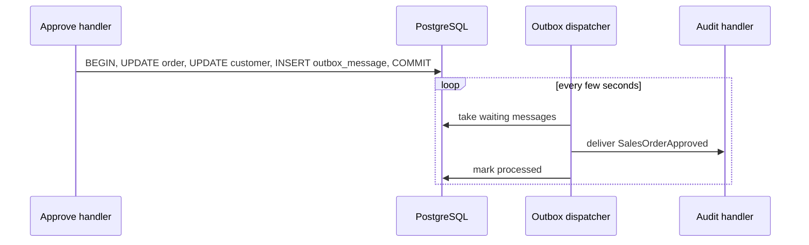

# Lesson 13 — Events and the Outbox: Reacting, Reliably

Good day, developer! Until now, each feature did its job and stopped. But in a real business, one thing
leads to another: when an order is approved, it goes in the audit log; when it ships, an invoice must be
issued; when a customer pays, their balance must drop. Today we teach the system to *react*, and to do it reliably, even if the
server crashes at the worst possible moment. About two hours. Are you ready? Let's begin!

## What we'll build

- **Domain events**: the order records "I was approved", as a fact.
- A **transactional outbox**: that fact is saved in the same transaction as the approval itself.
- A **background dispatcher** that delivers each saved fact to its handlers, after the commit.
- Our first event handler: an audit log line for every approval.

## Why we build it this way

### The obvious ways, and why they hurt

We want "when an order is approved, write an audit entry". Here are the three obvious ways to do it:

| Approach | What goes wrong |
|---|---|
| Write the audit entry inside the approve handler | Every new reaction means editing the handler. Approving starts to know about auditing, invoicing, emailing... |
| Publish the event *before* saving | The reactions run, then the save fails. You've reacted to something that never happened |
| Publish the event *after* saving | The save commits, then the server crashes before publishing. The approval happened, and the reaction is lost forever |

That third one is the sneaky one, because it works every time you test it.

### The fix: an outbox

Save the event **in the same transaction** as the change, as a row in an `outbox_message` table. Now the
approval and "an approval happened" commit together, or not at all. Then, separately, a background worker
reads the outbox, delivers each event to its handlers, and marks it done.

To remember it easily: the aggregate writes the letter, the outbox is the mailbox, and the dispatcher is the
**post office**. You don't run each letter to its reader the moment you write it; you drop it in the box as
part of finishing the job. The post office picks it up and delivers it to whoever subscribed, and the writer
never needs to know who that is. If the office closes for the night, the letters are still in the box
tomorrow.



Now, let's be honest about the trade-off. The dispatcher delivers each event **at least once**. If the server
dies after the audit handler runs but before the message is marked done, the handler will see that event
again after the restart. So every handler must be **idempotent**: running it twice must be as good as running
it once. Writing a log line twice is harmless. Charging a card twice is not, so a handler like that must check
whether it already did the work.

## 1. Teach the aggregate to record events

The pieces live in BuildingBlocks. First, the marker for an event, and the shape of a class that reacts to
one. Unlike a command, an event can have any number of handlers:

```csharp
// add to src/Shared/Erp.Shared.BuildingBlocks/Domain/BuildingBlocks.cs

// A fact the domain records ("order approved"), in its own module's words. Saved to the outbox in the same transaction
// as the change, then delivered to that module's IDomainEventHandler<T> classes after the commit. Never public: other
// modules hear about it only through an integration event (IIntegrationEvent) the module chooses to publish.
public interface IDomainEvent;

// What the outbox needs from any aggregate, whatever its id type: the events it recorded, and a way to forget them.
public interface IAggregateRoot
{
    IReadOnlyList<IDomainEvent> DomainEvents { get; }
    void ClearEvents();
}
```

Then the aggregate base class learns to keep a list. Before:

```csharp
public abstract class AggregateRoot<TId> : Entity<TId> where TId : struct;
```

After:

```csharp
public abstract class AggregateRoot<TId> : Entity<TId>, IAggregateRoot where TId : struct
{
    private readonly List<IDomainEvent> _events = new();
    public IReadOnlyList<IDomainEvent> DomainEvents => _events;
    protected void Raise(IDomainEvent e) => _events.Add(e);
    public void ClearEvents() => _events.Clear();
}
```

And the handler's shape, in a file of its own:

```csharp
// src/Shared/Erp.Shared.BuildingBlocks/Messaging/Events.cs
namespace Erp.Shared.BuildingBlocks;

// Runs after the change that raised the event has committed. At-least-once: it may run twice, so it must be idempotent.
public interface IDomainEventHandler<in TEvent> where TEvent : IDomainEvent
{
    Task HandleAsync(TEvent domainEvent, CancellationToken ct);
}
```

Two small interfaces and no library: that's all "deliver this to whoever is interested" needs inside one
process. (Lesson 03 promised we'd build exactly this, small.) The comment on `IDomainEvent` mentions
integration events: those are for telling *other* modules, and arrive in [lesson 17](17-item-catalog.md).

`Raise` is `protected`: only the aggregate itself can record a fact about itself. Why the extra
`IAggregateRoot` interface? `AggregateRoot<TId>` is generic, and the outbox needs to find every aggregate,
whatever its id type. A plain interface lets it ask for all of them at once.

In `SalesDbContext`, tell EF the event list isn't a column: inside the `SalesOrder` configuration, add
`e.Ignore(x => x.DomainEvents);`.

## 2. The event and its first handler

At the bottom of `Domain/SalesOrder.cs`, next to the order it describes:

```csharp
// Raise an event only in the change that adds its first handler.
internal sealed record SalesOrderApproved(SalesOrderId Id, CustomerId CustomerId, Money Total, UserId? ApprovedBy) : IDomainEvent;
```

In `SalesOrder.MarkApproved`, add one line at the end:

```csharp
Raise(new SalesOrderApproved(Id, CustomerId, Total, approver));
```

Because both auto-approval and manager approval go through `MarkApproved`, every approval raises it.

```csharp
// src/Modules/Sales/Erp.Modules.Sales/Infrastructure/EventHandlers/SalesOrderApprovedAuditHandler.cs
using System.Globalization;
using Erp.Modules.Sales.Domain;
using Erp.Shared.BuildingBlocks;
using Microsoft.Extensions.Logging;

namespace Erp.Modules.Sales.Infrastructure;

// Delivered by the outbox, so it can run more than once for the same approval. Logging twice is harmless.
internal sealed class SalesOrderApprovedAuditHandler(ILogger<SalesOrderApprovedAuditHandler> log)
    : IDomainEventHandler<SalesOrderApproved>
{
    public Task HandleAsync(SalesOrderApproved e, CancellationToken ct)
    {
        log.LogInformation("Sales order {OrderId} approved by {Approver} for ₱{Total:N2}",
            e.Id.Value, e.ApprovedBy?.Value.ToString(CultureInfo.InvariantCulture) ?? "auto-approval", e.Total.Amount);
        return Task.CompletedTask;
    }
}
```

Register it in `AddSalesModule`, like every handler, by hand:

```csharp
// Events: each module registers the handlers it owns. An unregistered handler never runs, and a test checks.
services.AddScoped<IDomainEventHandler<SalesOrderApproved>, SalesOrderApprovedAuditHandler>();
```

Notice the comment on the event: *raise an event only in the change that adds its first handler.* An event
nobody handles is a feature that silently does nothing, and a handler nobody registered is the same thing from
the other side. Step 8 adds a test for each.

The analyzers have one more opinion here: CA1711 says a type name ending in `EventHandler` should be a
delegate. `IDomainEventHandler` is the standard name for this interface in domain-driven code, so `.editorconfig`
gets one more line, with its reason:

```ini
# CA1711: IDomainEventHandler and IIntegrationEventHandler are the standard names for these interfaces in DDD code.
dotnet_diagnostic.CA1711.severity = none
```

## 3. The outbox message

```csharp
// src/Shared/Erp.Shared.BuildingBlocks/Messaging/OutboxMessage.cs
using System.Text.Json;

namespace Erp.Shared.BuildingBlocks;

// A domain event waiting in a module's outbox table, saved in the same transaction as the change that raised it.
public sealed class OutboxMessage
{
    public Guid Id { get; private set; }
    public string Type { get; private set; } = default!;
    public string Payload { get; private set; } = default!;
    public DateTime OccurredUtc { get; private set; }
    public DateTime? ProcessedUtc { get; private set; }
    public int Attempts { get; private set; }
    public string? LastError { get; private set; }

    private OutboxMessage() { }

    public static OutboxMessage From(IDomainEvent domainEvent, DateTime nowUtc)
    {
        var type = domainEvent.GetType();
        return new OutboxMessage
        {
            Id = Guid.NewGuid(),
            // No assembly version, so messages written before an upgrade still load after it.
            Type = $"{type.FullName}, {type.Assembly.GetName().Name}",
            Payload = JsonSerializer.Serialize(domainEvent, type),
            OccurredUtc = nowUtc
        };
    }

    public static IDomainEvent Deserialize(string type, string payload)
    {
        var eventType = System.Type.GetType(type, throwOnError: true)!;
        return (IDomainEvent)JsonSerializer.Deserialize(payload, eventType)!;
    }
}
```

An event is stored as two strings: its **type name**, so we know what to rebuild, and its data as **JSON**.
`ProcessedUtc` stays empty until it's delivered; `Attempts` and `LastError` record failures.

## 4. A test that catches a real bug

Before going further, let's prove an event survives the trip into JSON and back. Add this to the unit tests:

```csharp
public class OutboxSerializationTests
{
    [Fact]
    public void An_event_survives_the_round_trip_through_the_outbox()
    {
        var original = new SalesOrderApproved(new SalesOrderId(42), new CustomerId(7), new Money(60_000.50m), new UserId(2));

        var message = OutboxMessage.From(original, Make.Now);
        var restored = OutboxMessage.Deserialize(message.Type, message.Payload);

        restored.Should().Be(original);
    }
}
```

Run `dotnet test`. It **fails**:

```
Expected restored to be ... Total = Money { Amount = 60000.50M } ...
but found ...                  Total = Money { Amount = 0M } ...
```

The money came back as ₱0! Here's why. `Money` is a struct, and every struct also has a hidden, empty
constructor. When the JSON serializer rebuilds a `Money`, it uses that empty one, then tries to set `Amount`,
and `Amount` has no setter. So it stays 0, silently. In production, every approval event would have reported
a ₱0 total.

The fix is to tell the serializer which constructor to use. In `Money.cs`, add `using
System.Text.Json.Serialization;` and mark the real constructor:

```csharp
[JsonConstructor]   // without it, JSON (the outbox) builds the struct empty and the amount comes back as 0
public Money(decimal amount) =>
    Amount = amount >= 0
        ? Math.Round(amount, 2, MidpointRounding.AwayFromZero)
        : throw new DomainException(CommonErrors.NegativeMoney, "An amount of money cannot be negative.");
```

Do the same in `Quantity.cs` (`[JsonConstructor]   // see Money`). Run the tests again: green. And as a
bonus, the validating constructor now runs on the way back in too, so a corrupted payload can't create
negative money.

While you're in the tests, add one line to `Small_order_is_approved_automatically_and_charged`, to prove the
event is raised:

```csharp
order.DomainEvents.Should().ContainSingle().Which.Should().BeOfType<SalesOrderApproved>();
```

## 5. Write events into the outbox, in the same save

Shared Infrastructure needs EF Core now, to hook into saving:

```bash
dotnet add src/Shared/Erp.Shared.Infrastructure package Microsoft.EntityFrameworkCore --version 10.0.14
```

```csharp
// src/Shared/Erp.Shared.Infrastructure/Outbox/OutboxInterceptor.cs
using Erp.Shared.BuildingBlocks;
using Microsoft.EntityFrameworkCore;
using Microsoft.EntityFrameworkCore.Diagnostics;

namespace Erp.Shared.Infrastructure;

// Turns the aggregates' domain events into outbox rows inside the same SaveChanges, so they commit together.
public sealed class OutboxInterceptor(TimeProvider time) : SaveChangesInterceptor
{
    public override InterceptionResult<int> SavingChanges(DbContextEventData eventData, InterceptionResult<int> result)
    {
        MoveEventsToOutbox(eventData.Context);
        return base.SavingChanges(eventData, result);
    }

    public override ValueTask<InterceptionResult<int>> SavingChangesAsync(
        DbContextEventData eventData, InterceptionResult<int> result, CancellationToken cancellationToken = default)
    {
        MoveEventsToOutbox(eventData.Context);
        return base.SavingChangesAsync(eventData, result, cancellationToken);
    }

    private void MoveEventsToOutbox(DbContext? db)
    {
        if (db is null) return;

        var aggregates = db.ChangeTracker.Entries<IAggregateRoot>()
            .Select(e => e.Entity)
            .Where(a => a.DomainEvents.Count > 0)
            .ToList();

        var now = time.GetUtcNow().UtcDateTime;
        foreach (var aggregate in aggregates)
        {
            foreach (var domainEvent in aggregate.DomainEvents)
                db.Set<OutboxMessage>().Add(OutboxMessage.From(domainEvent, now));
            aggregate.ClearEvents();
        }
    }
}
```

An **interceptor** is a hook EF Core calls at certain moments. `SavingChanges` runs just before EF writes
anything. We find every tracked aggregate with events, turn each event into an `OutboxMessage`, and add it to
the same save. So when the order's `UPDATE` commits, its outbox row commits with it. Not one handler has to
remember to publish anything; recording the event in the domain is enough.

Register it once, in `AddSharedInfrastructure`:

```csharp
services.AddSingleton<IInterceptor, OutboxInterceptor>();
```

Then each module's DbContext picks it up. In `SalesModule`, `IdentityModule` and `InventoryModule`, add
`.AddInterceptors(sp.GetServices<IInterceptor>())` to the end of the `Configure(...)` call, and add `using
Microsoft.EntityFrameworkCore.Diagnostics;`. For example:

```csharp
services.AddDbContext<SalesDbContext>((sp, o) =>
    SalesDbContext.Configure(o, sp.GetRequiredService<ISharedConnection>().Connection)
        .AddInterceptors(sp.GetServices<IInterceptor>()));
```

Each module keeps its own outbox, in its own schema. In each module's `OnModelCreating` (Sales, Identity,
Inventory), right after `HasDefaultSchema`:

```csharp
b.Entity<OutboxMessage>(e =>
{
    e.ToTable("outbox_message");
    e.HasKey(x => x.Id);
    e.Property(x => x.Type).HasMaxLength(500);
    e.Property(x => x.Payload).HasColumnType("jsonb");
    e.HasIndex(x => x.OccurredUtc).HasFilter("processed_utc IS NULL");
});
```

`jsonb` is PostgreSQL's binary JSON type: you can query inside it later if you need to. The **filtered
index** only covers messages not yet processed, which is exactly what the dispatcher asks for, so finding
waiting messages stays fast even when the table holds millions of delivered ones.

## 6. The dispatcher

The dispatcher needs to know which schemas have an outbox. Every module's database knows its own schema, so
let's add it to the interface. In `IModuleDatabase`, add `string Schema { get; }`, and in each module's
database class, return the context's constant: `public string Schema => SalesDbContext.Schema;` (and the
same for Identity and Inventory).

```csharp
// src/Shared/Erp.Shared.Infrastructure/Outbox/OutboxDispatcher.cs
using System.Reflection;
using System.Text.RegularExpressions;
using Dapper;
using Erp.Shared.BuildingBlocks;
using Microsoft.Extensions.Configuration;
using Microsoft.Extensions.DependencyInjection;
using Microsoft.Extensions.Hosting;
using Microsoft.Extensions.Logging;
using Npgsql;

namespace Erp.Shared.Infrastructure;

public sealed class OutboxOptions
{
    public int PollIntervalMs { get; set; } = 2000;
    public int BatchSize { get; set; } = 50;
    public int MaxAttempts { get; set; } = 10;
}

// Delivers outbox events to their module's IDomainEventHandler<T> classes after commit. At-least-once: a handler may see an event twice, so handlers must be
// idempotent. FOR UPDATE SKIP LOCKED keeps several app instances from taking the same message. After
// MaxAttempts failures a message is left, with its last_error, for a person to look at.
public sealed partial class OutboxDispatcher(
    IServiceScopeFactory scopes,
    NpgsqlDataSource dataSource,
    IConfiguration config,
    TimeProvider time,
    ILogger<OutboxDispatcher> log) : BackgroundService
{
    private readonly OutboxOptions _options = config.GetSection("Outbox").Get<OutboxOptions>() ?? new();

    protected override async Task ExecuteAsync(CancellationToken stoppingToken)
    {
        string[] schemas;
        await using (var scope = scopes.CreateAsyncScope())
            schemas = scope.ServiceProvider.GetServices<IModuleDatabase>().Select(m => m.Schema).ToArray();

        using var timer = new PeriodicTimer(TimeSpan.FromMilliseconds(_options.PollIntervalMs));
        do
        {
            foreach (var schema in schemas)
            {
                try
                {
                    // A full batch means more may be waiting.
                    while (await DispatchBatchAsync(schema, stoppingToken) == _options.BatchSize) { }
                }
                catch (Exception ex) when (!stoppingToken.IsCancellationRequested)
                {
                    log.LogError(ex, "Outbox dispatch for schema {Schema} failed; will retry next tick", schema);
                }
            }
        }
        while (await timer.WaitForNextTickAsync(stoppingToken));
    }

    private sealed record Row(Guid Id, string Type, string Payload);

    public async Task<int> DispatchBatchAsync(string schema, CancellationToken ct)
    {
        if (!SafeIdentifier().IsMatch(schema)) throw new ArgumentException($"Bad schema name '{schema}'.");
        var table = $"{schema}.outbox_message";

        await using var conn = await dataSource.OpenConnectionAsync(ct);
        await using var tx = await conn.BeginTransactionAsync(ct);

        var batch = (await conn.QueryAsync<Row>(
            $"""
            SELECT id, type, payload FROM {table}
            WHERE processed_utc IS NULL AND attempts < @MaxAttempts
            ORDER BY occurred_utc
            LIMIT @BatchSize
            FOR UPDATE SKIP LOCKED
            """,
            new { _options.MaxAttempts, _options.BatchSize }, tx)).ToList();

        foreach (var message in batch)
        {
            try
            {
                var domainEvent = OutboxMessage.Deserialize(message.Type, message.Payload);
                await using var scope = scopes.CreateAsyncScope();
                await DeliverAsync(scope.ServiceProvider, domainEvent, ct);

                await conn.ExecuteAsync($"UPDATE {table} SET processed_utc = @Now WHERE id = @Id",
                    new { Now = time.GetUtcNow().UtcDateTime, message.Id }, tx);
            }
            catch (Exception ex) when (!ct.IsCancellationRequested)
            {
                await conn.ExecuteAsync($"UPDATE {table} SET attempts = attempts + 1, last_error = @Error WHERE id = @Id",
                    new { Error = ex.ToString(), message.Id }, tx);
                log.LogError(ex, "Outbox message {MessageId} ({Type}) failed", message.Id, message.Type);
            }
        }

        await tx.CommitAsync(ct);
        return batch.Count;
    }

    // The event's type is known only at run time (it was read from a row), so the typed method is picked by reflection.
    private static readonly MethodInfo DeliverTyped =
        typeof(OutboxDispatcher).GetMethod(nameof(DeliverToHandlersAsync), BindingFlags.NonPublic | BindingFlags.Static)!;

    private static Task DeliverAsync(IServiceProvider services, IDomainEvent domainEvent, CancellationToken ct) =>
        (Task)DeliverTyped.MakeGenericMethod(domainEvent.GetType()).Invoke(null, [services, domainEvent, ct])!;

    private static async Task DeliverToHandlersAsync<TEvent>(IServiceProvider services, TEvent domainEvent, CancellationToken ct)
        where TEvent : IDomainEvent
    {
        foreach (var handler in services.GetServices<IDomainEventHandler<TEvent>>())
            await handler.HandleAsync(domainEvent, ct);
    }

    [GeneratedRegex("^[a-z_][a-z0-9_]*$")]
    private static partial Regex SafeIdentifier();
}
```

This is the longest file in the course, so let's walk it carefully:

| Piece | What it does |
|---|---|
| `BackgroundService` | ASP.NET Core starts it with the app and stops it with the app; `ExecuteAsync` runs for the app's whole life |
| `PeriodicTimer` | Wakes up every 2 seconds (configurable) and checks each module's outbox |
| `FOR UPDATE SKIP LOCKED` | Takes a batch of waiting messages and locks them. If you run two copies of the app, the second skips the locked rows instead of delivering them twice |
| `DeliverAsync` | Hands the event to every `IDomainEventHandler<T>` registered for its type. Each event gets a fresh scope, like a fresh request |
| `MakeGenericMethod` | The event's type is only known once its row is read, so reflection picks `DeliverToHandlersAsync<SalesOrderApproved>`; inside it, everything is typed again |
| On success | `processed_utc` is set: delivered |
| On failure | `attempts` goes up and the error is kept. After 10 failures it stops retrying, and the message waits for a person |
| `SafeIdentifier` | The schema name is pasted into the SQL (table names can't be parameters), so we only allow plain lowercase names |

Register it in `AddSharedInfrastructure`:

```csharp
services.AddHostedService<OutboxDispatcher>();
```

And add its settings to `appsettings.json`:

```json
"Outbox": { "PollIntervalMs": 2000, "BatchSize": 50, "MaxAttempts": 10 }
```

Finally, give each module its outbox table:

```bash
for m in Identity Sales Inventory; do
  dotnet ef migrations add AddOutbox --project src/Modules/$m/Erp.Modules.$m \
    --startup-project src/Modules/$m/Erp.Modules.$m --output-dir Infrastructure/Migrations
done
```

## 7. Prove it: delivered, retried, parked, and never twice

The outbox promises four things: an event is delivered after the commit; an event from a rolled-back change
is never delivered; a message that keeps failing is retried, then set aside; and delivering an event twice
changes nothing. Each one gets a test.

The dispatcher wakes every two seconds, which would make every outbox test wait. The tests' copy of the app
can be quicker. In `CustomWebAppFactory.ConfigureWebHost`:

```csharp
builder.UseSetting("Outbox:PollIntervalMs", "200");
```

### Delivered, and rolled back

```csharp
// tests/Erp.Integration.Tests/PlatformTests.cs
using System.Net.Http.Json;
using AwesomeAssertions;
using Dapper;

namespace Erp.Integration.Tests;

[Collection("Integration")]
public class PlatformTests(CustomWebAppFactory factory)
{
    private sealed record Created(long Id);

    [Fact]
    public async Task An_approval_event_is_delivered_through_the_outbox()
    {
        var rep = await factory.ClientFor("rep@erp.local");
        var create = await rep.PostAsJsonAsync("/api/sales-orders",
            new { customerId = 1, lines = new[] { new { itemId = 1, quantity = 1 } } });
        var id = (await create.Content.ReadFromJsonAsync<Created>())!.Id;
        await rep.PostAsync($"/api/sales-orders/{id}/submit", null);   // auto-approved → SalesOrderApproved

        await using var conn = factory.OpenDatabase();
        const string sql = """
            SELECT processed_utc FROM sales.outbox_message
            WHERE type LIKE '%SalesOrderApproved%' AND (payload->'Id'->>'Value')::bigint = @id
            """;

        DateTime? processed = null;
        for (var attempt = 0; attempt < 50 && processed is null; attempt++)
        {
            processed = await conn.QuerySingleOrDefaultAsync<DateTime?>(sql, new { id });
            if (processed is null) await Task.Delay(200);
        }

        processed.Should().NotBeNull("the dispatcher should deliver the event within a few seconds");
    }
}
```

Delivery happens on a background timer, not inside the request, so the test **polls**: it checks, waits 200
ms, checks again, and gives up after ten seconds. Never a single fixed `Task.Delay(5000)`: that's slow when
things are fast and flaky when the machine is busy. `payload->'Id'->>'Value'` reads inside the stored JSON:
PostgreSQL's `->` steps into an object and `->>` returns text.

The rollback half goes where the failing submit already is. In `SalesOrderEdgeCaseTests`,
`Too_little_stock_refuses_the_submit_and_leaves_everything_as_it_was` gains one more check, after the balance:

```csharp
(await conn.ExecuteScalarAsync<long>(
    "SELECT COUNT(*) FROM sales.outbox_message WHERE (payload->'Id'->>'Value')::bigint = @id", new { id }))
    .Should().Be(0, "the approval event was rolled back with everything else");
```

That order was approved inside `Submit` before the stock check failed, so `SalesOrderApproved` *was*
raised. The interceptor wrote it into the same transaction, and the rollback took it away again. That's the
whole point of an outbox, in one line.

### Retried, then parked

```csharp
// tests/Erp.Integration.Tests/OperationsTests.cs
using System.Net;
using System.Net.Http.Json;
using AwesomeAssertions;
using Dapper;
using Erp.Shared.BuildingBlocks;
using Microsoft.Extensions.DependencyInjection;

namespace Erp.Integration.Tests;

// What keeps the running system honest: the outbox, health, tracing, limits and the database role.
[Collection("Integration")]
public class OperationsTests(CustomWebAppFactory factory)
{
    private sealed record Created(long Id);

    private static async Task<T> Eventually<T>(Func<Task<T>> read, Func<T, bool> done)
    {
        var value = await read();
        for (var i = 0; i < 75 && !done(value); i++)
        {
            await Task.Delay(200);
            value = await read();
        }
        return value;
    }

    // A message that can never be delivered must not block the others, and must not be retried forever.
    [Fact]
    public async Task A_message_that_keeps_failing_is_parked_with_its_error()
    {
        var id = Guid.NewGuid();
        await using var conn = factory.OpenDatabase();
        await conn.ExecuteAsync(
            """
            INSERT INTO sales.outbox_message (id, type, payload, occurred_utc, attempts)
            VALUES (@id, 'Erp.NoSuchEvent, Erp.NoSuchAssembly', '{}', now(), 0)
            """, new { id });

        var attempts = await Eventually(
            () => conn.ExecuteScalarAsync<int>("SELECT attempts FROM sales.outbox_message WHERE id = @id", new { id }),
            a => a >= 10);
        await Task.Delay(1000);   // a few more dispatcher ticks

        var row = await conn.QuerySingleAsync<(int Attempts, DateTime? Processed, string? Error)>(
            "SELECT attempts, processed_utc, last_error FROM sales.outbox_message WHERE id = @id", new { id });
        attempts.Should().Be(10);
        row.Attempts.Should().Be(10, "after MaxAttempts it is left alone");
        row.Processed.Should().BeNull();
        row.Error.Should().Contain("NoSuchAssembly");
    }
}
```

The test writes a message nobody can read, a type from an assembly that doesn't exist, straight into the
table, and watches the dispatcher try. Ten tries, the error kept in `last_error`, and then it's left alone
for a person to look at. The extra second of waiting is the edge: it proves try number eleven never comes.

### Twice changes nothing

At-least-once delivery means every handler will, one day, see the same event twice. The strongest test of
that: deliver *every* event again, and check that nothing in the business changed.

```csharp
// tests/Erp.Integration.Tests/OperationsTests.cs (add)
// At-least-once delivery means a handler can see the same event twice. Deliver everything again: nothing may change.
[Fact]
public async Task Delivering_every_event_a_second_time_changes_nothing()
{
    const string snapshot = """
        SELECT (SELECT COUNT(*) FROM sales.sales_order)::text
            || '|' || (SELECT COALESCE(SUM(outstanding_balance), 0) FROM sales.customer)::text
        """;
    string[] schemas;
    await using (var scope = factory.Services.CreateAsyncScope())
        schemas = scope.ServiceProvider.GetServices<IModuleDatabase>().Select(m => m.Schema).ToArray();
    await using var conn = factory.OpenDatabase();

    // Raise at least one event of our own, so the test doesn't depend on what ran before it.
    var rep = await factory.ClientFor("rep@erp.local");
    var created = await rep.PostAsJsonAsync("/api/sales-orders", new { customerId = 5, lines = new[] { new { itemId = 1, quantity = 1 } } });
    var orderId = (await created.Content.ReadFromJsonAsync<Created>())!.Id;
    (await rep.PostAsync($"/api/sales-orders/{orderId}/submit", null)).EnsureSuccessStatusCode();   // auto-approved

    // Let it, and whatever earlier tests raised, finish first.
    async Task<long> Waiting() => await conn.ExecuteScalarAsync<long>(string.Join(" + ", schemas.Select(s =>
        $"(SELECT COUNT(*) FROM {s}.outbox_message WHERE processed_utc IS NULL AND attempts < 10)")).Insert(0, "SELECT "));
    await Eventually(Waiting, n => n == 0);
    var before = await conn.ExecuteScalarAsync<string>(snapshot);

    var redelivered = 0;
    foreach (var schema in schemas)
        redelivered += await conn.ExecuteAsync($"UPDATE {schema}.outbox_message SET processed_utc = NULL WHERE processed_utc IS NOT NULL");
    (await Eventually(Waiting, n => n == 0)).Should().Be(0);

    redelivered.Should().BeGreaterThan(0, "this test raised an approval");
    (await conn.ExecuteScalarAsync<string>(snapshot)).Should().Be(before);
}
```

Setting `processed_utc` back to `NULL` is exactly what a crash between "handler ran" and "marked as done"
looks like to the dispatcher. Today the only handler writes a log line, so the snapshot only has orders and
balances to watch. Every later lesson whose handler changes data adds a line to `snapshot`: the item copies in
[lesson 17](17-item-catalog.md), invoices in [lesson 20](20-invoicing.md), applied payments in
[lesson 21](21-payments.md). If one of those handlers isn't idempotent, this test catches it the day it's
written.

Two things this test taught us, by failing the first time it was written. Run alone, it had no events to
redeliver, so it raises one of its own. And it reads the schemas from the registered modules, so each new
module's outbox joins automatically. A test should pass alone, and in any order.

### Every event has a handler, and every handler is wired up

An event nobody handles is a feature that silently does nothing. So is a handler class nobody registered. Two
architecture tests watch the events, in `ModuleBoundaryTests`:

```csharp
// tests/Erp.Architecture.Tests/ModuleBoundaryTests.cs (add)
// Raise an event only with its first handler. An event nobody handles is a feature that silently does nothing.
[Fact]
public void Every_domain_event_has_a_handler_in_its_own_module()
{
    foreach (var module in Modules)
    {
        var handled = HandledBy(module, typeof(IDomainEventHandler<>));
        module.GetTypes().Where(t => t is { IsAbstract: false, IsInterface: false } && typeof(IDomainEvent).IsAssignableFrom(t))
            .Where(e => !handled.Contains(e)).Select(e => e.FullName)
            .Should().BeEmpty($"every domain event in {module.GetName().Name} needs a handler there");
    }
}

// A public domain event would let another module couple to this module's internals: publish an integration event.
[Fact]
public void Domain_events_never_leave_their_module()
{
    Modules.Concat(ContractsAssemblies).SelectMany(a => a.GetTypes())
        .Where(t => t is { IsAbstract: false, IsInterface: false, IsVisible: true } && typeof(IDomainEvent).IsAssignableFrom(t))
        .Select(t => t.FullName)
        .Should().BeEmpty("domain events are internal; other modules hear about them through an IIntegrationEvent");
}

private static HashSet<Type> HandledBy(Assembly module, Type openHandler) =>
    module.GetTypes()
        .SelectMany(t => t.GetInterfaces())
        .Where(i => i.IsGenericType && i.GetGenericTypeDefinition() == openHandler)
        .Select(i => i.GetGenericArguments()[0])
        .ToHashSet();
```

(with `using Erp.Shared.BuildingBlocks;`). The second one guards the wall: a public domain event would let
another module couple itself to this module's insides. Other modules will hear about things through
*integration events* instead, from [lesson 17](17-item-catalog.md).

And the integration test from lesson 03 that checks every feature handler is registered gets a sibling for
event handlers, in `WiringTests`:

```csharp
[Fact]
public async Task Every_event_handler_class_is_registered()
{
    Type[] handlerInterfaces = [typeof(IDomainEventHandler<>)];
    var handlers = Modules.SelectMany(m => m.Assembly.GetTypes())
        .Where(t => t is { IsAbstract: false, IsInterface: false })
        .SelectMany(t => t.GetInterfaces()
            .Where(i => i.IsGenericType && handlerInterfaces.Contains(i.GetGenericTypeDefinition()))
            .Select(i => (Class: t, Interface: i)))
        .ToList();

    await using var scope = factory.Services.CreateAsyncScope();
    handlers.Should().NotBeEmpty();
    handlers.Where(h => !scope.ServiceProvider.GetServices(h.Interface).Any(s => s!.GetType() == h.Class))
        .Select(h => $"{h.Class.Name} as {h.Interface.Name}<{h.Interface.GetGenericArguments()[0].Name}>")
        .Should().BeEmpty("a handler that isn't registered never runs");
}
```

Delete `SalesOrderApprovedAuditHandler` and run the architecture tests: `SalesOrderApproved` is named as
unhandled. Put it back, comment out its `AddScoped` line instead, and the wiring test names it. Put that back
too.

### Edge cases covered in this lesson

| Test | The edge | Why it matters |
|---|---|---|
| `An_event_survives_the_round_trip_through_the_outbox` | A value object in JSON | Found a real bug: `Money` came back as ₱0 |
| `An_approval_event_is_delivered_through_the_outbox` | After the commit | The reaction really happens |
| `Too_little_stock_...` (the outbox line) | Rolled back | An event from a change that never happened is never delivered |
| `A_message_that_keeps_failing_is_parked_with_its_error` | Forever | A poison message is set aside, with its error, and doesn't block the rest |
| `Delivering_every_event_a_second_time_changes_nothing` | Twice | At-least-once delivery, made safe |
| `Every_domain_event_has_a_handler_in_its_own_module` | Nobody listening | A feature that silently does nothing |
| `Domain_events_never_leave_their_module` | One `public` too many | Other modules couple to this one's insides |
| `Every_event_handler_class_is_registered` | A forgotten `AddScoped` | A handler that compiles, passes its unit tests, and never runs |

## Mistakes to avoid

- Publishing events yourself, before or after `SaveChangesAsync`. Let the outbox do it, inside the save.
- Writing a handler that isn't safe to run twice.
- Raising events nobody handles "for later". The generator's warning is there to catch exactly that.
- Putting a value object in an event without `[JsonConstructor]`. It may come back empty, silently.
- Letting one module read another module's outbox. Each schema has its own.
- Waiting for the dispatcher with one fixed `Task.Delay`. Poll, with a limit.
- A test that only passes after other tests. Run each test class alone once in a while.

## Let's run it!

Run `dotnet test` first: the round-trip test passes now. Then restart the app and approve something. The
quickest is a small order, which is approved on submit. Click through it in the app, or (with a `$TOKEN`
from lesson 07):

```bash
ID=$(curl -s -X POST http://localhost:5264/api/sales-orders -H "Authorization: Bearer $TOKEN" -H "Content-Type: application/json" \
  -d '{"customerId":1,"lines":[{"itemId":1,"quantity":1}]}' | jq .id)
curl -s -o /dev/null -w "%{http_code}\n" -X POST http://localhost:5264/api/sales-orders/$ID/submit -H "Authorization: Bearer $TOKEN"
```

Within two seconds, the API's console shows:

```
info: Erp.Modules.Sales.Infrastructure.SalesOrderApprovedAuditHandler[0]
      Sales order 15 approved by auto-approval for ₱25.00
```

And the outbox row shows it was delivered:

```bash
podman exec -i erp-postgres psql -U postgres -d erp \
  -c "SELECT type, payload, processed_utc, attempts FROM sales.outbox_message ORDER BY occurred_utc DESC LIMIT 1;"
```

Then the tests, the new outbox ones among them:

```bash
dotnet test
```

All green. If you like, watch the parked message: run `A_message_that_keeps_failing_is_parked_with_its_error`
alone and look at `sales.outbox_message` while it runs, `attempts` climbing to 10.

## Let's check!

1. Why is "publish the event right after saving" not good enough?
2. What exactly does the outbox write, and in which transaction?
3. What does "at least once" mean, and what does it demand from every handler?
4. What does `FOR UPDATE SKIP LOCKED` protect against?
5. Why did `Money` come back as ₱0, and what fixed it?
6. Why does each module have its own outbox table?
7. How does a test wait for something that happens on a background timer, without a fixed delay?
8. How does `Delivering_every_event_a_second_time_changes_nothing` imitate a crash, and what does it prove?
9. Why must a test pass when it's run alone? What went wrong the first time this lesson's tests were?

And that's where this lesson ends. The system now reacts to what happens, and a crash can't make it forget.
Next time, we make the running app visible: traces, metrics, logs and health checks, so you can see what
it's doing when something goes wrong. Good
luck, developer!

---

← [Lesson 12 — Containers and CI](12-containers-ci.md) · Next: [Lesson 14 — Observability](14-observability.md) →
