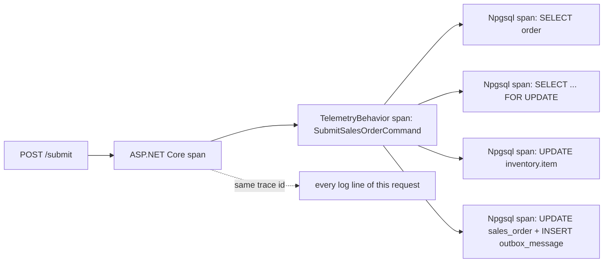

# Lesson 13 — Observability: Seeing What the App Is Doing

Good day, developer! Picture a Monday morning. A manager calls: "approving orders was slow on Friday, and one
failed." Where do you even start? Right now, you'd scroll through console output and guess. Today we fix that.
We'll make the app report what it's doing, in a standard way: traces that follow one request through
everything it touches, numbers you can chart, and logs you can tie back to a single request. And we'll watch
it all live in a dashboard. About an hour and a half. Are you ready? Let's begin!

## What we'll build

- **OpenTelemetry** traces, metrics and logs, sent to any monitoring tool you point it at.
- A **telemetry behavior** that measures every command and query.
- An `X-Trace-Id` header on every response, so a user can quote it when something goes wrong.
- **Health checks**: `/health/live` (is the app up?) and `/health/ready` (can it reach the database?).
- The **Aspire dashboard**, to see all of it while you develop.

## Why we build it this way

### Three kinds of signal

| Signal | Answers | Example |
|---|---|---|
| **Logs** | What happened, in words? | "Sales order 15 approved by auto-approval for ₱25.00" |
| **Traces** | Where did this one request spend its time? | `POST /submit` took 340 ms: 12 ms loading, 300 ms waiting on a lock, 28 ms saving |
| **Metrics** | How is it doing overall? | Approvals per minute, 95th-percentile request time, failures per hour |

A **trace** is the new one for most people. Each request gets a **trace id**, and every step inside it (the
handler, each database query, each outbox delivery) becomes a **span** with a start, an end and a parent.
Lined up, they show exactly where the time went. And every log line written during that request carries the
same trace id, so you can jump from a slow trace straight to its logs.

### Why OpenTelemetry

**OpenTelemetry** (Apache-2.0) is the industry standard for producing these signals. You write the code once,
and the data goes to whatever tool the buyer runs: Grafana, Jaeger, SigNoz, Elastic, Azure Monitor and many
others all accept it, over a protocol called **OTLP**. That's important for a product you sell: you don't pick
your customer's monitoring tool for them.

### Why the Aspire dashboard, and only while developing

**Aspire** (MIT) includes a dashboard that receives OpenTelemetry data and shows it beautifully, with no
setup. It's perfect on your machine. In production it's a different story: it keeps everything in memory only,
forgets it all on restart, and has no alerts. So it's our development tool, and production points the same
data at a real monitoring system. Same code, one setting.

## 1. Refactor: from a logging behavior to a telemetry behavior

Back in [lesson 02](02-mediator.md), we wrote a `LoggingBehavior`: it logged each request and how long it
took. That was enough then. Now it falls short in two ways: it can't tell a slow request's *parts* apart (no
spans), and you can't chart it (no metrics). Let's replace it with a behavior that does all three.

First, the app's own trace source and meter. These are plain .NET types; OpenTelemetry will pick them up by
name. They live in Infrastructure, because only infrastructure code records telemetry:

```csharp
// src/Shared/Erp.Shared.Infrastructure/Telemetry/ErpTelemetry.cs
using System.Diagnostics;
using System.Diagnostics.Metrics;

namespace Erp.Shared.Infrastructure;

public static class ErpTelemetry
{
    public const string Name = "Erp";

    public static readonly ActivitySource Source = new(Name);
    public static readonly Meter Meter = new(Name);
}
```

An `ActivitySource` makes spans (.NET calls a span an **activity**), and a `Meter` makes metrics.

Before, in BuildingBlocks' `Behaviors.cs`:

```csharp
public sealed class LoggingBehavior<TMessage, TResponse>(ILogger<LoggingBehavior<TMessage, TResponse>> log)
    : IPipelineBehavior<TMessage, TResponse> where TMessage : IMessage
{
    // ... a stopwatch and two log lines
}
```

After: delete `LoggingBehavior` from `Behaviors.cs` (leaving only `ValidationBehavior`), and create:

```csharp
// src/Shared/Erp.Shared.Infrastructure/Telemetry/TelemetryBehavior.cs
using System.Diagnostics;
using System.Diagnostics.Metrics;
using Erp.Shared.BuildingBlocks;
using FluentValidation;
using Mediator;
using Microsoft.EntityFrameworkCore;
using Microsoft.Extensions.Logging;

namespace Erp.Shared.Infrastructure;

// A span, a duration metric and a log line for every command and query. Registered outermost.
public sealed class TelemetryBehavior<TMessage, TResponse>(ILogger<TelemetryBehavior<TMessage, TResponse>> log)
    : IPipelineBehavior<TMessage, TResponse>
    where TMessage : IMessage
{
    private static readonly Histogram<double> Duration = ErpTelemetry.Meter.CreateHistogram<double>(
        "erp.request.duration", unit: "ms", description: "Time to handle a command or query");

    public async ValueTask<TResponse> Handle(
        TMessage message, MessageHandlerDelegate<TMessage, TResponse> next, CancellationToken ct)
    {
        var name = typeof(TMessage).Name;
        using var activity = ErpTelemetry.Source.StartActivity(name);
        var sw = Stopwatch.StartNew();
        var outcome = "success";
        try
        {
            var response = await next(message, ct);
            log.LogInformation("{Request} handled in {ElapsedMs} ms", name, sw.ElapsedMilliseconds);
            return response;
        }
        catch (Exception ex)
        {
            // Rejections the caller caused are expected; anything else is a failure worth alerting on.
            outcome = ex is ValidationException or DomainException or NotFoundException or DbUpdateConcurrencyException
                ? "rejected" : "error";
            activity?.SetStatus(ActivityStatusCode.Error, ex.Message);
            log.LogWarning(ex, "{Request} {Outcome} after {ElapsedMs} ms", name, outcome, sw.ElapsedMilliseconds);
            throw;
        }
        finally
        {
            Duration.Record(sw.Elapsed.TotalMilliseconds,
                new KeyValuePair<string, object?>("request", name), new KeyValuePair<string, object?>("outcome", outcome));
        }
    }
}
```

What's new compared with the logging version:

- **`StartActivity(name)`** opens a span named after the command. Every database query inside it shows up as
  a child span.
- **A histogram** records each request's duration, tagged with its name and its **outcome**. From that you can
  chart "how slow is SubmitSalesOrder" and "how often does it fail".
- **The outcome separates "rejected" from "error".** A blocked customer is the system working correctly; a
  crash is not. Mixing them would make your alerts useless. That's also why this behavior lives in
  Infrastructure: it needs to recognize EF Core's `DbUpdateConcurrencyException`, and BuildingBlocks must
  never depend on EF Core.

In `Program.cs`, swap the pipeline's first entry:

```csharp
options.PipelineBehaviors = [typeof(TelemetryBehavior<,>), typeof(ValidationBehavior<,>)];   // outermost first
```

BuildingBlocks no longer writes logs itself, so remove its `Microsoft.Extensions.Logging.Abstractions`
package reference.

Let's give the outbox dispatcher the same treatment. In `OutboxDispatcher`, add `using System.Diagnostics;`
and `using System.Diagnostics.Metrics;`, then two counters:

```csharp
private static readonly Counter<long> Dispatched = ErpTelemetry.Meter.CreateCounter<long>("erp.outbox.dispatched");
private static readonly Counter<long> Failed = ErpTelemetry.Meter.CreateCounter<long>("erp.outbox.failed");
```

Inside the `foreach` over the batch, wrap each delivery in a span, and count the results:

```csharp
foreach (var message in batch)
{
    using var activity = ErpTelemetry.Source.StartActivity("outbox deliver", ActivityKind.Consumer);
    activity?.SetTag("erp.outbox.type", message.Type);
    try
    {
        // ...deliver and mark processed, as before...
        Dispatched.Add(1);
    }
    catch (Exception ex) when (!ct.IsCancellationRequested)
    {
        activity?.SetStatus(ActivityStatusCode.Error, ex.Message);
        // ...record the failure, as before...
        Failed.Add(1);
    }
}
```

A rising `erp.outbox.failed` is exactly the kind of number you want an alert on.

## 2. Turn OpenTelemetry on

```bash
dotnet add src/Erp.Api package OpenTelemetry.Extensions.Hosting --version 1.20.1
dotnet add src/Erp.Api package OpenTelemetry.Instrumentation.AspNetCore --version 1.20.1
dotnet add src/Erp.Api package OpenTelemetry.Instrumentation.Http --version 1.20.1
dotnet add src/Erp.Api package OpenTelemetry.Instrumentation.Runtime --version 1.20.1
dotnet add src/Erp.Api package OpenTelemetry.Exporter.OpenTelemetryProtocol --version 1.20.1
dotnet add src/Erp.Api package Npgsql.OpenTelemetry --version 10.0.3
```

| Package | What it adds | License |
|---|---|---|
| `OpenTelemetry.Extensions.Hosting` | OpenTelemetry itself, started with the app | Apache-2.0 |
| `...Instrumentation.AspNetCore` | A span and metrics for every HTTP request | Apache-2.0 |
| `...Instrumentation.Http` | Spans for outgoing HTTP calls the app makes | Apache-2.0 |
| `...Instrumentation.Runtime` | Memory, garbage collection and thread-pool metrics | Apache-2.0 |
| `...Exporter.OpenTelemetryProtocol` | Sends everything out over OTLP | Apache-2.0 |
| `Npgsql.OpenTelemetry` | A span for every database command, with its SQL | PostgreSQL |

```csharp
// src/Erp.Api/Observability.cs
using System.Diagnostics;
using Erp.Shared.Infrastructure;
using Npgsql;
using OpenTelemetry;
using OpenTelemetry.Metrics;
using OpenTelemetry.Resources;
using OpenTelemetry.Trace;

namespace Erp.Api;

internal static class Observability
{
    public static WebApplicationBuilder AddObservability(this WebApplicationBuilder builder)
    {
        builder.Logging.Configure(o => o.ActivityTrackingOptions = ActivityTrackingOptions.TraceId | ActivityTrackingOptions.SpanId);
        if (!builder.Environment.IsDevelopment())
            builder.Logging.AddJsonConsole(o => o.IncludeScopes = true);   // machine-readable for log collectors
        builder.Logging.AddOpenTelemetry(o =>
        {
            o.IncludeFormattedMessage = true;
            o.IncludeScopes = true;
        });

        var otel = builder.Services.AddOpenTelemetry()
            .ConfigureResource(r => r.AddService("erp-api"))
            .WithTracing(t => t
                .AddSource(ErpTelemetry.Name)
                .AddAspNetCoreInstrumentation(o => o.Filter = ctx => !ctx.Request.Path.StartsWithSegments("/health"))
                .AddHttpClientInstrumentation()
                .AddNpgsql())
            .WithMetrics(m => m
                .AddMeter(ErpTelemetry.Name, "Npgsql", "Microsoft.EntityFrameworkCore")
                .AddAspNetCoreInstrumentation()
                .AddHttpClientInstrumentation()
                .AddRuntimeInstrumentation());

        // Exports only when a collector is configured: Aspire sets this in development; production sets it to
        // whatever the buyer runs (Grafana, Jaeger, Elastic, Azure Monitor, ...).
        if (!string.IsNullOrWhiteSpace(builder.Configuration["OTEL_EXPORTER_OTLP_ENDPOINT"]))
            otel.UseOtlpExporter();

        return builder;
    }

    // Lets a user quote the id from any response, and support find every log line and span for that request.
    public static IApplicationBuilder UseTraceIdHeader(this IApplicationBuilder app) =>
        app.Use((ctx, next) =>
        {
            if (Activity.Current is { } activity)
                ctx.Response.Headers["X-Trace-Id"] = activity.TraceId.ToString();
            return next(ctx);
        });
}
```

Here's what each part does:

| Line | Effect |
|---|---|
| `ActivityTrackingOptions` | Every log line carries the current trace and span id |
| `AddJsonConsole` outside development | Logs come out as JSON, one per line, which log collectors read directly |
| `AddService("erp-api")` | Names the app in every monitoring tool |
| `AddSource(ErpTelemetry.Name)` | Includes our own spans: one per command, one per outbox delivery |
| The `/health` filter | Health checks run every few seconds; tracing them would be noise |
| `AddMeter(...)` | Our metrics, plus Npgsql's (connection pool) and EF Core's (queries, saves) |
| `UseOtlpExporter()` only if an endpoint is set | No collector configured, nothing sent, nothing breaks |

In `Program.cs`, call `builder.AddObservability();` right after `CreateBuilder`, and
`app.UseTraceIdHeader();` right after `UseExceptionHandler()`.

## 3. Health checks

A load balancer, IIS, or a monitoring tool needs to ask two different questions:

- **"Are you alive?"** Is the process running at all? If not, restart it.
- **"Are you ready?"** Can it do real work right now? If not, stop sending it traffic for a while.

The second one depends on the database:

```csharp
// src/Shared/Erp.Shared.Infrastructure/Health/DatabaseHealthCheck.cs
using Microsoft.Extensions.Diagnostics.HealthChecks;
using Npgsql;

namespace Erp.Shared.Infrastructure;

public sealed class DatabaseHealthCheck(NpgsqlDataSource dataSource) : IHealthCheck
{
    public async Task<HealthCheckResult> CheckHealthAsync(HealthCheckContext context, CancellationToken ct = default)
    {
        try
        {
            await using var command = dataSource.CreateCommand("SELECT 1");
            await command.ExecuteScalarAsync(ct);
            return HealthCheckResult.Healthy();
        }
        catch (Exception ex)
        {
            return HealthCheckResult.Unhealthy("PostgreSQL is unreachable.", ex);
        }
    }
}
```

In `Program.cs`:

```csharp
builder.Services.AddHealthChecks().AddCheck<DatabaseHealthCheck>("database", tags: ["ready"]);
// ...
app.MapHealthChecks("/health/live", new HealthCheckOptions { Predicate = _ => false });   // the process is up
app.MapHealthChecks("/health/ready", new HealthCheckOptions { Predicate = c => c.Tags.Contains("ready") });
```

(add `using Microsoft.AspNetCore.Diagnostics.HealthChecks;`). `/health/live` runs no checks at all: if it
answers, the process is alive. `/health/ready` runs every check tagged `ready`. They sit outside `/api` on
purpose: they're for machines watching the server, not for the app, and they need no sign-in.

## 4. The Aspire dashboard

```bash
dotnet new console -n Erp.AppHost -o src/Erp.AppHost
rm src/Erp.AppHost/Program.cs
dotnet sln add src/Erp.AppHost
dotnet add src/Erp.AppHost reference src/Erp.Api
```

Replace the `.csproj` entirely, because the AppHost uses Aspire's own SDK:

```xml
<!-- src/Erp.AppHost/Erp.AppHost.csproj -->
<Project Sdk="Aspire.AppHost.Sdk/13.6.4">

  <!-- Development only: runs the API next to the Aspire dashboard (traces, logs, metrics). Never deployed. -->
  <PropertyGroup>
    <OutputType>Exe</OutputType>
    <UserSecretsId>erp-apphost-dev</UserSecretsId>
    <!-- ASPIRE010: we use the dashboard/orchestrator from NuGet on purpose, so no Aspire CLI install is needed. -->
    <NoWarn>$(NoWarn);ASPIRE010</NoWarn>
  </PropertyGroup>

  <ItemGroup>
    <ProjectReference Include="..\Erp.Api\Erp.Api.csproj" />
  </ItemGroup>

</Project>
```

The version, 13.6.4, lives in the `Sdk` attribute, so Aspire doesn't go in `Directory.Packages.props`. The
SDK brings its own packages, and putting one of them there too is a build error. About that `NoWarn`: Aspire
warns that you're not using its separate command-line tool. We're not, on purpose: the dashboard and
orchestrator come from NuGet, so nobody has to install anything extra. Suppressing one specific warning
about a choice we made deliberately is fine. Suppressing whole categories of warnings, to make a build go
quiet, is not.

```csharp
// src/Erp.AppHost/AppHost.cs
var builder = DistributedApplication.CreateBuilder(args);

builder.AddProject<Projects.Erp_Api>("erp-api");

builder.Build().Run();
```

That's the whole app host: "run the API". Aspire generates the `Projects.Erp_Api` type from your project
reference.

```json
// src/Erp.AppHost/Properties/launchSettings.json
{
  "$schema": "https://json.schemastore.org/launchsettings.json",
  "profiles": {
    "http": {
      "commandName": "Project",
      "dotnetRunMessages": true,
      "launchBrowser": true,
      "applicationUrl": "http://localhost:15180",
      "environmentVariables": {
        "ASPNETCORE_ENVIRONMENT": "Development",
        "DOTNET_ENVIRONMENT": "Development",
        "ASPIRE_DASHBOARD_OTLP_ENDPOINT_URL": "http://localhost:19180",
        "ASPIRE_RESOURCE_SERVICE_ENDPOINT_URL": "http://localhost:20180",
        "ASPIRE_ALLOW_UNSECURED_TRANSPORT": "true"
      }
    }
  }
}
```

Plain `http` on your own machine avoids trusting a development certificate. When the AppHost starts the API,
it sets `OTEL_EXPORTER_OTLP_ENDPOINT` for it, so the `UseOtlpExporter()` line from step 2 switches on by
itself. No Docker, no extra install.

## How a request flows



## Mistakes to avoid

- Logging as your only signal. You can't chart log lines, and you can't see where the time went.
- Counting a blocked customer as an error. Your error rate becomes meaningless, and so do your alerts.
- Shipping the Aspire dashboard as production monitoring. It forgets everything on restart and can't alert.
- Making `/health/live` check the database. If PostgreSQL blips, your orchestrator restarts a perfectly
  healthy app.
- Tracing health checks. They're called constantly and drown out the real traffic.

## Let's run it!

```bash
dotnet run --project src/Erp.AppHost
```

The console prints a login link, like `http://localhost:15180/login?t=...`. Open it. You'll see `erp-api`
running. Then open the app at `http://localhost:5264` and do a few things: sign in, create an order,
submit it, approve one.

In the dashboard:

- **Traces**: open the `POST /api/sales-orders/{id}/submit` trace. You'll see the `SubmitSalesOrderCommand` span,
  and inside it each database command, with its SQL and its duration.
- **Structured logs**: find the audit line "approved by ... for ₱...". Click its trace id, and you land on the
  `outbox deliver` span that wrote it.
- **Metrics**: `erp.request.duration`, split by `request` and `outcome`.

And the health checks:

```bash
curl -s http://localhost:5264/health/live    # Healthy
curl -s http://localhost:5264/health/ready   # Healthy  (stop PostgreSQL and it says Unhealthy)
curl -si http://localhost:5264/health/live | grep -i x-trace-id   # (none: health isn't traced)
curl -si http://localhost:5264/api/sales-orders -H "Authorization: Bearer $TOKEN" | grep -i x-trace-id
```

## Let's check!

1. What question does each signal answer: logs, traces, metrics?
2. Why does the telemetry behavior separate "rejected" from "error"?
3. Why did the telemetry behavior move from BuildingBlocks to Infrastructure?
4. What's the difference between `/health/live` and `/health/ready`, and why does it matter?
5. Why is the Aspire dashboard only for development?
6. How does a user's error report help you find the right trace?

And that's where this lesson ends. When something goes wrong now, you can see exactly what happened, and
where. The sales core is complete. Next time, we start building out the rest of the business, beginning
with the customers themselves. Good luck, developer!

---

← [Lesson 12 — Testing](12-testing.md) · Next: [Lesson 14 — Customers](14-customers.md) →
