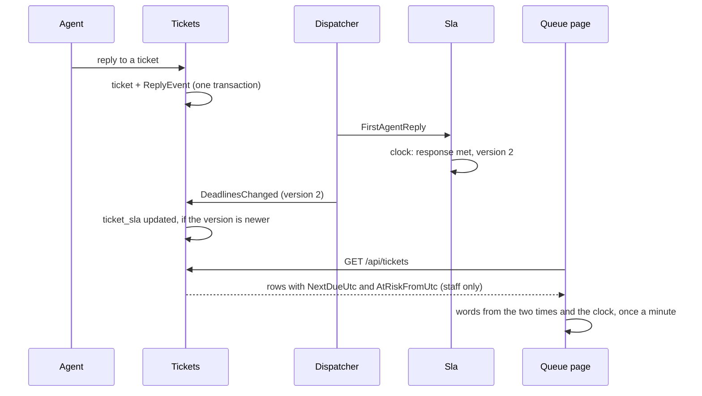

# Lesson 14 — Sla Answers, and the Screens Show It

Good day, developer! Last time Tickets learned to tell the world what happens to a ticket, and a new module, Sla, learned to listen: every ticket now gets a clock. But Sla's answer, "here are the deadlines", goes out to nobody, and no screen shows a deadline. Today we close the loop. Tickets listens to Sla and keeps its own copy of the deadlines. The queue gets an SLA column, the ticket's header gets a deadline, and team leads get an API and a page for the policies. It takes about three hours. Are you ready? Let's begin!

## What we'll build

| Piece | What it is |
|---|---|
| **`TicketSla`** | Tickets' own copy of one ticket's latest deadlines, in a table of its own |
| **`StoreDeadlines`** | The Tickets handler that hears `DeadlinesChanged` and keeps the copy |
| **Read functions, version 2** | The queue and the ticket page read the copy, and the queue sorts by the next deadline |
| **Deadlines as words** | "Breached 40m ago", "1h 10m left": a helper, a component, and a clock that ticks once a minute |
| **The SLA column and the header fact** | For staff only, never for the requester |
| **The policies' API and page** | Read and change each priority's numbers, and one form per priority for team leads and admins |

## Why we build it this way

### The pain: a question for every row

The queue shows twenty tickets, and each row needs its next deadline. The obvious way is for Tickets to ask Sla for each one. That is twenty calls into another module for one page, and the queue can no longer sort by deadline, because the sort happens in one SQL query and the deadlines live in another module's tables. (And no SQL may cross a schema: that's the island rule.)

### The fix: keep a copy of the answer

Sla already tells everyone when a deadline changes. So Tickets listens and keeps its own copy: the latest answer, one row per ticket, in its own schema. The queue joins that row like any other table of its own.

Now, let's be honest about the cost here: a copy can be a moment out of date. A reply is saved, then Sla hears about it, then Tickets hears back, and for a second or two the queue still shows the old deadline. That is **eventual consistency**: the copy catches up. For a deadline that is measured in hours, nobody will see the difference. And two more facts of events apply again: an answer can arrive twice, and an old answer can arrive after a new one. That is why `DeadlinesChanged` carries a version.

### Why a table of its own

Why not columns on the `ticket` table? Because saving a ticket's deadlines must never touch the ticket's row. Remember the row version from [lesson 09](09-take-a-ticket.md), the `xmin` that makes a stale save fail: if every deadline update changed the ticket row, an agent's click would keep failing with "someone else changed this first", for no reason the agent could see. A separate table also raises no ticket event, so no loop.

### A requester never sees a deadline

A deadline is an internal promise, not something to show the person it is made to. So the handlers empty it for anyone who isn't staff, and a test proves it at the API.

## 1. Tickets keeps the answer

Tickets' copy is a small class of its own:

```csharp
// src/Modules/Tickets/Yasda.Modules.Tickets/Domain/TicketSla.cs
namespace Yasda.Modules.Tickets.Domain;

// Tickets' copy of one ticket's deadlines, kept so a queue can sort and mark them without asking Sla. It lives in its
// own table: saving it never touches the ticket's row, so it can't bump the ticket's row version and make an agent's
// save fail, and it raises no ticket event. Sla owns the facts; this only remembers the latest answer it was told.
internal sealed class TicketSla
{
    private TicketSla() { }

    public TicketId TicketId { get; private set; }
    public int Version { get; private set; }
    public DateTime ResponseDueUtc { get; private set; }
    public bool? ResponseMet { get; private set; }
    public DateTime ResolveDueUtc { get; private set; }
    public bool? ResolutionMet { get; private set; }
    public DateTime? NextDueUtc { get; private set; }
    public DateTime? AtRiskFromUtc { get; private set; }

    public static TicketSla ForTicket(TicketId ticketId)
    {
        return new TicketSla { TicketId = ticketId };
    }

    // Deliveries can repeat and arrive out of order. Only a newer version is taken, and the answer says whether it was.
    public bool Apply(int version, DateTime responseDueUtc, bool? responseMet, DateTime resolveDueUtc, bool? resolutionMet,
        DateTime? nextDueUtc, DateTime? atRiskFromUtc)
    {
        if (version <= Version) return false;

        Version = version;
        ResponseDueUtc = responseDueUtc;
        ResponseMet = responseMet;
        ResolveDueUtc = resolveDueUtc;
        ResolutionMet = resolutionMet;
        NextDueUtc = nextDueUtc;
        AtRiskFromUtc = atRiskFromUtc;
        return true;
    }
}
```

Look at `Apply`. It is the idempotence rule in four words: `if (version <= Version) return false;`. A repeated delivery brings the same version and changes nothing. A late older one is ignored. Only a newer answer is taken, and the caller learns whether it was.

The class that listens. It is named for what it does, as every event handler is:

```csharp
// src/Modules/Tickets/Yasda.Modules.Tickets/Features/Events/StoreDeadlines.cs
using Yasda.Modules.Sla.Contracts;
using Yasda.Modules.Tickets.Domain;
using Yasda.Modules.Tickets.Infrastructure;
using Yasda.Shared.BuildingBlocks;
using Microsoft.EntityFrameworkCore;

namespace Yasda.Modules.Tickets.Features;

// Sla computed new deadlines for a ticket: remember them, so the queues can show and sort them. Delivery repeats and
// reorders, so only a newer version is applied. The ticket's own row is never touched.
internal sealed class StoreDeadlines(TicketsDbContext db) : IIntegrationEventHandler<DeadlinesChanged>
{
    public async Task HandleAsync(DeadlinesChanged integrationEvent, CancellationToken ct)
    {
        var ticketId = new TicketId(integrationEvent.TicketId);
        var stored = await db.TicketSlas.SingleOrDefaultAsync(s => s.TicketId == ticketId, ct);
        if (stored is null)
        {
            stored = TicketSla.ForTicket(ticketId);
            db.TicketSlas.Add(stored);
        }

        var applied = stored.Apply(integrationEvent.Version, integrationEvent.ResponseDueUtc, integrationEvent.ResponseMet,
            integrationEvent.ResolveDueUtc, integrationEvent.ResolutionMet, integrationEvent.NextDueUtc, integrationEvent.AtRiskFromUtc);
        if (!applied) return;

        await db.SaveChangesAsync(ct);
    }
}
```

In `TicketsDbContext`, add a `DbSet` and the table's mapping. At the top of the class:

```csharp
public DbSet<TicketSla> TicketSlas => Set<TicketSla>();
```

and in `OnModelCreating`, before the `Ticket` mapping:

```csharp
builder.Entity<TicketSla>(e =>
{
    e.ToTable("ticket_sla");
    // No foreign key to ticket: the row arrives later, from Sla, and may even arrive first.
    e.HasKey(x => x.TicketId);
    e.Property(x => x.TicketId).ValueGeneratedNever();
    // Two deliveries at once must not let an older answer overwrite a newer one.
    e.Property<uint>("RowVersion").IsRowVersion().HasColumnName("xmin");
});
```

Tickets now needs to reference Sla's Contracts, and to register the handler. In the Tickets project:

```bash
dotnet add src/Modules/Tickets/Yasda.Modules.Tickets reference src/Modules/Sla/Yasda.Modules.Sla.Contracts
```

and in `TicketsModule.cs`, add `using Yasda.Modules.Sla.Contracts;` and, after the other event handlers:

```csharp
services.AddScoped<IIntegrationEventHandler<DeadlinesChanged>, StoreDeadlines>();
```

The table needs a migration:

```bash
dotnet ef migrations add AddTicketSla --project src/Modules/Tickets/Yasda.Modules.Tickets --startup-project src/Modules/Tickets/Yasda.Modules.Tickets --output-dir Infrastructure/Migrations
```

Open it: one `CreateTable` for `ticket_sla`, and nothing else.

## 2. The queue and the ticket page read the copy

The two read functions gain the deadline columns, joined from the new table. A released script is never edited ([lesson 05](05-database.md) said so), so each gets a `.v2.sql` file, next to the old ones. A `LEFT JOIN` keeps every ticket, deadline or not, because a ticket's clock arrives a moment after the ticket does.

```sql
-- src/Modules/Tickets/Yasda.Modules.Tickets/Infrastructure/Sql/Functions/tickets.search_tickets.v2.sql
-- Released scripts are never edited: change a function with a .v2 file and a new migration.
-- The queues and "my tickets". p_requester_id limits a requester to their own; p_assignee_id / p_unassigned pick a
-- queue. The sort is one of the allow-listed names (SearchTicketsValidator), matched by CASE, never pasted in.
CREATE OR REPLACE FUNCTION tickets.search_tickets(
    p_requester_id bigint, p_status text, p_priority text, p_assignee_id bigint, p_unassigned boolean, p_search text,
    p_sort text, p_desc boolean, p_page integer, p_page_size integer)
RETURNS TABLE (id bigint, subject text, status text, priority text, requester_id bigint, requester_name text,
               assignee_id bigint, assignee_name text, created_utc timestamptz, updated_utc timestamptz,
               next_due_utc timestamptz, at_risk_from_utc timestamptz)
LANGUAGE sql STABLE
AS $$
    SELECT t.id, t.subject::text, t.status::text, t.priority::text, t.requester_id, t.requester_name::text,
           t.assignee_id, t.assignee_name::text, t.created_utc, t.updated_utc, s.next_due_utc, s.at_risk_from_utc
    FROM tickets.ticket t
    LEFT JOIN tickets.ticket_sla s ON s.ticket_id = t.id
    WHERE (p_requester_id IS NULL OR t.requester_id = p_requester_id)
      AND (p_status IS NULL OR t.status = p_status)
      AND (p_priority IS NULL OR t.priority = p_priority)
      AND (p_assignee_id IS NULL OR t.assignee_id = p_assignee_id)
      AND (NOT p_unassigned OR t.assignee_id IS NULL)
      AND (p_search IS NULL OR t.subject ILIKE '%' || p_search || '%' OR t.requester_name ILIKE '%' || p_search || '%'
           OR t.id::text = p_search)
    ORDER BY
        CASE WHEN p_sort = 'id' AND NOT p_desc THEN t.id END ASC,
        CASE WHEN p_sort = 'id' AND p_desc     THEN t.id END DESC,
        CASE WHEN p_sort = 'subject' AND NOT p_desc THEN t.subject END ASC,
        CASE WHEN p_sort = 'subject' AND p_desc     THEN t.subject END DESC,
        CASE WHEN p_sort = 'status' AND NOT p_desc THEN t.status END ASC,
        CASE WHEN p_sort = 'status' AND p_desc     THEN t.status END DESC,
        CASE WHEN p_sort = 'priority' AND NOT p_desc THEN tickets.priority_rank(t.priority) END ASC,
        CASE WHEN p_sort = 'priority' AND p_desc     THEN tickets.priority_rank(t.priority) END DESC,
        CASE WHEN p_sort = 'requesterName' AND NOT p_desc THEN t.requester_name END ASC,
        CASE WHEN p_sort = 'requesterName' AND p_desc     THEN t.requester_name END DESC,
        CASE WHEN p_sort = 'assigneeName' AND NOT p_desc THEN t.assignee_name END ASC,
        CASE WHEN p_sort = 'assigneeName' AND p_desc     THEN t.assignee_name END DESC,
        CASE WHEN p_sort = 'createdUtc' AND NOT p_desc THEN t.created_utc END ASC,
        CASE WHEN p_sort = 'createdUtc' AND p_desc     THEN t.created_utc END DESC,
        CASE WHEN p_sort = 'updatedUtc' AND NOT p_desc THEN t.updated_utc END ASC,
        -- The soonest deadline first, or last when descending; a ticket with no running deadline is always at the end.
        CASE WHEN p_sort = 'nextDue' AND NOT p_desc THEN s.next_due_utc END ASC NULLS LAST,
        CASE WHEN p_sort = 'nextDue' AND p_desc     THEN s.next_due_utc END DESC NULLS LAST,
        t.updated_utc DESC, t.id DESC
    OFFSET (p_page - 1) * p_page_size
    LIMIT p_page_size;
$$;

CREATE OR REPLACE FUNCTION tickets.count_tickets(
    p_requester_id bigint, p_status text, p_priority text, p_assignee_id bigint, p_unassigned boolean, p_search text)
RETURNS bigint
LANGUAGE sql STABLE
AS $$
    SELECT COUNT(*) FROM tickets.ticket t
    WHERE (p_requester_id IS NULL OR t.requester_id = p_requester_id)
      AND (p_status IS NULL OR t.status = p_status)
      AND (p_priority IS NULL OR t.priority = p_priority)
      AND (p_assignee_id IS NULL OR t.assignee_id = p_assignee_id)
      AND (NOT p_unassigned OR t.assignee_id IS NULL)
      AND (p_search IS NULL OR t.subject ILIKE '%' || p_search || '%' OR t.requester_name ILIKE '%' || p_search || '%'
           OR t.id::text = p_search);
$$;
```

Compare it with the v1 file. Three changes: the two new columns in the result, the `LEFT JOIN`, and a new sort. `nextDue` puts the soonest deadline first, and a ticket with nothing running is always last, whichever way you sort. The second file is the same idea for one ticket:

```sql
-- src/Modules/Tickets/Yasda.Modules.Tickets/Infrastructure/Sql/Functions/tickets.get_ticket.v2.sql
-- Released scripts are never edited: change a function with a .v2 file and a new migration.
-- One ticket, or no row when it doesn't exist or p_requester_id says the caller may only see their own.
CREATE OR REPLACE FUNCTION tickets.get_ticket(p_id bigint, p_requester_id bigint)
RETURNS TABLE (id bigint, subject text, status text, priority text, requester_id bigint, requester_name text,
               assignee_id bigint, assignee_name text, created_utc timestamptz, updated_utc timestamptz,
               first_response_utc timestamptz, resolved_utc timestamptz, closed_utc timestamptz, cancel_reason text,
               response_due_utc timestamptz, response_met boolean, resolve_due_utc timestamptz, resolution_met boolean,
               next_due_utc timestamptz, at_risk_from_utc timestamptz)
LANGUAGE sql STABLE
AS $$
    SELECT t.id, t.subject::text, t.status::text, t.priority::text, t.requester_id, t.requester_name::text,
           t.assignee_id, t.assignee_name::text, t.created_utc, t.updated_utc, t.first_response_utc, t.resolved_utc,
           t.closed_utc, t.cancel_reason::text,
           s.response_due_utc, s.response_met, s.resolve_due_utc, s.resolution_met, s.next_due_utc, s.at_risk_from_utc
    FROM tickets.ticket t
    LEFT JOIN tickets.ticket_sla s ON s.ticket_id = t.id
    WHERE t.id = p_id AND (p_requester_id IS NULL OR t.requester_id = p_requester_id);
$$;

-- The conversation, oldest first. Internal notes only when the caller is staff.
CREATE OR REPLACE FUNCTION tickets.get_ticket_messages(p_id bigint, p_include_internal boolean)
RETURNS TABLE (id bigint, author_id bigint, author_name text, body text, is_internal boolean, created_utc timestamptz)
LANGUAGE sql STABLE
AS $$
    SELECT m.id, m.author_id, m.author_name::text, m.body::text, m.is_internal, m.created_utc
    FROM tickets.ticket_message m
    WHERE m.ticket_id = p_id AND (p_include_internal OR NOT m.is_internal)
    ORDER BY m.created_utc, m.id;
$$;
```

The handlers learn the new columns. A requester must never receive them: the deadline is an internal promise, not something to show the person it is made to. So both handlers empty the deadline for anyone who isn't staff, and the handler decides "is this staff?" once, at the top, and uses it twice. The queue's handler also learns the new sort name, `nextDue`, in its allow-list. Replace the whole file:

```csharp
// src/Modules/Tickets/Yasda.Modules.Tickets/Features/SearchTickets/SearchTicketsHandler.cs
using Dapper;
using FluentValidation;
using Yasda.Modules.Tickets.Domain;
using Yasda.Shared.BuildingBlocks;

namespace Yasda.Modules.Tickets.Features;

// Assigned: "me" (my queue), "unassigned" (nobody's yet), or empty for all. A requester only ever gets their own.
internal sealed record SearchTicketsQuery(string? Status = null, string? Priority = null, string? Assigned = null, string? Search = null,
    string? Sort = null, bool Desc = false, int Page = 1, int PageSize = 20);

internal sealed record TicketSummaryDto(long Id, string Subject, string Status, string Priority, long RequesterId, string RequesterName,
    long? AssigneeId, string? AssigneeName, DateTime CreatedUtc, DateTime UpdatedUtc, DateTime? NextDueUtc, DateTime? AtRiskFromUtc);

internal sealed class SearchTicketsValidator : AbstractValidator<SearchTicketsQuery>
{
    public SearchTicketsValidator()
    {
        RuleFor(x => x.Page).ValidPage();
        RuleFor(x => x.PageSize).ValidPageSize();
        RuleFor(x => x.Sort).ValidSort("id", "subject", "status", "priority", "requesterName", "assigneeName", "createdUtc", "updatedUtc", "nextDue");
        RuleFor(x => x.Status).IsEnumName(typeof(TicketStatus), caseSensitive: true).When(x => x.Status is not null);
        RuleFor(x => x.Priority).IsEnumName(typeof(TicketPriority), caseSensitive: true).When(x => x.Priority is not null);
        RuleFor(x => x.Assigned).Must(a => a is null or "me" or "unassigned").WithMessage("Assigned is \"me\", \"unassigned\" or empty.");
    }
}

internal sealed class SearchTicketsHandler(IDbConnectionFactory connections, ICurrentUser currentUser)
{
    public async Task<PagedResult<TicketSummaryDto>> HandleAsync(SearchTicketsQuery q, CancellationToken ct)
    {
        // A requester only ever sees their own tickets, whatever the query asks for, and never the SLA (DESIGN.md 5.2).
        var isStaff = TicketRoles.IsHandler(currentUser.Role);
        long? requesterId = null;
        if (!isStaff) requesterId = currentUser.UserId;

        long? assigneeId = null;
        if (q.Assigned == "me") assigneeId = currentUser.UserId;
        var unassignedOnly = q.Assigned == "unassigned";

        var args = new
        {
            RequesterId = requesterId, q.Status, q.Priority, AssigneeId = assigneeId, Unassigned = unassignedOnly,
            Search = SearchText.ForLike(q.Search), q.Sort, q.Desc, q.Page, q.PageSize
        };

        await using var conn = connections.Create();
        using var multi = await conn.QueryMultipleAsync(new CommandDefinition(
            """
            SELECT * FROM tickets.search_tickets(@RequesterId, @Status, @Priority, @AssigneeId, @Unassigned, @Search, @Sort, @Desc, @Page, @PageSize);
            SELECT tickets.count_tickets(@RequesterId, @Status, @Priority, @AssigneeId, @Unassigned, @Search);
            """, args, cancellationToken: ct));

        var items = (await multi.ReadAsync<TicketSummaryDto>()).ToList();
        var total = (int)await multi.ReadSingleAsync<long>();
        if (!isStaff)
        {
            for (var i = 0; i < items.Count; i++)
                items[i] = items[i] with { NextDueUtc = null, AtRiskFromUtc = null };
        }
        return new PagedResult<TicketSummaryDto>(items, q.Page, q.PageSize, total);
    }
}
```

The ticket handler carries the six columns out in a small `TicketSlaDto`, filled only for staff, and only once Sla has answered. Replace the whole file:

```csharp
// src/Modules/Tickets/Yasda.Modules.Tickets/Features/GetTicket/GetTicketHandler.cs
using Dapper;
using Yasda.Shared.BuildingBlocks;

namespace Yasda.Modules.Tickets.Features;

internal sealed record GetTicketQuery(long TicketId);

internal sealed record TicketDetailDto(long Id, string Subject, string Status, string Priority, long RequesterId, string RequesterName,
    long? AssigneeId, string? AssigneeName, DateTime CreatedUtc, DateTime UpdatedUtc, DateTime? FirstResponseUtc,
    DateTime? ResolvedUtc, DateTime? ClosedUtc, string? CancelReason, TicketSlaDto? Sla, IReadOnlyList<TicketMessageDto> Messages);

// The deadlines Sla worked out, for staff. A requester never gets this (it is null for them).
internal sealed record TicketSlaDto(DateTime ResponseDueUtc, bool? ResponseMet, DateTime ResolveDueUtc, bool? ResolutionMet,
    DateTime? NextDueUtc, DateTime? AtRiskFromUtc);

internal sealed record TicketMessageDto(long Id, long AuthorId, string AuthorName, string Body, bool IsInternal, DateTime CreatedUtc);

// One row of tickets.get_ticket, exactly as the SQL function returns it.
internal sealed record TicketRow(long Id, string Subject, string Status, string Priority, long RequesterId, string RequesterName,
    long? AssigneeId, string? AssigneeName, DateTime CreatedUtc, DateTime UpdatedUtc, DateTime? FirstResponseUtc,
    DateTime? ResolvedUtc, DateTime? ClosedUtc, string? CancelReason,
    DateTime? ResponseDueUtc, bool? ResponseMet, DateTime? ResolveDueUtc, bool? ResolutionMet, DateTime? NextDueUtc, DateTime? AtRiskFromUtc);

internal sealed class GetTicketHandler(IDbConnectionFactory connections, ICurrentUser currentUser)
{
    public async Task<TicketDetailDto?> HandleAsync(GetTicketQuery q, CancellationToken ct)
    {
        // Staff see every ticket and the internal notes; anyone else only their own tickets, without the notes.
        var isStaff = TicketRoles.IsHandler(currentUser.Role);
        long? requesterId = null;
        if (!isStaff) requesterId = currentUser.UserId;

        await using var conn = connections.Create();
        using var multi = await conn.QueryMultipleAsync(new CommandDefinition(
            """
            SELECT * FROM tickets.get_ticket(@TicketId, @RequesterId);
            SELECT * FROM tickets.get_ticket_messages(@TicketId, @IsStaff);
            """, new { q.TicketId, RequesterId = requesterId, IsStaff = isStaff }, cancellationToken: ct));

        var row = await multi.ReadSingleOrDefaultAsync<TicketRow>();
        if (row is null) return null;
        var messages = (await multi.ReadAsync<TicketMessageDto>()).ToList();

        // Only staff see the deadlines, and only once Sla has told Tickets about them.
        TicketSlaDto? sla = null;
        if (isStaff && row.ResponseDueUtc is not null && row.ResolveDueUtc is not null)
        {
            sla = new TicketSlaDto(row.ResponseDueUtc.Value, row.ResponseMet, row.ResolveDueUtc.Value, row.ResolutionMet,
                row.NextDueUtc, row.AtRiskFromUtc);
        }

        return new TicketDetailDto(row.Id, row.Subject, row.Status, row.Priority, row.RequesterId, row.RequesterName,
            row.AssigneeId, row.AssigneeName, row.CreatedUtc, row.UpdatedUtc, row.FirstResponseUtc, row.ResolvedUtc,
            row.ClosedUtc, row.CancelReason, sla, messages);
    }
}
```

### The second migration

A function can't change what it returns, so the old two are dropped and the v2 files create them again. Create the migration empty, and replace its content. `Down` does the reverse:

```bash
dotnet ef migrations add AddSlaToReadFunctions --project src/Modules/Tickets/Yasda.Modules.Tickets --startup-project src/Modules/Tickets/Yasda.Modules.Tickets --output-dir Infrastructure/Migrations
```

```csharp
// src/Modules/Tickets/Yasda.Modules.Tickets/Infrastructure/Migrations/<timestamp>_AddSlaToReadFunctions.cs (the file EF Core made; replace its content)
using Microsoft.EntityFrameworkCore.Migrations;
using Yasda.Shared.BuildingBlocks;

#nullable disable

namespace Yasda.Modules.Tickets.Infrastructure.Migrations
{
    // The queue and the ticket page now return the ticket's deadlines too. A function can't change what it returns, so the
    // old two are dropped and the v2 files create them again. The v1 files stay as they were: a released script is never edited.
    public partial class AddSlaToReadFunctions : Migration
    {
        private static string Sql(string file)
        {
            return EmbeddedSql.Read(typeof(AddSlaToReadFunctions).Assembly, file);
        }

        protected override void Up(MigrationBuilder migrationBuilder)
        {
            migrationBuilder.Sql("DROP FUNCTION tickets.search_tickets(bigint, text, text, bigint, boolean, text, text, boolean, integer, integer);");
            migrationBuilder.Sql("DROP FUNCTION tickets.get_ticket(bigint, bigint);");
            migrationBuilder.Sql(Sql("tickets.search_tickets.v2.sql"));
            migrationBuilder.Sql(Sql("tickets.get_ticket.v2.sql"));
        }

        protected override void Down(MigrationBuilder migrationBuilder)
        {
            migrationBuilder.Sql("DROP FUNCTION tickets.search_tickets(bigint, text, text, bigint, boolean, text, text, boolean, integer, integer);");
            migrationBuilder.Sql("DROP FUNCTION tickets.get_ticket(bigint, bigint);");
            migrationBuilder.Sql(Sql("tickets.search_tickets.v1.sql"));
            migrationBuilder.Sql(Sql("tickets.get_ticket.v1.sql"));
        }
    }
}
```

Build the solution and start the app:

```bash
dotnet build Yasda.slnx
dotnet run --project src/Yasda.Api
```

On a fresh database, the three seeded tickets have already been through the whole chain: `Ticket` raised events, the outbox saved them, the dispatcher delivered them, Sla started and moved three clocks, and Tickets stored the answers. Look:

```bash
podman exec -it yasda-postgres psql -U yasda_dev -d yasda -c "SELECT ticket_id, version, response_due_utc, next_due_utc FROM tickets.ticket_sla ORDER BY ticket_id;"
```

Three rows. (If your development database predates lesson 13, its old tickets have no clock; drop the database and start again to see them.)

## 3. The policies' API

Last lesson left the four policy rows with no way to read or change them. Two endpoints fix that: staff read the policies, team leads and admins change them. First the module's project file gains what the endpoints need: Identity's contract (to record who changed a policy), Dapper for the read, FluentValidation for the request, and the folder of SQL files that the migration embeds:

```xml
<!-- src/Modules/Sla/Yasda.Modules.Sla/Yasda.Modules.Sla.csproj -->
<Project Sdk="Microsoft.NET.Sdk">

  <ItemGroup>
    <FrameworkReference Include="Microsoft.AspNetCore.App" />
  </ItemGroup>

  <!-- Another module only through its .Contracts; never Yasda.Shared.Infrastructure. -->
  <ItemGroup>
    <ProjectReference Include="..\..\..\Shared\Yasda.Shared.BuildingBlocks\Yasda.Shared.BuildingBlocks.csproj" />
    <ProjectReference Include="..\..\Identity\Yasda.Modules.Identity.Contracts\Yasda.Modules.Identity.Contracts.csproj" />
    <ProjectReference Include="..\Yasda.Modules.Sla.Contracts\Yasda.Modules.Sla.Contracts.csproj" />
    <ProjectReference Include="..\..\Tickets\Yasda.Modules.Tickets.Contracts\Yasda.Modules.Tickets.Contracts.csproj" />
  </ItemGroup>

  <ItemGroup>
    <InternalsVisibleTo Include="Yasda.Modules.Sla.UnitTests" />
    <InternalsVisibleTo Include="Yasda.Integration.Tests" />
  </ItemGroup>

  <ItemGroup>
    <EmbeddedResource Include="Infrastructure\Sql\**\*.sql" />
  </ItemGroup>

  <ItemGroup>
    <PackageReference Include="Dapper" />
    <PackageReference Include="FluentValidation" />
    <PackageReference Include="FluentValidation.DependencyInjectionExtensions" />
    <PackageReference Include="Microsoft.EntityFrameworkCore.Relational" />
    <PackageReference Include="Npgsql.EntityFrameworkCore.PostgreSQL" />
    <PackageReference Include="EFCore.NamingConventions" />
    <PackageReference Include="Microsoft.EntityFrameworkCore.Design" PrivateAssets="all" />
  </ItemGroup>

</Project>
```

Then the registrations. Replace `SlaModule.cs` with this version, which registers the two handlers and the validators, and add `api.MapSlaEndpoints();` after `api.MapTicketsEndpoints();` in the host's `Program.cs`:

```csharp
// src/Modules/Sla/Yasda.Modules.Sla/SlaModule.cs
using Yasda.Modules.Sla.Domain;
using Yasda.Modules.Sla.Features;
using Yasda.Modules.Sla.Infrastructure;
using Yasda.Modules.Tickets.Contracts;
using Yasda.Shared.BuildingBlocks;
using FluentValidation;
using Microsoft.AspNetCore.Builder;
using Microsoft.AspNetCore.Http;
using Microsoft.AspNetCore.Routing;
using Microsoft.EntityFrameworkCore;
using Microsoft.EntityFrameworkCore.Diagnostics;
using Microsoft.Extensions.Configuration;
using Microsoft.Extensions.DependencyInjection;

namespace Yasda.Modules.Sla;

public static class SlaModule
{
    public static IServiceCollection AddSlaModule(this IServiceCollection services)
    {
        services.AddDbContext<SlaDbContext>((provider, options) =>
        {
            var configuration = provider.GetRequiredService<IConfiguration>();
            SlaDbContext.Configure(options, configuration.GetConnectionString("YasdaDb")!);
            options.AddInterceptors(provider.GetServices<IInterceptor>());
        });
        services.AddScoped<IModuleDatabase, SlaDatabase>();

        // Handlers: plain classes, injected straight into the endpoints that use them.
        services.AddScoped<GetPoliciesHandler>();
        services.AddScoped<ChangePolicyHandler>();

        // Event handlers are registered by the interface they answer to (the outbox looks them up that way).
        services.AddScoped<IIntegrationEventHandler<TicketCreated>, StartClockOnTicketCreated>();
        services.AddScoped<IIntegrationEventHandler<FirstAgentReply>, StopResponseOnFirstReply>();
        services.AddScoped<IIntegrationEventHandler<TicketResolved>, StopResolveOnTicketResolved>();
        services.AddScoped<IIntegrationEventHandler<TicketReopened>, RestartResolveOnTicketReopened>();
        services.AddScoped<IIntegrationEventHandler<TicketCancelled>, StopClockOnTicketCancelled>();
        services.AddScoped<IIntegrationEventHandler<TicketPriorityChanged>, ChangeTargetsOnPriorityChanged>();
        services.AddScoped<IDomainEventHandler<DeadlinesChangedEvent>, PublishDeadlinesChanged>();

        // Without includeInternalTypes no validator is found, and validation silently stops.
        services.AddValidatorsFromAssembly(typeof(SlaModule).Assembly, includeInternalTypes: true);
        services.AddSingleton(ErrorCatalog.From(typeof(SlaErrors)));
        return services;
    }

    public static IEndpointRouteBuilder MapSlaEndpoints(this IEndpointRouteBuilder api)
    {
        var sla = api.MapGroup("").WithTags("Sla");
        GetPoliciesEndpoint.Map(sla);
        ChangePolicyEndpoint.Map(sla);
        return api;
    }
}
```

The rules about who may do what live in one small class: The rules about who may do what live in one small class:

```csharp
// src/Modules/Sla/Yasda.Modules.Sla/Features/SlaRoles.cs
using Yasda.Shared.BuildingBlocks;

namespace Yasda.Modules.Sla.Features;

// Who may do what with SLA policies (decision D6): staff read them, team leads and admins change them.
internal static class SlaRoles
{
    public static readonly string[] Readers = [Roles.Agent, Roles.TeamLead, Roles.Admin];
    public static readonly string[] Editors = [Roles.TeamLead, Roles.Admin];
}
```

```csharp
// src/Modules/Sla/Yasda.Modules.Sla/Features/GetPolicies/GetPoliciesHandler.cs
using Dapper;
using Yasda.Shared.BuildingBlocks;

namespace Yasda.Modules.Sla.Features;

internal sealed record PolicyDto(string Priority, int RespondMinutes, int ResolveMinutes, DateTime UpdatedUtc, long UpdatedById, string UpdatedByName);

internal sealed class GetPoliciesHandler(IDbConnectionFactory connections)
{
    public async Task<List<PolicyDto>> HandleAsync(CancellationToken ct)
    {
        await using var conn = connections.Create();
        var rows = await conn.QueryAsync<PolicyDto>(new CommandDefinition("SELECT * FROM sla.get_policies()", cancellationToken: ct));
        return rows.ToList();
    }
}
```

```csharp
// src/Modules/Sla/Yasda.Modules.Sla/Features/GetPolicies/GetPoliciesEndpoint.cs
using Microsoft.AspNetCore.Builder;
using Microsoft.AspNetCore.Http;
using Microsoft.AspNetCore.Http.HttpResults;
using Microsoft.AspNetCore.Routing;

namespace Yasda.Modules.Sla.Features;

internal static class GetPoliciesEndpoint
{
    public static void Map(IEndpointRouteBuilder app)
    {
        app.MapGet("/sla/policies", async Task<Ok<List<PolicyDto>>> (GetPoliciesHandler handler, CancellationToken ct) =>
        {
            var policies = await handler.HandleAsync(ct);
            return TypedResults.Ok(policies);
        })
        .RequireAuthorization(policy => policy.RequireRole(SlaRoles.Readers));
    }
}
```

```csharp
// src/Modules/Sla/Yasda.Modules.Sla/Features/ChangePolicy/ChangePolicyHandler.cs
using Yasda.Modules.Identity.Contracts;
using Yasda.Modules.Sla.Domain;
using Yasda.Modules.Sla.Infrastructure;
using Yasda.Shared.BuildingBlocks;
using Microsoft.EntityFrameworkCore;

namespace Yasda.Modules.Sla.Features;

internal sealed record ChangePolicyCommand(Priority Priority, int RespondMinutes, int ResolveMinutes);

internal sealed class ChangePolicyHandler(SlaDbContext db, ICurrentUser currentUser, IUserDirectory users, TimeProvider time)
{
    // false when there is no policy for that priority. Whether the numbers are allowed is the policy's call.
    public async Task<bool> HandleAsync(ChangePolicyCommand cmd, CancellationToken ct)
    {
        var policy = await db.Policies.SingleOrDefaultAsync(p => p.Priority == cmd.Priority, ct);
        if (policy is null) return false;

        // The name is copied onto the policy, so the screen can say who changed it without asking Identity again.
        var myName = await users.NameOfAsync(currentUser.UserId, ct) ?? currentUser.Username;
        policy.Change(TimeSpan.FromMinutes(cmd.RespondMinutes), TimeSpan.FromMinutes(cmd.ResolveMinutes),
            new UserId(currentUser.UserId), myName, time.GetUtcNow().UtcDateTime);

        await db.SaveChangesAsync(ct);
        return true;
    }
}
```

```csharp
// src/Modules/Sla/Yasda.Modules.Sla/Features/ChangePolicy/ChangePolicyEndpoint.cs
using Yasda.Modules.Sla.Domain;
using FluentValidation;
using Microsoft.AspNetCore.Builder;
using Microsoft.AspNetCore.Http;
using Microsoft.AspNetCore.Http.HttpResults;
using Microsoft.AspNetCore.Routing;

namespace Yasda.Modules.Sla.Features;

internal sealed record ChangePolicyRequest(int RespondMinutes, int ResolveMinutes);

// Only the shape is checked here (a number, no longer than a year). Whether the numbers make sense together is the policy's
// rule: zero or less, or a resolve target shorter than the response target, answers 422 with SLA-0001 or SLA-0002.
internal sealed class ChangePolicyRequestValidator : AbstractValidator<ChangePolicyRequest>
{
    private const int MinutesInAYear = 525_600;

    public ChangePolicyRequestValidator()
    {
        RuleFor(x => x.RespondMinutes).LessThanOrEqualTo(MinutesInAYear);
        RuleFor(x => x.ResolveMinutes).LessThanOrEqualTo(MinutesInAYear);
    }
}

internal static class ChangePolicyEndpoint
{
    public static void Map(IEndpointRouteBuilder app)
    {
        // The priority is in the address: a name that is no priority is a 404, like any other thing that doesn't exist.
        app.MapPut("/sla/policies/{priority}",
            async Task<Results<NoContent, NotFound>> (string priority, ChangePolicyRequest body, ChangePolicyHandler handler, CancellationToken ct) =>
        {
            var known = Enum.TryParse<Priority>(priority, ignoreCase: false, out var parsed) && Enum.IsDefined(parsed);
            if (!known) return TypedResults.NotFound();

            var found = await handler.HandleAsync(new ChangePolicyCommand(parsed, body.RespondMinutes, body.ResolveMinutes), ct);
            if (!found) return TypedResults.NotFound();
            return TypedResults.NoContent();
        })
        .RequireAuthorization(policy => policy.RequireRole(SlaRoles.Editors));
    }
}
```

Look at what the validator does and does not do. It only checks the *shape* (a number, no longer than a year). Whether the numbers make sense together, "a resolve target can't be shorter than the response target", is the domain's rule, and it answers `422` with its code `SLA-0002`, exactly as the table in [lesson 07](07-file-a-ticket.md) says.

The read function is plain SQL, in a file the migration will run:

```sql
-- src/Modules/Sla/Yasda.Modules.Sla/Infrastructure/Sql/Functions/sla.get_policies.v1.sql
-- Released scripts are never edited: change a function with a .v2 file and a new migration.
-- The four policies, most urgent first. Targets are whole minutes.
CREATE OR REPLACE FUNCTION sla.get_policies()
RETURNS TABLE (priority text, respond_minutes integer, resolve_minutes integer, updated_utc timestamptz,
               updated_by_id bigint, updated_by_name text)
LANGUAGE sql STABLE
AS $$
    SELECT p.priority::text, p.respond_minutes, p.resolve_minutes, p.updated_utc, p.updated_by_id, p.updated_by_name::text
    FROM sla.sla_policy p
    ORDER BY CASE p.priority WHEN 'Critical' THEN 0 WHEN 'High' THEN 1 WHEN 'Normal' THEN 2 ELSE 3 END;
$$;
```

Now the migration, for the function (the tables already exist):

```bash
dotnet ef migrations add AddReadFunctions --project src/Modules/Sla/Yasda.Modules.Sla --startup-project src/Modules/Sla/Yasda.Modules.Sla --output-dir Infrastructure/Migrations
```

Open the file, which EF Core made empty, and put the function in, exactly as lesson 05 did for Tickets:

```csharp
// src/Modules/Sla/Yasda.Modules.Sla/Infrastructure/Migrations/<timestamp>_AddReadFunctions.cs (the file EF Core made; replace its content)
using Microsoft.EntityFrameworkCore.Migrations;
using Yasda.Shared.BuildingBlocks;

#nullable disable

namespace Yasda.Modules.Sla.Infrastructure.Migrations
{
    // The read-side SQL functions ship with the schema. Never point a released migration at a changed file.
    public partial class AddReadFunctions : Migration
    {
        private static string Sql(string file)
        {
            return EmbeddedSql.Read(typeof(AddReadFunctions).Assembly, file);
        }

        protected override void Up(MigrationBuilder migrationBuilder)
        {
            migrationBuilder.Sql(Sql("sla.get_policies.v1.sql"));
        }

        protected override void Down(MigrationBuilder migrationBuilder)
        {
            migrationBuilder.Sql("DROP FUNCTION IF EXISTS sla.get_policies();");
        }
    }
}
```

(The long number in your file name will differ; it is the time you ran the command.)

## 4. Deadlines on the screens

The browser app learns four things: a deadline as words, a column in the queue, a fact in the ticket's header, and a page for the policies. DESIGN.md's section 5.2 says how a deadline looks; this is where we build it.

### The shapes and the words

First, the models. In `Models/Models.cs`, the summary and the detail gain the deadline fields, and two new records are added. Before:

```csharp
public sealed record TicketSummary(long Id, string Subject, string Status, string Priority, long RequesterId, string RequesterName,
    long? AssigneeId, string? AssigneeName, DateTime CreatedUtc, DateTime UpdatedUtc);
```

After:

```csharp
public sealed record TicketSummary(long Id, string Subject, string Status, string Priority, long RequesterId, string RequesterName,
    long? AssigneeId, string? AssigneeName, DateTime CreatedUtc, DateTime UpdatedUtc, DateTime? NextDueUtc, DateTime? AtRiskFromUtc);
```

`TicketDetail` gets `TicketSlaFacts? Sla` just before `List<TicketMessage> Messages`, and these two records join the file:

```csharp
// The deadlines Sla worked out for a ticket. Only staff ever receive them.
public sealed record TicketSlaFacts(DateTime ResponseDueUtc, bool? ResponseMet, DateTime ResolveDueUtc, bool? ResolutionMet,
    DateTime? NextDueUtc, DateTime? AtRiskFromUtc);

public sealed record SlaPolicy(string Priority, int RespondMinutes, int ResolveMinutes, DateTime UpdatedUtc, long UpdatedById, string UpdatedByName);
```

The policies page compares roles by name, so `_Imports.razor` gets `@using Yasda.Shared.BuildingBlocks` (the same project `Models.cs` already uses). Then the words. DESIGN.md says a deadline reads "Breached 40m ago", "1h 10m left" or "6h left", and that the words, not just a color, carry the state. Two helpers go into `Shared/Format.cs`, and a small record says which state the words describe. Add this to the `Format` class, after `Ago`:

```csharp
// src/Yasda.Web/Shared/Format.cs (added)
    // An SLA deadline as DESIGN.md 5.2 says it: "Breached 40m ago", "1h 10m left" or "6h left", and which of the three it is
    // (the screens color the first two, and mark their rows). The server decides when a ticket is at risk (Sla's rule);
    // this only compares those two times with now. No deadline running (a finished ticket) says nothing.
    public static SlaView Sla(DateTime? nextDueUtc, DateTime? atRiskFromUtc, DateTime nowUtc)
    {
        if (nextDueUtc is null) return new SlaView("", "none");

        if (nowUtc > nextDueUtc)
        {
            var late = nowUtc - nextDueUtc.Value;
            if (late < TimeSpan.FromMinutes(1)) return new SlaView("Breached just now", "breached");
            return new SlaView($"Breached {Span(late)} ago", "breached");
        }

        var left = nextDueUtc.Value - nowUtc;
        var text = "Under 1m left";
        if (left >= TimeSpan.FromMinutes(1)) text = $"{Span(left)} left";

        if (atRiskFromUtc is not null && nowUtc >= atRiskFromUtc) return new SlaView(text, "risk");
        return new SlaView(text, "ok");
    }

    // "40m", "1h 10m", "6h", "2d 3h": the two largest units that matter, nothing smaller.
    public static string Span(TimeSpan span)
    {
        var days = (int)span.TotalDays;
        var hours = span.Hours;
        var minutes = span.Minutes;

        if (days > 0)
        {
            if (hours == 0) return $"{days}d";
            return $"{days}d {hours}h";
        }
        if (span.TotalHours >= 1)
        {
            if (minutes == 0) return $"{(int)span.TotalHours}h";
            return $"{(int)span.TotalHours}h {minutes}m";
        }
        return $"{(int)span.TotalMinutes}m";
    }
}

// What a screen needs to show a deadline: the words, and which state they describe (none, ok, risk, breached).
```

and after the class, the record:

```csharp
// What a screen needs to show a deadline: the words, and which state they describe (none, ok, risk, breached).
public sealed record SlaView(string Text, string State);
```

Why does the browser decide "breached" and not the server? The *server* decides what "at risk" means (a quarter of the target left, Sla's rule), and sends the two times. The browser only compares them with *now*, so "1h 10m left" stays true as the minutes pass without asking the server again. That needs a clock the screens can listen to. Two small files: a component that draws a deadline's words in the right style, and a clock that ticks once a minute:

```razor
@* src/Yasda.Web/Shared/SlaText.razor *@
@* An SLA deadline as words (DESIGN.md 5.2). Breached is bold in the error color and at risk is bold in the risk color; the
   words say it too, so color is never the only signal. A ticket with nothing running says nothing. *@
@if (View.State != "none")
{
    @if (View.State == "breached")
    {
        <strong class="sla-breached">@View.Text</strong>
    }
    else if (View.State == "risk")
    {
        <strong class="sla-risk">@View.Text</strong>
    }
    else
    {
        <span>@View.Text</span>
    }
}

@code {
    [Parameter, EditorRequired] public SlaView View { get; set; } = new("", "none");
}
```

```csharp
// src/Yasda.Web/Services/MinuteClock.cs
namespace Yasda.Web.Services;

// Ticks once a minute. A page that shows "1h 10m left" listens, and draws itself again, so the words stay true without
// asking the server (DESIGN.md 5.2: SLA times update once a minute, no ticking seconds).
public sealed class MinuteClock : IDisposable
{
    private readonly Timer _timer;

    public MinuteClock()
    {
        _timer = new Timer(_ => Tick?.Invoke(), null, TimeSpan.FromMinutes(1), TimeSpan.FromMinutes(1));
    }

    public event Action? Tick;

    public void Dispose()
    {
        _timer.Dispose();
    }
}
```

A page that shows a deadline listens to the clock and draws itself again when it ticks. Register the clock in `Yasda.Web/Program.cs`, after `ListMemory`:

```csharp
builder.Services.AddScoped<MinuteClock>();
```

### The queue and the ticket page

In `Pages/Tickets/Tickets.razor`, the queue gets an SLA column for staff, and a colored edge on the rows that need attention. At the top, three lines after the existing `@inject` lines:

```razor
@inject MinuteClock Clock
@inject TimeProvider Time
@implements IDisposable
```

In the header row, after the "Assigned to" header:

```razor
@if (IsStaff)
{
    <SortHeader Column="nextDue" Title="SLA" Sort="@Sort" Desc="Desc" />
}
```

In the body, the row now works its state out first. Before:

```razor
<tr>
    <td class="num">@t.Id</td>
```

After:

```razor
var sla = Format.Sla(t.NextDueUtc, t.AtRiskFromUtc, Time.GetUtcNow().UtcDateTime);
<tr class="@RowClass(sla)">
    <td class="num">@t.Id</td>
```

and after the "Assigned to" cell:

```razor
@if (IsStaff)
{
    <td><SlaText View="sla" /></td>
}
```

In the `@code` block, add before `OnParametersSetAsync`:

```csharp
// A breached or at-risk ticket gets a colored edge on its row (DESIGN.md 5.2); the words in the SLA column say the same.
private string RowClass(SlaView sla)
{
    if (!IsStaff) return "";
    if (sla.State == "breached") return "row-breached";
    if (sla.State == "risk") return "row-risk";
    return "";
}

protected override void OnInitialized()
{
    Clock.Tick += Redraw;
}

private void Redraw()
{
    InvokeAsync(StateHasChanged);
}

public void Dispose()
{
    Clock.Tick -= Redraw;
}
```

`Pages/Tickets/TicketPage.razor` gets the same three `@inject`/`@implements` lines, and the header shows the deadline to staff. After the `Updated <TimeAgo ... />` in the `<Description>`:

```razor
@if (IsStaff && _ticket.Sla is not null && _ticket.Sla.NextDueUtc is not null)
{
    <text> · SLA: </text><SlaText View="CurrentSla()" />
}
```

and in the `@code` block, the same clock handlers as in the queue (`OnInitialized`, `Redraw`, `Dispose`), and:

```csharp
// Worked out again at every draw, so "1h 10m left" stays true as the minutes pass (see MinuteClock).
private SlaView CurrentSla()
{
    if (_ticket?.Sla is null) return new SlaView("", "none");
    return Format.Sla(_ticket.Sla.NextDueUtc, _ticket.Sla.AtRiskFromUtc, Time.GetUtcNow().UtcDateTime);
}
```

Two new colors need names. In `wwwroot/css/app.css`, add to the `:root` list of tokens:

```css
--risk: #7A4A00;            /* a deadline getting close */
--marker: 4px solid;        /* the colored edge on a row that needs attention */
```

and at the end of the file, the rules that use them:

```css
/* src/Yasda.Web/wwwroot/css/app.css (added) */
/* SLA state (DESIGN.md 5.2): the words carry it; a breached or at-risk ticket also gets a colored edge on its row. */
.sla-breached {
    color: var(--error);
    font-weight: bold;
}

.sla-risk {
    color: var(--risk);
    font-weight: bold;
}

tr.row-breached > :first-child {
    border-left: var(--marker) var(--error);
}

tr.row-risk > :first-child {
    border-left: var(--marker) var(--risk);
}
```

The words carry the state, and the color and the edge only repeat it, because color alone must never be the only signal.

### The policies page

A page for team leads and admins: one small form for each priority, with minutes in two number fields and a line that says who last changed it.

```razor
@* src/Yasda.Web/Pages/Admin/SlaPolicies.razor *@
@page "/sla-policies"
@attribute [Authorize(Roles = Roles.TeamLead + "," + Roles.Admin)]
@inject ApiClient Api

<PageTitle>SLA policies · YASDA</PageTitle>

<PageHeader Title="SLA policies">
    <Description>
        How long a team has to answer a new ticket and to resolve it, for each priority. A change applies to tickets filed after
        it; a ticket whose priority changes is worked out again with the policy as it is then.
    </Description>
</PageHeader>

@if (_edits is null)
{
    <p role="status">Loading…</p>
}
else
{
    @foreach (var edit in _edits)
    {
        <EditForm Model="edit" OnSubmit="@(() => Save(edit))">
            <fieldset>
                <legend>@edit.Priority</legend>
                <div class="field">
                    <label for="@($"respond-{edit.Priority}")">Respond within, in minutes</label>
                    <InputNumber id="@($"respond-{edit.Priority}")" @bind-Value="edit.RespondMinutes" min="1" required />
                    <span class="hint">That is @Format.Span(TimeSpan.FromMinutes(edit.RespondMinutes)).</span>
                </div>
                <div class="field">
                    <label for="@($"resolve-{edit.Priority}")">Resolve within, in minutes</label>
                    <InputNumber id="@($"resolve-{edit.Priority}")" @bind-Value="edit.ResolveMinutes" min="1" required />
                    <span class="hint">That is @Format.Span(TimeSpan.FromMinutes(edit.ResolveMinutes)).</span>
                </div>
                <p class="muted">Last changed by @edit.UpdatedByName, <TimeAgo Utc="edit.UpdatedUtc" />.</p>
                <div class="actions">
                    <button type="submit" disabled="@Api.Busy">Save @edit.Priority</button>
                </div>
            </fieldset>
        </EditForm>
    }
}

@code {
    // One per priority: the numbers as typed, until Save sends them.
    private sealed class PolicyEdit
    {
        public string Priority { get; init; } = "";
        public int RespondMinutes { get; set; }
        public int ResolveMinutes { get; set; }
        public string UpdatedByName { get; init; } = "";
        public DateTime UpdatedUtc { get; init; }
    }

    private List<PolicyEdit>? _edits;

    protected override async Task OnInitializedAsync()
    {
        await Load();
    }

    private async Task Load()
    {
        var policies = await Api.Get<List<SlaPolicy>>("api/sla/policies");
        if (policies is null) return;

        var edits = new List<PolicyEdit>();
        foreach (var policy in policies)
        {
            edits.Add(new PolicyEdit
            {
                Priority = policy.Priority,
                RespondMinutes = policy.RespondMinutes,
                ResolveMinutes = policy.ResolveMinutes,
                UpdatedByName = policy.UpdatedByName,
                UpdatedUtc = policy.UpdatedUtc,
            });
        }
        _edits = edits;
    }

    // Whether or not it worked, show the policies as they are now: a refused change should not look saved.
    private async Task Save(PolicyEdit edit)
    {
        await Api.Put($"api/sla/policies/{edit.Priority}", new { respondMinutes = edit.RespondMinutes, resolveMinutes = edit.ResolveMinutes },
            $"{edit.Priority} saved.");
        await Load();
    }
}
```

`PolicyEdit` holds the numbers as typed until Save sends them. `Save` reloads the list whether or not the change worked: a refused change must never look saved. Finally, a link in the menu for the two roles that may use it. In `Layout/NavMenu.razor`, before the "Error codes" item:

```razor
<AuthorizeView Roles="@($"{Roles.TeamLead},{Roles.Admin}")">
    <li><NavItem Href="sla-policies">SLA policies</NavItem></li>
</AuthorizeView>
```

Run the app and sign in as `agent@yasda.local`. The queue has an SLA column. The printer ticket (filed 30 hours ago, with 4 to respond) shows **Breached** in bold, with a red edge on its row. Open the ticket: the header says `SLA: Breached 1d 2h ago`. Sign in as `requester@yasda.local` and neither appears. And as `lead@yasda.local`, the menu has **SLA policies**.

## 5. Prove it: the answer, the policies, the screens, and who may not see them

### The setup

The screens' words, `Format.Sla` and `Format.Span`, are plain functions, so they get their own small test project, which references the browser app:

```bash
dotnet new classlib -n Yasda.Web.UnitTests -o tests/Yasda.Web.UnitTests
rm tests/Yasda.Web.UnitTests/Class1.cs
dotnet sln add tests/Yasda.Web.UnitTests
```

```xml
<!-- tests/Yasda.Web.UnitTests/Yasda.Web.UnitTests.csproj -->
<Project Sdk="Microsoft.NET.Sdk">

  <PropertyGroup>
    <IsPackable>false</IsPackable>
    <OutputType>Exe</OutputType>
  </PropertyGroup>

  <ItemGroup>
    <PackageReference Include="AwesomeAssertions" />
    <PackageReference Include="coverlet.MTP" />
    <PackageReference Include="xunit.v3" />
  </ItemGroup>

  <ItemGroup>
    <Using Include="Xunit" />
  </ItemGroup>

  <!-- The browser app's own code: the helpers that turn times into words. -->
  <ItemGroup>
    <ProjectReference Include="..\..\src\Yasda.Web\Yasda.Web.csproj" />
  </ItemGroup>

</Project>
```

Add the two new sort names to `Every_offered_sort_runs` in `ListSortingTests`: `[InlineData("/api/tickets?sort=nextDue")]` and `[InlineData("/api/tickets?sort=nextDue&desc=true")]`.

### No event without a listener, finished

Last lesson we left one architecture rule out, because `DeadlinesChanged` had no listener. Now it has, so add the third rule to `ModuleBoundaryTests`:

```csharp
// tests/Yasda.Architecture.Tests/ModuleBoundaryTests.cs (added)
    // An integration event exists to tell other modules something; one the publisher alone handles is a domain event.
    [Fact]
    public void Every_integration_event_is_handled_by_another_module()
    {
        foreach (var contracts in ContractsAssemblies)
        {
            var owner = contracts.GetName().Name![..^".Contracts".Length];

            var handled = new HashSet<Type>();
            foreach (var module in Modules)
            {
                if (module.GetName().Name == owner) continue;
                handled.UnionWith(HandledBy(module, typeof(IIntegrationEventHandler<>)));
            }

            var unhandled = new List<string>();
            foreach (var type in contracts.GetTypes())
            {
                if (IsConcreteEvent(type, typeof(IIntegrationEvent)) && !handled.Contains(type))
                    unhandled.Add(type.FullName!);
            }

            unhandled.Should().BeEmpty($"every integration event in {contracts.GetName().Name} needs a handler in another module");
        }
    }
```

### The whole round trip

Now the tests that follow a ticket from the form to the screen. The deadline comes back through two trips through the post office, so each waits for what it expects. The new top of `SlaTests.cs`, with helpers that read a ticket until its deadlines arrive (the new records and helpers join the ones from last lesson):

```csharp
// tests/Yasda.Integration.Tests/SlaTests.cs (the top of the new file; the tests below go inside the class)
using System.Net;
using System.Net.Http.Json;
using AwesomeAssertions;
using Dapper;
using Yasda.Modules.Tickets.Contracts;
using Yasda.Shared.BuildingBlocks;
using Microsoft.Extensions.DependencyInjection;

namespace Yasda.Integration.Tests;

// A ticket's deadlines, from the ticket being filed to the screen that shows them: Tickets raises an event, the outbox
// delivers it, Sla works the deadlines out, and the answer travels back the same way. Every step is a moment later, so the
// tests wait for what they expect instead of guessing how long to sleep.
[Collection("Integration")]
public class SlaTests(CustomWebAppFactory factory)
{
    private const string Requester = "requester@yasda.local", Agent = "agent@yasda.local", Admin = "admin@yasda.local";

    private sealed record Created(long Id);
    private sealed record ClockRow(DateTime StartedUtc, DateTime ResponseDueUtc, DateTime ResolveDueUtc);
    private sealed record Sla(DateTime ResponseDueUtc, bool? ResponseMet, DateTime ResolveDueUtc, bool? ResolutionMet,
        DateTime? NextDueUtc, DateTime? AtRiskFromUtc);
    private sealed record TicketView(long Id, string Status, string Priority, DateTime CreatedUtc, Sla? Sla);
    private sealed record Row(long Id, DateTime? NextDueUtc, DateTime? AtRiskFromUtc);
    private sealed record Page(List<Row> Items);

    private static async Task<long> File(HttpClient client, string priority, string? subject = null)
    {
        var response = await client.PostAsJsonAsync("/api/tickets",
            new { subject = subject ?? $"Deadlines {Guid.NewGuid():N}", message = "Please help.", priority });
        response.StatusCode.Should().Be(HttpStatusCode.Created);
        var created = await response.Content.ReadFromJsonAsync<Created>();
        return created!.Id;
    }

    // Reads the ticket until the deadlines Sla worked out have arrived and satisfy the test, then hands back what it read.
    private static async Task<TicketView> ReadUntil(HttpClient staff, long id, Func<TicketView, bool> arrived)
    {
        var ticket = await Waiting.Eventually(() => staff.GetFromJsonAsync<TicketView>($"/api/tickets/{id}")!, arrived);
        return ticket!;
    }

      // The ticket is filed through the API; the clock is read from Sla's own table, where it appears a moment later.
    // ... the tests that follow
```

The first test, in full. A new ticket gets its deadlines from its priority's policy, and they come back to the ticket:

```csharp
// tests/Yasda.Integration.Tests/SlaTests.cs (added)
    [Fact]
    public async Task A_new_ticket_gets_deadlines_from_its_priority_policy()
    {
        var requester = await factory.ClientFor(Requester);
        var agent = await factory.ClientFor(Agent);
        var id = await File(requester, "High");

        var ticket = await ReadUntil(agent, id, HasDeadlines);

        // High is 4 hours to respond and 24 hours to resolve (decision D3), counted from when the ticket was filed.
        ticket.Sla.Should().NotBeNull();
        ticket.Sla!.ResponseDueUtc.Should().Be(ticket.CreatedUtc.AddHours(4));
        ticket.Sla.ResolveDueUtc.Should().Be(ticket.CreatedUtc.AddHours(24));
        ticket.Sla.NextDueUtc.Should().Be(ticket.Sla.ResponseDueUtc);
        ticket.Sla.AtRiskFromUtc.Should().Be(ticket.Sla.ResponseDueUtc.AddHours(-1));
        ticket.Sla.ResponseMet.Should().BeNull();
        ticket.Sla.ResolutionMet.Should().BeNull();
    }
```

And the one that matters most for privacy: a requester never receives deadlines, proved at the API:

```csharp
// tests/Yasda.Integration.Tests/SlaTests.cs (added)
    [Fact]
    public async Task A_requester_never_receives_SLA_fields()
    {
        var requester = await factory.ClientFor(Requester);
        var agent = await factory.ClientFor(Agent);
        var id = await File(requester, "High");
        await ReadUntil(agent, id, HasDeadlines);

        var detail = await requester.GetFromJsonAsync<TicketView>($"/api/tickets/{id}");
        var queue = await requester.GetFromJsonAsync<Page>($"/api/tickets?search={id}&pageSize=100");

        detail!.Sla.Should().BeNull();
        queue!.Items.Should().NotBeEmpty();
        queue.Items.Should().OnlyContain(t => t.NextDueUtc == null && t.AtRiskFromUtc == null);
    }
```

The rest, in a table:

| Test | Why it matters |
|---|---|
| `The_first_agent_reply_meets_the_response_target` | The event travels all the way back as a met target |
| `Resolving_stops_and_reopening_restarts_the_resolve_target` | The resolve target follows the ticket's life |
| `A_ticket_resolved_without_a_reply_keeps_its_response_target_running` | Resolving is not a response: the cost we chose |
| `A_cancelled_ticket_has_no_running_deadline` | A cancelled ticket has no "Breached" |
| `A_priority_change_recomputes_the_deadlines` | The new priority's policy applies |
| `The_queue_sorts_by_next_due` | The new sort, and "nothing running" sorts last |
| `A_reply_made_exactly_at_the_due_time_is_on_time_after_the_database_round_trip` | The microsecond bug, through the real database |
| `The_seeded_tickets_have_deadlines_too` | The seed saves through the interceptors, so seeded tickets get clocks |

### The policies' API

The policy endpoints get integration tests too: who may read, who may change, and what a refusal looks like. The top of the new file `SlaPolicyTests.cs` has the helpers, and its tests are in the table:

```csharp
// tests/Yasda.Integration.Tests/SlaPolicyTests.cs (the top of the new file; the tests below go inside the class)
using System.Net;
using System.Net.Http.Json;
using System.Text.Json;
using AwesomeAssertions;

namespace Yasda.Integration.Tests;

// The SLA policies are rows a team lead edits. The tests change the Low policy and always put it back, because every test
// shares one database and the others count on the numbers they started with.
[Collection("Integration")]
public class SlaPolicyTests(CustomWebAppFactory factory)
{
    private const string Requester = "requester@yasda.local", Agent = "agent@yasda.local", Lead = "lead@yasda.local";

    private sealed record Policy(string Priority, int RespondMinutes, int ResolveMinutes, DateTime UpdatedUtc, long UpdatedById, string UpdatedByName);
    private sealed record Me(long Id, string FullName);
    private sealed record Created(long Id);
    private sealed record Deadlines(DateTime ResponseDueUtc, DateTime ResolveDueUtc);
    private sealed record TicketView(DateTime CreatedUtc, Deadlines? Sla);

    private static async Task<string?> CodeOf(HttpResponseMessage response)
    {
        var problem = await response.Content.ReadFromJsonAsync<JsonElement>();
        return problem.GetProperty("code").GetString();
    }

    private static async Task<Policy> LowOf(HttpClient client)
    {
        var all = await client.GetFromJsonAsync<List<Policy>>("/api/sla/policies");
        return all!.Single(p => p.Priority == "Low");
    }

    private static async Task SetLow(HttpClient lead, int respondMinutes, int resolveMinutes)
    {
        var response = await lead.PutAsJsonAsync("/api/sla/policies/Low", new { respondMinutes, resolveMinutes });
        response.EnsureSuccessStatusCode();
    }
    // ... the tests that follow
```

| Test | Why it matters |
|---|---|
| `Staff_read_the_four_policies_most_urgent_first` | The read function's order |
| `A_requester_cant_read_the_policies` | Only staff read policies |
| `An_agent_cant_change_a_policy` | Only team leads and admins change them |
| `A_team_lead_changes_a_policy_and_it_says_who_and_when` | The audit fields are filled |
| `A_policy_that_makes_no_sense_is_refused_with_its_code` | A `422` with `SLA-0001` or `SLA-0002` |
| `A_target_longer_than_a_year_is_refused_before_the_handler` | The validator's one rule: a `400` |
| `A_priority_nobody_has_a_policy_for_is_404` | An unknown thing in the address is a 404 |
| `A_changed_policy_applies_to_new_tickets_only` | Decision D5: old clocks keep their numbers |

The tests change the Low policy and always put it back, because every test shares one database.

### The words and the screens

The words are tested without a browser, because they are plain functions. The top of the new file, and the first test in full:

```csharp
// tests/Yasda.Web.UnitTests/FormatTests.cs (the top of the new file; the tests below go inside the class)
using AwesomeAssertions;
using Yasda.Web.Shared;

namespace Yasda.Web.UnitTests;

// The words the screens show for times. Format.Ago works in the computer's own time zone ("Yesterday" means the local
// day), so these start from noon in that zone, which is the same calendar day for everyone running them.
public class FormatTests
{
    private static readonly DateTime NoonToday = new DateTime(2026, 11, 20, 12, 0, 0, DateTimeKind.Local).ToUniversalTime();
    // ... the tests that follow
```

```csharp
// tests/Yasda.Web.UnitTests/FormatTests.cs (added)
    [Fact]
    public void A_deadline_exactly_now_is_not_breached_yet()
    {
        var view = Format.Sla(NoonToday, NoonToday.AddHours(-1), NoonToday);

        view.State.Should().Be("risk");
        view.Text.Should().Be("Under 1m left");
    }
```

| Test | Why it matters |
|---|---|
| `Nothing_running_says_nothing` | A finished ticket shows no deadline |
| `A_deadline_past_is_breached_and_says_for_how_long` | "Breached 40m ago" |
| `A_deadline_that_passed_seconds_ago_is_breached_just_now` | The first minute |
| `From_the_at_risk_point_on_it_is_at_risk_and_says_how_long_is_left` | "1h 10m left", in the risk style |
| `A_minute_before_the_at_risk_point_it_is_still_fine` | The edge of the last quarter |
| `A_deadline_with_no_at_risk_point_is_fine_until_it_is_breached` | The two states without a warning |
| `A_span_shows_the_two_largest_units_that_matter` | "2d 3h", never "2d 3h 4m" |
| The `Ago` tests (`Under_a_minute_ago_is_just_now` and six more) | The same helper file; they close a gap from lesson 08 |

The browser tests prove the rest: the breached deadline in the queue, shown to staff and never to the requester, the header, and the policies page.

```csharp
// tests/Yasda.Web.UiTests/TicketUiTests.cs (added)
    // The seeded printer ticket was filed 30 hours ago with 4 hours to respond, so it is long past its deadline.
    [UiFact]
    public async Task The_queue_shows_staff_a_breached_deadline_in_words_and_requesters_no_deadline_at_all()
    {
        var agent = await SignIn("agent@yasda.local");
        await agent.GotoAsync("/tickets?search=" + Uri.EscapeDataString("Printer on the 3rd floor"));

        var row = agent.GetByRole(AriaRole.Row).Filter(new() { HasText = "Printer on the 3rd floor" });
        await Expect(row.GetByText("Breached")).ToBeVisibleAsync();
        await Expect(agent.GetByRole(AriaRole.Columnheader, new() { Name = "SLA" })).ToBeVisibleAsync();

        var requester = await SignIn("requester@yasda.local");
        await requester.GotoAsync("/tickets");
        await Expect(requester.GetByRole(AriaRole.Link, new() { Name = "Printer on the 3rd floor won't print" })).ToBeVisibleAsync();
        await Expect(requester.GetByRole(AriaRole.Columnheader, new() { Name = "SLA" })).ToHaveCountAsync(0);
        await Expect(requester.GetByText("Breached")).ToHaveCountAsync(0);
    }
```

| Test (browser) | Why it matters |
|---|---|
| `The_ticket_header_shows_the_SLA_to_staff_and_never_to_the_requester` | The header obeys the same rule |
| `A_team_lead_changes_a_policy_on_its_page_and_an_agent_never_sees_the_page` | The page, its form and its role door |

### Make it fail once

First, the privacy rule. In `SearchTicketsHandler`, comment out the `if (!isStaff) { ... }` block that empties the deadlines, and run the integration tests. The queue test for requesters fails, because the requester's row now carries a deadline. Put it back.

Second, the boundary of "breached". In `Format.Sla`, change `nowUtc > nextDueUtc` to `nowUtc >= nextDueUtc`, and run the Web unit tests: `A_deadline_exactly_now_is_not_breached_yet` fails. Put it back.

## How a deadline flows



## Mistakes to avoid

- Putting the deadlines on the `ticket` row. Every deadline update would change the row version and make an agent's save fail.
- Taking an answer without checking its version. An old answer that arrives late would overwrite a new one.
- Showing a deadline to a requester. Test it at the API, not only on the screen.
- Letting the color be the only signal. The words carry the state; the color and the edge only repeat it.
- Redrawing a deadline from the server every second. The server decides what "at risk" means and sends two times; the browser compares them with now.

## Let's run it!

```bash
dotnet build Yasda.slnx
dotnet test --solution Yasda.slnx
```

Everything passes. Start the app and sign in as `agent@yasda.local` (password `Password123!`) and open **Tickets**. The SLA column shows the printer ticket as **Breached** in bold, with a colored edge on its row (it was filed 30 hours ago with 4 to respond), the VPN ticket with time left, and the resolved mouse ticket with nothing. Open the printer ticket: the header says `SLA: Breached 1d 2h ago`. File a new ticket as `requester@yasda.local`, then reload the queue as the agent: its header says about `7h 59m left` a moment after the requester pressed the button. Sign in as the requester and neither the column nor the header appears. Last, sign in as `lead@yasda.local`, open **SLA policies**, and change Low's response target. Tickets filed after that use the new number.

## Let's check!

1. Why does Tickets keep a copy of the deadlines instead of asking Sla for each row?
2. What does "eventual consistency" mean for the queue, and why is it fine here?
3. Why is `ticket_sla` its own table, and not columns on `ticket`?
4. What does `TicketSla.Apply` do with a version it has already seen, and with an older one?
5. Why does the v2 migration drop the old functions before creating the new ones?
6. Where is a requester's deadline removed, and which test proves it?
7. Why does the browser compare two times with "now" instead of asking the server how long is left?
8. Why does the architecture test for integration events wait until this lesson?

And that's where this lesson ends. A deadline now travels the whole way: a ticket changes, Sla works it out, Tickets keeps the answer, and the queue shows it in words, to staff only, with a colored edge that repeats what the words say. Next time, we look at the post office from the outside: traces that follow a request across it, a metric for the messages waiting, and a health check that tells us when one was given up on. Good luck, developer!

---

← [Lesson 13 — Events and the outbox](13-events-outbox.md) · Next: Lesson 15 — Observability (coming with milestone Y3) →
