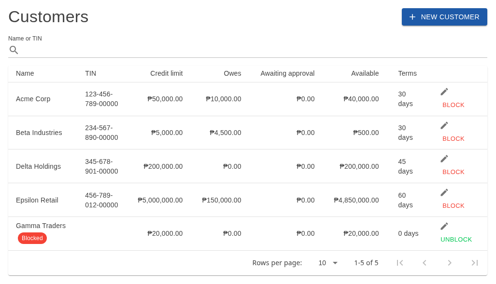
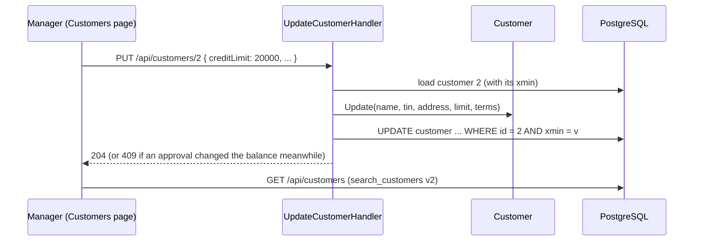

# Lesson 15 — Customers: Maintenance, and a Function's Second Version

Good day, developer! Our five customers have lived in the seed script since lesson 05. A real business adds
customers every week, raises a credit limit after a good year, and blocks a customer who stopped paying. And
when we start invoicing, each customer needs a tax number, an address, and payment terms. Today Sales
managers get a customer screen. Along the way you'll change a released SQL function the right way, with a
second version. About an hour and a half. Are you ready? Let's begin!

## What we'll build

| Endpoint | Who | What it does |
|---|---|---|
| `POST /api/customers` | SalesManager, Admin | Add a customer |
| `PUT /api/customers/{id}` | SalesManager, Admin | Change name, TIN, address, credit limit, terms |
| `POST /api/customers/{id}/block` and `/unblock` | SalesManager, Admin | Stop or allow new orders |

Plus three new facts about every customer, `sales.search_customers` version 2, and a **Customers** screen.

The Customers screen you'll build, with the credit each customer has left and who is blocked:



## Why we build it this way

### What a customer needs for invoicing

| Field | Why |
|---|---|
| **TIN** | The BIR Taxpayer Identification Number. A Philippine sales invoice prints the buyer's TIN when they have one |
| **Address** | Also printed on the invoice |
| **Payment terms** | "30 days" means the invoice is due 30 days after it's issued. Zero means cash on delivery |

The rules for them are small, but they're rules, so they go in the domain: payment terms between 0 and
365 days, a name that isn't blank.

### Who maintains customers

A rep's job is to sell, not to set their own customer's credit limit. So creating and changing customers,
and blocking them, are for managers. Reps keep reading customers, because they pick them on every order.

### Changing a released function

The order form reads customers through `sales.search_customers`, which shipped in lesson 08's migration. It
needs the three new columns now. Lesson 08's rule says we never edit a released script, so we add
`sales.search_customers.v2.sql` and a migration that applies it.

There's a PostgreSQL detail to know: `CREATE OR REPLACE FUNCTION` can replace a function's body, but not
the columns it returns. Change the `RETURNS TABLE (...)` list and PostgreSQL refuses with "cannot change
return type of existing function". So version 2 starts by dropping version 1.

## 1. The customer grows

Here's lesson 04's `Create`, before:

```csharp
public static Customer Create(string name, Money creditLimit)
{
    if (string.IsNullOrWhiteSpace(name)) throw new DomainException(SalesErrors.CustomerNameRequired, "A customer needs a name.");
    return new Customer { Name = name.Trim(), CreditLimit = creditLimit };
}
```

And after, with three new properties and an `Update` that `Create` reuses:

```csharp
// in Domain/Customer.cs
public string? Tin { get; private set; }         // BIR Taxpayer Identification Number, printed on invoices
public string? Address { get; private set; }
public int PaymentTermsDays { get; private set; }

public static Customer Create(string name, string? tin, string? address, Money creditLimit, int paymentTermsDays)
{
    var customer = new Customer();
    customer.Update(name, tin, address, creditLimit, paymentTermsDays);
    return customer;
}

public void Update(string name, string? tin, string? address, Money creditLimit, int paymentTermsDays)
{
    if (string.IsNullOrWhiteSpace(name)) throw new DomainException(SalesErrors.CustomerNameRequired, "A customer needs a name.");
    if (paymentTermsDays is < 0 or > 365) throw new DomainException(SalesErrors.PaymentTermsOutOfRange, "Payment terms must be between 0 and 365 days.");
    Name = name.Trim();
    Tin = string.IsNullOrWhiteSpace(tin) ? null : tin.Trim();
    Address = string.IsNullOrWhiteSpace(address) ? null : address.Trim();
    CreditLimit = creditLimit;
    PaymentTermsDays = paymentTermsDays;
}
```

Creating and updating check the same rules, because `Create` *is* an update of an empty customer. A blank
TIN becomes `null`, so "no TIN" has one meaning in the database, not two.

Notice what `Update` doesn't touch: `OutstandingBalance`. What a customer owes changes only through orders
and payments, never through an edit form. And lowering a credit limit below what's already owed is allowed:
it simply means no new orders until they pay.

The unit tests' `Make.Customer` calls the new `Create`:

```csharp
var customer = Domain.Customer.Create("Acme", "123-456-789-000", "Makati", new Money(limit), 30);
```

and one test joins `CustomerRuleTests`:

```csharp
[Fact]
public void Payment_terms_must_be_sensible() =>
    FluentActions.Invoking(() => Customer.Create("Acme", null, null, Money.Zero, 400))
        .Should().Throw<DomainException>();
```

In `SalesDbContext`, inside the `Customer` configuration:

```csharp
e.Property(x => x.Tin).HasMaxLength(20);
e.Property(x => x.Address).HasMaxLength(500);
```

The seed gets the new columns too. Seed data isn't a released script (it never runs in production), so it
may change. In `DevSeed.sql`, the customers become:

```sql
INSERT INTO sales.customer (name, tin, address, payment_terms_days, is_blocked, credit_limit, outstanding_balance)
SELECT v.name, v.tin, v.address, v.terms, v.is_blocked, v.credit_limit, v.outstanding_balance
FROM (VALUES ('Acme Corp',       '123-456-789-000', 'Makati City',  30, FALSE,   50000, 10000),   -- ₱40,000 headroom
             ('Beta Industries', '234-567-890-000', 'Pasig City',   30, FALSE,    5000,  4500),   -- only ₱500 left
             ('Gamma Traders',   NULL,              'Cebu City',     0, TRUE,    20000,     0),   -- blocked
             ('Delta Holdings',  '345-678-901-000', 'Davao City',   45, FALSE,  200000,     0),   -- two high-value orders, not three
             ('Epsilon Retail',  '456-789-012-000', 'Quezon City',  60, FALSE, 5000000,     0))   -- large account for approvals
     AS v(name, tin, address, terms, is_blocked, credit_limit, outstanding_balance)
WHERE NOT EXISTS (SELECT 1 FROM sales.customer);
```

Your existing development database already has customers, so this only affects a fresh one. To start
fresh, drop the `erp` database and restart the app; it rebuilds everything.

The new rule gets its code, at the end of `SalesErrors`:

```csharp
    public static readonly ErrorCode PaymentTermsOutOfRange = new("SALES-0021", "Payment terms out of range",
        "Enter payment terms between 0 (cash) and 365 days.");
```

## 2. Version 2 of the search

```sql
-- sales.search_customers.v2.sql
-- Released scripts are never edited: change a function with a .v3 file and a new migration.
-- v2: adds tin, address and payment terms, and searches by TIN. The result columns changed, so v1 is dropped first.
DROP FUNCTION IF EXISTS sales.search_customers(bigint, text, integer, integer);

CREATE FUNCTION sales.search_customers(p_customer_id bigint, p_search text, p_page integer, p_page_size integer)
RETURNS TABLE (id bigint, name text, tin text, address text, payment_terms_days integer, is_blocked boolean,
               credit_limit numeric, outstanding_balance numeric, pending_total numeric, available_credit numeric)
LANGUAGE sql STABLE
AS $$
    WITH pending AS (
        SELECT o.customer_id, SUM(ROUND(l.quantity * l.unit_price, 2)) AS total
        FROM sales.sales_order o
        JOIN sales.sales_order_line l ON l.sales_order_id = o.id
        WHERE o.status = 1
        GROUP BY o.customer_id
    )
    SELECT c.id, c.name::text, c.tin::text, c.address::text, c.payment_terms_days, c.is_blocked,
           c.credit_limit, c.outstanding_balance, COALESCE(p.total, 0),
           GREATEST(c.credit_limit - c.outstanding_balance - COALESCE(p.total, 0), 0)
    FROM sales.customer c
    LEFT JOIN pending p ON p.customer_id = c.id
    WHERE (p_customer_id IS NULL OR c.id = p_customer_id)
      AND (p_search IS NULL OR c.name ILIKE '%' || p_search || '%' OR c.tin ILIKE '%' || p_search || '%')
    ORDER BY c.name, c.id
    OFFSET (p_page - 1) * p_page_size
    LIMIT p_page_size;
$$;

CREATE OR REPLACE FUNCTION sales.count_customers(p_search text)
RETURNS bigint
LANGUAGE sql STABLE
AS $$
    SELECT COUNT(*) FROM sales.customer c
    WHERE p_search IS NULL OR c.name ILIKE '%' || p_search || '%' OR c.tin ILIKE '%' || p_search || '%';
$$;
```

`count_customers` keeps its return type, so plain `CREATE OR REPLACE` works for it. Now the model change and
the function go into one migration:

```bash
dotnet ef migrations add AddCustomerDetails \
  --project src/Modules/Sales/Erp.Modules.Sales --startup-project src/Modules/Sales/Erp.Modules.Sales \
  --output-dir Infrastructure/Migrations
```

EF generates the three `AddColumn` calls. Add the function at the end of `Up`, and put version 1 back in
`Down`:

```csharp
// at the end of Up(...)
migrationBuilder.Sql(EmbeddedSql.Read(typeof(AddCustomerDetails).Assembly, "sales.search_customers.v2.sql"));
```

```csharp
// at the start of Down(...), before the generated DropColumn calls
migrationBuilder.Sql("DROP FUNCTION IF EXISTS sales.search_customers(bigint, text, integer, integer);");
migrationBuilder.Sql(EmbeddedSql.Read(typeof(AddCustomerDetails).Assembly, "sales.search_customers.v1.sql"));
```

(add `using Erp.Shared.BuildingBlocks;`). Look at what happens on a brand-new database: lesson 08's
migration creates version 1, and this one replaces it with version 2, in order. That's why the old file
stays exactly as it was: the old migration still reads it.

In `SearchCustomersHandler.cs`, the DTO gains the three fields, in the function's column order:

```csharp
internal sealed record CustomerDto(
    long Id, string Name, string? Tin, string? Address, int PaymentTermsDays, bool IsBlocked,
    decimal CreditLimit, decimal OutstandingBalance, decimal PendingTotal, decimal AvailableCredit);
```

## 3. The maintenance slices

Create and update take the same fields, so they share one input record. Both endpoints receive that record
as their body, so its validator lives with the first of them, in `CreateCustomerEndpoint.cs`:

```csharp
// src/Modules/Sales/Erp.Modules.Sales/Features/CreateCustomer/CreateCustomerHandler.cs
using Erp.Modules.Sales.Domain;
using Erp.Modules.Sales.Infrastructure;
using Erp.Shared.BuildingBlocks;

namespace Erp.Modules.Sales.Features;

internal sealed record CustomerInput(string Name, string? Tin, string? Address, decimal CreditLimit, int PaymentTermsDays);

internal sealed record CreateCustomerCommand(CustomerInput Customer);

internal sealed class CreateCustomerHandler(SalesDbContext db)
{
    public async Task<long> HandleAsync(CreateCustomerCommand cmd, CancellationToken ct)
    {
        var c = cmd.Customer;
        var customer = Customer.Create(c.Name, c.Tin, c.Address, new Money(c.CreditLimit), c.PaymentTermsDays);
        db.Customers.Add(customer);
        await db.SaveChangesAsync(ct);
        return customer.Id.Value;
    }
}
```

The payment-terms range appears twice, once in the validator and once in the domain. That's lesson 10's
reason-check pattern again: the validator gives a fast, well-formed 400 with every field's problem at once;
the domain guarantees the rule even for code that never passes through a validator.

```csharp
// src/Modules/Sales/Erp.Modules.Sales/Features/CreateCustomer/CreateCustomerEndpoint.cs
using Erp.Shared.BuildingBlocks;
using FluentValidation;
using Microsoft.AspNetCore.Builder;
using Microsoft.AspNetCore.Http;
using Microsoft.AspNetCore.Http.HttpResults;
using Microsoft.AspNetCore.Routing;

namespace Erp.Modules.Sales.Features;

internal sealed class CustomerInputValidator : AbstractValidator<CustomerInput>
{
    public CustomerInputValidator()
    {
        RuleFor(x => x.Name).NotEmpty().MaximumLength(200);
        RuleFor(x => x.Tin).MaximumLength(20);
        RuleFor(x => x.Address).MaximumLength(500);
        RuleFor(x => x.CreditLimit).GreaterThanOrEqualTo(0);
        RuleFor(x => x.PaymentTermsDays).InclusiveBetween(0, 365);
    }
}

internal static class CreateCustomerEndpoint
{
    public static void Map(IEndpointRouteBuilder app) =>
        app.MapPost("/customers", async Task<Created<CreatedId>> (CustomerInput body, CreateCustomerHandler handler, CancellationToken ct) =>
            {
                var id = await handler.HandleAsync(new CreateCustomerCommand(body), ct);
                return TypedResults.Created($"/api/customers/{id}", new CreatedId(id));
            })
            .RequireAuthorization(p => p.RequireRole(SalesRoles.Managers));
}
```

The request body *is* `CustomerInput` here. The command wraps it, so the two can still part ways later, but
there's no point writing the same five fields three times today.

```csharp
// src/Modules/Sales/Erp.Modules.Sales/Features/UpdateCustomer/UpdateCustomerHandler.cs
using Erp.Modules.Sales.Domain;
using Erp.Modules.Sales.Infrastructure;
using Erp.Shared.BuildingBlocks;

namespace Erp.Modules.Sales.Features;

internal sealed record UpdateCustomerCommand(long CustomerId, CustomerInput Customer);

internal sealed class UpdateCustomerHandler(SalesDbContext db)
{
    public async Task<bool> HandleAsync(UpdateCustomerCommand cmd, CancellationToken ct)
    {
        var customer = await db.Customers.FindAsync([new CustomerId(cmd.CustomerId)], ct);
        if (customer is null) return false;
        var c = cmd.Customer;
        customer.Update(c.Name, c.Tin, c.Address, new Money(c.CreditLimit), c.PaymentTermsDays);
        await db.SaveChangesAsync(ct);
        return true;
    }
}

internal sealed record SetCustomerBlockedCommand(long CustomerId, bool Blocked);

internal sealed class SetCustomerBlockedHandler(SalesDbContext db)
{
    public async Task<bool> HandleAsync(SetCustomerBlockedCommand cmd, CancellationToken ct)
    {
        var customer = await db.Customers.FindAsync([new CustomerId(cmd.CustomerId)], ct);
        if (customer is null) return false;
        if (cmd.Blocked) customer.Block(); else customer.Unblock();
        await db.SaveChangesAsync(ct);
        return true;
    }
}
```

`FindAsync` looks the customer up by its key: a one-line way to load by id. And `if (cmd.Blocked)` isn't a
business `if`. It doesn't decide anything; it only picks which domain verb the caller asked for.

Lesson 10's `xmin` row version on `Customer` protects these too. A manager raising Acme's limit while an
approval charges Acme's balance can't silently undo either change: the second save gets a 409.

```csharp
// src/Modules/Sales/Erp.Modules.Sales/Features/UpdateCustomer/UpdateCustomerEndpoint.cs
using Microsoft.AspNetCore.Builder;
using Microsoft.AspNetCore.Http;
using Microsoft.AspNetCore.Http.HttpResults;
using Microsoft.AspNetCore.Routing;

namespace Erp.Modules.Sales.Features;

internal static class UpdateCustomerEndpoint
{
    public static void Map(IEndpointRouteBuilder app)
    {
        app.MapPut("/customers/{id:long}",
                async Task<Results<NoContent, NotFound>> (long id, CustomerInput body, UpdateCustomerHandler handler, CancellationToken ct) =>
                    await handler.HandleAsync(new UpdateCustomerCommand(id, body), ct) ? TypedResults.NoContent() : TypedResults.NotFound())
            .RequireAuthorization(p => p.RequireRole(SalesRoles.Managers));

        app.MapPost("/customers/{id:long}/block",
                async Task<Results<NoContent, NotFound>> (long id, SetCustomerBlockedHandler handler, CancellationToken ct) =>
                    await handler.HandleAsync(new SetCustomerBlockedCommand(id, true), ct) ? TypedResults.NoContent() : TypedResults.NotFound())
            .RequireAuthorization(p => p.RequireRole(SalesRoles.Managers));

        app.MapPost("/customers/{id:long}/unblock",
                async Task<Results<NoContent, NotFound>> (long id, SetCustomerBlockedHandler handler, CancellationToken ct) =>
                    await handler.HandleAsync(new SetCustomerBlockedCommand(id, false), ct) ? TypedResults.NoContent() : TypedResults.NotFound())
            .RequireAuthorization(p => p.RequireRole(SalesRoles.Managers));
    }
}
```

Register the three new handlers (`CreateCustomerHandler`, `UpdateCustomerHandler` and `SetCustomerBlockedHandler`;
`SearchCustomersHandler` is already there) in `AddSalesModule`, and map
`CreateCustomerEndpoint` and `UpdateCustomerEndpoint` in `MapSalesEndpoints`. Updating and blocking return
`false` for a customer that doesn't exist, and their endpoints answer 404, the pattern from lesson 09.

Block and unblock are two addresses rather than `PUT {"blocked": true}`, because they're two business
actions. Later, an audit log or a "you've been blocked" email attaches to exactly one of them.

## 4. The Customers screen

The browser's `Customer` model in `Models.cs` gains the same three fields:

```csharp
public sealed record Customer(long Id, string Name, string? Tin, string? Address, int PaymentTermsDays, bool IsBlocked,
    decimal CreditLimit, decimal OutstandingBalance, decimal PendingTotal, decimal AvailableCredit);
```

The form for adding and editing is a dialog, like lesson 10's reason dialog, but with five fields:

```razor
@* src/Erp.Web/Pages/Sales/CustomerDialog.razor *@
@inject ApiClient Api

<MudDialog>
    <DialogContent>
        <MudStack Spacing="2" Style="min-width:420px">
            <AppTextField @bind-Value="_name" Label="Name" Required="true" MaxLength="200" />
            <AppTextField @bind-Value="_tin" Label="TIN" MaxLength="20" HelperText="Printed on invoices" />
            <AppTextField @bind-Value="_address" Label="Address" Lines="2" MaxLength="500" />
            <AppNumericField @bind-Value="_creditLimit" Label="Credit limit (₱)" Min="0" Format="N2" />
            <AppNumericField @bind-Value="_terms" Label="Payment terms (days)" Min="0" Max="365" />
        </MudStack>
    </DialogContent>
    <DialogActions>
        <MudButton OnClick="() => Dialog.Cancel()">Cancel</MudButton>
        <MudButton OnClick="Save" Variant="Variant.Filled" Color="Color.Primary" Disabled="string.IsNullOrWhiteSpace(_name)">Save</MudButton>
    </DialogActions>
</MudDialog>

@code {
    [CascadingParameter] private IMudDialogInstance Dialog { get; set; } = default!;
    [Parameter] public Customer? Customer { get; set; }

    private string _name = "";
    private string? _tin, _address;
    private decimal _creditLimit;
    private int _terms = 30;

    protected override void OnInitialized()
    {
        if (Customer is not { } c) return;
        (_name, _tin, _address, _creditLimit, _terms) = (c.Name, c.Tin, c.Address, c.CreditLimit, c.PaymentTermsDays);
    }

    private async Task Save()
    {
        var body = new { name = _name, tin = _tin, address = _address, creditLimit = _creditLimit, paymentTermsDays = _terms };
        var saved = Customer is null
            ? await Api.Create("api/customers", body, "Customer added.") is not null
            : await Api.Put($"api/customers/{Customer.Id}", body, "Customer saved.");
        if (saved) Dialog.Close(DialogResult.Ok(true));
    }
}
```

One dialog does both jobs: `Customer` is `null` for a new one. The dialog saves for itself and closes only
when the API said yes; if it said no, the snackbar explains and the dialog stays open with the user's typing
intact.

```razor
@* src/Erp.Web/Pages/Sales/Customers.razor *@
@page "/customers"
@inject ApiClient Api
@inject IDialogService Dialogs

<PageTitle>Customers · ERP</PageTitle>

<MudStack Row="true" AlignItems="AlignItems.Center" Class="mb-4">
    <MudText Typo="Typo.h4">Customers</MudText>
    <MudSpacer />
    <AuthorizeView Roles="@Managers">
        <MudButton OnClick="() => Edit(null)" Variant="Variant.Filled" Color="Color.Primary" StartIcon="@Icons.Material.Filled.Add">New customer</MudButton>
    </AuthorizeView>
</MudStack>

<AppTextField T="string" Value="_search" ValueChanged="OnSearch" Label="Name or TIN" DebounceInterval="400" Clearable="true"
              Adornment="Adornment.Start" AdornmentIcon="@Icons.Material.Filled.Search" Class="mb-4" />

<MudTable Outlined="true" T="Customer" @ref="_table" ServerData="Load" Hover="true" Dense="true">
    <HeaderContent>
        <MudTh>Name</MudTh>
        <MudTh>TIN</MudTh>
        <MudTh Class="money">Credit limit</MudTh>
        <MudTh Class="money">Owes</MudTh>
        <MudTh Class="money">Awaiting approval</MudTh>
        <MudTh Class="money">Available</MudTh>
        <MudTh>Terms</MudTh>
        <MudTh></MudTh>
    </HeaderContent>
    <RowTemplate>
        <MudTd>
            @context.Name
            @if (context.IsBlocked) { <MudChip T="string" Color="Color.Error" Size="Size.Small">Blocked</MudChip> }
        </MudTd>
        <MudTd>@context.Tin</MudTd>
        <MudTd Class="money">@Format.Peso(context.CreditLimit)</MudTd>
        <MudTd Class="money">@Format.Peso(context.OutstandingBalance)</MudTd>
        <MudTd Class="money">@Format.Peso(context.PendingTotal)</MudTd>
        <MudTd Class="money">@Format.Peso(context.AvailableCredit)</MudTd>
        <MudTd>@context.PaymentTermsDays days</MudTd>
        <MudTd>
            <AuthorizeView Roles="@Managers" Context="auth">
                <MudIconButton Icon="@Icons.Material.Filled.Edit" Size="Size.Small" OnClick="() => Edit(context)" aria-label="Edit" />
                <MudButton Size="Size.Small" OnClick="() => ToggleBlock(context)" Color="@(context.IsBlocked ? Color.Success : Color.Error)">
                    @(context.IsBlocked ? "Unblock" : "Block")
                </MudButton>
            </AuthorizeView>
        </MudTd>
    </RowTemplate>
    <NoRecordsContent>No customers match.</NoRecordsContent>
    <PagerContent><MudTablePager /></PagerContent>
</MudTable>

@code {
    private static readonly string Managers = $"{Roles.SalesManager},{Roles.Admin}";
    private MudTable<Customer> _table = default!;
    private string? _search;

    private Task<TableData<Customer>> Load(TableState state, CancellationToken ct) =>
        Api.Page<Customer>(Url.With("api/customers", ("search", _search)), state);

    private Task OnSearch(string? text) { _search = text; return _table.ReloadServerData(); }

    private async Task Edit(Customer? customer)
    {
        var parameters = new DialogParameters<CustomerDialog> { { d => d.Customer, customer } };
        var dialog = await Dialogs.ShowAsync<CustomerDialog>(customer is null ? "New customer" : "Edit customer", parameters);
        if ((await dialog.Result) is { Canceled: false }) await _table.ReloadServerData();
    }

    private async Task ToggleBlock(Customer customer)
    {
        var action = customer.IsBlocked ? "unblock" : "block";
        if (await Api.Post($"api/customers/{customer.Id}/{action}", success: customer.IsBlocked ? "Unblocked." : "Blocked: no new orders."))
            await _table.ReloadServerData();
    }
}
```

`Context="auth"` on the inner `<AuthorizeView>` renames *its* `context`, so `context` inside the row still
means the customer. Without it, the two `context`s clash and the page doesn't compile.

The table shows exactly the three numbers the credit check uses: what they owe, what's awaiting approval,
and what's left. When a rep asks "why was my order refused?", the manager can see the answer in one row.

Then the links. In `NavMenu.razor`, inside the Sales group, after Sales orders:

```razor
<MudNavLink Href="customers">Customers</MudNavLink>
```

In `OrderEditor.razor`, the line under the customer box can show the terms now:

```razor
Available credit: <b>@Format.Peso(_customer.AvailableCredit)</b> · Terms: @_customer.PaymentTermsDays days
```

And in the UI test's `Every_page_opens_without_an_error`, add `"/customers"` to `pages`.

## 5. Prove it: the customer's edges

`Customer.Create` grew three parameters, so the integration tests' helper grows with it. In
`SalesOrderEdgeCaseTests.NewCustomer`, before:

```csharp
var customer = Customer.Create(name ?? $"Edge {Guid.NewGuid():N}", new Money(creditLimit));
```

After:

```csharp
var customer = Customer.Create(name ?? $"Edge {Guid.NewGuid():N}", null, null, new Money(creditLimit), 30);
```

The new rules have edges of their own. In the unit tests' `BoundaryTests.cs`, add:

```csharp
[Theory]
[InlineData(0, true)]      // cash on delivery
[InlineData(365, true)]
[InlineData(-1, false)]
[InlineData(366, false)]
public void Payment_terms_run_from_0_to_365_days(int days, bool allowed)
{
    var create = () => Customer.Create("Acme", null, null, Money.Zero, days);
    if (allowed) create.Should().NotThrow();
    else create.Should().Throw<DomainException>();
}

[Theory]
[InlineData("")]
[InlineData("   ")]
public void A_customer_needs_a_name(string name) =>
    FluentActions.Invoking(() => Customer.Create(name, null, null, Money.Zero, 30)).Should().Throw<DomainException>();
```

and in `RulesFoundByMutationTests.cs`, the rule Stryker would find the moment you run it:

```csharp
[Fact]
public void A_blank_TIN_or_address_is_stored_as_nothing_and_the_rest_is_trimmed()
{
    var customer = Customer.Create("  Acme  ", "  ", " Makati ", Money.Zero, 30);

    customer.Name.Should().Be("Acme");
    customer.Tin.Should().BeNull();
    customer.Address.Should().Be("Makati");
}

[Fact]
public void An_unblocked_customer_can_order_again()
{
    var customer = Make.Customer(blocked: true);
    customer.Unblock();
    customer.Invoking(c => c.EnsureNotBlocked()).Should().NotThrow();
}
```

A TIN of three spaces stored as `"   "` prints a blank line on every invoice and never matches a search.
Stored as `null`, it's honestly missing.

| Test | The edge | Why it matters |
|---|---|---|
| `Payment_terms_run_from_0_to_365_days` (4 cases) | 0, 365, and one past each | Both ends of the range are allowed; one step past is not |
| `A_customer_needs_a_name` | Empty, spaces | A customer nobody can find in a list |
| `A_blank_TIN_or_address_is_stored_as_nothing_and_the_rest_is_trimmed` | Whitespace | Blank is missing, not a value |
| `An_unblocked_customer_can_order_again` | Undoing | Unblocking really lets them order |

Add `/customers` to the `pages` list in `Every_page_opens_without_an_error`.

## How a request flows



## Mistakes to avoid

- Editing `sales.search_customers.v1.sql`. Lesson 08's migration reads it; a fresh database would get the
  wrong function first.
- Trying `CREATE OR REPLACE` on a function whose result columns changed. Drop it first.
- Letting the edit form set `OutstandingBalance`. It moves only with orders and payments.
- Giving reps the edit button. Credit limits are a manager's decision.
- Two `context` variables in one Razor scope. Rename the inner one.

## Let's run it!

Restart the app; the `AddCustomerDetails` migration runs. Sign in as `manager@erp.local` and open
**Sales → Customers**. Then:

1. Click **New customer**. Add "Zeta Supplies", TIN `567-890-123-000`, ₱100,000 limit, 30 days. It appears in
   the list with ₱100,000.00 available.
2. Type `567` in the search box. Only Zeta is left: version 2 searches by TIN.
3. Click **Block** on Zeta. Then, as the rep, try to create an order for Zeta: the red snackbar says it's
   blocked. Unblock it as the manager, and the rep's order saves.
4. Edit Beta Industries and raise its limit to ₱20,000. Its available credit becomes ₱15,500.

And the doors that should stay shut:

```bash
REP=$(curl -s -X POST http://localhost:5264/api/auth/login -H "Content-Type: application/json" \
  -d '{"email":"rep@erp.local","password":"Password123!"}' | jq -r .accessToken)
curl -s -o /dev/null -w "%{http_code}\n" -X POST http://localhost:5264/api/customers/1/block -H "Authorization: Bearer $REP"
# 403: reps don't maintain customers
curl -s -X POST http://localhost:5264/api/customers -H "Authorization: Bearer $MGR" -H "Content-Type: application/json" \
  -d '{"name":"Bad Terms","creditLimit":0,"paymentTermsDays":400}' | jq .errors
# [ "'Payment Terms Days' must be between 0 and 365. You entered 400." ]
```

(with `$MGR` signed in as the manager, as in lesson 08). Run `dotnet test` too: the new unit test passes,
and every integration test still does, because nothing about orders changed.

## Let's check!

1. Why are TIN, address and payment terms on the customer now, and not in lesson 04?
2. Why does `Create` call `Update`?
3. What does version 2 of `search_customers` do first, and why?
4. Why does lesson 08's `search_customers.v1.sql` stay exactly as it was?
5. Who may block a customer, and where is that decided?
6. Why are block and unblock separate endpoints instead of one `PUT`?

And that's where this lesson ends. Managers can now run the customer list themselves, and every customer
carries what an invoice will need. Next time, the rest of the staff arrive: warehouse clerks, buyers and
accountants, with accounts an administrator creates, and email for resetting a forgotten password. Good
luck, developer!

---

← [Lesson 14 — Observability](14-observability.md) · Next: [Lesson 16 — Users and email](16-users-email.md) →
