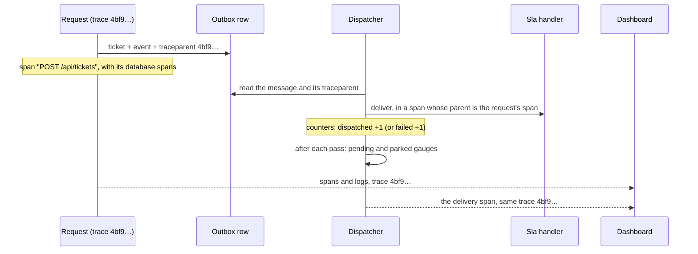

# Lesson 15 — Observability: Seeing What the System Is Doing, and When It Isn't

Good day, developer! The last two lessons made a ticket tell the rest of the system what happened to it, through a post office that runs by itself. That is powerful, and it has a new kind of danger: when something goes wrong, nothing in the request that caused it will say so. A ticket saved with no clock looks exactly like a ticket saved with one. Today we make the system tell us. We follow a request across the post office, count what it delivers, raise a flag when it gives up on a message, and watch it all on a dashboard. It takes about three hours. Are you ready? Let's begin!

## What we'll build

| Piece | What it is |
|---|---|
| **OpenTelemetry** | The standard way to send traces, metrics and logs out of the app, to whatever tool you run |
| **A trace id on every response** | One number that finds a request's whole story |
| **The post office, instrumented** | A count of what it delivers and what fails, and a trace for each delivery that joins the trace of the request that caused it |
| **The backlog** | Gauges for the messages waiting and the messages given up on |
| **Health checks** | `/health/live` and `/health/ready`, and an outbox check that says "degraded" when a message was given up on |
| **The Aspire dashboard** | A development-only page that shows the traces, logs and metrics as you use the app |

## Why we build it this way

### The pain: a system that fails quietly

Think of what can go wrong now, and what you would see:

- A handler fails ten times and its message is left in the table. Nobody is told. A clock never starts, and the first anyone knows is a ticket that never turns red.
- A request is slow. Was it the database, the other module, the post office? The log says "request took 900 ms" and nothing more.
- The database is down. The app is up. A load balancer asks "are you alive?" and gets "yes", and sends people to a page that can only fail.

These are three different questions, and they have three different tools.

### Logs, metrics and traces

A **log** is a line of text about one thing that happened: "message 7f3a failed". A **metric** is a number over time: "42 messages delivered in the last minute". A **trace** is the path of one request through the system, drawn as a tree of timed steps called **spans**: the request, then the database call inside it, then the post office delivery that came after. Each trace has an id. Put the same id on the response and on every log line, and one search finds the whole story.

**OpenTelemetry** is the open standard for producing all three, so the app doesn't care what reads them. You point it at a collector with one setting, and Grafana, Jaeger, Elastic or Azure Monitor can all listen. Its license is Apache-2.0, and the course never asks you to buy a monitoring tool.

Now, let's be honest about the cost here: telemetry is more code, more packages, and a little more work per request. And a dashboard only helps if someone looks at it. That is why the last part of this lesson is a health check: a thing that raises its hand instead of waiting to be looked at.

### Three words for health

A **liveness** check answers "is the process running?" It must never look at the database, or a database outage would make a platform restart a perfectly good app. A **readiness** check answers "can it do its job right now?", so it does look at the database. And a **degraded** answer means "working, but something needs a person". An outbox with a message that was given up on is exactly that: the app serves requests fine, but a clock that should have started has not, so it is degraded, not down. Reporting it as unhealthy would have the platform restart the app, which fixes nothing.

## 1. The names

Telemetry needs a name to hang numbers and spans on. One small class holds them, in `Yasda.Shared.Infrastructure`, the project only the host references:

```csharp
// src/Shared/Yasda.Shared.Infrastructure/Telemetry/YasdaTelemetry.cs
using System.Diagnostics;
using System.Diagnostics.Metrics;

namespace Yasda.Shared.Infrastructure;

public static class YasdaTelemetry
{
    public const string Name = "Yasda";

    public static readonly ActivitySource Source = new(Name);
    public static readonly Meter Meter = new(Name);
}
```

An **`ActivitySource`** is where spans are made, and a **`Meter`** is where counters and gauges are made. .NET has had both built in since .NET 5, so the code that produces telemetry needs no package. The packages are for sending it out.

## 2. Turn OpenTelemetry on

Six packages, all in the host, all Apache-2.0 except one under the PostgreSQL license (and all recorded in `THIRD-PARTY-NOTICES.md`, as every package is). Add them:

```bash
dotnet add src/Yasda.Api package OpenTelemetry.Extensions.Hosting --version 1.20.1
dotnet add src/Yasda.Api package OpenTelemetry.Instrumentation.AspNetCore --version 1.20.1
dotnet add src/Yasda.Api package OpenTelemetry.Instrumentation.Http --version 1.20.1
dotnet add src/Yasda.Api package OpenTelemetry.Instrumentation.Runtime --version 1.20.1
dotnet add src/Yasda.Api package OpenTelemetry.Exporter.OpenTelemetryProtocol --version 1.20.1
dotnet add src/Yasda.Api package Npgsql.OpenTelemetry --version 10.0.3
```

| Package | What it's for |
|---|---|
| `OpenTelemetry.Extensions.Hosting` | Plugs OpenTelemetry into the app's startup |
| `…Instrumentation.AspNetCore` | A span for every request, and the request metrics |
| `…Instrumentation.Http` | A span for every call the app makes to another HTTP service |
| `…Instrumentation.Runtime` | Memory, garbage collection and thread numbers |
| `…Exporter.OpenTelemetryProtocol` | Sends it all out over **OTLP**, OpenTelemetry's own protocol |
| `Npgsql.OpenTelemetry` | A span for every database command |

Then one file that sets it all up. Read it top to bottom:

```csharp
// src/Yasda.Api/Observability.cs
using System.Diagnostics;
using Yasda.Shared.Infrastructure;
using Npgsql;
using OpenTelemetry;
using OpenTelemetry.Metrics;
using OpenTelemetry.Resources;
using OpenTelemetry.Trace;

namespace Yasda.Api;

internal static class Observability
{
    public static WebApplicationBuilder AddObservability(this WebApplicationBuilder builder)
    {
        builder.Logging.Configure(o => o.ActivityTrackingOptions = ActivityTrackingOptions.TraceId | ActivityTrackingOptions.SpanId);
        if (!builder.Environment.IsDevelopment())
            builder.Logging.AddJsonConsole(o => o.IncludeScopes = true);   // machine-readable for log collectors
        builder.Logging.AddOpenTelemetry(o =>
        {
            o.IncludeFormattedMessage = true;
            o.IncludeScopes = true;
        });

        var otel = builder.Services.AddOpenTelemetry()
            .ConfigureResource(r => r.AddService("yasda-api"))
            .WithTracing(t => t
                .AddSource(YasdaTelemetry.Name)
                .AddAspNetCoreInstrumentation(o => o.Filter = ctx => !ctx.Request.Path.StartsWithSegments("/health"))
                .AddHttpClientInstrumentation()
                .AddNpgsql())
            .WithMetrics(m => m
                .AddMeter(YasdaTelemetry.Name, "Npgsql", "Microsoft.EntityFrameworkCore")
                .AddAspNetCoreInstrumentation()
                .AddHttpClientInstrumentation()
                .AddRuntimeInstrumentation());

        // Exports only when a collector is configured: Aspire sets this in development; production sets it to
        // whatever the buyer runs (Grafana, Jaeger, Elastic, Azure Monitor, ...).
        if (!string.IsNullOrWhiteSpace(builder.Configuration["OTEL_EXPORTER_OTLP_ENDPOINT"]))
            otel.UseOtlpExporter();

        return builder;
    }

    // Lets a user quote the id from any response, and support find every log line and span for that request.
    public static IApplicationBuilder UseTraceIdHeader(this IApplicationBuilder app) =>
        app.Use((ctx, next) =>
        {
            if (Activity.Current is not null)
                ctx.Response.Headers["X-Trace-Id"] = Activity.Current.TraceId.ToString();
            return next(ctx);
        });
}
```

- **Logs** carry the trace and span ids (`ActivityTrackingOptions`), so a log line can be found from a trace. Outside development, logs are JSON, one object per line, which every log collector reads. In development they stay plain text for you.
- **Traces** listen to our own source, to ASP.NET Core (but not to `/health`, which would drown the real requests), to outgoing HTTP calls, and to the database.
- **Metrics** listen to our own meter, the database driver and EF Core, ASP.NET Core, HTTP and the runtime.
- **Exporting** happens only when `OTEL_EXPORTER_OTLP_ENDPOINT` is set. In development the dashboard sets it for you; in production you set it to whatever collector you run. Nothing in the code names a vendor.
- **`UseTraceIdHeader`** copies the current trace id onto every response as `X-Trace-Id`. A person who sees an error can quote that one number, and support finds every log line and span of the request.

In `Program.cs`, three changes. After `var builder = WebApplication.CreateBuilder(args);`:

```csharp
builder.AddObservability();
```

After the middleware that turns exceptions into problem responses:

```csharp
app.UseTraceIdHeader();
```

The third change, the health checks, comes in step 5.

## 3. The post office, instrumented

In [lesson 13](13-events-outbox.md) the dispatcher had no telemetry. Let's give it three things: a count of what it delivers and what fails, a span for each delivery, and a link from that span to the request that caused it.

### Counting and timing

In the dispatcher, two counters are created from our meter, and each message's delivery is wrapped in a span:

```csharp
private static readonly Counter<long> Dispatched = YasdaTelemetry.Meter.CreateCounter<long>("yasda.outbox.dispatched");
private static readonly Counter<long> Failed = YasdaTelemetry.Meter.CreateCounter<long>("yasda.outbox.failed");
```

A **counter** only goes up, so the tool can show a rate: "3 messages per minute". The span is started around each message, with a tag that says which event it was, and its status is set to an error when the delivery throws. This is the dispatcher's loop, before (lesson 13) and after:

```csharp
foreach (var message in batch)
{
    try
    {
        var domainEvent = OutboxMessage.Deserialize(message.Type, message.Payload);
        ...
```

```csharp
foreach (var message in batch)
{
    using var activity = YasdaTelemetry.Source.StartActivity("outbox deliver", ActivityKind.Consumer);
    activity?.SetTag("yasda.outbox.type", message.Type);
    try
    {
        var domainEvent = OutboxMessage.Deserialize(message.Type, message.Payload);
        ...
```

### Joining the request's trace

A span for each delivery is not enough. Right now it would start a *new* trace, unconnected to anything. "Alan filed a ticket, and the clock started a moment later" would show as two separate traces, and a failed delivery could not be traced back to the request that caused it.

The fix is to save a note in the outbox row: the request's trace context, in the standard W3C `traceparent` format, a 55-character string that holds the trace id and the span id. When the dispatcher delivers the message, it uses that note as the delivery span's parent. One more column, and one more property on the row:

```csharp
// src/Shared/Yasda.Shared.BuildingBlocks/Messaging/OutboxMessage.cs
using System.Diagnostics;
using System.Text.Json;

namespace Yasda.Shared.BuildingBlocks;

// A domain event waiting in a module's outbox table, saved in the same transaction as the change that raised it.
public sealed class OutboxMessage
{
    public Guid Id { get; private set; }
    public string Type { get; private set; } = default!;
    public string Payload { get; private set; } = default!;
    public DateTime OccurredUtc { get; private set; }
    public DateTime? ProcessedUtc { get; private set; }
    public int Attempts { get; private set; }
    public string? LastError { get; private set; }
    // The request that raised the event, so its delivery can join the same trace. Null when nothing was being traced.
    public string? TraceParent { get; private set; }

    private OutboxMessage() { }

    public static OutboxMessage From(IDomainEvent domainEvent, DateTime nowUtc)
    {
        var type = domainEvent.GetType();
        return new OutboxMessage
        {
            Id = Guid.NewGuid(),
            // No assembly version, so messages written before an upgrade still load after it.
            Type = $"{type.FullName}, {type.Assembly.GetName().Name}",
            Payload = JsonSerializer.Serialize(domainEvent, type),
            OccurredUtc = nowUtc,
            TraceParent = Activity.Current?.Id
        };
    }

    public static IDomainEvent Deserialize(string type, string payload)
    {
        var eventType = System.Type.GetType(type, throwOnError: true)!;
        return (IDomainEvent)JsonSerializer.Deserialize(payload, eventType)!;
    }
}
```

`From` reads `Activity.Current`, the span of whatever is running when the event is written (the request), and stores its id. Each module's `DbContext` maps the new column, right after the `Payload` line of its `OutboxMessage` mapping:

```csharp
e.Property(x => x.TraceParent).HasMaxLength(55);   // a W3C traceparent is always 55 characters
```

That is one line in each of `TicketsDbContext`, `YasdaIdentityDbContext` and `SlaDbContext`, and so one migration in each:

```bash
dotnet ef migrations add AddOutboxTraceParent --project src/Modules/Tickets/Yasda.Modules.Tickets --startup-project src/Modules/Tickets/Yasda.Modules.Tickets --output-dir Infrastructure/Migrations
dotnet ef migrations add AddOutboxTraceParent --project src/Modules/Identity/Yasda.Modules.Identity --startup-project src/Modules/Identity/Yasda.Modules.Identity --output-dir Infrastructure/Migrations
dotnet ef migrations add AddOutboxTraceParent --project src/Modules/Sla/Yasda.Modules.Sla --startup-project src/Modules/Sla/Yasda.Modules.Sla --output-dir Infrastructure/Migrations
```

Each is one `AddColumn` for `trace_parent`, nullable, because the rows already in the table have none, and a message written when nothing was being traced has none either.

In the dispatcher, the select reads the new column, and the span uses it as its parent:

```csharp
// The delivery joins the trace of the request that raised the event, so one trace shows both.
ActivityContext requestContext = default;
if (message.TraceParent is not null) ActivityContext.TryParse(message.TraceParent, null, out requestContext);
using var activity = YasdaTelemetry.Source.StartActivity("outbox deliver", ActivityKind.Consumer, requestContext);
```

## 4. The backlog

Two numbers say how the post office is doing: how many messages are **pending** (it will still try) and how many are **parked** (it gave up). They are gauges: a **gauge** is a number that goes up and down, read at the moment the metrics are collected.

One small class counts them, so the dispatcher and the health check ask the same question the same way. It also owns the one place a schema name is turned into a table name, because a table name can't be a SQL parameter and so must be checked:

```csharp
// src/Shared/Yasda.Shared.Infrastructure/Outbox/OutboxBacklog.cs
using System.Text.RegularExpressions;
using Dapper;
using Microsoft.Extensions.Configuration;
using Npgsql;

namespace Yasda.Shared.Infrastructure;

// How many messages of one module's outbox are waiting, and how many were given up on.
public sealed record OutboxCounts(long Pending, long Parked);

public static partial class OutboxTable
{
    // The schema name goes into SQL text (a table name can't be a parameter), so only a plain name is accepted.
    public static string NameOf(string schema)
    {
        if (!SafeIdentifier().IsMatch(schema)) throw new ArgumentException($"Bad schema name '{schema}'.");
        return $"{schema}.outbox_message";
    }

    [GeneratedRegex("^[a-z_][a-z0-9_]*$")]
    private static partial Regex SafeIdentifier();
}

// Pending is what the dispatcher will still try. Parked is what it has given up on (MaxAttempts failures): nobody is
// working on those any more, so someone has to be told. The dispatcher publishes both as metrics, and a health check
// reports the parked ones.
public sealed class OutboxBacklog(NpgsqlDataSource dataSource, IConfiguration config)
{
    private readonly OutboxOptions _options = config.GetSection("Outbox").Get<OutboxOptions>() ?? new();

    public async Task<OutboxCounts> CountAsync(string schema, CancellationToken ct)
    {
        var table = OutboxTable.NameOf(schema);
        await using var conn = await dataSource.OpenConnectionAsync(ct);
        return await conn.QuerySingleAsync<OutboxCounts>(new CommandDefinition(
            $"""
            SELECT COUNT(*) FILTER (WHERE attempts < @MaxAttempts) AS Pending,
                   COUNT(*) FILTER (WHERE attempts >= @MaxAttempts) AS Parked
            FROM {table}
            WHERE processed_utc IS NULL
            """,
            new { _options.MaxAttempts }, cancellationToken: ct));
    }
}
```

The dispatcher counts after each pass through a module's outbox and keeps the latest numbers where the gauges can read them. This is the final dispatcher, which you should now replace lesson 13's with. Read it against the three things we just added: the counters, the span with its parent, and the gauges:

```csharp
// src/Shared/Yasda.Shared.Infrastructure/Outbox/OutboxDispatcher.cs
using System.Diagnostics;
using System.Diagnostics.Metrics;
using System.Collections.Concurrent;
using System.Reflection;
using Dapper;
using Yasda.Shared.BuildingBlocks;
using Microsoft.Extensions.Configuration;
using Microsoft.Extensions.DependencyInjection;
using Microsoft.Extensions.Hosting;
using Microsoft.Extensions.Logging;
using Npgsql;

namespace Yasda.Shared.Infrastructure;

public sealed class OutboxOptions
{
    public int PollIntervalMs { get; set; } = 2000;
    public int BatchSize { get; set; } = 50;
    public int MaxAttempts { get; set; } = 10;
}

// Delivers outbox events to their module's IDomainEventHandler<T> classes after commit. At-least-once: a handler may see an event twice, so handlers must be
// idempotent. FOR UPDATE SKIP LOCKED keeps several app instances from taking the same message. After
// MaxAttempts failures a message is left, with its last_error, for a person to look at.
public sealed class OutboxDispatcher(
    IServiceScopeFactory scopes,
    NpgsqlDataSource dataSource,
    IConfiguration config,
    OutboxBacklog backlog,
    TimeProvider time,
    ILogger<OutboxDispatcher> log) : BackgroundService
{
    private static readonly Counter<long> Dispatched = YasdaTelemetry.Meter.CreateCounter<long>("yasda.outbox.dispatched");
    private static readonly Counter<long> Failed = YasdaTelemetry.Meter.CreateCounter<long>("yasda.outbox.failed");

    // What the last tick saw in each module's outbox. A gauge is read when the metrics are collected, so the latest
    // numbers wait here until then.
    private static readonly ConcurrentDictionary<string, long> PendingBySchema = new();
    private static readonly ConcurrentDictionary<string, long> ParkedBySchema = new();

    static OutboxDispatcher()
    {
        YasdaTelemetry.Meter.CreateObservableGauge("yasda.outbox.pending", () => ReadGauge(PendingBySchema));
        YasdaTelemetry.Meter.CreateObservableGauge("yasda.outbox.parked", () => ReadGauge(ParkedBySchema));
    }

    private static List<Measurement<long>> ReadGauge(ConcurrentDictionary<string, long> bySchema)
    {
        var measurements = new List<Measurement<long>>();
        foreach (var pair in bySchema)
            measurements.Add(new Measurement<long>(pair.Value, new KeyValuePair<string, object?>("schema", pair.Key)));
        return measurements;
    }

    private readonly OutboxOptions _options = config.GetSection("Outbox").Get<OutboxOptions>() ?? new();

    protected override async Task ExecuteAsync(CancellationToken stoppingToken)
    {
        List<string> schemas;
        await using (var scope = scopes.CreateAsyncScope())
        {
            var modules = scope.ServiceProvider.GetServices<IModuleDatabase>();
            schemas = modules.Select(m => m.Schema).ToList();
        }

        // Once right away (events may have waited through a restart), then on every tick.
        await DispatchAllAsync(schemas, stoppingToken);

        using var timer = new PeriodicTimer(TimeSpan.FromMilliseconds(_options.PollIntervalMs));
        while (await timer.WaitForNextTickAsync(stoppingToken))
        {
            await DispatchAllAsync(schemas, stoppingToken);
        }
    }

    private async Task DispatchAllAsync(List<string> schemas, CancellationToken stoppingToken)
    {
        foreach (var schema in schemas)
        {
            try
            {
                // A full batch means more may be waiting, so go again until a batch comes back short.
                var moreWaiting = true;
                while (moreWaiting)
                {
                    var delivered = await DispatchBatchAsync(schema, stoppingToken);
                    moreWaiting = delivered == _options.BatchSize;
                }

                var counts = await backlog.CountAsync(schema, stoppingToken);
                PendingBySchema[schema] = counts.Pending;
                ParkedBySchema[schema] = counts.Parked;
            }
            catch (Exception ex) when (!stoppingToken.IsCancellationRequested)
            {
                log.LogError(ex, "Outbox dispatch for schema {Schema} failed; will retry next tick", schema);
            }
        }
    }

    private sealed record Row(Guid Id, string Type, string Payload, string? TraceParent);

    public async Task<int> DispatchBatchAsync(string schema, CancellationToken ct)
    {
        var table = OutboxTable.NameOf(schema);

        await using var conn = await dataSource.OpenConnectionAsync(ct);
        await using var tx = await conn.BeginTransactionAsync(ct);

        var rows = await conn.QueryAsync<Row>(
            $"""
            SELECT id, type, payload, trace_parent AS TraceParent FROM {table}
            WHERE processed_utc IS NULL AND attempts < @MaxAttempts
            ORDER BY occurred_utc
            LIMIT @BatchSize
            FOR UPDATE SKIP LOCKED
            """,
            new { _options.MaxAttempts, _options.BatchSize }, tx);
        var batch = rows.ToList();

        foreach (var message in batch)
        {
            // The delivery joins the trace of the request that raised the event, so one trace shows both.
            ActivityContext requestContext = default;
            if (message.TraceParent is not null) ActivityContext.TryParse(message.TraceParent, null, out requestContext);
            using var activity = YasdaTelemetry.Source.StartActivity("outbox deliver", ActivityKind.Consumer, requestContext);
            activity?.SetTag("yasda.outbox.type", message.Type);
            try
            {
                var domainEvent = OutboxMessage.Deserialize(message.Type, message.Payload);
                await using var scope = scopes.CreateAsyncScope();
                await DeliverAsync(scope.ServiceProvider, domainEvent, ct);

                await conn.ExecuteAsync($"UPDATE {table} SET processed_utc = @Now WHERE id = @Id",
                    new { Now = time.GetUtcNow().UtcDateTime, message.Id }, tx);
                Dispatched.Add(1);
            }
            catch (Exception ex) when (!ct.IsCancellationRequested)
            {
                activity?.SetStatus(ActivityStatusCode.Error, ex.Message);
                await conn.ExecuteAsync($"UPDATE {table} SET attempts = attempts + 1, last_error = @Error WHERE id = @Id",
                    new { Error = ex.ToString(), message.Id }, tx);
                Failed.Add(1);
                log.LogError(ex, "Outbox message {MessageId} ({Type}) failed", message.Id, message.Type);
            }
        }

        await tx.CommitAsync(ct);
        return batch.Count;
    }

    // The event's type is known only at run time (it was read from a row), so the typed method is picked by reflection.
    private static readonly MethodInfo DeliverTyped =
        typeof(OutboxDispatcher).GetMethod(nameof(DeliverToHandlersAsync), BindingFlags.NonPublic | BindingFlags.Static)!;

    private static Task DeliverAsync(IServiceProvider services, IDomainEvent domainEvent, CancellationToken ct) =>
        (Task)DeliverTyped.MakeGenericMethod(domainEvent.GetType()).Invoke(null, [services, domainEvent, ct])!;

    private static async Task DeliverToHandlersAsync<TEvent>(IServiceProvider services, TEvent domainEvent, CancellationToken ct)
        where TEvent : IDomainEvent
    {
        foreach (var handler in services.GetServices<IDomainEventHandler<TEvent>>())
            await handler.HandleAsync(domainEvent, ct);
    }
}
```

Register the new class in `DependencyInjection.cs`, before the dispatcher:

```csharp
services.AddSingleton<OutboxBacklog>();
services.AddHostedService<OutboxDispatcher>();
```

## 5. Health checks

Two checks. The first asks the database a trivial question:

```csharp
// src/Shared/Yasda.Shared.Infrastructure/Health/DatabaseHealthCheck.cs
using Microsoft.Extensions.Diagnostics.HealthChecks;
using Npgsql;

namespace Yasda.Shared.Infrastructure;

public sealed class DatabaseHealthCheck(NpgsqlDataSource dataSource) : IHealthCheck
{
    public async Task<HealthCheckResult> CheckHealthAsync(HealthCheckContext context, CancellationToken cancellationToken = default)
    {
        try
        {
            await using var command = dataSource.CreateCommand("SELECT 1");
            await command.ExecuteScalarAsync(cancellationToken);
            return HealthCheckResult.Healthy();
        }
        catch (Exception ex)
        {
            return HealthCheckResult.Unhealthy("PostgreSQL is unreachable.", ex);
        }
    }
}
```

The second is the one that matters for this lesson. It counts the parked messages in every module's outbox and says **Degraded** if there are any:

```csharp
// src/Shared/Yasda.Shared.Infrastructure/Health/OutboxHealthCheck.cs
using Microsoft.Extensions.DependencyInjection;
using Microsoft.Extensions.Diagnostics.HealthChecks;
using Yasda.Shared.BuildingBlocks;

namespace Yasda.Shared.Infrastructure;

// Degraded, not unhealthy, when events were given up on: the app still works, but something that should have happened
// (a clock started, a mail queued) did not, and a person has to look at the outbox rows. Unhealthy would have the
// platform restart a perfectly good app.
public sealed class OutboxHealthCheck(IServiceScopeFactory scopes, OutboxBacklog backlog) : IHealthCheck
{
    public async Task<HealthCheckResult> CheckHealthAsync(HealthCheckContext context, CancellationToken cancellationToken = default)
    {
        List<string> schemas;
        await using (var scope = scopes.CreateAsyncScope())
        {
            var modules = scope.ServiceProvider.GetServices<IModuleDatabase>();
            schemas = modules.Select(m => m.Schema).ToList();
        }

        var parkedIn = new List<string>();
        foreach (var schema in schemas)
        {
            var counts = await backlog.CountAsync(schema, cancellationToken);
            if (counts.Parked > 0) parkedIn.Add($"{schema}: {counts.Parked}");
        }

        if (parkedIn.Count == 0) return HealthCheckResult.Healthy();
        return HealthCheckResult.Degraded($"Outbox messages were given up on: {string.Join(", ", parkedIn)}.");
    }
}
```

Register both, tagged `ready`, and map the two endpoints. In `Program.cs`, add `using Microsoft.AspNetCore.Diagnostics.HealthChecks;`, and after `builder.Services.AddAuthorization();`:

```csharp
builder.Services.AddHealthChecks()
    .AddCheck<DatabaseHealthCheck>("database", tags: ["ready"])
    .AddCheck<OutboxHealthCheck>("outbox", tags: ["ready"]);
```

and before `var api = app.MapGroup("/api")...`:

```csharp
app.MapHealthChecks("/health/live", new HealthCheckOptions { Predicate = _ => false });   // the process is up
app.MapHealthChecks("/health/ready", new HealthCheckOptions { Predicate = c => c.Tags.Contains("ready") });
```

`Predicate = _ => false` means "run no checks": the live endpoint answers as long as the process does. The ready endpoint runs the checks tagged `ready`. By default ASP.NET Core answers `200` for Healthy and for Degraded, and `503` for Unhealthy: that is the behaviour we want, a degraded app keeps its traffic and a person gets told.

## 6. The dashboard

Reading raw output is a poor way to meet traces. **.NET Aspire** has a dashboard that receives OpenTelemetry and shows it as pages: the requests, the traces as trees, the logs, the metrics. We use it for development only, so it is a project of its own that the production app never references, and its license is MIT. Create it:

```bash
dotnet new classlib -o src/Yasda.AppHost
rm src/Yasda.AppHost/Class1.cs
dotnet sln add src/Yasda.AppHost --solution-folder src
```

Replace its project file. The first line selects the Aspire SDK, which brings everything the dashboard needs from NuGet; no separate tool needs installing:

```xml
<!-- src/Yasda.AppHost/Yasda.AppHost.csproj -->
<Project Sdk="Aspire.AppHost.Sdk/13.6.5">

  <!-- Development only: runs the API next to the Aspire dashboard (traces, logs, metrics). Never deployed. -->
  <PropertyGroup>
    <OutputType>Exe</OutputType>
    <UserSecretsId>yasda-apphost-dev</UserSecretsId>
    <!-- ASPIRE010: we use the dashboard/orchestrator from NuGet on purpose, so no Aspire CLI install is needed. -->
    <NoWarn>$(NoWarn);ASPIRE010</NoWarn>
  </PropertyGroup>

  <ItemGroup>
    <ProjectReference Include="..\Yasda.Api\Yasda.Api.csproj" />
  </ItemGroup>

</Project>
```

Its code is three lines. It says "start the API, and the dashboard next to it":

```csharp
// src/Yasda.AppHost/AppHost.cs
var builder = DistributedApplication.CreateBuilder(args);

builder.AddProject<Projects.Yasda_Api>("yasda-api");

builder.Build().Run();
```

And a launch profile that gives the dashboard its address and tells the API where to send its telemetry:

```json
{
  "$schema": "https://json.schemastore.org/launchsettings.json",
  "profiles": {
    "http": {
      "commandName": "Project",
      "dotnetRunMessages": true,
      "launchBrowser": true,
      "applicationUrl": "http://localhost:15180",
      "environmentVariables": {
        "ASPNETCORE_ENVIRONMENT": "Development",
        "DOTNET_ENVIRONMENT": "Development",
        "ASPIRE_DASHBOARD_OTLP_ENDPOINT_URL": "http://localhost:19180",
        "ASPIRE_RESOURCE_SERVICE_ENDPOINT_URL": "http://localhost:20180",
        "ASPIRE_ALLOW_UNSECURED_TRANSPORT": "true"
      }
    }
  }
}
```

Start it instead of the API, with the development database from [lesson 12](12-containers-ci.md) running:

```bash
dotnet run --project src/Yasda.AppHost
```

The console prints a line like `Login to the dashboard at http://localhost:15180/login?t=…`. Open it. Click the `yasda-api` resource and use the app: sign in, file a ticket. Under **Traces**, the request to `POST /api/tickets` is a tree, with the database commands inside it. Click **Metrics**, and find `yasda.outbox.dispatched` under the `Yasda` meter: the number goes up as the post office delivers.

The coverage report from lesson 12 should leave the new project out, because it is never deployed. In `ci.yml`, the assembly filter becomes `-assemblyfilters:"+Yasda.*;-Yasda.Web;-Yasda.AppHost"`.

## 7. Prove it: the system can tell when it is unwell

Observability is easy to break without noticing: a refactor that drops a line stops the trace link, and nothing fails. So each thing we built gets a test that checks it from outside. The small ones first. Start the file:

```csharp
// tests/Yasda.Integration.Tests/PlatformTests.cs (the top of the new file; the tests below go inside the class)
using System.Net;
using AwesomeAssertions;

namespace Yasda.Integration.Tests;

// What an operator and a load balancer see from outside: is it alive, is it ready, and can a response be traced.
[Collection("Integration")]
public class PlatformTests(CustomWebAppFactory factory)
{
    // ... the tests that follow
```

| Test | Why it matters |
|---|---|
| `Health_endpoints_report_healthy` (two cases) | Both endpoints answer `200` on a healthy app |
| `Responses_carry_a_trace_id` | The header is there, and is a 32-character trace id |

Two tests of operations, in a new file `OperationsTests.cs`:

```csharp
// tests/Yasda.Integration.Tests/OperationsTests.cs (the top of the new file; the tests below go inside the class)
using System.Net;
using System.Net.Http.Json;
using AwesomeAssertions;
using Microsoft.Extensions.Diagnostics.HealthChecks;
using Npgsql;
using Yasda.Shared.Infrastructure;

namespace Yasda.Integration.Tests;

// What keeps the running system honest: health and tracing.
[Collection("Integration")]
public class OperationsTests(CustomWebAppFactory factory)
{
    private sealed record Problem(string TraceId);
    // ... the tests that follow
```

```csharp
// tests/Yasda.Integration.Tests/OperationsTests.cs (added)
    [Fact]
    public async Task The_ready_check_fails_when_the_database_cannot_be_reached()
    {
        await using var unreachable = NpgsqlDataSource.Create("Host=127.0.0.1;Port=1;Database=yasda;Username=x;Password=x;Timeout=2");

        var result = await new DatabaseHealthCheck(unreachable).CheckHealthAsync(new HealthCheckContext());

        result.Status.Should().Be(HealthStatus.Unhealthy);
    }
```

```csharp
// tests/Yasda.Integration.Tests/OperationsTests.cs (added)
    // The id in the error body is the id in the header is the id in the logs: one search finds the whole story.
    [Fact]
    public async Task An_error_carries_the_same_trace_id_as_its_response_header()
    {
        var agent = await factory.ClientFor("agent@yasda.local");
        var response = await agent.GetAsync("/api/tickets/999999999");

        response.StatusCode.Should().Be(HttpStatusCode.NotFound);
        var header = response.Headers.GetValues("X-Trace-Id").Single();
        (await response.Content.ReadFromJsonAsync<Problem>())!.TraceId.Should().Be(header);
    }
```

The first points a database health check at an address nothing listens on, and says the answer must be Unhealthy. The second checks the id in the error body is the id in the header: one search finds the whole story.

### The three that are this lesson's point

A new file, `OutboxObservabilityTests.cs`. These tests exist because nothing else would notice when they break:

```csharp
// tests/Yasda.Integration.Tests/OutboxObservabilityTests.cs (the top of the new file; the tests below go inside the class)
using System.Collections.Concurrent;
using System.Diagnostics;
using System.Diagnostics.Metrics;
using System.Net.Http.Json;
using AwesomeAssertions;
using Dapper;

namespace Yasda.Integration.Tests;

// Lesson 14: what the outbox shows the people who run the system. An event that was never delivered is a clock that never
// started or a mail nobody got, and nothing in the request that caused it will say so. These tests are why the outbox
// reports a trace, a backlog and a health status.
[Collection("Integration")]
public class OutboxObservabilityTests(CustomWebAppFactory factory)
{
    private static readonly string[] Schemas = ["identity", "tickets", "sla"];

    // Messages the dispatcher gave up on, from this test or an earlier one, would hide what these tests look for.
    private static async Task RemoveParkedMessagesAsync(Npgsql.NpgsqlConnection conn)
    {
        foreach (var schema in Schemas)
            await conn.ExecuteAsync($"DELETE FROM {schema}.outbox_message WHERE processed_utc IS NULL AND attempts >= 10");
    }

    private static async Task ParkAMessageAsync(Npgsql.NpgsqlConnection conn, string schema)
    {
        await conn.ExecuteAsync(
            $$"""
            INSERT INTO {{schema}}.outbox_message (id, type, payload, occurred_utc, attempts, last_error)
            VALUES (@id, 'Yasda.NoSuchEvent, Yasda.NoSuchAssembly', '{}', now(), 10, 'gave up')
            """, new { id = Guid.NewGuid() });
    }
    // ... the tests that follow
```

Listening for a span needs an **`ActivityListener`**, which is how a test sees the spans the app makes inside the same process. The request carries a `traceparent` header with a trace id we chose, and then we wait for a delivery span to appear with that same id:

```csharp
// tests/Yasda.Integration.Tests/OutboxObservabilityTests.cs (added)
    [Fact]
    public async Task An_event_is_delivered_in_the_trace_of_the_request_that_raised_it()
    {
        var delivered = new ConcurrentBag<Activity>();
        using var listener = new ActivityListener
        {
            ShouldListenTo = source => source.Name is "Yasda" or "Microsoft.AspNetCore",
            Sample = (ref ActivityCreationOptions<ActivityContext> _) => ActivitySamplingResult.AllData,
            ActivityStopped = activity => { if (activity.OperationName == "outbox deliver") delivered.Add(activity); },
        };
        ActivitySource.AddActivityListener(listener);

        var traceId = ActivityTraceId.CreateRandom();
        var requester = await factory.ClientFor("requester@yasda.local");
        var request = new HttpRequestMessage(HttpMethod.Post, "/api/tickets")
        {
            Content = JsonContent.Create(new { subject = $"Traced {Guid.NewGuid():N}", message = "Please help.", priority = "Normal" }),
        };
        request.Headers.Add("traceparent", $"00-{traceId}-{ActivitySpanId.CreateRandom()}-01");
        (await requester.SendAsync(request)).EnsureSuccessStatusCode();

        var joined = await Waiting.Eventually(
            () => Task.FromResult(delivered.Where(a => a.TraceId == traceId).ToList()),
            found => found.Count > 0);
        joined.Should().NotBeEmpty("the delivery of a ticket's events carries the trace id of the request that filed it");
    }
```

The health check must go from Healthy to Degraded to Healthy again as a parked message appears and is removed. The helpers at the top of the file clear and add parked messages:

```csharp
// tests/Yasda.Integration.Tests/OutboxObservabilityTests.cs (added)
    [Fact]
    public async Task The_ready_check_is_degraded_while_a_message_is_parked_and_healthy_again_once_it_is_removed()
    {
        await using var conn = factory.OpenDatabase();
        await RemoveParkedMessagesAsync(conn);
        var client = factory.CreateClient();
        (await client.GetStringAsync("/health/ready")).Should().Be("Healthy");

        await ParkAMessageAsync(conn, "sla");
        (await client.GetStringAsync("/health/ready")).Should().Be("Degraded");

        await RemoveParkedMessagesAsync(conn);
        (await client.GetStringAsync("/health/ready")).Should().Be("Healthy");
    }
```

And the gauge: a **`MeterListener`** reads the metrics inside the test, and `RecordObservableInstruments` asks the gauge for its current value.

```csharp
// tests/Yasda.Integration.Tests/OutboxObservabilityTests.cs (added)
    [Fact]
    public async Task The_parked_gauge_counts_the_messages_given_up_on_per_module()
    {
        await using var conn = factory.OpenDatabase();
        await RemoveParkedMessagesAsync(conn);
        await ParkAMessageAsync(conn, "sla");
        _ = factory.Server;   // the app is what runs the dispatcher

        var seen = new ConcurrentDictionary<string, long>();
        using var listener = new MeterListener();
        listener.InstrumentPublished = (instrument, meterListener) =>
        {
            if (instrument.Name == "yasda.outbox.parked") meterListener.EnableMeasurementEvents(instrument);
        };
        listener.SetMeasurementEventCallback<long>((_, value, tags, _) =>
        {
            foreach (var tag in tags)
                if (tag.Key == "schema") seen[tag.Value!.ToString()!] = value;
        });
        listener.Start();

        var parkedInSla = await Waiting.Eventually(
            () =>
            {
                listener.RecordObservableInstruments();
                return Task.FromResult(seen.GetValueOrDefault("sla"));
            },
            count => count == 1);
        await RemoveParkedMessagesAsync(conn);

        parkedInSla.Should().Be(1);
    }
```

### Make each one fail once

First, the trace link. In the dispatcher, change `ActivityKind.Consumer, requestContext)` to `ActivityKind.Consumer)` and run the integration tests. `An_event_is_delivered_in_the_trace_of_the_request_that_raised_it` fails after fifteen seconds of waiting, because the delivery span now starts a trace of its own.

Second, the health check. In `Program.cs`, remove the `.AddCheck<OutboxHealthCheck>` line. The ready-check test fails: it expects `Degraded` and gets `Healthy`.

Third, the gauge. In the dispatcher, remove the line `ParkedBySchema[schema] = counts.Parked;`. The gauge test fails. Put each thing back after you see it fail.

## How a request is followed



## Mistakes to avoid

- Letting the liveness check look at the database. A database outage would make a platform restart a healthy app, over and over.
- Reporting a given-up message as unhealthy. The app still serves; a restart fixes nothing. Degraded says "a person is needed".
- Starting a delivery span with no parent. The request and what it caused would be two unrelated traces.
- Tracing `/health`. A probe every few seconds buries the real requests.
- Naming a vendor in the code. One endpoint setting is all the app should know about where telemetry goes.
- Putting the dashboard project in the deployed app. It is for development only.

## Let's run it!

```bash
dotnet build Yasda.slnx
dotnet test --solution Yasda.slnx
dotnet run --project src/Yasda.AppHost
```

All the tests pass. Open the dashboard, use the app, and find: a trace for filing a ticket, with the delivery spans in the same tree; the `yasda.outbox.dispatched` counter going up. Then, with the app running against your development database, ask the ready endpoint what it thinks:

```bash
curl -i http://localhost:5264/health/ready
```

It answers `200` and `Healthy`. To see **Degraded**, stop the app, park a message by hand, and start it again:

```bash
podman exec -it yasda-postgres psql -U yasda_dev -d yasda -c "INSERT INTO sla.outbox_message (id, type, payload, occurred_utc, attempts, last_error) VALUES (gen_random_uuid(), 'Yasda.NoSuchEvent, Yasda.NoSuchAssembly', '{}', now(), 10, 'gave up');"
```

Now `/health/ready` answers `Degraded`, and the `yasda.outbox.parked` gauge shows `1` for the `sla` schema. Remove the row with a `DELETE` to make it healthy again.

## Let's check!

1. What are the three things a trace, a metric and a log each tell you?
2. Why must the liveness check never look at the database?
3. Why is a message that was given up on "degraded" and not "unhealthy"?
4. What does `traceparent` hold, and where is it written and read?
5. Why is `trace_parent` a nullable column?
6. What is the difference between a counter and a gauge? Which does the backlog use?
7. Why is `/health` left out of the traces?
8. Why is the dashboard its own project, and what does the app know about where telemetry goes?

And that's where this lesson ends. A request now leaves a trace you can follow into the post office and out the other side, the post office counts what it does, and the system raises a flag when it gives up on something. Next time, we give tickets somewhere to go: teams, categories, and routing a ticket to the right team. Good luck, developer!

---

← [Lesson 14 — Sla answers, the screens show it](14-sla-answers.md) · Next: Lesson 16 — Teams, categories and routing (coming with milestone Y3) →
