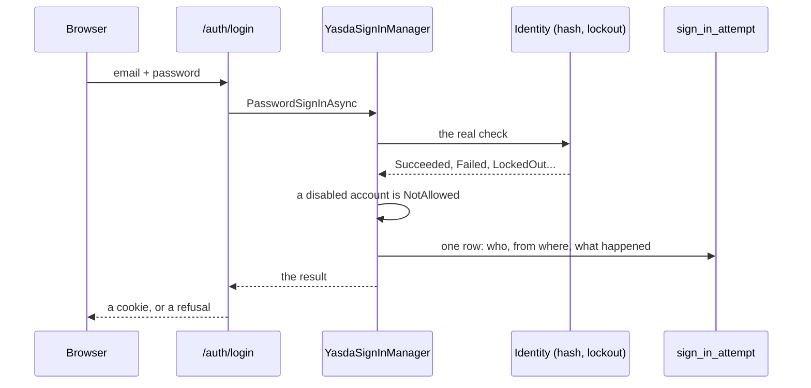

# Lesson 16 — Users and the Sign-in Log: Accounts an Admin Manages

Good day, developer! Since [lesson 06](06-sign-in.md), YASDA has had people who can sign in, but they have only ever been the four we seed for development. A real service desk needs more: an admin who adds an agent on Monday, switches off the account of someone who left on Friday, and can answer "who tried to get in last night?". Today we build that: the account screens, the rules that stop a company locking itself out, a log of every sign-in attempt, the first admin of a fresh installation, and "forgot your password". It is a big lesson, about three hours. Are you ready? Let's begin!

## What we'll build

| Piece | What it is |
|---|---|
| **Account administration** | Create, search, edit, disable, enable and reset the password of an account, for admins only |
| **Account rules** | A small class of rules: nobody disables themselves, the last admin stays, nobody changes their own role |
| **A temporary password** | An account made by an admin must change its password at first sign-in |
| **The sign-in log** | One row for every password sign-in, successful or not: who, from where, what happened |
| **The first admin** | A fresh installation has no users, so the first admin comes from configuration |
| **Forgot your password** | The mail that lets a person choose a new one |
| **Screens** | Users, the user page, the sign-in log, change password, forgot password |
| **Tests** | Unit tests for the rules, integration tests for every endpoint, browser tests for the screens |

## Why we build it this way

### The pain: accounts with no way in or out

Until now, the only accounts are the four a seed puts there. A new agent means editing seed code, and a person who left can't be removed. The obvious fix is a script that inserts a row into the users table. That would skip everything ASP.NET Core Identity does for us: hashing the password, checking its strength, keeping the lockout count and the security stamp. We never touch those tables ourselves. Identity owns *how* an account works; we add *who may manage accounts, and the rules around it*.

### Rules that live in one place

Think of what could go wrong when people manage accounts. An admin disables their own account and the company has nobody left to sign in. The only admin changes their role to Agent. These are business rules, so by the table in [lesson 07](07-file-a-ticket.md) they belong in the domain: a small class, with no database, that throws a `DomainException` with a code. The handlers load, ask the rule, and save.

### Two tools, again

Reading accounts for a screen is a list with search, sort and paging, so it follows lesson 08: a SQL function, called with Dapper. Changing an account goes through Identity's `UserManager`, because it knows how to hash, validate and stamp. Now, let's be honest about the cost here: the account's data is read by our SQL function and written by Identity's code, two ways of looking at the same table. That is the price of keeping Identity's guarantees while still getting fast list pages.

### A sign-in log is a different thing from the user table

"Who tried to get in?" cannot be answered from the users table: a wrong guess at an email that doesn't exist leaves no trace there. So every password attempt becomes a row in a table of its own, never changed afterwards. Two honest rules: the row records *what happened* (`InvalidCredentials`, `LockedOut`, `NotAllowed`, `Succeeded`), and the screen shows it to admins only.

## 1. The account, and the rules around it

The account gains two things: whether it is disabled, and whether its password is temporary. In `Infrastructure/AppUser.cs`:

```csharp
// src/Modules/Identity/Yasda.Modules.Identity/Infrastructure/AppUser.cs
using Microsoft.AspNetCore.Identity;

namespace Yasda.Modules.Identity.Infrastructure;

// Identity's user, plus the three things a staff list needs.
internal sealed class AppUser : IdentityUser<long>
{
    public string FullName { get; set; } = "";
    public bool IsDisabled { get; set; }            // left the company: can't sign in, history stays
    public bool MustChangePassword { get; set; }    // set by an admin-chosen temporary password
}
```

The error codes. Identity's codes start here: `IDENTITY-0001` and up, never renumbered, each with a title and a fix:

```csharp
// src/Modules/Identity/Yasda.Modules.Identity/Domain/IdentityErrors.cs
using Yasda.Shared.BuildingBlocks;

namespace Yasda.Modules.Identity.Domain;

// Every business rule Identity can refuse with. Add new codes at the end; never renumber or reuse one.
internal static class IdentityErrors
{
    public static readonly ErrorCode UnknownRole = new("IDENTITY-0001", "Unknown role",
        "Choose one of the roles in the list.");
    public static readonly ErrorCode CannotChangeOwnRole = new("IDENTITY-0002", "You can't change your own role",
        "Ask another admin to change it, so no one can promote themselves.");
    public static readonly ErrorCode CannotDisableSelf = new("IDENTITY-0003", "You can't disable your own account",
        "Ask another admin, so the company can't lose its last way in by accident.");
    public static readonly ErrorCode LastAdmin = new("IDENTITY-0004", "This is the last active admin",
        "Make someone else an admin first, then change or disable this account.");
    public static readonly ErrorCode AccountChangeRefused = new("IDENTITY-0005", "The account change was refused",
        "The message says why: usually the password is too weak (12+ characters, upper and lower case, a digit and a symbol) or the user name is taken.");
}
```

And the rules. Each method is a plain function of numbers and names, so it can be tested without a database:

```csharp
// src/Modules/Identity/Yasda.Modules.Identity/Domain/StaffAccountRules.cs
using Yasda.Shared.BuildingBlocks;

namespace Yasda.Modules.Identity.Domain;

// What an administrator may do to a staff account. The rules that stop a company locking itself out.
internal static class StaffAccountRules
{
    public static void EnsureRoleExists(string role)
    {
        if (!Roles.All.Contains(role)) throw new DomainException(IdentityErrors.UnknownRole, $"'{role}' is not a role.");
    }

    public static void EnsureCanChangeRole(long actorId, long targetId, string currentRole, string newRole, int activeAdmins)
    {
        EnsureRoleExists(newRole);
        if (currentRole == newRole) return;
        if (actorId == targetId) throw new DomainException(IdentityErrors.CannotChangeOwnRole, "You can't change your own role. Ask another admin.");
        EnsureNotLastAdmin(currentRole, activeAdmins);
    }

    public static void EnsureCanDisable(long actorId, long targetId, string targetRole, int activeAdmins)
    {
        if (actorId == targetId) throw new DomainException(IdentityErrors.CannotDisableSelf, "You can't disable your own account.");
        EnsureNotLastAdmin(targetRole, activeAdmins);
    }

    private static void EnsureNotLastAdmin(string role, int activeAdmins)
    {
        if (role == Roles.Admin && activeAdmins <= 1)
            throw new DomainException(IdentityErrors.LastAdmin, "This is the last active admin. Make someone else an admin first.");
    }
}
```

Identity reports rule failures (a password that is too short, an email that is taken) as *results*, not exceptions. A small helper turns a failed result into our `DomainException`, and two helpers answer questions the rules need:

```csharp
// src/Modules/Identity/Yasda.Modules.Identity/Infrastructure/IdentityResults.cs
using Yasda.Shared.BuildingBlocks;
using Yasda.Modules.Identity.Domain;
using Microsoft.AspNetCore.Identity;

namespace Yasda.Modules.Identity.Infrastructure;

internal static class IdentityResults
{
    // Identity reports rule failures ("password too short", "email taken") as results; the API answers them as 422.
    public static void ThrowIfFailed(this IdentityResult result)
    {
        if (!result.Succeeded)
            throw new DomainException(IdentityErrors.AccountChangeRefused, string.Join(" ", result.Errors.Select(e => e.Description)));
    }

    public static async Task<int> CountActiveAdminsAsync(this UserManager<AppUser> users) =>
        (await users.GetUsersInRoleAsync(Roles.Admin)).Count(u => !u.IsDisabled);

    public static async Task<string> GetRoleAsync(this UserManager<AppUser> users, AppUser user) =>
        (await users.GetRolesAsync(user)).SingleOrDefault() ?? "";
}
```

## 2. Reading accounts, and the sign-in log's table

Three SQL functions. `search_users` is the list page (with its count), `get_user` is one account, `list_staff` is the staff members who may handle tickets. The sign-in log's two functions sit beside them:

```sql
-- src/Modules/Identity/Yasda.Modules.Identity/Infrastructure/Sql/Functions/identity.search_users.v1.sql
-- Released scripts are never edited: change a function with a .v2 file and a new migration.
CREATE OR REPLACE FUNCTION identity.search_users(p_search text, p_sort text, p_desc boolean, p_page integer, p_page_size integer)
RETURNS TABLE (id bigint, email text, full_name text, role text, is_disabled boolean, must_change_password boolean,
               locked_out_until timestamptz, last_sign_in timestamptz)
LANGUAGE sql STABLE
AS $$
    WITH u AS (
        SELECT u.id, u.email::text AS email, u.full_name::text AS full_name, COALESCE(r.name, '')::text AS role,
               u.is_disabled, u.must_change_password,
               CASE WHEN u.lockout_end > now() THEN u.lockout_end END AS locked_out_until,
               (SELECT MAX(a.occurred_utc) FROM identity.sign_in_attempt a WHERE a.user_id = u.id AND a.outcome = 'Succeeded') AS last_sign_in
        FROM identity.users u
        LEFT JOIN identity.user_roles ur ON ur.user_id = u.id
        LEFT JOIN identity.roles r ON r.id = ur.role_id
        WHERE p_search IS NULL OR u.email ILIKE '%' || p_search || '%' OR u.full_name ILIKE '%' || p_search || '%'
    )
    SELECT * FROM u
    ORDER BY
        CASE WHEN p_sort = 'email' AND NOT p_desc THEN u.email END ASC,
        CASE WHEN p_sort = 'email' AND p_desc     THEN u.email END DESC,
        CASE WHEN p_sort = 'role' AND NOT p_desc THEN u.role END ASC,
        CASE WHEN p_sort = 'role' AND p_desc     THEN u.role END DESC,
        CASE WHEN p_sort = 'lastSignIn' AND NOT p_desc THEN u.last_sign_in END ASC,
        CASE WHEN p_sort = 'lastSignIn' AND p_desc     THEN u.last_sign_in END DESC,
        CASE WHEN p_sort = 'fullName' AND p_desc THEN u.full_name END DESC,
        u.full_name, u.id
    OFFSET (p_page - 1) * p_page_size
    LIMIT p_page_size;
$$;

CREATE OR REPLACE FUNCTION identity.count_users(p_search text)
RETURNS bigint
LANGUAGE sql STABLE
AS $$
    SELECT COUNT(*) FROM identity.users u
    WHERE p_search IS NULL OR u.email ILIKE '%' || p_search || '%' OR u.full_name ILIKE '%' || p_search || '%';
$$;

CREATE OR REPLACE FUNCTION identity.search_sign_in_attempts(p_email text, p_failed_only boolean, p_page integer, p_page_size integer)
RETURNS TABLE (id bigint, email text, user_id bigint, outcome text, ip_address text, occurred_utc timestamptz)
LANGUAGE sql STABLE
AS $$
    SELECT a.id, a.email::text, a.user_id, a.outcome::text, a.ip_address::text, a.occurred_utc
    FROM identity.sign_in_attempt a
    WHERE (p_email IS NULL OR a.email ILIKE '%' || p_email || '%')
      AND (NOT p_failed_only OR a.outcome <> 'Succeeded')
    ORDER BY a.occurred_utc DESC, a.id DESC
    OFFSET (p_page - 1) * p_page_size
    LIMIT p_page_size;
$$;

CREATE OR REPLACE FUNCTION identity.count_sign_in_attempts(p_email text, p_failed_only boolean)
RETURNS bigint
LANGUAGE sql STABLE
AS $$
    SELECT COUNT(*) FROM identity.sign_in_attempt a
    WHERE (p_email IS NULL OR a.email ILIKE '%' || p_email || '%')
      AND (NOT p_failed_only OR a.outcome <> 'Succeeded');
$$;
```

```sql
-- src/Modules/Identity/Yasda.Modules.Identity/Infrastructure/Sql/Functions/identity.get_user.v1.sql
-- Released scripts are never edited: change a function with a .v2 file and a new migration.
CREATE OR REPLACE FUNCTION identity.get_user(p_id bigint)
RETURNS TABLE (id bigint, email text, full_name text, role text, is_disabled boolean, must_change_password boolean,
               locked_out_until timestamptz, last_sign_in timestamptz)
LANGUAGE sql STABLE
AS $$
    SELECT u.id, u.email::text, u.full_name::text, COALESCE(r.name, '')::text,
           u.is_disabled, u.must_change_password,
           CASE WHEN u.lockout_end > now() THEN u.lockout_end END,
           (SELECT MAX(a.occurred_utc) FROM identity.sign_in_attempt a WHERE a.user_id = u.id AND a.outcome = 'Succeeded')
    FROM identity.users u
    LEFT JOIN identity.user_roles ur ON ur.user_id = u.id
    LEFT JOIN identity.roles r ON r.id = ur.role_id
    WHERE u.id = p_id;
$$;
```

```sql
-- src/Modules/Identity/Yasda.Modules.Identity/Infrastructure/Sql/Functions/identity.list_staff.v1.sql
-- Released scripts are never edited: change a function with a .v2 file and a new migration.
-- Active accounts that may handle tickets, by name: the "Assign to" list and IUserDirectory.FindStaffAsync.
CREATE OR REPLACE FUNCTION identity.list_staff(p_id bigint)
RETURNS TABLE (id bigint, full_name text, role text)
LANGUAGE sql STABLE
AS $$
    SELECT u.id, u.full_name::text, r.name::text
    FROM identity.users u
    JOIN identity.user_roles ur ON ur.user_id = u.id
    JOIN identity.roles r ON r.id = ur.role_id
    WHERE r.name IN ('Agent', 'TeamLead', 'Admin') AND NOT u.is_disabled
      AND (p_id IS NULL OR u.id = p_id)
    ORDER BY u.full_name, u.id;
$$;
```

The log row, and its mapping. A `SignInAttempt` is never changed after it is written, so it has no methods, only a constructor:

```csharp
// src/Modules/Identity/Yasda.Modules.Identity/Infrastructure/SignInAttempt.cs
namespace Yasda.Modules.Identity.Infrastructure;

// One row per password sign-in, successful or not: who, from where, and what happened. Never changed.
internal sealed class SignInAttempt
{
    public long Id { get; private set; }
    public string Email { get; private set; } = default!;
    public long? UserId { get; private set; }   // null when the email matched nobody
    public string Outcome { get; private set; } = default!;
    public string? IpAddress { get; private set; }
    public DateTime OccurredUtc { get; private set; }

    private SignInAttempt() { }

    public SignInAttempt(string email, long? userId, string outcome, string? ipAddress, DateTime occurredUtc)
    { Email = email; UserId = userId; Outcome = outcome; IpAddress = ipAddress; OccurredUtc = occurredUtc; }
}
```

In `YasdaIdentityDbContext`, a `DbSet` and a mapping. After the `DataProtectionKeys` line:

```csharp
public DbSet<SignInAttempt> SignInAttempts => Set<SignInAttempt>();
```

and in `OnModelCreating`, after the `DataProtectionKey` line:

```csharp
// src/Modules/Identity/Yasda.Modules.Identity/Infrastructure/YasdaIdentityDbContext.cs (added)
        builder.Entity<SignInAttempt>(e =>
        {
            e.ToTable("sign_in_attempt");
            e.HasKey(x => x.Id);
            e.Property(x => x.Id).UseIdentityColumn();
            e.Property(x => x.Email).HasMaxLength(256);
            e.Property(x => x.Outcome).HasMaxLength(30);
            e.Property(x => x.IpAddress).HasMaxLength(45);
            e.HasIndex(x => x.OccurredUtc);
            e.HasIndex(x => x.Email);
        });
```

The project needs two things: its SQL files compiled in (so a migration can read them), and a test project that may see its `internal` classes. In `Yasda.Modules.Identity.csproj`:

```xml
<ItemGroup>
  <InternalsVisibleTo Include="Yasda.Modules.Identity.UnitTests" />
</ItemGroup>

<ItemGroup>
  <EmbeddedResource Include="Infrastructure\Sql\**\*.sql" />
</ItemGroup>
```

and `dotnet add src/Modules/Identity/Yasda.Modules.Identity package MailKit --version 4.18.2`, which the password mail will use. Now two migrations, as in lessons 05 and 13: one generated for the new columns and the log's table, one by hand for the functions.

```bash
dotnet ef migrations add AddAccountAdministration --project src/Modules/Identity/Yasda.Modules.Identity --startup-project src/Modules/Identity/Yasda.Modules.Identity --output-dir Infrastructure/Migrations
dotnet ef migrations add AddUserReadFunctions --project src/Modules/Identity/Yasda.Modules.Identity --startup-project src/Modules/Identity/Yasda.Modules.Identity --output-dir Infrastructure/Migrations
```

Open the first and read it: two `AddColumn`s on `users` and a `CreateTable` for `sign_in_attempt`, with two indexes. Replace the second, which EF Core made empty:

```csharp
// src/Modules/Identity/Yasda.Modules.Identity/Infrastructure/Migrations/<timestamp>_AddUserReadFunctions.cs (the file EF Core made; replace its content)
using Microsoft.EntityFrameworkCore.Migrations;
using Yasda.Shared.BuildingBlocks;

#nullable disable

namespace Yasda.Modules.Identity.Infrastructure.Migrations
{
    // The read-side SQL functions ship with the schema. Never point a released migration at a changed file.
    public partial class AddUserReadFunctions : Migration
    {
        private static string Sql(string file)
        {
            return EmbeddedSql.Read(typeof(AddUserReadFunctions).Assembly, file);
        }

        protected override void Up(MigrationBuilder migrationBuilder)
        {
            migrationBuilder.Sql(Sql("identity.search_users.v1.sql"));
            migrationBuilder.Sql(Sql("identity.get_user.v1.sql"));
            migrationBuilder.Sql(Sql("identity.list_staff.v1.sql"));
        }

        protected override void Down(MigrationBuilder migrationBuilder)
        {
            migrationBuilder.Sql("DROP FUNCTION IF EXISTS identity.list_staff(bigint);");
            migrationBuilder.Sql("DROP FUNCTION IF EXISTS identity.get_user(bigint);");
            migrationBuilder.Sql("DROP FUNCTION IF EXISTS identity.count_sign_in_attempts(text, boolean);");
            migrationBuilder.Sql("DROP FUNCTION IF EXISTS identity.search_sign_in_attempts(text, boolean, integer, integer);");
            migrationBuilder.Sql("DROP FUNCTION IF EXISTS identity.count_users(text);");
            migrationBuilder.Sql("DROP FUNCTION IF EXISTS identity.search_users(text, text, boolean, integer, integer);");
        }
    }
}
```

## 3. The slices

One folder per feature, a handler and an endpoint, as in lesson 03. They are listed in the order a person meets them.

### Creating an account

An admin gives an email, a name, a role and a **temporary password**. The account is marked `MustChangePassword`, so the first sign-in must replace it. The handler asks the rules first and Identity second:

```csharp
// src/Modules/Identity/Yasda.Modules.Identity/Features/CreateUser/CreateUserHandler.cs
using Yasda.Modules.Identity.Domain;
using Yasda.Modules.Identity.Infrastructure;
using Microsoft.AspNetCore.Identity;

namespace Yasda.Modules.Identity.Features;

internal sealed record CreateUserCommand(string Email, string FullName, string Role, string TemporaryPassword);

// Staff accounts are made by an admin, with a temporary password the person must change at first sign-in.
internal sealed class CreateUserHandler(UserManager<AppUser> users)
{
    public async Task<long> HandleAsync(CreateUserCommand cmd, CancellationToken ct)
    {
        StaffAccountRules.EnsureRoleExists(cmd.Role);

        var email = cmd.Email.Trim();
        var user = new AppUser
        {
            UserName = email, Email = email, EmailConfirmed = true, FullName = cmd.FullName.Trim(), MustChangePassword = true
        };
        (await users.CreateAsync(user, cmd.TemporaryPassword)).ThrowIfFailed();
        (await users.AddToRoleAsync(user, cmd.Role)).ThrowIfFailed();
        return user.Id;
    }
}
```

```csharp
// src/Modules/Identity/Yasda.Modules.Identity/Features/CreateUser/CreateUserEndpoint.cs
using Yasda.Shared.BuildingBlocks;
using FluentValidation;
using Microsoft.AspNetCore.Builder;
using Microsoft.AspNetCore.Http;
using Microsoft.AspNetCore.Http.HttpResults;
using Microsoft.AspNetCore.Routing;

namespace Yasda.Modules.Identity.Features;

internal sealed record CreateUserRequest(string Email, string FullName, string Role, string TemporaryPassword);

internal sealed class CreateUserRequestValidator : AbstractValidator<CreateUserRequest>
{
    public CreateUserRequestValidator()
    {
        RuleFor(x => x.Email).NotEmpty().EmailAddress().MaximumLength(256);
        RuleFor(x => x.FullName).NotEmpty().MaximumLength(100);
        RuleFor(x => x.Role).NotEmpty();
        RuleFor(x => x.TemporaryPassword).NotEmpty();
    }
}

internal static class CreateUserEndpoint
{
    public static void Map(IEndpointRouteBuilder app) =>
        app.MapPost("/users", async Task<Created<CreatedId>> (CreateUserRequest body, CreateUserHandler handler, CancellationToken ct) =>
            {
                var id = await handler.HandleAsync(new CreateUserCommand(body.Email, body.FullName, body.Role, body.TemporaryPassword), ct);
                return TypedResults.Created($"/api/users/{id}", new CreatedId(id));
            })
            .RequireAuthorization(p => p.RequireRole(Roles.Admin));
}
```

### Finding accounts

The list page's handler and endpoint, with the sort allow-list from lesson 08. And one account, for its page:

```csharp
// src/Modules/Identity/Yasda.Modules.Identity/Features/SearchUsers/SearchUsersHandler.cs
using Dapper;
using Yasda.Shared.BuildingBlocks;
using FluentValidation;

namespace Yasda.Modules.Identity.Features;

internal sealed record SearchUsersQuery(string? Search = null, string? Sort = null, bool Desc = false, int Page = 1, int PageSize = 20);

internal sealed record UserDto(
    long Id, string Email, string FullName, string Role, bool IsDisabled, bool MustChangePassword,
    DateTime? LockedOutUntil, DateTime? LastSignIn);

internal sealed class SearchUsersValidator : AbstractValidator<SearchUsersQuery>
{
    public SearchUsersValidator()
    {
        RuleFor(x => x.Page).ValidPage();
        RuleFor(x => x.PageSize).ValidPageSize();
        RuleFor(x => x.Sort).ValidSort("fullName", "email", "role", "lastSignIn");
    }
}

internal sealed class SearchUsersHandler(IDbConnectionFactory connections)
{
    public async Task<PagedResult<UserDto>> HandleAsync(SearchUsersQuery q, CancellationToken ct)
    {
        var search = SearchText.ForLike(q.Search);
        await using var conn = connections.Create();
        using var multi = await conn.QueryMultipleAsync(new CommandDefinition(
            """
            SELECT * FROM identity.search_users(@Search, @Sort, @Desc, @Page, @PageSize);
            SELECT identity.count_users(@Search);
            """, new { Search = search, q.Sort, q.Desc, q.Page, q.PageSize }, cancellationToken: ct));

        var rows = (await multi.ReadAsync<UserDto>()).ToList();
        return new PagedResult<UserDto>(rows, q.Page, q.PageSize, (int)await multi.ReadSingleAsync<long>());
    }
}
```

```csharp
// src/Modules/Identity/Yasda.Modules.Identity/Features/SearchUsers/SearchUsersEndpoint.cs
using Yasda.Shared.BuildingBlocks;
using Microsoft.AspNetCore.Builder;
using Microsoft.AspNetCore.Http;
using Microsoft.AspNetCore.Routing;

namespace Yasda.Modules.Identity.Features;

internal static class SearchUsersEndpoint
{
    public static void Map(IEndpointRouteBuilder app)
    {
        app.MapGet("/users", async ([AsParameters] SearchUsersQuery query, SearchUsersHandler handler, CancellationToken ct) =>
                TypedResults.Ok(await handler.HandleAsync(query, ct)))
            .RequireAuthorization(p => p.RequireRole(Roles.Admin));
    }
}
```

```csharp
// src/Modules/Identity/Yasda.Modules.Identity/Features/GetUser/GetUserHandler.cs
using Dapper;
using Yasda.Shared.BuildingBlocks;

namespace Yasda.Modules.Identity.Features;

internal sealed class GetUserHandler(IDbConnectionFactory connections)
{
    public async Task<UserDto?> HandleAsync(long id, CancellationToken ct)
    {
        await using var conn = connections.Create();
        return await conn.QuerySingleOrDefaultAsync<UserDto>(new CommandDefinition(
            "SELECT * FROM identity.get_user(@Id);", new { Id = id }, cancellationToken: ct));
    }
}
```

```csharp
// src/Modules/Identity/Yasda.Modules.Identity/Features/GetUser/GetUserEndpoint.cs
using Yasda.Shared.BuildingBlocks;
using Microsoft.AspNetCore.Builder;
using Microsoft.AspNetCore.Http;
using Microsoft.AspNetCore.Http.HttpResults;
using Microsoft.AspNetCore.Routing;

namespace Yasda.Modules.Identity.Features;

internal static class GetUserEndpoint
{
    public static void Map(IEndpointRouteBuilder app)
    {
        app.MapGet("/users/{id:long}", async Task<Results<Ok<UserDto>, NotFound>> (long id, GetUserHandler handler, CancellationToken ct) =>
            {
                var user = await handler.HandleAsync(id, ct);
                if (user is null) return TypedResults.NotFound();
                return TypedResults.Ok(user);
            })
            .RequireAuthorization(p => p.RequireRole(Roles.Admin));
    }
}
```

The staff list is what an "Assign to" choice needs. It reads the function, and for one id it answers whether that person is active staff, which is how Tickets validates an assignee through Identity's contract:

```csharp
// src/Modules/Identity/Yasda.Modules.Identity/Features/ListStaff/ListStaffHandler.cs
using Dapper;
using Yasda.Shared.BuildingBlocks;

namespace Yasda.Modules.Identity.Features;

internal sealed record StaffDto(long Id, string FullName, string Role);

internal sealed class ListStaffHandler(IDbConnectionFactory connections)
{
    public async Task<IReadOnlyList<StaffDto>> HandleAsync(CancellationToken ct)
    {
        await using var conn = connections.Create();
        return (await conn.QueryAsync<StaffDto>(new CommandDefinition(
            "SELECT * FROM identity.list_staff(NULL)", cancellationToken: ct))).ToList();
    }
}
```

```csharp
// src/Modules/Identity/Yasda.Modules.Identity/Features/ListStaff/ListStaffEndpoint.cs
using Yasda.Shared.BuildingBlocks;
using Microsoft.AspNetCore.Builder;
using Microsoft.AspNetCore.Http;
using Microsoft.AspNetCore.Routing;

namespace Yasda.Modules.Identity.Features;

internal static class ListStaffEndpoint
{
    // Who a ticket can be assigned to. Staff only: requesters have no reason to list the team.
    public static void Map(IEndpointRouteBuilder app) =>
        app.MapGet("/staff", async (ListStaffHandler handler, CancellationToken ct) => TypedResults.Ok(await handler.HandleAsync(ct)))
            .RequireAuthorization(p => p.RequireRole(Roles.Agent, Roles.TeamLead, Roles.Admin));
}
```

Lesson 07's `UserDirectory.FindStaffAsync` had its own SQL inline. It now calls the same function, so there is one definition of "staff": replace the file with this version:

```csharp
// src/Modules/Identity/Yasda.Modules.Identity/Infrastructure/UserDirectory.cs
using Dapper;
using Yasda.Modules.Identity.Contracts;
using Yasda.Shared.BuildingBlocks;

namespace Yasda.Modules.Identity.Infrastructure;

internal sealed class UserDirectory(IDbConnectionFactory connections) : IUserDirectory
{
    public async Task<long?> IdOfAsync(string email, CancellationToken ct)
    {
        await using var conn = connections.Create();
        return await conn.QuerySingleOrDefaultAsync<long?>(new CommandDefinition(
            "SELECT id FROM identity.users WHERE normalized_email = upper(@email)", new { email }, cancellationToken: ct));
    }

    public async Task<string?> NameOfAsync(long userId, CancellationToken ct)
    {
        await using var conn = connections.Create();
        return await conn.QuerySingleOrDefaultAsync<string>(new CommandDefinition(
            "SELECT full_name FROM identity.users WHERE id = @userId", new { userId }, cancellationToken: ct));
    }

    public async Task<StaffMember?> FindStaffAsync(long userId, CancellationToken ct)
    {
        await using var conn = connections.Create();
        return await conn.QuerySingleOrDefaultAsync<StaffMember>(new CommandDefinition(
            "SELECT * FROM identity.list_staff(@userId)", new { userId }, cancellationToken: ct));
    }
}
```

### Changing an account

Four actions on one thing share a folder: edit the name and role, disable, enable, and reset the password. Each asks the rules, then Identity. Changing a role, disabling, and resetting all end the person's sessions: a new **security stamp** makes every cookie and token they hold stop working at its next check.

```csharp
// src/Modules/Identity/Yasda.Modules.Identity/Features/UpdateUser/UpdateUserHandler.cs
using System.Globalization;
using Yasda.Modules.Identity.Domain;
using Yasda.Modules.Identity.Infrastructure;
using Yasda.Shared.BuildingBlocks;
using Microsoft.AspNetCore.Identity;

namespace Yasda.Modules.Identity.Features;

internal sealed record UpdateUserCommand(long UserId, string FullName, string Role);

internal sealed class UpdateUserHandler(UserManager<AppUser> users, ICurrentUser current)
{
    public async Task<bool> HandleAsync(UpdateUserCommand cmd, CancellationToken ct)
    {
        var user = await users.FindByIdAsync(cmd.UserId.ToString(CultureInfo.InvariantCulture));
        if (user is null) return false;
        var currentRole = await users.GetRoleAsync(user);
        StaffAccountRules.EnsureCanChangeRole(current.UserId, user.Id, currentRole, cmd.Role, await users.CountActiveAdminsAsync());

        user.FullName = cmd.FullName.Trim();
        (await users.UpdateAsync(user)).ThrowIfFailed();
        if (currentRole != cmd.Role)
        {
            if (currentRole != "") (await users.RemoveFromRoleAsync(user, currentRole)).ThrowIfFailed();
            (await users.AddToRoleAsync(user, cmd.Role)).ThrowIfFailed();
            (await users.UpdateSecurityStampAsync(user)).ThrowIfFailed();   // their sessions carry the old role: end them
        }
        return true;
    }
}

internal sealed record SetUserDisabledCommand(long UserId, bool Disabled);

internal sealed class SetUserDisabledHandler(UserManager<AppUser> users, ICurrentUser current)
{
    public async Task<bool> HandleAsync(SetUserDisabledCommand cmd, CancellationToken ct)
    {
        var user = await users.FindByIdAsync(cmd.UserId.ToString(CultureInfo.InvariantCulture));
        if (user is null) return false;
        if (cmd.Disabled)
            StaffAccountRules.EnsureCanDisable(current.UserId, user.Id, await users.GetRoleAsync(user), await users.CountActiveAdminsAsync());

        user.IsDisabled = cmd.Disabled;
        (await users.UpdateAsync(user)).ThrowIfFailed();
        (await users.UpdateSecurityStampAsync(user)).ThrowIfFailed();   // ends every session they have
        return true;
    }
}

internal sealed record ResetUserPasswordCommand(long UserId, string TemporaryPassword);

internal sealed class ResetUserPasswordHandler(UserManager<AppUser> users)
{
    public async Task<bool> HandleAsync(ResetUserPasswordCommand cmd, CancellationToken ct)
    {
        var user = await users.FindByIdAsync(cmd.UserId.ToString(CultureInfo.InvariantCulture));
        if (user is null) return false;
        var token = await users.GeneratePasswordResetTokenAsync(user);
        (await users.ResetPasswordAsync(user, token, cmd.TemporaryPassword)).ThrowIfFailed();
        (await users.SetLockoutEndDateAsync(user, null)).ThrowIfFailed();
        user.MustChangePassword = true;
        (await users.UpdateAsync(user)).ThrowIfFailed();
        return true;
    }
}
```

```csharp
// src/Modules/Identity/Yasda.Modules.Identity/Features/UpdateUser/UpdateUserEndpoint.cs
using Yasda.Shared.BuildingBlocks;
using FluentValidation;
using Microsoft.AspNetCore.Builder;
using Microsoft.AspNetCore.Http;
using Microsoft.AspNetCore.Http.HttpResults;
using Microsoft.AspNetCore.Routing;

namespace Yasda.Modules.Identity.Features;

internal sealed record UpdateUserRequest(string FullName, string Role);
internal sealed record ResetUserPasswordRequest(string TemporaryPassword);

internal sealed class UpdateUserRequestValidator : AbstractValidator<UpdateUserRequest>
{
    public UpdateUserRequestValidator()
    {
        RuleFor(x => x.FullName).NotEmpty().MaximumLength(100);
        RuleFor(x => x.Role).NotEmpty();
    }
}

internal sealed class ResetUserPasswordRequestValidator : AbstractValidator<ResetUserPasswordRequest>
{
    public ResetUserPasswordRequestValidator() => RuleFor(x => x.TemporaryPassword).NotEmpty();
}

internal static class UpdateUserEndpoint
{
    public static void Map(IEndpointRouteBuilder app)
    {
        app.MapPut("/users/{id:long}",
                async Task<Results<NoContent, NotFound>> (long id, UpdateUserRequest body, UpdateUserHandler handler, CancellationToken ct) =>
                    await handler.HandleAsync(new UpdateUserCommand(id, body.FullName, body.Role), ct) ? TypedResults.NoContent() : TypedResults.NotFound())
            .RequireAuthorization(p => p.RequireRole(Roles.Admin));

        app.MapPost("/users/{id:long}/disable",
                async Task<Results<NoContent, NotFound>> (long id, SetUserDisabledHandler handler, CancellationToken ct) =>
                    await handler.HandleAsync(new SetUserDisabledCommand(id, true), ct) ? TypedResults.NoContent() : TypedResults.NotFound())
            .RequireAuthorization(p => p.RequireRole(Roles.Admin));

        app.MapPost("/users/{id:long}/enable",
                async Task<Results<NoContent, NotFound>> (long id, SetUserDisabledHandler handler, CancellationToken ct) =>
                    await handler.HandleAsync(new SetUserDisabledCommand(id, false), ct) ? TypedResults.NoContent() : TypedResults.NotFound())
            .RequireAuthorization(p => p.RequireRole(Roles.Admin));

        app.MapPost("/users/{id:long}/reset-password",
                async Task<Results<NoContent, NotFound>> (long id, ResetUserPasswordRequest body, ResetUserPasswordHandler handler, CancellationToken ct) =>
                    await handler.HandleAsync(new ResetUserPasswordCommand(id, body.TemporaryPassword), ct) ? TypedResults.NoContent() : TypedResults.NotFound())
            .RequireAuthorization(p => p.RequireRole(Roles.Admin));
    }
}
```

### Changing your own password, and signing out everywhere

A person replaces a temporary password with one of their own. After it, the security stamp has changed and would end this very session, so the handler signs the person in again:

```csharp
// src/Modules/Identity/Yasda.Modules.Identity/Features/ChangePassword/ChangePasswordHandler.cs
using System.Globalization;
using Yasda.Modules.Identity.Infrastructure;
using Yasda.Shared.BuildingBlocks;
using Microsoft.AspNetCore.Identity;

namespace Yasda.Modules.Identity.Features;

internal sealed record ChangePasswordCommand(string CurrentPassword, string NewPassword);

// Like Identity's /manage/info, but it also clears "must change password" after a temporary password.
internal sealed class ChangePasswordHandler(UserManager<AppUser> users, SignInManager<AppUser> signIn, ICurrentUser current)
{
    public async Task HandleAsync(ChangePasswordCommand cmd, CancellationToken ct)
    {
        var user = await users.FindByIdAsync(current.UserId.ToString(CultureInfo.InvariantCulture))
            ?? throw new InvalidOperationException("The signed-in user no longer exists.");

        (await users.ChangePasswordAsync(user, cmd.CurrentPassword, cmd.NewPassword)).ThrowIfFailed();
        user.MustChangePassword = false;
        (await users.UpdateAsync(user)).ThrowIfFailed();
        await signIn.RefreshSignInAsync(user);   // the new security stamp would end this session too; re-issue it
    }
}
```

```csharp
// src/Modules/Identity/Yasda.Modules.Identity/Features/ChangePassword/ChangePasswordEndpoint.cs
using FluentValidation;
using Microsoft.AspNetCore.Builder;
using Microsoft.AspNetCore.Http;
using Microsoft.AspNetCore.Http.HttpResults;
using Microsoft.AspNetCore.Routing;

namespace Yasda.Modules.Identity.Features;

internal sealed record ChangePasswordRequest(string CurrentPassword, string NewPassword);

internal sealed class ChangePasswordRequestValidator : AbstractValidator<ChangePasswordRequest>
{
    public ChangePasswordRequestValidator()
    {
        RuleFor(x => x.CurrentPassword).NotEmpty();
        RuleFor(x => x.NewPassword).NotEmpty().NotEqual(x => x.CurrentPassword)
            .WithMessage("The new password must be different from the current one.");
    }
}

internal static class ChangePasswordEndpoint
{
    public static void Map(IEndpointRouteBuilder app) =>
        app.MapPost("/auth/change-password", async Task<NoContent> (ChangePasswordRequest body, ChangePasswordHandler handler, CancellationToken ct) =>
            {
                await handler.HandleAsync(new ChangePasswordCommand(body.CurrentPassword, body.NewPassword), ct);
                return TypedResults.NoContent();
            })
            .RequireAuthorization();
}
```

Signing out gains a second action: sign out *everywhere*, by changing the stamp.

```csharp
// src/Modules/Identity/Yasda.Modules.Identity/Features/SignOut/SignOutHandler.cs
using System.Globalization;
using Yasda.Modules.Identity.Infrastructure;
using Yasda.Shared.BuildingBlocks;
using Microsoft.AspNetCore.Identity;

namespace Yasda.Modules.Identity.Features;

internal sealed class SignOutHandler(SignInManager<AppUser> signIn)
{
    public async Task HandleAsync(CancellationToken ct)
    {
        await signIn.SignOutAsync();   // clears the browser's sign-in cookie
    }
}

// A new security stamp invalidates every cookie and refresh token the user holds, on every device.
internal sealed class SignOutEverywhereHandler(UserManager<AppUser> users, SignInManager<AppUser> signIn, ICurrentUser currentUser)
{
    public async Task HandleAsync(CancellationToken ct)
    {
        var user = await users.FindByIdAsync(currentUser.UserId.ToString(CultureInfo.InvariantCulture))
            ?? throw new InvalidOperationException("The signed-in user no longer exists.");
        await users.UpdateSecurityStampAsync(user);
        await signIn.SignOutAsync();
    }
}
```

```csharp
// src/Modules/Identity/Yasda.Modules.Identity/Features/SignOut/SignOutEndpoint.cs
using Microsoft.AspNetCore.Builder;
using Microsoft.AspNetCore.Http;
using Microsoft.AspNetCore.Http.HttpResults;
using Microsoft.AspNetCore.Routing;

namespace Yasda.Modules.Identity.Features;

internal static class SignOutEndpoint
{
    public static void Map(IEndpointRouteBuilder app)
    {
        app.MapPost("/auth/logout", async Task<NoContent> (SignOutHandler handler, CancellationToken ct) =>
            {
                await handler.HandleAsync(ct);
                return TypedResults.NoContent();
            })
            .RequireAuthorization();

        app.MapPost("/auth/logout-everywhere", async Task<NoContent> (SignOutEverywhereHandler handler, CancellationToken ct) =>
            {
                await handler.HandleAsync(ct);
                return TypedResults.NoContent();
            })
            .RequireAuthorization();
    }
}
```

`/auth/me` now says whether the password is temporary, so the browser can send the person to change it:

```csharp
// src/Modules/Identity/Yasda.Modules.Identity/Features/Me/GetCurrentUserHandler.cs
using System.Globalization;
using Yasda.Modules.Identity.Infrastructure;
using Yasda.Shared.BuildingBlocks;
using Microsoft.AspNetCore.Identity;

namespace Yasda.Modules.Identity.Features;

internal sealed record CurrentUserDto(long Id, string Username, string FullName, string Role, bool MustChangePassword);

internal sealed class GetCurrentUserHandler(ICurrentUser current, UserManager<AppUser> users)
{
    public async Task<CurrentUserDto> HandleAsync(CancellationToken ct)
    {
        var user = await users.FindByIdAsync(current.UserId.ToString(CultureInfo.InvariantCulture))
            ?? throw new InvalidOperationException("The signed-in user no longer exists.");
        return new CurrentUserDto(user.Id, user.UserName!, user.FullName, current.Role, user.MustChangePassword);
    }
}
```

### The sign-in log's reader

```csharp
// src/Modules/Identity/Yasda.Modules.Identity/Features/SearchSignInAttempts/SearchSignInAttemptsHandler.cs
using Dapper;
using Yasda.Shared.BuildingBlocks;
using FluentValidation;

namespace Yasda.Modules.Identity.Features;

internal sealed record SearchSignInAttemptsQuery(string? Email = null, bool FailedOnly = false, int Page = 1, int PageSize = 50);

internal sealed record SignInAttemptDto(long Id, string Email, long? UserId, string Outcome, string? IpAddress, DateTime OccurredUtc);

internal sealed class SearchSignInAttemptsValidator : AbstractValidator<SearchSignInAttemptsQuery>
{
    public SearchSignInAttemptsValidator()
    {
        RuleFor(x => x.Page).ValidPage();
        RuleFor(x => x.PageSize).ValidPageSize();
    }
}

internal sealed class SearchSignInAttemptsHandler(IDbConnectionFactory connections)
{
    public async Task<PagedResult<SignInAttemptDto>> HandleAsync(SearchSignInAttemptsQuery q, CancellationToken ct)
    {
        var args = new { Email = SearchText.ForLike(q.Email), q.FailedOnly, q.Page, q.PageSize };
        await using var conn = connections.Create();
        using var multi = await conn.QueryMultipleAsync(new CommandDefinition(
            """
            SELECT * FROM identity.search_sign_in_attempts(@Email, @FailedOnly, @Page, @PageSize);
            SELECT identity.count_sign_in_attempts(@Email, @FailedOnly);
            """, args, cancellationToken: ct));

        var rows = (await multi.ReadAsync<SignInAttemptDto>()).ToList();
        return new PagedResult<SignInAttemptDto>(rows, q.Page, q.PageSize, (int)await multi.ReadSingleAsync<long>());
    }
}
```

```csharp
// src/Modules/Identity/Yasda.Modules.Identity/Features/SearchSignInAttempts/SearchSignInAttemptsEndpoint.cs
using Yasda.Shared.BuildingBlocks;
using Microsoft.AspNetCore.Builder;
using Microsoft.AspNetCore.Http;
using Microsoft.AspNetCore.Routing;

namespace Yasda.Modules.Identity.Features;

internal static class SearchSignInAttemptsEndpoint
{
    public static void Map(IEndpointRouteBuilder app) =>
        app.MapGet("/sign-in-attempts", async ([AsParameters] SearchSignInAttemptsQuery query, SearchSignInAttemptsHandler handler, CancellationToken ct) =>
                TypedResults.Ok(await handler.HandleAsync(query, ct)))
            .RequireAuthorization(p => p.RequireRole(Roles.Admin));
}
```

## 4. Signing in, and the first admin

### Two hooks on Identity's own sign-in

We don't write sign-in. Identity's `SignInManager` has two documented places to hook into, and we use both: a disabled account may not sign in, and every password attempt is recorded. Hashing, lockout counting and tokens stay Identity's:

```csharp
// src/Modules/Identity/Yasda.Modules.Identity/Infrastructure/YasdaSignInManager.cs
using Yasda.Shared.BuildingBlocks;
using Microsoft.AspNetCore.Authentication;
using Microsoft.AspNetCore.Http;
using Microsoft.AspNetCore.Identity;
using Microsoft.Extensions.Logging;
using Microsoft.Extensions.Options;

namespace Yasda.Modules.Identity.Infrastructure;

// Identity's own sign-in, extended at its two documented hooks: a disabled account may not sign in, and every
// password attempt is recorded. Hashing, lockout and tokens stay entirely Identity's.
internal sealed class YasdaSignInManager(
    UserManager<AppUser> users,
    IHttpContextAccessor context,
    IUserClaimsPrincipalFactory<AppUser> claims,
    IOptions<IdentityOptions> options,
    ILogger<SignInManager<AppUser>> logger,
    IAuthenticationSchemeProvider schemes,
    IUserConfirmation<AppUser> confirmation,
    YasdaIdentityDbContext db,
    TimeProvider time)
    : SignInManager<AppUser>(users, context, claims, options, logger, schemes, confirmation)
{
    public override async Task<bool> CanSignInAsync(AppUser user) =>
        !user.IsDisabled && await base.CanSignInAsync(user);

    public override async Task<SignInResult> PasswordSignInAsync(string userName, string password, bool isPersistent, bool lockoutOnFailure)
    {
        var user = await UserManager.FindByNameAsync(userName);
        var result = user is null
            ? SignInResult.Failed
            : await PasswordSignInAsync(user, password, isPersistent, lockoutOnFailure);

        var outcome = result.Succeeded ? "Succeeded"
            : result.IsLockedOut ? "LockedOut"
            : result.IsNotAllowed ? "NotAllowed"
            : result.RequiresTwoFactor ? "RequiresTwoFactor"
            : "InvalidCredentials";
        db.SignInAttempts.Add(new SignInAttempt(userName, user?.Id, outcome,
            Context.Connection.RemoteIpAddress?.ToString(), time.GetUtcNow().UtcDateTime));
        await db.SaveChangesAsync();
        return result;
    }
}
```

Look at the outcome names: they are the log's vocabulary. A wrong guess at an unknown email is `InvalidCredentials`, the same as a wrong password for a real one, so the log (and the API's answer) never reveals which emails exist.

### The first admin

A fresh installation has no users, and self sign-up is blocked, so nobody can sign in to create anybody. The first admin comes from two settings. It acts only while there are no users at all, so a setting someone forgot to remove can't recreate an account later:

```csharp
// src/Modules/Identity/Yasda.Modules.Identity/Infrastructure/InitialAdmin.cs
using Yasda.Shared.BuildingBlocks;
using Microsoft.AspNetCore.Identity;
using Microsoft.EntityFrameworkCore;
using Microsoft.Extensions.Configuration;
using Microsoft.Extensions.DependencyInjection;
using Microsoft.Extensions.Hosting;
using Microsoft.Extensions.Logging;

namespace Yasda.Modules.Identity.Infrastructure;

// A fresh install has no users and self sign-up is blocked, so the first admin comes from configuration.
// It only acts while there are no users at all, so a forgotten setting can't recreate an account later.
internal sealed class InitialAdmin(IServiceScopeFactory scopes, IConfiguration config, ILogger<InitialAdmin> log)
    : IHostedService
{
    public async Task StartAsync(CancellationToken ct)
    {
        var email = config["InitialAdmin:Email"];
        var password = config["InitialAdmin:Password"];
        if (string.IsNullOrEmpty(email) || string.IsNullOrEmpty(password)) return;

        await using var scope = scopes.CreateAsyncScope();
        var users = scope.ServiceProvider.GetRequiredService<UserManager<AppUser>>();
        if (await users.Users.AnyAsync(ct))
        {
            log.LogWarning("InitialAdmin is set, but users already exist, so it was ignored. Remove the setting.");
            return;
        }

        var admin = new AppUser { UserName = email, Email = email, EmailConfirmed = true, FullName = "Administrator" };
        var result = await users.CreateAsync(admin, password);
        if (result.Succeeded)
            result = await users.AddToRoleAsync(admin, Roles.Admin);
        if (!result.Succeeded)
            throw new InvalidOperationException(
                "The initial admin was not created: " + string.Join("; ", result.Errors.Select(e => e.Description)));

        log.LogInformation("Initial admin {Email} created. Remove the InitialAdmin settings.", email);
    }

    public Task StopAsync(CancellationToken ct) => Task.CompletedTask;
}
```

### Forgot your password

Identity's own endpoints already do the work of "forgot password": make a one-time code, and ask an `IEmailSender` to deliver it. We provide the sender, using **MailKit** (MIT), a library that speaks SMTP. With no SMTP host set (development), it logs the message instead, so the flow can be followed without a mail server:

```csharp
// src/Modules/Identity/Yasda.Modules.Identity/Infrastructure/SmtpEmailSender.cs
using MailKit.Net.Smtp;
using MailKit.Security;
using Microsoft.AspNetCore.Identity;
using Microsoft.Extensions.Configuration;
using Microsoft.Extensions.Logging;
using MimeKit;

namespace Yasda.Modules.Identity.Infrastructure;

internal sealed class SmtpOptions
{
    public string? Host { get; set; }
    public int Port { get; set; } = 587;
    public string? Username { get; set; }
    public string? Password { get; set; }
    public string From { get; set; } = "yasda@localhost";
}

// Identity calls this for "forgot password". With no SMTP host configured (development), the message is logged
// instead, so the flow can still be followed end to end.
internal sealed class SmtpEmailSender(IConfiguration config, ILogger<SmtpEmailSender> log) : IEmailSender<AppUser>
{
    private readonly SmtpOptions _smtp = config.GetSection("Smtp").Get<SmtpOptions>() ?? new();

    public Task SendConfirmationLinkAsync(AppUser user, string email, string confirmationLink) =>
        SendAsync(email, "Confirm your email", $"Confirm your email address: {confirmationLink}");

    public Task SendPasswordResetLinkAsync(AppUser user, string email, string resetLink) =>
        SendAsync(email, "Reset your password", $"Reset your password: {resetLink}");

    public Task SendPasswordResetCodeAsync(AppUser user, string email, string resetCode) =>
        SendAsync(email, "Your password reset code",
            $"Hello {user.FullName},\n\nYour password reset code is:\n\n{resetCode}\n\n" +
            "Enter it on the sign-in page under \"Forgot password\". If you didn't ask for this, ignore this email.");

    private async Task SendAsync(string to, string subject, string body)
    {
        if (string.IsNullOrWhiteSpace(_smtp.Host))
        {
            log.LogWarning("Smtp:Host is not set; email to {To} not sent. Subject: {Subject}. Body: {Body}", to, subject, body);
            return;
        }

        var message = new MimeMessage();
        message.From.Add(MailboxAddress.Parse(_smtp.From));
        message.To.Add(MailboxAddress.Parse(to));
        message.Subject = subject;
        message.Body = new TextPart("plain") { Text = body };

        using var client = new SmtpClient();
        await client.ConnectAsync(_smtp.Host, _smtp.Port, SecureSocketOptions.StartTlsWhenAvailable);
        if (!string.IsNullOrEmpty(_smtp.Username))
            await client.AuthenticateAsync(_smtp.Username, _smtp.Password ?? "");
        await client.SendAsync(message);
        await client.DisconnectAsync(true);
    }
}
```

The settings it reads, and the first admin's, go into `appsettings.json` as empty placeholders, because they describe the *installation*, never the business:

```json
"InitialAdmin": {
  "Email": "",
  "Password": ""
},
"Smtp": {
  "Host": "",
  "Port": 587,
  "Username": "",
  "Password": "",
  "From": ""
},
```

### Registering it all

In `IdentityModule.cs`, the sign-in manager and mail sender join the Identity setup, the first admin becomes a hosted service, and every handler is registered by hand, one line each, as in lesson 03. After `AddEntityFrameworkStores`:

```csharp
.AddEntityFrameworkStores<YasdaIdentityDbContext>()
.AddSignInManager<YasdaSignInManager>();

services.AddTransient<IEmailSender<AppUser>, SmtpEmailSender>();
// How soon a disabled account or a changed role ends a browser session (each check is one query).
services.Configure<SecurityStampValidatorOptions>(options => options.ValidationInterval = TimeSpan.FromMinutes(1));
```

and at the end of `AddIdentityModule`, in place of the two handlers it registers now:

```csharp
services.AddHostedService<InitialAdmin>();
services.AddValidatorsFromAssembly(typeof(IdentityModule).Assembly, includeInternalTypes: true);
services.AddSingleton(ErrorCatalog.From(typeof(IdentityErrors)));

// Handlers: plain classes, injected straight into the endpoints that use them.
services.AddScoped<GetCurrentUserHandler>();
services.AddScoped<ChangePasswordHandler>();
services.AddScoped<SignOutHandler>();
services.AddScoped<SignOutEverywhereHandler>();
services.AddScoped<CreateUserHandler>();
services.AddScoped<SearchUsersHandler>();
services.AddScoped<GetUserHandler>();
services.AddScoped<ListStaffHandler>();
services.AddScoped<UpdateUserHandler>();
services.AddScoped<SetUserDisabledHandler>();
services.AddScoped<ResetUserPasswordHandler>();
services.AddScoped<SearchSignInAttemptsHandler>();
```

(`using Yasda.Modules.Identity.Domain;` joins the usings.) In `MapIdentityModule`, the endpoints:

```csharp
GetCurrentUserEndpoint.Map(identity);
ChangePasswordEndpoint.Map(identity);
SignOutEndpoint.Map(identity);
CreateUserEndpoint.Map(identity);
SearchUsersEndpoint.Map(identity);
GetUserEndpoint.Map(identity);
ListStaffEndpoint.Map(identity);
UpdateUserEndpoint.Map(identity);
SearchSignInAttemptsEndpoint.Map(identity);
```

Run `dotnet build Yasda.slnx`: it should be clean. The error catalog now has Identity's codes, so the catalog page lists them.

## 5. The screens

### What the browser knows

In `Models/Models.cs`, two records for the new data (above `TicketSummary`):

```csharp
// src/Yasda.Web/Models/Models.cs (added)
public sealed record User(long Id, string Email, string FullName, string Role, bool IsDisabled, bool MustChangePassword,
    DateTime? LockedOutUntil, DateTime? LastSignIn)
{
    public string Status => IsDisabled ? "Disabled"
        : LockedOutUntil is not null ? "Locked out"
        : MustChangePassword ? "Temporary password"
        : "Active";
}

public sealed record SignInAttempt(long Id, string Email, long? UserId, string Outcome, string? IpAddress, DateTime OccurredUtc);
```

`Format` gains a helper that turns a role name into words ("TeamLead" into "Team lead"). Add it at the end of the `Format` class:

```csharp
// src/Yasda.Web/Shared/Format.cs (added)
    // "TeamLead" -> "Team lead": a space before each capital after the first, and that capital in lower case.
    public static string Words(string pascal)
    {
        var words = new System.Text.StringBuilder();
        for (var i = 0; i < pascal.Length; i++)
        {
            var letter = pascal[i];
            if (i > 0 && char.IsUpper(letter))
                words.Append(' ').Append(char.ToLowerInvariant(letter));
            else
                words.Append(letter);
        }
        return words.ToString();
    }
```

The state of the signed-in person now includes whether the password is temporary, and sign-out can be "everywhere". Replace this file:

```csharp
// src/Yasda.Web/Services/CookieAuthenticationStateProvider.cs
using System.Globalization;
using System.Net;
using System.Net.Http.Json;
using System.Security.Claims;
using Microsoft.AspNetCore.Components.Authorization;

namespace Yasda.Web.Services;

public sealed record CurrentUser(long Id, string Username, string FullName, string Role, bool MustChangePassword);

// Who is signed in, according to the API. The cookie itself is HttpOnly: the browser app never sees it, it only
// asks /api/auth/me. Signing in and out go through Identity's own endpoints.
public sealed class CookieAuthenticationStateProvider(HttpClient http) : AuthenticationStateProvider
{
    private static readonly AuthenticationState SignedOut = new(new ClaimsPrincipal(new ClaimsIdentity()));
    private CurrentUser? _user;
    private bool _loaded;

    public CurrentUser? User => _user;

    public override async Task<AuthenticationState> GetAuthenticationStateAsync()
    {
        if (!_loaded)
        {
            var response = await http.GetAsync("api/auth/me");
            _user = response.IsSuccessStatusCode ? await response.Content.ReadFromJsonAsync<CurrentUser>() : null;
            _loaded = true;
        }
        return _user is null ? SignedOut : new AuthenticationState(Principal(_user));
    }

    // null = signed in; otherwise the reason, in words a person can act on.
    public async Task<string?> SignInAsync(string email, string password)
    {
        var response = await http.PostAsJsonAsync("api/auth/login?useCookies=true", new { email, password });
        if (response.StatusCode == HttpStatusCode.TooManyRequests)
            return "Too many attempts. Wait a minute and try again.";
        if (!response.IsSuccessStatusCode)
        {
            var body = await response.Content.ReadAsStringAsync();
            if (body.Contains("LockedOut"))
                return "This account is locked for 15 minutes after too many wrong passwords.";
            if (body.Contains("NotAllowed"))
                return "This account is disabled. Ask an administrator.";
            return "Wrong email or password.";
        }
        Refresh();
        return null;
    }

    public async Task SignOutAsync(bool everywhere = false)
    {
        await http.PostAsync(everywhere ? "api/auth/logout-everywhere" : "api/auth/logout", null);
        Refresh();
    }

    // Forget what we knew and ask the API again (after sign-in, sign-out, a password change, or a 401).
    public void Refresh()
    {
        _loaded = false;
        NotifyAuthenticationStateChanged(GetAuthenticationStateAsync());
    }

    private static ClaimsPrincipal Principal(CurrentUser user) => new(new ClaimsIdentity(
    [
        new Claim(ClaimTypes.NameIdentifier, user.Id.ToString(CultureInfo.InvariantCulture)),
        new Claim(ClaimTypes.Name, user.FullName),
        new Claim(ClaimTypes.Email, user.Username),
        new Claim(ClaimTypes.Role, user.Role),
    ], authenticationType: "cookie", ClaimTypes.Name, ClaimTypes.Role));
}
```

A temporary password must be replaced before anything else, so the layout sends such a person to the change-password page. In `Layout/MainLayout.razor`, two `@inject` lines at the top (`CookieAuthenticationStateProvider Auth` and `NavigationManager Nav`), and at the bottom:

```razor
@code {
    // A temporary password from an admin must be replaced before anything else.
    protected override async Task OnParametersSetAsync()
    {
        await Auth.GetAuthenticationStateAsync();
        if (Auth.User is not null && Auth.User.MustChangePassword && !Nav.Uri.EndsWith("/change-password", StringComparison.Ordinal))
            Nav.NavigateTo("change-password");
    }
}
```

In `Layout/NavMenu.razor`, two things: a block for admins, before the "Error codes" item, and a link everyone has, before "Sign out":

```razor
<AuthorizeView Roles="@Roles.Admin">
    <li><NavItem Href="users">Users</NavItem></li>
    <li><NavItem Href="sign-in-log">Sign-in log</NavItem></li>
</AuthorizeView>
```

```razor
<li><NavItem Href="change-password">Change password</NavItem></li>
```

The password field gains a hint and an error line, and the stylesheet a `field-error` rule. Replace the component, and add the rule next to `.hint` in `app.css`:

```razor
@* src/Yasda.Web/Shared/PasswordField.razor *@
@* A password field with a Show button: people can check what they typed, because typos in a hidden field are the
   commonest reason a sign-in fails. Whether the text shows is this component's own state. *@
<div class="field">
    <label for="@_id">@Label</label>
    <input id="@_id" type="@(_shown ? "text" : "password")" value="@Value" required="@Required"
           autocomplete="@Autocomplete" aria-describedby="@(Hint is null ? null : $"{_id}-hint")"
           @oninput="e => ValueChanged.InvokeAsync(e.Value?.ToString())" />
    <button type="button" aria-label="@($"{(_shown ? "Hide" : "Show")} {Label.ToLowerInvariant()}")"
            @onclick="() => _shown = !_shown">@(_shown ? "Hide" : "Show")</button>
    @if (Hint is not null)
    {
        <span class="hint" id="@($"{_id}-hint")">@Hint</span>
    }
    @if (Error is not null)
    {
        <span class="field-error" role="alert">@Error</span>
    }
</div>

@code {
    private readonly string _id = $"pw-{Guid.NewGuid():N}";
    private bool _shown;

    [Parameter] public string? Value { get; set; }
    [Parameter] public EventCallback<string?> ValueChanged { get; set; }
    [Parameter, EditorRequired] public string Label { get; set; } = "";
    [Parameter] public bool Required { get; set; }
    [Parameter] public string? Hint { get; set; }
    [Parameter] public string? Error { get; set; }
    [Parameter] public string Autocomplete { get; set; } = "current-password";
}
```

```css
.field-error {
    display: block;
    color: var(--error);
}
```

Changing a half-filled form by accident is easy, so one helper asks first before leaving (it uses Blazor's `NavigationLock`, a component that sees a navigation coming and may cancel it):

```csharp
// src/Yasda.Web/Shared/UnsavedChanges.cs
using Microsoft.AspNetCore.Components.Routing;
using Microsoft.JSInterop;

namespace Yasda.Web.Shared;

// Asks before leaving a form whose changes weren't saved, with the browser's own confirm box. A page compares a
// snapshot of its fields with the last saved one, and hands NavigationLock this check.
public static class UnsavedChanges
{
    public static async Task ConfirmLeave(IJSRuntime js, LocationChangingContext context, bool unsaved)
    {
        if (!unsaved) return;
        if (!await js.InvokeAsync<bool>("confirm", "Your changes haven't been saved. Leave anyway?"))
            context.PreventNavigation();
    }
}
```

### The pages

The sign-in page gains the "Forgot your password?" link and shows the API's refusal reasons (locked out, disabled, too many attempts):

```razor
@* src/Yasda.Web/Pages/Login.razor *@
@page "/login"
@attribute [AllowAnonymous]
@inject CookieAuthenticationStateProvider Auth
@inject NavigationManager Nav
@inject Notices Notices

<PageTitle>Sign in · YASDA</PageTitle>

<PageHeader Title="Sign in">
    <Description>Use the email and password your administrator gave you.</Description>
</PageHeader>

<EditForm Model="this" OnSubmit="SignIn">
    <div class="field">
        <label for="email">Email</label>
        <InputText id="email" type="email" @bind-Value="_email" required autocomplete="username" autofocus />
    </div>
    <PasswordField @bind-Value="_password" Label="Password" Required="true" />
    <div class="actions">
        <button type="submit" disabled="@_busy">Sign in</button>
        <a href="forgot-password">Forgot your password?</a>
    </div>
</EditForm>

@code {
    [SupplyParameterFromQuery] public string? ReturnUrl { get; set; }

    private string _email = "", _password = "";
    private bool _busy;

    private async Task SignIn()
    {
        _busy = true;
        Notices.Clear();
        var error = await Auth.SignInAsync(_email.Trim(), _password ?? "");
        _busy = false;
        if (error is not null)
        {
            Notices.Error(error);
            return;
        }

        // Only ever go back inside this app: an outside returnUrl would make this page an open redirect.
        var stayInsideTheApp = ReturnUrl is not null && !ReturnUrl.Contains("//") && !ReturnUrl.Contains(':');
        Nav.NavigateTo(stayInsideTheApp ? ReturnUrl! : "");
    }
}
```

The list of users, with its search and sorts in the address, as in lesson 08:

```razor
@* src/Yasda.Web/Pages/Admin/Users.razor *@
@page "/users"
@attribute [Authorize(Roles = Roles.Admin)]
@inject ApiClient Api
@inject NavigationManager Nav
@inject ListMemory Memory

<PageTitle>Users · YASDA</PageTitle>

<PageHeader Title="@(_result is null ? "Users" : $"Users ({_result.TotalCount})")" List="true">
    <Actions><a href="users/new">New user</a></Actions>
</PageHeader>

@* The list's search, sort and page live in the address, so Back, a bookmark or a pasted link shows the same list. *@
<EditForm Model="this" OnSubmit="Find" class="search" role="search">
    <div class="field">
        <label for="search">Name or email</label>
        <InputText id="search" type="search" @bind-Value="_search" />
    </div>
    <button type="submit">Search</button>
    <a href="users">Clear</a>
</EditForm>

@if (!string.IsNullOrWhiteSpace(Search))
{
    <p>Showing: matching "@Search". <a href="users">Clear filters</a></p>
}

@if (_result is null)
{
    <p role="status">Loading…</p>
}
else if (_result.Items.Count == 0)
{
    <p>No users match. <a href="users">Clear filters</a> or <a href="users/new">add a new user</a>.</p>
}
else
{
    <TableBox Label="Users">
        <table>
            <thead>
                <tr>
                    <SortHeader Column="fullName" Title="Name" Sort="@Sort" Desc="Desc" />
                    <SortHeader Column="email" Title="Email" Sort="@Sort" Desc="Desc" />
                    <SortHeader Column="role" Title="Role" Sort="@Sort" Desc="Desc" />
                    <th scope="col">Status</th>
                    <SortHeader Column="lastSignIn" Title="Last sign-in" Sort="@Sort" Desc="Desc" />
                </tr>
            </thead>
            <tbody>
                @foreach (var u in _result.Items)
                {
                    <tr>
                        <td><a href="@($"users/{u.Id}")">@u.FullName</a></td>
                        <td>@u.Email</td>
                        <td>@Format.Words(u.Role)</td>
                        <td>@if (u.Status == "Active") { @u.Status } else { <strong>@u.Status</strong> }</td>
                        <td><TimeAgo Utc="u.LastSignIn" /></td>
                    </tr>
                }
            </tbody>
        </table>
    </TableBox>
    <Pager Page="_result.Page" PageSize="_result.PageSize" Total="_result.TotalCount" Noun="users" />
}

@code {
    private const int PageSize = 20;

    [SupplyParameterFromQuery] public string? Search { get; set; }
    [SupplyParameterFromQuery] public string? Sort { get; set; }
    [SupplyParameterFromQuery] public bool Desc { get; set; }
    [SupplyParameterFromQuery(Name = "page")] public int? PageNumber { get; set; }

    private PagedResult<User>? _result;
    private string? _search;

    protected override async Task OnParametersSetAsync()
    {
        _search = Search;
        Memory.Remember(Nav.ToBaseRelativePath(Nav.Uri));
        _result = await Api.Get<PagedResult<User>>(Url.With("api/users", ("search", Search), ("sort", Sort),
            ("desc", Desc ? true : null), ("page", PageNumber), ("pageSize", PageSize)));
    }

    // A new search starts again from page 1: page 3 of the old results may not exist.
    private void Find() => Nav.NavigateTo(Nav.GetUriWithQueryParameters(new Dictionary<string, object?>
    {
        ["search"] = string.IsNullOrWhiteSpace(_search) ? null : _search.Trim(),
        ["page"] = null,
    }));
}
```

The user page, which creates a user when there is no id and edits one when there is. Disabling asks first, with two buttons on the page itself (never a pop-up):

```razor
@* src/Yasda.Web/Pages/Admin/UserEdit.razor *@
@page "/users/new"
@page "/users/{Id:long}"
@attribute [Authorize(Roles = Roles.Admin)]
@inject ApiClient Api
@inject NavigationManager Nav
@inject ListMemory Memory
@inject IJSRuntime Js

<PageTitle>@Title · YASDA</PageTitle>

<NavigationLock OnBeforeInternalNavigation="ctx => UnsavedChanges.ConfirmLeave(Js, ctx, Unsaved)" />

<PageHeader Title="@Title" Trail="@([("Users", Memory.Last("users"))])">
    <Description>
        @if (_user is not null)
        {
            <text>Status: </text><strong>@_user.Status</strong><text> · Last sign-in: </text><TimeAgo Utc="_user.LastSignIn" />
        }
        else if (Id is null)
        {
            <text>Creates the account. Give them the temporary password in person; they choose their own when they first sign in.</text>
        }
    </Description>
</PageHeader>

@if (Id is not null && _user is null)
{
    <p role="status">Loading…</p>
}
else
{
    <EditForm Model="this" OnSubmit="Save">
        <div class="field">
            <label for="email">Email</label>
            <InputText id="email" type="email" @bind-Value="_email" disabled="@(_user is not null)" required
                       aria-describedby="email-hint" />
            <span class="hint" id="email-hint">They sign in with it. It can't be changed later.</span>
        </div>
        <div class="field">
            <label for="full-name">Full name</label>
            <InputText id="full-name" @bind-Value="_fullName" maxlength="100" required />
        </div>
        <div class="field">
            <label for="role">Role</label>
            <InputSelect id="role" @bind-Value="_role">
                @foreach (var r in Roles.All)
                {
                    <option value="@r">@Format.Words(r)</option>
                }
            </InputSelect>
        </div>
        @if (_user is null)
        {
            <PasswordField @bind-Value="_password" Label="Temporary password" Required="true" Autocomplete="new-password"
                           Hint="At least 12 characters." />
        }
        <div class="actions">
            <button type="submit" disabled="@Api.Busy">
                @(_user is null ? "Create user" : "Save changes")
            </button>
        </div>
    </EditForm>

    @if (_user is not null)
    {
        <h2>Password</h2>
        <p>Sets a temporary password and unlocks the account. They must choose their own when they next sign in.</p>
        <EditForm Model="this" OnSubmit="ResetPassword">
            <PasswordField @bind-Value="_temporary" Label="New temporary password" Required="true" Autocomplete="new-password"
                           Hint="At least 12 characters." />
            <div class="actions">
                <button type="submit" disabled="@Api.Busy">Reset password</button>
            </div>
        </EditForm>

        <h2>Access</h2>
        @if (!_confirmingAccess)
        {
            <p>@(_user.IsDisabled ? "This account is disabled: they can't sign in." : "This account can sign in.")</p>
            <div class="actions">
                <button type="button" @onclick="() => _confirmingAccess = true">@(_user.IsDisabled ? "Enable" : "Disable")</button>
            </div>
        }
        else
        {
            <p role="alert">
                @(_user.IsDisabled
                    ? $"Enable {_user.FullName}? They can sign in again with their current password."
                    : $"Disable {_user.FullName}? They can't sign in, and their open sessions end within a minute.")
            </p>
            <div class="actions">
                <button type="button" @onclick="ToggleDisabled" disabled="@Api.Busy">@(_user.IsDisabled ? "Enable" : "Disable")</button>
                <button type="button" @onclick="() => _confirmingAccess = false">Not yet</button>
            </div>
        }
    }
}

@code {
    [Parameter] public long? Id { get; set; }

    private User? _user;
    private string _email = "", _fullName = "", _role = Roles.Requester;
    private string? _password = "", _temporary = "";
    private bool _confirmingAccess;

    private string Title => _user?.FullName ?? (Id is null ? "New user" : "User");

    // Leaving with typed-in changes asks first. A new user counts as changed once anything is typed.
    private bool Unsaved => _user is null
        ? _email.Length > 0 || _fullName.Length > 0
        : _fullName != _user.FullName || _role != _user.Role;

    protected override async Task OnParametersSetAsync()
    {
        _confirmingAccess = false;
        if (Id is null) return;
        await Load(Id.Value);
    }

    private async Task Load(long id)
    {
        _user = await Api.Get<User>($"api/users/{id}");
        if (_user is not null) (_email, _fullName, _role) = (_user.Email, _user.FullName, _user.Role);
    }

    private async Task Save()
    {
        if (_user is null)
        {
            var id = await Api.Create("api/users",
                new { email = _email.Trim(), fullName = _fullName.Trim(), role = _role, temporaryPassword = _password }, "User created.");
            if (id is null) return;
            (_email, _fullName) = ("", "");   // saved: nothing left to lose on the way to the new user's page
            Nav.NavigateTo($"users/{id}");
        }
        else if (await Api.Put($"api/users/{_user.Id}", new { fullName = _fullName.Trim(), role = _role }, "User saved."))
        {
            await Load(_user.Id);
        }
    }

    private async Task ResetPassword()
    {
        if (await Api.Post($"api/users/{_user!.Id}/reset-password", new { temporaryPassword = _temporary }, "Password reset."))
        {
            _temporary = "";
            await Load(_user.Id);
        }
    }

    private async Task ToggleDisabled()
    {
        var user = _user!;
        if (await Api.Post($"api/users/{user.Id}/{(user.IsDisabled ? "enable" : "disable")}",
                success: user.IsDisabled ? "Enabled." : "Disabled. Their sessions end within a minute."))
            await Load(user.Id);
        _confirmingAccess = false;
    }
}
```

The sign-in log, a list like the others with a filter for failures:

```razor
@* src/Yasda.Web/Pages/Admin/SignInLog.razor *@
@page "/sign-in-log"
@attribute [Authorize(Roles = Roles.Admin)]
@inject ApiClient Api
@inject NavigationManager Nav

<PageTitle>Sign-in log · YASDA</PageTitle>

<PageHeader Title="@(_result is null ? "Sign-in log" : $"Sign-in log ({_result.TotalCount})")" List="true" />

@* Newest first, always: a log reads in time order, so it has no sort headers. *@
<EditForm Model="this" OnSubmit="Find" class="search" role="search">
    <div class="field">
        <label for="email">Email</label>
        <InputText id="email" type="search" @bind-Value="_email" />
    </div>
    <div class="check">
        <InputCheckbox id="failed-only" @bind-Value="_failedOnly" />
        <label for="failed-only">Failed only</label>
    </div>
    <button type="submit">Apply</button>
    <a href="sign-in-log">Clear</a>
</EditForm>

@if (Showing.Count > 0)
{
    <p>Showing: @string.Join(", ", Showing). <a href="sign-in-log">Clear filters</a></p>
}

@if (_result is null)
{
    <p role="status">Loading…</p>
}
else if (_result.Items.Count == 0)
{
    <p>No sign-in attempts match. <a href="sign-in-log">Clear filters</a> to see them all.</p>
}
else
{
    <TableBox Label="Sign-in attempts">
        <table>
            <thead>
                <tr><th scope="col">When</th><th scope="col">Email</th><th scope="col">Outcome</th><th scope="col">From</th></tr>
            </thead>
            <tbody>
                @foreach (var a in _result.Items)
                {
                    <tr>
                        <td><TimeAgo Utc="a.OccurredUtc" /></td>
                        <td>@a.Email</td>
                        <td>@if (a.Outcome == "Succeeded") { @Format.Words(a.Outcome) } else { <strong>@Format.Words(a.Outcome)</strong> }</td>
                        <td>@a.IpAddress</td>
                    </tr>
                }
            </tbody>
        </table>
    </TableBox>
    <Pager Page="_result.Page" PageSize="_result.PageSize" Total="_result.TotalCount" Noun="attempts" />
}

@code {
    private const int PageSize = 50;

    [SupplyParameterFromQuery] public string? Email { get; set; }
    [SupplyParameterFromQuery] public bool FailedOnly { get; set; }
    [SupplyParameterFromQuery(Name = "page")] public int? PageNumber { get; set; }

    private PagedResult<SignInAttempt>? _result;
    private string? _email;
    private bool _failedOnly;

    private List<string> Showing
    {
        get
        {
            var parts = new List<string>();
            if (FailedOnly) parts.Add("failed only");
            if (!string.IsNullOrWhiteSpace(Email)) parts.Add($"email matching \"{Email}\"");
            return parts;
        }
    }

    protected override async Task OnParametersSetAsync()
    {
        (_email, _failedOnly) = (Email, FailedOnly);
        _result = await Api.Get<PagedResult<SignInAttempt>>(Url.With("api/sign-in-attempts", ("email", Email),
            ("failedOnly", FailedOnly ? true : null), ("page", PageNumber), ("pageSize", PageSize)));
    }

    private void Find() => Nav.NavigateTo(Nav.GetUriWithQueryParameters(new Dictionary<string, object?>
    {
        ["email"] = string.IsNullOrWhiteSpace(_email) ? null : _email.Trim(),
        ["failedOnly"] = _failedOnly ? "true" : null,
        ["page"] = null,
    }));
}
```

And the two pages for passwords:

```razor
@* src/Yasda.Web/Pages/ChangePassword.razor *@
@page "/change-password"
@inject ApiClient Api
@inject CookieAuthenticationStateProvider Auth
@inject NavigationManager Nav

<PageTitle>Change password · YASDA</PageTitle>

<PageHeader Title="Change password">
    <Description>
        @if (Auth.User?.MustChangePassword == true)
        {
            <strong>An administrator set a temporary password. Choose your own to continue.</strong>
        }
        else
        {
            <text>Once it's changed, you go back to Home.</text>
        }
    </Description>
</PageHeader>

<EditForm Model="this" OnSubmit="Save">
    <PasswordField @bind-Value="_current" Label="Current password" Required="true" />
    <PasswordField @bind-Value="_new" Label="New password" Hint="At least 12 characters." Required="true"
                   Autocomplete="new-password" />
    <PasswordField @bind-Value="_repeat" Label="New password again" Required="true" Autocomplete="new-password"
                   Error="@(!string.IsNullOrEmpty(_repeat) && _repeat != _new ? "The two don't match." : null)" />
    <div class="actions">
        <button type="submit" disabled="@Api.Busy">Change password</button>
    </div>
</EditForm>

<h2>Sign out everywhere</h2>
<p>Ends your sessions on every device, this one included. Use it if you signed in on a computer that isn't yours.</p>
<div class="actions">
    <button type="button" @onclick="SignOutEverywhere">Sign out everywhere</button>
</div>

@code {
    private string? _current = "", _new = "", _repeat = "";

    private async Task Save()
    {
        if (_new != _repeat) return;   // the field already says the two don't match

        if (await Api.Post("api/auth/change-password", new { currentPassword = _current, newPassword = _new }, "Password changed."))
        {
            Auth.Refresh();
            Nav.NavigateTo("");
        }
    }

    private async Task SignOutEverywhere()
    {
        await Auth.SignOutAsync(everywhere: true);
        Nav.NavigateTo("login");
    }
}
```

```razor
@* src/Yasda.Web/Pages/ForgotPassword.razor *@
@page "/forgot-password"
@attribute [AllowAnonymous]
@inject HttpClient Http
@inject Notices Notices

<PageTitle>Forgot password · YASDA</PageTitle>

@* Identity's own endpoints: /forgotPassword emails a code, /resetPassword takes it back with the new password. *@
<PageHeader Title="Reset your password">
    <Description>
        @if (!_codeSent)
        {
            <text>Enter your email. If it belongs to an account, we'll send a reset code.</text>
        }
        else if (!_done)
        {
            <text>Check your email for the code, then choose a new password (at least 12 characters).</text>
        }
    </Description>
</PageHeader>

@if (!_codeSent)
{
    <EditForm Model="this" OnSubmit="SendCode">
        <div class="field">
            <label for="email">Email</label>
            <InputText id="email" type="email" @bind-Value="_email" required autocomplete="username" />
        </div>
        <div class="actions"><button type="submit">Send code</button></div>
    </EditForm>
}
else if (!_done)
{
    <EditForm Model="this" OnSubmit="Reset">
        <div class="field">
            <label for="code">Reset code</label>
            <InputText id="code" @bind-Value="_code" required autocomplete="one-time-code" />
        </div>
        <PasswordField @bind-Value="_password" Label="New password" Required="true" Autocomplete="new-password" />
        <div class="actions"><button type="submit">Set new password</button></div>
    </EditForm>
}
<p><a href="login">Back to sign in</a></p>

@code {
    private string _email = "", _code = "";
    private string? _password = "";
    private bool _codeSent, _done;

    // Always "sent", whether or not the email exists: the page must not reveal who has an account.
    private async Task SendCode()
    {
        await Http.PostAsJsonAsync("api/auth/forgotPassword", new { email = _email.Trim() });
        _codeSent = true;
        Notices.Success("If that email has an account, the code is on its way.");
    }

    private async Task Reset()
    {
        var response = await Http.PostAsJsonAsync("api/auth/resetPassword",
            new { email = _email.Trim(), resetCode = _code.Trim(), newPassword = _password });
        _done = response.IsSuccessStatusCode;
        if (_done) Notices.Success("Your password was changed. Sign in with it.");
        else Notices.Error("That code is wrong or has expired, or the password is too short.");
    }
}
```

## 6. Prove it: accounts that can't lock the company out

### The unit tests for the rules

The rules are plain functions, so their tests are small and fast. They need a project of their own, like Tickets' and Sla's (this is the module Stryker will mutate for the whole course, so it gets its config too):

```bash
dotnet new classlib -n Yasda.Modules.Identity.UnitTests -o tests/Yasda.Modules.Identity.UnitTests
rm tests/Yasda.Modules.Identity.UnitTests/Class1.cs
dotnet sln add tests/Yasda.Modules.Identity.UnitTests
```

```xml
<!-- tests/Yasda.Modules.Identity.UnitTests/Yasda.Modules.Identity.UnitTests.csproj -->
<Project Sdk="Microsoft.NET.Sdk">

  <PropertyGroup>
    <IsPackable>false</IsPackable>
    <OutputType>Exe</OutputType>
  </PropertyGroup>

  <ItemGroup>
    <PackageReference Include="AwesomeAssertions" />
    <PackageReference Include="coverlet.MTP" />
    <PackageReference Include="xunit.v3" />
  </ItemGroup>

  <ItemGroup>
    <Using Include="Xunit" />
  </ItemGroup>

  <ItemGroup>
    <ProjectReference Include="..\..\src\Modules\Identity\Yasda.Modules.Identity\Yasda.Modules.Identity.csproj" />
  </ItemGroup>

</Project>
```

```json
{
  "stryker-config": {
    "project": "Yasda.Modules.Identity.csproj",
    "test-runner": "mtp",
    "mutate": [ "**/Domain/**/*.cs", "!**/Domain/IdentityErrors.cs" ],
    "reporters": [ "progress", "html", "cleartext" ],
    "thresholds": { "high": 90, "low": 80, "break": 75 }
  }
}
```

```csharp
// tests/Yasda.Modules.Identity.UnitTests/StaffAccountRulesTests.cs
using AwesomeAssertions;
using Yasda.Modules.Identity.Domain;
using Yasda.Shared.BuildingBlocks;

namespace Yasda.Modules.Identity.UnitTests;

public class StaffAccountRulesTests
{
    private const long Me = 3, Someone = 7;

    [Fact]
    public void Nobody_disables_their_own_account() =>
        FluentActions.Invoking(() => StaffAccountRules.EnsureCanDisable(Me, Me, Roles.Admin, activeAdmins: 2))
            .Should().Throw<DomainException>().WithMessage("*your own*");

    [Fact]
    public void The_last_admin_stays()
    {
        FluentActions.Invoking(() => StaffAccountRules.EnsureCanDisable(Me, Someone, Roles.Admin, activeAdmins: 1))
            .Should().Throw<DomainException>().WithMessage("*last active admin*");
        FluentActions.Invoking(() => StaffAccountRules.EnsureCanChangeRole(Me, Someone, Roles.Admin, Roles.Agent, activeAdmins: 1))
            .Should().Throw<DomainException>();
        FluentActions.Invoking(() => StaffAccountRules.EnsureCanDisable(Me, Someone, Roles.Admin, activeAdmins: 2))
            .Should().NotThrow();
    }

    [Fact]
    public void Nobody_changes_their_own_role() =>
        FluentActions.Invoking(() => StaffAccountRules.EnsureCanChangeRole(Me, Me, Roles.Admin, Roles.Agent, activeAdmins: 3))
            .Should().Throw<DomainException>().WithMessage("*your own role*");

    [Fact]
    public void Only_real_roles_are_accepted() =>
        FluentActions.Invoking(() => StaffAccountRules.EnsureRoleExists("SuperUser")).Should().Throw<DomainException>();
}
```

| Test | Why it matters |
|---|---|
| `Nobody_disables_their_own_account` | The first way a company locks itself out |
| `The_last_admin_stays` | The second way: no admin left to fix anything |
| `Nobody_changes_their_own_role` | Nobody promotes, or demotes, themselves |
| `Only_real_roles_are_accepted` | An unknown role is `IDENTITY-0001`, not a mystery |

Add the Identity run to the mutation job in `.github/workflows/ci.yml`, after the Tickets one: `dotnet stryker` with `working-directory: tests/Yasda.Modules.Identity.UnitTests`.

### The integration tests

The new project doesn't need new test infrastructure: the factory from lessons 06 and 12 signs in as the seeded users. The big one follows an account through its life: an admin makes it, it must change its temporary password, an admin disables it, and it can't sign in any more:

```csharp
// tests/Yasda.Integration.Tests/UserAdministrationTests.cs (added)
    [Fact]
    public async Task A_new_user_must_change_the_temporary_password_and_a_disabled_user_is_refused()
    {
        var admin = await factory.ClientFor("admin@yasda.local");
        var email = $"staff-{Guid.NewGuid():N}@yasda.local";

        var created = await admin.PostAsJsonAsync("/api/users",
            new { email, fullName = "Lorna Garcia", role = "Agent", temporaryPassword = Temporary });
        created.StatusCode.Should().Be(HttpStatusCode.Created);
        var id = (await created.Content.ReadFromJsonAsync<Created>())!.Id;
        (await admin.GetFromJsonAsync<UserRow>($"/api/users/{id}")).Should()
            .Be(new UserRow(id, email, "Lorna Garcia", "Agent", IsDisabled: false, MustChangePassword: true));

        var user = factory.CreateClient();
        var tokens = await CustomWebAppFactory.LoginAsync(user, email, Temporary);
        user.DefaultRequestHeaders.Authorization = new AuthenticationHeaderValue("Bearer", tokens.AccessToken);
        (await user.GetFromJsonAsync<Me>("/api/auth/me"))!.MustChangePassword.Should().BeTrue();

        (await user.PostAsJsonAsync("/api/auth/change-password",
            new { currentPassword = Temporary, newPassword = "my own long password" })).StatusCode.Should().Be(HttpStatusCode.NoContent);
        (await user.GetFromJsonAsync<Me>("/api/auth/me"))!.MustChangePassword.Should().BeFalse();

        (await admin.PostAsync($"/api/users/{id}/disable", null)).StatusCode.Should().Be(HttpStatusCode.NoContent);
        (await factory.CreateClient().PostAsJsonAsync("/api/auth/login", new { email, password = "my own long password" }))
            .StatusCode.Should().Be(HttpStatusCode.Unauthorized);

        var attempts = await admin.GetFromJsonAsync<Page<Attempt>>($"/api/sign-in-attempts?email={email}");
        attempts!.Items.Select(a => a.Outcome).Should().Contain(["Succeeded", "NotAllowed"]);
    }
```

```csharp
// tests/Yasda.Integration.Tests/UserAdministrationTests.cs (the top of the new file; the tests below go inside the class)
using System.Net;
using System.Net.Http.Headers;
using System.Net.Http.Json;
using AwesomeAssertions;

namespace Yasda.Integration.Tests;

[Collection("Integration")]
public class UserAdministrationTests(CustomWebAppFactory factory)
{
    private sealed record Created(long Id);
    private sealed record Me(long Id, string Username, string FullName, string Role, bool MustChangePassword);
    private sealed record Page<T>(List<T> Items, int TotalCount);
    private sealed record Attempt(string Email, string Outcome);
    private sealed record UserRow(long Id, string Email, string FullName, string Role, bool IsDisabled, bool MustChangePassword);

    private const string Temporary = "a temporary password";
    // ... the tests that follow
```

| Test | Why it matters |
|---|---|
| `Only_an_admin_manages_users_and_nobody_disables_themselves` | Roles at the API, and the rule through a real request |
| `A_user_without_a_name_is_rejected_by_the_internal_validator` | Lesson 03's trap: an `internal` validator must still run |
| `An_unknown_user_is_404` | An unknown thing in the address is a 404 |
| `A_weak_temporary_password_is_refused_by_the_policy` | Identity's password rules answer `422` with `IDENTITY-0005` |

The first admin and the fresh install:

```csharp
// tests/Yasda.Integration.Tests/FirstRunTests.cs (the top of the new file; the tests below go inside the class)
using System.Net;
using System.Net.Http.Json;
using AwesomeAssertions;
using Yasda.Shared.BuildingBlocks;
using Microsoft.AspNetCore.Hosting;
using Microsoft.AspNetCore.Mvc.Testing;
using Testcontainers.PostgreSql;

namespace Yasda.Integration.Tests;

// A production install: its own empty server, no development users, only the InitialAdmin settings.
public sealed class FirstRunFactory : WebApplicationFactory<Program>, IAsyncLifetime
{
    public const string AdminEmail = "owner@company.test";
    public const string AdminPassword = "a long first-run password";

    private readonly PostgreSqlContainer _postgres = TestDatabase.Container().Build();

    public async ValueTask InitializeAsync() => await _postgres.StartAsync();

    public override async ValueTask DisposeAsync()
    {
        await base.DisposeAsync();
        await _postgres.DisposeAsync();
    }

    protected override void ConfigureWebHost(IWebHostBuilder builder)
    {
        builder.UseEnvironment("Development");
        builder.UseSetting("ConnectionStrings:YasdaDb", _postgres.GetConnectionString());
        builder.UseSetting("Database:SeedDevelopmentData", "false");
        builder.UseSetting("InitialAdmin:Email", AdminEmail);
        builder.UseSetting("InitialAdmin:Password", AdminPassword);
    }
}

public class FirstRunTests(FirstRunFactory factory) : IClassFixture<FirstRunFactory>
{
    private sealed record Tokens(string AccessToken);
    private sealed record Me(long Id, string Username, string Role);
    // ... the tests that follow
```

| Test | Why it matters |
|---|---|
| `A_fresh_install_gets_its_first_admin_from_configuration` | An empty database plus the two settings gives one admin who can sign in |
| `A_fresh_install_has_no_development_users` | Production never ships the well-known development accounts |

`AuthTests` from lesson 06 grows: replace it with the version in the reference build. It adds seven tests, the ones that need an account's whole life to exist:

| Test | Why it matters |
|---|---|
| `Five_wrong_passwords_lock_the_account` | Identity's lockout, seen through the API |
| `A_successful_sign_in_resets_the_count_of_failures` | Four wrong guesses and a right one don't add up to a lockout |
| `An_unknown_email_gets_the_same_answer_as_a_wrong_password` | The API never reveals which emails exist |
| `The_email_is_not_case_sensitive` | `Agent@Yasda.Local` is the same person |
| `Refresh_issues_a_new_access_token` and `A_made_up_refresh_token_is_refused` | Other clients sign in with tokens, not cookies |
| `Signing_out_everywhere_kills_existing_refresh_tokens` | A new security stamp ends every session |
| `A_role_without_access_gets_403_not_401` | Signed in but not allowed is a different answer from not signed in |

### The browser tests

The browser tests can take a picture of every step. Replace `UiTest.cs` with this version, which adds `YASDA_UI_SCREENSHOTS` (a folder that receives a screenshot of each step), `YASDA_UI_HEADED` (show the browser, slowed down), and a `Shot` helper:

```csharp
// tests/Yasda.Web.UiTests/UiTest.cs
using System.Runtime.CompilerServices;
using Microsoft.Playwright;
using static Microsoft.Playwright.Assertions;

namespace Yasda.Web.UiTests;

// Runs only against a running app with the development seed: set YASDA_UI_URL (e.g. http://localhost:5264).
// YASDA_UI_SCREENSHOTS, if set, is a folder that receives a screenshot of every step.
// YASDA_UI_HEADED, if set, shows the browser window, slowed down.
// YASDA_UI_BROWSER picks the browser: msedge (Windows default), chrome (elsewhere), or chromium for the one
// `playwright install chromium` downloads, on a machine with neither.
public sealed class UiFactAttribute : FactAttribute
{
    // xUnit v3 records where each test is written; an attribute built on Fact passes that location on.
    public UiFactAttribute([CallerFilePath] string? sourceFilePath = null, [CallerLineNumber] int sourceLineNumber = -1)
        : base(sourceFilePath, sourceLineNumber)
    {
        if (string.IsNullOrEmpty(Environment.GetEnvironmentVariable("YASDA_UI_URL")))
            Skip = "Set YASDA_UI_URL to a running YASDA to run browser tests.";
    }
}

// What every browser test needs: a browser, one context per person, a sign-in, and a trace when a test fails.
public abstract class UiTest : IAsyncLifetime
{
    protected const string Password = "Password123!";
    protected static readonly string BaseUrl = Environment.GetEnvironmentVariable("YASDA_UI_URL")?.TrimEnd('/') ?? "";
    private static readonly string? Screenshots = Environment.GetEnvironmentVariable("YASDA_UI_SCREENSHOTS");
    private readonly List<IBrowserContext> _contexts = [];
    private IPlaywright _playwright = default!;
    private IBrowser _browser = default!;
    private int _shot;

    public async ValueTask InitializeAsync()
    {
        if (BaseUrl.Length == 0) return;
        // A first visit downloads and starts the whole app in the browser; on a busy build machine that can take
        // longer than Expect's 5 seconds. Still a wait for something on screen, just a more patient one.
        SetDefaultExpectTimeout(15_000);
        _playwright = await Playwright.CreateAsync();
        // By default the Edge (or Chrome) already on the machine: nothing to download.
        var channel = Environment.GetEnvironmentVariable("YASDA_UI_BROWSER") ?? (OperatingSystem.IsWindows() ? "msedge" : "chrome");
        var headed = Environment.GetEnvironmentVariable("YASDA_UI_HEADED") is not null;
        _browser = await _playwright.Chromium.LaunchAsync(new()
        {
            Channel = channel == "chromium" ? null : channel,
            Headless = !headed,
            SlowMo = headed ? 300 : 0
        });
    }

    // A failed test leaves a trace: every step, with the page as it looked, the network and the console.
    // Open it with `pwsh bin/Debug/net10.0/playwright.ps1 show-trace <file>`, or drop it on trace.playwright.dev.
    public async ValueTask DisposeAsync()
    {
        if (BaseUrl.Length == 0) return;
        var failed = TestContext.Current.TestState?.Result == TestResult.Failed;
        for (var i = 0; i < _contexts.Count; i++)
        {
            var path = Path.Combine("playwright-traces", $"{TestContext.Current.Test?.TestDisplayName}-{i + 1}.zip");
            await _contexts[i].Tracing.StopAsync(failed ? new() { Path = path } : null);
            await _contexts[i].CloseAsync();
        }
        await _browser.DisposeAsync();
        _playwright.Dispose();
        GC.SuppressFinalize(this);
    }

    // Each person gets their own browser context: their own cookie, like their own computer. A phone-sized viewport
    // is the narrow case DESIGN.md's single column must handle.
    protected async Task<IPage> NewPage(int width = 1366)
    {
        var context = await _browser.NewContextAsync(new() { BaseURL = BaseUrl, ViewportSize = new() { Width = width, Height = 820 } });
        await context.Tracing.StartAsync(new() { Screenshots = true, Snapshots = true, Sources = true });
        _contexts.Add(context);
        return await context.NewPageAsync();
    }

    protected static async Task FillSignIn(IPage page, string email, string password)
    {
        await page.GetByLabel("Email").FillAsync(email);
        await page.GetByLabel("Password", new() { Exact = true }).FillAsync(password);
        await page.GetByRole(AriaRole.Button, new() { Name = "Sign in" }).ClickAsync();
    }

    // Signed in once Home shows with its own entry in the navigation marked as the current page. Each role's Home has
    // its own heading, so the navigation is what every role shares.
    protected async Task<IPage> SignIn(string email, int width = 1366)
    {
        var page = await NewPage(width);
        await page.GotoAsync("/login");
        await FillSignIn(page, email, Password);
        await Expect(MainNav(page).Locator("[aria-current=page]")).ToHaveTextAsync("Home");
        return page;
    }

    protected async Task Shot(IPage page, string name)
    {
        if (Screenshots is null) return;
        Directory.CreateDirectory(Screenshots);
        await page.ScreenshotAsync(new() { Path = Path.Combine(Screenshots, $"{GetType().Name}-{++_shot:00}-{name}.png"), FullPage = true });
    }

    protected static ILocator MainNav(IPage page) => page.GetByRole(AriaRole.Navigation, new() { Name = "Main" });

    // The status line with this message. Found by its text: a page may show its own "Loading…" status at the same time.
    protected static ILocator StatusSaying(IPage page, string text)
    {
        return page.GetByRole(AriaRole.Status).Filter(new() { HasText = text });
    }
}
```

The first browser test of this lesson follows an admin creating a user and disabling them, with the confirmation:

```csharp
// tests/Yasda.Web.UiTests/UserAdminUiTests.cs (added)
    [UiFact]
    public async Task An_admin_creates_a_user_then_disables_them_after_confirming()
    {
        var page = await SignIn("admin@yasda.local");
        var email = $"new-{Guid.NewGuid():N}@yasda.local";

        await MainNav(page).GetByRole(AriaRole.Link, new() { Name = "Users" }).ClickAsync();
        await page.GetByRole(AriaRole.Link, new() { Name = "New user" }).ClickAsync();
        await Field(page, "Email").FillAsync(email);
        await Field(page, "Full name").FillAsync("Nina Lopez");
        await Field(page, "Role").SelectOptionAsync("Agent");
        await Field(page, "Temporary password").FillAsync("a temporary password");
        await page.GetByRole(AriaRole.Button, new() { Name = "Create user" }).ClickAsync();

        await Expect(StatusSaying(page, "User created.")).ToBeVisibleAsync();
        await Expect(page.GetByRole(AriaRole.Heading, new() { Name = "Nina Lopez" })).ToBeVisibleAsync();
        await Expect(page.GetByText("Status: Temporary password")).ToBeVisibleAsync();
        await Shot(page, "user-created");

        await page.GetByRole(AriaRole.Button, new() { Name = "Disable" }).ClickAsync();
        await Expect(page.GetByRole(AriaRole.Alert)).ToContainTextAsync("Disable Nina Lopez?");
        await page.GetByRole(AriaRole.Button, new() { Name = "Disable" }).ClickAsync();

        await Expect(page.GetByText("Status: Disabled")).ToBeVisibleAsync();
        await Expect(StatusSaying(page, "Disabled.")).ToBeVisibleAsync();
    }
```

| Test (browser) | Why it matters |
|---|---|
| `Not_yet_cancels_the_disable` | Disabling asks first, and "Not yet" really cancels |
| `The_user_list_searches_and_sorts_through_its_address` | The list's search and sort live in the address |
| `A_refused_change_shows_its_code_and_the_code_explains_itself` | A refusal shows `IDENTITY-0003` and the link to what it means |
| `Someone_who_is_not_an_admin_neither_sees_nor_opens_the_user_pages` | No link, and the page itself refuses |
| `Leaving_a_half_filled_new_user_asks_first` | The unsaved-changes guard |

Two small changes finish the catalog tests. `ErrorCatalogTests` and `ErrorCodeTests` list the modules' code prefixes, and Identity's is new: add `[CatalogIn(typeof(IdentityModule))] = "IDENTITY"` to the first (with `using Yasda.Modules.Identity;`) and `"IDENTITY"` to the list in the second.

### Make each one fail once

First, the rule. In `StaffAccountRules.EnsureNotLastAdmin`, change `activeAdmins <= 1` to `activeAdmins <= 0` and run the Identity unit tests: `The_last_admin_stays` fails. Put it back.

Second, the hook. In `YasdaSignInManager.CanSignInAsync`, remove `!user.IsDisabled &&`, and run the integration tests: the test that follows an account's life fails at the last step, because the disabled user signs in (`Expected … to be 401, but found 200`). Put it back.

Third, the log. In `YasdaSignInManager.PasswordSignInAsync`, comment out `await db.SaveChangesAsync();`: the same account-life test fails where it reads the sign-in log, because nothing was saved. Put it back.

## How a sign-in is recorded



## Mistakes to avoid

- Writing to Identity's tables with SQL. You skip the hashing, the strength check and the security stamp. Use `UserManager`.
- Letting the answer to a wrong login say whether the email exists. Always one answer.
- Forgetting to change the security stamp when a role changes or an account is disabled. The person's old sessions would keep their old rights.
- Leaving `InitialAdmin` set after the first sign-in. It does nothing once users exist, but a secret in a settings file should not stay.
- Letting an admin change their own role or disable themselves. Two admins is the smallest safe number.

## Let's run it!

```bash
dotnet build Yasda.slnx
dotnet test --solution Yasda.slnx
dotnet run --project src/Yasda.Api
```

Sign in as `admin@yasda.local` (password `Password123!`). The menu has **Users** and **Sign-in log**. Create an agent with a temporary password, sign out, and sign in as them: you land on **Change password** and can't leave until you choose one. Sign in as the admin again, open the agent, and disable them, confirming. Try to sign in as the agent: "This account is disabled." Open the **Sign-in log**: every one of those attempts is there, with its outcome. Last, try to disable yourself: the page shows `IDENTITY-0003` and a link that explains it.

## Let's check!

1. Why do we never write to Identity's tables with our own SQL?
2. Which rules live in `StaffAccountRules`, and why in the domain?
3. What does a new security stamp do, and when do we change it?
4. Why is a failed sign-in for an unknown email recorded as `InvalidCredentials`?
5. Why does the first admin come from configuration, and why does it do nothing once users exist?
6. What are the two documented hooks we use on `SignInManager`?
7. Why does the change-password handler sign the person in again?
8. Why is `SmtpEmailSender` allowed to log the message instead of sending it?

And that's where this lesson ends. A company can now add and remove its own people, a sign-in leaves a trace, and no sequence of clicks locks everyone out. Next time we give those people a place to belong: teams, with members, and a setting for who is told about new work. Good luck, developer!

---

← [Lesson 15 — Observability](15-observability.md) · Next: Lesson 17 — Teams (coming with milestone Y3) →
