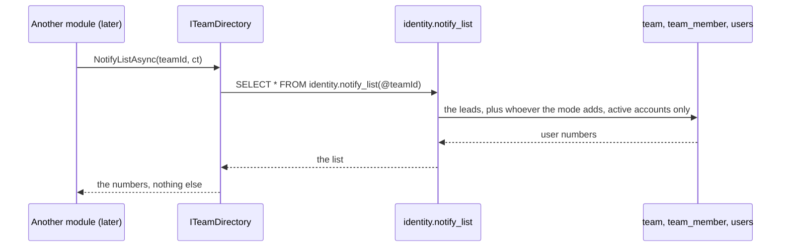

# Lesson 17 — Teams: Who Works Together, and Who Is Told About New Work

Good day, developer! A ticket that nobody owns needs somewhere to go. Today we give the service desk its teams: a "Service desk" and a "Network", each with people in it, and a rule for who gets told when work arrives that nobody has taken. We build the team as a small aggregate, the endpoints and pages to manage it, and a service window that other modules can ask: who is in this team, which teams is this person in, who should hear about this new ticket. It takes about two hours. Are you ready? Let's begin!

## What we'll build

| Piece | What it is |
|---|---|
| **`Team`** | An aggregate: a name, an active flag, its members, and a **notify mode** |
| **Members** | Staff only: an active agent, team lead or admin. Each member can be marked "tell this person too" |
| **Team endpoints** | List, open, create, rename, switch on or off, add and remove people, choose who is told. Admins manage; staff read |
| **`ITeamDirectory`** | Identity's service window for teams, with its SQL functions |
| **Two seeded teams** | "Service desk" (an agent and a team lead) and "Network" (a team lead) |
| **Two pages** | The list of teams, and the team's page |

## Why we build it this way

### Why teams live in Identity

A team is a set of people, and people belong to Identity. Tickets will keep only a team's *number* and a copy of its *name*, like it keeps a requester's name: no foreign key across schemas, as the island rule says. When Tickets needs to know who is in a team, it asks Identity through its Contracts project.

### Who is told: one rule, written once

When a ticket arrives with no owner, someone should hear about it. The plan chose one rule (decision D9), and the team keeps it as data:

| Notify mode | Who is told about work nobody has |
|---|---|
| **Team leads only** (the default) | The team's leads |
| **Team leads and selected members** | The leads, plus the members an admin ticked |
| **Everyone** | Every member |

Two more facts. Only *active* accounts are told: someone who has left must never get mail. And work with no team at all goes to every active team lead. Identity decides this list; whoever needs it only asks. That is why the list is one query behind `ITeamDirectory`, and not a copy in each module that wants it.

### Teams are an aggregate

A team's members can't change on their own: adding one has rules (only staff), and the team's row must change when its members do, or its row version would never be checked (the lesson 11 trap again). So the members are not a table of their own that anyone may write. They are *owned* by the `Team`: you add and remove them through the team, and the team touches its own `UpdatedUtc` each time.

## 1. The team's domain

Ids first, as in lesson 04: a team's number and a user's number must not be mixed up, so each gets its own type. This `UserId` is Identity's own, in its domain, next to the one Tickets has in its.

```csharp
// src/Modules/Identity/Yasda.Modules.Identity/Domain/Ids.cs
namespace Yasda.Modules.Identity.Domain;

internal readonly record struct TeamId(long Value);

// An account's number, as a team knows it.
internal readonly record struct UserId(long Value);
```

```csharp
// src/Modules/Identity/Yasda.Modules.Identity/Domain/NotifyMode.cs
namespace Yasda.Modules.Identity.Domain;

// Who hears about work nobody has taken yet (decision D9). A team's leads are its members whose role is TeamLead, and
// they always hear; this says who else does.
internal enum NotifyMode
{
    LeadsOnly,
    LeadsAndSelected,
    Everyone,
}
```

```csharp
// src/Modules/Identity/Yasda.Modules.Identity/Domain/TeamMember.cs
namespace Yasda.Modules.Identity.Domain;

// One person in a team. Notify is used when the team's mode is LeadsAndSelected.
internal sealed class TeamMember
{
    private TeamMember() { }

    internal TeamMember(UserId userId)
    {
        UserId = userId;
    }

    public UserId UserId { get; private set; }
    public bool Notify { get; internal set; }
}
```

The aggregate. Read its comments: each rule is a plain method that throws a `DomainException`:

```csharp
// src/Modules/Identity/Yasda.Modules.Identity/Domain/Team.cs
using Yasda.Shared.BuildingBlocks;

namespace Yasda.Modules.Identity.Domain;

// A group of staff who work a set of tickets together. Admins manage teams and who is in them. The domain decides
// every rule; the handlers only tell it what they looked up (is this name taken, is this person staff).
internal sealed class Team : AggregateRoot<TeamId>
{
    public const int NameMaxLength = 100;

    private readonly List<TeamMember> _members = [];

    private Team() { }

    public string Name { get; private set; } = "";
    public bool IsActive { get; private set; }
    public NotifyMode NotifyMode { get; private set; }
    public DateTime UpdatedUtc { get; private set; }
    public IReadOnlyList<TeamMember> Members => _members;

    public static Team Create(string name, bool nameTaken, DateTime nowUtc)
    {
        return new Team
        {
            Name = CheckedName(name, nameTaken),
            IsActive = true,
            NotifyMode = NotifyMode.LeadsOnly,
            UpdatedUtc = nowUtc,
        };
    }

    public void Rename(string name, bool nameTaken, DateTime nowUtc)
    {
        var checkedName = CheckedName(name, nameTaken);
        if (checkedName == Name) return;

        Name = checkedName;
        UpdatedUtc = nowUtc;
    }

    public void SetActive(bool isActive, DateTime nowUtc)
    {
        IsActive = isActive;
        UpdatedUtc = nowUtc;
    }

    // Only staff may be in a team, and Identity is the one who knows who is staff. Adding someone twice changes nothing.
    public void AddMember(UserId user, bool userIsStaff, DateTime nowUtc)
    {
        if (!userIsStaff)
            throw new DomainException(IdentityErrors.TeamMemberNotStaff);
        if (IsMember(user)) return;

        _members.Add(new TeamMember(user));
        UpdatedUtc = nowUtc;
    }

    public void RemoveMember(UserId user, DateTime nowUtc)
    {
        var removed = _members.RemoveAll(m => m.UserId == user);
        if (removed == 0) return;

        UpdatedUtc = nowUtc;
    }

    // Who else hears about unowned work besides the leads. Only members can be selected; the others are ignored.
    public void SetNotify(NotifyMode mode, IReadOnlyCollection<UserId> selected, DateTime nowUtc)
    {
        NotifyMode = mode;
        foreach (var member in _members)
            member.Notify = selected.Contains(member.UserId);
        UpdatedUtc = nowUtc;
    }

    public bool IsMember(UserId user)
    {
        foreach (var member in _members)
        {
            if (member.UserId == user) return true;
        }
        return false;
    }

    private static string CheckedName(string name, bool nameTaken)
    {
        var text = name?.Trim() ?? "";
        if (text.Length == 0 || text.Length > NameMaxLength)
            throw new DomainException(IdentityErrors.TeamNameRequired);
        if (nameTaken)
            throw new DomainException(IdentityErrors.TeamNameTaken);
        return text;
    }
}
```

Two things stand out. The rule "is that name taken?" needs the database, so it isn't asked *inside* the team: the caller finds out (`nameTaken`) and passes it in, and the team decides what to do about it. That keeps the domain free of data access. And `AddMember` takes `userIsStaff` the same way: Identity knows who is staff, the team only enforces that members must be.

The three new error codes join the catalog, after the five from last lesson. Their numbers are `IDENTITY-0006` to `0008`, and they are never renumbered:

```csharp
// src/Modules/Identity/Yasda.Modules.Identity/Domain/IdentityErrors.cs (added)
    public static readonly ErrorCode TeamNameRequired = new("IDENTITY-0006", "A team needs a name",
        "Give the team a name of 1 to 100 characters, such as \"Service desk\".");
    public static readonly ErrorCode TeamNameTaken = new("IDENTITY-0007", "A team with that name already exists",
        "Choose another name, or open the existing team and add people to it.");
    public static readonly ErrorCode TeamMemberNotStaff = new("IDENTITY-0008", "Only staff can be in a team",
        "Choose an active agent, team lead or admin. Requesters and disabled accounts can't be added.");
```

## 2. The tables and the functions

In `YasdaIdentityDbContext`, the team is mapped with its members as an owned collection, and the three ids and the mode get value converters, exactly as `TicketId` did in lesson 05. First the usings, `DbSet` and converters:

```csharp
using Yasda.Modules.Identity.Domain;
using Microsoft.EntityFrameworkCore.Storage.ValueConversion;
```

```csharp
public DbSet<Team> Teams => Set<Team>();
```

```csharp
protected override void ConfigureConventions(ModelConfigurationBuilder configuration)
{
    configuration.Properties<TeamId>().HaveConversion<TeamIdConverter>();
    configuration.Properties<Domain.UserId>().HaveConversion<UserIdConverter>();
    // Stored by name: readable in SQL, and safe if the enum is ever reordered.
    configuration.Properties<NotifyMode>().HaveConversion<string>().HaveMaxLength(20);
}
```

Then, in `OnModelCreating`, before the `OutboxMessage` mapping:

```csharp
// src/Modules/Identity/Yasda.Modules.Identity/Infrastructure/YasdaIdentityDbContext.cs (added)
        builder.Entity<Team>(e =>
        {
            e.ToTable("team", t =>
            {
                t.HasCheckConstraint("ck_team_notify_mode", "notify_mode IN ('LeadsOnly', 'LeadsAndSelected', 'Everyone')");
            });
            e.HasKey(x => x.Id);
            e.Property(x => x.Id).UseIdentityColumn();
            e.Property(x => x.Name).HasMaxLength(Team.NameMaxLength);
            e.HasIndex(x => x.Name).IsUnique();
            e.Property<uint>("RowVersion").IsRowVersion().HasColumnName("xmin");
            e.Ignore(x => x.DomainEvents);

            e.OwnsMany(x => x.Members, m =>
            {
                m.ToTable("team_member");
                m.WithOwner().HasForeignKey("TeamId");
                m.HasKey("TeamId", nameof(TeamMember.UserId));
                m.HasIndex(x => x.UserId);
            });
            e.Navigation(x => x.Members).HasField("_members").UsePropertyAccessMode(PropertyAccessMode.Field);
        });
```

and the two converters, above the design-time factory at the bottom of the file:

```csharp
internal sealed class TeamIdConverter() : ValueConverter<TeamId, long>(v => v.Value, v => new TeamId(v));
internal sealed class UserIdConverter() : ValueConverter<Domain.UserId, long>(v => v.Value, v => new Domain.UserId(v));
```

Notice what the mapping does *not* do. `team_member.user_id` has no foreign key to `identity.users`. The two types differ (`UserId` has its own converter, the users table's id is a plain `long`), and a member row only ever holds a number that Identity itself put there. The cost, said plainly: the database won't stop a member row from pointing at a user that was deleted. Accounts are never deleted here, only disabled, so it can't happen, and the "disabled members are never told" rule handles the rest.

The reads are SQL functions again. Four files: the list and its count, one team with its members, the teams one person is in, and the notify list:

```sql
-- src/Modules/Identity/Yasda.Modules.Identity/Infrastructure/Sql/Functions/identity.search_teams.v1.sql
-- Released scripts are never edited: change a function with a .v2 file and a new migration.
-- The teams list: a search, a sort from the allow-list (TeamsValidator), a page. Members are counted, not listed.
CREATE OR REPLACE FUNCTION identity.search_teams(p_search text, p_sort text, p_desc boolean, p_page integer, p_page_size integer)
RETURNS TABLE (id bigint, name text, is_active boolean, notify_mode text, member_count bigint)
LANGUAGE sql STABLE
AS $$
    WITH t AS (
        SELECT t.id, t.name::text AS name, t.is_active, t.notify_mode::text AS notify_mode,
               (SELECT COUNT(*) FROM identity.team_member m WHERE m.team_id = t.id) AS member_count
        FROM identity.team t
        WHERE p_search IS NULL OR t.name ILIKE '%' || p_search || '%'
    )
    SELECT * FROM t
    ORDER BY
        CASE WHEN p_sort = 'name' AND p_desc THEN t.name END DESC,
        CASE WHEN p_sort = 'members' AND NOT p_desc THEN t.member_count END ASC,
        CASE WHEN p_sort = 'members' AND p_desc     THEN t.member_count END DESC,
        t.name, t.id
    OFFSET (p_page - 1) * p_page_size
    LIMIT p_page_size;
$$;

CREATE OR REPLACE FUNCTION identity.count_teams(p_search text)
RETURNS bigint
LANGUAGE sql STABLE
AS $$
    SELECT COUNT(*) FROM identity.team t
    WHERE p_search IS NULL OR t.name ILIKE '%' || p_search || '%';
$$;
```

```sql
-- src/Modules/Identity/Yasda.Modules.Identity/Infrastructure/Sql/Functions/identity.get_team.v1.sql
-- Released scripts are never edited: change a function with a .v2 file and a new migration.
-- One team, and its members with their roles. A disabled account stays listed (so an admin can remove it) and says so.
CREATE OR REPLACE FUNCTION identity.get_team(p_id bigint)
RETURNS TABLE (id bigint, name text, is_active boolean, notify_mode text)
LANGUAGE sql STABLE
AS $$
    SELECT t.id, t.name::text, t.is_active, t.notify_mode::text
    FROM identity.team t
    WHERE t.id = p_id;
$$;

CREATE OR REPLACE FUNCTION identity.get_team_members(p_team_id bigint)
RETURNS TABLE (user_id bigint, full_name text, role text, notify boolean, is_disabled boolean)
LANGUAGE sql STABLE
AS $$
    SELECT m.user_id, u.full_name::text, COALESCE(r.name, '')::text, m.notify, u.is_disabled
    FROM identity.team_member m
    JOIN identity.users u ON u.id = m.user_id
    LEFT JOIN identity.user_roles ur ON ur.user_id = u.id
    LEFT JOIN identity.roles r ON r.id = ur.role_id
    WHERE m.team_id = p_team_id
    ORDER BY u.full_name, u.id;
$$;
```

```sql
-- src/Modules/Identity/Yasda.Modules.Identity/Infrastructure/Sql/Functions/identity.teams_of_user.v1.sql
-- Released scripts are never edited: change a function with a .v2 file and a new migration.
-- The teams a person is a member of: ITeamDirectory.TeamIdsOfAsync, and the queue's "My teams" filter.
CREATE OR REPLACE FUNCTION identity.teams_of_user(p_user_id bigint)
RETURNS TABLE (team_id bigint)
LANGUAGE sql STABLE
AS $$
    SELECT m.team_id FROM identity.team_member m WHERE m.user_id = p_user_id ORDER BY m.team_id;
$$;
```

```sql
-- src/Modules/Identity/Yasda.Modules.Identity/Infrastructure/Sql/Functions/identity.notify_list.v1.sql
-- Released scripts are never edited: change a function with a .v2 file and a new migration.
-- Who hears about work nobody has taken yet (decision D9). With a team: its leads (members whose role is TeamLead)
-- always, plus every member when the team's mode is Everyone, or the members flagged to be told when it is
-- LeadsAndSelected. With no team (unrouted work): every team lead. Only active accounts.
CREATE OR REPLACE FUNCTION identity.notify_list(p_team_id bigint)
RETURNS TABLE (user_id bigint)
LANGUAGE sql STABLE
AS $$
    SELECT u.id
    FROM identity.users u
    JOIN identity.user_roles ur ON ur.user_id = u.id
    JOIN identity.roles r ON r.id = ur.role_id
    WHERE p_team_id IS NULL AND r.name = 'TeamLead' AND NOT u.is_disabled
    UNION
    SELECT u.id
    FROM identity.team t
    JOIN identity.team_member m ON m.team_id = t.id
    JOIN identity.users u ON u.id = m.user_id
    JOIN identity.user_roles ur ON ur.user_id = u.id
    JOIN identity.roles r ON r.id = ur.role_id
    WHERE t.id = p_team_id AND NOT u.is_disabled
      AND (r.name = 'TeamLead' OR t.notify_mode = 'Everyone' OR (t.notify_mode = 'LeadsAndSelected' AND m.notify))
    ORDER BY 1;
$$;
```

Read `notify_list` slowly. It is the rule from the table above, written once: a team's leads always, then the members the mode adds, with a `CASE` on the mode, only active accounts, and for `NULL` (no team) every active team lead. This is a *query*, not a decision: the domain already decided each member's flag and the team's mode, and the function only gathers who matches, which is what SQL is for. Nothing in it can refuse anything.

The staff list from last lesson gains a team filter, so a screen can ask for just a team's people. A function's arguments can't change in place, so this is a `.v2` file, and the migration below drops the old one:

```sql
-- src/Modules/Identity/Yasda.Modules.Identity/Infrastructure/Sql/Functions/identity.list_staff.v2.sql
-- Released scripts are never edited: change a function with a .v2 file and a new migration.
-- Active accounts that may handle tickets, by name: the "Assign to" list and IUserDirectory.FindStaffAsync. With a team
-- number, only that team's members.
CREATE OR REPLACE FUNCTION identity.list_staff(p_id bigint, p_team_id bigint)
RETURNS TABLE (id bigint, full_name text, role text)
LANGUAGE sql STABLE
AS $$
    SELECT u.id, u.full_name::text, r.name::text
    FROM identity.users u
    JOIN identity.user_roles ur ON ur.user_id = u.id
    JOIN identity.roles r ON r.id = ur.role_id
    WHERE r.name IN ('Agent', 'TeamLead', 'Admin') AND NOT u.is_disabled
      AND (p_id IS NULL OR u.id = p_id)
      AND (p_team_id IS NULL OR EXISTS (SELECT 1 FROM identity.team_member m WHERE m.team_id = p_team_id AND m.user_id = u.id))
    ORDER BY u.full_name, u.id;
$$;
```

Two migrations: one generated, one by hand.

```bash
dotnet ef migrations add AddTeams --project src/Modules/Identity/Yasda.Modules.Identity --startup-project src/Modules/Identity/Yasda.Modules.Identity --output-dir Infrastructure/Migrations
dotnet ef migrations add AddTeamReadFunctions --project src/Modules/Identity/Yasda.Modules.Identity --startup-project src/Modules/Identity/Yasda.Modules.Identity --output-dir Infrastructure/Migrations
```

Read the first: `team` with a unique index on its name, and `team_member` with a composite key. Replace the second:

```csharp
// src/Modules/Identity/Yasda.Modules.Identity/Infrastructure/Migrations/<timestamp>_AddTeamReadFunctions.cs (the file EF Core made; replace its content)
using Microsoft.EntityFrameworkCore.Migrations;
using Yasda.Shared.BuildingBlocks;

#nullable disable

namespace Yasda.Modules.Identity.Infrastructure.Migrations
{
    // The read-side SQL functions ship with the schema. Never point a released migration at a changed file.
    public partial class AddTeamReadFunctions : Migration
    {
        private static string Sql(string file)
        {
            return EmbeddedSql.Read(typeof(AddTeamReadFunctions).Assembly, file);
        }

        protected override void Up(MigrationBuilder migrationBuilder)
        {
            // list_staff gains a team filter, which changes its arguments: the old one goes, the v2 file makes the new one.
            migrationBuilder.Sql("DROP FUNCTION identity.list_staff(bigint);");
            migrationBuilder.Sql(Sql("identity.list_staff.v2.sql"));
            migrationBuilder.Sql(Sql("identity.search_teams.v1.sql"));
            migrationBuilder.Sql(Sql("identity.get_team.v1.sql"));
            migrationBuilder.Sql(Sql("identity.teams_of_user.v1.sql"));
            migrationBuilder.Sql(Sql("identity.notify_list.v1.sql"));
        }

        protected override void Down(MigrationBuilder migrationBuilder)
        {
            migrationBuilder.Sql("DROP FUNCTION IF EXISTS identity.notify_list(bigint);");
            migrationBuilder.Sql("DROP FUNCTION IF EXISTS identity.teams_of_user(bigint);");
            migrationBuilder.Sql("DROP FUNCTION IF EXISTS identity.get_team_members(bigint);");
            migrationBuilder.Sql("DROP FUNCTION IF EXISTS identity.get_team(bigint);");
            migrationBuilder.Sql("DROP FUNCTION IF EXISTS identity.count_teams(text);");
            migrationBuilder.Sql("DROP FUNCTION IF EXISTS identity.search_teams(text, text, boolean, integer, integer);");
            migrationBuilder.Sql("DROP FUNCTION IF EXISTS identity.list_staff(bigint, bigint);");
            migrationBuilder.Sql(Sql("identity.list_staff.v1.sql"));
        }
    }
}
```

## 3. The slices

Who may do what is one small class: staff read teams, admins change them.

```csharp
// src/Modules/Identity/Yasda.Modules.Identity/Features/TeamRoles.cs
using Yasda.Shared.BuildingBlocks;

namespace Yasda.Modules.Identity.Features;

// Who may do what with teams (decision D6): admins manage teams and who is in them. Staff may read them: the queue's team
// filter and the categories screen need the list of teams.
internal static class TeamRoles
{
    public static readonly string[] Readers = [Roles.Agent, Roles.TeamLead, Roles.Admin];
    public static readonly string[] Managers = [Roles.Admin];
}
```

Reading:

```csharp
// src/Modules/Identity/Yasda.Modules.Identity/Features/SearchTeams/SearchTeamsHandler.cs
using Dapper;
using FluentValidation;
using Yasda.Shared.BuildingBlocks;

namespace Yasda.Modules.Identity.Features;

internal sealed record SearchTeamsQuery(string? Search = null, string? Sort = null, bool Desc = false, int Page = 1, int PageSize = 20);

internal sealed record TeamSummaryDto(long Id, string Name, bool IsActive, string NotifyMode, long MemberCount);

internal sealed class SearchTeamsValidator : AbstractValidator<SearchTeamsQuery>
{
    public SearchTeamsValidator()
    {
        RuleFor(x => x.Page).ValidPage();
        RuleFor(x => x.PageSize).ValidPageSize();
        RuleFor(x => x.Sort).ValidSort("name", "members");
    }
}

internal sealed class SearchTeamsHandler(IDbConnectionFactory connections)
{
    public async Task<PagedResult<TeamSummaryDto>> HandleAsync(SearchTeamsQuery q, CancellationToken ct)
    {
        var search = SearchText.ForLike(q.Search);
        await using var conn = connections.Create();
        using var multi = await conn.QueryMultipleAsync(new CommandDefinition(
            """
            SELECT * FROM identity.search_teams(@Search, @Sort, @Desc, @Page, @PageSize);
            SELECT identity.count_teams(@Search);
            """, new { Search = search, q.Sort, q.Desc, q.Page, q.PageSize }, cancellationToken: ct));

        var rows = (await multi.ReadAsync<TeamSummaryDto>()).ToList();
        var total = (int)await multi.ReadSingleAsync<long>();
        return new PagedResult<TeamSummaryDto>(rows, q.Page, q.PageSize, total);
    }
}
```

```csharp
// src/Modules/Identity/Yasda.Modules.Identity/Features/SearchTeams/SearchTeamsEndpoint.cs
using Microsoft.AspNetCore.Builder;
using Microsoft.AspNetCore.Http;
using Microsoft.AspNetCore.Routing;

namespace Yasda.Modules.Identity.Features;

internal static class SearchTeamsEndpoint
{
    public static void Map(IEndpointRouteBuilder app)
    {
        app.MapGet("/teams", async ([AsParameters] SearchTeamsQuery query, SearchTeamsHandler handler, CancellationToken ct) =>
        {
            var teams = await handler.HandleAsync(query, ct);
            return TypedResults.Ok(teams);
        })
        .RequireAuthorization(policy => policy.RequireRole(TeamRoles.Readers));
    }
}
```

```csharp
// src/Modules/Identity/Yasda.Modules.Identity/Features/GetTeam/GetTeamHandler.cs
using Dapper;
using Yasda.Shared.BuildingBlocks;

namespace Yasda.Modules.Identity.Features;

internal sealed record TeamDetailDto(long Id, string Name, bool IsActive, string NotifyMode, IReadOnlyList<TeamMemberDto> Members);

internal sealed record TeamMemberDto(long UserId, string FullName, string Role, bool Notify, bool IsDisabled);

// One row of identity.get_team, exactly as the SQL function returns it.
internal sealed record TeamRow(long Id, string Name, bool IsActive, string NotifyMode);

internal sealed class GetTeamHandler(IDbConnectionFactory connections)
{
    public async Task<TeamDetailDto?> HandleAsync(long teamId, CancellationToken ct)
    {
        await using var conn = connections.Create();
        using var multi = await conn.QueryMultipleAsync(new CommandDefinition(
            """
            SELECT * FROM identity.get_team(@teamId);
            SELECT * FROM identity.get_team_members(@teamId);
            """, new { teamId }, cancellationToken: ct));

        var row = await multi.ReadSingleOrDefaultAsync<TeamRow>();
        if (row is null) return null;
        var members = (await multi.ReadAsync<TeamMemberDto>()).ToList();

        return new TeamDetailDto(row.Id, row.Name, row.IsActive, row.NotifyMode, members);
    }
}
```

```csharp
// src/Modules/Identity/Yasda.Modules.Identity/Features/GetTeam/GetTeamEndpoint.cs
using Microsoft.AspNetCore.Builder;
using Microsoft.AspNetCore.Http;
using Microsoft.AspNetCore.Http.HttpResults;
using Microsoft.AspNetCore.Routing;

namespace Yasda.Modules.Identity.Features;

internal static class GetTeamEndpoint
{
    public static void Map(IEndpointRouteBuilder app)
    {
        app.MapGet("/teams/{id:long}", async Task<Results<Ok<TeamDetailDto>, NotFound>> (long id, GetTeamHandler handler, CancellationToken ct) =>
        {
            var team = await handler.HandleAsync(id, ct);
            if (team is null) return TypedResults.NotFound();
            return TypedResults.Ok(team);
        })
        .RequireAuthorization(policy => policy.RequireRole(TeamRoles.Readers));
    }
}
```

Creating, and the changes to an existing team (they share a folder, as in `UpdateUser`): rename, switch on or off, choose who is told. Each loads the team, asks it, and saves; the only business `if`s are in the `Team`.

```csharp
// src/Modules/Identity/Yasda.Modules.Identity/Features/CreateTeam/CreateTeamHandler.cs
using Yasda.Modules.Identity.Domain;
using Yasda.Modules.Identity.Infrastructure;
using Yasda.Shared.BuildingBlocks;
using Microsoft.EntityFrameworkCore;

namespace Yasda.Modules.Identity.Features;

internal sealed record CreateTeamCommand(string Name);

internal sealed class CreateTeamHandler(YasdaIdentityDbContext db, TimeProvider time)
{
    public async Task<long> HandleAsync(CreateTeamCommand cmd, CancellationToken ct)
    {
        // Whether the name is taken is a fact the database knows; whether that is allowed is the team's call.
        var pattern = SearchText.ForLike(cmd.Name);
        var nameTaken = pattern is not null && await db.Teams.AnyAsync(t => EF.Functions.ILike(t.Name, pattern), ct);
        var team = Team.Create(cmd.Name, nameTaken, time.GetUtcNow().UtcDateTime);

        db.Teams.Add(team);
        await db.SaveChangesAsync(ct);
        return team.Id.Value;
    }
}
```

```csharp
// src/Modules/Identity/Yasda.Modules.Identity/Features/CreateTeam/CreateTeamEndpoint.cs
using Yasda.Modules.Identity.Domain;
using Yasda.Shared.BuildingBlocks;
using FluentValidation;
using Microsoft.AspNetCore.Builder;
using Microsoft.AspNetCore.Http;
using Microsoft.AspNetCore.Http.HttpResults;
using Microsoft.AspNetCore.Routing;

namespace Yasda.Modules.Identity.Features;

internal sealed record CreateTeamRequest(string Name);

internal sealed class CreateTeamRequestValidator : AbstractValidator<CreateTeamRequest>
{
    public CreateTeamRequestValidator()
    {
        RuleFor(x => x.Name).NotEmpty().MaximumLength(Team.NameMaxLength);
    }
}

internal static class CreateTeamEndpoint
{
    public static void Map(IEndpointRouteBuilder app)
    {
        app.MapPost("/teams", async Task<Created<CreatedId>> (CreateTeamRequest body, CreateTeamHandler handler, CancellationToken ct) =>
        {
            var id = await handler.HandleAsync(new CreateTeamCommand(body.Name), ct);
            return TypedResults.Created($"/api/teams/{id}", new CreatedId(id));
        })
        .RequireAuthorization(policy => policy.RequireRole(TeamRoles.Managers));
    }
}
```

```csharp
// src/Modules/Identity/Yasda.Modules.Identity/Features/UpdateTeam/UpdateTeamHandlers.cs
using Yasda.Modules.Identity.Domain;
using Yasda.Modules.Identity.Infrastructure;
using Yasda.Shared.BuildingBlocks;
using Microsoft.EntityFrameworkCore;

namespace Yasda.Modules.Identity.Features;

// Changes to one team, each a small handler: load the team, ask it to change itself, save. They answer false when
// there is no such team. The rules (a name nobody has, who may be notified) are the team's own.

internal sealed record RenameTeamCommand(long TeamId, string Name);

internal sealed class RenameTeamHandler(YasdaIdentityDbContext db, TimeProvider time)
{
    public async Task<bool> HandleAsync(RenameTeamCommand cmd, CancellationToken ct)
    {
        var id = new TeamId(cmd.TeamId);
        var team = await db.Teams.SingleOrDefaultAsync(t => t.Id == id, ct);
        if (team is null) return false;

        var pattern = SearchText.ForLike(cmd.Name);
        var nameTaken = pattern is not null && await db.Teams.AnyAsync(t => t.Id != id && EF.Functions.ILike(t.Name, pattern), ct);
        team.Rename(cmd.Name, nameTaken, time.GetUtcNow().UtcDateTime);

        await db.SaveChangesAsync(ct);
        return true;
    }
}

internal sealed record SetTeamActiveCommand(long TeamId, bool IsActive);

internal sealed class SetTeamActiveHandler(YasdaIdentityDbContext db, TimeProvider time)
{
    public async Task<bool> HandleAsync(SetTeamActiveCommand cmd, CancellationToken ct)
    {
        var id = new TeamId(cmd.TeamId);
        var team = await db.Teams.SingleOrDefaultAsync(t => t.Id == id, ct);
        if (team is null) return false;

        team.SetActive(cmd.IsActive, time.GetUtcNow().UtcDateTime);

        await db.SaveChangesAsync(ct);
        return true;
    }
}

internal sealed record SetTeamNotifyCommand(long TeamId, NotifyMode Mode, IReadOnlyList<long> SelectedUserIds);

internal sealed class SetTeamNotifyHandler(YasdaIdentityDbContext db, TimeProvider time)
{
    public async Task<bool> HandleAsync(SetTeamNotifyCommand cmd, CancellationToken ct)
    {
        var id = new TeamId(cmd.TeamId);
        var team = await db.Teams.SingleOrDefaultAsync(t => t.Id == id, ct);
        if (team is null) return false;

        var selected = new List<UserId>();
        foreach (var userId in cmd.SelectedUserIds)
            selected.Add(new UserId(userId));
        team.SetNotify(cmd.Mode, selected, time.GetUtcNow().UtcDateTime);

        await db.SaveChangesAsync(ct);
        return true;
    }
}
```

```csharp
// src/Modules/Identity/Yasda.Modules.Identity/Features/UpdateTeam/UpdateTeamEndpoint.cs
using Yasda.Modules.Identity.Domain;
using FluentValidation;
using Microsoft.AspNetCore.Builder;
using Microsoft.AspNetCore.Http;
using Microsoft.AspNetCore.Http.HttpResults;
using Microsoft.AspNetCore.Routing;

namespace Yasda.Modules.Identity.Features;

internal sealed record RenameTeamRequest(string Name);

internal sealed record SetTeamNotifyRequest(NotifyMode Mode, List<long>? SelectedUserIds);

internal sealed class RenameTeamRequestValidator : AbstractValidator<RenameTeamRequest>
{
    public RenameTeamRequestValidator()
    {
        RuleFor(x => x.Name).NotEmpty().MaximumLength(Team.NameMaxLength);
    }
}

internal sealed class SetTeamNotifyRequestValidator : AbstractValidator<SetTeamNotifyRequest>
{
    public SetTeamNotifyRequestValidator()
    {
        RuleFor(x => x.Mode).IsInEnum();
    }
}

internal static class UpdateTeamEndpoint
{
    public static void Map(IEndpointRouteBuilder app)
    {
        app.MapPut("/teams/{id:long}", async Task<Results<NoContent, NotFound>> (long id, RenameTeamRequest body, RenameTeamHandler handler, CancellationToken ct) =>
        {
            var found = await handler.HandleAsync(new RenameTeamCommand(id, body.Name), ct);
            if (!found) return TypedResults.NotFound();
            return TypedResults.NoContent();
        })
        .RequireAuthorization(policy => policy.RequireRole(TeamRoles.Managers));

        app.MapPost("/teams/{id:long}/activate", async Task<Results<NoContent, NotFound>> (long id, SetTeamActiveHandler handler, CancellationToken ct) =>
        {
            var found = await handler.HandleAsync(new SetTeamActiveCommand(id, true), ct);
            if (!found) return TypedResults.NotFound();
            return TypedResults.NoContent();
        })
        .RequireAuthorization(policy => policy.RequireRole(TeamRoles.Managers));

        app.MapPost("/teams/{id:long}/deactivate", async Task<Results<NoContent, NotFound>> (long id, SetTeamActiveHandler handler, CancellationToken ct) =>
        {
            var found = await handler.HandleAsync(new SetTeamActiveCommand(id, false), ct);
            if (!found) return TypedResults.NotFound();
            return TypedResults.NoContent();
        })
        .RequireAuthorization(policy => policy.RequireRole(TeamRoles.Managers));

        app.MapPut("/teams/{id:long}/notify", async Task<Results<NoContent, NotFound>> (long id, SetTeamNotifyRequest body, SetTeamNotifyHandler handler, CancellationToken ct) =>
        {
            var selected = body.SelectedUserIds ?? [];
            var found = await handler.HandleAsync(new SetTeamNotifyCommand(id, body.Mode, selected), ct);
            if (!found) return TypedResults.NotFound();
            return TypedResults.NoContent();
        })
        .RequireAuthorization(policy => policy.RequireRole(TeamRoles.Managers));
    }
}
```

Adding and removing a person:

```csharp
// src/Modules/Identity/Yasda.Modules.Identity/Features/TeamMembers/TeamMembersHandlers.cs
using Yasda.Modules.Identity.Contracts;
using Yasda.Modules.Identity.Domain;
using Yasda.Modules.Identity.Infrastructure;
using Microsoft.EntityFrameworkCore;

namespace Yasda.Modules.Identity.Features;

internal sealed record AddTeamMemberCommand(long TeamId, long UserId);

internal sealed class AddTeamMemberHandler(YasdaIdentityDbContext db, IUserDirectory users, TimeProvider time)
{
    public async Task<bool> HandleAsync(AddTeamMemberCommand cmd, CancellationToken ct)
    {
        var id = new TeamId(cmd.TeamId);
        var team = await db.Teams.SingleOrDefaultAsync(t => t.Id == id, ct);
        if (team is null) return false;

        // Only Identity knows who is an active member of staff; whether that is enough is the team's call.
        var staff = await users.FindStaffAsync(cmd.UserId, ct);
        team.AddMember(new UserId(cmd.UserId), staff is not null, time.GetUtcNow().UtcDateTime);

        await db.SaveChangesAsync(ct);
        return true;
    }
}

internal sealed record RemoveTeamMemberCommand(long TeamId, long UserId);

internal sealed class RemoveTeamMemberHandler(YasdaIdentityDbContext db, TimeProvider time)
{
    public async Task<bool> HandleAsync(RemoveTeamMemberCommand cmd, CancellationToken ct)
    {
        var id = new TeamId(cmd.TeamId);
        var team = await db.Teams.SingleOrDefaultAsync(t => t.Id == id, ct);
        if (team is null) return false;

        team.RemoveMember(new UserId(cmd.UserId), time.GetUtcNow().UtcDateTime);

        await db.SaveChangesAsync(ct);
        return true;
    }
}
```

```csharp
// src/Modules/Identity/Yasda.Modules.Identity/Features/TeamMembers/TeamMembersEndpoint.cs
using FluentValidation;
using Microsoft.AspNetCore.Builder;
using Microsoft.AspNetCore.Http;
using Microsoft.AspNetCore.Http.HttpResults;
using Microsoft.AspNetCore.Routing;

namespace Yasda.Modules.Identity.Features;

internal sealed record AddTeamMemberRequest(long UserId);

internal sealed class AddTeamMemberRequestValidator : AbstractValidator<AddTeamMemberRequest>
{
    public AddTeamMemberRequestValidator()
    {
        RuleFor(x => x.UserId).GreaterThan(0);
    }
}

internal static class TeamMembersEndpoint
{
    public static void Map(IEndpointRouteBuilder app)
    {
        app.MapPost("/teams/{id:long}/members", async Task<Results<NoContent, NotFound>> (long id, AddTeamMemberRequest body, AddTeamMemberHandler handler, CancellationToken ct) =>
        {
            var found = await handler.HandleAsync(new AddTeamMemberCommand(id, body.UserId), ct);
            if (!found) return TypedResults.NotFound();
            return TypedResults.NoContent();
        })
        .RequireAuthorization(policy => policy.RequireRole(TeamRoles.Managers));

        app.MapDelete("/teams/{id:long}/members/{userId:long}", async Task<Results<NoContent, NotFound>> (long id, long userId, RemoveTeamMemberHandler handler, CancellationToken ct) =>
        {
            var found = await handler.HandleAsync(new RemoveTeamMemberCommand(id, userId), ct);
            if (!found) return TypedResults.NotFound();
            return TypedResults.NoContent();
        })
        .RequireAuthorization(policy => policy.RequireRole(TeamRoles.Managers));
    }
}
```

The staff list's handler and endpoint learn `?teamId=`. Replace both:

```csharp
// src/Modules/Identity/Yasda.Modules.Identity/Features/ListStaff/ListStaffHandler.cs
using Dapper;
using Yasda.Shared.BuildingBlocks;

namespace Yasda.Modules.Identity.Features;

// Who can be assigned a ticket: every active staff account, or only the members of one team.
internal sealed record ListStaffQuery(long? TeamId = null);

internal sealed record StaffDto(long Id, string FullName, string Role);

internal sealed class ListStaffHandler(IDbConnectionFactory connections)
{
    public async Task<IReadOnlyList<StaffDto>> HandleAsync(ListStaffQuery query, CancellationToken ct)
    {
        await using var conn = connections.Create();
        var staff = await conn.QueryAsync<StaffDto>(new CommandDefinition(
            "SELECT * FROM identity.list_staff(NULL, @TeamId)", new { query.TeamId }, cancellationToken: ct));
        return staff.ToList();
    }
}
```

```csharp
// src/Modules/Identity/Yasda.Modules.Identity/Features/ListStaff/ListStaffEndpoint.cs
using Yasda.Shared.BuildingBlocks;
using Microsoft.AspNetCore.Builder;
using Microsoft.AspNetCore.Http;
using Microsoft.AspNetCore.Routing;

namespace Yasda.Modules.Identity.Features;

internal static class ListStaffEndpoint
{
    // Who a ticket can be assigned to; ?teamId= narrows it to one team. Staff only: requesters have no reason to list the team.
    public static void Map(IEndpointRouteBuilder app)
    {
        app.MapGet("/staff", async ([AsParameters] ListStaffQuery query, ListStaffHandler handler, CancellationToken ct) =>
        {
            var staff = await handler.HandleAsync(query, ct);
            return TypedResults.Ok(staff);
        })
        .RequireAuthorization(p => p.RequireRole(Roles.Agent, Roles.TeamLead, Roles.Admin));
    }
}
```

And in `UserDirectory.FindStaffAsync`, the one call changes to the new function: `"SELECT * FROM identity.list_staff(@userId, NULL)"`.

## 4. The service window

Other modules never see a `Team`. They see this interface, in Identity's Contracts project, with plain data only. Add it, with its record, to `IdentityContracts.cs`:

```csharp
// src/Modules/Identity/Yasda.Modules.Identity.Contracts/IdentityContracts.cs (added)
// What other modules may ask about teams. Teams belong to Identity; Tickets keeps only a team's number and a copy of its name.
public interface ITeamDirectory
{
    // The team with this number, or null.
    Task<TeamInfo?> FindTeamAsync(long teamId, CancellationToken ct);

    // The number of the team with this name (any case), or null. For the development seed, as IdOfAsync is for people.
    Task<long?> TeamIdOfAsync(string name, CancellationToken ct);

    Task<bool> IsMemberAsync(long teamId, long userId, CancellationToken ct);

    // The teams this person is a member of.
    Task<IReadOnlyList<long>> TeamIdsOfAsync(long userId, CancellationToken ct);

    // Who hears about work nobody has taken yet (decision D9): the team's leads always, plus the members its notify mode
    // adds. For work with no team, every active team lead. Only active accounts. Identity decides the list; the caller
    // only asks for it.
    Task<IReadOnlyList<long>> NotifyListAsync(long? teamId, CancellationToken ct);
}

public sealed record TeamInfo(long Id, string Name, bool IsActive);
```

The implementation reads the functions with Dapper. Note `NotifyListAsync`: it just asks the function, so the rule lives in one place.

```csharp
// src/Modules/Identity/Yasda.Modules.Identity/Infrastructure/TeamDirectory.cs
using Dapper;
using Yasda.Modules.Identity.Contracts;
using Yasda.Shared.BuildingBlocks;

namespace Yasda.Modules.Identity.Infrastructure;

internal sealed class TeamDirectory(IDbConnectionFactory connections) : ITeamDirectory
{
    public async Task<TeamInfo?> FindTeamAsync(long teamId, CancellationToken ct)
    {
        await using var conn = connections.Create();
        return await conn.QuerySingleOrDefaultAsync<TeamInfo>(new CommandDefinition(
            "SELECT id, name, is_active FROM identity.get_team(@teamId)", new { teamId }, cancellationToken: ct));
    }

    public async Task<long?> TeamIdOfAsync(string name, CancellationToken ct)
    {
        await using var conn = connections.Create();
        return await conn.QuerySingleOrDefaultAsync<long?>(new CommandDefinition(
            "SELECT id FROM identity.team WHERE lower(name) = lower(@name)", new { name }, cancellationToken: ct));
    }

    public async Task<bool> IsMemberAsync(long teamId, long userId, CancellationToken ct)
    {
        await using var conn = connections.Create();
        return await conn.ExecuteScalarAsync<bool>(new CommandDefinition(
            "SELECT EXISTS (SELECT 1 FROM identity.team_member WHERE team_id = @teamId AND user_id = @userId)",
            new { teamId, userId }, cancellationToken: ct));
    }

    public async Task<IReadOnlyList<long>> TeamIdsOfAsync(long userId, CancellationToken ct)
    {
        await using var conn = connections.Create();
        var ids = await conn.QueryAsync<long>(new CommandDefinition(
            "SELECT team_id FROM identity.teams_of_user(@userId)", new { userId }, cancellationToken: ct));
        return ids.ToList();
    }

    public async Task<IReadOnlyList<long>> NotifyListAsync(long? teamId, CancellationToken ct)
    {
        await using var conn = connections.Create();
        var ids = await conn.QueryAsync<long>(new CommandDefinition(
            "SELECT user_id FROM identity.notify_list(@teamId)", new { teamId }, cancellationToken: ct));
        return ids.ToList();
    }
}
```

Nothing in the product asks for it yet, though a test does, and Tickets will next lesson. Register it, and the handlers and endpoints, in `IdentityModule.cs`:

```csharp
services.AddScoped<ITeamDirectory, TeamDirectory>();
```

```csharp
services.AddScoped<SearchTeamsHandler>();
services.AddScoped<GetTeamHandler>();
services.AddScoped<CreateTeamHandler>();
services.AddScoped<RenameTeamHandler>();
services.AddScoped<SetTeamActiveHandler>();
services.AddScoped<SetTeamNotifyHandler>();
services.AddScoped<AddTeamMemberHandler>();
services.AddScoped<RemoveTeamMemberHandler>();
```

```csharp
SearchTeamsEndpoint.Map(identity);
GetTeamEndpoint.Map(identity);
CreateTeamEndpoint.Map(identity);
UpdateTeamEndpoint.Map(identity);
TeamMembersEndpoint.Map(identity);
```

### The development teams

A fresh development database should have two teams to click through. The seed adds them after the users, because they refer to the users' numbers. `IdentityDatabase` takes a `TimeProvider` and gets a second seed method (and `SeedDevelopmentDataAsync` ends with `await SeedTeamsAsync(ct);`):

```csharp
// src/Modules/Identity/Yasda.Modules.Identity/Infrastructure/IdentityDatabase.cs (added)
    // Two teams to route tickets to: the service desk (an agent and a team lead) and Network (a team lead).
    private async Task SeedTeamsAsync(CancellationToken ct)
    {
        if (await db.Teams.AnyAsync(ct)) return;

        var agent = await users.FindByEmailAsync("agent@yasda.local");
        var lead = await users.FindByEmailAsync("lead@yasda.local");
        if (agent is null || lead is null) return;
        var now = time.GetUtcNow().UtcDateTime;

        var serviceDesk = Team.Create("Service desk", nameTaken: false, now);
        serviceDesk.AddMember(new UserId(agent.Id), userIsStaff: true, now);
        serviceDesk.AddMember(new UserId(lead.Id), userIsStaff: true, now);
        var network = Team.Create("Network", nameTaken: false, now);
        network.AddMember(new UserId(lead.Id), userIsStaff: true, now);

        db.Teams.AddRange(serviceDesk, network);
        await db.SaveChangesAsync(ct);
    }
```

It goes through the domain, like every seed since lesson 05: `Team.Create` and `AddMember`, so a seeded team obeys the same rules as a real one. The first line, `if (await db.Teams.AnyAsync(ct)) return;`, makes it safe to run twice.

## 5. The screens

Two pages, and four records for the browser. In `Models/Models.cs`, before the `TicketChoices` class:

```csharp
// src/Yasda.Web/Models/Models.cs (added)
public sealed record StaffMember(long Id, string FullName, string Role);

public sealed record TeamSummary(long Id, string Name, bool IsActive, string NotifyMode, long MemberCount);

public sealed record TeamMember(long UserId, string FullName, string Role, bool Notify, bool IsDisabled);

public sealed record TeamDetail(long Id, string Name, bool IsActive, string NotifyMode, List<TeamMember> Members);
```

and, inside `TicketChoices`:

```csharp
// src/Yasda.Web/Models/Models.cs (added)
    public static readonly string[] NotifyModes = ["LeadsOnly", "LeadsAndSelected", "Everyone"];

    public static string NotifyText(string mode)
    {
        switch (mode)
        {
            case "Everyone": return "Everyone in the team";
            case "LeadsAndSelected": return "Team leads and selected members";
            default: return "Team leads only";
        }
    }

    public static readonly string[] Priorities = ["Low", "Normal", "High", "Critical"];
    public static readonly string[] Statuses = ["New", "Open", "Pending", "Resolved", "Closed", "Cancelled"];

    // Who works on tickets. The API decides; the screens only hide what someone can't do anyway.
    public static bool IsStaff(string? role)
    {
        return role is Roles.Agent or Roles.TeamLead or Roles.Admin;
    }
```

`ApiClient` learns to remove something. Add after `Put`:

```csharp
// src/Yasda.Web/Services/ApiClient.cs (added)
    // For taking something away, such as a person from a team.
    public async Task<bool> Delete(string url, string? success = null)
    {
        return await Send(HttpMethod.Delete, url, null, success);
    }
```

The list of teams, with the usual search, sort and page in the address:

```razor
@* src/Yasda.Web/Pages/Admin/Teams.razor *@
@page "/teams"
@attribute [Authorize(Roles = Roles.Admin)]
@inject ApiClient Api
@inject NavigationManager Nav
@inject ListMemory Memory

<PageTitle>Teams · YASDA</PageTitle>

<PageHeader Title="@(_result is null ? "Teams" : $"Teams ({_result.TotalCount})")" List="true">
    <Actions><a href="teams/new">New team</a></Actions>
</PageHeader>

@* The list's search, sort and page live in the address, so Back, a bookmark or a pasted link shows the same list. *@
<EditForm Model="this" OnSubmit="Find" class="search" role="search">
    <div class="field">
        <label for="search">Team name</label>
        <InputText id="search" type="search" @bind-Value="_search" />
    </div>
    <button type="submit">Search</button>
    <a href="teams">Clear</a>
</EditForm>

@if (!string.IsNullOrWhiteSpace(Search))
{
    <p>Showing: matching "@Search". <a href="teams">Clear filters</a></p>
}

@if (_result is null)
{
    <p role="status">Loading…</p>
}
else if (_result.Items.Count == 0)
{
    <p>No teams match. <a href="teams">Clear filters</a> or <a href="teams/new">add a new team</a>.</p>
}
else
{
    <TableBox Label="Teams">
        <table>
            <thead>
                <tr>
                    <SortHeader Column="name" Title="Name" Sort="@Sort" Desc="Desc" />
                    <SortHeader Column="members" Title="Members" Sort="@Sort" Desc="Desc" Class="num" />
                    <th scope="col">Told about new tickets</th>
                    <th scope="col">Status</th>
                </tr>
            </thead>
            <tbody>
                @foreach (var team in _result.Items)
                {
                    <tr>
                        <td><a href="@($"teams/{team.Id}")">@team.Name</a></td>
                        <td class="num">@team.MemberCount</td>
                        <td>@TicketChoices.NotifyText(team.NotifyMode)</td>
                        <td>@if (team.IsActive) { <text>Active</text> } else { <strong>Inactive</strong> }</td>
                    </tr>
                }
            </tbody>
        </table>
    </TableBox>
    <Pager Page="_result.Page" PageSize="_result.PageSize" Total="_result.TotalCount" Noun="teams" />
}

@code {
    private const int PageSize = 20;

    [SupplyParameterFromQuery] public string? Search { get; set; }
    [SupplyParameterFromQuery] public string? Sort { get; set; }
    [SupplyParameterFromQuery] public bool Desc { get; set; }
    [SupplyParameterFromQuery(Name = "page")] public int? PageNumber { get; set; }

    private PagedResult<TeamSummary>? _result;
    private string? _search;

    protected override async Task OnParametersSetAsync()
    {
        _search = Search;
        Memory.Remember(Nav.ToBaseRelativePath(Nav.Uri));
        _result = await Api.Get<PagedResult<TeamSummary>>(Url.With("api/teams", ("search", Search), ("sort", Sort),
            ("desc", Desc ? true : null), ("page", PageNumber), ("pageSize", PageSize)));
    }

    // A new search starts again from page 1: page 3 of the old results may not exist.
    private void Find()
    {
        var name = string.IsNullOrWhiteSpace(_search) ? null : _search.Trim();
        Nav.NavigateTo(Nav.GetUriWithQueryParameters(new Dictionary<string, object?>
        {
            ["search"] = name,
            ["page"] = null,
        }));
    }
}
```

And the team's page: its name, its people with a remove button each, a way to add someone, the notify setting, and a switch. Every change has its own small form, so a refusal shows its code next to the thing that was refused:

```razor
@* src/Yasda.Web/Pages/Admin/TeamEdit.razor *@
@page "/teams/new"
@page "/teams/{Id:long}"
@attribute [Authorize(Roles = Roles.Admin)]
@inject ApiClient Api
@inject NavigationManager Nav
@inject ListMemory Memory
@inject IJSRuntime Js

<PageTitle>@Title · YASDA</PageTitle>

<NavigationLock OnBeforeInternalNavigation="ctx => UnsavedChanges.ConfirmLeave(Js, ctx, Unsaved)" />

<PageHeader Title="@Title" Trail="@([("Teams", Memory.Last("teams"))])">
    <Description>
        @if (_team is not null)
        {
            <text>Status: </text><strong>@(_team.IsActive ? "Active" : "Inactive")</strong><text> · Members: @_team.Members.Count</text>
        }
        else if (Id is null)
        {
            <text>Creates the team. Add its people afterwards, from the team's page.</text>
        }
    </Description>
</PageHeader>

@if (Id is not null && _team is null)
{
    <p role="status">Loading…</p>
}
else
{
    <EditForm Model="this" OnSubmit="SaveName">
        <div class="field">
            <label for="name">Team name</label>
            <InputText id="name" @bind-Value="_name" maxlength="100" required />
        </div>
        <div class="actions">
            <button type="submit" disabled="@Api.Busy">@(_team is null ? "Create team" : "Save name")</button>
        </div>
    </EditForm>

    @if (_team is not null)
    {
        <h2>People</h2>
        @if (_team.Members.Count == 0)
        {
            <p>Nobody is in this team yet.</p>
        }
        else
        {
            <TableBox Label="Members">
                <table>
                    <thead>
                        <tr>
                            <th scope="col">Name</th>
                            <th scope="col">Role</th>
                            <th scope="col">Account</th>
                            <th scope="col">Remove</th>
                        </tr>
                    </thead>
                    <tbody>
                        @foreach (var member in _team.Members)
                        {
                            <tr>
                                <td>@member.FullName</td>
                                <td>@Format.Words(member.Role)</td>
                                <td>@if (member.IsDisabled) { <strong>Disabled</strong> } else { <text>Active</text> }</td>
                                <td><button type="button" @onclick="() => RemoveMember(member)" disabled="@Api.Busy">Remove @member.FullName</button></td>
                            </tr>
                        }
                    </tbody>
                </table>
            </TableBox>
        }

        @if (Candidates.Count > 0)
        {
            <EditForm Model="this" OnSubmit="AddMember" class="search">
                <div class="field">
                    <label for="new-member">Add a person</label>
                    <InputSelect id="new-member" @bind-Value="_newMemberId">
                        @foreach (var person in Candidates)
                        {
                            <option value="@person.Id">@person.FullName (@Format.Words(person.Role))</option>
                        }
                    </InputSelect>
                </div>
                <button type="submit" disabled="@Api.Busy">Add to team</button>
            </EditForm>
        }

        <h2>Who is told about new tickets</h2>
        <p>
            When a ticket for this team has no owner yet, its team leads are told, and the people this setting adds. Only active
            accounts are told.
        </p>
        <EditForm Model="this" OnSubmit="SaveNotify">
            <div class="field">
                <label for="notify-mode">Tell</label>
                <InputSelect id="notify-mode" @bind-Value="_mode">
                    @foreach (var mode in TicketChoices.NotifyModes)
                    {
                        <option value="@mode">@TicketChoices.NotifyText(mode)</option>
                    }
                </InputSelect>
            </div>
            @if (_mode == "LeadsAndSelected")
            {
                @foreach (var member in _team.Members)
                {
                    <div class="check">
                        <input type="checkbox" id="@($"notify-{member.UserId}")" checked="@_selected.Contains(member.UserId)"
                               @onchange="e => Select(member.UserId, (bool)e.Value!)" />
                        <label for="@($"notify-{member.UserId}")">Tell @member.FullName</label>
                    </div>
                }
            }
            <div class="actions">
                <button type="submit" disabled="@Api.Busy">Save who is told</button>
            </div>
        </EditForm>

        <h2>Status</h2>
        @if (!_confirmingActive)
        {
            <p>@(_team.IsActive ? "This team is active: tickets can be routed to it." : "This team is inactive: no new tickets can be routed to it. Tickets it already has stay.")</p>
            <div class="actions">
                <button type="button" @onclick="StartConfirming">@(_team.IsActive ? "Deactivate" : "Activate")</button>
            </div>
        }
        else
        {
            <p role="alert">
                @(_team.IsActive
                    ? $"Deactivate {_team.Name}? No new tickets can be routed to it. Tickets it already has stay."
                    : $"Activate {_team.Name}? Tickets can be routed to it again.")
            </p>
            <div class="actions">
                <button type="button" @onclick="ToggleActive" disabled="@Api.Busy">@(_team.IsActive ? "Deactivate" : "Activate")</button>
                <button type="button" @onclick="StopConfirming">Not yet</button>
            </div>
        }
    }
}

@code {
    [Parameter] public long? Id { get; set; }

    private TeamDetail? _team;
    private List<StaffMember> _staff = [];
    private string _name = "", _mode = "LeadsOnly";
    private long _newMemberId;
    private bool _confirmingActive;
    private readonly HashSet<long> _selected = [];

    private string Title => _team?.Name ?? (Id is null ? "New team" : "Team");

    // People who could be added: active staff who are not in the team yet.
    private List<StaffMember> Candidates
    {
        get
        {
            var inTeam = new HashSet<long>();
            if (_team is not null)
            {
                foreach (var member in _team.Members)
                    inTeam.Add(member.UserId);
            }

            var candidates = new List<StaffMember>();
            foreach (var person in _staff)
            {
                if (!inTeam.Contains(person.Id)) candidates.Add(person);
            }
            return candidates;
        }
    }

    // Leaving with a typed-in name asks first.
    private bool Unsaved
    {
        get
        {
            if (_team is null) return _name.Length > 0;
            return _name != _team.Name;
        }
    }

    protected override async Task OnParametersSetAsync()
    {
        _confirmingActive = false;
        if (Id is null) return;
        await Load(Id.Value);
    }

    private async Task Load(long id)
    {
        _team = await Api.Get<TeamDetail>($"api/teams/{id}");
        if (_team is null) return;

        _name = _team.Name;
        _mode = _team.NotifyMode;
        _selected.Clear();
        foreach (var member in _team.Members)
        {
            if (member.Notify) _selected.Add(member.UserId);
        }

        var staff = await Api.Get<List<StaffMember>>("api/staff");
        _staff = staff ?? [];
        var candidates = Candidates;
        if (candidates.Count > 0) _newMemberId = candidates[0].Id;
    }

    private async Task SaveName()
    {
        if (_team is null)
        {
            var id = await Api.Create("api/teams", new { name = _name.Trim() }, "Team created.");
            if (id is null) return;
            _name = "";   // saved: nothing left to lose on the way to the team's page
            Nav.NavigateTo($"teams/{id}");
            return;
        }

        var saved = await Api.Put($"api/teams/{_team.Id}", new { name = _name.Trim() }, "Team saved.");
        if (saved) await Load(_team.Id);
    }

    private async Task AddMember()
    {
        var added = await Api.Post($"api/teams/{_team!.Id}/members", new { userId = _newMemberId }, "Person added.");
        if (added) await Load(_team.Id);
    }

    private async Task RemoveMember(TeamMember member)
    {
        var removed = await Api.Delete($"api/teams/{_team!.Id}/members/{member.UserId}", $"{member.FullName} removed.");
        if (removed) await Load(_team.Id);
    }

    private void Select(long userId, bool selected)
    {
        if (selected) _selected.Add(userId);
        else _selected.Remove(userId);
    }

    private async Task SaveNotify()
    {
        var chosen = new List<long>();
        if (_mode == "LeadsAndSelected") chosen.AddRange(_selected);

        var saved = await Api.Put($"api/teams/{_team!.Id}/notify", new { mode = _mode, selectedUserIds = chosen }, "Saved.");
        if (saved) await Load(_team.Id);
    }

    private void StartConfirming()
    {
        _confirmingActive = true;
    }

    private void StopConfirming()
    {
        _confirmingActive = false;
    }

    private async Task ToggleActive()
    {
        var team = _team!;
        var action = "deactivate";
        var message = "Deactivated.";
        if (!team.IsActive)
        {
            action = "activate";
            message = "Activated.";
        }

        var done = await Api.Post($"api/teams/{team.Id}/{action}", success: message);
        if (done) await Load(team.Id);
        _confirmingActive = false;
    }
}
```

A link for admins, in `NavMenu.razor`, inside the admin block, after "Users":

```razor
<li><NavItem Href="teams">Teams</NavItem></li>
```

## 6. Prove it: teams that follow the rules

### The unit tests of the aggregate

The team is tested like every aggregate: no database, fast, one rule per test. The top of the file, and one in full:

```csharp
// tests/Yasda.Modules.Identity.UnitTests/TeamTests.cs (the top of the new file; the tests below go inside the class)
using AwesomeAssertions;
using Yasda.Modules.Identity.Domain;
using Yasda.Shared.BuildingBlocks;

namespace Yasda.Modules.Identity.UnitTests;

// A team's rules: it needs a name nobody else has, and only staff can be in it.
public class TeamTests
{
    private static readonly DateTime Now = new(2026, 11, 20, 9, 0, 0, DateTimeKind.Utc);
    private static readonly UserId Alan = new(3), Lea = new(4), Kira = new(6);

    private static ErrorCode CodeOf(Action act)
    {
        var exception = FluentActions.Invoking(act).Should().Throw<DomainException>().Which;
        return exception.Error;
    }

    private static Team NewTeam()
    {
        return Team.Create("Service desk", nameTaken: false, Now);
    }
    // ... the tests that follow
```

```csharp
// tests/Yasda.Modules.Identity.UnitTests/TeamTests.cs (added)
    [Fact]
    public void Someone_who_is_not_staff_cannot_join()
    {
        var team = NewTeam();

        Action add = () => team.AddMember(Kira, userIsStaff: false, Now);

        CodeOf(add).Should().Be(IdentityErrors.TeamMemberNotStaff);
        team.Members.Should().BeEmpty();
    }
```

| Test | Why it matters |
|---|---|
| `A_new_team_is_active_and_tells_only_its_leads` | The defaults |
| `The_name_is_trimmed` | Spaces around a name aren't part of it |
| `A_team_needs_a_name` | `IDENTITY-0006` |
| `A_name_of_exactly_100_characters_is_fine_and_101_is_too_long` | The boundary |
| `A_name_another_team_has_is_refused` | `IDENTITY-0007` |
| `Renaming_changes_the_name_and_touches_the_team` | The root row changes, so a stale save is caught |
| `Renaming_to_the_same_name_changes_nothing` | No change, no new `UpdatedUtc` |
| `Renaming_to_a_name_another_team_has_is_refused_and_leaves_the_name` | A refusal changes nothing |
| `A_team_can_be_switched_off_and_on` | The flag |
| `Staff_can_be_added_and_adding_them_twice_changes_nothing` | Idempotent |
| `A_member_can_be_removed_and_removing_a_stranger_changes_nothing` | Idempotent |
| `Selecting_who_to_tell_sets_the_mode_and_flags_only_the_selected_members` | The notify setting |
| `Someone_selected_who_is_not_a_member_is_ignored` | You can't tell a stranger |
| `Switching_back_clears_the_flags` | Going back to "leads only" leaves no stale flags |

### The integration tests

The endpoints, through real requests. The notify rule gets a test for each mode, because it is the rule everything else will depend on:

```csharp
// tests/Yasda.Integration.Tests/TeamTests.cs (the top of the new file; the tests below go inside the class)
using System.Net;
using System.Net.Http.Json;
using System.Text.Json;
using AwesomeAssertions;
using Yasda.Modules.Identity.Contracts;
using Yasda.Shared.BuildingBlocks;
using Microsoft.Extensions.DependencyInjection;

namespace Yasda.Integration.Tests;

// Teams belong to Identity: admins manage them and who is in them, and only staff can be in one. Every test makes its own
// team (with a name no other has) because all the tests share one database.
[Collection("Integration")]
public class TeamTests(CustomWebAppFactory factory)
{
    private const string Admin = "admin@yasda.local", Lead = "lead@yasda.local", Agent = "agent@yasda.local", Requester = "requester@yasda.local";

    private sealed record Created(long Id);
    private sealed record Me(long Id, string FullName);
    private sealed record Member(long UserId, string FullName, string Role, bool Notify, bool IsDisabled);
    private sealed record TeamView(long Id, string Name, bool IsActive, string NotifyMode, List<Member> Members);
    private sealed record TeamRow(long Id, string Name, bool IsActive, string NotifyMode, long MemberCount);
    private sealed record Page(List<TeamRow> Items, int TotalCount);
    private sealed record Staff(long Id, string FullName, string Role);

    private static async Task<string?> CodeOf(HttpResponseMessage response)
    {
        var problem = await response.Content.ReadFromJsonAsync<JsonElement>();
        return problem.GetProperty("code").GetString();
    }

    private async Task<long> IdOf(string email)
    {
        var client = await factory.ClientFor(email);
        var me = await client.GetFromJsonAsync<Me>("/api/auth/me");
        return me!.Id;
    }

    private static async Task<long> CreateTeam(HttpClient admin, string? name = null)
    {
        var response = await admin.PostAsJsonAsync("/api/teams", new { name = name ?? $"Team {Guid.NewGuid():N}" });
        response.StatusCode.Should().Be(HttpStatusCode.Created);
        var created = await response.Content.ReadFromJsonAsync<Created>();
        return created!.Id;
    }

    private static async Task AddMember(HttpClient admin, long teamId, long userId)
    {
        var response = await admin.PostAsJsonAsync($"/api/teams/{teamId}/members", new { userId });
        response.StatusCode.Should().Be(HttpStatusCode.NoContent);
    }
    // ... the tests that follow
```

```csharp
// tests/Yasda.Integration.Tests/TeamTests.cs (added)
    [Fact]
    public async Task Everyone_mode_tells_every_member()
    {
        var admin = await factory.ClientFor(Admin);
        var (team, lead, agent, adminId) = await TeamWithThreeMembers(admin);

        (await admin.PutAsJsonAsync($"/api/teams/{team}/notify", new { mode = "Everyone" })).EnsureSuccessStatusCode();

        (await NotifyList(team)).Should().BeEquivalentTo([lead, agent, adminId]);
    }
```

| Test | Why it matters |
|---|---|
| `An_admin_creates_a_team_and_finds_it_in_the_list` | The round trip |
| `A_name_another_team_has_is_refused_whatever_the_case` | `Network` and `NETWORK` are the same name |
| `A_team_without_a_name_is_refused_before_the_handler` | The validator's `400` |
| `A_team_is_renamed_and_a_taken_name_is_refused` | `422` with `IDENTITY-0007` |
| `A_team_can_be_deactivated_and_activated_again` | The switch |
| `Staff_are_added_to_a_team_and_removed_again` | Members |
| `A_requester_cannot_join_a_team` | `IDENTITY-0008` |
| `A_disabled_account_cannot_join_a_team` | Disabled accounts aren't staff |
| `Only_admins_manage_teams_and_staff_may_read_them` | Roles at the API |
| `A_team_that_does_not_exist_is_404` | An unknown thing in the address |
| `The_teams_list_sorts_and_pages_through_the_address` | Sorting on the server |
| `The_staff_list_can_be_narrowed_to_one_team` | `?teamId=` |
| `The_development_teams_are_seeded` | The seed |
| `The_directory_finds_a_team_by_number_and_by_name_in_any_case` | `ITeamDirectory`, asked from the container |
| `The_directory_knows_who_is_a_member_and_of_which_teams` | `IsMemberAsync`, `TeamIdsOfAsync` |
| `Leads_only_mode_tells_the_teams_leads_and_nobody_else` | The default mode |
| `Leads_and_selected_mode_adds_only_the_selected_members` | The second mode |
| `A_disabled_member_is_never_told` | Only active accounts |
| `Work_with_no_team_tells_every_active_team_lead` | Unrouted work |

Add the two team sorts to `Every_offered_sort_runs` in `ListSortingTests`: `[InlineData("/api/teams?sort=name")]` and `[InlineData("/api/teams?sort=members&desc=true")]`.

### The browser tests

```csharp
// tests/Yasda.Web.UiTests/TeamUiTests.cs (added)
    [UiFact]
    public async Task An_admin_makes_a_team_adds_a_person_chooses_who_is_told_and_switches_it_off()
    {
        var name = $"Billing {Guid.NewGuid():N}";
        var page = await SignIn("admin@yasda.local");
        await MainNav(page).GetByRole(AriaRole.Link, new() { Name = "Teams" }).ClickAsync();
        await page.GetByRole(AriaRole.Link, new() { Name = "New team" }).First.ClickAsync();
        await page.GetByLabel("Team name").FillAsync(name);
        await page.GetByRole(AriaRole.Button, new() { Name = "Create team" }).ClickAsync();
        await Expect(page.GetByRole(AriaRole.Heading, new() { Name = name })).ToBeVisibleAsync();
        await Expect(StatusSaying(page, "Team created.")).ToBeVisibleAsync();

        await page.GetByLabel("Add a person").SelectOptionAsync(new SelectOptionValue { Label = "Alan Reyes (Agent)" });
        await page.GetByRole(AriaRole.Button, new() { Name = "Add to team" }).ClickAsync();
        await Expect(StatusSaying(page, "Person added.")).ToBeVisibleAsync();
        await Expect(page.GetByRole(AriaRole.Cell, new() { Name = "Alan Reyes", Exact = true })).ToBeVisibleAsync();

        await page.GetByLabel("Tell", new() { Exact = true }).SelectOptionAsync("LeadsAndSelected");
        await page.GetByLabel("Tell Alan Reyes").CheckAsync();
        await page.GetByRole(AriaRole.Button, new() { Name = "Save who is told" }).ClickAsync();
        await Expect(StatusSaying(page, "Saved.")).ToBeVisibleAsync();
        await Expect(page.GetByLabel("Tell Alan Reyes")).ToBeCheckedAsync();

        await page.GetByRole(AriaRole.Button, new() { Name = "Deactivate" }).ClickAsync();
        await Expect(page.GetByRole(AriaRole.Alert)).ToContainTextAsync($"Deactivate {name}?");
        await page.GetByRole(AriaRole.Button, new() { Name = "Not yet" }).ClickAsync();
        await Expect(page.GetByText("This team is active")).ToBeVisibleAsync();
        await page.GetByRole(AriaRole.Button, new() { Name = "Deactivate" }).ClickAsync();
        await page.GetByRole(AriaRole.Button, new() { Name = "Deactivate" }).ClickAsync();
        await Expect(StatusSaying(page, "Deactivated.")).ToBeVisibleAsync();
        await Expect(page.GetByText("Status: Inactive")).ToBeVisibleAsync();

        await page.GetByRole(AriaRole.Button, new() { Name = "Remove Alan Reyes" }).ClickAsync();
        await Expect(StatusSaying(page, "Alan Reyes removed.")).ToBeVisibleAsync();
        await Expect(page.GetByText("Nobody is in this team yet.")).ToBeVisibleAsync();
    }
```

| Test (browser) | Why it matters |
|---|---|
| `The_seeded_teams_are_listed_with_their_members` | The list and the seed |
| `Someone_who_is_not_an_admin_neither_sees_nor_opens_the_teams_pages` | No link, and the page refuses |

### Make each one fail once

First, the staff rule. In `Team.AddMember`, change `if (!userIsStaff)` to `if (false)` and run the Identity unit tests: `Someone_who_is_not_staff_cannot_join` fails. Put it back.

Second, the name rule. In `Team.CheckedName`, change `if (nameTaken)` to `if (false)`: `A_name_another_team_has_is_refused` and `Renaming_to_a_name_another_team_has_is_refused_and_leaves_the_name` fail in the unit tests, and the integration tests for taken names fail too. Put it back.

Third, the door. In `TeamRoles`, make `Managers` include `Roles.Agent` and run the integration tests: `Only_admins_manage_teams_and_staff_may_read_them` fails, because an agent can now create a team. Put it back.

## How the notify list is asked



## Mistakes to avoid

- Putting the notify rule in each module that wants it. Two copies drift; ask Identity.
- Adding a foreign key from `team_member.user_id` to `identity.users`. It is the same schema here, but the types differ and the island rule holds for what comes next: Tickets will keep a number and a name, never a join.
- Letting a team's members change without touching the team's row. A stale save would not be caught.
- Telling people who have left. Only active accounts are told.
- Editing a released SQL file. Changing a function's arguments is a `.v2` file and a migration that drops the old one.

## Let's run it!

```bash
dotnet build Yasda.slnx
dotnet test --solution Yasda.slnx
dotnet run --project src/Yasda.Api
```

Sign in as `admin@yasda.local` (password `Password123!`) and open **Teams**: "Service desk" (2 members) and "Network" (1). Open Service desk. Add the admin, choose **Team leads and selected members**, and tick the admin as someone to tell; save. Then ask the database what the rule says:

```bash
podman exec -it yasda-postgres psql -U yasda_dev -d yasda -c "SELECT * FROM identity.notify_list((SELECT id FROM identity.team WHERE name = 'Service desk'));"
```

You'll see two user numbers: the lead, and the admin you selected. Change the mode back to **Team leads only** and ask again: one.

## Let's check!

1. Why do teams live in Identity, and what will Tickets keep of one?
2. What are the three notify modes, and who is told in each?
3. Who hears about a ticket that has no team?
4. Why can't a team's members change without going through the team?
5. Why is "is this name taken?" answered outside the `Team` and passed in?
6. Why does `team_member.user_id` have no foreign key, and what is the cost?
7. Why is the notify rule a SQL function behind `ITeamDirectory` and not copied where it is needed?
8. Why does changing `list_staff`'s arguments need a `.v2` file and a migration that drops the old function?

And that's where this lesson ends. The service desk has teams, with people who must be staff, and one rule, in one place, for who hears about work nobody has. Next time, tickets get somewhere to go: categories that point at a team, a ticket that knows its team, and routing. Good luck, developer!

---

← [Lesson 16 — Users and the sign-in log](16-users.md) · Next: Lesson 18 — Categories and routing (coming with milestone Y3) →
