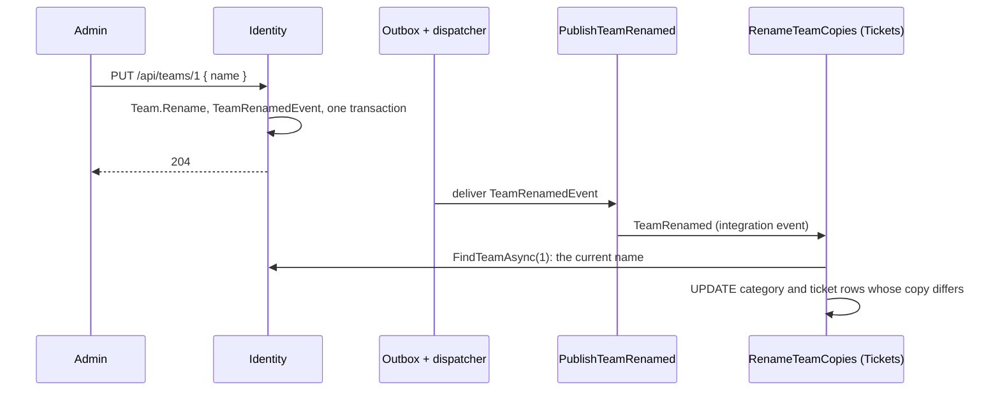

# Lesson 18 — Categories and Routing: Tickets Find Their Team

Good day, developer! We have teams. We have tickets. Today they meet. A requester says what kind of problem they have, a **category**, and the category knows which team answers. The ticket carries its team, the queue can be filtered by team, a team lead can move a ticket to another team, and only a team's members (or an admin) may own its tickets. It is the biggest change to the Tickets module since lesson 13, so we'll go in order and prove each rule. It takes about three hours. Are you ready? Let's begin!

## What we'll build

| Piece | What it is |
|---|---|
| **`Category`** | An aggregate in Tickets: a name, an active flag, and the team its tickets go to |
| **A ticket's category and team** | Both optional. "Not sure" leaves a ticket unrouted for a team lead to sort |
| **The membership rule** | Only a team's members, and admins, may take, be assigned, or take by replying a ticket of that team |
| **`RouteTicket`** | A team lead changes a ticket's category and team. An owner outside the new team loses the ticket, which goes back to New |
| **The team filter** | The queue: any team, "My teams", one team, or "No team yet" |
| **`RenameTeamCopies`** | Tickets keeps a copy of each team's name, and hears when Identity renames a team |
| **Screens** | Categories, a category's page, a category choice when filing, a routing form for team leads, a Team column and filter |

## Why we build it this way

### Routing is a fact, and where it comes from

A ticket's team could be asked of Identity every time it is shown. That would be one call per row of the queue, and the queue could not filter by team in one SQL query. So, as with Sla's deadlines, Tickets keeps what it needs *as data of its own*: the team's number, and a **copy** of its name. The ticket, and the category, carry both.

A category points at a team, and filing a ticket with a category copies that routing onto the ticket. After that the ticket's team is the ticket's: a team lead can change it, and changing the category later does not move tickets already filed.

### Two rules that need Identity's answer

Some rules need a fact only another module knows. "Is this person in the ticket's team?" is Identity's to answer. But the *rule*, "only a member may own a team's ticket", is Tickets', so it must live in the domain, with no call to anyone inside it. The plain way, again, is to ask first in the handler and pass the answer in: `ticket.Take(agent, name, now, agentIsMember: true)`. The ticket decides what to do with it. The domain stays pure, and the rule gets a unit test with no database.

### Now, let's be honest about the cost here

The copy of a team's name can go stale: rename "Network" to "Network and VPN" and every category and ticket that carries the old name is wrong until it is brought up to date. We fix that with an event, which is the whole second half of this lesson, but the fix has a cost of its own: an event can arrive late, twice, or out of order. We'll meet all three.

## 1. Categories

### The domain

A category is an aggregate with the same shape as a team: private setters, a factory, and rules in methods. The name check needs the database ("is it taken?"), so the caller passes `nameTaken` in, as for teams. And routing to an inactive team is refused, unless the category already points at that team (so an inactive team doesn't stop someone renaming a category).

```csharp
// src/Modules/Tickets/Yasda.Modules.Tickets/Domain/Ids.cs
namespace Yasda.Modules.Tickets.Domain;

internal readonly record struct TicketId(long Value);

// Owned by the Identity module, referenced by id only.
internal readonly record struct UserId(long Value);

internal readonly record struct CategoryId(long Value);

// Owned by the Identity module, referenced by id only.
internal readonly record struct TeamId(long Value);
```

```csharp
// src/Modules/Tickets/Yasda.Modules.Tickets/Domain/TeamRef.cs
namespace Yasda.Modules.Tickets.Domain;

// What Tickets knows about a team: the facts Identity told it, at the moment it asked. Tickets keeps the number and a copy of the name.
internal readonly record struct TeamRef(TeamId Id, string Name, bool IsActive);
```

```csharp
// src/Modules/Tickets/Yasda.Modules.Tickets/Domain/Category.cs
using Yasda.Shared.BuildingBlocks;

namespace Yasda.Modules.Tickets.Domain;

// A kind of request ("Hardware", "Access") that decides which team a new ticket goes to: routing is the category's team.
// A category with no team leaves its tickets unrouted, for a team lead to sort. Team leads and admins manage categories.
internal sealed class Category : AggregateRoot<CategoryId>
{
    public const int NameMaxLength = 100;

    private Category() { }

    public string Name { get; private set; } = "";
    public TeamId? TeamId { get; private set; }
    public string? TeamName { get; private set; }
    public bool IsActive { get; private set; }
    public DateTime UpdatedUtc { get; private set; }

    public static Category Create(string name, bool nameTaken, TeamRef? team, DateTime nowUtc)
    {
        var category = new Category
        {
            Name = CheckedName(name, nameTaken),
            IsActive = true,
            UpdatedUtc = nowUtc,
        };
        category.RouteTo(team);
        return category;
    }

    public void Update(string name, bool nameTaken, TeamRef? team, bool isActive, DateTime nowUtc)
    {
        var checkedName = CheckedName(name, nameTaken);
        EnsureTeamAllowed(team);

        Name = checkedName;
        IsActive = isActive;
        RouteTo(team);
        UpdatedUtc = nowUtc;
    }

    // New routing to an inactive team is refused. A category that already points at the team keeps pointing at it, so an
    // inactive team doesn't stop someone renaming the category.
    private void EnsureTeamAllowed(TeamRef? team)
    {
        if (team is null) return;
        if (team.Value.IsActive) return;
        if (TeamId == team.Value.Id) return;

        throw new DomainException(TicketsErrors.TeamInactive);
    }

    private void RouteTo(TeamRef? team)
    {
        EnsureTeamAllowed(team);
        if (team is null)
        {
            TeamId = null;
            TeamName = null;
            return;
        }

        TeamId = team.Value.Id;
        TeamName = team.Value.Name;
    }

    private static string CheckedName(string name, bool nameTaken)
    {
        var text = name?.Trim() ?? "";
        if (text.Length == 0 || text.Length > NameMaxLength)
            throw new DomainException(TicketsErrors.CategoryNameRequired);
        if (nameTaken)
            throw new DomainException(TicketsErrors.CategoryNameTaken);
        return text;
    }
}
```

`TeamRef` is what Tickets knows about a team at the moment it asked: the number, the name, and whether it is active. It is a small record the *handler* builds from Identity's answer and hands to the domain.

The six new error codes, `TICKETS-0012` to `0017`, join the catalog:

```csharp
// src/Modules/Tickets/Yasda.Modules.Tickets/Domain/TicketsErrors.cs (added)
    public static readonly ErrorCode NotInTeam = new("TICKETS-0012", "That person isn't in this ticket's team",
        "Choose someone from the ticket's team, or ask an admin to add them to it. Admins can take any team's ticket.");
    public static readonly ErrorCode UnknownTeam = new("TICKETS-0013", "That team doesn't exist",
        "Choose a team from the list.");
    public static readonly ErrorCode TeamInactive = new("TICKETS-0014", "Tickets can't be routed to an inactive team",
        "Choose an active team, or ask an admin to activate this one. Tickets the team already has stay with it.");
    public static readonly ErrorCode CategoryNameRequired = new("TICKETS-0015", "A category needs a name",
        "Give the category a name of 1 to 100 characters, such as \"Hardware\".");
    public static readonly ErrorCode CategoryNameTaken = new("TICKETS-0016", "A category with that name already exists",
        "Choose another name, or change the existing category.");
    public static readonly ErrorCode CategoryNotAvailable = new("TICKETS-0017", "That category isn't available",
        "Choose a category from the list, or \"Not sure\" and a team lead will sort it.");
```

### The slices

Four small slices, all for team leads and admins, except that anyone may *read* the list (the filing form needs it): list, one, create, update. They follow the pattern of lesson 17's team slices, so we show them in full and don't re-explain them.

```csharp
// src/Modules/Tickets/Yasda.Modules.Tickets/Features/SearchCategories/SearchCategoriesHandler.cs
using Dapper;
using FluentValidation;
using Yasda.Shared.BuildingBlocks;

namespace Yasda.Modules.Tickets.Features;

internal sealed record SearchCategoriesQuery(string? Search = null, string? Sort = null, bool Desc = false, int Page = 1, int PageSize = 20);

internal sealed record CategoryDto(long Id, string Name, long? TeamId, string? TeamName, bool IsActive);

internal sealed class SearchCategoriesValidator : AbstractValidator<SearchCategoriesQuery>
{
    public SearchCategoriesValidator()
    {
        RuleFor(x => x.Page).ValidPage();
        RuleFor(x => x.PageSize).ValidPageSize();
        RuleFor(x => x.Sort).ValidSort("name", "team", "status");
    }
}

internal sealed class SearchCategoriesHandler(IDbConnectionFactory connections, ICurrentUser currentUser)
{
    public async Task<PagedResult<CategoryDto>> HandleAsync(SearchCategoriesQuery q, CancellationToken ct)
    {
        // Team leads and admins manage every category. Anyone else, filing a ticket, only ever sees the ones in use.
        var activeOnly = !TicketRoles.Leads.Contains(currentUser.Role);

        await using var conn = connections.Create();
        using var multi = await conn.QueryMultipleAsync(new CommandDefinition(
            """
            SELECT * FROM tickets.search_categories(@Search, @ActiveOnly, @Sort, @Desc, @Page, @PageSize);
            SELECT tickets.count_categories(@Search, @ActiveOnly);
            """, new { Search = SearchText.ForLike(q.Search), ActiveOnly = activeOnly, q.Sort, q.Desc, q.Page, q.PageSize }, cancellationToken: ct));

        var rows = (await multi.ReadAsync<CategoryDto>()).ToList();
        var total = (int)await multi.ReadSingleAsync<long>();
        return new PagedResult<CategoryDto>(rows, q.Page, q.PageSize, total);
    }
}
```

```csharp
// src/Modules/Tickets/Yasda.Modules.Tickets/Features/SearchCategories/SearchCategoriesEndpoint.cs
using Microsoft.AspNetCore.Builder;
using Microsoft.AspNetCore.Http;
using Microsoft.AspNetCore.Routing;

namespace Yasda.Modules.Tickets.Features;

internal static class SearchCategoriesEndpoint
{
    // Anyone signed in reads the categories in use: the "New ticket" form needs them.
    public static void Map(IEndpointRouteBuilder app)
    {
        app.MapGet("/categories", async ([AsParameters] SearchCategoriesQuery query, SearchCategoriesHandler handler, CancellationToken ct) =>
        {
            var categories = await handler.HandleAsync(query, ct);
            return TypedResults.Ok(categories);
        })
        .RequireAuthorization();
    }
}
```

```csharp
// src/Modules/Tickets/Yasda.Modules.Tickets/Features/GetCategory/GetCategoryHandler.cs
using Dapper;
using Yasda.Shared.BuildingBlocks;

namespace Yasda.Modules.Tickets.Features;

internal sealed class GetCategoryHandler(IDbConnectionFactory connections)
{
    public async Task<CategoryDto?> HandleAsync(long categoryId, CancellationToken ct)
    {
        await using var conn = connections.Create();
        return await conn.QuerySingleOrDefaultAsync<CategoryDto>(new CommandDefinition(
            "SELECT * FROM tickets.get_category(@categoryId)", new { categoryId }, cancellationToken: ct));
    }
}
```

```csharp
// src/Modules/Tickets/Yasda.Modules.Tickets/Features/GetCategory/GetCategoryEndpoint.cs
using Microsoft.AspNetCore.Builder;
using Microsoft.AspNetCore.Http;
using Microsoft.AspNetCore.Http.HttpResults;
using Microsoft.AspNetCore.Routing;

namespace Yasda.Modules.Tickets.Features;

internal static class GetCategoryEndpoint
{
    public static void Map(IEndpointRouteBuilder app)
    {
        app.MapGet("/categories/{id:long}", async Task<Results<Ok<CategoryDto>, NotFound>> (long id, GetCategoryHandler handler, CancellationToken ct) =>
        {
            var category = await handler.HandleAsync(id, ct);
            if (category is null) return TypedResults.NotFound();
            return TypedResults.Ok(category);
        })
        .RequireAuthorization(policy => policy.RequireRole(TicketRoles.Leads));
    }
}
```

`TeamFacts` is the one helper that asks Identity, so no handler repeats the lookup:

```csharp
// src/Modules/Tickets/Yasda.Modules.Tickets/Features/TeamFacts.cs
using Yasda.Modules.Identity.Contracts;
using Yasda.Modules.Tickets.Domain;
using Yasda.Shared.BuildingBlocks;

namespace Yasda.Modules.Tickets.Features;

// What the handlers ask Identity about teams, so the domain can decide. Tickets never reads a team table.
internal static class TeamFacts
{
    // The team Identity knows by this number, or null when none was given. A number that is no team is refused with its code.
    public static async Task<TeamRef?> FindAsync(ITeamDirectory teams, long? teamId, CancellationToken ct)
    {
        if (teamId is null) return null;

        var info = await teams.FindTeamAsync(teamId.Value, ct);
        if (info is null) throw new DomainException(TicketsErrors.UnknownTeam);
        return new TeamRef(new TeamId(info.Id), info.Name, info.IsActive);
    }

    // Is this person in the ticket's team? Only asked when the ticket has one: a ticket with no team needs no membership.
    public static async Task<bool> IsMemberAsync(ITeamDirectory teams, Ticket ticket, long userId, CancellationToken ct)
    {
        if (ticket.TeamId is null) return false;
        return await teams.IsMemberAsync(ticket.TeamId.Value.Value, userId, ct);
    }
}
```

```csharp
// src/Modules/Tickets/Yasda.Modules.Tickets/Features/CreateCategory/CreateCategoryHandler.cs
using Yasda.Modules.Identity.Contracts;
using Yasda.Modules.Tickets.Domain;
using Yasda.Modules.Tickets.Infrastructure;
using Yasda.Shared.BuildingBlocks;
using Microsoft.EntityFrameworkCore;

namespace Yasda.Modules.Tickets.Features;

internal sealed record CreateCategoryCommand(string Name, long? TeamId);

internal sealed class CreateCategoryHandler(TicketsDbContext db, ITeamDirectory teams, TimeProvider time)
{
    public async Task<long> HandleAsync(CreateCategoryCommand cmd, CancellationToken ct)
    {
        // The database knows whether the name is taken, and Identity which team this is; the category decides what is allowed.
        var pattern = SearchText.ForLike(cmd.Name);
        var nameTaken = pattern is not null && await db.Categories.AnyAsync(c => EF.Functions.ILike(c.Name, pattern), ct);
        var team = await TeamFacts.FindAsync(teams, cmd.TeamId, ct);

        var category = Category.Create(cmd.Name, nameTaken, team, time.GetUtcNow().UtcDateTime);

        db.Categories.Add(category);
        await db.SaveChangesAsync(ct);
        return category.Id.Value;
    }
}
```

```csharp
// src/Modules/Tickets/Yasda.Modules.Tickets/Features/CreateCategory/CreateCategoryEndpoint.cs
using Yasda.Modules.Tickets.Domain;
using Yasda.Shared.BuildingBlocks;
using FluentValidation;
using Microsoft.AspNetCore.Builder;
using Microsoft.AspNetCore.Http;
using Microsoft.AspNetCore.Http.HttpResults;
using Microsoft.AspNetCore.Routing;

namespace Yasda.Modules.Tickets.Features;

internal sealed record CreateCategoryRequest(string Name, long? TeamId);

internal sealed class CreateCategoryRequestValidator : AbstractValidator<CreateCategoryRequest>
{
    public CreateCategoryRequestValidator()
    {
        RuleFor(x => x.Name).NotEmpty().MaximumLength(Category.NameMaxLength);
        RuleFor(x => x.TeamId).GreaterThan(0).When(x => x.TeamId is not null);
    }
}

internal static class CreateCategoryEndpoint
{
    public static void Map(IEndpointRouteBuilder app)
    {
        app.MapPost("/categories", async Task<Created<CreatedId>> (CreateCategoryRequest body, CreateCategoryHandler handler, CancellationToken ct) =>
        {
            var id = await handler.HandleAsync(new CreateCategoryCommand(body.Name, body.TeamId), ct);
            return TypedResults.Created($"/api/categories/{id}", new CreatedId(id));
        })
        .RequireAuthorization(policy => policy.RequireRole(TicketRoles.Leads));
    }
}
```

```csharp
// src/Modules/Tickets/Yasda.Modules.Tickets/Features/UpdateCategory/UpdateCategoryHandler.cs
using Yasda.Modules.Identity.Contracts;
using Yasda.Modules.Tickets.Domain;
using Yasda.Modules.Tickets.Infrastructure;
using Yasda.Shared.BuildingBlocks;
using Microsoft.EntityFrameworkCore;

namespace Yasda.Modules.Tickets.Features;

internal sealed record UpdateCategoryCommand(long CategoryId, string Name, long? TeamId, bool IsActive);

internal sealed class UpdateCategoryHandler(TicketsDbContext db, ITeamDirectory teams, TimeProvider time)
{
    public async Task<bool> HandleAsync(UpdateCategoryCommand cmd, CancellationToken ct)
    {
        var id = new CategoryId(cmd.CategoryId);
        var category = await db.Categories.SingleOrDefaultAsync(c => c.Id == id, ct);
        if (category is null) return false;

        var pattern = SearchText.ForLike(cmd.Name);
        var nameTaken = pattern is not null && await db.Categories.AnyAsync(c => c.Id != id && EF.Functions.ILike(c.Name, pattern), ct);
        var team = await TeamFacts.FindAsync(teams, cmd.TeamId, ct);

        category.Update(cmd.Name, nameTaken, team, cmd.IsActive, time.GetUtcNow().UtcDateTime);

        await db.SaveChangesAsync(ct);
        return true;
    }
}
```

```csharp
// src/Modules/Tickets/Yasda.Modules.Tickets/Features/UpdateCategory/UpdateCategoryEndpoint.cs
using Yasda.Modules.Tickets.Domain;
using FluentValidation;
using Microsoft.AspNetCore.Builder;
using Microsoft.AspNetCore.Http;
using Microsoft.AspNetCore.Http.HttpResults;
using Microsoft.AspNetCore.Routing;

namespace Yasda.Modules.Tickets.Features;

internal sealed record UpdateCategoryRequest(string Name, long? TeamId, bool IsActive);

internal sealed class UpdateCategoryRequestValidator : AbstractValidator<UpdateCategoryRequest>
{
    public UpdateCategoryRequestValidator()
    {
        RuleFor(x => x.Name).NotEmpty().MaximumLength(Category.NameMaxLength);
        RuleFor(x => x.TeamId).GreaterThan(0).When(x => x.TeamId is not null);
    }
}

internal static class UpdateCategoryEndpoint
{
    public static void Map(IEndpointRouteBuilder app)
    {
        app.MapPut("/categories/{id:long}", async Task<Results<NoContent, NotFound>> (long id, UpdateCategoryRequest body, UpdateCategoryHandler handler, CancellationToken ct) =>
        {
            var found = await handler.HandleAsync(new UpdateCategoryCommand(id, body.Name, body.TeamId, body.IsActive), ct);
            if (!found) return TypedResults.NotFound();
            return TypedResults.NoContent();
        })
        .RequireAuthorization(policy => policy.RequireRole(TicketRoles.Leads));
    }
}
```

The list's SQL function (with its count and the single-category read) is new, and a plain `v1`:

```sql
-- src/Modules/Tickets/Yasda.Modules.Tickets/Infrastructure/Sql/Functions/tickets.search_categories.v1.sql
-- Released scripts are never edited: change a function with a .v2 file and a new migration.
-- The categories list, and the choices on the "New ticket" form (p_active_only). The sort is one of the allow-listed names.
CREATE OR REPLACE FUNCTION tickets.search_categories(
    p_search text, p_active_only boolean, p_sort text, p_desc boolean, p_page integer, p_page_size integer)
RETURNS TABLE (id bigint, name text, team_id bigint, team_name text, is_active boolean)
LANGUAGE sql STABLE
AS $$
    SELECT c.id, c.name::text, c.team_id, c.team_name::text, c.is_active
    FROM tickets.category c
    WHERE (p_search IS NULL OR c.name ILIKE '%' || p_search || '%')
      AND (NOT p_active_only OR c.is_active)
    ORDER BY
        CASE WHEN p_sort = 'name' AND p_desc THEN c.name END DESC,
        CASE WHEN p_sort = 'team' AND NOT p_desc THEN c.team_name END ASC NULLS LAST,
        CASE WHEN p_sort = 'team' AND p_desc     THEN c.team_name END DESC NULLS LAST,
        CASE WHEN p_sort = 'status' AND NOT p_desc THEN c.is_active END DESC,
        CASE WHEN p_sort = 'status' AND p_desc     THEN c.is_active END ASC,
        c.name, c.id
    OFFSET (p_page - 1) * p_page_size
    LIMIT p_page_size;
$$;

CREATE OR REPLACE FUNCTION tickets.count_categories(p_search text, p_active_only boolean)
RETURNS bigint
LANGUAGE sql STABLE
AS $$
    SELECT COUNT(*) FROM tickets.category c
    WHERE (p_search IS NULL OR c.name ILIKE '%' || p_search || '%')
      AND (NOT p_active_only OR c.is_active);
$$;

-- One category, or no row when it doesn't exist.
CREATE OR REPLACE FUNCTION tickets.get_category(p_id bigint)
RETURNS TABLE (id bigint, name text, team_id bigint, team_name text, is_active boolean)
LANGUAGE sql STABLE
AS $$
    SELECT c.id, c.name::text, c.team_id, c.team_name::text, c.is_active
    FROM tickets.category c
    WHERE c.id = p_id;
$$;
```

In `TicketsDbContext`, add `public DbSet<Category> Categories => Set<Category>();`, two converters, and the mapping. After the `UserId` line in `ConfigureConventions`:

```csharp
configuration.Properties<CategoryId>().HaveConversion<CategoryIdConverter>();
configuration.Properties<TeamId>().HaveConversion<TeamIdConverter>();
```

before the `Ticket` mapping:

```csharp
// src/Modules/Tickets/Yasda.Modules.Tickets/Infrastructure/TicketsDbContext.cs (added)
        builder.Entity<Category>(e =>
        {
            e.ToTable("category");
            e.HasKey(x => x.Id);
            e.Property(x => x.Id).UseIdentityColumn();
            e.Property(x => x.Name).HasMaxLength(Category.NameMaxLength);
            e.Property(x => x.TeamName).HasMaxLength(100);
            e.HasIndex(x => x.Name).IsUnique();
            e.HasIndex(x => x.TeamId);
            e.Property<uint>("RowVersion").IsRowVersion().HasColumnName("xmin");
            e.Ignore(x => x.DomainEvents);
        });
```

and the converters at the bottom:

```csharp
internal sealed class CategoryIdConverter() : ValueConverter<CategoryId, long>(v => v.Value, v => new CategoryId(v));
internal sealed class TeamIdConverter() : ValueConverter<TeamId, long>(v => v.Value, v => new TeamId(v));
```

The category's team is a number and a name copy, not a foreign key: `team_id` points at a table in another schema, which no table of ours may reference.

## 2. A ticket knows its category and team

`Ticket` changes in several places, so here is the whole file, then what to look at. Read it with the comments:

```csharp
// src/Modules/Tickets/Yasda.Modules.Tickets/Domain/Ticket.cs
using Yasda.Shared.BuildingBlocks;

namespace Yasda.Modules.Tickets.Domain;

// A request for help and its whole conversation. Every rule about what may happen to a ticket lives here.
internal sealed class Ticket : AggregateRoot<TicketId>
{
    public const int SubjectMaxLength = 200;
    public const int MessageMaxLength = 10_000;
    public const int ReasonMaxLength = 500;
    public static readonly TimeSpan ReopenWindow = TimeSpan.FromDays(7);

    private readonly List<TicketMessage> _messages = [];

    private Ticket() { }

    public string Subject { get; private set; } = "";
    public TicketPriority Priority { get; private set; }
    public TicketStatus Status { get; private set; }
    public UserId RequesterId { get; private set; }
    public string RequesterName { get; private set; } = "";
    public UserId? AssigneeId { get; private set; }
    public string? AssigneeName { get; private set; }
    public DateTime CreatedUtc { get; private set; }
    public DateTime UpdatedUtc { get; private set; }
    public DateTime? FirstResponseUtc { get; private set; }
    public DateTime? ResolvedUtc { get; private set; }
    public DateTime? ClosedUtc { get; private set; }
    public string? CancelReason { get; private set; }

    // Where the ticket belongs. Both are optional: "Not sure" leaves it unrouted for a team lead to sort (decision D4). The names
    // are copies, so a queue can show them without asking Identity.
    public CategoryId? CategoryId { get; private set; }
    public string? CategoryName { get; private set; }
    public TeamId? TeamId { get; private set; }
    public string? TeamName { get; private set; }
    public IReadOnlyList<TicketMessage> Messages => _messages;

    public bool IsFinished => Status is TicketStatus.Closed or TicketStatus.Cancelled;

    // The id comes from the database sequence before the ticket exists, so the events it raises already carry it.
    // The request itself is the conversation's first message, written by the requester.
    public static Ticket Create(TicketId id, string subject, string message, TicketPriority priority, UserId requester, string requesterName,
        DateTime nowUtc, Category? category = null, bool categoryChosen = false)
    {
        EnsureCategoryAvailable(category, categoryChosen);

        var ticket = new Ticket
        {
            Id = id,
            Subject = CheckedSubject(subject),
            Priority = priority,
            Status = TicketStatus.New,
            RequesterId = requester,
            RequesterName = requesterName,
            CreatedUtc = nowUtc,
            UpdatedUtc = nowUtc,
        };
        ticket._messages.Add(new TicketMessage(requester, requesterName, CheckedMessage(message), isInternal: false, nowUtc));
        if (category is not null)
        {
            ticket.CategoryId = category.Id;
            ticket.CategoryName = category.Name;
            ticket.TeamId = category.TeamId;
            ticket.TeamName = category.TeamName;
        }
        ticket.Raise(new TicketCreatedEvent(id, priority, nowUtc));
        return ticket;
    }

    // An agent picks up a ticket nobody has. Taking your own ticket again changes nothing.
    public void Take(UserId agent, string agentName, DateTime nowUtc, bool agentIsMember = false, bool agentIsAdmin = false)
    {
        EnsureIn("take", TicketStatus.New, TicketStatus.Open, TicketStatus.Pending);
        EnsureCanOwn(agentIsMember, agentIsAdmin);
        if (AssigneeId is not null && AssigneeId != agent)
            throw new DomainException(TicketsErrors.TakenBySomeoneElse, $"{AssigneeName} already has ticket #{Id.Value}.");
        AssignTo(agent, agentName, nowUtc);
    }

    // A team lead hands a ticket to someone, whoever had it before.
    public void Assign(UserId agent, string agentName, DateTime nowUtc, bool assigneeIsMember = false, bool assigneeIsAdmin = false)
    {
        EnsureIn("assign", TicketStatus.New, TicketStatus.Open, TicketStatus.Pending);
        EnsureCanOwn(assigneeIsMember, assigneeIsAdmin);
        AssignTo(agent, agentName, nowUtc);
    }

    // A team lead changes where a ticket belongs. The assignee stays only if they are in the new team (or are an admin, who
    // may work any team's tickets). Otherwise the ticket loses its owner, and an open or pending one goes back to New:
    // a ticket in progress always has an owner.
    public void Route(Category? category, TeamRef? team, DateTime nowUtc, bool assigneeIsMember = false, bool assigneeIsAdmin = false)
    {
        EnsureIn("route", TicketStatus.New, TicketStatus.Open, TicketStatus.Pending);
        // Keeping the category the ticket already has is always allowed, even if the category has been switched off since.
        var categoryChanged = category is not null && CategoryId != category.Id;
        EnsureCategoryAvailable(category, categoryChosen: categoryChanged);
        if (team is not null && !team.Value.IsActive && TeamId != team.Value.Id)
            throw new DomainException(TicketsErrors.TeamInactive);

        CategoryId = category?.Id;
        CategoryName = category?.Name;
        TeamId = team?.Id;
        TeamName = team?.Name;

        var staysWithAssignee = AssigneeId is null || team is null || assigneeIsMember || assigneeIsAdmin;
        if (!staysWithAssignee)
        {
            AssigneeId = null;
            AssigneeName = null;
            if (Status is TicketStatus.Open or TicketStatus.Pending) Status = TicketStatus.New;
        }
        UpdatedUtc = nowUtc;
    }

    public void Reply(UserId author, string authorName, string body, bool isInternal, bool authorIsStaff, DateTime nowUtc,
        bool authorIsMember = false, bool authorIsAdmin = false)
    {
        EnsureNotFinished();
        var text = CheckedMessage(body);
        if (isInternal && !authorIsStaff)
            throw new DomainException(TicketsErrors.RequesterCannotWriteNotes);

        if (!isInternal && !authorIsStaff)
        {
            // The requester answered: the ball is back with the agents.
            if (Status == TicketStatus.Pending) Status = TicketStatus.Open;
            else if (Status == TicketStatus.Resolved) Reopen(nowUtc);
        }
        else if (!isInternal)
        {
            // An agent answering a ticket nobody has takes it: an open ticket always has an owner. So the same rule as Take
            // applies, and an agent outside the ticket's team can't get hold of it by replying.
            if (AssigneeId is null) EnsureCanOwn(authorIsMember, authorIsAdmin);
            if (FirstResponseUtc is null)
            {
                FirstResponseUtc = nowUtc;
                Raise(new FirstAgentReplyEvent(Id, nowUtc));
            }
            if (AssigneeId is null) AssignTo(author, authorName, nowUtc);
            if (Status == TicketStatus.New) Status = TicketStatus.Open;
        }

        _messages.Add(new TicketMessage(author, authorName, text, isInternal, nowUtc));
        UpdatedUtc = nowUtc;
    }

    // Waiting on the requester: an agent asked something and can't go on without the answer.
    public void MarkPending(DateTime nowUtc)
    {
        EnsureIn("wait on the requester", TicketStatus.Open);
        Move(TicketStatus.Pending, nowUtc);
    }

    public void Resolve(DateTime nowUtc)
    {
        EnsureIn("resolve", TicketStatus.Open, TicketStatus.Pending);
        Move(TicketStatus.Resolved, nowUtc);
        ResolvedUtc = nowUtc;
        Raise(new TicketResolvedEvent(Id, nowUtc));
    }

    public void Close(DateTime nowUtc)
    {
        EnsureIn("close", TicketStatus.Resolved);
        Move(TicketStatus.Closed, nowUtc);
        ClosedUtc = nowUtc;
    }

    // A resolved ticket comes back to life for a week, if the fix didn't hold.
    public void Reopen(DateTime nowUtc)
    {
        EnsureIn("reopen", TicketStatus.Resolved);
        if (nowUtc - ResolvedUtc!.Value > ReopenWindow)
            throw new DomainException(TicketsErrors.ReopenWindowPassed,
                $"Ticket #{Id.Value} was resolved on {ResolvedUtc:yyyy-MM-dd}; it can be reopened for 7 days.");
        Move(TicketStatus.Open, nowUtc);
        ResolvedUtc = null;
        Raise(new TicketReopenedEvent(Id, nowUtc));
    }

    public void Cancel(string reason, DateTime nowUtc)
    {
        EnsureIn("cancel", TicketStatus.New, TicketStatus.Open, TicketStatus.Pending);
        var text = reason?.Trim() ?? "";
        if (text.Length is 0 or > ReasonMaxLength)
            throw new DomainException(TicketsErrors.CancelReasonRequired);
        CancelReason = text;
        Move(TicketStatus.Cancelled, nowUtc);
        Raise(new TicketCancelledEvent(Id, nowUtc));
    }

    public void ChangePriority(TicketPriority priority, DateTime nowUtc)
    {
        EnsureNotFinished();
        var changed = Priority != priority;
        Priority = priority;
        UpdatedUtc = nowUtc;
        if (changed) Raise(new TicketPriorityChangedEvent(Id, priority, nowUtc));
    }

    // Requesters see their own tickets; staff who handle tickets see them all.
    public bool IsVisibleTo(UserId user, bool userIsStaff) => userIsStaff || RequesterId == user;

    // On a ticket with a team, only its members (and admins) can own it (decision D7).
    private void EnsureCanOwn(bool isMember, bool isAdmin)
    {
        if (TeamId is null) return;
        if (isMember || isAdmin) return;

        throw new DomainException(TicketsErrors.NotInTeam);
    }

    private static void EnsureCategoryAvailable(Category? category, bool categoryChosen)
    {
        if (!categoryChosen) return;
        if (category is not null && category.IsActive) return;

        throw new DomainException(TicketsErrors.CategoryNotAvailable);
    }

    private void AssignTo(UserId agent, string agentName, DateTime nowUtc)
    {
        AssigneeId = agent;
        AssigneeName = agentName;
        if (Status == TicketStatus.New) Status = TicketStatus.Open;
        UpdatedUtc = nowUtc;
    }

    private void Move(TicketStatus to, DateTime nowUtc)
    {
        Status = to;
        UpdatedUtc = nowUtc;
    }

    private void EnsureNotFinished()
    {
        if (IsFinished)
            throw new DomainException(TicketsErrors.TicketFinished, $"Ticket #{Id.Value} is {Status.ToString().ToLowerInvariant()}.");
    }

    private void EnsureIn(string action, params TicketStatus[] allowed)
    {
        EnsureNotFinished();
        if (!allowed.Contains(Status))
            throw new DomainException(TicketsErrors.InvalidTransition,
                $"Can't {action} a ticket that is {Status.ToString().ToLowerInvariant()}; only one that is " +
                $"{string.Join(" or ", allowed.Select(s => s.ToString().ToLowerInvariant()))}.");
    }

    private static string CheckedSubject(string subject)
    {
        var text = subject?.Trim() ?? "";
        if (text.Length == 0) throw new DomainException(TicketsErrors.SubjectRequired);
        if (text.Length > SubjectMaxLength) throw new DomainException(TicketsErrors.SubjectTooLong);
        return text;
    }

    private static string CheckedMessage(string body)
    {
        var text = body?.Trim() ?? "";
        if (text.Length == 0) throw new DomainException(TicketsErrors.MessageRequired);
        if (text.Length > MessageMaxLength) throw new DomainException(TicketsErrors.MessageTooLong);
        return text;
    }
}
```

What changed:

- **Four fields**: `CategoryId`, `CategoryName`, `TeamId`, `TeamName`. The names are copies.
- **`Create`** takes an optional `Category`, and `categoryChosen` says whether the requester picked one. A chosen category that doesn't exist or is switched off is refused (`TICKETS-0017`); "Not sure" is fine and leaves the ticket unrouted.
- **`Take` and `Assign`** take two facts, `isMember` and `isAdmin`, and call `EnsureCanOwn`. On a ticket with a team, someone who is neither a member nor an admin gets `TICKETS-0012`. On a ticket with no team, anyone may.
- **`Reply`** has the same guard, and it is easy to miss why. An agent's public reply to an unowned ticket *takes* it (lesson 11). Without the guard, an agent outside the team could take a team's ticket by replying, a back door round `Take`. An internal note, or a reply to a ticket someone already has, never takes anything, so no guard.
- **`Route`** is new. It changes the category and the team, and then asks one question: does the owner belong in the new team? If not, the ticket loses its owner, and an Open or Pending ticket goes back to New, because a ticket in progress always has an owner.

The default for each new flag is `false`, the safe side: forgetting to pass `isMember` can only refuse, never allow.

### The handlers learn the facts

The three handlers that can give someone a ticket ask Identity first, then call the domain. `Take`, `Assign` and `Reply` each gain the same few lines:

```csharp
// src/Modules/Tickets/Yasda.Modules.Tickets/Features/TakeTicket/TakeTicketHandler.cs
using Yasda.Modules.Identity.Contracts;
using Yasda.Modules.Tickets.Domain;
using Yasda.Modules.Tickets.Infrastructure;
using Yasda.Shared.BuildingBlocks;

namespace Yasda.Modules.Tickets.Features;

internal sealed record TakeTicketCommand(long TicketId);

internal sealed class TakeTicketHandler(TicketsDbContext db, ICurrentUser currentUser, IUserDirectory users, ITeamDirectory teams, TimeProvider time)
{
    // Two agents clicking "Take" at the same moment both load an unassigned ticket. The first save wins; the
    // second fails on the ticket's row version (xmin) and gets a 409, so a ticket never has two owners.
    public async Task<bool> HandleAsync(TakeTicketCommand cmd, CancellationToken ct)
    {
        var me = new UserId(currentUser.UserId);
        var ticket = await db.GetVisibleTicketAsync(cmd.TicketId, me, userIsStaff: true, ct);
        if (ticket is null) return false;

        var myName = await users.NameOfAsync(currentUser.UserId, ct) ?? currentUser.Username;
        // On a ticket with a team, only its members (and admins) may take it: the ticket decides, we tell it who this is.
        var isMember = await TeamFacts.IsMemberAsync(teams, ticket, currentUser.UserId, ct);
        var isAdmin = currentUser.Role == Roles.Admin;
        ticket.Take(me, myName, time.GetUtcNow().UtcDateTime, isMember, isAdmin);

        await db.SaveChangesAsync(ct);
        return true;
    }
}
```

```csharp
// src/Modules/Tickets/Yasda.Modules.Tickets/Features/AssignTicket/AssignTicketHandler.cs
using Yasda.Modules.Identity.Contracts;
using Yasda.Modules.Tickets.Domain;
using Yasda.Modules.Tickets.Infrastructure;
using Yasda.Shared.BuildingBlocks;

namespace Yasda.Modules.Tickets.Features;

internal sealed record AssignTicketCommand(long TicketId, long AssigneeId);

internal sealed class AssignTicketHandler(TicketsDbContext db, ICurrentUser currentUser, IUserDirectory users, ITeamDirectory teams, TimeProvider time)
{
    public async Task<bool> HandleAsync(AssignTicketCommand cmd, CancellationToken ct)
    {
        var me = new UserId(currentUser.UserId);
        var ticket = await db.GetVisibleTicketAsync(cmd.TicketId, me, userIsStaff: true, ct);
        if (ticket is null) return false;

        // Only Identity knows who is staff. An id in the body that isn't, is refused with its code.
        var assignee = await users.FindStaffAsync(cmd.AssigneeId, ct);
        if (assignee is null)
            throw new DomainException(TicketsErrors.AssigneeNotStaff, $"User {cmd.AssigneeId} isn't an active agent, team lead or admin.");

        var isMember = await TeamFacts.IsMemberAsync(teams, ticket, assignee.Id, ct);
        var isAdmin = assignee.Role == Roles.Admin;
        ticket.Assign(new UserId(assignee.Id), assignee.FullName, time.GetUtcNow().UtcDateTime, isMember, isAdmin);

        await db.SaveChangesAsync(ct);
        return true;
    }
}
```

```csharp
// src/Modules/Tickets/Yasda.Modules.Tickets/Features/ReplyToTicket/ReplyToTicketHandler.cs
using Yasda.Modules.Identity.Contracts;
using Yasda.Modules.Tickets.Domain;
using Yasda.Modules.Tickets.Infrastructure;
using Yasda.Shared.BuildingBlocks;

namespace Yasda.Modules.Tickets.Features;

internal sealed record ReplyToTicketCommand(long TicketId, string Body, bool IsInternal);

internal sealed class ReplyToTicketHandler(TicketsDbContext db, ICurrentUser currentUser, IUserDirectory users, ITeamDirectory teams, TimeProvider time)
{
    public async Task<bool> HandleAsync(ReplyToTicketCommand cmd, CancellationToken ct)
    {
        var me = new UserId(currentUser.UserId);
        var isStaff = TicketRoles.IsHandler(currentUser.Role);
        var ticket = await db.GetVisibleTicketAsync(cmd.TicketId, me, isStaff, ct);
        if (ticket is null) return false;

        var myName = await users.NameOfAsync(currentUser.UserId, ct) ?? currentUser.Username;
        // An agent's answer to an unowned ticket takes it, so the same team rule as Take applies.
        var isMember = false;
        if (isStaff) isMember = await TeamFacts.IsMemberAsync(teams, ticket, currentUser.UserId, ct);
        var isAdmin = currentUser.Role == Roles.Admin;
        ticket.Reply(me, myName, cmd.Body, cmd.IsInternal, isStaff, time.GetUtcNow().UtcDateTime, isMember, isAdmin);

        await db.SaveChangesAsync(ct);
        return true;
    }
}
```

Filing a ticket may now carry a category. In `CreateTicketEndpoint.cs`, the request, its validator and the command:

```csharp
internal sealed record CreateTicketRequest(string Subject, string Message, TicketPriority Priority = TicketPriority.Normal, long? CategoryId = null);
```

```csharp
RuleFor(x => x.CategoryId).GreaterThan(0).When(x => x.CategoryId is not null);
```

```csharp
var command = new CreateTicketCommand(body.Subject, body.Message, body.Priority, body.CategoryId);
```

and the handler looks the category up and passes it on:

```csharp
// src/Modules/Tickets/Yasda.Modules.Tickets/Features/CreateTicket/CreateTicketHandler.cs
using Yasda.Modules.Identity.Contracts;
using Yasda.Modules.Tickets.Domain;
using Yasda.Modules.Tickets.Infrastructure;
using Yasda.Shared.BuildingBlocks;
using Microsoft.EntityFrameworkCore;

namespace Yasda.Modules.Tickets.Features;

internal sealed record CreateTicketCommand(string Subject, string Message, TicketPriority Priority, long? CategoryId);

internal sealed class CreateTicketHandler(TicketsDbContext db, ICurrentUser currentUser, IUserDirectory users, TimeProvider time)
{
    public async Task<long> HandleAsync(CreateTicketCommand cmd, CancellationToken ct)
    {
        // The name is copied onto the ticket, so the queues can show it without reading Identity's tables.
        var name = await users.NameOfAsync(currentUser.UserId, ct) ?? currentUser.Username;
        var now = time.GetUtcNow().UtcDateTime;

        // The category is optional ("Not sure" leaves the ticket unrouted). Whether the one chosen may be used is the ticket's call.
        Category? category = null;
        if (cmd.CategoryId is not null)
        {
            var categoryId = new CategoryId(cmd.CategoryId.Value);
            category = await db.Categories.SingleOrDefaultAsync(c => c.Id == categoryId, ct);
        }

        var id = await db.NextTicketIdAsync(ct);
        var ticket = Ticket.Create(id, cmd.Subject, cmd.Message, cmd.Priority, new UserId(currentUser.UserId), name, now,
            category, categoryChosen: cmd.CategoryId is not null);

        db.Tickets.Add(ticket);
        await db.SaveChangesAsync(ct);
        return ticket.Id.Value;
    }
}
```

Look at `RouteTicketHandler`, the new slice for team leads. It builds `TeamRef` through `TeamFacts`, asks Identity whether the current owner is in the new team and whether they are an admin, and lets the ticket decide:

```csharp
// src/Modules/Tickets/Yasda.Modules.Tickets/Features/RouteTicket/RouteTicketHandler.cs
using Yasda.Modules.Identity.Contracts;
using Yasda.Modules.Tickets.Domain;
using Yasda.Modules.Tickets.Infrastructure;
using Yasda.Shared.BuildingBlocks;
using Microsoft.EntityFrameworkCore;

namespace Yasda.Modules.Tickets.Features;

// Both are optional: no team leaves the ticket unrouted. The team is chosen explicitly, usually the category's team.
internal sealed record RouteTicketCommand(long TicketId, long? CategoryId, long? TeamId);

internal sealed class RouteTicketHandler(TicketsDbContext db, ICurrentUser currentUser, IUserDirectory users, ITeamDirectory teams, TimeProvider time)
{
    public async Task<bool> HandleAsync(RouteTicketCommand cmd, CancellationToken ct)
    {
        var me = new UserId(currentUser.UserId);
        var ticket = await db.GetVisibleTicketAsync(cmd.TicketId, me, userIsStaff: true, ct);
        if (ticket is null) return false;

        // An id in the body that names nothing is refused with its code, as for the assignee.
        Category? category = null;
        if (cmd.CategoryId is not null)
        {
            var categoryId = new CategoryId(cmd.CategoryId.Value);
            category = await db.Categories.SingleOrDefaultAsync(c => c.Id == categoryId, ct);
            if (category is null) throw new DomainException(TicketsErrors.CategoryNotAvailable);
        }
        var team = await TeamFacts.FindAsync(teams, cmd.TeamId, ct);

        // Does the current owner belong in the new team? The ticket decides whether they keep it.
        var assigneeIsMember = false;
        var assigneeIsAdmin = false;
        if (ticket.AssigneeId is not null && team is not null)
        {
            var assigneeId = ticket.AssigneeId.Value.Value;
            assigneeIsMember = await teams.IsMemberAsync(team.Value.Id.Value, assigneeId, ct);
            var assignee = await users.FindStaffAsync(assigneeId, ct);
            assigneeIsAdmin = assignee is not null && assignee.Role == Roles.Admin;
        }

        ticket.Route(category, team, time.GetUtcNow().UtcDateTime, assigneeIsMember, assigneeIsAdmin);

        await db.SaveChangesAsync(ct);
        return true;
    }
}
```

```csharp
// src/Modules/Tickets/Yasda.Modules.Tickets/Features/RouteTicket/RouteTicketEndpoint.cs
using FluentValidation;
using Microsoft.AspNetCore.Builder;
using Microsoft.AspNetCore.Http;
using Microsoft.AspNetCore.Http.HttpResults;
using Microsoft.AspNetCore.Routing;

namespace Yasda.Modules.Tickets.Features;

internal sealed record RouteTicketRequest(long? CategoryId, long? TeamId);

internal sealed class RouteTicketRequestValidator : AbstractValidator<RouteTicketRequest>
{
    public RouteTicketRequestValidator()
    {
        RuleFor(x => x.CategoryId).GreaterThan(0).When(x => x.CategoryId is not null);
        RuleFor(x => x.TeamId).GreaterThan(0).When(x => x.TeamId is not null);
    }
}

internal static class RouteTicketEndpoint
{
    // Sorting out where a ticket belongs is the team lead's call.
    public static void Map(IEndpointRouteBuilder app)
    {
        app.MapPost("/tickets/{id:long}/route", async Task<Results<NoContent, NotFound>> (long id, RouteTicketRequest body, RouteTicketHandler handler, CancellationToken ct) =>
        {
            var found = await handler.HandleAsync(new RouteTicketCommand(id, body.CategoryId, body.TeamId), ct);
            if (!found) return TypedResults.NotFound();
            return TypedResults.NoContent();
        })
        .RequireAuthorization(policy => policy.RequireRole(TicketRoles.Leads));
    }
}
```

## 3. Reading the team: the queue and the ticket page

The queue's SQL gets a team filter, so `search_tickets` and `count_tickets` change their arguments (v3), and `get_ticket` returns the new columns. A list of teams goes in as one PostgreSQL array. There is a trap: Dapper turns a list parameter into `(@a1, @a2)`, which suits an `IN` clause and breaks a function argument. A tiny class passes it as a real `bigint[]` instead:

```csharp
// src/Modules/Tickets/Yasda.Modules.Tickets/Infrastructure/BigintArrayParameter.cs
using System.Data;
using Dapper;
using Npgsql;
using NpgsqlTypes;

namespace Yasda.Modules.Tickets.Infrastructure;

// Passes a list of numbers to a SQL function as one PostgreSQL bigint[]. Dapper's own handling of a list turns it into
// "(@a1, @a2)", which suits an IN clause and breaks a function argument. A null list means "no filter".
internal sealed class BigintArrayParameter(long[]? values) : SqlMapper.ICustomQueryParameter
{
    public void AddParameter(IDbCommand command, string name)
    {
        var parameter = new NpgsqlParameter(name, NpgsqlDbType.Array | NpgsqlDbType.Bigint);
        if (values is null) parameter.Value = DBNull.Value;
        else parameter.Value = values;
        command.Parameters.Add(parameter);
    }
}
```

```sql
-- src/Modules/Tickets/Yasda.Modules.Tickets/Infrastructure/Sql/Functions/tickets.search_tickets.v3.sql
-- Released scripts are never edited: change a function with a .v2 file and a new migration.
-- The queues and "my tickets". p_requester_id limits a requester to their own; p_assignee_id / p_unassigned pick a
-- queue. p_team_ids limits it to tickets of those teams (the "My teams" filter passes every team the person is in; a single
-- team passes one), and p_no_team to tickets nobody has routed yet. The sort is one of the allow-listed names
-- (SearchTicketsValidator), matched by CASE, never pasted in.
CREATE OR REPLACE FUNCTION tickets.search_tickets(
    p_requester_id bigint, p_status text, p_priority text, p_assignee_id bigint, p_unassigned boolean, p_search text,
    p_team_ids bigint[], p_no_team boolean,
    p_sort text, p_desc boolean, p_page integer, p_page_size integer)
RETURNS TABLE (id bigint, subject text, status text, priority text, requester_id bigint, requester_name text,
               assignee_id bigint, assignee_name text, created_utc timestamptz, updated_utc timestamptz,
               next_due_utc timestamptz, at_risk_from_utc timestamptz, team_name text, category_name text)
LANGUAGE sql STABLE
AS $$
    SELECT t.id, t.subject::text, t.status::text, t.priority::text, t.requester_id, t.requester_name::text,
           t.assignee_id, t.assignee_name::text, t.created_utc, t.updated_utc, s.next_due_utc, s.at_risk_from_utc,
           t.team_name::text, t.category_name::text
    FROM tickets.ticket t
    LEFT JOIN tickets.ticket_sla s ON s.ticket_id = t.id
    WHERE (p_requester_id IS NULL OR t.requester_id = p_requester_id)
      AND (p_status IS NULL OR t.status = p_status)
      AND (p_priority IS NULL OR t.priority = p_priority)
      AND (p_assignee_id IS NULL OR t.assignee_id = p_assignee_id)
      AND (NOT p_unassigned OR t.assignee_id IS NULL)
      AND (p_search IS NULL OR t.subject ILIKE '%' || p_search || '%' OR t.requester_name ILIKE '%' || p_search || '%'
           OR t.id::text = p_search)
      AND (p_team_ids IS NULL OR t.team_id = ANY(p_team_ids))
      AND (NOT p_no_team OR t.team_id IS NULL)
    ORDER BY
        CASE WHEN p_sort = 'id' AND NOT p_desc THEN t.id END ASC,
        CASE WHEN p_sort = 'id' AND p_desc     THEN t.id END DESC,
        CASE WHEN p_sort = 'subject' AND NOT p_desc THEN t.subject END ASC,
        CASE WHEN p_sort = 'subject' AND p_desc     THEN t.subject END DESC,
        CASE WHEN p_sort = 'status' AND NOT p_desc THEN t.status END ASC,
        CASE WHEN p_sort = 'status' AND p_desc     THEN t.status END DESC,
        CASE WHEN p_sort = 'priority' AND NOT p_desc THEN tickets.priority_rank(t.priority) END ASC,
        CASE WHEN p_sort = 'priority' AND p_desc     THEN tickets.priority_rank(t.priority) END DESC,
        CASE WHEN p_sort = 'requesterName' AND NOT p_desc THEN t.requester_name END ASC,
        CASE WHEN p_sort = 'requesterName' AND p_desc     THEN t.requester_name END DESC,
        CASE WHEN p_sort = 'assigneeName' AND NOT p_desc THEN t.assignee_name END ASC,
        CASE WHEN p_sort = 'assigneeName' AND p_desc     THEN t.assignee_name END DESC,
        CASE WHEN p_sort = 'createdUtc' AND NOT p_desc THEN t.created_utc END ASC,
        CASE WHEN p_sort = 'createdUtc' AND p_desc     THEN t.created_utc END DESC,
        CASE WHEN p_sort = 'updatedUtc' AND NOT p_desc THEN t.updated_utc END ASC,
        -- The soonest deadline first, or last when descending; a ticket with no running deadline is always at the end.
        CASE WHEN p_sort = 'nextDue' AND NOT p_desc THEN s.next_due_utc END ASC NULLS LAST,
        CASE WHEN p_sort = 'nextDue' AND p_desc     THEN s.next_due_utc END DESC NULLS LAST,
        t.updated_utc DESC, t.id DESC
    OFFSET (p_page - 1) * p_page_size
    LIMIT p_page_size;
$$;

CREATE OR REPLACE FUNCTION tickets.count_tickets(
    p_requester_id bigint, p_status text, p_priority text, p_assignee_id bigint, p_unassigned boolean, p_search text,
    p_team_ids bigint[], p_no_team boolean)
RETURNS bigint
LANGUAGE sql STABLE
AS $$
    SELECT COUNT(*) FROM tickets.ticket t
    WHERE (p_requester_id IS NULL OR t.requester_id = p_requester_id)
      AND (p_status IS NULL OR t.status = p_status)
      AND (p_priority IS NULL OR t.priority = p_priority)
      AND (p_assignee_id IS NULL OR t.assignee_id = p_assignee_id)
      AND (NOT p_unassigned OR t.assignee_id IS NULL)
      AND (p_search IS NULL OR t.subject ILIKE '%' || p_search || '%' OR t.requester_name ILIKE '%' || p_search || '%'
           OR t.id::text = p_search)
      AND (p_team_ids IS NULL OR t.team_id = ANY(p_team_ids))
      AND (NOT p_no_team OR t.team_id IS NULL);
$$;
```

```sql
-- src/Modules/Tickets/Yasda.Modules.Tickets/Infrastructure/Sql/Functions/tickets.get_ticket.v3.sql
-- Released scripts are never edited: change a function with a .v2 file and a new migration.
-- One ticket, or no row when it doesn't exist or p_requester_id says the caller may only see their own.
CREATE OR REPLACE FUNCTION tickets.get_ticket(p_id bigint, p_requester_id bigint)
RETURNS TABLE (id bigint, subject text, status text, priority text, requester_id bigint, requester_name text,
               assignee_id bigint, assignee_name text, created_utc timestamptz, updated_utc timestamptz,
               first_response_utc timestamptz, resolved_utc timestamptz, closed_utc timestamptz, cancel_reason text,
               response_due_utc timestamptz, response_met boolean, resolve_due_utc timestamptz, resolution_met boolean,
               next_due_utc timestamptz, at_risk_from_utc timestamptz,
               category_id bigint, category_name text, team_id bigint, team_name text)
LANGUAGE sql STABLE
AS $$
    SELECT t.id, t.subject::text, t.status::text, t.priority::text, t.requester_id, t.requester_name::text,
           t.assignee_id, t.assignee_name::text, t.created_utc, t.updated_utc, t.first_response_utc, t.resolved_utc,
           t.closed_utc, t.cancel_reason::text,
           s.response_due_utc, s.response_met, s.resolve_due_utc, s.resolution_met, s.next_due_utc, s.at_risk_from_utc,
           t.category_id, t.category_name::text, t.team_id, t.team_name::text
    FROM tickets.ticket t
    LEFT JOIN tickets.ticket_sla s ON s.ticket_id = t.id
    WHERE t.id = p_id AND (p_requester_id IS NULL OR t.requester_id = p_requester_id);
$$;

-- The conversation, oldest first. Internal notes only when the caller is staff.
CREATE OR REPLACE FUNCTION tickets.get_ticket_messages(p_id bigint, p_include_internal boolean)
RETURNS TABLE (id bigint, author_id bigint, author_name text, body text, is_internal boolean, created_utc timestamptz)
LANGUAGE sql STABLE
AS $$
    SELECT m.id, m.author_id, m.author_name::text, m.body::text, m.is_internal, m.created_utc
    FROM tickets.ticket_message m
    WHERE m.ticket_id = p_id AND (p_include_internal OR NOT m.is_internal)
    ORDER BY m.created_utc, m.id;
$$;
```

The handlers use it. "My teams" is every team the person is in, asked of Identity, and the filter is for staff only: a requester asking for a team gets nothing extra.

```csharp
// src/Modules/Tickets/Yasda.Modules.Tickets/Features/SearchTickets/SearchTicketsHandler.cs
using Dapper;
using FluentValidation;
using Yasda.Modules.Identity.Contracts;
using Yasda.Modules.Tickets.Domain;
using Yasda.Modules.Tickets.Infrastructure;
using Yasda.Shared.BuildingBlocks;

namespace Yasda.Modules.Tickets.Features;

// Assigned: "me" (my queue), "unassigned" (nobody's yet), or empty for all. Team: "mine" (every team I am in), "none" (not
// routed yet), a team's number, or empty for all. A requester only ever gets their own tickets, whatever the filters say.
internal sealed record SearchTicketsQuery(string? Status = null, string? Priority = null, string? Assigned = null, string? Search = null,
    string? Team = null, string? Sort = null, bool Desc = false, int Page = 1, int PageSize = 20);

internal sealed record TicketSummaryDto(long Id, string Subject, string Status, string Priority, long RequesterId, string RequesterName,
    long? AssigneeId, string? AssigneeName, DateTime CreatedUtc, DateTime UpdatedUtc, DateTime? NextDueUtc, DateTime? AtRiskFromUtc,
    string? TeamName, string? CategoryName);

internal sealed class SearchTicketsValidator : AbstractValidator<SearchTicketsQuery>
{
    public SearchTicketsValidator()
    {
        RuleFor(x => x.Page).ValidPage();
        RuleFor(x => x.PageSize).ValidPageSize();
        RuleFor(x => x.Sort).ValidSort("id", "subject", "status", "priority", "requesterName", "assigneeName", "createdUtc", "updatedUtc", "nextDue");
        RuleFor(x => x.Status).IsEnumName(typeof(TicketStatus), caseSensitive: true).When(x => x.Status is not null);
        RuleFor(x => x.Priority).IsEnumName(typeof(TicketPriority), caseSensitive: true).When(x => x.Priority is not null);
        RuleFor(x => x.Team).Must(t => t is null or "mine" or "none" || long.TryParse(t, out var number) && number > 0)
            .WithMessage("Team is \"mine\", \"none\", a team's number, or empty.");
        RuleFor(x => x.Assigned).Must(a => a is null or "me" or "unassigned").WithMessage("Assigned is \"me\", \"unassigned\" or empty.");
    }
}

internal sealed class SearchTicketsHandler(IDbConnectionFactory connections, ICurrentUser currentUser, ITeamDirectory teams)
{
    public async Task<PagedResult<TicketSummaryDto>> HandleAsync(SearchTicketsQuery q, CancellationToken ct)
    {
        // A requester only ever sees their own tickets, whatever the query asks for, and never the SLA (DESIGN.md 5.2).
        var isStaff = TicketRoles.IsHandler(currentUser.Role);
        long? requesterId = null;
        if (!isStaff) requesterId = currentUser.UserId;

        long? assigneeId = null;
        if (q.Assigned == "me") assigneeId = currentUser.UserId;
        var unassignedOnly = q.Assigned == "unassigned";

        // The team filter is for staff. "Mine" is every team the person is in (none at all matches nothing).
        long[]? teamIds = null;
        var noTeam = false;
        if (isStaff && q.Team == "mine")
        {
            var mine = await teams.TeamIdsOfAsync(currentUser.UserId, ct);
            teamIds = mine.ToArray();
        }
        else if (isStaff && q.Team == "none")
        {
            noTeam = true;
        }
        else if (isStaff && long.TryParse(q.Team, out var teamNumber))
        {
            teamIds = [teamNumber];
        }

        var args = new
        {
            RequesterId = requesterId, q.Status, q.Priority, AssigneeId = assigneeId, Unassigned = unassignedOnly,
            Search = SearchText.ForLike(q.Search), TeamIds = new BigintArrayParameter(teamIds), NoTeam = noTeam,
            q.Sort, q.Desc, q.Page, q.PageSize
        };

        await using var conn = connections.Create();
        using var multi = await conn.QueryMultipleAsync(new CommandDefinition(
            """
            SELECT * FROM tickets.search_tickets(@RequesterId, @Status, @Priority, @AssigneeId, @Unassigned, @Search, @TeamIds, @NoTeam, @Sort, @Desc, @Page, @PageSize);
            SELECT tickets.count_tickets(@RequesterId, @Status, @Priority, @AssigneeId, @Unassigned, @Search, @TeamIds, @NoTeam);
            """, args, cancellationToken: ct));

        var items = (await multi.ReadAsync<TicketSummaryDto>()).ToList();
        var total = (int)await multi.ReadSingleAsync<long>();
        if (!isStaff)
        {
            for (var i = 0; i < items.Count; i++)
                items[i] = items[i] with { NextDueUtc = null, AtRiskFromUtc = null };
        }
        return new PagedResult<TicketSummaryDto>(items, q.Page, q.PageSize, total);
    }
}
```

```csharp
// src/Modules/Tickets/Yasda.Modules.Tickets/Features/GetTicket/GetTicketHandler.cs
using Dapper;
using Yasda.Shared.BuildingBlocks;

namespace Yasda.Modules.Tickets.Features;

internal sealed record GetTicketQuery(long TicketId);

internal sealed record TicketDetailDto(long Id, string Subject, string Status, string Priority, long RequesterId, string RequesterName,
    long? AssigneeId, string? AssigneeName, DateTime CreatedUtc, DateTime UpdatedUtc, DateTime? FirstResponseUtc,
    DateTime? ResolvedUtc, DateTime? ClosedUtc, string? CancelReason, long? CategoryId, string? CategoryName, long? TeamId, string? TeamName,
    TicketSlaDto? Sla, IReadOnlyList<TicketMessageDto> Messages);

// The deadlines Sla worked out, for staff. A requester never gets this (it is null for them).
internal sealed record TicketSlaDto(DateTime ResponseDueUtc, bool? ResponseMet, DateTime ResolveDueUtc, bool? ResolutionMet,
    DateTime? NextDueUtc, DateTime? AtRiskFromUtc);

internal sealed record TicketMessageDto(long Id, long AuthorId, string AuthorName, string Body, bool IsInternal, DateTime CreatedUtc);

// One row of tickets.get_ticket, exactly as the SQL function returns it.
internal sealed record TicketRow(long Id, string Subject, string Status, string Priority, long RequesterId, string RequesterName,
    long? AssigneeId, string? AssigneeName, DateTime CreatedUtc, DateTime UpdatedUtc, DateTime? FirstResponseUtc,
    DateTime? ResolvedUtc, DateTime? ClosedUtc, string? CancelReason,
    DateTime? ResponseDueUtc, bool? ResponseMet, DateTime? ResolveDueUtc, bool? ResolutionMet, DateTime? NextDueUtc, DateTime? AtRiskFromUtc,
    long? CategoryId, string? CategoryName, long? TeamId, string? TeamName);

internal sealed class GetTicketHandler(IDbConnectionFactory connections, ICurrentUser currentUser)
{
    public async Task<TicketDetailDto?> HandleAsync(GetTicketQuery q, CancellationToken ct)
    {
        // Staff see every ticket and the internal notes; anyone else only their own tickets, without the notes.
        var isStaff = TicketRoles.IsHandler(currentUser.Role);
        long? requesterId = null;
        if (!isStaff) requesterId = currentUser.UserId;

        await using var conn = connections.Create();
        using var multi = await conn.QueryMultipleAsync(new CommandDefinition(
            """
            SELECT * FROM tickets.get_ticket(@TicketId, @RequesterId);
            SELECT * FROM tickets.get_ticket_messages(@TicketId, @IsStaff);
            """, new { q.TicketId, RequesterId = requesterId, IsStaff = isStaff }, cancellationToken: ct));

        var row = await multi.ReadSingleOrDefaultAsync<TicketRow>();
        if (row is null) return null;
        var messages = (await multi.ReadAsync<TicketMessageDto>()).ToList();

        // Only staff see the deadlines, and only once Sla has told Tickets about them.
        TicketSlaDto? sla = null;
        if (isStaff && row.ResponseDueUtc is not null && row.ResolveDueUtc is not null)
        {
            sla = new TicketSlaDto(row.ResponseDueUtc.Value, row.ResponseMet, row.ResolveDueUtc.Value, row.ResolutionMet,
                row.NextDueUtc, row.AtRiskFromUtc);
        }

        return new TicketDetailDto(row.Id, row.Subject, row.Status, row.Priority, row.RequesterId, row.RequesterName,
            row.AssigneeId, row.AssigneeName, row.CreatedUtc, row.UpdatedUtc, row.FirstResponseUtc, row.ResolvedUtc,
            row.ClosedUtc, row.CancelReason, row.CategoryId, row.CategoryName, row.TeamId, row.TeamName, sla, messages);
    }
}
```

### The migrations

The ticket's four columns and the category table are one generated migration, and the changed functions a second, by hand. A function whose arguments change is a different function, so the migration drops the old ones before the v3 files create the new:

```bash
dotnet ef migrations add AddCategoriesAndRouting --project src/Modules/Tickets/Yasda.Modules.Tickets --startup-project src/Modules/Tickets/Yasda.Modules.Tickets --output-dir Infrastructure/Migrations
dotnet ef migrations add AddRoutingReadFunctions --project src/Modules/Tickets/Yasda.Modules.Tickets --startup-project src/Modules/Tickets/Yasda.Modules.Tickets --output-dir Infrastructure/Migrations
```

Read the first: four `AddColumn`s on `ticket` (all nullable, because every ticket that already exists has no category), `category`, and two indexes. Replace the second:

```csharp
// src/Modules/Tickets/Yasda.Modules.Tickets/Infrastructure/Migrations/<timestamp>_AddRoutingReadFunctions.cs (the file EF Core made; replace its content)
using Microsoft.EntityFrameworkCore.Migrations;
using Yasda.Shared.BuildingBlocks;

#nullable disable

namespace Yasda.Modules.Tickets.Infrastructure.Migrations
{
    // The queue, the count and the ticket page now know a ticket's team and category, and the queue can filter by team. Their
    // arguments or results change, so the old ones are dropped and the v3 files create them again; the category functions are new.
    public partial class AddRoutingReadFunctions : Migration
    {
        private static string Sql(string file)
        {
            return EmbeddedSql.Read(typeof(AddRoutingReadFunctions).Assembly, file);
        }

        protected override void Up(MigrationBuilder migrationBuilder)
        {
            migrationBuilder.Sql("DROP FUNCTION tickets.search_tickets(bigint, text, text, bigint, boolean, text, text, boolean, integer, integer);");
            migrationBuilder.Sql("DROP FUNCTION tickets.count_tickets(bigint, text, text, bigint, boolean, text);");
            migrationBuilder.Sql("DROP FUNCTION tickets.get_ticket(bigint, bigint);");
            migrationBuilder.Sql(Sql("tickets.search_tickets.v3.sql"));
            migrationBuilder.Sql(Sql("tickets.get_ticket.v3.sql"));
            migrationBuilder.Sql(Sql("tickets.search_categories.v1.sql"));
        }

        protected override void Down(MigrationBuilder migrationBuilder)
        {
            migrationBuilder.Sql("DROP FUNCTION IF EXISTS tickets.get_category(bigint);");
            migrationBuilder.Sql("DROP FUNCTION IF EXISTS tickets.count_categories(text, boolean);");
            migrationBuilder.Sql("DROP FUNCTION IF EXISTS tickets.search_categories(text, boolean, text, boolean, integer, integer);");
            migrationBuilder.Sql("DROP FUNCTION IF EXISTS tickets.get_ticket(bigint, bigint);");
            migrationBuilder.Sql("DROP FUNCTION IF EXISTS tickets.count_tickets(bigint, text, text, bigint, boolean, text, bigint[], boolean);");
            migrationBuilder.Sql("DROP FUNCTION IF EXISTS tickets.search_tickets(bigint, text, text, bigint, boolean, text, bigint[], boolean, text, boolean, integer, integer);");
            migrationBuilder.Sql(Sql("tickets.search_tickets.v2.sql"));
            migrationBuilder.Sql(Sql("tickets.get_ticket.v2.sql"));
        }
    }
}
```

### Registering it, and the seed

In `TicketsModule.cs`, add `using Yasda.Modules.Identity.Contracts;` and the handlers and endpoints:

```csharp
services.AddScoped<RouteTicketHandler>();
services.AddScoped<SearchCategoriesHandler>();
services.AddScoped<GetCategoryHandler>();
services.AddScoped<CreateCategoryHandler>();
services.AddScoped<UpdateCategoryHandler>();
```

```csharp
RouteTicketEndpoint.Map(tickets);
SearchCategoriesEndpoint.Map(tickets);
GetCategoryEndpoint.Map(tickets);
CreateCategoryEndpoint.Map(tickets);
UpdateCategoryEndpoint.Map(tickets);
```

A fresh development database gets four categories: Hardware, Software and Access go to the Service desk, and Network goes to the Network team. They need the teams' numbers, which come through Identity's contract. `TicketsDatabase` asks for `ITeamDirectory`, and ends `SeedDevelopmentDataAsync`'s first line with a call to a new method (`await SeedCategoriesAsync(ct);` before the check for existing tickets):

```csharp
// src/Modules/Tickets/Yasda.Modules.Tickets/Infrastructure/TicketsDatabase.cs (added)
    // The kinds of request, each routed to the team that handles it. Identity seeds first, so its teams exist; their numbers come
    // through its contract. The seeded tickets stay uncategorized, to show what "Not sure" looks like.
    private async Task SeedCategoriesAsync(CancellationToken ct)
    {
        if (await db.Categories.AnyAsync(ct)) return;

        var serviceDesk = await TeamAsync("Service desk", ct);
        var network = await TeamAsync("Network", ct);
        if (serviceDesk is null || network is null) return;
        var now = time.GetUtcNow().UtcDateTime;

        db.Categories.AddRange(
            Category.Create("Hardware", nameTaken: false, serviceDesk, now),
            Category.Create("Software", nameTaken: false, serviceDesk, now),
            Category.Create("Access", nameTaken: false, serviceDesk, now),
            Category.Create("Network", nameTaken: false, network, now));
        await db.SaveChangesAsync(ct);
    }

    private async Task<TeamRef?> TeamAsync(string name, CancellationToken ct)
    {
        var id = await teams.TeamIdOfAsync(name, ct);
        if (id is null) return null;
        var info = await teams.FindTeamAsync(id.Value, ct);
        if (info is null) return null;
        return new TeamRef(new TeamId(info.Id), info.Name, info.IsActive);
    }
}
```

The seeded tickets stay uncategorized on purpose, to show what "Not sure" looks like.

## 4. When a team is renamed

Identity must tell Tickets. This is the integration event that was waiting: a record in Identity's Contracts, a domain event raised by `Team.Rename`, and a small publishing class. The pieces:

```csharp
// src/Modules/Identity/Yasda.Modules.Identity.Contracts/IdentityContracts.cs (added)
// A team was renamed. Tickets keeps a copy of each team's name, so it hears about this. The name is a convenience: a
// listener that needs the truth asks ITeamDirectory, since two renames can be delivered in either order.
public sealed record TeamRenamed(long TeamId, string Name) : IIntegrationEvent;
```

```csharp
// src/Modules/Identity/Yasda.Modules.Identity/Domain/TeamEvents.cs
using Yasda.Shared.BuildingBlocks;

namespace Yasda.Modules.Identity.Domain;

// A team's name changed. Saved to the outbox with the rename; the publishing class tells the other modules afterwards.
internal sealed record TeamRenamedEvent(TeamId TeamId, string Name) : IDomainEvent;
```

```csharp
// src/Modules/Identity/Yasda.Modules.Identity/Features/Events/PublishTeamRenamed.cs
using Yasda.Modules.Identity.Contracts;
using Yasda.Modules.Identity.Domain;
using Yasda.Shared.BuildingBlocks;

namespace Yasda.Modules.Identity.Features;

// A team was renamed: tell the modules that keep a copy of its name. Runs in the outbox delivery, after the rename committed.
internal sealed class PublishTeamRenamed(IIntegrationEventPublisher publisher) : IDomainEventHandler<TeamRenamedEvent>
{
    public async Task HandleAsync(TeamRenamedEvent domainEvent, CancellationToken ct)
    {
        await publisher.PublishAsync(new TeamRenamed(domainEvent.TeamId.Value, domainEvent.Name), ct);
    }
}
```

In `Team.Rename`, one line at the end, after `UpdatedUtc = nowUtc;`:

```csharp
Raise(new TeamRenamedEvent(Id, checkedName));
```

and in `IdentityModule.cs`, the handler is registered by the interface it answers to:

```csharp
services.AddScoped<IDomainEventHandler<TeamRenamedEvent>, PublishTeamRenamed>();
```

Now Tickets listens. Read the comment: it tells the three facts of events again, and what we do about each.

```csharp
// src/Modules/Tickets/Yasda.Modules.Tickets/Features/Events/RenameTeamCopies.cs
using Yasda.Modules.Identity.Contracts;
using Yasda.Modules.Tickets.Domain;
using Yasda.Modules.Tickets.Infrastructure;
using Yasda.Shared.BuildingBlocks;
using Microsoft.EntityFrameworkCore;

namespace Yasda.Modules.Tickets.Features;

// A team was renamed: bring the copies of its name that categories and tickets carry up to date. The event carries a name,
// but two quick renames can be delivered in either order, so the current name is asked from Identity instead. Setting a name
// that is already set changes nothing, so a repeated delivery is harmless. (The ticket rows are updated in one statement, which
// also moves their row version: an agent saving one of them at that very moment gets the usual "someone changed this" answer.)
internal sealed class RenameTeamCopies(TicketsDbContext db, ITeamDirectory teams) : IIntegrationEventHandler<TeamRenamed>
{
    public async Task HandleAsync(TeamRenamed integrationEvent, CancellationToken ct)
    {
        var team = await teams.FindTeamAsync(integrationEvent.TeamId, ct);
        if (team is null) return;

        var id = new TeamId(integrationEvent.TeamId);
        var name = team.Name;
        await db.Categories.Where(c => c.TeamId == id && c.TeamName != name)
            .ExecuteUpdateAsync(s => s.SetProperty(c => c.TeamName, name), ct);
        await db.Tickets.Where(t => t.TeamId == id && t.TeamName != name)
            .ExecuteUpdateAsync(s => s.SetProperty(t => t.TeamName, name), ct);
    }
}
```

- **Out of order.** The event carries a name, but two quick renames can arrive in either order. So the handler does not trust the name in the event. It asks Identity for the *current* name, and writes that.
- **Twice.** `ExecuteUpdate` only touches rows whose name differs (`TeamName != name`), so a repeat changes nothing.
- **One honest side effect.** The ticket rows are updated in one statement, and that moves their row version (`xmin`). An agent saving one of those tickets at that very moment gets the usual "someone changed this" answer. It is rare, and it is correct.

Register it, in `TicketsModule.cs`, with the other integration handler:

```csharp
services.AddScoped<IIntegrationEventHandler<TeamRenamed>, RenameTeamCopies>();
```

That also finishes lesson 17's loose end: `TeamTests` in the Identity unit tests gets back the two tests about the event, `Renaming_raises_one_event_with_the_new_name` and `A_refused_rename_raises_nothing`, and the one assertion in `Renaming_to_the_same_name_changes_nothing`, in the version from the reference build.

## 5. The screens

The browser app learns about categories and the ticket's team. In `Models/Models.cs`, the summary and the detail gain fields, and a `Category` record joins the file:

```csharp
public sealed record TicketSummary(long Id, string Subject, string Status, string Priority, long RequesterId, string RequesterName,
    long? AssigneeId, string? AssigneeName, DateTime CreatedUtc, DateTime UpdatedUtc, DateTime? NextDueUtc, DateTime? AtRiskFromUtc,
    string? TeamName, string? CategoryName);
```

`TicketDetail` gains `long? CategoryId, string? CategoryName, long? TeamId, string? TeamName,` just before `TicketSlaFacts? Sla`. Add the record `public sealed record Category(long Id, string Name, long? TeamId, string? TeamName, bool IsActive);` next to `TeamSummary`, and to `TicketChoices`:

```csharp
// src/Yasda.Web/Models/Models.cs (added)
    // Who may sort tickets: route them, and hand them to someone.
    public static bool IsLead(string? role)
    {
        return role is Roles.TeamLead or Roles.Admin;
    }
```

A "Categories" link for team leads and admins, in `NavMenu.razor`, before "SLA policies":

```razor
<li><NavItem Href="categories">Categories</NavItem></li>
```

The two pages for categories, a list and a page like the team's:

```razor
@* src/Yasda.Web/Pages/Admin/Categories.razor *@
@page "/categories"
@attribute [Authorize(Roles = Roles.TeamLead + "," + Roles.Admin)]
@inject ApiClient Api
@inject NavigationManager Nav
@inject ListMemory Memory

<PageTitle>Categories · YASDA</PageTitle>

<PageHeader Title="@(_result is null ? "Categories" : $"Categories ({_result.TotalCount})")" List="true">
    <Actions><a href="categories/new">New category</a></Actions>
</PageHeader>

@* The list's search, sort and page live in the address, so Back, a bookmark or a pasted link shows the same list. *@
<EditForm Model="this" OnSubmit="Find" class="search" role="search">
    <div class="field">
        <label for="search">Category name</label>
        <InputText id="search" type="search" @bind-Value="_search" />
    </div>
    <button type="submit">Search</button>
    <a href="categories">Clear</a>
</EditForm>

@if (!string.IsNullOrWhiteSpace(Search))
{
    <p>Showing: matching "@Search". <a href="categories">Clear filters</a></p>
}

@if (_result is null)
{
    <p role="status">Loading…</p>
}
else if (_result.Items.Count == 0)
{
    <p>No categories match. <a href="categories">Clear filters</a> or <a href="categories/new">add a new category</a>.</p>
}
else
{
    <TableBox Label="Categories">
        <table>
            <thead>
                <tr>
                    <SortHeader Column="name" Title="Name" Sort="@Sort" Desc="Desc" />
                    <SortHeader Column="team" Title="Goes to team" Sort="@Sort" Desc="Desc" />
                    <SortHeader Column="status" Title="Status" Sort="@Sort" Desc="Desc" />
                </tr>
            </thead>
            <tbody>
                @foreach (var category in _result.Items)
                {
                    <tr>
                        <td><a href="@($"categories/{category.Id}")">@category.Name</a></td>
                        <td>@(category.TeamName ?? "No team")</td>
                        <td>@if (category.IsActive) { <text>In use</text> } else { <strong>Switched off</strong> }</td>
                    </tr>
                }
            </tbody>
        </table>
    </TableBox>
    <Pager Page="_result.Page" PageSize="_result.PageSize" Total="_result.TotalCount" Noun="categories" />
}

@code {
    private const int PageSize = 20;

    [SupplyParameterFromQuery] public string? Search { get; set; }
    [SupplyParameterFromQuery] public string? Sort { get; set; }
    [SupplyParameterFromQuery] public bool Desc { get; set; }
    [SupplyParameterFromQuery(Name = "page")] public int? PageNumber { get; set; }

    private PagedResult<Category>? _result;
    private string? _search;

    protected override async Task OnParametersSetAsync()
    {
        _search = Search;
        Memory.Remember(Nav.ToBaseRelativePath(Nav.Uri));
        _result = await Api.Get<PagedResult<Category>>(Url.With("api/categories", ("search", Search), ("sort", Sort),
            ("desc", Desc ? true : null), ("page", PageNumber), ("pageSize", PageSize)));
    }

    // A new search starts again from page 1: page 3 of the old results may not exist.
    private void Find()
    {
        var name = string.IsNullOrWhiteSpace(_search) ? null : _search.Trim();
        Nav.NavigateTo(Nav.GetUriWithQueryParameters(new Dictionary<string, object?>
        {
            ["search"] = name,
            ["page"] = null,
        }));
    }
}
```

```razor
@* src/Yasda.Web/Pages/Admin/CategoryEdit.razor *@
@page "/categories/new"
@page "/categories/{Id:long}"
@attribute [Authorize(Roles = Roles.TeamLead + "," + Roles.Admin)]
@inject ApiClient Api
@inject NavigationManager Nav
@inject ListMemory Memory
@inject IJSRuntime Js

<PageTitle>@Title · YASDA</PageTitle>

<NavigationLock OnBeforeInternalNavigation="ctx => UnsavedChanges.ConfirmLeave(Js, ctx, Unsaved)" />

<PageHeader Title="@Title" Trail="@([("Categories", Memory.Last("categories"))])">
    <Description>
        @if (_category is not null)
        {
            <text>Status: </text><strong>@(_category.IsActive ? "In use" : "Switched off")</strong>
        }
        else if (Id is null)
        {
            <text>Creates the category. New tickets filed under it go to its team.</text>
        }
    </Description>
</PageHeader>

@if (Id is not null && _category is null)
{
    <p role="status">Loading…</p>
}
else
{
    <EditForm Model="this" OnSubmit="Save">
        <div class="field">
            <label for="name">Category name</label>
            <InputText id="name" @bind-Value="_name" maxlength="100" required />
        </div>
        <div class="field">
            <label for="team">Goes to team</label>
            <InputSelect id="team" @bind-Value="_team" aria-describedby="team-hint">
                <option value="">No team</option>
                @foreach (var t in _teams)
                {
                    <option value="@t.Id">@t.Name</option>
                }
            </InputSelect>
            <span class="hint" id="team-hint">Tickets with no team wait for a team lead to sort them. Only active teams can be chosen.</span>
        </div>
        @if (_category is not null)
        {
            <div class="check">
                <InputCheckbox id="active" @bind-Value="_isActive" />
                <label for="active">In use: people can choose it when they file a ticket</label>
            </div>
        }
        <div class="actions">
            <button type="submit" disabled="@Api.Busy">@(_category is null ? "Create category" : "Save changes")</button>
        </div>
    </EditForm>
}

@code {
    [Parameter] public long? Id { get; set; }

    private Category? _category;
    private List<TeamSummary> _teams = [];
    private string _name = "", _team = "";
    private bool _isActive = true;

    private string Title => _category?.Name ?? (Id is null ? "New category" : "Category");

    private bool Unsaved
    {
        get
        {
            if (_category is null) return _name.Length > 0;
            return _name != _category.Name || _team != (_category.TeamId?.ToString() ?? "") || _isActive != _category.IsActive;
        }
    }

    protected override async Task OnParametersSetAsync()
    {
        await LoadTeams();
        if (Id is null) return;
        await Load(Id.Value);
    }

    // Only active teams can be chosen, and the one the category already points at (even if it has since been switched off).
    private async Task LoadTeams()
    {
        var page = await Api.Get<PagedResult<TeamSummary>>("api/teams?pageSize=100");
        _teams = [];
        if (page is null) return;
        foreach (var t in page.Items)
        {
            if (t.IsActive || t.Id == _category?.TeamId) _teams.Add(t);
        }
    }

    private async Task Load(long id)
    {
        _category = await Api.Get<Category>($"api/categories/{id}");
        if (_category is null) return;

        _name = _category.Name;
        _team = _category.TeamId?.ToString() ?? "";
        _isActive = _category.IsActive;
        await LoadTeams();
    }

    private async Task Save()
    {
        long? teamId = null;
        if (long.TryParse(_team, out var team)) teamId = team;

        if (_category is null)
        {
            var id = await Api.Create("api/categories", new { name = _name.Trim(), teamId }, "Category created.");
            if (id is null) return;
            _name = "";   // saved: nothing left to lose on the way to the category's page
            Nav.NavigateTo($"categories/{id}");
            return;
        }

        var saved = await Api.Put($"api/categories/{_category.Id}", new { name = _name.Trim(), teamId, isActive = _isActive }, "Category saved.");
        if (saved) await Load(_category.Id);
    }
}
```

### Filing, with a category

In `NewTicket.razor`, the form gets a select with "Not sure", and the page loads the categories. After the message field:

```razor
<div class="field">
    <label for="category">Category</label>
    <InputSelect id="category" @bind-Value="_category" aria-describedby="category-hint">
        <option value="">Not sure</option>
        @foreach (var c in _categories)
        {
            <option value="@c.Id">@c.Name</option>
        }
    </InputSelect>
    <span class="hint" id="category-hint">It decides which team answers. If you're not sure, a team lead will sort it.</span>
</div>
```

In the `@code` block, two fields, a loader, and the call:

```csharp
private string _subject = "", _message = "", _priority = "Normal", _category = "";
private List<Category> _categories = [];

protected override async Task OnInitializedAsync()
{
    var page = await Api.Get<PagedResult<Category>>("api/categories?pageSize=100");
    if (page is not null) _categories = page.Items;
}
```

```csharp
long? categoryId = null;
if (long.TryParse(_category, out var chosen)) categoryId = chosen;

var id = await Api.Create("api/tickets",
    new { subject = _subject.Trim(), message = _message.Trim(), priority = _priority, categoryId },
    "Ticket sent. We'll answer here.");
```

### The queue, with a team

In `Tickets.razor`, staff get a Team select (any team, "My teams", "No team yet", or one team), a Team column, and the filter in the address. After the "Assigned to" field:

```razor
@if (IsStaff)
{
    <div class="field">
        <label for="team">Team</label>
        <InputSelect id="team" @bind-Value="_team">
            <option value="">Any team</option>
            <option value="mine">My teams</option>
            <option value="none">No team yet</option>
            @foreach (var t in _teams)
            {
                <option value="@t.Id">@t.Name</option>
            }
        </InputSelect>
    </div>
}
```

In the table, a header and a cell, after "Priority":

```razor
@if (IsStaff)
{
    <th scope="col">Team</th>
}
```

```razor
@if (IsStaff)
{
    <td>@(t.TeamName ?? "No team yet")</td>
}
```

and in `@code`: the parameter, the field, the teams list and its loader, and the filter sent to the API and kept in the address:

```csharp
[SupplyParameterFromQuery] public string? Team { get; set; }
private string? _search, _assigned, _status, _priority, _team;
private List<TeamSummary> _teams = [];

private async Task LoadTeams()
{
    var page = await Api.Get<PagedResult<TeamSummary>>("api/teams?pageSize=100");
    if (page is not null) _teams = page.Items;
}
```

In `OnParametersSetAsync`: `_team = Team ?? "";`, `if (IsStaff && _teams.Count == 0) await LoadTeams();`, and `("team", Team)` in the URL builder; and in the function that builds the address from the form, `["team"] = string.IsNullOrEmpty(_team) ? null : _team,`. The filter's summary line also names the team. The reference build's `Tickets.razor` has all of it in one place, as in every list since lesson 08.

### The ticket page

The ticket page shows the category and team in its header, and gives team leads two forms: one to route, one to assign, whose list of people narrows to the ticket's team. This is a whole new version of the page (it also gives team leads the "Assign to" list that lesson 09 left to the API):

```razor
@* src/Yasda.Web/Pages/Tickets/TicketPage.razor *@
@page "/tickets/{Id:long}"
@inject ApiClient Api
@inject ListMemory Memory
@inject CookieAuthenticationStateProvider Auth
@inject Notices Notices
@inject MinuteClock Clock
@inject TimeProvider Time
@implements IDisposable

<PageTitle>@(_ticket is null ? "Ticket" : $"#{_ticket.Id} {_ticket.Subject}") · YASDA</PageTitle>

@if (_ticket is null)
{
    <PageHeader Title="Ticket" Trail="@([("Tickets", Memory.Last("tickets"))])" />
    <p role="status">Loading…</p>
}
else
{
    <PageHeader Title="@($"#{_ticket.Id} {_ticket.Subject}")" Trail="@([("Tickets", Memory.Last("tickets"))])">
        <Description>
            Status: @_ticket.Status · Priority: <PriorityText Value="@_ticket.Priority" /> ·
            @if (_ticket.CategoryName is not null)
            {
                <text>Category: @_ticket.CategoryName · </text>
            }
            @if (IsStaff)
            {
                <text>Team: @(_ticket.TeamName ?? "None yet") · </text>
            }
            Assigned: @(_ticket.AssigneeName ?? "Nobody yet") · Requester: @_ticket.RequesterName ·
            Filed <TimeAgo Utc="_ticket.CreatedUtc" /> · Updated <TimeAgo Utc="_ticket.UpdatedUtc" />
            @if (IsStaff && _ticket.Sla is not null && _ticket.Sla.NextDueUtc is not null)
            {
                <text> · SLA: </text><SlaText View="CurrentSla()" />
            }
        </Description>
    </PageHeader>

    @if (_ticket.CancelReason is not null)
    {
        <p>Cancelled because: @_ticket.CancelReason</p>
    }

    @* What this person can do now. The API checks every one of these again; hiding a button is only a convenience. *@
    <div class="actions">
        @if (IsStaff && _ticket.IsBeingWorkedOn && _ticket.AssigneeId != MyId)
        {
            <button type="button" @onclick="Take" disabled="@Api.Busy">Take it</button>
        }
        @if (IsStaff && _ticket.Status == "Open")
        {
            <button type="button" @onclick="WaitOnRequester" disabled="@Api.Busy">Wait on requester</button>
        }
        @if (IsStaff && (_ticket.Status == "Open" || _ticket.Status == "Pending"))
        {
            <button type="button" @onclick="Resolve" disabled="@Api.Busy">Resolve</button>
        }
        @if (IsStaff && _ticket.Status == "Resolved")
        {
            <button type="button" @onclick="Close" disabled="@Api.Busy">Close</button>
        }
        @if (_ticket.Status == "Resolved")
        {
            <button type="button" @onclick="Reopen" disabled="@Api.Busy">Reopen</button>
        }
        @if (_ticket.IsBeingWorkedOn && !_cancelling)
        {
            <button type="button" @onclick="StartCancelling">Cancel ticket</button>
        }
    </div>

    @if (_cancelling)
    {
        <EditForm Model="this" OnSubmit="Cancel">
            <p role="alert">Cancel #@_ticket.Id? Nobody will work on it any more, and it can't be reopened.</p>
            <div class="field">
                <label for="reason">Why?</label>
                <InputText id="reason" @bind-Value="_reason" maxlength="500" required aria-describedby="reason-hint" />
                <span class="hint" id="reason-hint">For example: duplicate of #1042, or fixed itself.</span>
            </div>
            <div class="actions">
                <button type="submit" disabled="@Api.Busy">Cancel ticket</button>
                <button type="button" @onclick="StopCancelling">Not yet</button>
            </div>
        </EditForm>
    }

    @if (IsStaff && !_ticket.IsFinished)
    {
        <EditForm Model="this" OnSubmit="ChangePriority" class="search">
            <div class="field">
                <label for="priority">Priority</label>
                <InputSelect id="priority" @bind-Value="_priority">
                    @foreach (var p in TicketChoices.Priorities)
                    {
                        <option value="@p">@p</option>
                    }
                </InputSelect>
            </div>
            <button type="submit" disabled="@Api.Busy">Change priority</button>
        </EditForm>
    }

    @if (IsLead && _ticket.IsBeingWorkedOn)
    {
        <EditForm Model="this" OnSubmit="RouteTicket" class="search">
            <div class="field">
                <label for="route-category">Category</label>
                <InputSelect id="route-category" @bind-Value="_routeCategory" @bind-Value:after="CategoryChosen">
                    <option value="">Not sure</option>
                    @foreach (var c in _categories)
                    {
                        <option value="@c.Id">@c.Name</option>
                    }
                </InputSelect>
            </div>
            <div class="field">
                <label for="route-team">Team</label>
                <InputSelect id="route-team" @bind-Value="_routeTeam">
                    <option value="">No team yet</option>
                    @foreach (var t in _teams)
                    {
                        <option value="@t.Id">@t.Name</option>
                    }
                </InputSelect>
            </div>
            <button type="submit" disabled="@Api.Busy">Route</button>
        </EditForm>
        <p class="hint">If the owner isn't in the new team, the ticket loses its owner and goes back to New.</p>
    }

    @if (IsLead && _ticket.IsBeingWorkedOn && _staff is not null)
    {
        <EditForm Model="this" OnSubmit="Assign" class="search">
            <div class="field">
                <label for="assignee">Assign to</label>
                <InputSelect id="assignee" @bind-Value="_assigneeId">
                    @foreach (var s in _staff)
                    {
                        <option value="@s.Id">@s.FullName (@Format.Words(s.Role))</option>
                    }
                </InputSelect>
            </div>
            <button type="submit" disabled="@Api.Busy">Assign</button>
        </EditForm>
    }

    <section class="thread" aria-labelledby="conversation">
        <h2 id="conversation">Conversation</h2>
        @foreach (var m in _ticket.Messages)
        {
            <article class="message">
                <h3>@m.AuthorName, <TimeAgo Utc="m.CreatedUtc" /></h3>
                @if (m.IsInternal)
                {
                    <p><strong>Internal note:</strong> only staff see this.</p>
                }
                <p class="message-body">@m.Body</p>
            </article>
        }

        @if (!_ticket.IsFinished)
        {
            <EditForm Model="this" OnSubmit="Reply">
                <div class="field">
                    <label for="reply">Your reply</label>
                    <InputTextArea id="reply" @bind-Value="_reply" rows="5" maxlength="10000" required />
                </div>
                @if (IsStaff)
                {
                    <div class="check">
                        <InputCheckbox id="internal" @bind-Value="_internal" />
                        <label for="internal">Internal note: only staff will see it</label>
                    </div>
                }
                <div class="actions">
                    <button type="submit" disabled="@Api.Busy">
                        @(_internal ? "Add note" : "Send reply")
                    </button>
                </div>
            </EditForm>
        }
    </section>
}

@code {
    [Parameter] public long Id { get; set; }
    private TicketDetail? _ticket;
    private List<StaffMember>? _staff;
    private List<Category> _categories = [];
    private List<TeamSummary> _teams = [];
    private string _routeCategory = "", _routeTeam = "";
    private string _reply = "", _reason = "", _priority = "";
    private long? _assigneeId;
    private bool _internal, _cancelling;

    private long? MyId => Auth.User?.Id;
    private bool IsStaff => TicketChoices.IsStaff(Auth.User?.Role);
    private bool IsLead => TicketChoices.IsLead(Auth.User?.Role);

    // Worked out again at every draw, so "1h 10m left" stays true as the minutes pass (see MinuteClock).
    private SlaView CurrentSla()
    {
        if (_ticket?.Sla is null) return new SlaView("", "none");
        return Format.Sla(_ticket.Sla.NextDueUtc, _ticket.Sla.AtRiskFromUtc, Time.GetUtcNow().UtcDateTime);
    }

    protected override void OnInitialized()
    {
        Clock.Tick += Redraw;
    }

    private void Redraw()
    {
        InvokeAsync(StateHasChanged);
    }

    public void Dispose()
    {
        Clock.Tick -= Redraw;
    }

    protected override async Task OnParametersSetAsync()
    {
        await Auth.GetAuthenticationStateAsync();
        await Load();
    }

    private async Task Load()
    {
        _ticket = await Api.Get<TicketDetail>($"api/tickets/{Id}");
        _priority = _ticket?.Priority ?? "";
        if (_ticket is not null && IsLead) await LoadLeadChoices();
        _assigneeId = _ticket?.AssigneeId;
        _cancelling = false;
    }

    // What a team lead chooses from: the people who can own this ticket (its team's members, once it has a team), and the categories
    // and teams it can be routed to.
    private async Task LoadLeadChoices()
    {
        var staffAddress = "api/staff";
        if (_ticket!.TeamId is not null) staffAddress = $"api/staff?teamId={_ticket.TeamId}";
        _staff = await Api.Get<List<StaffMember>>(staffAddress);

        var categories = await Api.Get<PagedResult<Category>>("api/categories?pageSize=100");
        _categories = [];
        if (categories is not null)
        {
            foreach (var c in categories.Items)
            {
                if (c.IsActive || c.Id == _ticket.CategoryId) _categories.Add(c);
            }
        }

        var teams = await Api.Get<PagedResult<TeamSummary>>("api/teams?pageSize=100");
        _teams = [];
        if (teams is not null)
        {
            foreach (var t in teams.Items)
            {
                if (t.IsActive || t.Id == _ticket.TeamId) _teams.Add(t);
            }
        }

        _routeCategory = _ticket.CategoryId?.ToString() ?? "";
        _routeTeam = _ticket.TeamId?.ToString() ?? "";
    }

    // Choosing a category suggests its team.
    private void CategoryChosen()
    {
        foreach (var c in _categories)
        {
            if (c.Id.ToString() == _routeCategory && c.TeamId is not null) _routeTeam = c.TeamId.ToString()!;
        }
    }

    private async Task RouteTicket()
    {
        long? categoryId = null;
        if (long.TryParse(_routeCategory, out var category)) categoryId = category;
        long? teamId = null;
        if (long.TryParse(_routeTeam, out var team)) teamId = team;

        await Api.Post($"api/tickets/{Id}/route", new { categoryId, teamId }, "Routed.");
        await Load();
    }

    private async Task Take()
    {
        await Step("take", "You have this ticket now.");
    }

    private async Task WaitOnRequester()
    {
        await Step("pending", "Waiting on the requester.");
    }

    private async Task Resolve()
    {
        await Step("resolve", "Resolved.");
    }

    private async Task Close()
    {
        await Step("close", "Closed.");
    }

    private async Task Reopen()
    {
        await Step("reopen", "Reopened.");
    }

    // One status step. Whether it worked or not, show the ticket as it is now.
    private async Task Step(string action, string success)
    {
        await Api.Post($"api/tickets/{Id}/{action}", success: success);
        await Load();
    }

    private async Task Reply()
    {
        var sent = await Api.Post($"api/tickets/{Id}/replies", new { body = _reply.Trim(), isInternal = _internal },
            _internal ? "Note added." : "Reply sent.");
        if (sent)
        {
            _reply = "";
            _internal = false;
        }
        await Load();
    }

    private void StartCancelling()
    {
        _cancelling = true;
    }

    private void StopCancelling()
    {
        _cancelling = false;
    }

    private async Task Cancel()
    {
        await Api.Post($"api/tickets/{Id}/cancel", new { reason = _reason.Trim() }, "Cancelled.");
        _reason = "";
        await Load();
    }

    // DESIGN.md: an enabled button that says what's missing beats a disabled one that says nothing.
    private async Task ChangePriority()
    {
        if (_priority == _ticket!.Priority)
        {
            Notices.Success($"Priority is already {_priority}. Choose another one first.");
            return;
        }
        await Api.Put($"api/tickets/{Id}/priority", new { priority = _priority }, "Priority changed.");
        await Load();
    }

    private async Task Assign()
    {
        if (_assigneeId == _ticket!.AssigneeId)
        {
            Notices.Success($"It's already assigned to {_ticket.AssigneeName}. Choose someone else first.");
            return;
        }
        await Api.Post($"api/tickets/{Id}/assign", new { assigneeId = _assigneeId }, "Assigned.");
        await Load();
    }
}
```

Look at `LoadLeadChoices`. The "Assign to" list asks `api/staff?teamId=…` when the ticket has a team, so a lead can only choose members. And `CategoryChosen` suggests the team of the category they pick, but leaves the choice to them.

## 6. Prove it: routing that follows the rules

### The unit tests: the rules, without a database

Two files. First, the category's. A taste in full, then the table:

```csharp
// tests/Yasda.Modules.Tickets.UnitTests/CategoryTests.cs (the top of the new file; the tests below go inside the class)
using AwesomeAssertions;
using Yasda.Modules.Tickets.Domain;
using Yasda.Shared.BuildingBlocks;

namespace Yasda.Modules.Tickets.UnitTests;

// A category decides which team a new ticket goes to. It needs a name nobody else has, and it can't send tickets to a team that
// has been switched off.
public class CategoryTests
{
    private static readonly DateTime Now = new(2026, 11, 20, 9, 0, 0, DateTimeKind.Utc);
    private static readonly TeamRef ServiceDesk = new(new TeamId(1), "Service desk", IsActive: true);
    private static readonly TeamRef Network = new(new TeamId(2), "Network", IsActive: true);
    private static readonly TeamRef Closed = new(new TeamId(3), "Old team", IsActive: false);

    private static ErrorCode CodeOf(Action act)
    {
        var exception = FluentActions.Invoking(act).Should().Throw<DomainException>().Which;
        return exception.Error;
    }
    // ... the tests that follow
```

```csharp
// tests/Yasda.Modules.Tickets.UnitTests/CategoryTests.cs (added)
    [Fact]
    public void A_category_already_pointing_at_a_team_can_be_renamed_after_the_team_goes_inactive()
    {
        var category = Category.Create("Legacy", nameTaken: false, new TeamRef(new TeamId(3), "Old team", IsActive: true), Now);

        category.Update("Legacy hardware", nameTaken: false, Closed, isActive: true, Now.AddHours(1));

        category.Name.Should().Be("Legacy hardware");
        category.TeamId.Should().Be(new TeamId(3));
    }
```

| Test | Why it matters |
|---|---|
| `A_new_category_is_active_and_routes_to_its_team` | The defaults |
| `A_category_with_no_team_leaves_its_tickets_unrouted` | "Not sure" is a valid category too |
| `A_category_needs_a_name` | `TICKETS-0015` |
| `A_name_of_exactly_100_characters_is_fine_and_101_is_too_long` | The boundary |
| `A_name_another_category_has_is_refused` | `TICKETS-0016` |
| `A_new_category_cannot_route_to_an_inactive_team` | `TICKETS-0014` |
| `Updating_changes_the_name_the_team_and_whether_it_is_active` | The update |
| `Updating_can_take_the_team_away` | A category can go back to unrouted |
| `A_category_cannot_be_moved_to_an_inactive_team_and_stays_as_it_was` | A refusal changes nothing |
| `A_refused_rename_changes_nothing` | Same, for the name |

Second, the ticket's routing rules, which are the heart of the lesson:

```csharp
// tests/Yasda.Modules.Tickets.UnitTests/TicketRoutingTests.cs (the top of the new file; the tests below go inside the class)
using AwesomeAssertions;
using Yasda.Modules.Tickets.Domain;
using Yasda.Shared.BuildingBlocks;

namespace Yasda.Modules.Tickets.UnitTests;

// Which team a ticket belongs to, and who may take it (decision D7: the team's members, and admins).
public class TicketRoutingTests
{
    private static readonly DateTime Now = new(2026, 11, 20, 9, 0, 0, DateTimeKind.Utc);
    private static readonly UserId Requester = new(5), Member = new(3), Outsider = new(8), Admin = new(1);
    private static readonly TeamRef ServiceDesk = new(new TeamId(1), "Service desk", IsActive: true);
    private static readonly TeamRef Network = new(new TeamId(2), "Network", IsActive: true);
    private static readonly TeamRef Closed = new(new TeamId(3), "Old team", IsActive: false);

    private static ErrorCode CodeOf(Action act)
    {
        var exception = FluentActions.Invoking(act).Should().Throw<DomainException>().Which;
        return exception.Error;
    }

    private static Category Hardware()
    {
        return Category.Create("Hardware", nameTaken: false, ServiceDesk, Now);
    }

    private static Ticket Unrouted()
    {
        return Ticket.Create(new TicketId(1), "Printer won't print", "It says paper jam.", TicketPriority.Normal, Requester, "Rita Cruz", Now);
    }

    private static Ticket ServiceDeskTicket()
    {
        return Ticket.Create(new TicketId(1), "Printer won't print", "It says paper jam.", TicketPriority.Normal, Requester, "Rita Cruz",
            Now, Hardware(), categoryChosen: true);
    }

    // ---- Filing ----
    // ... the tests that follow
```

The two that matter most, in full. Someone outside the team can't take its ticket; and the back door through `Reply` is closed:

```csharp
// tests/Yasda.Modules.Tickets.UnitTests/TicketRoutingTests.cs (added)
    [Fact]
    public void Someone_outside_the_team_cannot_take_its_ticket()
    {
        var ticket = ServiceDeskTicket();

        Action take = () => ticket.Take(Outsider, "Bea Lim", Now, agentIsMember: false);

        CodeOf(take).Should().Be(TicketsErrors.NotInTeam);
        ticket.AssigneeId.Should().BeNull();
    }
```

```csharp
// tests/Yasda.Modules.Tickets.UnitTests/TicketRoutingTests.cs (added)
    [Fact]
    public void An_agent_outside_the_team_cannot_get_its_ticket_by_replying_and_nothing_changes()
    {
        var ticket = ServiceDeskTicket();

        Action reply = () => ticket.Reply(Outsider, "Bea Lim", "I'll take it.", isInternal: false, authorIsStaff: true, Now, authorIsMember: false);

        CodeOf(reply).Should().Be(TicketsErrors.NotInTeam);
        ticket.AssigneeId.Should().BeNull();
        ticket.Status.Should().Be(TicketStatus.New);
        ticket.Messages.Should().ContainSingle();
        ticket.FirstResponseUtc.Should().BeNull();
    }
```

| Test | Why it matters |
|---|---|
| `A_ticket_filed_with_a_category_copies_it_and_its_team` | Routing is copied at filing |
| `A_ticket_filed_with_no_category_is_unrouted` | "Not sure" |
| `A_category_that_does_not_exist_is_refused`, `A_category_that_is_switched_off_is_refused` | `TICKETS-0017` |
| `A_category_with_no_team_files_an_unrouted_ticket` | A category without a team |
| `A_member_takes_their_teams_ticket` | The happy path |
| `An_admin_may_take_any_teams_ticket` | Decision D7: admins are exempt |
| `Anyone_may_take_a_ticket_that_has_no_team` | No team, no membership rule |
| `A_ticket_cannot_be_assigned_to_someone_outside_its_team_unless_they_are_an_admin` | `Assign` has the same rule |
| `A_member_or_an_admin_replying_takes_the_unowned_ticket` | The auto-take still works for members |
| `An_outsider_may_still_write_an_internal_note_and_reply_to_a_ticket_someone_already_has` | The guard only closes the back door |
| `A_requester_replying_is_not_affected_by_teams` | Teams are for staff |
| `Routing_changes_the_category_and_the_team` | `Route` |
| `Routing_can_choose_a_team_without_a_category_and_can_clear_both` | Either, or neither |
| `Routing_keeps_the_assignee_who_is_in_the_new_team`, `Routing_keeps_an_admin_assignee_whatever_the_team`, `Routing_to_no_team_keeps_the_assignee` | When the owner stays |
| `Routing_drops_an_assignee_outside_the_new_team_and_the_ticket_goes_back_to_new` | When they don't |
| `Routing_to_an_inactive_team_is_refused_and_changes_nothing` | `TICKETS-0014` |
| `A_ticket_may_keep_routing_that_points_at_a_team_that_has_since_gone_inactive` | Re-saving the same routing is fine |
| `A_category_switched_off_since_can_still_stay_on_a_ticket_that_has_it` | Same, for categories |
| `A_finished_ticket_cannot_be_routed`, `A_resolved_ticket_cannot_be_routed` | A finished ticket stays where it is |

The lesson 04 property test gets three more actions in its list, so the status machine is also checked with routing mixed in: `route`, `route-keeping-owner` and `take-as-member`. The rule it keeps is the one it always had: an Open or Pending ticket always has an owner. Open `TicketPropertyTests.cs` in the reference build to see them; every call there to `Ticket.Create` already has the id from lesson 13.

### The integration tests

Real requests, a real database, and Identity's answers through the real contract. Each test builds its own team, category and tickets, with names nobody else has, because all the tests share one database. The top of the file has the helpers; two tests follow in full:

```csharp
// tests/Yasda.Integration.Tests/RoutingTests.cs (the top of the new file; the tests below go inside the class)
using System.Net;
using System.Net.Http.Json;
using System.Text.Json;
using AwesomeAssertions;
using Yasda.Shared.BuildingBlocks;

namespace Yasda.Integration.Tests;

// Categories decide which team a ticket goes to, and a team's tickets are worked by its members (and admins). Each test builds
// its own team, category and tickets, with names nobody else has, because all the tests share one database.
[Collection("Integration")]
public class RoutingTests(CustomWebAppFactory factory)
{
    private const string Admin = "admin@yasda.local", Lead = "lead@yasda.local", Agent = "agent@yasda.local", Requester = "requester@yasda.local";

    private sealed record Created(long Id);
    private sealed record Me(long Id, string FullName);
    private sealed record Category(long Id, string Name, long? TeamId, string? TeamName, bool IsActive);
    private sealed record CategoryPage(List<Category> Items, int TotalCount);
    private sealed record TicketView(long Id, string Status, long? AssigneeId, string? AssigneeName, long? CategoryId, string? CategoryName,
        long? TeamId, string? TeamName);
    private sealed record Row(long Id, string? TeamName, string? CategoryName);
    private sealed record Page(List<Row> Items, int TotalCount);

    private static async Task<string?> CodeOf(HttpResponseMessage response)
    {
        var problem = await response.Content.ReadFromJsonAsync<JsonElement>();
        return problem.GetProperty("code").GetString();
    }

    private async Task<long> IdOf(string email)
    {
        var client = await factory.ClientFor(email);
        return (await client.GetFromJsonAsync<Me>("/api/auth/me"))!.Id;
    }

    // A new team with the given people in it.
    private static async Task<long> MakeTeam(HttpClient admin, params long[] members)
    {
        var response = await admin.PostAsJsonAsync("/api/teams", new { name = $"Team {Guid.NewGuid():N}" });
        response.StatusCode.Should().Be(HttpStatusCode.Created);
        var id = (await response.Content.ReadFromJsonAsync<Created>())!.Id;
        foreach (var member in members)
            (await admin.PostAsJsonAsync($"/api/teams/{id}/members", new { userId = member })).EnsureSuccessStatusCode();
        return id;
    }

    private static async Task<long> MakeCategory(HttpClient lead, long? teamId, string? name = null)
    {
        var response = await lead.PostAsJsonAsync("/api/categories", new { name = name ?? $"Category {Guid.NewGuid():N}", teamId });
        response.StatusCode.Should().Be(HttpStatusCode.Created);
        return (await response.Content.ReadFromJsonAsync<Created>())!.Id;
    }

    private static async Task<long> FileTicket(HttpClient requester, long? categoryId, string? subject = null)
    {
        var response = await requester.PostAsJsonAsync("/api/tickets",
            new { subject = subject ?? $"Routing {Guid.NewGuid():N}", message = "Please help.", priority = "Normal", categoryId });
        response.StatusCode.Should().Be(HttpStatusCode.Created);
        return (await response.Content.ReadFromJsonAsync<Created>())!.Id;
    }

    private static async Task<TicketView> Read(HttpClient client, long id)
    {
        return (await client.GetFromJsonAsync<TicketView>($"/api/tickets/{id}"))!;
    }

    // ---- Categories ----
    // ... the tests that follow
```

```csharp
// tests/Yasda.Integration.Tests/RoutingTests.cs (added)
    [Fact]
    public async Task Routing_to_a_team_the_owner_is_not_in_takes_the_ticket_from_them_and_it_goes_back_to_new()
    {
        var admin = await factory.ClientFor(Admin);
        var lead = await factory.ClientFor(Lead);
        var requester = await factory.ClientFor(Requester);
        var agent = await factory.ClientFor(Agent);
        var otherTeam = await MakeTeam(admin, await IdOf(Lead));
        var ticket = await FileTicket(requester, categoryId: null);
        (await agent.PostAsync($"/api/tickets/{ticket}/take", null)).EnsureSuccessStatusCode();
        (await Read(lead, ticket)).Status.Should().Be("Open");

        (await lead.PostAsJsonAsync($"/api/tickets/{ticket}/route", new { teamId = otherTeam })).EnsureSuccessStatusCode();

        var after = await Read(lead, ticket);
        after.AssigneeId.Should().BeNull();
        after.Status.Should().Be("New");
        after.TeamId.Should().Be(otherTeam);
    }
```

```csharp
// tests/Yasda.Integration.Tests/RoutingTests.cs (added)
    [Fact]
    public async Task Two_quick_renames_leave_the_newer_name_on_the_copies()
    {
        var admin = await factory.ClientFor(Admin);
        var lead = await factory.ClientFor(Lead);
        var team = await MakeTeam(admin);
        var category = await MakeCategory(lead, team);
        var first = $"First {Guid.NewGuid():N}";
        var second = $"Second {Guid.NewGuid():N}";

        (await admin.PutAsJsonAsync($"/api/teams/{team}", new { name = first })).EnsureSuccessStatusCode();
        (await admin.PutAsJsonAsync($"/api/teams/{team}", new { name = second })).EnsureSuccessStatusCode();

        var seen = await Waiting.Eventually(() => lead.GetFromJsonAsync<Category>($"/api/categories/{category}")!, c => c!.TeamName == second);
        seen!.TeamName.Should().Be(second);
    }
```

| Test | Why it matters |
|---|---|
| `A_team_lead_makes_a_category_that_routes_to_a_team` | The round trip |
| `Only_team_leads_and_admins_manage_categories` | Roles at the API |
| `A_category_name_that_is_taken_is_refused_whatever_the_case` | `TICKETS-0016` |
| `A_category_for_a_team_that_does_not_exist_or_is_switched_off_is_refused` | `TICKETS-0013` and `0014` through the contract |
| `A_category_can_be_renamed_moved_and_switched_off` | Update |
| `A_category_that_does_not_exist_is_404` | An unknown thing in the address |
| `Requesters_and_agents_only_see_the_categories_in_use_and_leads_see_all` | A switched-off category is invisible to those filing |
| `The_categories_list_sorts_and_pages_through_the_address` | Sorting on the server |
| `The_development_categories_are_seeded_with_their_teams` | The seed |
| `A_ticket_filed_with_a_category_goes_to_that_categorys_team` | Routing at filing |
| `A_ticket_filed_with_no_category_is_unrouted_and_can_be_found_that_way` | `team=none` |
| `A_category_that_does_not_exist_or_is_switched_off_cannot_be_chosen` | `TICKETS-0017` |
| `A_member_takes_their_teams_ticket_and_someone_outside_the_team_cannot` | `TICKETS-0012` at the API |
| `An_admin_may_take_any_teams_ticket` | Admins |
| `A_lead_cannot_assign_a_ticket_to_someone_outside_its_team_but_can_to_a_member_or_an_admin` | Assign |
| `An_agent_outside_the_team_cannot_get_its_ticket_by_replying_but_may_leave_a_note` | The back door, through the API |
| `A_member_answering_an_unowned_team_ticket_takes_it` | The auto-take |
| `A_lead_routes_an_unrouted_ticket_to_a_category_and_team` | `RouteTicket` |
| `Routing_to_a_team_the_owner_is_in_keeps_them_as_owner` | Owner stays |
| `Only_team_leads_and_admins_route_tickets_and_the_team_must_exist_and_be_active` | Roles, `0013`, `0014` |
| `My_teams_shows_the_tickets_of_every_team_I_am_in_and_none_of_the_others` | The array parameter |
| `My_teams_for_someone_in_no_team_shows_nothing` | An empty list matches nothing |
| `A_team_filter_that_makes_no_sense_is_refused_and_requesters_are_not_affected_by_it` | The validator, and privacy |
| `Renaming_a_team_updates_the_name_copied_onto_its_categories_and_tickets` | The event, end to end |

The sort list gets no new rows this lesson. The integration test project already holds the shared `Waiting` helper from lesson 13; `Renaming_a_team…` uses it to wait for the rename to arrive.

### The browser tests

```csharp
// tests/Yasda.Web.UiTests/RoutingUiTests.cs (added)
    [UiFact]
    public async Task A_ticket_filed_with_a_category_lands_in_that_teams_queue_and_not_in_the_others()
    {
        var hardware = $"Monitor {Guid.NewGuid():N}";
        var network = $"Switch {Guid.NewGuid():N}";
        var (requester, _) = await FileTicket(hardware, "Hardware");
        await Expect(requester.GetByText("Category: Hardware")).ToBeVisibleAsync();
        await Expect(requester.GetByText("Team:")).ToHaveCountAsync(0);   // requesters see the category, not the routing
        await FileTicket(network, "Network");

        var agent = await SignIn("agent@yasda.local");
        await agent.GotoAsync("/tickets?team=mine&search=" + Uri.EscapeDataString(hardware));
        await Expect(agent.GetByRole(AriaRole.Link, new() { Name = hardware })).ToBeVisibleAsync();
        await agent.GotoAsync("/tickets?team=mine&search=" + Uri.EscapeDataString(network));
        await Expect(agent.GetByText("No tickets match.")).ToBeVisibleAsync();

        var lead = await SignIn("lead@yasda.local");
        await lead.GotoAsync("/tickets?search=" + Uri.EscapeDataString(network));
        await Expect(lead.GetByRole(AriaRole.Row).Filter(new() { HasText = network }).GetByText("Network")).ToBeVisibleAsync();
    }
```

| Test (browser) | Why it matters |
|---|---|
| `The_team_filter_is_offered_to_staff_and_remembered_in_the_address` | The filter lives in the address |
| `A_team_lead_routes_an_unsorted_ticket_and_an_owner_outside_the_new_team_loses_it` | The route form, end to end |
| `A_team_lead_manages_categories_and_an_agent_never_sees_the_pages` | The pages, and their doors |

One existing browser test needs a number changed. The staff queue has a new Team column, so the "assigned to" cell moved from the 6th to the 7th. In `TicketUiTests.cs`, the line that picks that column becomes `Locator("td:nth-child(7)")`, with a comment listing the columns.

### Make each one fail once

First, the back door. In `Ticket.Reply`, comment out the line `if (AssigneeId is null) EnsureCanOwn(authorIsMember, authorIsAdmin);` and run the Tickets unit tests: `An_agent_outside_the_team_cannot_get_its_ticket_by_replying_and_nothing_changes` fails. Put it back.

Second, the owner. In `Ticket.Route`, change the condition so the owner is always kept (set `staysWithAssignee` to `true`): `Routing_drops_an_assignee_outside_the_new_team_and_the_ticket_goes_back_to_new` fails, once for Open and once for Pending. Put it back.

Third, the copies. In `RenameTeamCopies`, remove the `ExecuteUpdate` for tickets and run the integration tests: `Renaming_a_team_updates_the_name_copied_onto_its_categories_and_tickets` fails after fifteen seconds of waiting. Put it back.

## How a rename travels



## Mistakes to avoid

- Asking Identity inside the domain. The handler asks, the ticket decides.
- Forgetting the `Reply` guard. A rule on `Take` that `Reply` can walk round is not a rule.
- Trusting the name in a rename event. Two renames can arrive in either order; ask for the current one.
- Putting the team's name only in Identity and joining at read time. The island rule forbids the join; keep a copy and bring it up to date.
- Passing a list to a SQL function as a Dapper list parameter. Use the array parameter.
- A foreign key from `category.team_id` to a team table. The tables live in different schemas.

## Let's run it!

```bash
dotnet build Yasda.slnx
dotnet test --solution Yasda.slnx
dotnet run --project src/Yasda.Api
```

As `requester@yasda.local`, open **New ticket**: the Category select offers Hardware, Software, Access and Network. File one as Network. As `agent@yasda.local` (the Service desk's agent), open the queue and choose **Team: Network**: the ticket is there, and the agent can't take it ("That person isn't in this ticket's team"). As `lead@yasda.local` (a lead of both teams), open the ticket, route it to **Service desk**, and take it as the agent. Last, as `admin@yasda.local`, rename the Service desk "Help desk" and reload the ticket: its header says Team: Help desk, a moment later.

## Let's check!

1. Why does a ticket carry a copy of its team's name, and not ask Identity each time?
2. Why is "is this person in the team?" asked in the handler and passed to the ticket?
3. Why does `Reply` need the same membership guard as `Take`?
4. What happens to a ticket's owner when a team lead routes it to a team they are not in? To its status?
5. Why do `Take` and `Assign` default their `isMember` flag to `false`?
6. Why does `RenameTeamCopies` ask Identity for the current name?
7. What makes `RenameTeamCopies` safe to run twice?
8. Why does `BigintArrayParameter` exist?

And that's where this lesson ends. A ticket now finds its team through its category, only the team's people may own it, a team lead can move it, and a renamed team's name follows along. Next time, we make the system talk to people: mail for new tickets, assignments and replies, queued so that a mail server that is down never slows anything. Good luck, developer!

---

← [Lesson 17 — Teams](17-teams.md) · Next: [Lesson 19 — Email](19-email.md) →
