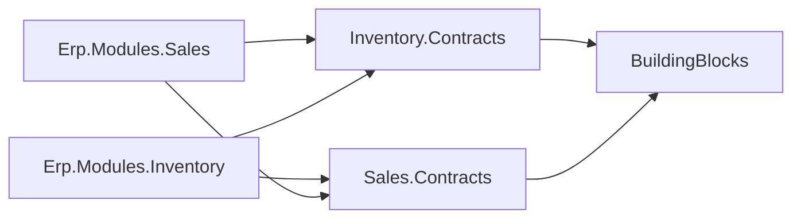

# Lesson 18 — Shipping: Two Modules Calling Each Other

Good day, developer! An approved order is a promise. Today the warehouse keeps it: the clerk opens an
approved order, clicks **Ship**, and three things happen at once. Stock leaves the shelf, the reservation is
used up, and the order becomes Shipped. Two modules, one transaction, and for the first time the call goes
the other way: Inventory asks Sales. That's the day lesson 09's Contracts projects were built for. About an
hour and a half. Are you ready? Let's begin!

## What we'll build

| Endpoint | Who | What it does |
|---|---|---|
| `POST /api/shipments` | InventoryClerk, Admin | Ship one approved sales order |
| `GET /api/shipments` | Anyone signed in | Shipments, newest first |

Plus a **Shipped** status for orders, the `Erp.Modules.Sales.Contracts` project, a **Ship** button on the
order page, and a Shipments screen.

## Why we build it this way

### Who owns shipping?

Shipping is the warehouse's job, and moving stock is Inventory's. So the shipment belongs to Inventory. But
the order's status belongs to Sales: only Sales may say "this order is Shipped". So Inventory runs the
shipment and asks Sales two things through a contract: "may I ship this order, and what's on it?" and "mark
it shipped".

### Calling in both directions

Sales already calls Inventory (to reserve stock). Now Inventory calls Sales. If each module referenced the
other's main project, the build would refuse: two projects can't reference each other. That's exactly why
lesson 09 put Inventory's window in a separate Contracts project. Now Sales gets one too:



Every arrow points toward a Contracts project, and Contracts point only at BuildingBlocks. No cycle can
form, however many modules call each other. To remember it easily: islands never build bridges to each
other, only to each other's service windows.

### One transaction, again

If stock left the shelf but the order stayed Approved, a second click would ship it twice. If the order
became Shipped but the stock didn't move, the count would be wrong forever. So it's all or nothing:
Inventory starts the transaction, and Sales joins it through the contract, the same way Inventory joined
Sales' transaction at submit.

### Two clerks, one order

Two clerks click Ship on the same order at the same moment. Both see "Approved", both start shipping. The
fix is lesson 09's customer lock, applied to the order: Sales locks the order's row inside the transaction.
The second clerk waits at the lock, then sees "Shipped" and gets a clear 422. And a unique index on
`shipment.sales_order_id` stands behind it: whatever the code does, one order can only ship once.

## 1. Orders learn to ship

A sixth status. In `SalesOrder.cs`:

```csharp
internal enum SalesOrderStatus
{
    Draft = 0,
    PendingApproval = 1,
    Approved = 2,
    Cancelled = 3,
    Rejected = 4,
    Shipped = 5
}
```

and in the transition table, an approved order may now ship, and a shipped order goes nowhere:

```csharp
[SalesOrderStatus.Approved]        = [SalesOrderStatus.Shipped, SalesOrderStatus.Cancelled],
[SalesOrderStatus.Shipped]         = [],
```

Two methods, next to `Cancel`:

```csharp
public DateTime? ShippedUtc { get; private set; }

public void EnsureCanShip()
{
    if (Status != SalesOrderStatus.Approved)
        throw new DomainException(SalesErrors.OnlyApprovedOrdersShip, $"Only approved orders can be shipped; {OrderNumber} is {Status}.");
}

public void MarkShipped(DateTime nowUtc)
{
    EnsureCanShip();
    Transition(SalesOrderStatus.Shipped);
    ShippedUtc = nowUtc;
}
```

Notice what *isn't* allowed: cancelling a shipped order. The goods are gone; taking them back is a return,
a different business process with its own paperwork. The state machine says so by leaving `Shipped` with no
way out. `HoldsStock` stays as it was: a shipped order holds no reservation, because shipping used it up.

The `RejectAndCancelTests` class becomes `ShipRejectCancelTests`, with one more test:

```csharp
[Fact]
public void Only_an_approved_order_ships_and_a_shipped_order_cannot_be_cancelled()
{
    var customer = Make.Customer();
    var order = Make.Order(customer, unitPrice: 60_000);
    order.Invoking(o => o.MarkShipped(Make.Now)).Should().Throw<DomainException>();

    order.Submit(customer, Money.Zero, Make.Now);
    order.Approve(Make.Manager, customer, Make.Now);
    order.MarkShipped(Make.Now);

    order.Status.Should().Be(SalesOrderStatus.Shipped);
    order.Invoking(o => o.Cancel(customer)).Should().Throw<DomainException>();
}
```

In `SalesDbContext`, the status check constraint widens to `status BETWEEN 0 AND 5`, and a lock for the
order joins the customer's:

```csharp
public Task LockOrderAsync(SalesOrderId id, CancellationToken ct) =>
    Database.ExecuteSqlAsync($"SELECT 1 FROM sales.sales_order WHERE id = {id.Value} FOR UPDATE", ct);
```

The order page reads `shipped_utc` too, so `sales.get_sales_order` needs it. That's a changed result, so
it's lesson 15's recipe again: a `sales.get_sales_order.v2.sql` that drops version 1 and creates the
function with one more column at the end, `shipped_utc timestamptz` (selecting `o.shipped_utc`). Its
companion `get_sales_order_lines` is unchanged, so version 2 recreates it as it was. Then:

```bash
dotnet ef migrations add AddShipping \
  --project src/Modules/Sales/Erp.Modules.Sales --startup-project src/Modules/Sales/Erp.Modules.Sales \
  --output-dir Infrastructure/Migrations
```

EF generates the new column and the wider check constraint; add the `.v2.sql` at the end of `Up`, and put
version 1 back in `Down`. In `GetSalesOrderHandler.cs`, the header row and the DTO gain
`DateTime? ShippedUtc` at the end, passed through as `h.ShippedUtc`.

Shipping an order that isn't approved gets a code, at the end of `SalesErrors`:

```csharp
    public static readonly ErrorCode OnlyApprovedOrdersShip = new("SALES-0024", "Only approved orders can be shipped",
        "Submit the order and get it approved first.");
```

## 2. Sales' service window

```bash
dotnet new classlib -n Erp.Modules.Sales.Contracts -o src/Modules/Sales/Erp.Modules.Sales.Contracts
rm src/Modules/Sales/Erp.Modules.Sales.Contracts/Class1.cs
dotnet sln add src/Modules/Sales/Erp.Modules.Sales.Contracts
dotnet add src/Modules/Sales/Erp.Modules.Sales.Contracts reference src/Shared/Erp.Shared.BuildingBlocks
dotnet add src/Modules/Sales/Erp.Modules.Sales reference src/Modules/Sales/Erp.Modules.Sales.Contracts
dotnet add src/Modules/Inventory/Erp.Modules.Inventory reference src/Modules/Sales/Erp.Modules.Sales.Contracts
```

As always, delete the new `<PropertyGroup>`.

```csharp
// src/Modules/Sales/Erp.Modules.Sales.Contracts/SalesContracts.cs
using System.Data.Common;

namespace Erp.Modules.Sales.Contracts;

public sealed record ShippableOrder(long OrderId, string OrderNumber, IReadOnlyList<ShippableLine> Lines);
public sealed record ShippableLine(long ItemId, decimal Quantity);

public interface ISalesOrders
{
    // Both join the caller's transaction. GetForShipment returns null when there is no such order, and throws a
    // DomainException unless the order is approved.
    Task<ShippableOrder?> GetForShipmentAsync(long orderId, DbTransaction tx, CancellationToken ct);
    Task MarkShippedAsync(long orderId, DateTime shippedUtc, DbTransaction tx, CancellationToken ct);
}
```

Plain records and plain types again. Inventory learns the order's number and lines, and nothing else: not
the customer, not the prices.

```csharp
// src/Modules/Sales/Erp.Modules.Sales/Infrastructure/SalesOrdersService.cs
using System.Data.Common;
using Erp.Modules.Sales.Contracts;
using Erp.Modules.Sales.Domain;
using Erp.Shared.BuildingBlocks;
using Microsoft.EntityFrameworkCore;

namespace Erp.Modules.Sales.Infrastructure;

// Sales' service window for the modules that ship and bill its orders.
internal sealed class SalesOrdersService(SalesDbContext db) : ISalesOrders
{
    public Task<ShippableOrder?> GetForShipmentAsync(long orderId, DbTransaction tx, CancellationToken ct) =>
        InTransaction(tx, async () =>
        {
            var id = new SalesOrderId(orderId);
            await db.LockOrderAsync(id, ct);   // two clerks shipping the same order: the second waits, then sees Shipped
            var order = await db.SalesOrders.SingleOrDefaultAsync(o => o.Id == id, ct);
            if (order is null) return null;
            order.EnsureCanShip();
            return (ShippableOrder?)new ShippableOrder(order.Id.Value, order.OrderNumber,
                order.Lines.Select(l => new ShippableLine(l.ItemId.Value, l.Quantity.Value)).ToList());
        }, ct);

    public Task MarkShippedAsync(long orderId, DateTime shippedUtc, DbTransaction tx, CancellationToken ct) =>
        InTransaction(tx, async () =>
        {
            var id = new SalesOrderId(orderId);
            var order = await db.SalesOrders.SingleAsync(o => o.Id == id, ct);
            order.MarkShipped(shippedUtc);
            await db.SaveChangesAsync(ct);
            return true;
        }, ct);

    // Join the caller's transaction for one operation, then let go: the caller owns the commit.
    private async Task<T> InTransaction<T>(DbTransaction tx, Func<Task<T>> work, CancellationToken ct)
    {
        await db.Database.UseTransactionAsync(tx, ct);
        try { return await work(); }
        finally { await db.Database.UseTransactionAsync(null, ct); }
    }
}
```

It's the mirror image of Inventory's `StockService`: join, work, let go. A missing order is `null`, not an
exception: the caller decides what "not there" means for it. (The `(ShippableOrder?)` cast tells the compiler
both branches return the same nullable type.) And the rule about shipping, "only
approved orders", is still asked of the domain (`EnsureCanShip`), on Sales' side of the window. Inventory
never sees `SalesOrderStatus`.

Register it in `SalesModule`: `services.AddScoped<ISalesOrders, SalesOrdersService>();`.

## 3. The shipment

```csharp
// src/Modules/Inventory/Erp.Modules.Inventory/Domain/Shipment.cs
using Erp.Shared.BuildingBlocks;

namespace Erp.Modules.Inventory.Domain;

internal readonly record struct ShipmentId(long Value);

internal sealed record ShipmentLine(ItemId ItemId, decimal Quantity);

// Goods that left the building for one approved sales order. Invoicing bills from it.
internal sealed class Shipment : AggregateRoot<ShipmentId>
{
    private readonly List<ShipmentLine> _lines = new();
    public IReadOnlyList<ShipmentLine> Lines => _lines;

    public string Number { get; private set; } = default!;
    public long SalesOrderId { get; private set; }   // owned by Sales: id only, no foreign key
    public string OrderNumber { get; private set; } = default!;
    public UserId ShippedBy { get; private set; }
    public DateTime ShippedUtc { get; private set; }

    private Shipment() { }

    public static Shipment Record(ShipmentId id, string number, long salesOrderId, string orderNumber,
        IEnumerable<ShipmentLine> lines, UserId by, DateTime nowUtc)
    {
        var shipment = new Shipment
        {
            Id = id, Number = number, SalesOrderId = salesOrderId, OrderNumber = orderNumber, ShippedBy = by, ShippedUtc = nowUtc
        };
        shipment._lines.AddRange(lines);
        if (shipment._lines.Count == 0) throw new DomainException(InventoryErrors.ShipmentNeedsLines, "A shipment needs at least one line.");
        return shipment;
    }
}
```

`SalesOrderId` is a plain `long`: it's Sales' id, and Inventory may not have Sales' `SalesOrderId` type.
The order number is copied in, so the shipments list can show "SO-2026-000042" without asking Sales.

The movement kinds get their third member, `Shipment = 3`, and its factory joins `Adjustment` in
`StockMovement`:

```csharp
internal enum MovementKind { Adjustment = 2, Shipment = 3 }

public static StockMovement Shipment(ItemId item, decimal quantity, string reference, UserId by, DateTime nowUtc) =>
    new() { ItemId = item, Quantity = -quantity, Kind = MovementKind.Shipment, Reference = reference, UserId = by, OccurredUtc = nowUtc };
```

The quantity is stored negative: stock went *out*. Every movement's sign tells you the direction, so the
history adds up to what's on the shelf.

In `InventoryDbContext`, a `DbSet<Shipment> Shipments`, a `ShipmentIdConverter` in `ConfigureConventions`, a
second sequence, and the mapping:

```csharp
public Task<long> NextShipmentIdAsync(CancellationToken ct) => NextAsync($"SELECT nextval('inventory.shipment_id_seq') AS \"Value\"", ct);
```

```csharp
b.HasSequence<long>("shipment_id_seq");

b.Entity<Shipment>(e =>
{
    e.ToTable("shipment");
    e.HasKey(x => x.Id);
    e.Property(x => x.Id).ValueGeneratedNever();
    e.Property(x => x.Number).HasMaxLength(30);
    e.HasIndex(x => x.Number).IsUnique();
    e.Property(x => x.OrderNumber).HasMaxLength(30);
    e.HasIndex(x => x.SalesOrderId).IsUnique();   // an order ships once
    e.Ignore(x => x.DomainEvents);
    e.OwnsMany(x => x.Lines, l =>
    {
        l.ToTable("shipment_line", t => t.HasCheckConstraint("ck_shipment_line_qty", "quantity > 0"));
        l.WithOwner().HasForeignKey("ShipmentId");
        l.Property<long>("Id");
        l.HasKey("Id");
    });
    e.Navigation(x => x.Lines).HasField("_lines").UsePropertyAccessMode(PropertyAccessMode.Field);
});
```

The shipment number is built from its id ("SH-2026-000001"), so the id comes from a sequence before the
shipment exists. The unique index on `sales_order_id` is the database's own "an order ships once"; if two
clerks ever slipped past the lock, PostgreSQL's 23505 would make the second one a 409, thanks to lesson 17.

```bash
dotnet ef migrations add AddShipments \
  --project src/Modules/Inventory/Erp.Modules.Inventory --startup-project src/Modules/Inventory/Erp.Modules.Inventory \
  --output-dir Infrastructure/Migrations
```

## 4. The ship slice

```csharp
// src/Modules/Inventory/Erp.Modules.Inventory/Features/ShipSalesOrder/ShipSalesOrderHandler.cs
using Erp.Modules.Inventory.Domain;
using Erp.Modules.Inventory.Infrastructure;
using Erp.Modules.Sales.Contracts;
using Erp.Shared.BuildingBlocks;
using Microsoft.EntityFrameworkCore;
using Microsoft.EntityFrameworkCore.Storage;

namespace Erp.Modules.Inventory.Features;

internal sealed record ShipSalesOrderCommand(long SalesOrderId);

// Stock leaves, the reservation is used up, and the order becomes Shipped: one transaction across two modules.
internal sealed class ShipSalesOrderHandler(InventoryDbContext db, ISalesOrders orders, ICurrentUser user, TimeProvider time)
{
    public async Task<long> HandleAsync(ShipSalesOrderCommand cmd, CancellationToken ct)
    {
        await using var tx = await db.Database.BeginTransactionAsync(ct);
        var order = await orders.GetForShipmentAsync(cmd.SalesOrderId, tx.GetDbTransaction(), ct)
            ?? throw new DomainException(InventoryErrors.SalesOrderNotFound, $"Sales order {cmd.SalesOrderId} doesn't exist.");

        var now = time.GetUtcNow().UtcDateTime;
        var by = new UserId(user.UserId);
        var id = new ShipmentId(await db.NextShipmentIdAsync(ct));
        var number = DocumentNumber.Format("SH", id.Value, now);

        var lines = new List<ShipmentLine>();
        foreach (var line in order.Lines)
        {
            var itemId = new ItemId(line.ItemId);
            var rows = await db.Items
                .Where(i => i.Id == itemId && i.Reserved >= line.Quantity && i.OnHand >= line.Quantity)
                .ExecuteUpdateAsync(s => s
                    .SetProperty(i => i.OnHand, i => i.OnHand - line.Quantity)
                    .SetProperty(i => i.Reserved, i => i.Reserved - line.Quantity), ct);
            if (rows != 1)
                throw new DomainException(InventoryErrors.ReservationMissing, $"Item {line.ItemId} no longer has {line.Quantity:0.###} reserved for {order.OrderNumber}.");

            db.StockMovements.Add(StockMovement.Shipment(itemId, line.Quantity, number, by, now));
            lines.Add(new ShipmentLine(itemId, line.Quantity));
        }

        db.Shipments.Add(Shipment.Record(id, number, order.OrderId, order.OrderNumber, lines, by, now));
        await db.SaveChangesAsync(ct);
        await orders.MarkShippedAsync(order.OrderId, now, tx.GetDbTransaction(), ct);
        await tx.CommitAsync(ct);
        return id.Value;
    }
}
```

Read it as a story:

1. **Start the transaction**, and ask Sales for the order inside it. Sales locks it and checks it's
   approved; if not, its `DomainException` ends everything right here.
2. **Take the stock, one line at a time, with a guard.** Each `UPDATE` lowers both on-hand and reserved,
   but only if the reservation is really there. It's lesson 09's turnstile, used in reverse.
3. **Write a movement for each line**, referencing the shipment number, and record the shipment.
4. **Save Inventory's changes, then tell Sales** the order shipped, still in the same transaction.
5. **Commit.** Stock, movements, shipment and order status become true together.

Is the `if (rows != 1)` a business `if` in a handler? No: it's lesson 09's pattern, turning the database's
"0 rows matched" into an exception. The rule ("you can only ship what's reserved") lives in the `WHERE`,
where it's atomic.

```csharp
// src/Modules/Inventory/Erp.Modules.Inventory/Features/ShipSalesOrder/ShipSalesOrderEndpoint.cs
using Erp.Shared.BuildingBlocks;
using FluentValidation;
using Microsoft.AspNetCore.Builder;
using Microsoft.AspNetCore.Http;
using Microsoft.AspNetCore.Http.HttpResults;
using Microsoft.AspNetCore.Routing;

namespace Erp.Modules.Inventory.Features;

internal sealed record ShipSalesOrderRequest(long SalesOrderId);

internal sealed class ShipSalesOrderRequestValidator : AbstractValidator<ShipSalesOrderRequest>
{
    public ShipSalesOrderRequestValidator() => RuleFor(x => x.SalesOrderId).GreaterThan(0);
}

internal static class ShipSalesOrderEndpoint
{
    public static void Map(IEndpointRouteBuilder app) =>
        app.MapPost("/shipments", async Task<Created<CreatedId>> (ShipSalesOrderRequest body, ShipSalesOrderHandler handler, CancellationToken ct) =>
            {
                var id = await handler.HandleAsync(new ShipSalesOrderCommand(body.SalesOrderId), ct);
                return TypedResults.Created($"/api/shipments/{id}", new CreatedId(id));
            })
            .RequireAuthorization(p => p.RequireRole(Roles.InventoryClerk, Roles.Admin));
}
```

A shipment is something *created*, so it's `POST /shipments`, not `POST /sales-orders/{id}/ship`. That also
puts the address in the module that owns it, and it decides what an unknown order means here: the order id is
inside the request body, so it's a 422 with its code, as in lesson 07, not a 404. Three codes join the end of
`InventoryErrors`:

```csharp
    public static readonly ErrorCode ShipmentNeedsLines = new("INVENTORY-0007", "A shipment needs at least one line",
        "The order has nothing left to ship.");
    public static readonly ErrorCode ReservationMissing = new("INVENTORY-0008", "The order's stock is no longer reserved",
        "Reload the order: it may have been cancelled or already shipped by someone else.");
    public static readonly ErrorCode SalesOrderNotFound = new("INVENTORY-0009", "The sales order doesn't exist",
        "Choose an approved order from the list of orders ready to ship.");
```

Register `ShipSalesOrderHandler` (and, for the next section, `SearchShipmentsHandler`), and map
`ShipSalesOrderEndpoint` and `SearchShipmentsEndpoint` in `MapInventoryEndpoints`.

## 5. Listing shipments

```sql
-- inventory.search_shipments.v1.sql
-- Released scripts are never edited: change a function with a .v2 file and a new migration.
CREATE OR REPLACE FUNCTION inventory.search_shipments(p_sales_order_id bigint, p_page integer, p_page_size integer)
RETURNS TABLE (id bigint, number text, sales_order_id bigint, order_number text, shipped_by bigint,
               shipped_utc timestamptz, line_count integer)
LANGUAGE sql STABLE
AS $$
    SELECT s.id, s.number::text, s.sales_order_id, s.order_number::text, s.shipped_by, s.shipped_utc,
           (SELECT COUNT(*)::integer FROM inventory.shipment_line l WHERE l.shipment_id = s.id)
    FROM inventory.shipment s
    WHERE (p_sales_order_id IS NULL OR s.sales_order_id = p_sales_order_id)
    ORDER BY s.shipped_utc DESC, s.id DESC
    OFFSET (p_page - 1) * p_page_size
    LIMIT p_page_size;
$$;

CREATE OR REPLACE FUNCTION inventory.count_shipments(p_sales_order_id bigint)
RETURNS bigint
LANGUAGE sql STABLE
AS $$
    SELECT COUNT(*) FROM inventory.shipment s WHERE p_sales_order_id IS NULL OR s.sales_order_id = p_sales_order_id;
$$;
```

Apply it in an Inventory migration named `AddShipmentSearch`. The slice, `Features/SearchShipments/`, is a
`SearchShipmentsQuery(long? SalesOrderId, int Page, int PageSize)` returning
`ShipmentDto(long Id, string Number, long SalesOrderId, string OrderNumber, long ShippedBy, DateTime ShippedUtc,
int LineCount)`, with the paging validator, mapped as `GET /shipments` for anyone signed in. The result
columns match the DTO, so Dapper fills it directly.

## 6. The screens

On the order page, the Ship button joins the others, for the people who ship, along with a history line:

```razor
@if (_order.Status == "Approved")
{
    <AuthorizeView Roles="@Shippers">
        <MudButton OnClick="Ship" Variant="Variant.Filled" Color="Color.Primary" StartIcon="@Icons.Material.Filled.LocalShipping">Ship</MudButton>
    </AuthorizeView>
}
```

```razor
@if (_order.ShippedUtc is not null) { <MudText Typo="Typo.body2">Shipped @Format.Date(_order.ShippedUtc)</MudText> }
```

```csharp
private static readonly string Shippers = $"{Roles.InventoryClerk},{Roles.Admin}";

private async Task Ship()
{
    if (await Api.Create("api/shipments", new { salesOrderId = Id }, "Shipped.") is not null)
        await Load();
}
```

`SalesOrderDetail` in `Models.cs` gets `DateTime? ShippedUtc` before `Lines`; the order list's `Statuses`
gets `"Shipped"` after `"Approved"`; and `StatusChip` shows it green: `"Approved" or "Shipped" =>
Color.Success`.

The Shipments page:

```razor
@* src/Erp.Web/Pages/Inventory/Shipments.razor *@
@page "/shipments"
@inject ApiClient Api
@inject UserDirectory Users

<PageTitle>Shipments · ERP</PageTitle>

<MudText Typo="Typo.h4" Class="mb-2">Shipments</MudText>
<MudText Typo="Typo.body2" Class="mb-4">
    To ship an approved order, open it from <MudLink Href="sales-orders?status=Approved">Ready to ship</MudLink> and choose Ship.
</MudText>

<MudTable T="Shipment" ServerData="Load" Hover="true" Dense="true">
    <HeaderContent>
        <MudTh>Shipment</MudTh><MudTh>Order</MudTh><MudTh>Lines</MudTh><MudTh>Shipped</MudTh><MudTh>By</MudTh>
    </HeaderContent>
    <RowTemplate>
        <MudTd>@context.Number</MudTd>
        <MudTd><MudLink Href="@($"sales-orders/{context.SalesOrderId}")">@context.OrderNumber</MudLink></MudTd>
        <MudTd>@context.LineCount</MudTd>
        <MudTd>@Format.Date(context.ShippedUtc)</MudTd>
        <MudTd>@_names.GetValueOrDefault(context.ShippedBy)</MudTd>
    </RowTemplate>
    <NoRecordsContent>Nothing has shipped yet.</NoRecordsContent>
    <PagerContent><MudTablePager /></PagerContent>
</MudTable>

@code {
    private readonly Dictionary<long, string> _names = [];

    private async Task<TableData<Shipment>> Load(TableState state, CancellationToken ct)
    {
        var page = await Api.Page<Shipment>("api/shipments", state);
        foreach (var id in page.Items!.Select(s => s.ShippedBy).Distinct()) _names[id] = await Users.NameOf(id);
        return page;
    }
}
```

with `public sealed record Shipment(long Id, string Number, long SalesOrderId, string OrderNumber, long
ShippedBy, DateTime ShippedUtc, int LineCount);` in `Models.cs`. The order link crosses modules on screen,
which is fine: the browser app talks to every module's API.

The menu's Inventory group gets `<MudNavLink Href="shipments">Shipments</MudNavLink>`. And the clerk's home
page gets a tile:

```razor
<AuthorizeView Roles="@ClerkRoles">
    <MudItem xs="12" sm="6" md="4">
        <Tile Title="Ready to ship" Text="Approved orders waiting for the warehouse." Href="sales-orders?status=Approved" Icon="@Icons.Material.Filled.LocalShipping" />
    </MudItem>
</AuthorizeView>
```

with `private static readonly string ClerkRoles = $"{Roles.InventoryClerk},{Roles.Admin}";`.

The UI flow test gets its next step, after the manager approves:

```csharp
// The warehouse ships it.
var clerk = await SignIn("clerk@erp.local");
await clerk.GotoAsync(orderUrl);
await clerk.GetByRole(AriaRole.Button, new() { Name = "Ship" }).ClickAsync();
await clerk.Locator(".mud-chip").Filter(new() { HasText = "Shipped" }).WaitForAsync();
await Shot(clerk, "clerk-shipped");
```

and `"/shipments"` joins `pages`.

## 7. Prove it: only once, and only when approved

Orders can ship now, so the state machine has a sixth status. The status test from
[lesson 04](04-domain-model.md) grows: `Ship` joins the `Step` enum and `Do`, `OrderIn` learns to reach
`Shipped`, and four rows join the theory:

```csharp
public enum Step { Submit, Approve, Reject, Cancel, Ship }

// in OrderIn:
case SalesOrderStatus.Shipped: order.Approve(Make.Manager, customer, Make.Now); order.MarkShipped(Make.Now); break;

// in Do:
case Step.Ship: order.MarkShipped(Make.Now); break;

[InlineData("Draft", Step.Ship)]
[InlineData("PendingApproval", Step.Ship)]
[InlineData("Shipped", Step.Cancel)]
[InlineData("Shipped", Step.Ship)]
```

That's the value of writing the forbidden moves as a table: a new status is four new rows, not four new tests.

Through the front door, in `LaterModuleEdgeCaseTests`:

```csharp
// Lesson 18: only an approved order leaves the warehouse.
[Fact]
public async Task A_draft_order_cannot_be_shipped()
{
    var rep = await factory.ClientFor("rep@erp.local");
    var create = await rep.PostAsJsonAsync("/api/sales-orders", new { customerId = 5, lines = new[] { new { itemId = 1, quantity = 1 } } });
    var id = (await create.Content.ReadFromJsonAsync<Created>())!.Id;

    var clerk = await factory.ClientFor("clerk@erp.local");
    (await clerk.PostAsJsonAsync("/api/shipments", new { salesOrderId = id })).StatusCode.Should().Be(HttpStatusCode.UnprocessableEntity);
}
```

And the browser flow takes its next step: after the manager approves, the clerk ships. In
`From_order_to_paid_invoice_through_the_screens`, after the approval:

```csharp
// The warehouse ships it.
var clerk = await SignIn("clerk@erp.local");
await clerk.GotoAsync(orderUrl);
await clerk.GetByRole(AriaRole.Button, new() { Name = "Ship" }).ClickAsync();
await clerk.Locator(".mud-chip").Filter(new() { HasText = "Shipped" }).WaitForAsync();
await Shot(clerk, "clerk-shipped");
```

| Test | The edge | Why it matters |
|---|---|---|
| `A_step_not_allowed_from_a_status_is_refused_and_changes_nothing` (+4 rows) | When | Shipping a draft, cancelling what's on the truck |
| `A_draft_order_cannot_be_shipped` | When, through HTTP | The warehouse can't ship what nobody approved |
| "an order ships once" (in `Shipping_issues_an_invoice_and_a_payment_lowers_the_customer_balance`) | Twice | Two shipments, two invoices, one order |
| `An_order_awaiting_approval_is_not_ready_to_ship` | When | Inventory asks Sales before it moves anything |

## How a request flows

```mermaid
sequenceDiagram
  participant C as Clerk
  participant I as ShipSalesOrderHandler (Inventory)
  participant S as SalesOrdersService (Sales)
  participant DB as PostgreSQL (one connection)
  C->>I: POST /api/shipments { salesOrderId: 42 }
  I->>DB: BEGIN
  I->>S: GetForShipmentAsync(42, tx)
  S->>DB: SELECT ... FOR UPDATE (order 42); EnsureCanShip
  loop each line
    I->>DB: UPDATE inventory.item SET on_hand -= q, reserved -= q WHERE reserved >= q
  end
  I->>DB: INSERT shipment, shipment lines, stock movements
  I->>S: MarkShippedAsync(42, now, tx)
  S->>DB: UPDATE sales.sales_order SET status = 5
  I->>DB: COMMIT
  I-->>C: 201 { id }
```

## Mistakes to avoid

- Letting Inventory set the order's status itself. Status is Sales' fact; ask through the contract.
- Referencing `Erp.Modules.Sales` from Inventory. Only `Erp.Modules.Sales.Contracts`.
- Shipping without the order lock. Two clerks, one order, two shipments.
- Shipping stock that isn't reserved. The guard in the `WHERE` makes it impossible.
- Allowing "cancel" after shipping. That's a return, a different process.
- A foreign key from `inventory.shipment.sales_order_id` into `sales`. Store the id; no SQL crosses a schema.

## Let's run it!

Restart the app. As `rep@erp.local`, create and submit an order for Acme: 2 Widgets and 1.5 kg of Copper
Wire. It's approved on the spot. Then sign in as `clerk@erp.local`:

1. The home page shows **Ready to ship**. Click it: your order is in the list.
2. Open it and click **Ship**. "Shipped." The chip turns green, and the history says when.
3. **Inventory → Shipments**: SH-2026-000001, with 2 lines, shipped by Carlo Bautista.
4. **Items and stock**: Widget went from 100 to 98 on hand, with nothing reserved. Its **Movement history**
   shows −2 pc, reference SH-2026-000001.

Then the doors that should stay shut:

```bash
CLERK=$(curl -s -X POST http://localhost:5264/api/auth/login -H "Content-Type: application/json" \
  -d '{"email":"clerk@erp.local","password":"Password123!"}' | jq -r .accessToken)
curl -s -X POST http://localhost:5264/api/shipments -H "Authorization: Bearer $CLERK" \
  -H "Content-Type: application/json" -d '{"salesOrderId":1}' | jq .detail
# "Only approved orders can be shipped; SO-2026-000001 is Shipped."
```

Ship the same order again, as above: the 422 tells you it's already shipped. As the rep, try **Cancel order**
on it: there's no button, and the API would answer "Cannot move a Shipped order to Cancelled."

Run `dotnet test` once more. The architecture test `A_module_references_other_modules_only_through_their_Contracts`
now checks a module that references *two* other modules' Contracts, and passes.

## Let's check!

1. Why does the shipment belong to Inventory, while the order's status belongs to Sales?
2. Inventory calls Sales and Sales calls Inventory. Why doesn't the build refuse?
3. What happens to stock and to the order if one line's reservation turns out to be missing?
4. Two clerks ship the same order at the same moment. What stops a second shipment, twice over?
5. Why can't a shipped order be cancelled?
6. Why is the shipment's id taken from a sequence?

And that's where this lesson ends. Orders now leave the building, and stock follows every one of them out.
Next time, we fill the shelves back up: suppliers, purchase orders, and receiving goods. Good luck,
developer!

---

← [Lesson 17 — Item catalog and stock](17-item-catalog.md) · Next: [Lesson 19 — Purchasing](19-purchasing.md) →
