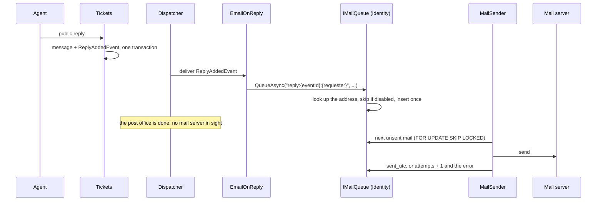

# Lesson 19 — Email: Telling People, Without Waiting for the Mail Server

Good day, developer! A new ticket arrives in the Network team's queue, and nobody is looking at the queue. Today the system speaks up. A new ticket mails the people the team's notify setting names. An agent's reply mails the requester. A requester's reply mails whoever has the ticket. An assignment mails the person assigned. We build all of it on the outbox from lesson 13, with one rule above the rest: **a mail server that is down must never slow a ticket or stop an SLA clock.** It takes about two hours. Are you ready? Let's begin!

## What we'll build

| Piece | What it is |
|---|---|
| **`outgoing_mail`** | A table in Identity: one row per mail waiting to go out, or already sent |
| **`IMailQueue`** | Identity's service window for "please mail this person". Other modules never see an email address |
| **`MailSender`** | A background service that sends the waiting mail, retries failures, and gives up only after ten tries |
| **`IMailer` and `SmtpMailer`** | The one class that talks to a mail server, extracted from lesson 16's `SmtpEmailSender` |
| **Two new Tickets events** | `TicketAssignedEvent` and `ReplyAddedEvent`; and `TicketCreatedEvent` grows an id, a subject and a team |
| **Three small handlers** | `EmailOnNewTicket`, `EmailOnAssignment`, `EmailOnReply` |

## Why we build it this way

### The pain: mail inside the post office

The obvious way: when the post office delivers `ReplyAddedEvent`, the handler sends the mail right there, with MailKit. Think about what that does. The dispatcher runs a message's handlers one after another and retries *all* of them if one fails. If the mail server is down, `EmailOnReply` fails, so the whole message is retried, and Sla's clock handler, which was waiting in the same delivery, never runs. After ten tries the message is parked, and a clock that should have started never does. One slow dependency has taken an unrelated feature down with it.

### The fix: queue it, send it somewhere else

A handler in the post office only **queues** the mail: it writes a row to a table, which cannot fail for a reason a mail server causes. A second background service, the **mail sender**, reads that table and talks to the mail server, on its own time, with its own retries. The post office is never slowed by SMTP, and a mail server that is down only delays the mail.

Two details make the queue safe. Each mail has a **key** that names it (`"reply:{eventId}:{userId}"`), and the key is unique: queueing the same key twice does nothing, which is exactly the idempotence the outbox's at-least-once delivery demands. And Identity looks up the email address, so Tickets never sees one: it says "mail user 7", and Identity decides whether user 7 has an address and an active account.

### Now, let's be honest about the cost here

There is one gap we can't close: if the app crashes between the mail server *accepting* a mail and the row being marked as sent, the mail is sent a second time after the restart. A mail server's "accepted" and our "sent" are two writes, and there is no transaction across them. For a reply notification, twice is acceptable; it is the price of never losing one. A second cost is smaller but worth knowing: the event for a reply carries the reply's text, and the outbox row keeps it. That includes an internal note, though a note is never mailed.

## 1. The queue, in Identity

The row, and its two methods. A mail is marked sent, or marked failed with the reason:

```csharp
// src/Modules/Identity/Yasda.Modules.Identity/Infrastructure/OutgoingMail.cs
namespace Yasda.Modules.Identity.Infrastructure;

// One mail waiting to go out, or already sent. The key is unique, which is what makes queueing the same mail twice
// harmless.
internal sealed class OutgoingMail
{
    public string Key { get; private set; } = default!;
    public string ToAddress { get; private set; } = default!;
    public string Subject { get; private set; } = default!;
    public string Body { get; private set; } = default!;
    public DateTime QueuedUtc { get; private set; }
    public DateTime? SentUtc { get; private set; }
    public int Attempts { get; private set; }
    public string? LastError { get; private set; }

    private OutgoingMail() { }

    public OutgoingMail(string key, string toAddress, string subject, string body, DateTime queuedUtc)
    {
        Key = key;
        ToAddress = toAddress;
        Subject = subject;
        Body = body;
        QueuedUtc = queuedUtc;
    }

    public void MarkSent(DateTime nowUtc)
    {
        SentUtc = nowUtc;
        LastError = null;
    }

    public void MarkFailed(string error)
    {
        Attempts++;
        LastError = error;
    }
}
```

Map it in `YasdaIdentityDbContext`: a `DbSet` and the mapping, before the `Team` mapping. The partial index holds only unsent mail, so it stays tiny, as the outbox's does:

```csharp
public DbSet<OutgoingMail> OutgoingMails => Set<OutgoingMail>();
```

```csharp
builder.Entity<OutgoingMail>(e =>
{
    e.ToTable("outgoing_mail");
    e.HasKey(x => x.Key);
    e.Property(x => x.Key).HasMaxLength(200);
    e.Property(x => x.ToAddress).HasMaxLength(256);
    e.Property(x => x.Subject).HasMaxLength(300);
    e.HasIndex(x => x.QueuedUtc).HasFilter("sent_utc IS NULL");
});
```

```bash
dotnet ef migrations add AddOutgoingMail --project src/Modules/Identity/Yasda.Modules.Identity --startup-project src/Modules/Identity/Yasda.Modules.Identity --output-dir Infrastructure/Migrations
```

Open it: one `CreateTable` and one filtered index.

The service window other modules will call. Add it to `IdentityContracts.cs`:

```csharp
// src/Modules/Identity/Yasda.Modules.Identity.Contracts/IdentityContracts.cs (added)
// Email that other modules want sent. The mail is only queued here; a background service sends it, so a down mail
// server never slows or fails the caller. Tickets never sees an email address.
public interface IMailQueue
{
    // Queues one mail to a person. The key names this mail ("kind:eventId:userId"): queueing the same key again does
    // nothing, so a redelivered event sends one mail. A disabled or unknown account gets nothing.
    Task QueueAsync(string key, long toUserId, string subject, string body, CancellationToken ct);
}
```

Its implementation looks the person up, skips a disabled or unknown account, and queues the mail once:

```csharp
// src/Modules/Identity/Yasda.Modules.Identity/Infrastructure/MailQueue.cs
using Microsoft.EntityFrameworkCore;
using Yasda.Modules.Identity.Contracts;

namespace Yasda.Modules.Identity.Infrastructure;

internal sealed class MailQueue(YasdaIdentityDbContext db, TimeProvider time) : IMailQueue
{
    public async Task QueueAsync(string key, long toUserId, string subject, string body, CancellationToken ct)
    {
        var user = await db.Users.AsNoTracking().SingleOrDefaultAsync(u => u.Id == toUserId, ct);
        if (user is null || user.IsDisabled || string.IsNullOrWhiteSpace(user.Email))
            return;

        var alreadyQueued = await db.OutgoingMails.AnyAsync(m => m.Key == key, ct);
        if (alreadyQueued)
            return;

        db.OutgoingMails.Add(new OutgoingMail(key, user.Email, subject, body, time.GetUtcNow().UtcDateTime));
        try
        {
            await db.SaveChangesAsync(ct);
        }
        catch (DbUpdateException)
        {
            // Another delivery queued the same key between our check and our save: that is the outcome we wanted.
            var nowQueued = await db.OutgoingMails.AsNoTracking().AnyAsync(m => m.Key == key, ct);
            if (!nowQueued)
                throw;
        }
    }
}
```

Notice the `catch`. Two deliveries of the same event can race: both check, both see "not queued", both insert, and one hits the unique key. That loser's failure means the mail is queued, which is the answer wanted, so it counts as success. It is the same idea as the clock's start in lesson 13.

## 2. The sender

### One class that talks to a mail server

Lesson 16's `SmtpEmailSender` had the MailKit code inline, for "forgot password". Two places now need to send mail (that one, and the queue's sender), so the sending moves into one class behind a small interface, which also lets a test swap in a mailer that fails. This is the before and after: the `SmtpOptions` and the `SendAsync` body leave `SmtpEmailSender` for `SmtpMailer`.

```csharp
// src/Modules/Identity/Yasda.Modules.Identity/Infrastructure/SmtpMailer.cs
using MailKit.Net.Smtp;
using MailKit.Security;
using Microsoft.Extensions.Configuration;
using Microsoft.Extensions.Logging;
using MimeKit;

namespace Yasda.Modules.Identity.Infrastructure;

internal sealed class SmtpOptions
{
    public string? Host { get; set; }
    public int Port { get; set; } = 587;
    public string? Username { get; set; }
    public string? Password { get; set; }
    public string From { get; set; } = "yasda@localhost";
}

// Sends one mail. A class behind an interface so tests can swap in one that fails.
internal interface IMailer
{
    Task SendAsync(string to, string subject, string body, CancellationToken ct);
}

// With no SMTP host configured (development), the message is logged instead, so every flow can still be followed.
internal sealed class SmtpMailer(IConfiguration config, ILogger<SmtpMailer> log) : IMailer
{
    private readonly SmtpOptions _smtp = config.GetSection("Smtp").Get<SmtpOptions>() ?? new();

    public async Task SendAsync(string to, string subject, string body, CancellationToken ct)
    {
        if (string.IsNullOrWhiteSpace(_smtp.Host))
        {
            log.LogWarning("Smtp:Host is not set; email to {To} not sent. Subject: {Subject}. Body: {Body}", to, subject, body);
            return;
        }

        var message = new MimeMessage();
        message.From.Add(MailboxAddress.Parse(_smtp.From));
        message.To.Add(MailboxAddress.Parse(to));
        message.Subject = subject;
        message.Body = new TextPart("plain") { Text = body };

        using var client = new SmtpClient();
        await client.ConnectAsync(_smtp.Host, _smtp.Port, SecureSocketOptions.StartTlsWhenAvailable, ct);
        if (!string.IsNullOrEmpty(_smtp.Username))
            await client.AuthenticateAsync(_smtp.Username, _smtp.Password ?? "", ct);
        await client.SendAsync(message, ct);
        await client.DisconnectAsync(true, ct);
    }
}
```

`SmtpEmailSender` shrinks to three one-line methods that call the mailer. Password reset still sends directly, not through the queue, because the person is waiting for it:

```csharp
// src/Modules/Identity/Yasda.Modules.Identity/Infrastructure/SmtpEmailSender.cs
using Microsoft.AspNetCore.Identity;

namespace Yasda.Modules.Identity.Infrastructure;

// Identity calls this for "forgot password". It sends straight away, not through the mail queue: the person is
// waiting for the message.
internal sealed class SmtpEmailSender(IMailer mailer) : IEmailSender<AppUser>
{
    public Task SendConfirmationLinkAsync(AppUser user, string email, string confirmationLink) =>
        mailer.SendAsync(email, "Confirm your email", $"Confirm your email address: {confirmationLink}", CancellationToken.None);

    public Task SendPasswordResetLinkAsync(AppUser user, string email, string resetLink) =>
        mailer.SendAsync(email, "Reset your password", $"Reset your password: {resetLink}", CancellationToken.None);

    public Task SendPasswordResetCodeAsync(AppUser user, string email, string resetCode) =>
        mailer.SendAsync(email, "Your password reset code",
            $"Hello {user.FullName},\n\nYour password reset code is:\n\n{resetCode}\n\n" +
            "Enter it on the sign-in page under \"Forgot password\". If you didn't ask for this, ignore this email.",
            CancellationToken.None);
}
```

### The background service

`MailSender` works the way the dispatcher does: poll, take a batch with `FOR UPDATE SKIP LOCKED` so several app instances never take the same mail, try each, record the result. A failure counts an attempt and is retried on the next tick; after `Mail:MaxAttempts` the row stays, with its error, for a person to look at. One bad mail never blocks the others, and never touches the outbox.

```csharp
// src/Modules/Identity/Yasda.Modules.Identity/Infrastructure/MailSender.cs
using System.Diagnostics.Metrics;
using Microsoft.EntityFrameworkCore;
using Microsoft.Extensions.Configuration;
using Microsoft.Extensions.DependencyInjection;
using Microsoft.Extensions.Hosting;
using Microsoft.Extensions.Logging;

namespace Yasda.Modules.Identity.Infrastructure;

internal sealed class MailOptions
{
    public int PollIntervalMs { get; set; } = 2000;
    public int BatchSize { get; set; } = 20;
    public int MaxAttempts { get; set; } = 10;
}

// Sends the mail waiting in identity.outgoing_mail, as the outbox dispatcher delivers events: poll, take a batch with
// FOR UPDATE SKIP LOCKED (several app instances never take the same mail), try each, record the result. A failure
// counts an attempt and is retried on the next tick; after MaxAttempts the row stays, with its last_error, for a
// person to look at. One bad mail never blocks the others, and never touches the outbox.
internal sealed class MailSender(
    IServiceScopeFactory scopes,
    IConfiguration config,
    TimeProvider time,
    ILogger<MailSender> log) : BackgroundService
{
    // The host listens to the meter named "Yasda" (Observability.cs), so a meter with that name is found.
    private static readonly Meter YasdaMeter = new("Yasda");
    private static readonly Counter<long> Sent = YasdaMeter.CreateCounter<long>("yasda.mail.sent");
    private static readonly Counter<long> Failed = YasdaMeter.CreateCounter<long>("yasda.mail.failed");

    private readonly MailOptions _options = config.GetSection("Mail").Get<MailOptions>() ?? new();

    protected override async Task ExecuteAsync(CancellationToken stoppingToken)
    {
        using var timer = new PeriodicTimer(TimeSpan.FromMilliseconds(_options.PollIntervalMs));
        while (await timer.WaitForNextTickAsync(stoppingToken))
        {
            try
            {
                // A full batch means more may be waiting, so go again until a batch comes back short.
                var moreWaiting = true;
                while (moreWaiting)
                {
                    var handled = await SendBatchAsync(stoppingToken);
                    moreWaiting = handled == _options.BatchSize;
                }
            }
            catch (Exception ex) when (!stoppingToken.IsCancellationRequested)
            {
                log.LogError(ex, "Sending queued mail failed; will retry next tick");
            }
        }
    }

    public async Task<int> SendBatchAsync(CancellationToken ct)
    {
        await using var scope = scopes.CreateAsyncScope();
        var db = scope.ServiceProvider.GetRequiredService<YasdaIdentityDbContext>();
        var mailer = scope.ServiceProvider.GetRequiredService<IMailer>();

        await using var tx = await db.Database.BeginTransactionAsync(ct);
        var batch = await db.OutgoingMails
            .FromSqlInterpolated($"""
                SELECT * FROM identity.outgoing_mail
                WHERE sent_utc IS NULL AND attempts < {_options.MaxAttempts}
                ORDER BY queued_utc
                LIMIT {_options.BatchSize}
                FOR UPDATE SKIP LOCKED
                """)
            .ToListAsync(ct);

        foreach (var mail in batch)
        {
            try
            {
                await mailer.SendAsync(mail.ToAddress, mail.Subject, mail.Body, ct);
                mail.MarkSent(time.GetUtcNow().UtcDateTime);
                Sent.Add(1);
            }
            catch (Exception ex) when (!ct.IsCancellationRequested)
            {
                mail.MarkFailed(ex.Message);
                Failed.Add(1);
                log.LogError(ex, "Mail {Key} failed (attempt {Attempts})", mail.Key, mail.Attempts);
            }
        }

        await db.SaveChangesAsync(ct);
        await tx.CommitAsync(ct);
        return batch.Count;
    }
}
```

Two things to notice. The counters for sent and failed mail come from a meter named `Yasda`: Identity can't reference the shared infrastructure project where lesson 15's `YasdaTelemetry` lives, but the host listens to that name, so a meter with the same name is found. And it reads the same kind of settings as the outbox. Register all of it in `IdentityModule.cs`, next to the mail sender for passwords:

```csharp
services.AddTransient<IEmailSender<AppUser>, SmtpEmailSender>();
services.AddSingleton<IMailer, SmtpMailer>();
services.AddScoped<IMailQueue, MailQueue>();
services.AddHostedService<MailSender>();
```

`IMailer` is a singleton because the transient `IEmailSender` depends on it and a transient can't depend on a scoped service. The settings go into `appsettings.json` as installation settings, next to `Smtp`:

```json
"App": {
  "PublicUrl": ""
},
"Mail": {
  "PollIntervalMs": 2000,
  "BatchSize": 20,
  "MaxAttempts": 10
},
```

`App:PublicUrl` is the address people reach YASDA at; the links in mails start with it. Lesson 28, which deploys the product, makes it a required setting.

## 3. Tickets says what happened

Mail needs three facts that the events from lesson 13 don't carry yet. Who was assigned, and by whom. What was said in a reply, and by whom. And, for a new ticket, its subject and its team. Each new event also carries an **`EventId`**, a fresh `Guid` set in the domain, which becomes part of each mail's key: that is how a redelivered event queues each mail once.

```csharp
// src/Modules/Tickets/Yasda.Modules.Tickets/Domain/TicketEvents.cs
using Yasda.Shared.BuildingBlocks;

namespace Yasda.Modules.Tickets.Domain;

// What happened to a ticket, in Tickets' own words. Each is saved to the outbox in the same transaction as the change,
// then delivered after the commit. Domain events are internal: other modules hear about them only through the
// integration events the publishing classes in Features/Events send. Each carries its own time, so a late delivery
// can't move a deadline.
// EventId names this one happening. Mail is keyed by it, so a redelivered event queues each mail once.
internal sealed record TicketCreatedEvent(Guid EventId, TicketId TicketId, string Subject, TeamId? TeamId, UserId RequesterId,
    TicketPriority Priority, DateTime CreatedUtc) : IDomainEvent;

internal sealed record FirstAgentReplyEvent(TicketId TicketId, DateTime RepliedUtc) : IDomainEvent;

internal sealed record TicketResolvedEvent(TicketId TicketId, DateTime ResolvedUtc) : IDomainEvent;

internal sealed record TicketReopenedEvent(TicketId TicketId, DateTime ReopenedUtc) : IDomainEvent;

internal sealed record TicketCancelledEvent(TicketId TicketId, DateTime CancelledUtc) : IDomainEvent;

internal sealed record TicketPriorityChangedEvent(TicketId TicketId, TicketPriority Priority, DateTime ChangedUtc) : IDomainEvent;

// Someone now has the ticket. Self-assignment (Take, or an agent's reply to an unowned ticket) raises it too, with
// AssignedById equal to AssigneeId; the mail handler skips that case.
internal sealed record TicketAssignedEvent(Guid EventId, TicketId TicketId, string Subject, UserId AssigneeId, UserId AssignedById) : IDomainEvent;

// A message was added to the conversation (internal notes too: the mail handler decides what to do with them).
// TeamId is the ticket's team when the reply was written, for the people to tell when nobody has the ticket.
internal sealed record ReplyAddedEvent(Guid EventId, TicketId TicketId, string Subject, UserId AuthorId, bool AuthorIsStaff,
    bool IsInternal, string Body, UserId RequesterId, UserId? AssigneeId, TeamId? TeamId) : IDomainEvent;
```

`Ticket` changes in four places. `Create` passes the new fields. `Assign` learns who is doing the assigning, because an assignment by yourself isn't news to you. Before:

```csharp
public void Assign(UserId agent, string agentName, DateTime nowUtc, bool assigneeIsMember = false, bool assigneeIsAdmin = false)
{
    EnsureIn("assign", TicketStatus.New, TicketStatus.Open, TicketStatus.Pending);
    EnsureCanOwn(assigneeIsMember, assigneeIsAdmin);
    AssignTo(agent, agentName, nowUtc);
}
```

After:

```csharp
public void Assign(UserId assignee, string assigneeName, UserId assignedBy, DateTime nowUtc, bool assigneeIsMember = false, bool assigneeIsAdmin = false)
{
    EnsureIn("assign", TicketStatus.New, TicketStatus.Open, TicketStatus.Pending);
    EnsureCanOwn(assigneeIsMember, assigneeIsAdmin);
    AssignTo(assignee, assigneeName, assignedBy, nowUtc);
}
```

`Take` passes the agent as both sides (`AssignTo(agent, agentName, assignedBy: agent, nowUtc)`), and so does the auto-take inside `Reply`. `AssignTo` raises the event, but only when the owner really changes:

```csharp
private void AssignTo(UserId agent, string agentName, UserId assignedBy, DateTime nowUtc)
{
    // Taking your own ticket again changes nothing, so it tells nobody.
    var changed = AssigneeId != agent;
    AssigneeId = agent;
    AssigneeName = agentName;
    if (Status == TicketStatus.New) Status = TicketStatus.Open;
    UpdatedUtc = nowUtc;
    if (changed) Raise(new TicketAssignedEvent(Guid.NewGuid(), Id, Subject, agent, assignedBy));
}
```

and the end of `Reply` raises the reply event, for every message including internal notes (the mail handler decides what to do with them):

```csharp
Raise(new ReplyAddedEvent(Guid.NewGuid(), Id, Subject, author, authorIsStaff, isInternal, text, RequesterId, AssigneeId, TeamId));
```

In `Create`, the created event becomes `ticket.Raise(new TicketCreatedEvent(Guid.NewGuid(), id, ticket.Subject, ticket.TeamId, requester, priority, nowUtc));`. In `AssignTicketHandler`, the call becomes `ticket.Assign(new UserId(assignee.Id), assignee.FullName, me, time.GetUtcNow().UtcDateTime, isMember, isAdmin);`.

## 4. Three handlers that only queue

These run in the outbox delivery, so they only queue. Read the three recipient rules; they are the heart of the lesson:

| Event | Who gets mail |
|---|---|
| A new ticket | The team's notify list (lesson 17), without the requester. A ticket with no team goes to every active team lead |
| An agent's public reply | The requester |
| A requester's reply | The assignee; or, if nobody has the ticket, the notify list |
| An assignment | The assignee, unless they assigned it to themselves |
| An internal note | Nobody |

And one rule above them: nobody gets mail about their own action. The author of a reply is removed from its list.

```csharp
// src/Modules/Tickets/Yasda.Modules.Tickets/Features/Events/EmailOnTicketEvents.cs
using Microsoft.Extensions.Configuration;
using Yasda.Modules.Identity.Contracts;
using Yasda.Modules.Tickets.Domain;
using Yasda.Shared.BuildingBlocks;

namespace Yasda.Modules.Tickets.Features;

// Mail about tickets. These run in the outbox delivery, so they only queue: Identity's background service sends, and
// a down mail server never holds back the events Sla is waiting for. The key of each mail is "kind:eventId:userId",
// so a redelivered event queues each mail once. Nobody gets mail about their own action.

internal static class TicketMail
{
    // Where the ticket can be opened. App:PublicUrl is an installation setting (the address people reach YASDA at).
    public static string LinkTo(IConfiguration config, TicketId ticketId)
    {
        var baseUrl = (config["App:PublicUrl"] ?? "").TrimEnd('/');
        return $"{baseUrl}/tickets/{ticketId.Value}";
    }
}

internal sealed class EmailOnNewTicket(IMailQueue mail, ITeamDirectory teams, IConfiguration config) : IDomainEventHandler<TicketCreatedEvent>
{
    public async Task HandleAsync(TicketCreatedEvent domainEvent, CancellationToken ct)
    {
        var teamId = domainEvent.TeamId?.Value;
        var people = await teams.NotifyListAsync(teamId, ct);
        var subject = $"New ticket #{domainEvent.TicketId.Value}: {domainEvent.Subject}";
        var body = $"A new ticket needs an owner.\n\n{domainEvent.Subject}\n\nOpen it: {TicketMail.LinkTo(config, domainEvent.TicketId)}";

        foreach (var person in people)
        {
            if (person == domainEvent.RequesterId.Value) continue;
            await mail.QueueAsync($"new-ticket:{domainEvent.EventId}:{person}", person, subject, body, ct);
        }
    }
}

internal sealed class EmailOnAssignment(IMailQueue mail, IConfiguration config) : IDomainEventHandler<TicketAssignedEvent>
{
    public async Task HandleAsync(TicketAssignedEvent domainEvent, CancellationToken ct)
    {
        // Taking a ticket yourself is not news to you.
        if (domainEvent.AssigneeId == domainEvent.AssignedById) return;

        var assignee = domainEvent.AssigneeId.Value;
        var subject = $"Ticket #{domainEvent.TicketId.Value} was assigned to you: {domainEvent.Subject}";
        var body = $"{domainEvent.Subject}\n\nOpen it: {TicketMail.LinkTo(config, domainEvent.TicketId)}";
        await mail.QueueAsync($"assigned:{domainEvent.EventId}:{assignee}", assignee, subject, body, ct);
    }
}

internal sealed class EmailOnReply(IMailQueue mail, ITeamDirectory teams, IConfiguration config) : IDomainEventHandler<ReplyAddedEvent>
{
    public async Task HandleAsync(ReplyAddedEvent domainEvent, CancellationToken ct)
    {
        // Internal notes are for staff to read on the ticket; they are never mailed.
        if (domainEvent.IsInternal) return;

        var people = new List<long>();
        if (domainEvent.AuthorIsStaff)
        {
            people.Add(domainEvent.RequesterId.Value);
        }
        else if (domainEvent.AssigneeId is not null)
        {
            people.Add(domainEvent.AssigneeId.Value.Value);
        }
        else
        {
            // Nobody has the ticket yet, so the people who hear about work nobody has (decision D9).
            var teamId = domainEvent.TeamId?.Value;
            people.AddRange(await teams.NotifyListAsync(teamId, ct));
        }

        var subject = $"Re: ticket #{domainEvent.TicketId.Value}: {domainEvent.Subject}";
        var body = $"{domainEvent.Body}\n\nOpen the ticket: {TicketMail.LinkTo(config, domainEvent.TicketId)}";
        foreach (var person in people)
        {
            if (person == domainEvent.AuthorId.Value) continue;
            await mail.QueueAsync($"reply:{domainEvent.EventId}:{person}", person, subject, body, ct);
        }
    }
}
```

Register them, by the interface each answers to, in `TicketsModule.cs`. A domain event can have several handlers, so `TicketCreatedEvent` now has two: the one that publishes to Sla, and the one that mails.

```csharp
services.AddScoped<IDomainEventHandler<TicketCreatedEvent>, PublishTicketCreated>();
services.AddScoped<IDomainEventHandler<TicketCreatedEvent>, EmailOnNewTicket>();
services.AddScoped<IDomainEventHandler<TicketAssignedEvent>, EmailOnAssignment>();
services.AddScoped<IDomainEventHandler<ReplyAddedEvent>, EmailOnReply>();
```

The two handlers for one event run one after another in the same delivery. If the mail handler fails, the delivery is retried, and `PublishTicketCreated` runs again: that is why *it* must be idempotent too, and Sla's clock handler already is (lesson 13). The mail queue's key makes the mail one safe to repeat.

## 5. Prove it: every mail rule, and a mail server that is down

### What existing tests need

- **`TicketTests`, `TicketRoutingTests`, `TicketEventTests`**: every call to `Assign` gets the new `assignedBy` argument, and the created event's shape changed (it now has `EventId`, `Subject`, `TeamId` and `RequesterId`), so the test that expects it compares the fields. The reference build has the updated files; the changes are those two.
- **`TicketEventTests`**: this lesson's new events get their own tests. They follow the pattern you know.
- **`OutboxTests`**: the round-trip test's list gains the new events, and, as lesson 13 promised, `No_event_type_is_left_out_of_the_round_trip_test` failed the moment `TicketAssignedEvent` existed until they were added. Add one `TicketCreatedEvent` with a team and one without, one `TicketAssignedEvent`, and two `ReplyAddedEvent`s, one with an assignee and a team, one with neither.

### The new unit tests

| Test | Why it matters |
|---|---|
| `Assigning_a_ticket_raises_the_assigned_event_with_who_did_it` | The mail needs both people |
| `Taking_a_ticket_raises_the_assigned_event_with_the_agent_as_both_sides` | Self-assignment, for the mail handler to skip |
| `Taking_your_own_ticket_again_raises_no_assigned_event` | Not news |
| `A_reply_raises_the_reply_added_event_with_who_wrote_it_and_who_has_the_ticket` | The mail needs the author and the assignee |
| `An_internal_note_raises_the_reply_added_event_marked_internal` | The handler decides, not the domain |
| `An_agents_reply_to_an_unowned_ticket_takes_it_and_raises_a_self_assignment` | The auto-take is a self-assignment too |

### The integration tests

Mail is observable in one place: the queue's table. Each test builds its own team and ticket, with a subject nobody else uses, waits for the outbox to drain, and reads `identity.outgoing_mail`. The test factory gets a **`TestMailer`**, which sends nothing and refuses any mail whose subject says `[fail-test]`, and two settings so retries take moments:

```csharp
// tests/Yasda.Integration.Tests/CustomWebAppFactory.cs (added)
        builder.UseSetting("Mail:PollIntervalMs", "200");
        builder.UseSetting("Mail:MaxAttempts", "3");
        builder.ConfigureTestServices(services =>
        {
            services.RemoveAll<IMailer>();
            services.AddSingleton<IMailer, TestMailer>();
        });
```


The class itself goes at the bottom of `CustomWebAppFactory.cs`:

```csharp
// tests/Yasda.Integration.Tests/CustomWebAppFactory.cs (added)
// Stands in for the SMTP server: sends nothing, and refuses any mail whose subject says "[fail-test]", so a test can watch what the
// mail sender does with a mail that can't be delivered.
internal sealed class TestMailer : IMailer
{
    public Task SendAsync(string to, string subject, string body, CancellationToken ct)
    {
        if (subject.Contains("[fail-test]", StringComparison.Ordinal))
            throw new InvalidOperationException("The test mail server refused this mail.");
        return Task.CompletedTask;
    }
}
```

The first tests in full: an agent's reply queues exactly one mail to the requester, and an internal note queues none:

```csharp
// tests/Yasda.Integration.Tests/MailTests.cs (the top of the new file; the tests below go inside the class)
using System.Net;
using System.Net.Http.Json;
using AwesomeAssertions;
using Dapper;
using Microsoft.Extensions.DependencyInjection;
using Npgsql;
using Yasda.Modules.Identity.Contracts;
using Yasda.Shared.BuildingBlocks;

namespace Yasda.Integration.Tests;

// Tickets queue mail while the outbox delivers an event; Identity's mail sender sends it afterwards. These tests read
// identity.outgoing_mail, the queue itself, after the outbox has delivered. Each builds its own team and ticket, with a
// subject nobody else uses, because all the tests share one database.
[Collection("Integration")]
public class MailTests(CustomWebAppFactory factory)
{
    private const string Admin = "admin@yasda.local", Lead = "lead@yasda.local", Agent = "agent@yasda.local", Requester = "requester@yasda.local";

    private sealed record Created(long Id);
    private sealed record Me(long Id, string FullName);
    private sealed record Mail(string Key, string ToAddress, string Subject, DateTime? SentUtc, int Attempts, string? LastError);

    private async Task<long> IdOf(string email)
    {
        var client = await factory.ClientFor(email);
        return (await client.GetFromJsonAsync<Me>("/api/auth/me"))!.Id;
    }

    private static async Task<long> MakeTeam(HttpClient admin, params long[] members)
    {
        var response = await admin.PostAsJsonAsync("/api/teams", new { name = $"Team {Guid.NewGuid():N}" });
        response.StatusCode.Should().Be(HttpStatusCode.Created);
        var id = (await response.Content.ReadFromJsonAsync<Created>())!.Id;
        foreach (var member in members)
            (await admin.PostAsJsonAsync($"/api/teams/{id}/members", new { userId = member })).EnsureSuccessStatusCode();
        return id;
    }

    private static async Task<long> MakeCategory(HttpClient lead, long teamId)
    {
        var response = await lead.PostAsJsonAsync("/api/categories", new { name = $"Category {Guid.NewGuid():N}", teamId });
        response.StatusCode.Should().Be(HttpStatusCode.Created);
        return (await response.Content.ReadFromJsonAsync<Created>())!.Id;
    }

    private static async Task<long> FileTicket(HttpClient requester, long? categoryId)
    {
        var response = await requester.PostAsJsonAsync("/api/tickets",
            new { subject = $"Mail {Guid.NewGuid():N}", message = "Please help.", priority = "Normal", categoryId });
        response.StatusCode.Should().Be(HttpStatusCode.Created);
        return (await response.Content.ReadFromJsonAsync<Created>())!.Id;
    }

    private static async Task Reply(HttpClient client, long ticketId, string body, bool isInternal = false)
    {
        var response = await client.PostAsJsonAsync($"/api/tickets/{ticketId}/replies", new { body, isInternal });
        response.StatusCode.Should().Be(HttpStatusCode.NoContent);
    }

    // The mail queued about one ticket, once the outbox has delivered everything. The kind is how the subject starts:
    // "New ticket #12", "Ticket #12 was assigned", "Re: ticket #12".
    private async Task<List<Mail>> MailAbout(long ticketId, string kind)
    {
        await using var conn = factory.OpenDatabase();
        await Waiting.OutboxesAreDrainedAsync(conn);
        var rows = await conn.QueryAsync<Mail>(
            """
            SELECT key, to_address AS ToAddress, subject, sent_utc AS SentUtc, attempts, last_error AS LastError
            FROM identity.outgoing_mail
            WHERE subject LIKE @pattern
            """,
            new { pattern = $"{kind} #{ticketId}%" });
        return rows.ToList();
    }

    private static string[] Recipients(List<Mail> mail)
    {
        var addresses = new List<string>();
        foreach (var row in mail) addresses.Add(row.ToAddress);
        addresses.Sort();
        return addresses.ToArray();
    }

    // A team with one lead and one agent that nobody else uses, a category that routes to it, and the two people's addresses.
    private async Task<(long Team, long Category, string LeadEmail, string AgentEmail)> TeamWithCategory(HttpClient admin, HttpClient seededLead)
    {
        var leadEmail = await factory.CreateUserAsync(Roles.TeamLead);
        var agentEmail = await factory.CreateUserAsync(Roles.Agent);
        var team = await MakeTeam(admin, await IdOf(leadEmail), await IdOf(agentEmail));
        var category = await MakeCategory(seededLead, team);
        return (team, category, leadEmail, agentEmail);
    }
    // ... the tests that follow
```

```csharp
// tests/Yasda.Integration.Tests/MailTests.cs (added)
    [Fact]
    public async Task An_agent_reply_queues_one_mail_to_the_requester()
    {
        var requester = await factory.ClientFor(Requester);
        var agent = await factory.ClientFor(Agent);
        var id = await FileTicket(requester, null);

        await Reply(agent, id, "Have you tried turning it off and on again?");

        var mail = await MailAbout(id, "Re: ticket");
        mail.Should().ContainSingle().Which.ToAddress.Should().Be(Requester);
        mail[0].Subject.Should().Contain("Mail ");
        var sent = await Waiting.Eventually(async () => (await MailAbout(id, "Re: ticket")).Single().SentUtc, when => when is not null);
        sent.Should().NotBeNull("the mail sender sends what is queued");
    }
```

```csharp
// tests/Yasda.Integration.Tests/MailTests.cs (added)
    [Fact]
    public async Task An_internal_note_queues_no_mail()
    {
        var requester = await factory.ClientFor(Requester);
        var agent = await factory.ClientFor(Agent);
        var id = await FileTicket(requester, null);

        await Reply(agent, id, "Fuser again, I bet.", isInternal: true);

        (await MailAbout(id, "Re: ticket")).Should().BeEmpty();
    }
```

The two that guard the promises of the lesson. A redelivered event queues its mail once; the test puts the event back in the outbox, as a crash would, and waits:

```csharp
// tests/Yasda.Integration.Tests/MailTests.cs (added)
    [Fact]
    public async Task Redelivering_a_reply_event_queues_it_once()
    {
        var requester = await factory.ClientFor(Requester);
        var agent = await factory.ClientFor(Agent);
        var id = await FileTicket(requester, null);
        await Reply(agent, id, "Looking now.");
        (await MailAbout(id, "Re: ticket")).Should().HaveCount(1);

        // The post office delivers the same event again, as it does after a crash between handling and marking it done.
        await using var conn = factory.OpenDatabase();
        var again = await conn.ExecuteAsync(
            """
            UPDATE tickets.outbox_message SET processed_utc = NULL
            WHERE type LIKE '%ReplyAddedEvent%' AND (payload -> 'TicketId' ->> 'Value')::bigint = @id
            """,
            new { id });
        again.Should().Be(1, "the reply event is in the outbox");
        await Waiting.OutboxesAreDrainedAsync(conn);

        (await MailAbout(id, "Re: ticket")).Should().HaveCount(1);
    }
```

And a mail the server refuses: it is tried the number of times the setting says, then left alone with its error, and meanwhile the outbox keeps delivering and the next mail is sent:

```csharp
// tests/Yasda.Integration.Tests/MailTests.cs (added)
    [Fact]
    public async Task Smtp_failure_retries_then_parks_the_mail_without_blocking_the_outbox()
    {
        var leadId = await IdOf(Lead);
        await using var scope = factory.Services.CreateAsyncScope();
        var queue = scope.ServiceProvider.GetRequiredService<IMailQueue>();
        var token = Guid.NewGuid().ToString("N");
        await queue.QueueAsync($"test:{token}:bad", leadId, $"[fail-test] {token}", "This one cannot be delivered.", CancellationToken.None);
        await queue.QueueAsync($"test:{token}:good", leadId, $"Fine {token}", "This one can.", CancellationToken.None);

        // Meanwhile the outbox keeps delivering: a ticket filed now still gets its mail queued.
        var requester = await factory.ClientFor(Requester);
        var id = await FileTicket(requester, null);
        (await MailAbout(id, "New ticket")).Should().NotBeEmpty();

        var bad = await Waiting.Eventually(() => Read(token, "bad"), mail => mail.Attempts >= 3);
        bad.Attempts.Should().Be(3, "the sender stops at Mail:MaxAttempts");
        bad.SentUtc.Should().BeNull();
        bad.LastError.Should().Contain("refused");
        var good = await Waiting.Eventually(() => Read(token, "good"), mail => mail.SentUtc is not null);
        good.SentUtc.Should().NotBeNull("one bad mail never blocks the others");
    }
```

| Test | Why it matters |
|---|---|
| `A_new_ticket_mails_the_teams_leads` | The default notify mode |
| `A_new_unrouted_ticket_mails_every_team_lead` | No team, every active lead |
| `A_requester_reply_to_an_unassigned_ticket_mails_the_notify_list` | Leads plus the selected members |
| `A_requester_reply_to_an_assigned_ticket_mails_only_the_assignee` | Whoever has it |
| `Everyone_mode_mails_every_member` | The third mode |
| `Taking_a_ticket_yourself_queues_no_mail` | Nobody gets mail about their own action |
| `A_team_lead_assigning_a_ticket_mails_the_assignee` | The assignment mail |
| `A_disabled_assignee_gets_no_mail` | Identity skips disabled accounts |

### Make each one fail once

Break three rules together and watch exactly their tests fail. In `EmailOnReply`, remove the `if (domainEvent.IsInternal) return;` line; in `EmailOnAssignment`, remove the `if (domainEvent.AssigneeId == domainEvent.AssignedById) return;` line; and in `EmailOnReply`, change the key from `{domainEvent.EventId}` to `{Guid.NewGuid()}`. Run the integration tests: `An_internal_note_queues_no_mail`, `Taking_a_ticket_yourself_queues_no_mail` and `Redelivering_a_reply_event_queues_it_once` fail, and no others. Put the three back.

## How a mail travels



## Mistakes to avoid

- Sending mail inside the post office. A slow server holds up everything delivered with it.
- A queue key that isn't unique per event and person. A redelivered event would mail twice.
- Mailing the person who did the thing. Nobody wants mail about their own reply.
- Giving Tickets an email address. It says "mail user 7"; Identity knows the address.
- Mailing an internal note. It is for staff to read on the ticket.
- Putting `App:PublicUrl` in code. It describes the installation.

## Let's run it!

```bash
dotnet build Yasda.slnx
dotnet test --solution Yasda.slnx
dotnet run --project src/Yasda.Api
```

With no SMTP host set, the mail sender logs each mail instead of sending it, so you can watch it work in the console. Sign in as `requester@yasda.local` and file a ticket in the Network category; the log shows a warning like `Smtp:Host is not set; email to lead@yasda.local not sent. Subject: New ticket #…`. As `agent@yasda.local`, take the Service desk's ticket and reply: a mail to the requester. Then look at the queue:

```bash
podman exec -it yasda-postgres psql -U yasda_dev -d yasda -c "SELECT to_address, subject, sent_utc IS NOT NULL AS sent, attempts FROM identity.outgoing_mail ORDER BY queued_utc DESC LIMIT 5;"
```

## Let's check!

1. Why must a handler in the post office only queue mail, and not send it?
2. What makes queueing the same mail twice harmless?
3. Why does Tickets never see an email address?
4. What is `EventId` for?
5. Who gets mail when a requester replies to a ticket nobody has?
6. Why does an assignment to yourself send nothing?
7. What is the one gap the mail queue can't close, and why?
8. Why is `IMailer` a singleton?

And that's where this lesson ends. The system now tells the right people about the right things, and a mail server that is down only delays the mail. That closes the plan for events, deadlines, teams and mail. Next time, we give the product something to read: a knowledge base of articles with a review step and an audit trail. Good luck, developer!

---

← [Lesson 18 — Categories and routing](18-routing.md) · Next: [Lesson 20 — The knowledge base, part one: articles and the review](20-articles.md) →
