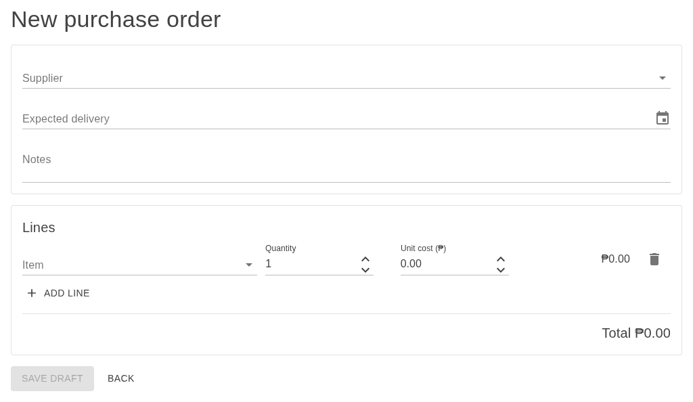
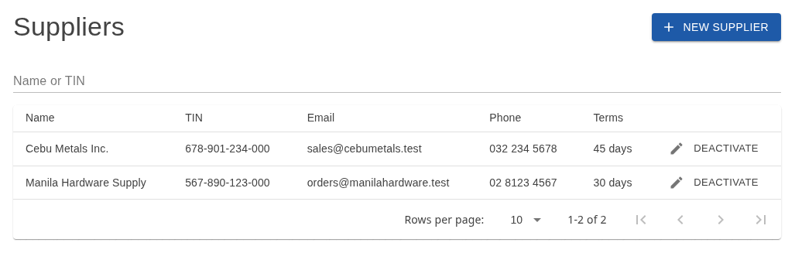
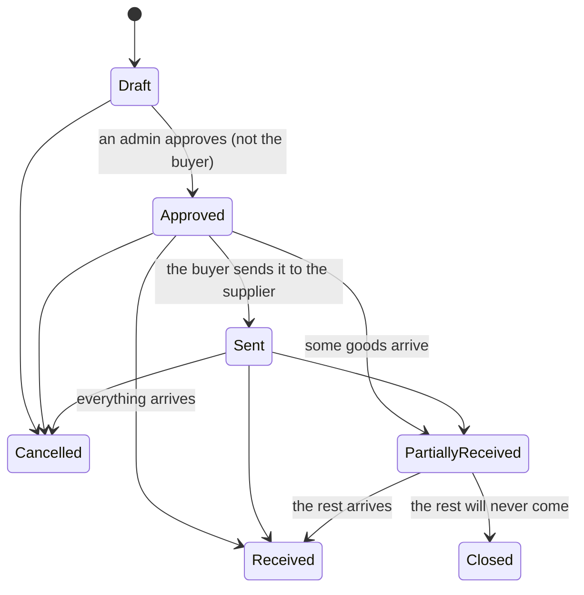
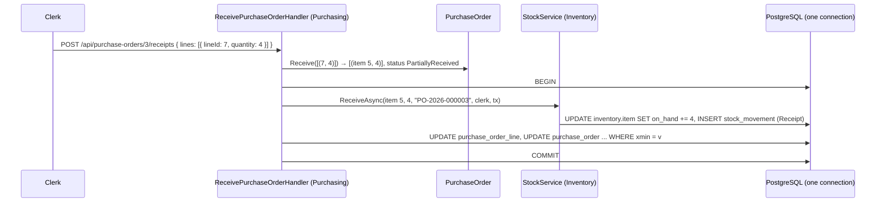

# Lesson 19 — Purchasing: Filling the Shelves

Good day, developer! Stock leaves with every shipment, and so far the only way it comes back is a clerk's
adjustment. A real business buys it: a buyer orders from a supplier, someone else approves the spending, the
supplier delivers, sometimes in parts, and the clerk counts what arrived. Today we build all of that as a
fourth module, Purchasing. You'll recognize almost every move, which is the point: the patterns are doing
the work now. About two hours. Are you ready? Let's begin!

## What we'll build

| Endpoint | Who | What it does |
|---|---|---|
| `GET`, `POST`, `PUT /api/suppliers`, `/activate`, `/deactivate` | Purchaser, Admin (read: also clerk, accountant) | Supplier maintenance |
| `POST /api/purchase-orders`, `PUT /api/purchase-orders/{id}` | Purchaser, Admin | Write or change a draft |
| `POST /api/purchase-orders/{id}/approve` | Admin | Approve the spending |
| `POST /api/purchase-orders/{id}/send`, `/close`, `/cancel` | Purchaser, Admin | Sent to the supplier; closed short; cancelled |
| `POST /api/purchase-orders/{id}/receipts` | InventoryClerk, Purchaser, Admin | Count what arrived, and put it into stock |
| `GET /api/purchase-orders`, `/api/purchase-orders/{id}` | Purchasing readers | Search and read |

Plus two new windows on Inventory's island (`IItemCatalog` and `IStockReceiving`), and the Suppliers,
Purchase orders, purchase order and Receive screens.

The purchase order form, and the supplier list behind it:





## Why we build it this way

### A purchase order's life



Three business rules hide in that picture:

| Rule | Why |
|---|---|
| Nobody approves their own purchase order | Spending needs a second pair of eyes: segregation of duties, as in lesson 04 |
| Goods can be received once approved, even before "Sent" | Suppliers deliver when they deliver; the clerk must not be blocked by a missing click |
| A partly received order can be **closed short** | The supplier ran out; the remaining quantity will never come, and the order shouldn't stay open forever |

### What Purchasing needs from Inventory

Two things, both through Inventory's Contracts:

- **What an item is**: its SKU, name, unit, whether fractions are allowed, whether it's active. Purchasing
  copies them onto each line when the order is written, like Sales' order lines do.
- **"These goods arrived"**: on-hand stock goes up, with a receipt movement in the audit trail, in the same
  transaction as the purchase order recording what it received.

Why ask for the catalog through a contract, when Sales keeps a copy through events? Because Purchasing needs
it rarely (when a buyer writes an order) and needs it current (no ordering an item the clerk just
deactivated). A copy pays off when you read something constantly. A contract pays off when you read it now
and then. Both are fine designs; the course uses each where it fits.

## 1. The module

```bash
dotnet new classlib -n Erp.Modules.Purchasing -o src/Modules/Purchasing/Erp.Modules.Purchasing
rm src/Modules/Purchasing/Erp.Modules.Purchasing/Class1.cs
dotnet sln add src/Modules/Purchasing/Erp.Modules.Purchasing
dotnet add src/Modules/Purchasing/Erp.Modules.Purchasing reference \
  src/Shared/Erp.Shared.BuildingBlocks src/Modules/Inventory/Erp.Modules.Inventory.Contracts
dotnet add src/Erp.Api reference src/Modules/Purchasing/Erp.Modules.Purchasing
```

Then the packages and `.csproj` lines every module has: Npgsql's EF Core provider, `EFCore.NamingConventions`,
the design package (build-only), `FluentValidation.DependencyInjectionExtensions` and Dapper, the ASP.NET Core
framework reference, the embedded SQL, and `InternalsVisibleTo` for `Erp.Modules.Purchasing.UnitTests` and
`Erp.Integration.Tests` (test projects only, as always). Copy them from `Erp.Modules.Inventory.csproj`; the versions are already in
`Directory.Packages.props`.

`PurchasingModule` has the same two public methods as Inventory's. `AddPurchasingModule` registers the
DbContext on the shared connection with the outbox interceptor, `IModuleDatabase`, each handler as you write
it, the validators and the error catalog; `MapPurchasingEndpoints` maps each endpoint class into a group
tagged "Purchasing". In `Program.cs`, register it after Inventory and map it with `api.MapPurchasingEndpoints();`.
The module joins the `Modules` lists in the architecture tests and in `WiringTests`, and its catalog joins
`ErrorCatalogTests` (`"PURCHASING"`) and `ErrorCodeTests`.

## 2. The domain

```csharp
// src/Modules/Purchasing/Erp.Modules.Purchasing/Domain/Supplier.cs
using Erp.Shared.BuildingBlocks;

namespace Erp.Modules.Purchasing.Domain;

internal readonly record struct SupplierId(long Value);
internal readonly record struct PurchaseOrderId(long Value);
internal readonly record struct ItemId(long Value);   // owned by Inventory
internal readonly record struct UserId(long Value);   // owned by Identity

internal sealed class Supplier : Entity<SupplierId>
{
    public string Name { get; private set; } = default!;
    public string? Tin { get; private set; }
    public string? Address { get; private set; }
    public string? Email { get; private set; }
    public string? Phone { get; private set; }
    public int PaymentTermsDays { get; private set; }
    public bool IsActive { get; private set; }

    private Supplier() { }

    public static Supplier Create(string name, string? tin, string? address, string? email, string? phone, int paymentTermsDays)
    {
        var supplier = new Supplier { IsActive = true };
        supplier.Update(name, tin, address, email, phone, paymentTermsDays);
        return supplier;
    }

    public void Update(string name, string? tin, string? address, string? email, string? phone, int paymentTermsDays)
    {
        if (string.IsNullOrWhiteSpace(name)) throw new DomainException(PurchasingErrors.SupplierNameRequired, "A supplier needs a name.");
        if (paymentTermsDays is < 0 or > 365) throw new DomainException(PurchasingErrors.PaymentTermsOutOfRange, "Payment terms must be between 0 and 365 days.");
        Name = name.Trim();
        Tin = Clean(tin); Address = Clean(address); Email = Clean(email); Phone = Clean(phone);
        PaymentTermsDays = paymentTermsDays;
    }

    public void SetActive(bool active) => IsActive = active;

    public void EnsureCanOrderFrom()
    {
        if (!IsActive) throw new DomainException(PurchasingErrors.SupplierInactive, $"Supplier '{Name}' is inactive.");
    }

    private static string? Clean(string? value) => string.IsNullOrWhiteSpace(value) ? null : value.Trim();
}
```

`Supplier` is lesson 15's `Customer` pattern on the other side of the business: `Create` calls `Update`, and
blanks become `null`.

```csharp
// src/Modules/Purchasing/Erp.Modules.Purchasing/Domain/PurchaseOrder.cs
using Erp.Shared.BuildingBlocks;

namespace Erp.Modules.Purchasing.Domain;

// Stored as numbers: never renumber.
internal enum PurchaseOrderStatus
{
    Draft = 0,
    Approved = 1,
    Sent = 2,
    PartiallyReceived = 3,
    Received = 4,
    Closed = 5,      // partly received, and the rest will never come
    Cancelled = 6
}

// What we buy, from whom, at what cost. Snapshot of the item as it was when ordered.
internal sealed class PurchaseOrderLine
{
    public long Id { get; private set; }
    public ItemId ItemId { get; private set; }
    public string Sku { get; private set; } = default!;
    public string ItemName { get; private set; } = default!;
    public string Unit { get; private set; } = default!;
    public Quantity Quantity { get; private set; }
    public decimal ReceivedQuantity { get; private set; }
    public Money UnitCost { get; private set; }
    public Money LineTotal => UnitCost * Quantity;
    public decimal Outstanding => Quantity.Value - ReceivedQuantity;

    private PurchaseOrderLine() { }

    public PurchaseOrderLine(ItemId itemId, string sku, string itemName, string unit, Quantity quantity, Money unitCost)
    { ItemId = itemId; Sku = sku; ItemName = itemName; Unit = unit; Quantity = quantity; UnitCost = unitCost; }

    public void EnsureCanReceive(decimal quantity)
    {
        if (quantity > Outstanding)
            throw new DomainException(PurchasingErrors.ReceiptExceedsOutstanding, $"Only {Outstanding:0.###} {Unit} of {Sku} is still to come; {quantity:0.###} was entered.");
    }

    public void Receive(Quantity quantity)
    {
        EnsureCanReceive(quantity.Value);
        ReceivedQuantity += quantity.Value;
    }
}

internal sealed record OrderLineSpec(ItemId ItemId, string Sku, string Name, string Unit, bool AllowsFractions, bool IsActive,
    Quantity Quantity, Money UnitCost);

internal sealed class PurchaseOrder : Entity<PurchaseOrderId>
{
    private readonly List<PurchaseOrderLine> _lines = new();
    public IReadOnlyList<PurchaseOrderLine> Lines => _lines;

    public string Number { get; private set; } = default!;
    public SupplierId SupplierId { get; private set; }
    public PurchaseOrderStatus Status { get; private set; }
    public DateOnly? ExpectedDate { get; private set; }
    public string? Notes { get; private set; }
    public UserId CreatedBy { get; private set; }
    public DateTime CreatedUtc { get; private set; }
    public UserId? ApprovedBy { get; private set; }
    public DateTime? ApprovedUtc { get; private set; }
    public DateTime? SentUtc { get; private set; }

    public Money Total => _lines.Aggregate(Money.Zero, (sum, l) => sum + l.LineTotal);

    private PurchaseOrder() { }

    public static PurchaseOrder Create(string number, Supplier supplier, UserId createdBy, DateTime nowUtc)
    {
        supplier.EnsureCanOrderFrom();
        return new PurchaseOrder
        {
            Number = number, SupplierId = supplier.Id, CreatedBy = createdBy, CreatedUtc = nowUtc, Status = PurchaseOrderStatus.Draft
        };
    }

    public void Describe(DateOnly? expectedDate, string? notes)
    {
        EnsureStatus(PurchaseOrderStatus.Draft);
        ExpectedDate = expectedDate;
        Notes = string.IsNullOrWhiteSpace(notes) ? null : notes.Trim();
    }

    public void SetLines(IReadOnlyList<OrderLineSpec> lines)
    {
        EnsureStatus(PurchaseOrderStatus.Draft);
        if (lines.Count == 0) throw new DomainException(PurchasingErrors.OrderNeedsLines, "A purchase order needs at least one line.");
        if (lines.GroupBy(l => l.ItemId).Any(g => g.Count() > 1))
            throw new DomainException(PurchasingErrors.DuplicateItem, "Each item may appear on a purchase order only once.");

        foreach (var l in lines)
        {
            if (!l.IsActive) throw new DomainException(PurchasingErrors.InactiveItem, $"Item {l.Sku} is inactive.");
            if (!l.AllowsFractions && !l.Quantity.IsWhole)
                throw new DomainException(PurchasingErrors.WholeUnitsOnly, $"Item {l.Sku} is counted in whole {l.Unit}; {l.Quantity} is not allowed.");
        }
        // Checked first, replaced after: a refused line leaves the order exactly as it was.
        _lines.Clear();
        _lines.AddRange(lines.Select(l => new PurchaseOrderLine(l.ItemId, l.Sku, l.Name, l.Unit, l.Quantity, l.UnitCost)));
    }

    // Spending needs a second pair of eyes: nobody approves their own purchase order.
    public void Approve(UserId approver, DateTime nowUtc)
    {
        EnsureStatus(PurchaseOrderStatus.Draft);
        if (_lines.Count == 0) throw new DomainException(PurchasingErrors.OrderNeedsLines, "A purchase order needs at least one line.");
        if (approver == CreatedBy) throw new DomainException(PurchasingErrors.CreatorCannotApprove, "A purchase order can't be approved by the person who created it.");
        Status = PurchaseOrderStatus.Approved;
        ApprovedBy = approver;
        ApprovedUtc = nowUtc;
    }

    public void MarkSent(DateTime nowUtc)
    {
        EnsureStatus(PurchaseOrderStatus.Approved);
        Status = PurchaseOrderStatus.Sent;
        SentUtc = nowUtc;
    }

    // Returns what to put into stock. Goods can arrive before we mark the order sent, so Approved counts too.
    public IReadOnlyList<(ItemId ItemId, Quantity Quantity)> Receive(IReadOnlyList<(long LineId, Quantity Quantity)> received)
    {
        EnsureStatus(PurchaseOrderStatus.Approved, PurchaseOrderStatus.Sent, PurchaseOrderStatus.PartiallyReceived);
        if (received.Count == 0) throw new DomainException(PurchasingErrors.NothingReceived, "Enter at least one received quantity.");

        var receipt = received
            .Select(r => (Line: _lines.SingleOrDefault(l => l.Id == r.LineId)
                ?? throw new DomainException(PurchasingErrors.LineNotOnOrder, $"Line {r.LineId} is not on {Number}."), r.Quantity))
            .ToList();
        // Every line is checked before any changes, so a refused line leaves the whole order as it was.
        foreach (var sameLine in receipt.GroupBy(r => r.Line))
            sameLine.Key.EnsureCanReceive(sameLine.Sum(r => r.Quantity.Value));

        var toStock = new List<(ItemId, Quantity)>();
        foreach (var (line, quantity) in receipt)
        {
            line.Receive(quantity);
            toStock.Add((line.ItemId, quantity));
        }

        Status = _lines.All(l => l.Outstanding == 0) ? PurchaseOrderStatus.Received : PurchaseOrderStatus.PartiallyReceived;
        return toStock;
    }

    public void Close()
    {
        EnsureStatus(PurchaseOrderStatus.PartiallyReceived);
        Status = PurchaseOrderStatus.Closed;
    }

    public void Cancel()
    {
        EnsureStatus(PurchaseOrderStatus.Draft, PurchaseOrderStatus.Approved, PurchaseOrderStatus.Sent);
        Status = PurchaseOrderStatus.Cancelled;
    }

    private void EnsureStatus(params PurchaseOrderStatus[] allowed)
    {
        if (!allowed.Contains(Status))
            throw new DomainException(PurchasingErrors.InvalidStatusChange, $"{Number} is {Status}; that can't be done now.");
    }
}
```

Compare it with `SalesOrder` and you'll see two honest differences:

- **The status rules are written per method** (`EnsureStatus(...)`) instead of in a transition table. A
  purchase order's moves don't follow a single chain, and each method naming its allowed starting states
  reads more plainly here. Both styles keep the rule inside the aggregate, which is what matters.
- **`PurchaseOrder` is an `Entity`, not an `AggregateRoot`.** It raises no events, because nothing reacts to
  it. Lesson 13's rule again: an event arrives in the same change as its first handler.

`Receive` returns what goes into stock, the way `Reject` and `Cancel` return what to release in Sales. The
order decides what arrived; the handler only carries it to Inventory.

And `OrderLineSpec` is how the handler hands the domain an item it got from another module: plain facts,
already looked up, so the domain stays pure.


Every rule above has its code, in Purchasing's catalog:

```csharp
// src/Modules/Purchasing/Erp.Modules.Purchasing/Domain/PurchasingErrors.cs
using Erp.Shared.BuildingBlocks;

namespace Erp.Modules.Purchasing.Domain;

// Every business rule Purchasing can refuse with. Add new codes at the end; never renumber or reuse one.
internal static class PurchasingErrors
{
    public static readonly ErrorCode ReceiptExceedsOutstanding = new("PURCHASING-0001", "More was received than is still to come",
        "Enter only what arrived for this line. Extra goods need a new purchase order.");
    public static readonly ErrorCode OrderNeedsLines = new("PURCHASING-0002", "The purchase order has no lines",
        "Add at least one item.");
    public static readonly ErrorCode DuplicateItem = new("PURCHASING-0003", "An item appears twice",
        "Put each item on one line and add up the quantities.");
    public static readonly ErrorCode InactiveItem = new("PURCHASING-0004", "The item is inactive",
        "Reactivate the item under Inventory → Items, or choose another.");
    public static readonly ErrorCode WholeUnitsOnly = new("PURCHASING-0005", "The item is counted in whole units",
        "Enter a whole number: this item's unit can't be split.");
    public static readonly ErrorCode CreatorCannotApprove = new("PURCHASING-0006", "You can't approve your own purchase order",
        "Another admin must approve it.");
    public static readonly ErrorCode NothingReceived = new("PURCHASING-0007", "No received quantity was entered",
        "Enter the quantity that arrived on at least one line.");
    public static readonly ErrorCode LineNotOnOrder = new("PURCHASING-0008", "That line isn't on this purchase order",
        "Reload the purchase order: its lines may have changed.");
    public static readonly ErrorCode InvalidStatusChange = new("PURCHASING-0009", "The purchase order can't do that in its current status",
        "Reload it: someone may have changed it. The status shown lists the actions still possible.");
    public static readonly ErrorCode SupplierNameRequired = new("PURCHASING-0010", "A supplier needs a name",
        "Enter the supplier's registered or trade name.");
    public static readonly ErrorCode PaymentTermsOutOfRange = new("PURCHASING-0011", "Payment terms out of range",
        "Enter payment terms between 0 (cash) and 365 days.");
    public static readonly ErrorCode SupplierInactive = new("PURCHASING-0012", "The supplier is inactive",
        "Reactivate the supplier, or choose another.");
    public static readonly ErrorCode SupplierNotFound = new("PURCHASING-0013", "The supplier doesn't exist",
        "Choose a supplier from the list.");
    public static readonly ErrorCode ItemNotFound = new("PURCHASING-0014", "An item on the purchase order doesn't exist",
        "Choose items from the list.");
}
```

The last two are for ids inside a request that don't exist, the pattern from lesson 07, used by the save
handler below.

## 3. Two more windows on Inventory

In `InventoryContracts.cs`:

```csharp
public interface IStockReceiving
{
    Task ReceiveAsync(long itemId, decimal quantity, string reference, long userId, DbTransaction tx, CancellationToken ct);
}

public sealed record CatalogItem(long Id, string Sku, string Name, string Unit, bool AllowsFractions, bool IsActive);

public interface IItemCatalog
{
    Task<IReadOnlyList<CatalogItem>> GetAsync(IReadOnlyCollection<long> itemIds, CancellationToken ct);
}
```

`StockService` implements both. It needs the time for the movement, so it asks for `TimeProvider` too:

```csharp
// Inventory's service window: what other modules may ask of it.
internal sealed class StockService(InventoryDbContext db, TimeProvider time) : IStockReservation, IStockReceiving, IItemCatalog
{
    // ... TryReserveAsync and ReleaseAsync as before ...

    public Task ReceiveAsync(long itemId, decimal quantity, string reference, long userId, DbTransaction tx, CancellationToken ct) =>
        InTransaction(tx, async () =>
        {
            var id = new ItemId(itemId);
            var rows = await db.Items.Where(i => i.Id == id)
                .ExecuteUpdateAsync(s => s.SetProperty(i => i.OnHand, i => i.OnHand + quantity), ct);
            // Only items already on a purchase order are received, so a missing one is a bug, not a request to refuse.
            if (rows == 0) throw new InvalidOperationException($"Item {itemId} doesn't exist.");

            db.StockMovements.Add(StockMovement.Receipt(id, quantity, reference, new UserId(userId), time.GetUtcNow().UtcDateTime));
            await db.SaveChangesAsync(ct);
            return true;
        }, ct);

    public async Task<IReadOnlyList<CatalogItem>> GetAsync(IReadOnlyCollection<long> itemIds, CancellationToken ct)
    {
        var ids = itemIds.Select(i => new ItemId(i)).ToList();
        return await db.Items.AsNoTracking()
            .Where(i => ids.Contains(i.Id))
            .Select(i => new CatalogItem(i.Id.Value, i.Sku, i.Name, i.Unit, i.AllowsFractions, i.IsActive))
            .ToListAsync(ct);
    }
}
```

Receiving adds stock with one atomic `UPDATE`, like reserving does, so a delivery counted while an order
reserves the same item can't lose either change. The first movement kind finally arrives:

```csharp
internal enum MovementKind { Receipt = 1, Adjustment = 2, Shipment = 3 }

public static StockMovement Receipt(ItemId item, decimal quantity, string reference, UserId by, DateTime nowUtc) =>
    new() { ItemId = item, Quantity = quantity, Kind = MovementKind.Receipt, Reference = reference, UserId = by, OccurredUtc = nowUtc };
```

One class now stands behind three interfaces, and each must hand out the *same* scoped object (it holds the
request's DbContext). In `InventoryModule`, before:

```csharp
services.AddScoped<IStockReservation, StockService>();
```

after:

```csharp
services.AddScoped<StockService>();
services.AddScoped<IStockReservation>(sp => sp.GetRequiredService<StockService>());
services.AddScoped<IStockReceiving>(sp => sp.GetRequiredService<StockService>());
services.AddScoped<IItemCatalog>(sp => sp.GetRequiredService<StockService>());
```

## 4. Purchasing's database

`PurchasingDbContext` is built exactly like `SalesDbContext`: the `purchasing` schema, a static
`Configure`, a design-time factory, the outbox mapping (no events today, but every module maps its outbox
so the dispatcher can poll every schema), value converters for the typed ids, `Money` and `Quantity`, and a
sequence for numbers:

```csharp
public async Task<string> NextOrderNumberAsync(DateTime nowUtc, CancellationToken ct)
{
    var next = (await Database.SqlQuery<long>($"SELECT nextval('purchasing.purchase_order_number_seq') AS \"Value\"")
        .ToListAsync(ct)).Single();
    return DocumentNumber.Format("PO", next, nowUtc);
}
```

Lesson 07 put `DocumentNumber` in BuildingBlocks for exactly this day: "PO-2026-000001" looks like its
sales cousin.

The mapping for the order is lesson 05's, with three things worth reading:

```csharp
l.ToTable("purchase_order_line", t =>
{
    t.HasCheckConstraint("ck_purchase_order_line_qty", "quantity > 0");
    t.HasCheckConstraint("ck_purchase_order_line_received", "received_quantity >= 0 AND received_quantity <= quantity");
    t.HasCheckConstraint("ck_purchase_order_line_cost", "unit_cost >= 0");
});
l.WithOwner().HasForeignKey("PurchaseOrderId");
l.HasKey(x => x.Id);
l.Property(x => x.Id).UseIdentityColumn();
```

- **The line's `Id` is a real property**, not a shadow one, because a receipt names the line it's for.
- **`received_quantity <= quantity`** is the database's own version of `PurchaseOrderLine.Receive`.
- **`xmin` on the order, plus lesson 11's override**: a receipt changes only line rows, so
  `SaveChangesAsync` touches the order, and two clerks counting the same delivery at once get a 409 instead
  of counting it twice.

```csharp
public override Task<int> SaveChangesAsync(CancellationToken ct = default)
{
    // A receipt changes only line rows; touch the order so its xmin catches two clerks receiving at once.
    if (ChangeTracker.Entries<PurchaseOrderLine>().Any(l => l.State != EntityState.Unchanged))
        foreach (var po in ChangeTracker.Entries<PurchaseOrder>().Where(o => o.State == EntityState.Unchanged))
            po.Property(o => o.Status).IsModified = true;

    return base.SaveChangesAsync(ct);
}
```

The full file is [PurchasingDbContext.cs](../course-validation/business/src/Modules/Purchasing/Erp.Modules.Purchasing/Infrastructure/PurchasingDbContext.cs).
The `PurchasingDatabase` and a `DevSeed.sql` with two suppliers (Manila Hardware Supply and Cebu Metals)
follow Inventory's. Then `dotnet ef migrations add InitialCreate` for the new module.

## 5. The slices

**Suppliers** (`Features/SaveSupplier/`, `Features/SearchSuppliers/`) are lesson 15's customer slices
again: one `SupplierInput` shared by create and update, `activate`/`deactivate`, and a search function with
a count. Who may do what lives in one place:

```csharp
// src/Modules/Purchasing/Erp.Modules.Purchasing/Features/PurchasingRoles.cs
using Erp.Shared.BuildingBlocks;

namespace Erp.Modules.Purchasing.Features;

internal static class PurchasingRoles
{
    public static readonly string[] Buyers = [Roles.Purchaser, Roles.Admin];
    public static readonly string[] Approvers = [Roles.Admin];
    public static readonly string[] Receivers = [Roles.InventoryClerk, Roles.Purchaser, Roles.Admin];
    public static readonly string[] Readers = [Roles.Purchaser, Roles.Admin, Roles.InventoryClerk, Roles.Accountant];
}
```

**Writing a purchase order** looks up the items through the catalog contract and hands the domain plain
specs:

```csharp
// src/Modules/Purchasing/Erp.Modules.Purchasing/Features/SavePurchaseOrder/SavePurchaseOrderHandler.cs
using Erp.Modules.Inventory.Contracts;
using Erp.Modules.Purchasing.Domain;
using Erp.Modules.Purchasing.Infrastructure;
using Erp.Shared.BuildingBlocks;
using Microsoft.EntityFrameworkCore;

namespace Erp.Modules.Purchasing.Features;

internal sealed record PurchaseLineInput(long ItemId, decimal Quantity, decimal UnitCost);

// One command for a new draft (no id) and for editing a draft (id).
internal sealed record SavePurchaseOrderCommand(
    long? PurchaseOrderId, long SupplierId, DateOnly? ExpectedDate, string? Notes, IReadOnlyList<PurchaseLineInput> Lines);

internal sealed class SavePurchaseOrderHandler(PurchasingDbContext db, IItemCatalog catalog, ICurrentUser user, TimeProvider time)
{
    // null: the purchase order to update doesn't exist.
    public async Task<long?> HandleAsync(SavePurchaseOrderCommand cmd, CancellationToken ct)
    {
        var supplier = await db.Suppliers.FindAsync([new SupplierId(cmd.SupplierId)], ct)
            ?? throw new DomainException(PurchasingErrors.SupplierNotFound, $"Supplier {cmd.SupplierId} doesn't exist.");

        PurchaseOrder po;
        if (cmd.PurchaseOrderId is { } id)
        {
            var existing = await db.PurchaseOrders.SingleOrDefaultAsync(p => p.Id == new PurchaseOrderId(id), ct);
            if (existing is null) return null;
            po = existing;
        }
        else
        {
            var now = time.GetUtcNow().UtcDateTime;
            po = PurchaseOrder.Create(await db.NextOrderNumberAsync(now, ct), supplier, new UserId(user.UserId), now);
            db.PurchaseOrders.Add(po);
        }

        var items = (await catalog.GetAsync(cmd.Lines.Select(l => l.ItemId).Distinct().ToList(), ct)).ToDictionary(i => i.Id);
        var lines = cmd.Lines.Select(l => items.TryGetValue(l.ItemId, out var i)
                ? new OrderLineSpec(new ItemId(i.Id), i.Sku, i.Name, i.Unit, i.AllowsFractions, i.IsActive,
                    new Quantity(l.Quantity), new Money(l.UnitCost))
                : throw new DomainException(PurchasingErrors.ItemNotFound, $"Item {l.ItemId} doesn't exist."))
            .ToList();

        po.Describe(cmd.ExpectedDate, cmd.Notes);
        po.SetLines(lines);
        await db.SaveChangesAsync(ct);
        return po.Id.Value;
    }
}
```

The endpoints map `POST /purchase-orders` (no id) and `PUT /purchase-orders/{id:long}` to this one command,
for `PurchasingRoles.Buyers`. Both take a `PurchaseOrderRequest(long SupplierId, DateOnly? ExpectedDate, string?
Notes, IReadOnlyList<PurchaseLineInput> Lines)`, whose validator in the endpoint file wants a supplier id above
zero, at least one line, and sensible quantities and costs. A `null` from the handler means the purchase order
to edit doesn't exist: the `PUT` answers 404. An unknown supplier or item inside the request is a 422 with
`PURCHASING-0013` or `0014`. `DateOnly` is new here: an expected delivery date is a calendar day, not a
moment, so it's stored as PostgreSQL's `date` type.

**The simple status changes** (approve, send, close, cancel) touch nothing but the order, so they share one
command and one handler:

```csharp
// src/Modules/Purchasing/Erp.Modules.Purchasing/Features/ChangePurchaseOrderStatus/ChangePurchaseOrderStatusHandler.cs
using Erp.Modules.Purchasing.Domain;
using Erp.Modules.Purchasing.Infrastructure;
using Erp.Shared.BuildingBlocks;
using Microsoft.EntityFrameworkCore;

namespace Erp.Modules.Purchasing.Features;

internal enum PurchaseOrderAction { Approve, Send, Close, Cancel }

// The status changes that touch nothing but the order itself.
internal sealed record ChangePurchaseOrderStatusCommand(long PurchaseOrderId, PurchaseOrderAction Action);

internal sealed class ChangePurchaseOrderStatusHandler(PurchasingDbContext db, ICurrentUser user, TimeProvider time)
{
    public async Task<bool> HandleAsync(ChangePurchaseOrderStatusCommand cmd, CancellationToken ct)
    {
        var po = await db.PurchaseOrders.SingleOrDefaultAsync(p => p.Id == new PurchaseOrderId(cmd.PurchaseOrderId), ct);
        if (po is null) return false;

        switch (cmd.Action)
        {
            case PurchaseOrderAction.Approve: po.Approve(new UserId(user.UserId), time.GetUtcNow().UtcDateTime); break;
            case PurchaseOrderAction.Send: po.MarkSent(time.GetUtcNow().UtcDateTime); break;
            case PurchaseOrderAction.Close: po.Close(); break;
            case PurchaseOrderAction.Cancel: po.Cancel(); break;
        }

        await db.SaveChangesAsync(ct);
        return true;
    }
}
```

```csharp
// src/Modules/Purchasing/Erp.Modules.Purchasing/Features/ChangePurchaseOrderStatus/ChangePurchaseOrderStatusEndpoint.cs
using Microsoft.AspNetCore.Builder;
using Microsoft.AspNetCore.Http;
using Microsoft.AspNetCore.Http.HttpResults;
using Microsoft.AspNetCore.Routing;

namespace Erp.Modules.Purchasing.Features;

internal static class ChangePurchaseOrderStatusEndpoint
{
    public static void Map(IEndpointRouteBuilder app)
    {
        Map(app, "approve", PurchaseOrderAction.Approve, PurchasingRoles.Approvers);
        Map(app, "send", PurchaseOrderAction.Send, PurchasingRoles.Buyers);
        Map(app, "close", PurchaseOrderAction.Close, PurchasingRoles.Buyers);
        Map(app, "cancel", PurchaseOrderAction.Cancel, PurchasingRoles.Buyers);
    }

    private static void Map(IEndpointRouteBuilder app, string verb, PurchaseOrderAction action, string[] roles) =>
        app.MapPost($"/purchase-orders/{{id:long}}/{verb}",
                async Task<Results<NoContent, NotFound>> (long id, ChangePurchaseOrderStatusHandler handler, CancellationToken ct) =>
                    await handler.HandleAsync(new ChangePurchaseOrderStatusCommand(id, action), ct) ? TypedResults.NoContent() : TypedResults.NotFound())
            .RequireAuthorization(p => p.RequireRole(roles));
}
```

Is the `switch` a business `if`? No: it only picks which domain verb the caller asked for, like lesson 15's
block and unblock. Every rule (who may approve, from which status) is inside the verb. Sharing one command
here is a judgement call: four slices of five lines each would say the same thing four times. Approval keeps
its own role, `Approvers`, on its own address.

**Receiving** is the one that crosses into Inventory:

```csharp
// src/Modules/Purchasing/Erp.Modules.Purchasing/Features/ReceivePurchaseOrder/ReceivePurchaseOrderHandler.cs
using Erp.Modules.Inventory.Contracts;
using Erp.Modules.Purchasing.Domain;
using Erp.Modules.Purchasing.Infrastructure;
using Erp.Shared.BuildingBlocks;
using Microsoft.EntityFrameworkCore;
using Microsoft.EntityFrameworkCore.Storage;

namespace Erp.Modules.Purchasing.Features;

internal sealed record ReceivedLineInput(long LineId, decimal Quantity);

internal sealed record ReceivePurchaseOrderCommand(long PurchaseOrderId, IReadOnlyList<ReceivedLineInput> Lines);

// Goods in: the order records what arrived and Inventory's stock goes up, in one transaction.
internal sealed class ReceivePurchaseOrderHandler(PurchasingDbContext db, IStockReceiving stock, ICurrentUser user)
{
    public async Task<bool> HandleAsync(ReceivePurchaseOrderCommand cmd, CancellationToken ct)
    {
        var po = await db.PurchaseOrders.SingleOrDefaultAsync(p => p.Id == new PurchaseOrderId(cmd.PurchaseOrderId), ct);
        if (po is null) return false;

        var toStock = po.Receive(cmd.Lines.Select(l => (l.LineId, new Quantity(l.Quantity))).ToList());

        await using var tx = await db.Database.BeginTransactionAsync(ct);
        foreach (var (itemId, quantity) in toStock)
            await stock.ReceiveAsync(itemId.Value, quantity.Value, po.Number, user.UserId, tx.GetDbTransaction(), ct);
        await db.SaveChangesAsync(ct);   // xmin: two clerks receiving the same order at once can't both count
        await tx.CommitAsync(ct);
        return true;
    }
}
```

It's lesson 10's reject handler, mirrored: the domain says what moves, Inventory joins the transaction to
move it, and the order's own save commits with it. The address is
`POST /purchase-orders/{id:long}/receipts`, taking a `ReceivePurchaseOrderRequest` (`{ lines: [{ lineId, quantity }] }`,
validated in the endpoint file: at least one line, sensible quantities), for `PurchasingRoles.Receivers`: a
receipt is something created, like a shipment. Like the status changes, the handler returns `false` for an
order that doesn't exist, and the endpoint answers 404.

**Reading** follows lesson 08: `purchasing.search_suppliers.v1.sql` (with `count_suppliers`) and
`purchasing.search_purchase_orders.v1.sql`, which also holds `count_purchase_orders`, `get_purchase_order`
and `get_purchase_order_lines`. The search computes each order's total with
`SUM(ROUND(quantity * unit_cost, 2))`, `Money`'s arithmetic once more; the lines return `outstanding` as
`quantity - received_quantity` for the receive screen. Write them from the pattern, apply them in an
`AddReadFunctions` migration, and compare with the reference build's
[Functions folder](../course-validation/business/src/Modules/Purchasing/Erp.Modules.Purchasing/Infrastructure/Sql/Functions/).

One thing Dapper doesn't do on its own: turn a PostgreSQL `date` into a `DateOnly`. Run the search and the
expected date comes back as an error. Dapper lets you teach it a type once, for every query, with a **type
handler**:

```csharp
// src/Shared/Erp.Shared.Infrastructure/Data/DateOnlyTypeHandler.cs
using System.Globalization;
using System.Data;
using Dapper;

namespace Erp.Shared.Infrastructure;

// PostgreSQL `date` columns are calendar dates; this maps them to DateOnly, not DateTime at midnight.
public sealed class DateOnlyTypeHandler : SqlMapper.TypeHandler<DateOnly>
{
    public override void SetValue(IDbDataParameter parameter, DateOnly value)
    {
        parameter.DbType = DbType.Date;
        parameter.Value = value;
    }

    public override DateOnly Parse(object value) => value switch
    {
        DateOnly d => d,
        DateTime dt => DateOnly.FromDateTime(dt),
        _ => DateOnly.Parse(value.ToString()!, CultureInfo.InvariantCulture)
    };
}
```

Register it next to `MatchNamesWithUnderscores` in `AddSharedInfrastructure`:
`Dapper.SqlMapper.AddTypeHandler(new DateOnlyTypeHandler());`. Like that setting, it's global, so it lives in
the one place only the host sees. EF Core needs nothing: Npgsql maps `DateOnly` to `date` by itself.

## 6. The screens

Four shapes join `Models.cs`:

```csharp
public sealed record Supplier(long Id, string Name, string? Tin, string? Address, string? Email, string? Phone, int PaymentTermsDays, bool IsActive);

public sealed record PurchaseOrderSummary(long Id, string Number, long SupplierId, string SupplierName, string Status, decimal Total,
    DateOnly? ExpectedDate, DateTime CreatedUtc);

public sealed record PurchaseOrderLine(long Id, long ItemId, string Sku, string ItemName, string Unit, decimal Quantity,
    decimal ReceivedQuantity, decimal Outstanding, decimal UnitCost, decimal LineTotal);

public sealed record PurchaseOrderDetail(long Id, string Number, long SupplierId, string SupplierName, string Status, decimal Total,
    DateOnly? ExpectedDate, string? Notes, long CreatedBy, DateTime CreatedUtc, long? ApprovedBy, DateTime? ApprovedUtc,
    DateTime? SentUtc, List<PurchaseOrderLine> Lines);
```

`Format` gets a date-only overload, `public static string Date(DateOnly date) => date.ToString("MMM d, yyyy", Ph);`,
and `StatusChip` learns the new statuses: `"Received"` green; `"PartiallyReceived"` and `"Sent"` amber;
`"Closed"` grey.

The pages are built from parts you know:

| Page | Built like |
|---|---|
| **Suppliers** (`/suppliers`) and its `SupplierDialog` | Customers and `CustomerDialog`, lesson 15 |
| **Purchase orders** (`/purchase-orders`), with a status filter that reads `?status=` | The order list, lesson 08 |
| **New / edit purchase order** (`/purchase-orders/new`, `/purchase-orders/{id}/edit`) | The order form, lessons 08 and 10, with a supplier picker, an item picker over `api/items?activeOnly=true`, a unit cost per line, an expected date (`AppDatePicker`) and notes |
| **One purchase order** (`/purchase-orders/{id}`) | The order page, lesson 08, with buttons that show by status and role: Edit and Approve on a draft, Send once approved, **Receive** while goods are due, Close on a partly received order, Cancel before anything arrives |

Type them out, then compare with the reference build's
[Purchasing pages](../course-validation/business/src/Erp.Web/Pages/Purchasing/). The one new idea is the
receive dialog, so here it is in full:

```razor
@* src/Erp.Web/Pages/Purchasing/ReceiveDialog.razor *@
@inject ApiClient Api

@* Count what actually arrived. Partial deliveries are normal: the order stays open for the rest. *@
<MudDialog>
    <DialogContent>
        <MudSimpleTable Dense="true">
            <thead><tr><th>Item</th><th class="money">Still to come</th><th>Arrived now</th></tr></thead>
            <tbody>
                @foreach (var line in _lines)
                {
                    <tr>
                        <td>@line.Line.Sku · @line.Line.ItemName</td>
                        <td class="money">@Format.Qty(line.Line.Outstanding) @line.Line.Unit</td>
                        <td><AppNumericField T="decimal" @bind-Value="line.Arrived" Min="0" Max="line.Line.Outstanding" Style="max-width:140px" /></td>
                    </tr>
                }
            </tbody>
        </MudSimpleTable>
    </DialogContent>
    <DialogActions>
        <MudButton OnClick="() => Dialog.Cancel()">Cancel</MudButton>
        <MudButton OnClick="Save" Variant="Variant.Filled" Color="Color.Primary" Disabled="!_lines.Any(l => l.Arrived > 0)">Put into stock</MudButton>
    </DialogActions>
</MudDialog>

@code {
    [CascadingParameter] private IMudDialogInstance Dialog { get; set; } = default!;
    [Parameter] public PurchaseOrderDetail Order { get; set; } = default!;

    private sealed class Entry(PurchaseOrderLine line)
    {
        public PurchaseOrderLine Line { get; } = line;
        public decimal Arrived { get; set; } = line.Outstanding;
    }

    private List<Entry> _lines = [];

    protected override void OnInitialized() => _lines = Order.Lines.Where(l => l.Outstanding > 0).Select(l => new Entry(l)).ToList();

    private async Task Save()
    {
        var lines = _lines.Where(l => l.Arrived > 0).Select(l => new { lineId = l.Line.Id, quantity = l.Arrived });
        if (await Api.Post($"api/purchase-orders/{Order.Id}/receipts", new { lines }, "Received. Stock is updated."))
            Dialog.Close(DialogResult.Ok(true));
    }
}
```

Each line starts filled in with what's still to come, because a complete delivery is the common case: the
clerk only changes the lines that came short. `Max` stops typing more than is due, and the domain refuses it
anyway.

The menu gets a Purchasing group, and the home page two tiles:

```razor
<AuthorizeView Roles="@Buying">
    <MudNavGroup Title="Purchasing" Icon="@Icons.Material.Filled.ShoppingCart" Expanded="true">
        <MudNavLink Href="purchase-orders">Purchase orders</MudNavLink>
        <MudNavLink Href="suppliers">Suppliers</MudNavLink>
    </MudNavGroup>
</AuthorizeView>
```

```csharp
private static readonly string Buying = Join(Roles.Purchaser, Roles.Admin, Roles.InventoryClerk, Roles.Accountant);
```

```razor
@* inside the clerk's AuthorizeView, after "Ready to ship" *@
<MudItem xs="12" sm="6" md="4">
    <Tile Title="Goods to receive" Text="Purchase orders on their way." Href="purchase-orders?status=Sent" Icon="@Icons.Material.Filled.Inventory" />
</MudItem>
```

```razor
<AuthorizeView Roles="@BuyerRoles">
    <MudItem xs="12" sm="6" md="4">
        <Tile Title="New purchase order" Text="Restock from a supplier." Href="purchase-orders/new" Icon="@Icons.Material.Filled.ShoppingCart" />
    </MudItem>
</AuthorizeView>
```

with `private static readonly string BuyerRoles = $"{Roles.Purchaser},{Roles.Admin}";`.

## 7. Tests

A unit test project for Purchasing, set up like Inventory's, with eight tests in
[PurchaseOrderTests.cs](../course-validation/business/tests/Erp.Modules.Purchasing.UnitTests/PurchaseOrderTests.cs):
an inactive supplier gets no orders; lines check each item (whole units, active, once each); the buyer
can't approve their own order; receiving in parts tracks what's still to come; a draft can't be received and
a received order can't be cancelled; a partly received order can be closed short; and two that keep a
refused change from leaving anything half-done (below). Here's the one that tells
the story of a delivery:

```csharp
[Fact]
public void Receiving_in_parts_tracks_what_is_still_to_come()
{
    // Line ids come from the database (0 in memory), so this uses a single-line order.
    var single = Draft(Line(1, 10, 300));
    single.Approve(Admin, Now);
    single.MarkSent(Now);
    var toStock = single.Receive([(0, new Quantity(4))]);

    toStock.Should().ContainSingle().Which.Quantity.Should().Be(new Quantity(4));
    single.Status.Should().Be(PurchaseOrderStatus.PartiallyReceived);
    single.Invoking(p => p.Receive([(0, new Quantity(7))])).Should().Throw<DomainException>().WithMessage("*still to come*");

    single.Receive([(0, new Quantity(6))]);
    single.Status.Should().Be(PurchaseOrderStatus.Received);
}
```

The integration test `Receiving_a_purchase_order_puts_stock_on_hand`, in `BusinessFlowTests.cs`, walks the
whole flow through the API, buyer to admin to clerk, and checks the item's on-hand afterwards. The UI tests
add `"/suppliers"`, `"/purchase-orders"` and `"/purchase-orders/new"` to `pages`, and
`A_rep_does_not_see_administration` becomes `A_rep_does_not_see_administration_or_purchasing`, with one more
line:

```csharp
(await rep.GetByText("Purchasing").CountAsync()).Should().Be(0);
```

### A refused line, and nothing half-done

Two more tests, and the story behind them. An early version of `Receive` applied each line as it went: line
one received, line two refused, and the order was left with line one counted and the exception thrown. The
handler never saved, so nothing reached the database, but the order object was half-changed, and the next
person to add code after that `Receive` call could save it by accident. The same was true of `SetLines`. Both
now check every line first and change nothing until all have passed, and these tests hold them to it:

```csharp
[Fact]
public void A_refused_receipt_leaves_the_order_exactly_as_it_was()
{
    var po = Draft(Line(1, 10, 300));
    po.Approve(Admin, Now);

    // The same line twice: 4 fits, but 4 + 7 is more than the 10 ordered.
    po.Invoking(p => p.Receive([(0, new Quantity(4)), (0, new Quantity(7))])).Should().Throw<DomainException>();

    po.Lines.Single().Outstanding.Should().Be(10);
    po.Status.Should().Be(PurchaseOrderStatus.Approved);
}

[Fact]
public void A_refused_line_leaves_the_old_lines()
{
    var po = Draft(Line(1, 10, 300));
    po.Invoking(p => p.SetLines([Line(2, 1, 10), Line(3, 1, 10, active: false)])).Should().Throw<DomainException>();
    po.Lines.Should().ContainSingle().Which.ItemId.Should().Be(new ItemId(1));
}
```

The first one also covers an edge that's easy to miss: the *same line twice* in one receipt. Each quantity
alone fits; together they don't. That's why `Receive` adds them up per line before checking.

| Test | The edge | Why it matters |
|---|---|---|
| `Receiving_in_parts_tracks_what_is_still_to_come` | One more than outstanding | Over-receipt puts phantom stock on the shelf |
| `A_refused_receipt_leaves_the_order_exactly_as_it_was` | The same line twice; half-done | All or nothing, inside the aggregate too |
| `A_refused_line_leaves_the_old_lines` | Half-done | A refused edit keeps the order as it was |
| `The_buyer_cannot_approve_their_own_order` | Who: yourself | The second pair of eyes on spending |
| `A_draft_cannot_be_received_and_a_received_order_cannot_be_cancelled` | When | Goods can't arrive for an order nobody approved |
| `A_partly_received_order_can_be_closed_short` | The supplier never sends the rest | The order can still be finished |

## How a request flows



## Mistakes to avoid

- Letting the buyer approve their own spending. Segregation of duties, again.
- Refusing a delivery because nobody clicked "Sent". Goods arrive when they arrive.
- Leaving a short delivery open forever. Close it short.
- Writing on-hand stock from Purchasing. Ask Inventory through `IStockReceiving`, inside your transaction.
- Registering one service class three times. Register it once, and map each interface to that instance.
- Raising events nobody handles. `PurchaseOrder` stays an `Entity` until something needs to react to it.

## Let's run it!

Restart the app; Purchasing migrates and seeds its two suppliers. Then:

1. As `buyer@erp.local`: **Purchasing → Purchase orders → New**. Supplier Cebu Metals, 100 kg of Copper Wire
   at ₱410.00, and 10 Server Racks at ₱52,000.00. Save: PO-2026-000001, a draft for ₱561,000.00.
2. Still the buyer, try **Approve**: the button isn't there, and the API would say "can't be approved by the
   person who created it."
3. As `admin@erp.local`, open it and click **Approve**. Then, as the buyer, **Send**.
4. As `clerk@erp.local`, the **Goods to receive** tile lists it. Open it, click **Receive**, change the racks
   to 4, and **Put into stock**. The order is "Partially received".
5. **Items and stock**: Copper Wire is up by 100 kg, and its movement history shows a receipt referencing
   PO-2026-000001.
6. As the buyer, the supplier says the other 6 racks are discontinued: **Close**. The order is closed short.

Then `dotnet test`: six new unit tests, and the receiving flow through the API.

## Let's check!

1. Who may approve a purchase order, and why not the buyer?
2. Why can goods be received on an order that's only Approved, not yet Sent?
3. Purchasing asks Inventory for item details through a contract, while Sales keeps a copy. Why the
   difference?
4. What keeps a receipt and the stock increase consistent with each other?
5. Two clerks count the same delivery at the same moment. What stops it being counted twice?
6. Why is `PurchaseOrder` an `Entity` and not an `AggregateRoot`?

And that's where this lesson ends. The shelves fill up as well as empty, and every unit has a paper trail
both ways. Next time, money: every shipment becomes an invoice, by itself, with a number no auditor can
fault. Good luck, developer!

---

← [Lesson 18 — Shipping](18-shipping.md) · Next: [Lesson 20 — Invoicing](20-invoicing.md) →
