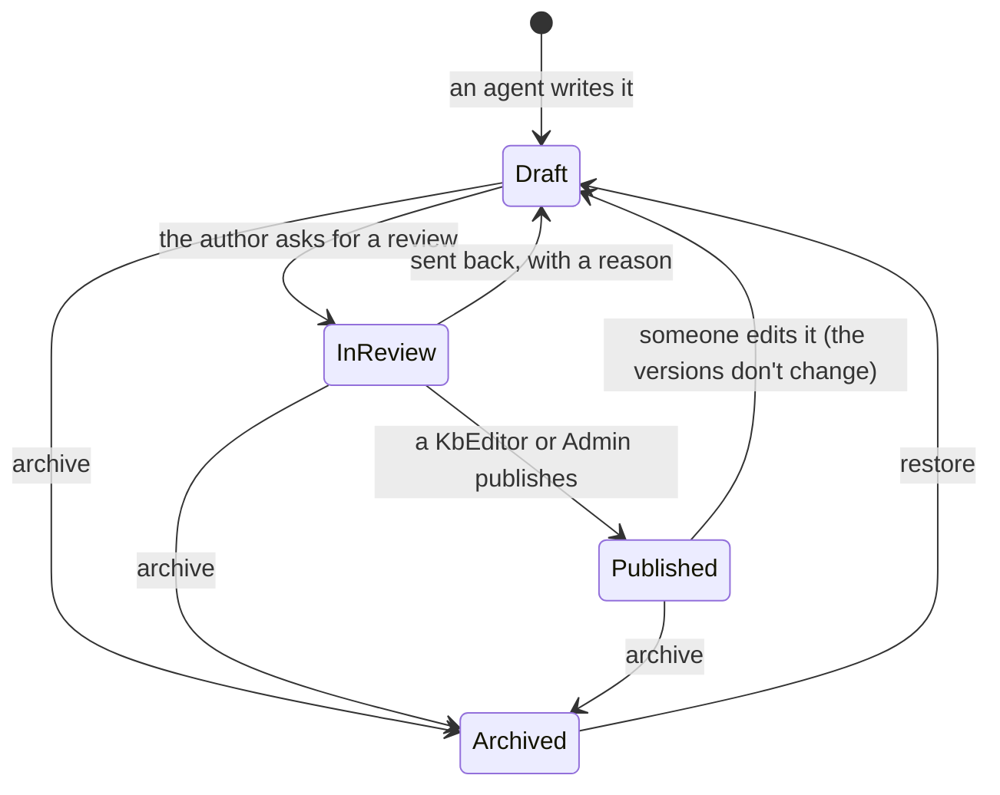
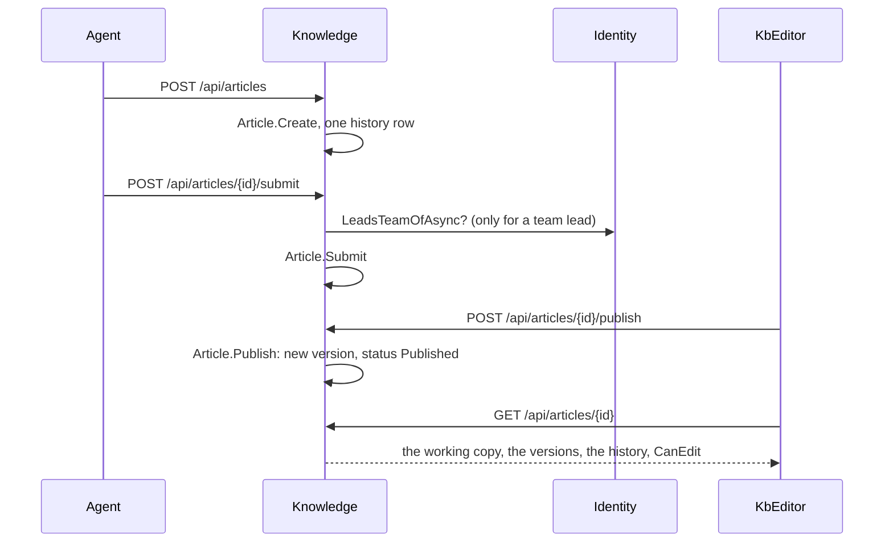

# Lesson 20 — The Knowledge Base, Part One: Articles, a Review, and a Trail You Can Trust

Good day, developer! A requester types "how do I reset my password" into a ticket, and an agent types the same answer for the fortieth time. Over the next two lessons we write the answer once. We build the **knowledge base**: help articles that staff write, a KbEditor reviews and publishes, and requesters search and read, with a record of who did what to every article. Today is the writing side, behind the API: how an article is written, reviewed and published, and who may change it. Next time, the reading side, and every screen. Along the way we meet three ideas that apply far beyond articles: a working copy that is not what readers see, a rule that nobody approves their own work, and an audit trail the code writes by itself. It takes about two hours. Are you ready? Let's begin!

## What we'll build

| Piece | What it is |
|---|---|
| **The Knowledge module** | A new island: its own schema, its own migrations, its own error codes (`KNOWLEDGE-0001` and up) |
| **`Article`** | The aggregate: a working copy, a status, numbered published **versions**, an **edit list**, and a **history** |
| **The review** | Draft → In review → Published, with Archived on the side. A KbEditor or Admin decides; the person who last changed the words never approves them |
| **Who may edit** | The author, the team leads of the author's team, KbEditors and Admins, and anyone on the article's own edit list |
| **The staff reads** | A filtered, sorted, paged list, and one article with its versions, its edit list and its history |

By the end, an agent can write an article, a KbEditor can publish it, and you can read every step in its history, all through the API and its tests. There is no screen and no reader yet: that is lesson 21.

## Why we build it this way

### The pain: one table, one status column

The obvious design is one `article` table with `title`, `body` and `status`. An editor opens a published article to fix a typo, and the moment they press Save, every requester sees the half-finished text. To avoid that, you add a rule: "don't edit published articles." Then nobody can fix a typo without taking the article down. And when a requester asks "who wrote this?", the table can only say who saved it last.

### The fix: a working copy and numbered versions

An **article** keeps two kinds of text. The **working copy** is what editors change. The **versions** are what readers see: each time a KbEditor publishes, the working copy is copied into a new numbered version, version 1, 2, 3, and a version never changes again. Editing a published article changes only the working copy, so readers keep reading version 2 while version 3 is being written.

To remember it easily: the working copy is the desk, the versions are the wall. You scribble on the desk all day; only publishing hangs a new picture on the wall.



Two rules keep the review honest. **Nobody approves their own words**: the person who last changed the text can't publish it (a rule we choose for this product). The exception is an Admin, so an installation with one person in it can still publish. And **every step leaves a line in the article's history**, written by the article itself in the same save, so the trail can't be forgotten and can't be wrong.

### Now, let's be honest about the cost here

The history only ever grows, and every version repeats the full text, so a much-edited article takes more space than its words. We accept that: space is cheap, and "who changed this and when" is the question that matters on the day something goes wrong. A second cost is that the article asks Identity one question (does this person lead the author's team?) every time a team lead acts, so a team lead's request costs one more query than an agent's. We pay it because teams are Identity's to know, and it is only asked of team leads.

## 1. The project and its small types

A new module is a new project. Make it, add it to the solution, and give the host (the API) a reference to it:

```bash
dotnet new classlib -o src/Modules/Knowledge/Yasda.Modules.Knowledge
rm src/Modules/Knowledge/Yasda.Modules.Knowledge/Class1.cs
dotnet sln add src/Modules/Knowledge/Yasda.Modules.Knowledge --solution-folder src/Modules
dotnet add src/Yasda.Api reference src/Modules/Knowledge/Yasda.Modules.Knowledge
```

Replace its project file. Knowledge needs only `BuildingBlocks` and Identity's Contracts (to ask who is staff and who leads a team), and it is the same shape as Sla's. No new package: every one is pinned already:

```xml
<!-- src/Modules/Knowledge/Yasda.Modules.Knowledge/Yasda.Modules.Knowledge.csproj -->
<Project Sdk="Microsoft.NET.Sdk">

  <ItemGroup>
    <FrameworkReference Include="Microsoft.AspNetCore.App" />
  </ItemGroup>

  <!-- Another module only through its .Contracts; never Yasda.Shared.Infrastructure. -->
  <ItemGroup>
    <ProjectReference Include="..\..\..\Shared\Yasda.Shared.BuildingBlocks\Yasda.Shared.BuildingBlocks.csproj" />
    <ProjectReference Include="..\..\Identity\Yasda.Modules.Identity.Contracts\Yasda.Modules.Identity.Contracts.csproj" />
  </ItemGroup>

  <ItemGroup>
    <InternalsVisibleTo Include="Yasda.Modules.Knowledge.UnitTests" />
    <InternalsVisibleTo Include="Yasda.Integration.Tests" />
  </ItemGroup>

  <ItemGroup>
    <EmbeddedResource Include="Infrastructure\Sql\**\*.sql" />
  </ItemGroup>

  <ItemGroup>
    <PackageReference Include="Dapper" />
    <PackageReference Include="FluentValidation" />
    <PackageReference Include="FluentValidation.DependencyInjectionExtensions" />
    <PackageReference Include="Npgsql.EntityFrameworkCore.PostgreSQL" />
    <PackageReference Include="EFCore.NamingConventions" />
    <PackageReference Include="Microsoft.EntityFrameworkCore.Relational" />
    <PackageReference Include="Microsoft.EntityFrameworkCore.Design" PrivateAssets="all" />
  </ItemGroup>

</Project>
```

The module's ids, and two small types that every method of the article will use:

```csharp
// src/Modules/Knowledge/Yasda.Modules.Knowledge/Domain/Ids.cs
namespace Yasda.Modules.Knowledge.Domain;

internal readonly record struct ArticleId(long Value);

// Owned by the Identity module, referenced by id only.
internal readonly record struct UserId(long Value);

// A person as an article remembers them: Identity's number for them, and a copy of their name, so a screen can say who did
// something without asking Identity.
internal readonly record struct Person(UserId Id, string Name);

// What the handler found out about the person acting, for the rules that depend on other modules' data. Everything else the
// article knows itself (its author, its edit list). IsEditor: a KbEditor or an Admin. LeadsAuthorsTeam: a team lead in a
// team the author belongs to.
internal readonly record struct ArticleAccess(bool IsEditor, bool LeadsAuthorsTeam);
```

A **`Person`** is a user's number and a copy of their name, so a screen can say who did something without asking Identity (the same reason a ticket copies its requester's name). **`ArticleAccess`** carries two facts the article can't know alone, because they live in another module: whether the person is a KbEditor or Admin, and whether they lead a team the author belongs to. The handler looks those up and passes them in. If you remember `assigneeIsMember` from lesson 18, it is the same idea.

```csharp
// src/Modules/Knowledge/Yasda.Modules.Knowledge/Domain/ArticleEnums.cs
namespace Yasda.Modules.Knowledge.Domain;

// Where an article is in its review. Draft → InReview → Published; Archived hides it from readers.
internal enum ArticleStatus { Draft, InReview, Published, Archived }

// Who may read a published article: everyone signed in, or staff only.
internal enum ArticleVisibility { Public, Internal }

// The things worth remembering about an article, one history row each.
internal enum ArticleAction { Created, Edited, Submitted, Rejected, Published, Archived, Restored, EditorAdded, EditorRemoved }
```

## 2. The article's rules

Three small classes hold the article's lists: what a version, an edit-list entry and a history line are. Each is written once and never changed:

```csharp
// src/Modules/Knowledge/Yasda.Modules.Knowledge/Domain/ArticleVersion.cs
namespace Yasda.Modules.Knowledge.Domain;

// What readers saw from one publication on: the words and the visibility as they were when the article was published. Written
// once and never changed, so an old version can always be shown exactly as it was.
internal sealed class ArticleVersion
{
    private ArticleVersion() { }

    internal ArticleVersion(int number, string title, string summary, string body, ArticleVisibility visibility, Person publishedBy, DateTime publishedUtc)
    {
        Number = number;
        Title = title;
        Summary = summary;
        Body = body;
        Visibility = visibility;
        PublishedById = publishedBy.Id;
        PublishedByName = publishedBy.Name;
        PublishedUtc = publishedUtc;
    }

    public long Id { get; private set; }
    public int Number { get; private set; }
    public string Title { get; private set; } = "";
    public string Summary { get; private set; } = "";
    public string Body { get; private set; } = "";
    public ArticleVisibility Visibility { get; private set; }
    public UserId PublishedById { get; private set; }
    public string PublishedByName { get; private set; } = "";
    public DateTime PublishedUtc { get; private set; }
}
```

```csharp
// src/Modules/Knowledge/Yasda.Modules.Knowledge/Domain/ArticleEditor.cs
namespace Yasda.Modules.Knowledge.Domain;

// Someone who may edit this one article, though it isn't theirs: put on its edit list by the author, a team lead of the
// author's team, or a KbEditor or Admin.
internal sealed class ArticleEditor
{
    private ArticleEditor() { }

    internal ArticleEditor(Person person, Person addedBy, DateTime addedUtc)
    {
        UserId = person.Id;
        UserName = person.Name;
        AddedById = addedBy.Id;
        AddedByName = addedBy.Name;
        AddedUtc = addedUtc;
    }

    public long Id { get; private set; }
    public UserId UserId { get; private set; }
    public string UserName { get; private set; } = "";
    public UserId AddedById { get; private set; }
    public string AddedByName { get; private set; } = "";
    public DateTime AddedUtc { get; private set; }
}
```

```csharp
// src/Modules/Knowledge/Yasda.Modules.Knowledge/Domain/ArticleHistoryEntry.cs
namespace Yasda.Modules.Knowledge.Domain;

// One line of an article's audit trail: who did what, and when. Only ever added, never changed or removed.
internal sealed class ArticleHistoryEntry
{
    private ArticleHistoryEntry() { }

    internal ArticleHistoryEntry(ArticleAction action, Person actor, DateTime atUtc, string? note, int? versionNumber)
    {
        Action = action;
        ActorId = actor.Id;
        ActorName = actor.Name;
        AtUtc = atUtc;
        Note = note;
        VersionNumber = versionNumber;
    }

    public long Id { get; private set; }
    public ArticleAction Action { get; private set; }
    public UserId ActorId { get; private set; }
    public string ActorName { get; private set; } = "";
    public DateTime AtUtc { get; private set; }
    // The reason for a rejection, or the person added to or removed from the edit list.
    public string? Note { get; private set; }
    public int? VersionNumber { get; private set; }
}
```

The module's error codes, as in every module, are in one file and never renumbered. The first five are the rules; the rest say what is wrong with the text:

```csharp
// src/Modules/Knowledge/Yasda.Modules.Knowledge/Domain/KnowledgeErrors.cs
using Yasda.Shared.BuildingBlocks;

namespace Yasda.Modules.Knowledge.Domain;

// KNOWLEDGE-0001 and up. Codes are never renumbered or reused.
internal static class KnowledgeErrors
{
    public static readonly ErrorCode NotAllowedInThisStatus = new("KNOWLEDGE-0001", "The article can't do that from its current status",
        "Reload to see where the article is. The message says which statuses allow this step.");
    public static readonly ErrorCode CannotPublishOwnChanges = new("KNOWLEDGE-0002", "You can't publish words you wrote yourself",
        "Ask another KbEditor or an Admin to review and publish it. The person who last changed the text never approves it.");
    public static readonly ErrorCode ArticleArchived = new("KNOWLEDGE-0003", "This article is archived",
        "An archived article can't change. Restore it first, then edit it.");
    public static readonly ErrorCode NotAllowedToEdit = new("KNOWLEDGE-0004", "You can't change this article",
        "Only its author, a team lead of the author's team, a KbEditor, an Admin or someone on its edit list may. Ask one of them to add you to the list.");
    public static readonly ErrorCode EditorNotStaff = new("KNOWLEDGE-0005", "That person can't be given edit access",
        "Choose an active agent or team lead from the list. KbEditors and admins can already edit every article.");
    public static readonly ErrorCode RejectReasonRequired = new("KNOWLEDGE-0006", "A reason is needed to send an article back",
        "Say in a few words what to change (up to 500 characters), so the author knows what to fix.");
    public static readonly ErrorCode TitleRequired = new("KNOWLEDGE-0007", "An article needs a title",
        "Write a short title that says what the article helps with, such as \"Reset your password\".");
    public static readonly ErrorCode TitleTooLong = new("KNOWLEDGE-0008", "The title is too long",
        "Keep the title to 200 characters.");
    public static readonly ErrorCode SummaryRequired = new("KNOWLEDGE-0009", "An article needs a summary",
        "Write one line under the title that tells a reader whether this is the article they need.");
    public static readonly ErrorCode SummaryTooLong = new("KNOWLEDGE-0010", "The summary is too long",
        "Keep the summary to 300 characters; the details belong in the body.");
    public static readonly ErrorCode BodyRequired = new("KNOWLEDGE-0011", "The article has no body",
        "Write the steps or the explanation before saving.");
    public static readonly ErrorCode BodyTooLong = new("KNOWLEDGE-0012", "The body is too long",
        "Keep the body to 20,000 characters. Split a long guide into two articles.");
}
```

And the article. Read it slowly: every rule in this lesson is a line in it.

```csharp
// src/Modules/Knowledge/Yasda.Modules.Knowledge/Domain/Article.cs
using Yasda.Shared.BuildingBlocks;

namespace Yasda.Modules.Knowledge.Domain;

// A help article, from first draft to the versions readers see. Every rule about who may change it and what may happen next
// lives here.
//
// An article has a working copy (Title, Summary, Body, Visibility: what editors change) and a list of published versions (what
// readers see). Editing never changes a version; only publishing adds one. So while a published article is being revised,
// readers keep the last published text.
internal sealed class Article : AggregateRoot<ArticleId>
{
    public const int TitleMaxLength = 200;
    public const int SummaryMaxLength = 300;
    public const int BodyMaxLength = 20_000;
    public const int ReasonMaxLength = 500;

    private readonly List<ArticleVersion> _versions = [];
    private readonly List<ArticleEditor> _editors = [];
    private readonly List<ArticleHistoryEntry> _history = [];

    private Article() { }

    public string Title { get; private set; } = "";
    public string Summary { get; private set; } = "";
    public string Body { get; private set; } = "";
    public ArticleVisibility Visibility { get; private set; }
    public ArticleStatus Status { get; private set; }
    public UserId CreatedById { get; private set; }
    public string CreatedByName { get; private set; } = "";
    // Whoever last changed the text: the one person who can't publish it (unless they are an Admin).
    public UserId LastEditedById { get; private set; }
    public string LastEditedByName { get; private set; } = "";
    public DateTime CreatedUtc { get; private set; }
    // Touched by every change, including a new version, history row or edit-list entry, so the row's xmin changes and a
    // second person working from an older copy is refused.
    public DateTime UpdatedUtc { get; private set; }
    // The number of the newest published version; 0 while the article has never been published.
    public int CurrentVersion { get; private set; }
    // Why the last review sent it back. Cleared when it is submitted again.
    public string? RejectionReason { get; private set; }

    public IReadOnlyList<ArticleVersion> Versions => _versions;
    public IReadOnlyList<ArticleEditor> Editors => _editors;
    public IReadOnlyList<ArticleHistoryEntry> History => _history;

    public static Article Create(string title, string summary, string body, ArticleVisibility visibility, Person author, DateTime nowUtc)
    {
        var article = new Article
        {
            Title = CheckedTitle(title),
            Summary = CheckedSummary(summary),
            Body = CheckedBody(body),
            Visibility = visibility,
            Status = ArticleStatus.Draft,
            CreatedById = author.Id,
            CreatedByName = author.Name,
            LastEditedById = author.Id,
            LastEditedByName = author.Name,
            CreatedUtc = nowUtc,
            UpdatedUtc = nowUtc,
        };
        article.Record(ArticleAction.Created, author, nowUtc);
        return article;
    }

    // Changes the working copy. A published article goes back to Draft (its readers keep the version they have); one in review
    // must first be sent back, so nobody changes words a reviewer is reading.
    public void Edit(string title, string summary, string body, ArticleVisibility visibility, Person actor, ArticleAccess access, DateTime nowUtc)
    {
        EnsureNotArchived();
        EnsureMayEdit(actor, access);
        EnsureIn("edit", ArticleStatus.Draft, ArticleStatus.Published);

        Title = CheckedTitle(title);
        Summary = CheckedSummary(summary);
        Body = CheckedBody(body);
        Visibility = visibility;
        LastEditedById = actor.Id;
        LastEditedByName = actor.Name;
        Status = ArticleStatus.Draft;
        UpdatedUtc = nowUtc;
        Record(ArticleAction.Edited, actor, nowUtc);
    }

    // The author is done and asks for a review.
    public void Submit(Person actor, ArticleAccess access, DateTime nowUtc)
    {
        EnsureNotArchived();
        EnsureMayEdit(actor, access);
        EnsureIn("submit", ArticleStatus.Draft);

        Status = ArticleStatus.InReview;
        RejectionReason = null;
        UpdatedUtc = nowUtc;
        Record(ArticleAction.Submitted, actor, nowUtc);
    }

    // A reviewer sends it back to the author, and says why.
    public void Reject(string reason, Person actor, DateTime nowUtc)
    {
        EnsureNotArchived();
        EnsureIn("send back", ArticleStatus.InReview);
        var text = CheckedReason(reason);

        Status = ArticleStatus.Draft;
        RejectionReason = text;
        UpdatedUtc = nowUtc;
        Record(ArticleAction.Rejected, actor, nowUtc, note: text);
    }

    // A reviewer approves it: the working copy becomes the next numbered version, which readers see from now on. The person
    // who last changed the text can't approve it, unless they are an Admin (so an installation with one person can still publish).
    public void Publish(Person actor, bool actorIsAdmin, DateTime nowUtc)
    {
        EnsureNotArchived();
        EnsureIn("publish", ArticleStatus.InReview);
        if (actor.Id == LastEditedById && !actorIsAdmin)
            throw new DomainException(KnowledgeErrors.CannotPublishOwnChanges,
                $"{actor.Name} last changed this article, so someone else has to publish it.");

        CurrentVersion = CurrentVersion + 1;
        _versions.Add(new ArticleVersion(CurrentVersion, Title, Summary, Body, Visibility, actor, nowUtc));
        Status = ArticleStatus.Published;
        RejectionReason = null;
        UpdatedUtc = nowUtc;
        Record(ArticleAction.Published, actor, nowUtc, versionNumber: CurrentVersion);
    }

    // Takes the article away from readers, whatever its status. Its versions stay.
    public void Archive(Person actor, DateTime nowUtc)
    {
        EnsureNotArchived();

        Status = ArticleStatus.Archived;
        UpdatedUtc = nowUtc;
        Record(ArticleAction.Archived, actor, nowUtc);
    }

    // Brings it back as a draft. If it was ever published, readers see its newest version again at once.
    public void Restore(Person actor, DateTime nowUtc)
    {
        EnsureIn("restore", ArticleStatus.Archived);

        Status = ArticleStatus.Draft;
        UpdatedUtc = nowUtc;
        Record(ArticleAction.Restored, actor, nowUtc);
    }

    // Lets one more person edit this article. Adding the author, or someone already on the list, changes nothing.
    public void AddEditor(Person person, Person actor, ArticleAccess access, DateTime nowUtc)
    {
        EnsureMayManageEditors(actor, access);
        if (person.Id == CreatedById) return;
        if (FindEditor(person.Id) is not null) return;

        _editors.Add(new ArticleEditor(person, actor, nowUtc));
        UpdatedUtc = nowUtc;
        Record(ArticleAction.EditorAdded, actor, nowUtc, note: person.Name);
    }

    // Takes someone off the edit list. Removing someone who isn't on it changes nothing.
    public void RemoveEditor(UserId userId, Person actor, ArticleAccess access, DateTime nowUtc)
    {
        EnsureMayManageEditors(actor, access);
        var editor = FindEditor(userId);
        if (editor is null) return;

        _editors.Remove(editor);
        UpdatedUtc = nowUtc;
        Record(ArticleAction.EditorRemoved, actor, nowUtc, note: editor.UserName);
    }

    // May this person change the article's words? The author, someone on the edit list, a KbEditor or Admin, or a team lead of the
    // author's team. Static, so a screen's query can ask the same question without loading the article.
    public static bool MayEdit(UserId author, IEnumerable<UserId> editList, UserId person, ArticleAccess access)
    {
        if (person == author) return true;
        if (editList.Contains(person)) return true;
        if (access.IsEditor) return true;
        if (access.LeadsAuthorsTeam) return true;
        return false;
    }

    // The edit list is managed by the author and the people above them, not by someone who was only lent edit access.
    public static bool MayManageEditors(UserId author, UserId person, ArticleAccess access)
    {
        if (person == author) return true;
        if (access.IsEditor) return true;
        if (access.LeadsAuthorsTeam) return true;
        return false;
    }

    private ArticleEditor? FindEditor(UserId userId)
    {
        foreach (var editor in _editors)
        {
            if (editor.UserId == userId) return editor;
        }
        return null;
    }

    private void EnsureMayEdit(Person actor, ArticleAccess access)
    {
        var onTheList = _editors.Select(e => e.UserId);
        if (MayEdit(CreatedById, onTheList, actor.Id, access)) return;
        throw new DomainException(KnowledgeErrors.NotAllowedToEdit);
    }

    private void EnsureMayManageEditors(Person actor, ArticleAccess access)
    {
        if (MayManageEditors(CreatedById, actor.Id, access)) return;
        throw new DomainException(KnowledgeErrors.NotAllowedToEdit);
    }

    private void EnsureNotArchived()
    {
        if (Status != ArticleStatus.Archived) return;
        throw new DomainException(KnowledgeErrors.ArticleArchived, $"Article #{Id.Value} is archived.");
    }

    private void EnsureIn(string action, params ArticleStatus[] allowed)
    {
        if (allowed.Contains(Status)) return;

        var statuses = string.Join(" or ", allowed.Select(s => s.ToString()));
        throw new DomainException(KnowledgeErrors.NotAllowedInThisStatus,
            $"Can't {action} article #{Id.Value}: it is {Status}, and this needs {statuses}.");
    }

    private void Record(ArticleAction action, Person actor, DateTime atUtc, string? note = null, int? versionNumber = null)
    {
        _history.Add(new ArticleHistoryEntry(action, actor, atUtc, note, versionNumber));
    }

    private static string CheckedTitle(string title)
    {
        var text = title?.Trim() ?? "";
        if (text.Length == 0) throw new DomainException(KnowledgeErrors.TitleRequired);
        if (text.Length > TitleMaxLength) throw new DomainException(KnowledgeErrors.TitleTooLong);
        return text;
    }

    private static string CheckedSummary(string summary)
    {
        var text = summary?.Trim() ?? "";
        if (text.Length == 0) throw new DomainException(KnowledgeErrors.SummaryRequired);
        if (text.Length > SummaryMaxLength) throw new DomainException(KnowledgeErrors.SummaryTooLong);
        return text;
    }

    private static string CheckedBody(string body)
    {
        var text = body?.Trim() ?? "";
        if (text.Length == 0) throw new DomainException(KnowledgeErrors.BodyRequired);
        if (text.Length > BodyMaxLength) throw new DomainException(KnowledgeErrors.BodyTooLong);
        return text;
    }

    private static string CheckedReason(string reason)
    {
        var text = reason?.Trim() ?? "";
        if (text.Length == 0 || text.Length > ReasonMaxLength) throw new DomainException(KnowledgeErrors.RejectReasonRequired);
        return text;
    }
}
```

A few lines deserve a second look:

- **`UpdatedUtc = nowUtc` in every method**, even ones that only add a row to a list. The article's row carries PostgreSQL's `xmin` as its version (lesson 09). If a change only added a history row, the article's own row would stay the same, its version would not move, and two people changing it at once would both succeed. Touching the root is what makes the second one fail.
- **`Edit` sets the status to `Draft`**, even for a published article. The status describes the working copy. Readers don't use it: they look at the versions, and at one fact, whether the article is archived (lesson 21).
- **`MayEdit` and `MayManageEditors` are static.** The screen needs to know whether to show the edit form, and it must ask the same question the article asks. A static method can be asked without loading the article.
- **`Publish` compares the actor with `LastEditedById`, not with the author.** Suppose Kira rewrites an agent's draft and submits it. Kira changed the words, so Kira can't approve them, but the agent, who isn't a reviewer, couldn't either. A second editor has to.

Easy, right?

## 3. The tables

The module's DbContext maps the article and its three lists to tables. The lists are **owned collections**: EF Core saves them together with the article, and they have no life of their own, like a ticket's messages in lesson 05.

```csharp
// src/Modules/Knowledge/Yasda.Modules.Knowledge/Infrastructure/KnowledgeDbContext.cs
using Yasda.Modules.Knowledge.Domain;
using Yasda.Shared.BuildingBlocks;
using Microsoft.EntityFrameworkCore;
using Microsoft.EntityFrameworkCore.Design;
using Microsoft.EntityFrameworkCore.Storage.ValueConversion;

namespace Yasda.Modules.Knowledge.Infrastructure;

internal sealed class KnowledgeDbContext(DbContextOptions<KnowledgeDbContext> options) : DbContext(options)
{
    public const string Schema = "knowledge";

    public DbSet<Article> Articles => Set<Article>();

    // Shared by the app and `dotnet ef`, so the two can't drift apart.
    public static DbContextOptionsBuilder Configure(DbContextOptionsBuilder options, string connectionString)
    {
        // An article loads three lists (versions, edit list, history). One query joining them all would repeat every row of each
        // list for every row of the others, so each list is read with its own query.
        options.UseNpgsql(connectionString, npgsql => npgsql
            .MigrationsHistoryTable("__EFMigrationsHistory", Schema)
            .UseQuerySplittingBehavior(QuerySplittingBehavior.SplitQuery));
        options.UseSnakeCaseNamingConvention();
        return options;
    }

    protected override void ConfigureConventions(ModelConfigurationBuilder c)
    {
        c.Properties<ArticleId>().HaveConversion<ArticleIdConverter>();
        c.Properties<UserId>().HaveConversion<UserIdConverter>();
        // Statuses and the like are stored by name: readable in SQL, and safe if an enum is ever reordered.
        c.Properties<ArticleStatus>().HaveConversion<string>().HaveMaxLength(20);
        c.Properties<ArticleVisibility>().HaveConversion<string>().HaveMaxLength(20);
        c.Properties<ArticleAction>().HaveConversion<string>().HaveMaxLength(20);
    }

    protected override void OnModelCreating(ModelBuilder b)
    {
        b.HasDefaultSchema(Schema);

        // Knowledge raises no events yet, but the dispatcher, the backlog gauges and the health check look in every module's schema
        // for this table, so it is here from the start.
        b.Entity<OutboxMessage>(e =>
        {
            e.ToTable("outbox_message");
            e.HasKey(x => x.Id);
            e.Property(x => x.Type).HasMaxLength(500);
            e.Property(x => x.Payload).HasColumnType("jsonb");
            e.Property(x => x.TraceParent).HasMaxLength(55);   // a W3C traceparent is always 55 characters
            e.HasIndex(x => x.OccurredUtc).HasFilter("processed_utc IS NULL");
        });

        b.Entity<Article>(e =>
        {
            e.ToTable("article", t =>
            {
                t.HasCheckConstraint("ck_article_status", "status IN ('Draft', 'InReview', 'Published', 'Archived')");
                t.HasCheckConstraint("ck_article_visibility", "visibility IN ('Public', 'Internal')");
            });
            e.HasKey(x => x.Id);
            e.Property(x => x.Id).UseIdentityColumn();
            e.Property(x => x.Title).HasMaxLength(Article.TitleMaxLength);
            e.Property(x => x.Summary).HasMaxLength(Article.SummaryMaxLength);
            e.Property(x => x.Body).HasMaxLength(Article.BodyMaxLength);
            e.Property(x => x.CreatedByName).HasMaxLength(100);
            e.Property(x => x.LastEditedByName).HasMaxLength(100);
            e.Property(x => x.RejectionReason).HasMaxLength(Article.ReasonMaxLength);
            e.HasIndex(x => new { x.Status, x.UpdatedUtc });
            e.HasIndex(x => x.CreatedById);
            e.Property<uint>("RowVersion").IsRowVersion().HasColumnName("xmin");
            e.Ignore(x => x.DomainEvents);

            e.OwnsMany(x => x.Versions, v =>
            {
                v.ToTable("article_version");
                v.WithOwner().HasForeignKey("ArticleId");
                v.HasKey(x => x.Id);
                v.Property(x => x.Id).UseIdentityColumn();
                v.Property(x => x.Title).HasMaxLength(Article.TitleMaxLength);
                v.Property(x => x.Summary).HasMaxLength(Article.SummaryMaxLength);
                v.Property(x => x.Body).HasMaxLength(Article.BodyMaxLength);
                v.Property(x => x.PublishedByName).HasMaxLength(100);
                // Backstop: two people publishing at once can't both write version 3.
                v.HasIndex("ArticleId", nameof(ArticleVersion.Number)).IsUnique();
            });
            e.Navigation(x => x.Versions).HasField("_versions").UsePropertyAccessMode(PropertyAccessMode.Field);

            e.OwnsMany(x => x.Editors, ed =>
            {
                ed.ToTable("article_editor");
                ed.WithOwner().HasForeignKey("ArticleId");
                ed.HasKey(x => x.Id);
                ed.Property(x => x.Id).UseIdentityColumn();
                ed.Property(x => x.UserName).HasMaxLength(100);
                ed.Property(x => x.AddedByName).HasMaxLength(100);
                // Backstop: a person is on an article's edit list once.
                ed.HasIndex("ArticleId", nameof(ArticleEditor.UserId)).IsUnique();
            });
            e.Navigation(x => x.Editors).HasField("_editors").UsePropertyAccessMode(PropertyAccessMode.Field);

            e.OwnsMany(x => x.History, h =>
            {
                h.ToTable("article_history");
                h.WithOwner().HasForeignKey("ArticleId");
                h.HasKey(x => x.Id);
                h.Property(x => x.Id).UseIdentityColumn();
                h.Property(x => x.ActorName).HasMaxLength(100);
                h.Property(x => x.Note).HasMaxLength(Article.ReasonMaxLength);
            });
            e.Navigation(x => x.History).HasField("_history").UsePropertyAccessMode(PropertyAccessMode.Field);
        });
    }
}

internal sealed class ArticleIdConverter() : ValueConverter<ArticleId, long>(v => v.Value, v => new ArticleId(v));
internal sealed class UserIdConverter() : ValueConverter<UserId, long>(v => v.Value, v => new UserId(v));

// For `dotnet ef migrations add`; never connects.
internal sealed class KnowledgeDbContextFactory : IDesignTimeDbContextFactory<KnowledgeDbContext>
{
    public KnowledgeDbContext CreateDbContext(string[] args)
    {
        var options = new DbContextOptionsBuilder<KnowledgeDbContext>();
        KnowledgeDbContext.Configure(options, "Host=localhost;Database=yasda_design_time");
        return new KnowledgeDbContext(options.Options);
    }
}
```

Three details are new:

- **`UseQuerySplittingBehavior(SplitQuery)`.** An article loads three lists. Joined into one query, every row of each list repeats for every row of the others: 5 versions, 4 editors and 40 history lines would come back as 800 rows. Split into one query per list, it is about 50. EF Core even warns about it, so we said so up front.
- **Two unique indexes**, `(article_id, number)` for versions and `(article_id, user_id)` for the edit list. The domain already prevents duplicates, so these are a second lock on the same door.
- **`outbox_message`.** Knowledge raises no events, so nothing ever writes to this table. It is here because the outbox dispatcher, its backlog gauges and its health check look for it in every module's schema (lesson 15), and a module without it would fill the log with errors. That is an honest oddity: the one table we add before we use it, because the platform expects it.

Ask EF Core for the first migration. It writes the whole schema (no new package, no SQL of ours):

```bash
dotnet ef migrations add CreateKnowledgeSchema --project src/Modules/Knowledge/Yasda.Modules.Knowledge --startup-project src/Modules/Knowledge/Yasda.Modules.Knowledge --output-dir Infrastructure/Migrations
```

Open the file once. You should see tables `article`, `article_version`, `article_editor`, `article_history` and `outbox_message`, and a `status` column with a check constraint. Nothing in it is edited by hand.

## 4. Who may edit: one new question for Identity

An article can be edited by the author, by someone on its edit list, by a KbEditor or Admin, and by a **team lead of the author's team**. The last one is a fact about teams, and teams belong to Identity (lesson 17). So Identity's window gets one more question. Add a method to `ITeamDirectory` in `IdentityContracts.cs`, just above `NotifyListAsync`:

```csharp
// src/Modules/Identity/Yasda.Modules.Identity.Contracts/IdentityContracts.cs (added, inside ITeamDirectory)
    // Is the first person an active team lead in a team the second person belongs to? Knowledge asks this to decide who may
    // edit someone's draft.
    Task<bool> LeadsTeamOfAsync(long leadUserId, long memberUserId, CancellationToken ct);
```

The answer is one SQL function. It is a brand-new function, so it starts at `.v1`:

```sql
-- src/Modules/Identity/Yasda.Modules.Identity/Infrastructure/Sql/Functions/identity.leads_team_of.v1.sql
-- Released scripts are never edited: change a function with a .v2 file and a new migration.
-- Is the first person a team lead in a team the second person belongs to? ITeamDirectory.LeadsTeamOfAsync, for who may edit
-- someone's knowledge-base draft. Only an active account counts as a lead.
CREATE OR REPLACE FUNCTION identity.leads_team_of(p_lead_id bigint, p_member_id bigint)
RETURNS boolean
LANGUAGE sql STABLE
AS $$
    SELECT EXISTS (
        SELECT 1
        FROM identity.team_member lead_row
        JOIN identity.team_member member_row ON member_row.team_id = lead_row.team_id
        JOIN identity.users u ON u.id = lead_row.user_id
        JOIN identity.user_roles ur ON ur.user_id = u.id
        JOIN identity.roles r ON r.id = ur.role_id
        WHERE lead_row.user_id = p_lead_id
          AND member_row.user_id = p_member_id
          AND r.name = 'TeamLead'
          AND NOT u.is_disabled
    );
$$;
```

The directory calls it. In `TeamDirectory.cs`, above `NotifyListAsync`:

```csharp
// src/Modules/Identity/Yasda.Modules.Identity/Infrastructure/TeamDirectory.cs (added)
    public async Task<bool> LeadsTeamOfAsync(long leadUserId, long memberUserId, CancellationToken ct)
    {
        await using var conn = connections.Create();
        return await conn.ExecuteScalarAsync<bool>(new CommandDefinition(
            "SELECT identity.leads_team_of(@leadUserId, @memberUserId)", new { leadUserId, memberUserId }, cancellationToken: ct));
    }
```

Make the migration that ships the function, and fill it in as you did for the teams in lesson 17:

```bash
dotnet ef migrations add AddLeadsTeamOf --project src/Modules/Identity/Yasda.Modules.Identity --startup-project src/Modules/Identity/Yasda.Modules.Identity --output-dir Infrastructure/Migrations
```

```csharp
// src/Modules/Identity/Yasda.Modules.Identity/Infrastructure/Migrations/<timestamp>_AddLeadsTeamOf.cs (the file EF Core made; replace its content)
using Microsoft.EntityFrameworkCore.Migrations;
using Yasda.Shared.BuildingBlocks;

#nullable disable

namespace Yasda.Modules.Identity.Infrastructure.Migrations
{
    // A new read function: its first version, so no old one to drop.
    public partial class AddLeadsTeamOf : Migration
    {
        private static string Sql(string file)
        {
            return EmbeddedSql.Read(typeof(AddLeadsTeamOf).Assembly, file);
        }

        protected override void Up(MigrationBuilder migrationBuilder)
        {
            migrationBuilder.Sql(Sql("identity.leads_team_of.v1.sql"));
        }

        protected override void Down(MigrationBuilder migrationBuilder)
        {
            migrationBuilder.Sql("DROP FUNCTION IF EXISTS identity.leads_team_of(bigint, bigint);");
        }
    }
}
```

There is one more place that picks the people on an edit list: the staff list from lesson 17. A KbEditor owns the edit lists of every article but isn't an Agent, so `GET /api/staff` would answer them with a 403. Allow the role, in `ListStaffEndpoint.cs`:

```csharp
// src/Modules/Identity/Yasda.Modules.Identity/Features/ListStaff/ListStaffEndpoint.cs (added)
    // Who a ticket can be assigned to; ?teamId= narrows it to one team. Staff only: requesters have no reason to list the team. KbEditors may too: they choose who joins an article's edit list.
    public static void Map(IEndpointRouteBuilder app)
    {
        app.MapGet("/staff", async ([AsParameters] ListStaffQuery query, ListStaffHandler handler, CancellationToken ct) =>
        {
            var staff = await handler.HandleAsync(query, ct);
            return TypedResults.Ok(staff);
        })
        .RequireAuthorization(p => p.RequireRole(Roles.Agent, Roles.TeamLead, Roles.KbEditor, Roles.Admin));
```

### The person making the request

Several handlers need the same two answers: the current user's name, and the two facts of `ArticleAccess`. That is the second place we need something twice, so it earns a small class. It isn't a handler (its name doesn't end in `Handler`), and a team lead is the only role that costs Identity a question:

```csharp
// src/Modules/Knowledge/Yasda.Modules.Knowledge/Features/ActingUser.cs
using Yasda.Modules.Identity.Contracts;
using Yasda.Modules.Knowledge.Domain;
using Yasda.Shared.BuildingBlocks;

namespace Yasda.Modules.Knowledge.Features;

// The person making this request, as an article needs to know them: their name (copied onto what they change) and which of the
// access facts that come from other modules are true of them. Several handlers need the same two answers.
internal sealed class ActingUser(ICurrentUser currentUser, IUserDirectory users, ITeamDirectory teams)
{
    public UserId Id => new(currentUser.UserId);

    public async Task<Person> PersonAsync(CancellationToken ct)
    {
        var name = await users.NameOfAsync(currentUser.UserId, ct) ?? currentUser.Username;
        return new Person(Id, name);
    }

    // Only a team lead can lead the author's team, so only a team lead costs Identity a question.
    public async Task<ArticleAccess> AccessAsync(UserId author, CancellationToken ct)
    {
        var isEditor = KnowledgeRoles.IsEditor(currentUser.Role);
        var leadsAuthorsTeam = false;
        if (currentUser.Role == Roles.TeamLead)
            leadsAuthorsTeam = await teams.LeadsTeamOfAsync(currentUser.UserId, author.Value, ct);
        return new ArticleAccess(isEditor, leadsAuthorsTeam);
    }
}
```

Roles for the module are decided once, like `TicketRoles`:

```csharp
// src/Modules/Knowledge/Yasda.Modules.Knowledge/Features/KnowledgeRoles.cs
using Yasda.Shared.BuildingBlocks;

namespace Yasda.Modules.Knowledge.Features;

// Who may do what with articles. Anyone signed in reads the published ones; staff write; KbEditors and Admins review.
internal static class KnowledgeRoles
{
    public static readonly string[] Writers = [Roles.Agent, Roles.TeamLead, Roles.KbEditor, Roles.Admin];
    public static readonly string[] Editors = [Roles.KbEditor, Roles.Admin];

    public static bool IsWriter(string role)
    {
        return Writers.Contains(role);
    }

    public static bool IsEditor(string role)
    {
        return Editors.Contains(role);
    }
}
```

## 5. Writing: five slices

Every change is a command handler: load the article, call one method, save. There is no business `if` in any of them. Starting a draft:

```csharp
// src/Modules/Knowledge/Yasda.Modules.Knowledge/Features/CreateArticle/CreateArticleHandler.cs
using Yasda.Modules.Knowledge.Domain;
using Yasda.Modules.Knowledge.Infrastructure;

namespace Yasda.Modules.Knowledge.Features;

internal sealed record CreateArticleCommand(string Title, string Summary, string Body, ArticleVisibility Visibility);

internal sealed class CreateArticleHandler(KnowledgeDbContext db, ActingUser actingUser, TimeProvider time)
{
    public async Task<long> HandleAsync(CreateArticleCommand cmd, CancellationToken ct)
    {
        var author = await actingUser.PersonAsync(ct);
        var article = Article.Create(cmd.Title, cmd.Summary, cmd.Body, cmd.Visibility, author, time.GetUtcNow().UtcDateTime);

        db.Articles.Add(article);
        await db.SaveChangesAsync(ct);
        return article.Id.Value;
    }
}
```

```csharp
// src/Modules/Knowledge/Yasda.Modules.Knowledge/Features/CreateArticle/CreateArticleEndpoint.cs
using Yasda.Modules.Knowledge.Domain;
using Yasda.Shared.BuildingBlocks;
using FluentValidation;
using Microsoft.AspNetCore.Builder;
using Microsoft.AspNetCore.Http;
using Microsoft.AspNetCore.Http.HttpResults;
using Microsoft.AspNetCore.Routing;

namespace Yasda.Modules.Knowledge.Features;

internal sealed record CreateArticleRequest(string Title, string Summary, string Body, ArticleVisibility Visibility = ArticleVisibility.Public);

internal sealed class CreateArticleRequestValidator : AbstractValidator<CreateArticleRequest>
{
    public CreateArticleRequestValidator()
    {
        RuleFor(x => x.Title).NotEmpty().MaximumLength(Article.TitleMaxLength);
        RuleFor(x => x.Summary).NotEmpty().MaximumLength(Article.SummaryMaxLength);
        RuleFor(x => x.Body).NotEmpty().MaximumLength(Article.BodyMaxLength);
        RuleFor(x => x.Visibility).IsInEnum();
    }
}

internal static class CreateArticleEndpoint
{
    // Any staff member may start a draft; a KbEditor or Admin publishes it.
    public static void Map(IEndpointRouteBuilder app)
    {
        app.MapPost("/articles", async Task<Created<CreatedId>> (CreateArticleRequest body, CreateArticleHandler handler, CancellationToken ct) =>
        {
            var id = await handler.HandleAsync(new CreateArticleCommand(body.Title, body.Summary, body.Body, body.Visibility), ct);
            return TypedResults.Created($"/api/articles/{id}", new CreatedId(id));
        })
        .RequireAuthorization(policy => policy.RequireRole(KnowledgeRoles.Writers));
    }
}
```

The endpoint says who may *try*; the article decides who really may. Changing the words:

```csharp
// src/Modules/Knowledge/Yasda.Modules.Knowledge/Features/UpdateArticle/UpdateArticleHandler.cs
using Yasda.Modules.Knowledge.Domain;
using Yasda.Modules.Knowledge.Infrastructure;
using Microsoft.EntityFrameworkCore;

namespace Yasda.Modules.Knowledge.Features;

internal sealed record UpdateArticleCommand(long ArticleId, string Title, string Summary, string Body, ArticleVisibility Visibility);

internal sealed class UpdateArticleHandler(KnowledgeDbContext db, ActingUser actingUser, TimeProvider time)
{
    // false when there is no such article. Whether this person may change it is the article's call.
    public async Task<bool> HandleAsync(UpdateArticleCommand cmd, CancellationToken ct)
    {
        var id = new ArticleId(cmd.ArticleId);
        var article = await db.Articles.SingleOrDefaultAsync(a => a.Id == id, ct);
        if (article is null) return false;

        var person = await actingUser.PersonAsync(ct);
        var access = await actingUser.AccessAsync(article.CreatedById, ct);
        article.Edit(cmd.Title, cmd.Summary, cmd.Body, cmd.Visibility, person, access, time.GetUtcNow().UtcDateTime);

        await db.SaveChangesAsync(ct);
        return true;
    }
}
```

```csharp
// src/Modules/Knowledge/Yasda.Modules.Knowledge/Features/UpdateArticle/UpdateArticleEndpoint.cs
using Yasda.Modules.Knowledge.Domain;
using FluentValidation;
using Microsoft.AspNetCore.Builder;
using Microsoft.AspNetCore.Http;
using Microsoft.AspNetCore.Http.HttpResults;
using Microsoft.AspNetCore.Routing;

namespace Yasda.Modules.Knowledge.Features;

internal sealed record UpdateArticleRequest(string Title, string Summary, string Body, ArticleVisibility Visibility);

internal sealed class UpdateArticleRequestValidator : AbstractValidator<UpdateArticleRequest>
{
    public UpdateArticleRequestValidator()
    {
        RuleFor(x => x.Title).NotEmpty().MaximumLength(Article.TitleMaxLength);
        RuleFor(x => x.Summary).NotEmpty().MaximumLength(Article.SummaryMaxLength);
        RuleFor(x => x.Body).NotEmpty().MaximumLength(Article.BodyMaxLength);
        RuleFor(x => x.Visibility).IsInEnum();
    }
}

internal static class UpdateArticleEndpoint
{
    // Every writer may try; the article decides who really may (its author, the author's team leads, editors, its edit list).
    public static void Map(IEndpointRouteBuilder app)
    {
        app.MapPut("/articles/{id:long}", async Task<Results<NoContent, NotFound>> (long id, UpdateArticleRequest body, UpdateArticleHandler handler, CancellationToken ct) =>
        {
            var found = await handler.HandleAsync(new UpdateArticleCommand(id, body.Title, body.Summary, body.Body, body.Visibility), ct);
            if (!found) return TypedResults.NotFound();
            return TypedResults.NoContent();
        })
        .RequireAuthorization(policy => policy.RequireRole(KnowledgeRoles.Writers));
    }
}
```

The five steps of the review share one handler, as the five steps of a ticket's life did in lesson 10. Submitting needs the access facts; the others are for KbEditors and Admins only, which the endpoints enforce:

```csharp
// src/Modules/Knowledge/Yasda.Modules.Knowledge/Features/ChangeArticleStatus/ChangeArticleStatusHandler.cs
using Yasda.Modules.Knowledge.Domain;
using Yasda.Modules.Knowledge.Infrastructure;
using Yasda.Shared.BuildingBlocks;
using Microsoft.EntityFrameworkCore;

namespace Yasda.Modules.Knowledge.Features;

// The steps of an article's review. Which step is allowed from which status is the article's call.
internal enum ArticleStep { Submit, Reject, Publish, Archive, Restore }

internal sealed record ChangeArticleStatusCommand(long ArticleId, ArticleStep Step, string? Reason = null);

internal sealed class ChangeArticleStatusHandler(KnowledgeDbContext db, ActingUser actingUser, ICurrentUser currentUser, TimeProvider time)
{
    public async Task<bool> HandleAsync(ChangeArticleStatusCommand cmd, CancellationToken ct)
    {
        var id = new ArticleId(cmd.ArticleId);
        var article = await db.Articles.SingleOrDefaultAsync(a => a.Id == id, ct);
        if (article is null) return false;

        var person = await actingUser.PersonAsync(ct);
        var now = time.GetUtcNow().UtcDateTime;
        switch (cmd.Step)
        {
            case ArticleStep.Submit:
                var access = await actingUser.AccessAsync(article.CreatedById, ct);
                article.Submit(person, access, now);
                break;
            case ArticleStep.Reject:
                article.Reject(cmd.Reason ?? "", person, now);
                break;
            case ArticleStep.Publish:
                article.Publish(person, actorIsAdmin: currentUser.Role == Roles.Admin, now);
                break;
            case ArticleStep.Archive:
                article.Archive(person, now);
                break;
            case ArticleStep.Restore:
                article.Restore(person, now);
                break;
        }

        await db.SaveChangesAsync(ct);
        return true;
    }
}
```

```csharp
// src/Modules/Knowledge/Yasda.Modules.Knowledge/Features/ChangeArticleStatus/ChangeArticleStatusEndpoint.cs
using Yasda.Modules.Knowledge.Domain;
using FluentValidation;
using Microsoft.AspNetCore.Builder;
using Microsoft.AspNetCore.Http;
using Microsoft.AspNetCore.Http.HttpResults;
using Microsoft.AspNetCore.Routing;

namespace Yasda.Modules.Knowledge.Features;

internal sealed record RejectArticleRequest(string Reason);

internal sealed class RejectArticleRequestValidator : AbstractValidator<RejectArticleRequest>
{
    public RejectArticleRequestValidator()
    {
        RuleFor(x => x.Reason).NotEmpty().MaximumLength(Article.ReasonMaxLength);
    }
}

internal static class ChangeArticleStatusEndpoint
{
    public static void Map(IEndpointRouteBuilder app)
    {
        // Any writer asks for a review (the article checks they may touch this one); only KbEditors and Admins decide.
        app.MapPost("/articles/{id:long}/submit", async Task<Results<NoContent, NotFound>> (long id, ChangeArticleStatusHandler handler, CancellationToken ct) =>
        {
            var found = await handler.HandleAsync(new ChangeArticleStatusCommand(id, ArticleStep.Submit), ct);
            return Answer(found);
        })
        .RequireAuthorization(policy => policy.RequireRole(KnowledgeRoles.Writers));

        app.MapPost("/articles/{id:long}/reject", async Task<Results<NoContent, NotFound>> (long id, RejectArticleRequest body, ChangeArticleStatusHandler handler, CancellationToken ct) =>
        {
            var found = await handler.HandleAsync(new ChangeArticleStatusCommand(id, ArticleStep.Reject, body.Reason), ct);
            return Answer(found);
        })
        .RequireAuthorization(policy => policy.RequireRole(KnowledgeRoles.Editors));

        app.MapPost("/articles/{id:long}/publish", async Task<Results<NoContent, NotFound>> (long id, ChangeArticleStatusHandler handler, CancellationToken ct) =>
        {
            var found = await handler.HandleAsync(new ChangeArticleStatusCommand(id, ArticleStep.Publish), ct);
            return Answer(found);
        })
        .RequireAuthorization(policy => policy.RequireRole(KnowledgeRoles.Editors));

        app.MapPost("/articles/{id:long}/archive", async Task<Results<NoContent, NotFound>> (long id, ChangeArticleStatusHandler handler, CancellationToken ct) =>
        {
            var found = await handler.HandleAsync(new ChangeArticleStatusCommand(id, ArticleStep.Archive), ct);
            return Answer(found);
        })
        .RequireAuthorization(policy => policy.RequireRole(KnowledgeRoles.Editors));

        app.MapPost("/articles/{id:long}/restore", async Task<Results<NoContent, NotFound>> (long id, ChangeArticleStatusHandler handler, CancellationToken ct) =>
        {
            var found = await handler.HandleAsync(new ChangeArticleStatusCommand(id, ArticleStep.Restore), ct);
            return Answer(found);
        })
        .RequireAuthorization(policy => policy.RequireRole(KnowledgeRoles.Editors));
    }

    private static Results<NoContent, NotFound> Answer(bool found)
    {
        if (!found) return TypedResults.NotFound();
        return TypedResults.NoContent();
    }
}
```

And the edit list. Adding someone asks Identity whether that id is an active member of staff, because an id in a request body might be anything:

```csharp
// src/Modules/Knowledge/Yasda.Modules.Knowledge/Features/ArticleEditors/ArticleEditorsHandlers.cs
using Yasda.Modules.Identity.Contracts;
using Yasda.Modules.Knowledge.Domain;
using Yasda.Modules.Knowledge.Infrastructure;
using Yasda.Shared.BuildingBlocks;
using Microsoft.EntityFrameworkCore;

namespace Yasda.Modules.Knowledge.Features;

internal sealed record AddArticleEditorCommand(long ArticleId, long UserId);

internal sealed record RemoveArticleEditorCommand(long ArticleId, long UserId);

// The article's own edit list: people who may edit this one article without being its author. Who may change the list is the article's call.
internal sealed class AddArticleEditorHandler(KnowledgeDbContext db, ActingUser actingUser, IUserDirectory users, TimeProvider time)
{
    // false when there is no such article.
    public async Task<bool> HandleAsync(AddArticleEditorCommand cmd, CancellationToken ct)
    {
        var id = new ArticleId(cmd.ArticleId);
        var article = await db.Articles.SingleOrDefaultAsync(a => a.Id == id, ct);
        if (article is null) return false;

        // Only Identity knows who is an active member of staff. An id in the body that isn't one is refused with its code.
        var staff = await users.FindStaffAsync(cmd.UserId, ct);
        if (staff is null)
            throw new DomainException(KnowledgeErrors.EditorNotStaff, $"User {cmd.UserId} isn't an active agent, team lead or admin.");

        var person = await actingUser.PersonAsync(ct);
        var access = await actingUser.AccessAsync(article.CreatedById, ct);
        article.AddEditor(new Person(new UserId(staff.Id), staff.FullName), person, access, time.GetUtcNow().UtcDateTime);

        await db.SaveChangesAsync(ct);
        return true;
    }
}

internal sealed class RemoveArticleEditorHandler(KnowledgeDbContext db, ActingUser actingUser, TimeProvider time)
{
    // false when there is no such article.
    public async Task<bool> HandleAsync(RemoveArticleEditorCommand cmd, CancellationToken ct)
    {
        var id = new ArticleId(cmd.ArticleId);
        var article = await db.Articles.SingleOrDefaultAsync(a => a.Id == id, ct);
        if (article is null) return false;

        var person = await actingUser.PersonAsync(ct);
        var access = await actingUser.AccessAsync(article.CreatedById, ct);
        article.RemoveEditor(new UserId(cmd.UserId), person, access, time.GetUtcNow().UtcDateTime);

        await db.SaveChangesAsync(ct);
        return true;
    }
}
```

```csharp
// src/Modules/Knowledge/Yasda.Modules.Knowledge/Features/ArticleEditors/ArticleEditorsEndpoint.cs
using FluentValidation;
using Microsoft.AspNetCore.Builder;
using Microsoft.AspNetCore.Http;
using Microsoft.AspNetCore.Http.HttpResults;
using Microsoft.AspNetCore.Routing;

namespace Yasda.Modules.Knowledge.Features;

internal sealed record AddArticleEditorRequest(long UserId);

internal sealed class AddArticleEditorRequestValidator : AbstractValidator<AddArticleEditorRequest>
{
    public AddArticleEditorRequestValidator()
    {
        RuleFor(x => x.UserId).GreaterThan(0);
    }
}

internal static class ArticleEditorsEndpoint
{
    // Every writer may try; the article lets only its author, the author's team leads, KbEditors and Admins change the list.
    public static void Map(IEndpointRouteBuilder app)
    {
        app.MapPost("/articles/{id:long}/editors", async Task<Results<NoContent, NotFound>> (long id, AddArticleEditorRequest body, AddArticleEditorHandler handler, CancellationToken ct) =>
        {
            var found = await handler.HandleAsync(new AddArticleEditorCommand(id, body.UserId), ct);
            if (!found) return TypedResults.NotFound();
            return TypedResults.NoContent();
        })
        .RequireAuthorization(policy => policy.RequireRole(KnowledgeRoles.Writers));

        app.MapDelete("/articles/{id:long}/editors/{userId:long}", async Task<Results<NoContent, NotFound>> (long id, long userId, RemoveArticleEditorHandler handler, CancellationToken ct) =>
        {
            var found = await handler.HandleAsync(new RemoveArticleEditorCommand(id, userId), ct);
            if (!found) return TypedResults.NotFound();
            return TypedResults.NoContent();
        })
        .RequireAuthorization(policy => policy.RequireRole(KnowledgeRoles.Writers));
    }
}
```

## 6. Reading for staff

Staff read the working copy, the versions, the edit list and the history. The reads are SQL functions, as ever. First the list, which can be filtered, sorted by an allow-listed name, and narrowed to "mine", the articles you wrote or may edit by name:

```sql
-- src/Modules/Knowledge/Yasda.Modules.Knowledge/Infrastructure/Sql/Functions/knowledge.search_articles.v1.sql
-- Released scripts are never edited: change a function with a .v2 file and a new migration.
-- The staff list of articles: the working copies, whatever their status. p_mine is a user id (or null for everyone's): the
-- articles that person wrote or may edit. The sort is one of the allow-listed names; without one, the newest change first.
CREATE OR REPLACE FUNCTION knowledge.search_articles(
    p_search text, p_status text, p_visibility text, p_mine bigint,
    p_sort text, p_desc boolean, p_page integer, p_page_size integer)
RETURNS TABLE (id bigint, title text, summary text, status text, visibility text, current_version integer,
               created_by_id bigint, created_by_name text, last_edited_by_name text, updated_utc timestamptz)
LANGUAGE sql STABLE
AS $$
    SELECT a.id, a.title::text, a.summary::text, a.status::text, a.visibility::text, a.current_version,
           a.created_by_id, a.created_by_name::text, a.last_edited_by_name::text, a.updated_utc
    FROM knowledge.article a
    WHERE (p_search IS NULL OR a.title ILIKE '%' || p_search || '%' OR a.summary ILIKE '%' || p_search || '%')
      AND (p_status IS NULL OR a.status = p_status)
      AND (p_visibility IS NULL OR a.visibility = p_visibility)
      AND (p_mine IS NULL OR a.created_by_id = p_mine
           OR EXISTS (SELECT 1 FROM knowledge.article_editor e WHERE e.article_id = a.id AND e.user_id = p_mine))
    ORDER BY
        CASE WHEN p_sort = 'title' AND NOT p_desc THEN a.title END ASC,
        CASE WHEN p_sort = 'title' AND p_desc     THEN a.title END DESC,
        CASE WHEN p_sort = 'status' AND NOT p_desc THEN a.status END ASC,
        CASE WHEN p_sort = 'status' AND p_desc     THEN a.status END DESC,
        CASE WHEN p_sort = 'visibility' AND NOT p_desc THEN a.visibility END ASC,
        CASE WHEN p_sort = 'visibility' AND p_desc     THEN a.visibility END DESC,
        CASE WHEN p_sort = 'author' AND NOT p_desc THEN a.created_by_name END ASC,
        CASE WHEN p_sort = 'author' AND p_desc     THEN a.created_by_name END DESC,
        CASE WHEN p_sort = 'updated' AND NOT p_desc THEN a.updated_utc END ASC,
        CASE WHEN p_sort IS DISTINCT FROM 'updated' OR p_desc THEN a.updated_utc END DESC,
        a.id DESC
    OFFSET (p_page - 1) * p_page_size
    LIMIT p_page_size;
$$;

CREATE OR REPLACE FUNCTION knowledge.count_articles(p_search text, p_status text, p_visibility text, p_mine bigint)
RETURNS bigint
LANGUAGE sql STABLE
AS $$
    SELECT COUNT(*) FROM knowledge.article a
    WHERE (p_search IS NULL OR a.title ILIKE '%' || p_search || '%' OR a.summary ILIKE '%' || p_search || '%')
      AND (p_status IS NULL OR a.status = p_status)
      AND (p_visibility IS NULL OR a.visibility = p_visibility)
      AND (p_mine IS NULL OR a.created_by_id = p_mine
           OR EXISTS (SELECT 1 FROM knowledge.article_editor e WHERE e.article_id = a.id AND e.user_id = p_mine));
$$;
```

And one article with its three lists:

```sql
-- src/Modules/Knowledge/Yasda.Modules.Knowledge/Infrastructure/Sql/Functions/knowledge.get_article.v1.sql
-- Released scripts are never edited: change a function with a .v2 file and a new migration.
-- One article for the staff page: the working copy. No row when there is no such article.
CREATE OR REPLACE FUNCTION knowledge.get_article(p_id bigint)
RETURNS TABLE (id bigint, title text, summary text, body text, status text, visibility text, current_version integer,
               created_by_id bigint, created_by_name text, last_edited_by_id bigint, last_edited_by_name text,
               created_utc timestamptz, updated_utc timestamptz, rejection_reason text)
LANGUAGE sql STABLE
AS $$
    SELECT a.id, a.title::text, a.summary::text, a.body::text, a.status::text, a.visibility::text, a.current_version,
           a.created_by_id, a.created_by_name::text, a.last_edited_by_id, a.last_edited_by_name::text,
           a.created_utc, a.updated_utc, a.rejection_reason::text
    FROM knowledge.article a
    WHERE a.id = p_id;
$$;

-- Every published version, newest first. The words of a version are not listed here: this is the table of who published what, when.
CREATE OR REPLACE FUNCTION knowledge.get_article_versions(p_id bigint)
RETURNS TABLE (number integer, title text, visibility text, published_by_id bigint, published_by_name text, published_utc timestamptz)
LANGUAGE sql STABLE
AS $$
    SELECT v.number, v.title::text, v.visibility::text, v.published_by_id, v.published_by_name::text, v.published_utc
    FROM knowledge.article_version v
    WHERE v.article_id = p_id
    ORDER BY v.number DESC;
$$;

-- The people on the article's own edit list, in the order they were added.
CREATE OR REPLACE FUNCTION knowledge.get_article_editors(p_id bigint)
RETURNS TABLE (user_id bigint, user_name text, added_by_name text, added_utc timestamptz)
LANGUAGE sql STABLE
AS $$
    SELECT e.user_id, e.user_name::text, e.added_by_name::text, e.added_utc
    FROM knowledge.article_editor e
    WHERE e.article_id = p_id
    ORDER BY e.added_utc, e.id;
$$;

-- The audit trail, oldest first.
CREATE OR REPLACE FUNCTION knowledge.get_article_history(p_id bigint)
RETURNS TABLE (action text, actor_id bigint, actor_name text, at_utc timestamptz, note text, version_number integer)
LANGUAGE sql STABLE
AS $$
    SELECT h.action::text, h.actor_id, h.actor_name::text, h.at_utc, h.note::text, h.version_number
    FROM knowledge.article_history h
    WHERE h.article_id = p_id
    ORDER BY h.at_utc, h.id;
$$;
```

The handlers call them with Dapper:

```csharp
// src/Modules/Knowledge/Yasda.Modules.Knowledge/Features/SearchArticles/SearchArticlesHandler.cs
using Dapper;
using FluentValidation;
using Yasda.Modules.Knowledge.Domain;
using Yasda.Shared.BuildingBlocks;

namespace Yasda.Modules.Knowledge.Features;

// The staff list: working copies, whatever their status. Mine: only the articles I wrote or may edit by name.
internal sealed record SearchArticlesQuery(string? Search = null, string? Status = null, string? Visibility = null, bool Mine = false,
    string? Sort = null, bool Desc = false, int Page = 1, int PageSize = 20);

internal sealed record ArticleRowDto(long Id, string Title, string Summary, string Status, string Visibility, int CurrentVersion,
    long CreatedById, string CreatedByName, string LastEditedByName, DateTime UpdatedUtc);

internal sealed class SearchArticlesValidator : AbstractValidator<SearchArticlesQuery>
{
    public SearchArticlesValidator()
    {
        RuleFor(x => x.Page).ValidPage();
        RuleFor(x => x.PageSize).ValidPageSize();
        RuleFor(x => x.Sort).ValidSort("title", "status", "visibility", "author", "updated");
        RuleFor(x => x.Status).IsEnumName(typeof(ArticleStatus), caseSensitive: true).When(x => x.Status is not null);
        RuleFor(x => x.Visibility).IsEnumName(typeof(ArticleVisibility), caseSensitive: true).When(x => x.Visibility is not null);
    }
}

internal sealed class SearchArticlesHandler(IDbConnectionFactory connections, ICurrentUser currentUser)
{
    public async Task<PagedResult<ArticleRowDto>> HandleAsync(SearchArticlesQuery q, CancellationToken ct)
    {
        long? mine = null;
        if (q.Mine) mine = currentUser.UserId;

        var args = new { Search = SearchText.ForLike(q.Search), q.Status, q.Visibility, Mine = mine, q.Sort, q.Desc, q.Page, q.PageSize };

        await using var conn = connections.Create();
        using var multi = await conn.QueryMultipleAsync(new CommandDefinition(
            """
            SELECT * FROM knowledge.search_articles(@Search, @Status, @Visibility, @Mine, @Sort, @Desc, @Page, @PageSize);
            SELECT knowledge.count_articles(@Search, @Status, @Visibility, @Mine);
            """, args, cancellationToken: ct));

        var rows = (await multi.ReadAsync<ArticleRowDto>()).ToList();
        var total = (int)await multi.ReadSingleAsync<long>();
        return new PagedResult<ArticleRowDto>(rows, q.Page, q.PageSize, total);
    }
}
```

```csharp
// src/Modules/Knowledge/Yasda.Modules.Knowledge/Features/SearchArticles/SearchArticlesEndpoint.cs
using Microsoft.AspNetCore.Builder;
using Microsoft.AspNetCore.Http;
using Microsoft.AspNetCore.Routing;

namespace Yasda.Modules.Knowledge.Features;

internal static class SearchArticlesEndpoint
{
    // Staff only: this list shows drafts and articles in review. Readers have their own list of published articles.
    public static void Map(IEndpointRouteBuilder app)
    {
        app.MapGet("/articles", async ([AsParameters] SearchArticlesQuery query, SearchArticlesHandler handler, CancellationToken ct) =>
        {
            var page = await handler.HandleAsync(query, ct);
            return TypedResults.Ok(page);
        })
        .RequireAuthorization(policy => policy.RequireRole(KnowledgeRoles.Writers));
    }
}
```

`GetArticleHandler` is where the static rules pay off. It reads, and it also tells the screen whether this person `CanEdit` and `CanManageEditors`, using the article's own two methods on the data it just read:

```csharp
// src/Modules/Knowledge/Yasda.Modules.Knowledge/Features/GetArticle/GetArticleHandler.cs
using Dapper;
using Yasda.Modules.Knowledge.Domain;
using Yasda.Shared.BuildingBlocks;

namespace Yasda.Modules.Knowledge.Features;

internal sealed record GetArticleQuery(long ArticleId);

// CanEdit and CanManageEditors are what this person may do, so the page shows only the controls that will work. The article
// still decides when they use them.
internal sealed record ArticleDetailDto(long Id, string Title, string Summary, string Body, string Status, string Visibility, int CurrentVersion,
    long CreatedById, string CreatedByName, long LastEditedById, string LastEditedByName, DateTime CreatedUtc, DateTime UpdatedUtc,
    string? RejectionReason, bool CanEdit, bool CanManageEditors,
    IReadOnlyList<ArticleVersionDto> Versions, IReadOnlyList<ArticleEditorDto> Editors, IReadOnlyList<ArticleHistoryDto> History);

internal sealed record ArticleVersionDto(int Number, string Title, string Visibility, long PublishedById, string PublishedByName, DateTime PublishedUtc);

internal sealed record ArticleEditorDto(long UserId, string UserName, string AddedByName, DateTime AddedUtc);

internal sealed record ArticleHistoryDto(string Action, long ActorId, string ActorName, DateTime AtUtc, string? Note, int? VersionNumber);

// One row of knowledge.get_article, exactly as the SQL function returns it.
internal sealed record ArticleRow(long Id, string Title, string Summary, string Body, string Status, string Visibility, int CurrentVersion,
    long CreatedById, string CreatedByName, long LastEditedById, string LastEditedByName, DateTime CreatedUtc, DateTime UpdatedUtc, string? RejectionReason);

internal sealed class GetArticleHandler(IDbConnectionFactory connections, ActingUser actingUser)
{
    public async Task<ArticleDetailDto?> HandleAsync(GetArticleQuery q, CancellationToken ct)
    {
        await using var conn = connections.Create();
        using var multi = await conn.QueryMultipleAsync(new CommandDefinition(
            """
            SELECT * FROM knowledge.get_article(@ArticleId);
            SELECT * FROM knowledge.get_article_versions(@ArticleId);
            SELECT * FROM knowledge.get_article_editors(@ArticleId);
            SELECT * FROM knowledge.get_article_history(@ArticleId);
            """, new { q.ArticleId }, cancellationToken: ct));

        var row = await multi.ReadSingleOrDefaultAsync<ArticleRow>();
        if (row is null) return null;
        var versions = (await multi.ReadAsync<ArticleVersionDto>()).ToList();
        var editors = (await multi.ReadAsync<ArticleEditorDto>()).ToList();
        var history = (await multi.ReadAsync<ArticleHistoryDto>()).ToList();

        // The same two rules the article applies, asked here only to decide which controls to show.
        var author = new UserId(row.CreatedById);
        var access = await actingUser.AccessAsync(author, ct);
        var onTheList = new List<UserId>();
        foreach (var editor in editors)
            onTheList.Add(new UserId(editor.UserId));
        var canEdit = Article.MayEdit(author, onTheList, actingUser.Id, access);
        var canManageEditors = Article.MayManageEditors(author, actingUser.Id, access);

        return new ArticleDetailDto(row.Id, row.Title, row.Summary, row.Body, row.Status, row.Visibility, row.CurrentVersion,
            row.CreatedById, row.CreatedByName, row.LastEditedById, row.LastEditedByName, row.CreatedUtc, row.UpdatedUtc,
            row.RejectionReason, canEdit, canManageEditors, versions, editors, history);
    }
}
```

```csharp
// src/Modules/Knowledge/Yasda.Modules.Knowledge/Features/GetArticle/GetArticleEndpoint.cs
using Microsoft.AspNetCore.Builder;
using Microsoft.AspNetCore.Http;
using Microsoft.AspNetCore.Http.HttpResults;
using Microsoft.AspNetCore.Routing;

namespace Yasda.Modules.Knowledge.Features;

internal static class GetArticleEndpoint
{
    // Staff read every article's working copy, history and edit list; a requester has no business here (403).
    public static void Map(IEndpointRouteBuilder app)
    {
        app.MapGet("/articles/{id:long}", async Task<Results<Ok<ArticleDetailDto>, NotFound>> (long id, GetArticleHandler handler, CancellationToken ct) =>
        {
            var article = await handler.HandleAsync(new GetArticleQuery(id), ct);
            if (article is null) return TypedResults.NotFound();
            return TypedResults.Ok(article);
        })
        .RequireAuthorization(policy => policy.RequireRole(KnowledgeRoles.Writers));
    }
}
```

## 7. Wire it up, and give it something to read

The module's front door registers everything by hand, as every module does: the context, the handlers, the validators and the error catalog.

```csharp
// src/Modules/Knowledge/Yasda.Modules.Knowledge/KnowledgeModule.cs
using Yasda.Modules.Knowledge.Domain;
using Yasda.Modules.Knowledge.Features;
using Yasda.Modules.Knowledge.Infrastructure;
using Yasda.Shared.BuildingBlocks;
using FluentValidation;
using Microsoft.AspNetCore.Builder;
using Microsoft.AspNetCore.Http;
using Microsoft.AspNetCore.Routing;
using Microsoft.EntityFrameworkCore;
using Microsoft.EntityFrameworkCore.Diagnostics;
using Microsoft.Extensions.Configuration;
using Microsoft.Extensions.DependencyInjection;

namespace Yasda.Modules.Knowledge;

public static class KnowledgeModule
{
    public static IServiceCollection AddKnowledgeModule(this IServiceCollection services)
    {
        services.AddDbContext<KnowledgeDbContext>((provider, options) =>
        {
            var configuration = provider.GetRequiredService<IConfiguration>();
            KnowledgeDbContext.Configure(options, configuration.GetConnectionString("YasdaDb")!);
            options.AddInterceptors(provider.GetServices<IInterceptor>());
        });
        services.AddScoped<IModuleDatabase, KnowledgeDatabase>();

        // The person making the request, as an article needs to know them.
        services.AddScoped<ActingUser>();

        // Handlers: plain classes, injected straight into the endpoints that use them.
        services.AddScoped<CreateArticleHandler>();
        services.AddScoped<UpdateArticleHandler>();
        services.AddScoped<ChangeArticleStatusHandler>();
        services.AddScoped<AddArticleEditorHandler>();
        services.AddScoped<RemoveArticleEditorHandler>();
        services.AddScoped<SearchArticlesHandler>();
        services.AddScoped<GetArticleHandler>();

        // Without includeInternalTypes no validator is found, and validation silently stops.
        services.AddValidatorsFromAssembly(typeof(KnowledgeModule).Assembly, includeInternalTypes: true);
        services.AddSingleton(ErrorCatalog.From(typeof(KnowledgeErrors)));
        return services;
    }

    public static IEndpointRouteBuilder MapKnowledgeEndpoints(this IEndpointRouteBuilder api)
    {
        var knowledge = api.MapGroup("").WithTags("Knowledge");
        CreateArticleEndpoint.Map(knowledge);
        UpdateArticleEndpoint.Map(knowledge);
        ChangeArticleStatusEndpoint.Map(knowledge);
        ArticleEditorsEndpoint.Map(knowledge);
        SearchArticlesEndpoint.Map(knowledge);
        GetArticleEndpoint.Map(knowledge);
        return api;
    }
}
```

In `Program.cs`, three lines, after Sla (registration order is migration and seed order, and Knowledge's seed needs Identity's people):

```csharp
// src/Yasda.Api/Program.cs (added)
using Yasda.Modules.Knowledge;                     // with the other usings

builder.Services.AddKnowledgeModule();             // after AddSlaModule()

api.MapKnowledgeEndpoints();                       // after api.MapSlaEndpoints()
```

In development the database also gets three articles to click through. They go through the domain like real ones, which matters: the seed must obey the rule that nobody approves their own words, so an agent writes each one and Kira, the KbEditor, publishes it.

```csharp
// src/Modules/Knowledge/Yasda.Modules.Knowledge/Infrastructure/KnowledgeDatabase.cs
using Microsoft.EntityFrameworkCore;
using Yasda.Modules.Identity.Contracts;
using Yasda.Modules.Knowledge.Domain;
using Yasda.Shared.BuildingBlocks;

namespace Yasda.Modules.Knowledge.Infrastructure;

internal sealed class KnowledgeDatabase(KnowledgeDbContext db, IUserDirectory users, TimeProvider time) : IModuleDatabase
{
    public string Module => "Knowledge";
    public string Schema => KnowledgeDbContext.Schema;

    public async Task MigrateAsync(CancellationToken ct)
    {
        await db.Database.MigrateAsync(ct);
    }

    // Three articles to click through, built through the domain like real ones: so each one is written by a different person
    // than the one who publishes it. Identity seeds first (registration order), so its sample people exist; their ids come
    // through its contract.
    public async Task SeedDevelopmentDataAsync(CancellationToken ct)
    {
        if (await db.Articles.AnyAsync(ct)) return;

        var agent = await PersonAsync("agent@yasda.local", ct);
        var lead = await PersonAsync("lead@yasda.local", ct);
        var editor = await PersonAsync("editor@yasda.local", ct);
        if (agent is null || lead is null || editor is null) return;
        var now = time.GetUtcNow().UtcDateTime;
        var nobodyElse = new ArticleAccess(IsEditor: false, LeadsAuthorsTeam: false);

        var password = Article.Create("Reset your password",
            "Forgot your password? Reset it yourself in about two minutes.",
            "Open the sign-in page and choose \"Forgot your password?\".\n\nType the email address you sign in with. We send you a link that works for one hour.\n\nOpen the link, choose a new password, and sign in with it.",
            ArticleVisibility.Public, agent.Value, now.AddDays(-9));
        password.Submit(agent.Value, nobodyElse, now.AddDays(-9));
        password.Publish(editor.Value, actorIsAdmin: false, now.AddDays(-8));

        var outage = Article.Create("Escalating a network outage",
            "When the whole floor loses the network, who to call and what to say.",
            "Check that the switch on the floor has power before you escalate.\n\nThen open a Critical ticket in the Network category and put the floor and the time in the first line.\n\nTell the Network team lead directly. Do not wait for the SLA warning.",
            ArticleVisibility.Internal, lead.Value, now.AddDays(-6));
        outage.Submit(lead.Value, nobodyElse, now.AddDays(-6));
        outage.Publish(editor.Value, actorIsAdmin: false, now.AddDays(-5));

        var vpn = Article.Create("Set up the VPN on a home laptop",
            "Connect your own laptop to the company network from home.",
            "Download the VPN client from the software page.\n\nSign in with your work email and the code from your authenticator app.",
            ArticleVisibility.Public, agent.Value, now.AddDays(-1));

        db.Articles.AddRange(password, outage, vpn);
        await db.SaveChangesAsync(ct);
    }

    private async Task<Person?> PersonAsync(string email, CancellationToken ct)
    {
        var id = await users.IdOfAsync(email, ct);
        if (id is null) return null;
        var name = await users.NameOfAsync(id.Value, ct);
        if (name is null) return null;
        return new Person(new UserId(id.Value), name);
    }
}
```

Build and look at the API's description at `/scalar` (lesson 07). The new endpoints are there under "Knowledge".

## 8. Prove it: the review, and the rule that nobody approves their own words

### What existing tests need

- **`ModuleBoundaryTests`**, **`ErrorCatalogTests`** and **`WiringTests`** each list the modules. Add `typeof(KnowledgeModule)` (with `using Yasda.Modules.Knowledge;`) to all three, and `"KNOWLEDGE"` with the Knowledge catalog to the catalog test. Run the architecture tests: they pass at once, because the module follows the boundaries from the start.
- **`ErrorCodeTests`**: the list of prefixes in `The_catalog_lists_every_module_and_an_unknown_code_is_404` gains `"KNOWLEDGE"`.
- **`TeamTests`** gets three tests for the new Identity question. They go above the "Who hears about unowned work" section:

| Test | Why it matters |
|---|---|
| `A_lead_leads_the_people_in_their_team_and_nobody_else` | The positive case, and a stranger |
| `An_agent_in_the_same_team_is_not_its_lead` | Only a `TeamLead` leads |
| `A_lead_of_another_team_does_not_lead_this_one` | A lead of the wrong team |

### The domain: a new unit-test project

```bash
dotnet new classlib -n Yasda.Modules.Knowledge.UnitTests -o tests/Yasda.Modules.Knowledge.UnitTests
rm tests/Yasda.Modules.Knowledge.UnitTests/Class1.cs
dotnet sln add tests/Yasda.Modules.Knowledge.UnitTests
```

```xml
<!-- tests/Yasda.Modules.Knowledge.UnitTests/Yasda.Modules.Knowledge.UnitTests.csproj -->
<Project Sdk="Microsoft.NET.Sdk">

  <PropertyGroup>
    <IsPackable>false</IsPackable>
    <OutputType>Exe</OutputType>
  </PropertyGroup>

  <ItemGroup>
    <PackageReference Include="AwesomeAssertions" />
    <PackageReference Include="coverlet.MTP" />
    <PackageReference Include="FsCheck.Xunit.v3" />
    <PackageReference Include="xunit.v3" />
  </ItemGroup>

  <ItemGroup>
    <Using Include="Xunit" />
  </ItemGroup>

  <ItemGroup>
    <ProjectReference Include="..\..\src\Modules\Knowledge\Yasda.Modules.Knowledge\Yasda.Modules.Knowledge.csproj" />
  </ItemGroup>

</Project>
```

The people and the clock every test shares, so each test reads as a sentence:

```csharp
// tests/Yasda.Modules.Knowledge.UnitTests/ArticleFixtures.cs
using Yasda.Modules.Knowledge.Domain;

namespace Yasda.Modules.Knowledge.UnitTests;

// The people and the clock the article tests share.
internal static class Fixtures
{
    public static readonly DateTime Now = new(2026, 11, 21, 9, 0, 0, DateTimeKind.Utc);

    public static readonly Person Author = new(new UserId(3), "Alan Reyes");
    public static readonly Person OtherAgent = new(new UserId(7), "Oscar Dela Cruz");
    public static readonly Person Kira = new(new UserId(4), "Kira Santos");        // a KbEditor
    public static readonly Person OtherEditor = new(new UserId(5), "Ines Bautista");
    public static readonly Person Admin = new(new UserId(1), "Dyst");
    public static readonly Person Lead = new(new UserId(2), "Lena Torres");        // leads the author's team

    public static readonly ArticleAccess Nothing = new(IsEditor: false, LeadsAuthorsTeam: false);
    public static readonly ArticleAccess Editor = new(IsEditor: true, LeadsAuthorsTeam: false);
    public static readonly ArticleAccess TeamLead = new(IsEditor: false, LeadsAuthorsTeam: true);

    public static Article NewDraft()
    {
        return Article.Create("Reset your password", "Do it yourself in two minutes.", "Open the sign-in page.", ArticleVisibility.Public, Author, Now);
    }

    public static Article NewInReview()
    {
        var article = NewDraft();
        article.Submit(Author, Nothing, Now);
        return article;
    }

    // Written by the author, approved by Kira.
    public static Article NewPublished()
    {
        var article = NewInReview();
        article.Publish(Kira, actorIsAdmin: false, Now);
        return article;
    }
}
```

The tests that teach something new, in full. Nobody approves their own words, and the Admin exception:

```csharp
// tests/Yasda.Modules.Knowledge.UnitTests/ArticleLifeTests.cs (the top of the new file; the tests below go inside the class)
using AwesomeAssertions;
using Yasda.Modules.Knowledge.Domain;
using Yasda.Shared.BuildingBlocks;
using static Yasda.Modules.Knowledge.UnitTests.Fixtures;

namespace Yasda.Modules.Knowledge.UnitTests;

// An article's life: draft, review, published versions, archive. Each test names one rule.
public class ArticleLifeTests
{
    private static ErrorCode CodeOf(Action act)
    {
        var exception = FluentActions.Invoking(act).Should().Throw<DomainException>().Which;
        return exception.Error;
    }

    // ---- Creating ----
    // ... the tests that follow
```

```csharp
// tests/Yasda.Modules.Knowledge.UnitTests/ArticleLifeTests.cs (added)
    [Fact]
    public void Whoever_last_changed_the_text_cannot_publish_it()
    {
        var article = NewDraft();
        article.Edit("Reset your password", "Two minutes.", "Open the sign-in page. Then wait.", ArticleVisibility.Public, Kira, Editor, Now);
        article.Submit(Kira, Editor, Now);

        CodeOf(() => article.Publish(Kira, actorIsAdmin: false, Now)).Should().Be(KnowledgeErrors.CannotPublishOwnChanges);

        article.Status.Should().Be(ArticleStatus.InReview);
        article.Versions.Should().BeEmpty();
    }
```

```csharp
// tests/Yasda.Modules.Knowledge.UnitTests/ArticleLifeTests.cs (added)
    [Fact]
    public void An_admin_may_publish_their_own_changes_so_a_one_person_installation_is_not_stuck()
    {
        var article = Article.Create("Reset", "Quick.", "Steps.", ArticleVisibility.Public, Admin, Now);
        article.Submit(Admin, Editor, Now);

        article.Publish(Admin, actorIsAdmin: true, Now);

        article.Status.Should().Be(ArticleStatus.Published);
        article.History[^1].ActorName.Should().Be("Dyst");
    }
```

Editing a published article leaves what readers see alone, because that is what the working copy and the versions are for:

```csharp
// tests/Yasda.Modules.Knowledge.UnitTests/ArticleLifeTests.cs (added)
    [Fact]
    public void Editing_a_published_article_makes_it_a_draft_and_leaves_what_readers_see_alone()
    {
        var article = NewPublished();

        article.Edit("Different", "Different.", "Different words.", ArticleVisibility.Internal, Author, Nothing, Now);

        article.Status.Should().Be(ArticleStatus.Draft);
        article.CurrentVersion.Should().Be(1);
        var seenByReaders = article.Versions.Should().ContainSingle().Which;
        seenByReaders.Title.Should().Be("Reset your password");
        seenByReaders.Body.Should().Be("Open the sign-in page.");
        seenByReaders.Visibility.Should().Be(ArticleVisibility.Public);
    }
```

And the test that guards the `UpdatedUtc` line you were told to notice. It calls every changing method and checks that each touched the article's row:

```csharp
// tests/Yasda.Modules.Knowledge.UnitTests/ArticleLifeTests.cs (added)
    // Every change must touch the article's own row, or the database never notices that two people changed it at once.
    [Fact]
    public void Every_change_touches_the_article_so_a_stale_copy_is_refused()
    {
        var later = Now.AddHours(3);
        var changes = new Dictionary<string, Action<Article>>
        {
            ["edit"] = a => a.Edit("A", "B", "C", ArticleVisibility.Public, Author, Nothing, later),
            ["submit"] = a => a.Submit(Author, Nothing, later),
            ["reject"] = a => a.Reject("Why", Kira, later),
            ["publish"] = a => a.Publish(Kira, false, later),
            ["archive"] = a => a.Archive(Kira, later),
            ["restore"] = a => a.Restore(Kira, later),
            ["add editor"] = a => a.AddEditor(OtherAgent, Author, Nothing, later),
            ["remove editor"] = a => a.RemoveEditor(OtherAgent.Id, Author, Nothing, later),
        };
        var startingPoints = new Dictionary<string, Func<Article>>
        {
            ["edit"] = NewDraft,
            ["submit"] = NewDraft,
            ["reject"] = NewInReview,
            ["publish"] = NewInReview,
            ["archive"] = NewDraft,
            ["restore"] = () => { var a = NewDraft(); a.Archive(Kira, Now); return a; },
            ["add editor"] = NewDraft,
            ["remove editor"] = () => { var a = NewDraft(); a.AddEditor(OtherAgent, Author, Nothing, Now); return a; },
        };

        foreach (var (name, change) in changes)
        {
            var article = startingPoints[name]();

            change(article);

            article.UpdatedUtc.Should().Be(later, $"'{name}' must touch the article row");
        }
    }
```

The rest of the lifecycle:

| Test | Why it matters |
|---|---|
| `A_new_article_is_a_draft_nobody_has_published` | Where every article starts |
| `The_words_are_trimmed` | No stray spaces in a title |
| `Every_part_of_the_text_is_required` | Title, summary and body |
| `The_text_has_a_limit_and_the_limit_itself_is_fine` | 200, 300 and 20,000 characters, at the edge |
| `Submitting_a_draft_puts_it_in_review` | The first step |
| `Only_a_draft_can_be_submitted` | Not twice, not a published one |
| `Sending_an_article_back_needs_a_reason_and_keeps_it` | The reason is shown to the author |
| `Submitting_again_clears_the_old_reason` | A stale reason must not linger |
| `Only_an_article_in_review_can_be_sent_back` | The status machine |
| `Publishing_makes_the_working_copy_version_one` | A version records who published it, and when |
| `Each_publication_adds_the_next_number_and_keeps_the_old_versions_as_they_were` | Versions never change |
| `Only_an_article_in_review_can_be_published` | No publishing a draft |
| `The_author_who_became_an_editor_still_cannot_publish_their_own_draft` | The rule is about the words, not the job |
| `Another_editor_can_publish_what_the_first_one_wrote` | The way out of the rule |
| `Editing_a_draft_changes_the_working_copy_and_the_editor_of_record` | Who changed it last |
| `An_article_in_review_cannot_be_edited_until_it_is_sent_back` | A reviewer reads stable words |
| `An_edit_with_a_bad_title_changes_nothing` | A refused step leaves no trace |
| `An_article_can_be_archived_from_any_status_and_keeps_its_versions` | Archive never destroys |
| `An_archived_article_cannot_change_in_any_way` | Frozen until restored |
| `Restoring_brings_an_archived_article_back_as_a_draft` | And its versions come back too |
| `Only_an_archived_article_can_be_restored` | The status machine |
| `Every_successful_step_adds_one_history_row_with_who_and_when` | The audit trail |
| `A_refused_step_leaves_no_history_row` | Only what happened is recorded |

Who may edit, and who may change the edit list, are in their own file. The new ideas are in `Edit_access_does_not_let_someone_publish_what_they_wrote`; the table lists the rest:

```csharp
// tests/Yasda.Modules.Knowledge.UnitTests/ArticleAccessTests.cs
using AwesomeAssertions;
using Yasda.Modules.Knowledge.Domain;
using Yasda.Shared.BuildingBlocks;
using static Yasda.Modules.Knowledge.UnitTests.Fixtures;

namespace Yasda.Modules.Knowledge.UnitTests;

// Who may change an article's words, and who may change the list of people who can: the author, a team lead of the author's
// team, a KbEditor or Admin, and (for the words only) anyone on the article's own edit list.
public class ArticleAccessTests
{
    private static ErrorCode CodeOf(Action act)
    {
        var exception = FluentActions.Invoking(act).Should().Throw<DomainException>().Which;
        return exception.Error;
    }

    private static void TryEdit(Article article, Person who, ArticleAccess access)
    {
        article.Edit("Changed", "Changed.", "Changed body.", ArticleVisibility.Public, who, access, Now);
    }

    [Fact]
    public void The_author_may_edit_their_own_draft()
    {
        var article = NewDraft();

        TryEdit(article, Author, Nothing);

        article.Title.Should().Be("Changed");
    }

    [Fact]
    public void Another_agent_may_read_a_draft_but_not_change_it()
    {
        var article = NewDraft();

        CodeOf(() => TryEdit(article, OtherAgent, Nothing)).Should().Be(KnowledgeErrors.NotAllowedToEdit);
        CodeOf(() => article.Submit(OtherAgent, Nothing, Now)).Should().Be(KnowledgeErrors.NotAllowedToEdit);

        article.Title.Should().Be("Reset your password");
    }

    [Fact]
    public void A_lead_of_the_authors_team_may_edit()
    {
        var article = NewDraft();

        TryEdit(article, Lead, TeamLead);

        article.LastEditedById.Should().Be(Lead.Id);
    }

    [Fact]
    public void A_kb_editor_or_admin_may_edit_anyones_draft()
    {
        var article = NewDraft();

        TryEdit(article, Kira, Editor);

        article.LastEditedById.Should().Be(Kira.Id);
    }

    [Fact]
    public void Someone_on_the_edit_list_may_edit_and_submit()
    {
        var article = NewDraft();
        article.AddEditor(OtherAgent, Author, Nothing, Now);

        TryEdit(article, OtherAgent, Nothing);
        article.Submit(OtherAgent, Nothing, Now);

        article.Status.Should().Be(ArticleStatus.InReview);
    }

    [Fact]
    public void Taking_someone_off_the_edit_list_ends_their_access()
    {
        var article = NewDraft();
        article.AddEditor(OtherAgent, Author, Nothing, Now);
        article.RemoveEditor(OtherAgent.Id, Author, Nothing, Now);

        CodeOf(() => TryEdit(article, OtherAgent, Nothing)).Should().Be(KnowledgeErrors.NotAllowedToEdit);
    }

    [Fact]
    public void Edit_access_does_not_let_someone_publish_what_they_wrote()
    {
        var article = NewDraft();
        article.AddEditor(OtherAgent, Author, Nothing, Now);
        TryEdit(article, OtherAgent, Nothing);
        article.Submit(OtherAgent, Nothing, Now);

        // Whoever last changed the words can not approve them, however they got the right to change them.
        CodeOf(() => article.Publish(OtherAgent, actorIsAdmin: false, Now)).Should().Be(KnowledgeErrors.CannotPublishOwnChanges);
    }

    // ---- The edit list ----

    [Fact]
    public void The_author_a_lead_and_an_editor_manage_the_edit_list()
    {
        var byAuthor = NewDraft();
        var byLead = NewDraft();
        var byEditor = NewDraft();

        byAuthor.AddEditor(OtherAgent, Author, Nothing, Now);
        byLead.AddEditor(OtherAgent, Lead, TeamLead, Now);
        byEditor.AddEditor(OtherAgent, Kira, Editor, Now);

        byAuthor.Editors.Should().ContainSingle().Which.UserId.Should().Be(OtherAgent.Id);
        byLead.Editors.Should().ContainSingle();
        byEditor.Editors.Should().ContainSingle().Which.AddedByName.Should().Be("Kira Santos");
    }

    [Fact]
    public void Someone_only_lent_edit_access_cannot_hand_it_on()
    {
        var article = NewDraft();
        article.AddEditor(OtherAgent, Author, Nothing, Now);
        var third = new Person(new UserId(9), "Third Agent");

        CodeOf(() => article.AddEditor(third, OtherAgent, Nothing, Now)).Should().Be(KnowledgeErrors.NotAllowedToEdit);
        CodeOf(() => article.RemoveEditor(OtherAgent.Id, OtherAgent, Nothing, Now)).Should().Be(KnowledgeErrors.NotAllowedToEdit);
    }

    [Fact]
    public void Adding_someone_twice_or_adding_the_author_changes_nothing()
    {
        var article = NewDraft();
        article.AddEditor(OtherAgent, Author, Nothing, Now);

        article.AddEditor(OtherAgent, Author, Nothing, Now);
        article.AddEditor(Author, Author, Nothing, Now);

        article.Editors.Should().ContainSingle();
        article.History.Count(h => h.Action == ArticleAction.EditorAdded).Should().Be(1);
    }

    [Fact]
    public void Removing_someone_who_is_not_on_the_list_changes_nothing()
    {
        var article = NewDraft();

        article.RemoveEditor(OtherAgent.Id, Author, Nothing, Now);

        article.History.Should().ContainSingle();
    }

    [Fact]
    public void The_history_names_who_was_added_and_removed()
    {
        var article = NewDraft();
        article.AddEditor(OtherAgent, Author, Nothing, Now);
        article.RemoveEditor(OtherAgent.Id, Lead, TeamLead, Now);

        var last = article.History.TakeLast(2).ToList();
        last[0].Should().Match<ArticleHistoryEntry>(h => h.Action == ArticleAction.EditorAdded && h.Note == "Oscar Dela Cruz" && h.ActorName == "Alan Reyes");
        last[1].Should().Match<ArticleHistoryEntry>(h => h.Action == ArticleAction.EditorRemoved && h.Note == "Oscar Dela Cruz" && h.ActorName == "Lena Torres");
    }
}
```

| Test | Why it matters |
|---|---|
| `The_author_may_edit_their_own_draft` | The obvious case |
| `Another_agent_may_read_a_draft_but_not_change_it` | `KNOWLEDGE-0004` |
| `A_lead_of_the_authors_team_may_edit` | Identity's fact, passed in |
| `A_kb_editor_or_admin_may_edit_anyones_draft` | The reviewers |
| `Someone_on_the_edit_list_may_edit_and_submit` | The grant |
| `Taking_someone_off_the_edit_list_ends_their_access` | The revoke |
| `The_author_a_lead_and_an_editor_manage_the_edit_list` | Who may grant |
| `Someone_only_lent_edit_access_cannot_hand_it_on` | A grant is not a delegation |
| `Adding_someone_twice_or_adding_the_author_changes_nothing` | Idempotent, and no second history row |
| `Removing_someone_who_is_not_on_the_list_changes_nothing` | Same |
| `The_history_names_who_was_added_and_removed` | The trail names both people |

### A property: no order of actions breaks the article

The lifecycle tests are the cases we thought of. A **property test** asks FsCheck for hundreds of random orders of ten actions (edit, edit as a stranger, submit, reject, publish three ways, archive, restore), and after every step it checks what must always be true. The version numbers count 1, 2, 3 without gaps; a published version never changes; a refused step adds nothing to the history and a successful one adds exactly one; an archived article is frozen; and a published article's working copy is exactly its newest version.

```csharp
// tests/Yasda.Modules.Knowledge.UnitTests/ArticlePropertyTests.cs
using AwesomeAssertions;
using FsCheck;
using FsCheck.Fluent;
using FsCheck.Xunit;
using Yasda.Modules.Knowledge.Domain;
using Yasda.Shared.BuildingBlocks;
using static Yasda.Modules.Knowledge.UnitTests.Fixtures;

namespace Yasda.Modules.Knowledge.UnitTests;

// Rules checked against hundreds of generated sequences, not only the ones we thought of.
public class ArticlePropertyTests
{
    // Whatever people do, in whatever order: published versions are numbered 1, 2, 3 without gaps and never change; a refused step
    // changes nothing; a successful one leaves exactly one history row; an archived article is frozen; and a published article's
    // working copy is exactly its newest version.
    [Property(MaxTest = 300)]
    public Property No_sequence_of_actions_breaks_the_articles_rules()
    {
        var actions = Gen.Elements("edit", "edit-as-stranger", "edit-as-editor", "submit", "reject", "publish", "publish-as-last-editor",
                "publish-as-admin", "archive", "restore")
            .ListOf()
            .ToArbitrary();

        return Prop.ForAll(actions, steps =>
        {
            var article = NewDraft();
            var copiesOfVersions = new List<(int Number, string Title, string Body, ArticleVisibility Visibility)>();
            var counter = 0;

            foreach (var step in steps)
            {
                counter = counter + 1;
                var historyBefore = article.History.Count;
                var statusBefore = article.Status;
                var titleBefore = article.Title;

                var succeeded = true;
                try
                {
                    Do(article, step, counter);
                }
                catch (DomainException)
                {
                    succeeded = false;
                }

                if (succeeded) article.History.Count.Should().Be(historyBefore + 1, $"'{step}' worked, so it is in the trail once");
                else article.History.Count.Should().Be(historyBefore, $"'{step}' was refused, so it leaves no trace");
                if (!succeeded) article.Status.Should().Be(statusBefore);
                if (statusBefore == ArticleStatus.Archived && step != "restore") article.Title.Should().Be(titleBefore, "an archived article is frozen");

                RememberNewVersions(article, copiesOfVersions);
                article.Versions.Select(v => v.Number).Should().Equal(Enumerable.Range(1, article.CurrentVersion), "versions count up without gaps");
                foreach (var copy in copiesOfVersions)
                {
                    var version = article.Versions.Single(v => v.Number == copy.Number);
                    version.Title.Should().Be(copy.Title, "a published version never changes");
                    version.Body.Should().Be(copy.Body);
                    version.Visibility.Should().Be(copy.Visibility);
                }
                if (article.Status == ArticleStatus.Published)
                {
                    var newest = article.Versions.Single(v => v.Number == article.CurrentVersion);
                    article.Title.Should().Be(newest.Title, "a published article has nothing waiting to be published");
                    article.Body.Should().Be(newest.Body);
                }
                if (article.Status == ArticleStatus.InReview) article.RejectionReason.Should().BeNull();
            }
        });
    }

    private static void RememberNewVersions(Article article, List<(int Number, string Title, string Body, ArticleVisibility Visibility)> copies)
    {
        foreach (var version in article.Versions)
        {
            var known = copies.Any(c => c.Number == version.Number);
            if (!known) copies.Add((version.Number, version.Title, version.Body, version.Visibility));
        }
    }

    // Each edit writes new words, so a changed version would show.
    private static void Do(Article article, string step, int counter)
    {
        var title = $"Title {counter}";
        var body = $"Body {counter}";
        var visibility = counter % 2 == 0 ? ArticleVisibility.Public : ArticleVisibility.Internal;
        switch (step)
        {
            case "edit": article.Edit(title, "Summary", body, visibility, Author, Nothing, Now); break;
            case "edit-as-stranger": article.Edit(title, "Summary", body, visibility, OtherAgent, Nothing, Now); break;
            case "edit-as-editor": article.Edit(title, "Summary", body, visibility, Kira, Editor, Now); break;
            case "submit": article.Submit(Author, Nothing, Now); break;
            case "reject": article.Reject("Please fix", OtherEditor, Now); break;
            case "publish": article.Publish(OtherEditor, actorIsAdmin: false, Now); break;
            case "publish-as-last-editor": article.Publish(new Person(article.LastEditedById, article.LastEditedByName), actorIsAdmin: false, Now); break;
            case "publish-as-admin": article.Publish(Admin, actorIsAdmin: true, Now); break;
            case "archive": article.Archive(Kira, Now); break;
            case "restore": article.Restore(Kira, Now); break;
        }
    }
}
```

### The integration tests

These run the whole API against a real PostgreSQL in a container. The shapes and the calls every test shares come first, so each test reads as a sentence:

```csharp
// tests/Yasda.Integration.Tests/KnowledgeApi.cs
using System.Net;
using System.Net.Http.Json;
using System.Text.Json;
using AwesomeAssertions;

namespace Yasda.Integration.Tests;

// What the knowledge-base tests share: the shapes the API answers with, and the calls every test makes.
internal static class KnowledgeApi
{
    public sealed record Created(long Id);
    public sealed record Me(long Id, string FullName);
    public sealed record Version(int Number, string Title, string Visibility, string PublishedByName);
    public sealed record Editor(long UserId, string UserName, string AddedByName);
    public sealed record HistoryLine(string Action, string ActorName, DateTime AtUtc, string? Note, int? VersionNumber);
    public sealed record ArticleView(long Id, string Title, string Summary, string Body, string Status, string Visibility, int CurrentVersion,
        string CreatedByName, string LastEditedByName, string? RejectionReason, bool CanEdit, bool CanManageEditors,
        List<Version> Versions, List<Editor> Editors, List<HistoryLine> History);
    public sealed record Row(long Id, string Title, string Status, string Visibility, string CreatedByName);
    public sealed record StaffPage(List<Row> Items, int TotalCount);

    // A title nobody else has, so a test can find its own article among all the others.
    public static string UniqueTitle(string start = "Article")
    {
        return $"{start} {Guid.NewGuid():N}";
    }

    public static async Task<long> CreateAsync(HttpClient author, string? title = null, string visibility = "Public")
    {
        var response = await author.PostAsJsonAsync("/api/articles", new
        {
            title = title ?? UniqueTitle(),
            summary = "A short summary.",
            body = "First paragraph.\n\nSecond paragraph.",
            visibility,
        });
        response.StatusCode.Should().Be(HttpStatusCode.Created);
        return (await response.Content.ReadFromJsonAsync<Created>())!.Id;
    }

    public static async Task<HttpResponseMessage> EditAsync(HttpClient client, long id, string? title = null, string visibility = "Public")
    {
        return await client.PutAsJsonAsync($"/api/articles/{id}", new
        {
            title = title ?? UniqueTitle("Edited"),
            summary = "Another summary.",
            body = "Edited body.",
            visibility,
        });
    }

    public static async Task<HttpResponseMessage> StepAsync(HttpClient client, long id, string step)
    {
        return await client.PostAsync($"/api/articles/{id}/{step}", content: null);
    }

    public static async Task SubmitAndPublishAsync(HttpClient author, HttpClient editor, long id)
    {
        (await StepAsync(author, id, "submit")).StatusCode.Should().Be(HttpStatusCode.NoContent);
        (await StepAsync(editor, id, "publish")).StatusCode.Should().Be(HttpStatusCode.NoContent);
    }

    // A new article, already published as a version readers can see.
    public static async Task<long> CreatePublishedAsync(HttpClient author, HttpClient editor, string? title = null, string visibility = "Public")
    {
        var id = await CreateAsync(author, title, visibility);
        await SubmitAndPublishAsync(author, editor, id);
        return id;
    }

    public static async Task<ArticleView> GetAsync(HttpClient staff, long id)
    {
        var response = await staff.GetAsync($"/api/articles/{id}");
        response.StatusCode.Should().Be(HttpStatusCode.OK);
        return (await response.Content.ReadFromJsonAsync<ArticleView>())!;
    }

    public static async Task<string?> CodeOf(HttpResponseMessage response)
    {
        var problem = await response.Content.ReadFromJsonAsync<JsonElement>();
        return problem.GetProperty("code").GetString();
    }

    public static async Task<long> IdOfAsync(HttpClient client)
    {
        var me = await client.GetFromJsonAsync<Me>("/api/auth/me");
        return me!.Id;
    }
}
```

The writers' side:

```csharp
// tests/Yasda.Integration.Tests/KnowledgeReviewTests.cs (the top of the new file; the tests below go inside the class)
using System.Net;
using System.Net.Http.Json;
using AwesomeAssertions;
using Yasda.Modules.Knowledge.Domain;
using Yasda.Modules.Knowledge.Infrastructure;
using Yasda.Shared.BuildingBlocks;
using Microsoft.EntityFrameworkCore;
using Microsoft.Extensions.DependencyInjection;
using static Yasda.Integration.Tests.KnowledgeApi;

namespace Yasda.Integration.Tests;

// The writers' side of the knowledge base through the real API and database: the review, who may change what, and what the
// audit trail remembers. Every test writes its own articles, because all the tests share one database.
[Collection("Integration")]
public class KnowledgeReviewTests(CustomWebAppFactory factory)
{
    private const string Admin = "admin@yasda.local", Lead = "lead@yasda.local", Agent = "agent@yasda.local",
        KbEditor = "editor@yasda.local", Requester = "requester@yasda.local";

    private async Task<HttpClient> NewAgentAsync()
    {
        return await factory.ClientFor(await factory.CreateUserAsync(Roles.Agent));
    }

    // ---- The review, start to finish ----
    // ... the tests that follow
```

```csharp
// tests/Yasda.Integration.Tests/KnowledgeReviewTests.cs (added)
    [Fact]
    public async Task An_agent_drafts_an_article_and_a_kb_editor_publishes_it()
    {
        var agent = await factory.ClientFor(Agent);
        var editor = await factory.ClientFor(KbEditor);

        var id = await CreateAsync(agent);
        var draft = await GetAsync(agent, id);
        draft.Status.Should().Be("Draft");
        draft.CurrentVersion.Should().Be(0);

        (await StepAsync(agent, id, "submit")).StatusCode.Should().Be(HttpStatusCode.NoContent);
        (await GetAsync(agent, id)).Status.Should().Be("InReview");
        (await StepAsync(editor, id, "publish")).StatusCode.Should().Be(HttpStatusCode.NoContent);

        var published = await GetAsync(agent, id);
        published.Status.Should().Be("Published");
        published.CurrentVersion.Should().Be(1);
        published.Versions.Should().ContainSingle().Which.PublishedByName.Should().Be("Kira Santos");
    }
```

A team lead of the author's team edits the draft, and one of another team can't. This is the test where Identity and Knowledge meet:

```csharp
// tests/Yasda.Integration.Tests/KnowledgeReviewTests.cs (added)
    [Fact]
    public async Task A_lead_of_the_authors_team_may_edit_the_draft()
    {
        var (author, lead, _, _) = await AuthorAndLeadInOneTeamAsync();
        var id = await CreateAsync(author);

        (await GetAsync(lead, id)).CanEdit.Should().BeTrue();
        (await EditAsync(lead, id)).StatusCode.Should().Be(HttpStatusCode.NoContent);
        (await GetAsync(author, id)).History.Select(h => h.Action).Should().Contain("Edited");
    }
```

Two people changing an article at once: the second save is refused, because every change touches the article's row:

```csharp
// tests/Yasda.Integration.Tests/KnowledgeReviewTests.cs (added)
    [Fact]
    public async Task A_change_based_on_a_stale_copy_of_the_article_is_refused()
    {
        var agent = await factory.ClientFor(Agent);
        var id = await CreateAsync(agent);

        await using var alice = factory.Services.CreateAsyncScope();
        await using var bob = factory.Services.CreateAsyncScope();
        var aliceDb = alice.ServiceProvider.GetRequiredService<KnowledgeDbContext>();
        var bobDb = bob.ServiceProvider.GetRequiredService<KnowledgeDbContext>();
        var aliceCopy = await aliceDb.Articles.SingleAsync(a => a.Id == new ArticleId(id));
        var bobCopy = await bobDb.Articles.SingleAsync(a => a.Id == new ArticleId(id));
        var alan = new Person(new UserId(3), "Alan Reyes");
        var nothing = new ArticleAccess(IsEditor: false, LeadsAuthorsTeam: false);

        aliceCopy.AddEditor(new Person(new UserId(9), "Third Agent"), alan, nothing, DateTime.UtcNow);
        await aliceDb.SaveChangesAsync();
        bobCopy.Submit(new Person(new UserId(1), "Dyst"), new ArticleAccess(IsEditor: true, LeadsAuthorsTeam: false), DateTime.UtcNow);

        var bobSaves = () => bobDb.SaveChangesAsync();
        await bobSaves.Should().ThrowAsync<DbUpdateConcurrencyException>();
    }
```

| Test | Why it matters |
|---|---|
| `Sending_an_article_back_needs_a_reason_and_shows_it_to_the_author` | A rejection without a reason is a 400 |
| `The_history_says_who_did_what_and_when` | The audit trail through the API |
| `Whoever_last_changed_the_text_cannot_publish_it_but_an_admin_can` | The four-eyes rule end to end |
| `Archived_articles_cannot_be_edited_until_restored` | `KNOWLEDGE-0003` |
| `An_article_that_is_not_there_is_a_404_for_every_step` | Every endpoint, not just one |
| `A_requester_cannot_call_any_staff_endpoint` | All six are a 403 |
| `An_agent_cannot_decide_a_review` | Publish, reject, archive and restore are for editors |
| `Another_agent_cannot_edit_my_draft_but_can_read_it` | And `CanEdit` is false for them |
| `A_kb_editor_may_edit_anyones_draft_and_the_article_remembers_who_changed_it` | The reviewer's right |
| `A_lead_of_another_team_may_not` | Wrong team |
| `A_person_on_the_edit_list_may_edit_and_taking_them_off_ends_it` | The grant, end to end |
| `A_lead_of_the_authors_team_may_change_the_edit_list_but_someone_on_it_may_not` | Who may grant |
| `Only_staff_can_be_put_on_the_edit_list` | `KNOWLEDGE-0005` for a requester's id |
| `The_staff_list_filters_sorts_and_pages` | The list |
| `Mine_lists_what_I_wrote_and_what_I_may_edit_by_name` | The `mine` filter |
| `A_filter_or_sort_the_list_does_not_know_is_a_400` | The allow-list |
| `The_form_refuses_empty_and_too_long_text` | The validator |

### Make each one fail once

Break two rules together and watch exactly their tests fail. In `Article.Publish`, delete the whole `if (actor.Id == LastEditedById && !actorIsAdmin)` check. In `AddEditor`, delete the line `UpdatedUtc = nowUtc;`. Run the tests: `Whoever_last_changed_the_text_cannot_publish_it` and the other publish tests fail, and `Every_change_touches_the_article_so_a_stale_copy_is_refused` fails. Put both lines back and everything is green again. Now you know each of those tests can notice the rule it guards.

## How a request flows

An agent writes, and an editor publishes:



## Mistakes to avoid

- A change that only adds a row to a list, without touching the article. The article's version doesn't move, so two people changing it at once both succeed.
- Checking who may edit in the handler, with an `if`. The rule is the article's, so every route to it, now and later, goes through it.
- Comparing the publisher with the author. The words may have been changed by someone else since.
- Trusting an id in a request body. Ask Identity whether it is an active member of staff.
- Forgetting the `outbox_message` table in a new module. The dispatcher looks for it in every schema.

## Let's run it!

```bash
dotnet build Yasda.slnx
dotnet test --solution Yasda.slnx
dotnet run --project src/Yasda.Api
```

The tests should end with no failures. There is no screen for articles yet, so we use the API's own page. Sign in to the app as `agent@yasda.local` in your browser (the cookie it sets is also sent to `/scalar`, as lesson 07 said), then open `/scalar` and look under "Knowledge". Try these, in order:

1. `GET /api/articles`: the three seeded articles, two published and one draft.
2. `POST /api/articles` with a title, a summary and a body: a new draft. Note the `id` it returns.
3. `POST /api/articles/{id}/submit`: it is now in review.
4. `POST /api/articles/{id}/publish`: a 403. An agent doesn't decide reviews.

Sign out, sign in as `editor@yasda.local`, and publish it: a 204. Then `GET /api/articles/{id}` shows version 1, who published it, and a history of three lines. Change one word as `editor@yasda.local` with `PUT /api/articles/{id}`, submit it, and publish again as the same person: a 422 with `KNOWLEDGE-0002`. That is the rule from this lesson, on a real request.

You can also look at what was written:

```bash
podman exec -it yasda-postgres psql -U yasda_dev -d yasda -c "SELECT a.title, h.action, h.actor_name, h.at_utc FROM knowledge.article a JOIN knowledge.article_history h ON h.article_id = a.id ORDER BY a.id, h.at_utc;"
```

## Let's check!

1. Why does an article keep a working copy and numbered versions, and not one body and a status?
2. Who can't publish an article, and what is the exception?
3. Why does every method of `Article` set `UpdatedUtc`, even one that only adds a history row?
4. Why are `MayEdit` and `MayManageEditors` static?
5. Who may edit an article, and which of them is decided by another module?
6. Why does `Publish` compare the publisher with `LastEditedById` and not with the author?
7. Why does a module that raises no events still have an `outbox_message` table?
8. Why does the article write its own history, and not an event handler?

And that's where this lesson ends. The API can now take an article from a first draft to a published version, and every article carries the story of who wrote it, who approved it and when. But there is no screen yet, and nobody outside the staff can read an article. Next time, we open the door to requesters, carefully, and put all of it on screen. Good luck, developer!

---

← [Lesson 19 — Email](19-email.md) · Next: [Lesson 21 — The knowledge base, part two: readers and screens](21-readers.md) →
