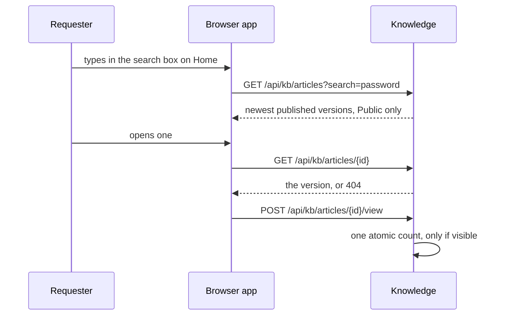

# Lesson 21 — The Knowledge Base, Part Two: What Readers See, and Every Screen

Good day, developer! Last time we built the writing side: an article goes from a draft, through a review, to a numbered version, and the API remembers who did what. Today the product opens its door. Requesters search the knowledge base and read what staff published, and only that. We count what is read, so Home can list the most popular articles. And we give staff and readers every screen, from the search box to the page where an article is reviewed. It takes about two hours. Are you ready? Let's begin!

## What we'll build

| Piece | What it is |
|---|---|
| **Two kinds of reader** | Staff read every published article; requesters read only the Public ones, and get a 404 for everything else |
| **View counts** | One number per article per day, no person recorded |
| **Popular articles** | The five most read in the last 30 days, among the ones the reader may see |
| **Four reader and staff screens** | The knowledge base, one article, the staff list, and the page where an article is written and reviewed |
| **Home** | A search box and the popular list, so a requester finds an answer before filing a ticket |

## Why we build it this way

### The pain: a reader who sees too much

The obvious reader query is `SELECT * FROM article WHERE status = 'Published'`. It shows readers the working copy, so an editor who corrects a typo in a published article shows the half-edited text to every requester; and it has no notion of Internal, so a staff-only article is one URL away from anyone who guesses its number. The usual fix, a check in each endpoint, works until the day someone adds an endpoint and forgets it.

### The fix: readers read versions, and the answer to "may I?" is a 404

Readers read **versions**, never the working copy. Every column a reader sees, and every condition that hides an article, comes from the newest published version, in the SQL itself. And the answer to "you may not see this" is always **404, never 403**: a 403 says "this exists, but not for you", and a 404 says nothing. Requesters can't tell an Internal article from a draft from an archived one from one that never existed.

### Now, let's be honest about the cost here

The rule "readers see only the newest published version of an article that isn't archived" is written five times, in five SQL statements (the reader list and its count, one article, the popular list, and the view counter), because each one reads straight from the tables. We keep them side by side, and a test covers each. A second cost: the view counter counts the staff who read an article too, so an editor previewing a page adds one. And the counter is one number per day, so it can say "this article was read 40 times today", but never "by whom": that is deliberate, and it is also a limit.

## 1. Reading for readers

Here is the rule that makes this lesson safe to deploy: **a requester sees only the newest published version of an article that is Public and not archived, and anything else is a 404, never a 403.** A 403 would say "this exists, but not for you". A 404 says nothing.

The rule lives in SQL, in a plain `WHERE`, exactly as a ticket's requester filter did in lesson 08. A query handler can't load the article (a query never takes a DbContext), and a list couldn't ask the article about each row anyway. Every column comes from the **version**, not from the working copy, so an editor who is rewriting an article or switching it to Internal changes nothing for readers until they publish:

```sql
-- src/Modules/Knowledge/Yasda.Modules.Knowledge/Infrastructure/Sql/Functions/knowledge.search_published_articles.v1.sql
-- Released scripts are never edited: change a function with a .v2 file and a new migration.
-- What readers can look up: each article's newest published version, never the working copy being revised. An article is
-- listed when it has been published and is not archived. p_public_only hides the Internal ones (the handler passes it for
-- anyone who is not staff). Both the filter and the words come from the version, so a revision in progress changes nothing here.
CREATE OR REPLACE FUNCTION knowledge.search_published_articles(
    p_search text, p_public_only boolean, p_sort text, p_desc boolean, p_page integer, p_page_size integer)
RETURNS TABLE (id bigint, title text, summary text, visibility text, published_utc timestamptz)
LANGUAGE sql STABLE
AS $$
    SELECT a.id, v.title::text, v.summary::text, v.visibility::text, v.published_utc
    FROM knowledge.article a
    JOIN knowledge.article_version v ON v.article_id = a.id AND v.number = a.current_version
    WHERE a.status <> 'Archived' AND a.current_version > 0
      AND (NOT p_public_only OR v.visibility = 'Public')
      AND (p_search IS NULL OR v.title ILIKE '%' || p_search || '%' OR v.summary ILIKE '%' || p_search || '%')
    ORDER BY
        CASE WHEN p_sort = 'title' AND NOT p_desc THEN v.title END ASC,
        CASE WHEN p_sort = 'title' AND p_desc     THEN v.title END DESC,
        CASE WHEN p_sort = 'updated' AND NOT p_desc THEN v.published_utc END ASC,
        CASE WHEN p_sort IS DISTINCT FROM 'updated' OR p_desc THEN v.published_utc END DESC,
        a.id DESC
    OFFSET (p_page - 1) * p_page_size
    LIMIT p_page_size;
$$;

CREATE OR REPLACE FUNCTION knowledge.count_published_articles(p_search text, p_public_only boolean)
RETURNS bigint
LANGUAGE sql STABLE
AS $$
    SELECT COUNT(*)
    FROM knowledge.article a
    JOIN knowledge.article_version v ON v.article_id = a.id AND v.number = a.current_version
    WHERE a.status <> 'Archived' AND a.current_version > 0
      AND (NOT p_public_only OR v.visibility = 'Public')
      AND (p_search IS NULL OR v.title ILIKE '%' || p_search || '%' OR v.summary ILIKE '%' || p_search || '%');
$$;
```

```sql
-- src/Modules/Knowledge/Yasda.Modules.Knowledge/Infrastructure/Sql/Functions/knowledge.get_published_article.v1.sql
-- Released scripts are never edited: change a function with a .v2 file and a new migration.
-- One article as readers see it: the newest published version. No row when the article doesn't exist, was never published, is
-- archived, or is Internal and p_public_only is set: a reader can't tell those apart.
CREATE OR REPLACE FUNCTION knowledge.get_published_article(p_id bigint, p_public_only boolean)
RETURNS TABLE (id bigint, title text, summary text, body text, visibility text, version_number integer, published_utc timestamptz)
LANGUAGE sql STABLE
AS $$
    SELECT a.id, v.title::text, v.summary::text, v.body::text, v.visibility::text, v.number, v.published_utc
    FROM knowledge.article a
    JOIN knowledge.article_version v ON v.article_id = a.id AND v.number = a.current_version
    WHERE a.id = p_id
      AND a.status <> 'Archived' AND a.current_version > 0
      AND (NOT p_public_only OR v.visibility = 'Public');
$$;
```

The handlers decide who counts as a reader of Internal articles, and they decide it by who is *staff*, not by who is a requester. If a new role ever appears, it starts with the narrow view:

```csharp
// src/Modules/Knowledge/Yasda.Modules.Knowledge/Features/BrowsePublishedArticles/BrowsePublishedArticlesHandler.cs
using Dapper;
using FluentValidation;
using Yasda.Shared.BuildingBlocks;

namespace Yasda.Modules.Knowledge.Features;

internal sealed record BrowsePublishedArticlesQuery(string? Search = null, string? Sort = null, bool Desc = false, int Page = 1, int PageSize = 20);

internal sealed record PublishedArticleRowDto(long Id, string Title, string Summary, string Visibility, DateTime PublishedUtc);

internal sealed class BrowsePublishedArticlesValidator : AbstractValidator<BrowsePublishedArticlesQuery>
{
    public BrowsePublishedArticlesValidator()
    {
        RuleFor(x => x.Page).ValidPage();
        RuleFor(x => x.PageSize).ValidPageSize();
        RuleFor(x => x.Sort).ValidSort("title", "updated");
    }
}

internal sealed class BrowsePublishedArticlesHandler(IDbConnectionFactory connections, ICurrentUser currentUser)
{
    public async Task<PagedResult<PublishedArticleRowDto>> HandleAsync(BrowsePublishedArticlesQuery q, CancellationToken ct)
    {
        // Staff also read the Internal articles. Anyone else, whatever their role, sees only the Public ones.
        var publicOnly = !KnowledgeRoles.IsWriter(currentUser.Role);

        await using var conn = connections.Create();
        using var multi = await conn.QueryMultipleAsync(new CommandDefinition(
            """
            SELECT * FROM knowledge.search_published_articles(@Search, @PublicOnly, @Sort, @Desc, @Page, @PageSize);
            SELECT knowledge.count_published_articles(@Search, @PublicOnly);
            """, new { Search = SearchText.ForLike(q.Search), PublicOnly = publicOnly, q.Sort, q.Desc, q.Page, q.PageSize }, cancellationToken: ct));

        var rows = (await multi.ReadAsync<PublishedArticleRowDto>()).ToList();
        var total = (int)await multi.ReadSingleAsync<long>();
        return new PagedResult<PublishedArticleRowDto>(rows, q.Page, q.PageSize, total);
    }
}
```

```csharp
// src/Modules/Knowledge/Yasda.Modules.Knowledge/Features/BrowsePublishedArticles/BrowsePublishedArticlesEndpoint.cs
using Microsoft.AspNetCore.Builder;
using Microsoft.AspNetCore.Http;
using Microsoft.AspNetCore.Routing;

namespace Yasda.Modules.Knowledge.Features;

internal static class BrowsePublishedArticlesEndpoint
{
    // Anyone signed in; the handler decides which visibility they get.
    public static void Map(IEndpointRouteBuilder app)
    {
        app.MapGet("/kb/articles", async ([AsParameters] BrowsePublishedArticlesQuery query, BrowsePublishedArticlesHandler handler, CancellationToken ct) =>
        {
            var page = await handler.HandleAsync(query, ct);
            return TypedResults.Ok(page);
        })
        .RequireAuthorization();
    }
}
```

```csharp
// src/Modules/Knowledge/Yasda.Modules.Knowledge/Features/GetPublishedArticle/GetPublishedArticleHandler.cs
using Dapper;
using Yasda.Shared.BuildingBlocks;

namespace Yasda.Modules.Knowledge.Features;

internal sealed record GetPublishedArticleQuery(long ArticleId);

internal sealed record PublishedArticleDto(long Id, string Title, string Summary, string Body, string Visibility, int VersionNumber, DateTime PublishedUtc);

internal sealed class GetPublishedArticleHandler(IDbConnectionFactory connections, ICurrentUser currentUser)
{
    // null when there is no such article, and when this reader may not see it (a draft, an archived one, an Internal one for a
    // requester): they can't even learn that it exists.
    public async Task<PublishedArticleDto?> HandleAsync(GetPublishedArticleQuery q, CancellationToken ct)
    {
        var publicOnly = !KnowledgeRoles.IsWriter(currentUser.Role);

        await using var conn = connections.Create();
        return await conn.QuerySingleOrDefaultAsync<PublishedArticleDto>(new CommandDefinition(
            "SELECT * FROM knowledge.get_published_article(@ArticleId, @PublicOnly)",
            new { q.ArticleId, PublicOnly = publicOnly }, cancellationToken: ct));
    }
}
```

```csharp
// src/Modules/Knowledge/Yasda.Modules.Knowledge/Features/GetPublishedArticle/GetPublishedArticleEndpoint.cs
using Microsoft.AspNetCore.Builder;
using Microsoft.AspNetCore.Http;
using Microsoft.AspNetCore.Http.HttpResults;
using Microsoft.AspNetCore.Routing;

namespace Yasda.Modules.Knowledge.Features;

internal static class GetPublishedArticleEndpoint
{
    // An article the reader may not see is a 404, not a 403: nothing may hint that it exists.
    public static void Map(IEndpointRouteBuilder app)
    {
        app.MapGet("/kb/articles/{id:long}", async Task<Results<Ok<PublishedArticleDto>, NotFound>> (long id, GetPublishedArticleHandler handler, CancellationToken ct) =>
        {
            var article = await handler.HandleAsync(new GetPublishedArticleQuery(id), ct);
            if (article is null) return TypedResults.NotFound();
            return TypedResults.Ok(article);
        })
        .RequireAuthorization();
    }
}
```

## 2. Counting what is read

A popular list needs a count. We keep the least we can: **one row per article per day, holding a number**. No person is stored, so there is nothing personal to keep or delete. The statement that counts a view is one atomic insert-or-add (so two readers at the same moment both count), and it checks that the reader may see the article in the same statement, so a requester can't inflate an Internal article's count. It is a `POST`, because counting changes something and a link prefetch must not count:

The counter is a table, so the model grows. `ArticleViewDay` has no rules, so it is not in the domain: it lives next to the DbContext, and its row has no person in it.

```csharp
// src/Modules/Knowledge/Yasda.Modules.Knowledge/Infrastructure/ArticleViewDay.cs
using Yasda.Modules.Knowledge.Domain;

namespace Yasda.Modules.Knowledge.Infrastructure;

// How many times an article was opened on one day. Only a count: no person is stored, so there is nothing personal to keep or
// delete. It has no rules of its own, which is why it lives here and not in the domain; it is added to with one atomic
// statement (see RecordArticleViewHandler).
internal sealed class ArticleViewDay
{
    public ArticleId ArticleId { get; set; }
    public DateOnly Day { get; set; }
    public int Views { get; set; }
}
```

Map it in `KnowledgeDbContext.OnModelCreating`, after the article:

```csharp
// src/Modules/Knowledge/Yasda.Modules.Knowledge/Infrastructure/KnowledgeDbContext.cs (added)
        b.Entity<ArticleViewDay>(e =>
        {
            e.ToTable("article_view_day");
            e.HasKey(x => new { x.ArticleId, x.Day });
            e.HasOne<Article>().WithMany().HasForeignKey(x => x.ArticleId);
        });
```

```bash
dotnet ef migrations add AddArticleViews --project src/Modules/Knowledge/Yasda.Modules.Knowledge --startup-project src/Modules/Knowledge/Yasda.Modules.Knowledge --output-dir Infrastructure/Migrations
```

EF Core writes the one new table. Nothing in it is edited by hand.

Now the handler:

```csharp
// src/Modules/Knowledge/Yasda.Modules.Knowledge/Features/RecordArticleView/RecordArticleViewHandler.cs
using Yasda.Modules.Knowledge.Infrastructure;
using Yasda.Shared.BuildingBlocks;
using Microsoft.EntityFrameworkCore;

namespace Yasda.Modules.Knowledge.Features;

internal sealed record RecordArticleViewCommand(long ArticleId);

internal sealed class RecordArticleViewHandler(KnowledgeDbContext db, ICurrentUser currentUser, TimeProvider time)
{
    // false when this reader can't see the article (the same test as the reader's article page), so nothing is counted.
    public async Task<bool> HandleAsync(RecordArticleViewCommand cmd, CancellationToken ct)
    {
        var publicOnly = !KnowledgeRoles.IsWriter(currentUser.Role);
        var today = time.Today();

        // One statement that checks and counts: two readers at once both add 1, which a read followed by a write would lose.
        var rows = await db.Database.ExecuteSqlInterpolatedAsync(
            $"""
            INSERT INTO knowledge.article_view_day (article_id, day, views)
            SELECT a.id, {today}, 1
            FROM knowledge.article a
            JOIN knowledge.article_version v ON v.article_id = a.id AND v.number = a.current_version
            WHERE a.id = {cmd.ArticleId} AND a.status <> 'Archived' AND a.current_version > 0
              AND (NOT {publicOnly} OR v.visibility = 'Public')
            ON CONFLICT (article_id, day) DO UPDATE SET views = knowledge.article_view_day.views + 1
            """, ct);
        return rows > 0;
    }
}
```

```csharp
// src/Modules/Knowledge/Yasda.Modules.Knowledge/Features/RecordArticleView/RecordArticleViewEndpoint.cs
using Microsoft.AspNetCore.Builder;
using Microsoft.AspNetCore.Http;
using Microsoft.AspNetCore.Http.HttpResults;
using Microsoft.AspNetCore.Routing;

namespace Yasda.Modules.Knowledge.Features;

internal static class RecordArticleViewEndpoint
{
    // A POST, because counting a view changes something: a link prefetch or a crawler's GET must not count. The article page
    // calls it once it has shown the article.
    public static void Map(IEndpointRouteBuilder app)
    {
        app.MapPost("/kb/articles/{id:long}/view", async Task<Results<NoContent, NotFound>> (long id, RecordArticleViewHandler handler, CancellationToken ct) =>
        {
            var counted = await handler.HandleAsync(new RecordArticleViewCommand(id), ct);
            if (!counted) return TypedResults.NotFound();
            return TypedResults.NoContent();
        })
        .RequireAuthorization();
    }
}
```

Two small things the handler needs that the project doesn't have yet. "Today" is the calendar date where the business is. For now it is the server's own time zone; lesson 22 gives the organization its own. Add this to `BuildingBlocks`:

```csharp
// src/Shared/Yasda.Shared.BuildingBlocks/Abstractions/TimeProviderExtensions.cs
namespace Yasda.Shared.BuildingBlocks;

public static class TimeProviderExtensions
{
    // The calendar date where the business is (the provider's local time zone), for invoice and due dates.
    public static DateOnly Today(this TimeProvider time) => DateOnly.FromDateTime(time.GetLocalNow().DateTime);
}
```

And Dapper doesn't know how to send a `DateOnly` to PostgreSQL's `date`, so the popular list's "since" parameter would fail with a 500. Teach it once, in the shared infrastructure:

```csharp
// src/Shared/Yasda.Shared.Infrastructure/Data/DateOnlyTypeHandler.cs
using System.Globalization;
using System.Data;
using Dapper;

namespace Yasda.Shared.Infrastructure;

// PostgreSQL `date` columns are calendar dates; this maps them to DateOnly, not DateTime at midnight.
public sealed class DateOnlyTypeHandler : SqlMapper.TypeHandler<DateOnly>
{
    public override void SetValue(IDbDataParameter parameter, DateOnly value)
    {
        parameter.DbType = DbType.Date;
        parameter.Value = value;
    }

    public override DateOnly Parse(object value) => value switch
    {
        DateOnly d => d,
        DateTime dt => DateOnly.FromDateTime(dt),
        _ => DateOnly.Parse(value.ToString()!, CultureInfo.InvariantCulture)
    };
}
```

Register it beside the line that matches `snake_case` column names, in `DependencyInjection.cs`:

```csharp
// src/Shared/Yasda.Shared.Infrastructure/DependencyInjection.cs (added, right after the MatchNamesWithUnderscores line)
        Dapper.SqlMapper.AddTypeHandler(new DateOnlyTypeHandler());
```

## 3. The most read

A popular list. Same reader rule, same version columns, and ties go to the more recently published:

```sql
-- src/Modules/Knowledge/Yasda.Modules.Knowledge/Infrastructure/Sql/Functions/knowledge.popular_articles.v1.sql
-- Released scripts are never edited: change a function with a .v2 file and a new migration.
-- The most read articles since a date, among the ones a reader may see (the same rule as the reader list). Ties go to the
-- more recently published.
CREATE OR REPLACE FUNCTION knowledge.popular_articles(p_since date, p_public_only boolean, p_limit integer)
RETURNS TABLE (id bigint, title text, summary text, views bigint)
LANGUAGE sql STABLE
AS $$
    SELECT a.id, v.title::text, v.summary::text, SUM(d.views)::bigint AS views
    FROM knowledge.article_view_day d
    JOIN knowledge.article a ON a.id = d.article_id
    JOIN knowledge.article_version v ON v.article_id = a.id AND v.number = a.current_version
    WHERE d.day >= p_since
      AND a.status <> 'Archived' AND a.current_version > 0
      AND (NOT p_public_only OR v.visibility = 'Public')
    GROUP BY a.id, v.title, v.summary, v.published_utc
    ORDER BY SUM(d.views) DESC, v.published_utc DESC, a.id
    LIMIT p_limit;
$$;
```

```csharp
// src/Modules/Knowledge/Yasda.Modules.Knowledge/Features/PopularArticles/PopularArticlesHandler.cs
using Dapper;
using Yasda.Shared.BuildingBlocks;

namespace Yasda.Modules.Knowledge.Features;

internal sealed record PopularArticlesQuery;

internal sealed record PopularArticleDto(long Id, string Title, string Summary, long Views);

internal sealed class PopularArticlesHandler(IDbConnectionFactory connections, ICurrentUser currentUser, TimeProvider time)
{
    // The most read articles of the last month, among the ones this reader may see.
    private const int Days = 30;
    private const int HowMany = 5;

    public async Task<IReadOnlyList<PopularArticleDto>> HandleAsync(PopularArticlesQuery q, CancellationToken ct)
    {
        var publicOnly = !KnowledgeRoles.IsWriter(currentUser.Role);
        var since = time.Today().AddDays(-Days);

        await using var conn = connections.Create();
        var rows = await conn.QueryAsync<PopularArticleDto>(new CommandDefinition(
            "SELECT * FROM knowledge.popular_articles(@Since, @PublicOnly, @Limit)",
            new { Since = since, PublicOnly = publicOnly, Limit = HowMany }, cancellationToken: ct));
        return rows.ToList();
    }
}
```

```csharp
// src/Modules/Knowledge/Yasda.Modules.Knowledge/Features/PopularArticles/PopularArticlesEndpoint.cs
using Microsoft.AspNetCore.Builder;
using Microsoft.AspNetCore.Http;
using Microsoft.AspNetCore.Routing;

namespace Yasda.Modules.Knowledge.Features;

internal static class PopularArticlesEndpoint
{
    public static void Map(IEndpointRouteBuilder app)
    {
        app.MapGet("/kb/popular", async (PopularArticlesHandler handler, CancellationToken ct) =>
        {
            var articles = await handler.HandleAsync(new PopularArticlesQuery(), ct);
            return TypedResults.Ok(articles);
        })
        .RequireAuthorization();
    }
}
```

Create the migration that ships the three reader-side functions, and fill it in. These are new names, so they start at `.v1`:

```bash
dotnet ef migrations add AddReaderReadFunctions --project src/Modules/Knowledge/Yasda.Modules.Knowledge --startup-project src/Modules/Knowledge/Yasda.Modules.Knowledge --output-dir Infrastructure/Migrations
```

```csharp
// src/Modules/Knowledge/Yasda.Modules.Knowledge/Infrastructure/Migrations/<timestamp>_AddReaderReadFunctions.cs (the file EF Core made; replace its content)
using Microsoft.EntityFrameworkCore.Migrations;
using Yasda.Shared.BuildingBlocks;

#nullable disable

namespace Yasda.Modules.Knowledge.Infrastructure.Migrations
{
    // What readers see: three new read functions, each the first version of its name.
    public partial class AddReaderReadFunctions : Migration
    {
        private static string Sql(string file)
        {
            return EmbeddedSql.Read(typeof(AddReaderReadFunctions).Assembly, file);
        }

        protected override void Up(MigrationBuilder migrationBuilder)
        {
            migrationBuilder.Sql(Sql("knowledge.search_published_articles.v1.sql"));
            migrationBuilder.Sql(Sql("knowledge.get_published_article.v1.sql"));
            migrationBuilder.Sql(Sql("knowledge.popular_articles.v1.sql"));
        }

        protected override void Down(MigrationBuilder migrationBuilder)
        {
            migrationBuilder.Sql("DROP FUNCTION IF EXISTS knowledge.popular_articles(date, boolean, integer);");
            migrationBuilder.Sql("DROP FUNCTION IF EXISTS knowledge.get_published_article(bigint, boolean);");
            migrationBuilder.Sql("DROP FUNCTION IF EXISTS knowledge.count_published_articles(text, boolean);");
            migrationBuilder.Sql("DROP FUNCTION IF EXISTS knowledge.search_published_articles(text, boolean, text, boolean, integer, integer);");
        }
    }
}
```

## 4. Wire it up

The module registers the four new handlers and maps the four new endpoints. In `KnowledgeModule.cs`, after the other handlers and after the other `Map` calls:

```csharp
// src/Modules/Knowledge/Yasda.Modules.Knowledge/KnowledgeModule.cs (added)
        services.AddScoped<BrowsePublishedArticlesHandler>();
        services.AddScoped<GetPublishedArticleHandler>();
        services.AddScoped<PopularArticlesHandler>();
        services.AddScoped<RecordArticleViewHandler>();

        BrowsePublishedArticlesEndpoint.Map(knowledge);
        GetPublishedArticleEndpoint.Map(knowledge);
        PopularArticlesEndpoint.Map(knowledge);
        RecordArticleViewEndpoint.Map(knowledge);
```

The development seed gains some reading, so the popular list has something to show. At the end of `SeedDevelopmentDataAsync` in `KnowledgeDatabase.cs`:

```csharp
// src/Modules/Knowledge/Yasda.Modules.Knowledge/Infrastructure/KnowledgeDatabase.cs (added)
        // Some reading, so the popular list has something to show.
        var today = time.Today();
        db.Add(new ArticleViewDay { ArticleId = password.Id, Day = today.AddDays(-2), Views = 9 });
        db.Add(new ArticleViewDay { ArticleId = password.Id, Day = today, Views = 3 });
        db.Add(new ArticleViewDay { ArticleId = outage.Id, Day = today.AddDays(-1), Views = 4 });
        await db.SaveChangesAsync(ct);
```

## 5. The screens

The browser app keeps its own copies of the API's shapes (lesson 06). Add these to `Models.cs`, above the "choices the API accepts" comment:

```csharp
// src/Yasda.Web/Models/Models.cs (added)
// The knowledge base's JSON shapes. An article has a working copy (what editors change) and published versions (what readers see).
public sealed record ArticleSummary(long Id, string Title, string Summary, string Status, string Visibility, int CurrentVersion,
    long CreatedById, string CreatedByName, string LastEditedByName, DateTime UpdatedUtc);

public sealed record ArticleVersionInfo(int Number, string Title, string Visibility, long PublishedById, string PublishedByName, DateTime PublishedUtc);

public sealed record ArticleEditorInfo(long UserId, string UserName, string AddedByName, DateTime AddedUtc);

public sealed record ArticleHistoryLine(string Action, long ActorId, string ActorName, DateTime AtUtc, string? Note, int? VersionNumber);

// CanEdit and CanManageEditors say what this person may do, so a page shows only the controls that will work.
public sealed record ArticleDetail(long Id, string Title, string Summary, string Body, string Status, string Visibility, int CurrentVersion,
    long CreatedById, string CreatedByName, long LastEditedById, string LastEditedByName, DateTime CreatedUtc, DateTime UpdatedUtc,
    string? RejectionReason, bool CanEdit, bool CanManageEditors,
    List<ArticleVersionInfo> Versions, List<ArticleEditorInfo> Editors, List<ArticleHistoryLine> History);

public sealed record PublishedSummary(long Id, string Title, string Summary, string Visibility, DateTime PublishedUtc);

public sealed record PublishedArticle(long Id, string Title, string Summary, string Body, string Visibility, int VersionNumber, DateTime PublishedUtc);

public sealed record PopularArticle(long Id, string Title, string Summary, long Views);

public static class KnowledgeChoices
{
    public static readonly string[] Statuses = ["Draft", "InReview", "Published", "Archived"];
    public static readonly string[] Visibilities = ["Public", "Internal"];

    // Who writes articles, and who decides on them. The API decides; the screens only hide what someone can't do anyway.
    public static bool IsWriter(string? role) => role is Roles.Agent or Roles.TeamLead or Roles.KbEditor or Roles.Admin;
    public static bool IsEditor(string? role) => role is Roles.KbEditor or Roles.Admin;

    public static string StatusText(string status)
    {
        if (status == "InReview") return "In review";
        return status;
    }

    // One line of the history, in words.
    public static string ActionText(string action)
    {
        switch (action)
        {
            case "Created": return "Started the draft";
            case "Edited": return "Changed the words";
            case "Submitted": return "Asked for a review";
            case "Rejected": return "Sent it back";
            case "Published": return "Published";
            case "Archived": return "Archived";
            case "Restored": return "Restored it as a draft";
            case "EditorAdded": return "Added to the edit list";
            case "EditorRemoved": return "Removed from the edit list";
            default: return action;
        }
    }
}
```

Navigation gets two entries: every signed-in person reads the knowledge base, and staff manage articles. In `NavMenu.razor`, replace the line `<AuthorizeView Roles="@($"{Roles.TeamLead},{Roles.Admin}")">` with:

```razor
@* src/Yasda.Web/Layout/NavMenu.razor (changed) *@
        <li><NavItem Href="kb">Knowledge base</NavItem></li>
        <AuthorizeView Roles="@($"{Roles.Agent},{Roles.TeamLead},{Roles.KbEditor},{Roles.Admin}")">
            <li><NavItem Href="kb/manage">Manage articles</NavItem></li>
        </AuthorizeView>
        <AuthorizeView Roles="@($"{Roles.TeamLead},{Roles.Admin}")">
```

A little style for the list of articles, in `app.css`, above the comment that starts "A ticket's conversation":

```css
/* src/Yasda.Web/wwwroot/css/app.css (added) */
/* The knowledge base's list of articles: a link, then its summary beneath it. */
.articles {
    list-style: none;
    padding: 0;
}

.articles li {
    margin-bottom: var(--gap-m);
}
```

DESIGN.md's article page (§4.2) is a title, a one-line summary, "last updated", the body and a way out. The body is plain text, and a blank line starts a new paragraph. Blazor encodes everything it writes, so a body that contains `<script>` is shown as text and never runs. That is the whole reason this course stores plain text: it needs no sanitizer. A rich-text editor is a later lesson of its own. The page also tells the API it has been read, once it is on screen:

```razor
@* src/Yasda.Web/Pages/Knowledge/KbArticle.razor *@
@page "/kb/{Id:long}"
@inject ApiClient Api
@inject ListMemory Memory

<PageTitle>@(_article?.Title ?? "Article") · YASDA</PageTitle>

@* DESIGN.md §4.2: the title, a one-line summary, when it was last updated, the body, and the way out if it didn't help. *@
@if (_article is null)
{
    <PageHeader Title="Article" Trail="@([("Knowledge base", Memory.Last("kb"))])" />
    @if (_loaded)
    {
        <p>There is no such article. <a href="kb">Search the knowledge base</a>.</p>
    }
    else
    {
        <p role="status">Loading…</p>
    }
}
else
{
    <PageHeader Title="@_article.Title" Trail="@([("Knowledge base", Memory.Last("kb"))])">
        <Description>
            @_article.Summary
        </Description>
    </PageHeader>

    <p class="muted">
        Last updated <TimeAgo Utc="_article.PublishedUtc" />
        @if (_article.Visibility == "Internal")
        {
            <strong> · Internal: only staff see this article</strong>
        }
    </p>

    <section aria-label="Article">
        @foreach (var paragraph in Paragraphs())
        {
            <p class="message-body">@paragraph</p>
        }
    </section>

    <hr />
    <p>Didn't fix it? <a href="tickets/new">Submit a ticket</a></p>
}

@code {
    [Parameter] public long Id { get; set; }
    private PublishedArticle? _article;
    private bool _loaded;

    // The body is plain text; a blank line starts a new paragraph.
    private List<string> Paragraphs()
    {
        var paragraphs = new List<string>();
        if (_article is null) return paragraphs;

        var normal = _article.Body.Replace("\r\n", "\n");
        foreach (var part in normal.Split("\n\n"))
        {
            var text = part.Trim();
            if (text.Length > 0) paragraphs.Add(text);
        }
        return paragraphs;
    }

    protected override async Task OnParametersSetAsync()
    {
        _loaded = false;
        _article = await Api.Get<PublishedArticle>($"api/kb/articles/{Id}");
        _loaded = true;

        // Once the article is on the screen it counts as read. It is a separate call, so only a person looking at it is counted.
        if (_article is not null) await Api.Post($"api/kb/articles/{Id}/view");
    }
}
```

The list readers search, whose search lives in the address like every list since lesson 08:

```razor
@* src/Yasda.Web/Pages/Knowledge/Kb.razor *@
@page "/kb"
@inject ApiClient Api
@inject NavigationManager Nav
@inject ListMemory Memory
@inject CookieAuthenticationStateProvider Auth

<PageTitle>Knowledge base · YASDA</PageTitle>

<PageHeader Title="@(_result is null ? "Knowledge base" : $"Knowledge base ({_result.TotalCount})")" />

@* The search lives in the address, so Back, a bookmark or a pasted link shows the same results. *@
<EditForm Model="this" OnSubmit="Find" class="search" role="search">
    <div class="field">
        <label for="search">Search the knowledge base</label>
        <InputText id="search" type="search" @bind-Value="_search" />
    </div>
    <button type="submit">Search</button>
    <a href="kb">Clear</a>
</EditForm>

@if (!string.IsNullOrWhiteSpace(Search))
{
    <p>Showing: matching "@Search". <a href="kb">Clear search</a></p>
}

@if (_result is null)
{
    <p role="status">Loading…</p>
}
else if (_result.Items.Count == 0)
{
    <p>No articles match. <a href="kb">Clear the search</a>, or <a href="tickets/new">submit a ticket</a> and we'll answer it.</p>
}
else
{
    <ul class="articles">
        @foreach (var article in _result.Items)
        {
            <li>
                <a href="@($"kb/{article.Id}")">@article.Title</a>
                @if (article.Visibility == "Internal")
                {
                    <strong> (Internal: staff only)</strong>
                }
                <span class="hint">@article.Summary Updated <TimeAgo Utc="article.PublishedUtc" />.</span>
            </li>
        }
    </ul>
    <Pager Page="_result.Page" PageSize="_result.PageSize" Total="_result.TotalCount" Noun="articles" />
}

@code {
    private const int PageSize = 20;

    [SupplyParameterFromQuery] public string? Search { get; set; }
    [SupplyParameterFromQuery(Name = "page")] public int? PageNumber { get; set; }

    private PagedResult<PublishedSummary>? _result;
    private string? _search;

    protected override async Task OnParametersSetAsync()
    {
        _search = Search;
        Memory.Remember(Nav.ToBaseRelativePath(Nav.Uri));
        _result = await Api.Get<PagedResult<PublishedSummary>>(Url.With("api/kb/articles", ("search", Search), ("page", PageNumber), ("pageSize", PageSize)));
    }

    // A new search starts again from page 1: page 3 of the old results may not exist.
    private void Find()
    {
        var text = string.IsNullOrWhiteSpace(_search) ? null : _search.Trim();
        Nav.NavigateTo(Nav.GetUriWithQueryParameters(new Dictionary<string, object?>
        {
            ["search"] = text,
            ["page"] = null,
        }));
    }
}
```

The staff list, with filters, server-side sorting and paging:

```razor
@* src/Yasda.Web/Pages/Knowledge/KbManage.razor *@
@page "/kb/manage"
@attribute [Authorize(Roles = Roles.Agent + "," + Roles.TeamLead + "," + Roles.KbEditor + "," + Roles.Admin)]
@inject ApiClient Api
@inject NavigationManager Nav
@inject ListMemory Memory

<PageTitle>Manage articles · YASDA</PageTitle>

<PageHeader Title="@(_result is null ? "Manage articles" : $"Manage articles ({_result.TotalCount})")" List="true">
    <Actions><a href="kb/manage/new">New article</a></Actions>
</PageHeader>

@* The list's filters, sort and page live in the address, so Back, a bookmark or a pasted link shows the same list. *@
<EditForm Model="this" OnSubmit="Find" class="search" role="search">
    <div class="field">
        <label for="search">Title or summary</label>
        <InputText id="search" type="search" @bind-Value="_search" />
    </div>
    <div class="field">
        <label for="status">Status</label>
        <InputSelect id="status" @bind-Value="_status">
            <option value="">Any</option>
            @foreach (var s in KnowledgeChoices.Statuses)
            {
                <option value="@s">@KnowledgeChoices.StatusText(s)</option>
            }
        </InputSelect>
    </div>
    <div class="field">
        <label for="visibility">Who can read it</label>
        <InputSelect id="visibility" @bind-Value="_visibility">
            <option value="">Anyone</option>
            @foreach (var v in KnowledgeChoices.Visibilities)
            {
                <option value="@v">@v</option>
            }
        </InputSelect>
    </div>
    <div class="check">
        <InputCheckbox id="mine" @bind-Value="_mine" />
        <label for="mine">Only mine (I wrote it or may edit it)</label>
    </div>
    <button type="submit">Apply</button>
    <a href="kb/manage">Clear</a>
</EditForm>

@if (Showing.Count > 0)
{
    <p>Showing: @string.Join(", ", Showing). <a href="kb/manage">Clear filters</a></p>
}

@if (_result is null)
{
    <p role="status">Loading…</p>
}
else if (_result.Items.Count == 0)
{
    <p>No articles match. <a href="kb/manage">Clear filters</a> or <a href="kb/manage/new">write a new article</a>.</p>
}
else
{
    <TableBox Label="Articles">
        <table>
            <thead>
                <tr>
                    <SortHeader Column="title" Title="Title" Sort="@Sort" Desc="Desc" />
                    <SortHeader Column="status" Title="Status" Sort="@Sort" Desc="Desc" />
                    <SortHeader Column="visibility" Title="Who can read it" Sort="@Sort" Desc="Desc" />
                    <th scope="col">Published version</th>
                    <SortHeader Column="author" Title="Author" Sort="@Sort" Desc="Desc" />
                    <SortHeader Column="updated" Title="Updated" Sort="@Sort" Desc="Desc" />
                </tr>
            </thead>
            <tbody>
                @foreach (var article in _result.Items)
                {
                    <tr>
                        <td class="truncate"><a href="@($"kb/manage/{article.Id}")">@article.Title</a></td>
                        <td>
                            @if (article.Status == "InReview")
                            {
                                <strong>In review</strong>
                            }
                            else
                            {
                                @KnowledgeChoices.StatusText(article.Status)
                            }
                        </td>
                        <td>@article.Visibility</td>
                        <td>@(article.CurrentVersion == 0 ? "None yet" : $"Version {article.CurrentVersion}")</td>
                        <td>@article.CreatedByName</td>
                        <td><TimeAgo Utc="article.UpdatedUtc" /></td>
                    </tr>
                }
            </tbody>
        </table>
    </TableBox>
    <Pager Page="_result.Page" PageSize="_result.PageSize" Total="_result.TotalCount" Noun="articles" />
}

@code {
    private const int PageSize = 20;

    [SupplyParameterFromQuery] public string? Search { get; set; }
    [SupplyParameterFromQuery] public string? Status { get; set; }
    [SupplyParameterFromQuery] public string? Visibility { get; set; }
    [SupplyParameterFromQuery] public bool Mine { get; set; }
    [SupplyParameterFromQuery] public string? Sort { get; set; }
    [SupplyParameterFromQuery] public bool Desc { get; set; }
    [SupplyParameterFromQuery(Name = "page")] public int? PageNumber { get; set; }

    private PagedResult<ArticleSummary>? _result;
    private string? _search, _status, _visibility;
    private bool _mine;

    // The filters in force, in words: "Showing: In review, Internal, only mine."
    private List<string> Showing
    {
        get
        {
            var parts = new List<string>();
            if (!string.IsNullOrEmpty(Status)) parts.Add(KnowledgeChoices.StatusText(Status));
            if (!string.IsNullOrEmpty(Visibility)) parts.Add(Visibility);
            if (Mine) parts.Add("only mine");
            if (!string.IsNullOrWhiteSpace(Search)) parts.Add($"matching \"{Search}\"");
            return parts;
        }
    }

    protected override async Task OnParametersSetAsync()
    {
        _search = Search;
        _status = Status ?? "";
        _visibility = Visibility ?? "";
        _mine = Mine;
        Memory.Remember(Nav.ToBaseRelativePath(Nav.Uri));
        _result = await Api.Get<PagedResult<ArticleSummary>>(Url.With("api/articles", ("search", Search), ("status", Status),
            ("visibility", Visibility), ("mine", Mine ? true : null), ("sort", Sort), ("desc", Desc ? true : null), ("page", PageNumber),
            ("pageSize", PageSize)));
    }

    // A new search starts again from page 1: page 3 of the old results may not exist.
    private void Find()
    {
        Nav.NavigateTo(Nav.GetUriWithQueryParameters(new Dictionary<string, object?>
        {
            ["search"] = string.IsNullOrWhiteSpace(_search) ? null : _search.Trim(),
            ["status"] = string.IsNullOrEmpty(_status) ? null : _status,
            ["visibility"] = string.IsNullOrEmpty(_visibility) ? null : _visibility,
            ["mine"] = _mine ? "true" : null,
            ["page"] = null,
        }));
    }
}
```

The page where an article is written and reviewed. Read its buttons: each appears only when the person can use it, and the API checks every one again. The two decisions that can't be undone ask inline first (lesson 10): sending an article back asks for a reason, archiving asks "are you sure". It also links to the article as readers see it:

```razor
@* src/Yasda.Web/Pages/Knowledge/ArticleEdit.razor *@
@page "/kb/manage/new"
@page "/kb/manage/{Id:long}"
@attribute [Authorize(Roles = Roles.Agent + "," + Roles.TeamLead + "," + Roles.KbEditor + "," + Roles.Admin)]
@inject ApiClient Api
@inject NavigationManager Nav
@inject ListMemory Memory
@inject CookieAuthenticationStateProvider Auth
@inject IJSRuntime Js

<PageTitle>@Title · YASDA</PageTitle>

<NavigationLock OnBeforeInternalNavigation="ctx => UnsavedChanges.ConfirmLeave(Js, ctx, Unsaved)" />

<PageHeader Title="@Title" Trail="@([("Manage articles", Memory.Last("kb/manage"))])">
    <Description>
        @if (_article is not null)
        {
            <text>Status: </text><strong>@KnowledgeChoices.StatusText(_article.Status)</strong>
            <text> · Who can read it: @_article.Visibility · Published version: @(_article.CurrentVersion == 0 ? "none yet" : _article.CurrentVersion.ToString())
            · Written by @_article.CreatedByName · Last changed by @_article.LastEditedByName <TimeAgo Utc="_article.UpdatedUtc" /></text>
        }
        else if (Id is null)
        {
            <text>Saves a draft. Nothing reaches readers until a KbEditor or an Admin reviews and publishes it.</text>
        }
    </Description>
</PageHeader>

@if (Id is not null && _article is null)
{
    <p role="status">Loading…</p>
}
else
{
    @if (_article is not null && _article.RejectionReason is not null && _article.Status == "Draft")
    {
        <p><strong>Sent back for changes:</strong> @_article.RejectionReason</p>
    }

    @* What this person can do now. The API checks every one of these again; hiding a button is only a convenience. *@
    @if (_article is not null)
    {
        <div class="actions">
            @if (_article.CanEdit && _article.Status == "Draft")
            {
                <button type="button" @onclick="Submit" disabled="@Api.Busy">Submit for review</button>
            }
            @if (IsEditor && _article.Status == "InReview")
            {
                <button type="button" @onclick="Publish" disabled="@Api.Busy">Publish</button>
                @if (!_rejecting)
                {
                    <button type="button" @onclick="StartRejecting">Send back</button>
                }
            }
            @if (IsEditor && _article.Status != "Archived" && !_archiving)
            {
                <button type="button" @onclick="StartArchiving">Archive</button>
            }
            @if (IsEditor && _article.Status == "Archived")
            {
                <button type="button" @onclick="Restore" disabled="@Api.Busy">Restore as a draft</button>
            }
            @if (_article.CurrentVersion > 0 && _article.Status != "Archived")
            {
                <a href="@($"kb/{_article.Id}")">Read it as readers see it</a>
            }
        </div>

        @if (_rejecting)
        {
            <EditForm Model="this" OnSubmit="Reject">
                <p role="alert">Send "@_article.Title" back to its author? It becomes a draft again.</p>
                <div class="field">
                    <label for="reason">What should change?</label>
                    <InputText id="reason" @bind-Value="_reason" maxlength="500" required aria-describedby="reason-hint" />
                    <span class="hint" id="reason-hint">The author sees this on the article. For example: add a screenshot of the sign-in page.</span>
                </div>
                <div class="actions">
                    <button type="submit" disabled="@Api.Busy">Send back</button>
                    <button type="button" @onclick="StopRejecting">Not yet</button>
                </div>
            </EditForm>
        }

        @if (_archiving)
        {
            <p role="alert">Archive "@_article.Title"? Readers will no longer find it. You can restore it later.</p>
            <div class="actions">
                <button type="button" @onclick="Archive" disabled="@Api.Busy">Archive</button>
                <button type="button" @onclick="StopArchiving">Not yet</button>
            </div>
        }
    }

    @if (CanChangeWords)
    {
        @if (_article is not null && _article.Status == "Published")
        {
            <p>Saving starts a new draft. Readers keep seeing version @_article.CurrentVersion until the new one is published.</p>
        }
        <EditForm Model="this" OnSubmit="Save">
            <div class="field">
                <label for="title">Title</label>
                <InputText id="title" @bind-Value="_title" maxlength="200" required />
            </div>
            <div class="field">
                <label for="summary">Summary</label>
                <InputText id="summary" @bind-Value="_summary" maxlength="300" required aria-describedby="summary-hint" />
                <span class="hint" id="summary-hint">One line under the title that tells a reader whether this is the article they need.</span>
            </div>
            <div class="field">
                <label for="body">Body</label>
                <InputTextArea id="body" @bind-Value="_body" rows="16" maxlength="20000" required aria-describedby="body-hint" />
                <span class="hint" id="body-hint">Plain text. A blank line starts a new paragraph.</span>
            </div>
            <div class="field">
                <label for="visibility">Who can read it</label>
                <InputSelect id="visibility" @bind-Value="_visibility" aria-describedby="visibility-hint">
                    @foreach (var v in KnowledgeChoices.Visibilities)
                    {
                        <option value="@v">@v</option>
                    }
                </InputSelect>
                <span class="hint" id="visibility-hint">Public: everyone who signs in. Internal: staff only.</span>
            </div>
            <div class="actions">
                <button type="submit" disabled="@Api.Busy">@(_article is null ? "Save draft" : "Save changes")</button>
            </div>
        </EditForm>
    }
    else if (_article is not null)
    {
        @if (_article.Status == "InReview")
        {
            <p>This article is in review, so it can't be changed. A KbEditor or an Admin publishes it, or sends it back with a reason.</p>
        }
        else if (_article.Status == "Archived")
        {
            <p>This article is archived, so it can't be changed. A KbEditor or an Admin can restore it.</p>
        }
        else
        {
            <p>You can read this article but not change it. Ask its author, a team lead of the author's team, a KbEditor or an Admin to add you to its edit list.</p>
        }

        <h2>The article</h2>
        <p>@_article.Summary</p>
        @foreach (var paragraph in Paragraphs())
        {
            <p class="message-body">@paragraph</p>
        }
    }

    @if (_article is not null)
    {
        <h2>Who can edit</h2>
        <p>The author, the team leads of the author's team, KbEditors and Admins can always edit. These people can too.</p>
        @if (_article.Editors.Count == 0)
        {
            <p>Nobody else yet.</p>
        }
        else
        {
            <TableBox Label="People on the edit list">
                <table>
                    <thead>
                        <tr>
                            <th scope="col">Name</th>
                            <th scope="col">Added by</th>
                            <th scope="col">When</th>
                            @if (_article.CanManageEditors)
                            {
                                <th scope="col">Remove</th>
                            }
                        </tr>
                    </thead>
                    <tbody>
                        @foreach (var editor in _article.Editors)
                        {
                            <tr>
                                <td>@editor.UserName</td>
                                <td>@editor.AddedByName</td>
                                <td><TimeAgo Utc="editor.AddedUtc" /></td>
                                @if (_article.CanManageEditors)
                                {
                                    <td><button type="button" @onclick="() => RemoveEditor(editor)" disabled="@Api.Busy">Remove @editor.UserName</button></td>
                                }
                            </tr>
                        }
                    </tbody>
                </table>
            </TableBox>
        }

        @if (_article.CanManageEditors && Candidates.Count > 0)
        {
            <EditForm Model="this" OnSubmit="AddEditor" class="search">
                <div class="field">
                    <label for="new-editor">Add a person</label>
                    <InputSelect id="new-editor" @bind-Value="_newEditorId">
                        @foreach (var person in Candidates)
                        {
                            <option value="@person.Id">@person.FullName (@Format.Words(person.Role))</option>
                        }
                    </InputSelect>
                </div>
                <button type="submit" disabled="@Api.Busy">Add to the edit list</button>
            </EditForm>
        }

        <h2>Published versions</h2>
        @if (_article.Versions.Count == 0)
        {
            <p>Never published. Readers can't see this article yet.</p>
        }
        else
        {
            <TableBox Label="Published versions">
                <table>
                    <thead>
                        <tr>
                            <th scope="col" class="num">Version</th>
                            <th scope="col">Title</th>
                            <th scope="col">Who can read it</th>
                            <th scope="col">Published by</th>
                            <th scope="col">When</th>
                        </tr>
                    </thead>
                    <tbody>
                        @foreach (var version in _article.Versions)
                        {
                            <tr>
                                <td class="num">@version.Number</td>
                                <td>@version.Title</td>
                                <td>@version.Visibility</td>
                                <td>@version.PublishedByName</td>
                                <td><TimeAgo Utc="version.PublishedUtc" /></td>
                            </tr>
                        }
                    </tbody>
                </table>
            </TableBox>
        }

        <h2>History</h2>
        <TableBox Label="History">
            <table>
                <thead>
                    <tr>
                        <th scope="col">When</th>
                        <th scope="col">Who</th>
                        <th scope="col">What</th>
                        <th scope="col">Note</th>
                    </tr>
                </thead>
                <tbody>
                    @foreach (var line in _article.History)
                    {
                        <tr>
                            <td><TimeAgo Utc="line.AtUtc" /></td>
                            <td>@line.ActorName</td>
                            <td>@KnowledgeChoices.ActionText(line.Action)@(line.VersionNumber is null ? "" : $" (version {line.VersionNumber})")</td>
                            <td>@line.Note</td>
                        </tr>
                    }
                </tbody>
            </table>
        </TableBox>
    }
}

@code {
    [Parameter] public long? Id { get; set; }

    private ArticleDetail? _article;
    private List<StaffMember> _staff = [];
    private string _title = "", _summary = "", _body = "", _visibility = "Public", _reason = "";
    private long _newEditorId;
    private bool _rejecting, _archiving;

    private string Title => _article?.Title ?? (Id is null ? "New article" : "Article");
    private bool IsEditor => KnowledgeChoices.IsEditor(Auth.User?.Role);

    // A new article is always being written. An existing one can be changed by whoever may edit it, while it is a draft or published
    // (a published one becomes a draft again); in review and archived it is read-only.
    private bool CanChangeWords
    {
        get
        {
            if (_article is null) return Id is null;
            if (!_article.CanEdit) return false;
            return _article.Status is "Draft" or "Published";
        }
    }

    // Leaving with changes that were not saved asks first.
    private bool Unsaved
    {
        get
        {
            if (_article is null) return _title.Length > 0 || _summary.Length > 0 || _body.Length > 0;
            return _title != _article.Title || _summary != _article.Summary || _body != _article.Body || _visibility != _article.Visibility;
        }
    }

    // People who could be added: active staff who are not the author and not on the list yet.
    private List<StaffMember> Candidates
    {
        get
        {
            var candidates = new List<StaffMember>();
            if (_article is null) return candidates;

            var taken = new HashSet<long> { _article.CreatedById };
            foreach (var editor in _article.Editors)
                taken.Add(editor.UserId);
            foreach (var person in _staff)
            {
                if (!taken.Contains(person.Id)) candidates.Add(person);
            }
            return candidates;
        }
    }

    // The body is plain text; a blank line starts a new paragraph.
    private List<string> Paragraphs()
    {
        var paragraphs = new List<string>();
        if (_article is null) return paragraphs;

        var normal = _article.Body.Replace("\r\n", "\n");
        foreach (var part in normal.Split("\n\n"))
        {
            var text = part.Trim();
            if (text.Length > 0) paragraphs.Add(text);
        }
        return paragraphs;
    }

    protected override async Task OnParametersSetAsync()
    {
        await Auth.GetAuthenticationStateAsync();
        if (Id is null) return;
        await Load(Id.Value);
    }

    private async Task Load(long id)
    {
        _article = await Api.Get<ArticleDetail>($"api/articles/{id}");
        _rejecting = false;
        _archiving = false;
        if (_article is null) return;

        _title = _article.Title;
        _summary = _article.Summary;
        _body = _article.Body;
        _visibility = _article.Visibility;

        if (_article.CanManageEditors && _staff.Count == 0)
        {
            var staff = await Api.Get<List<StaffMember>>("api/staff");
            if (staff is not null) _staff = staff;
        }
        if (Candidates.Count > 0) _newEditorId = Candidates[0].Id;
    }

    private async Task Save()
    {
        if (_article is null)
        {
            var id = await Api.Create("api/articles", new { title = _title.Trim(), summary = _summary.Trim(), body = _body.Trim(), visibility = _visibility },
                "Draft saved.");
            if (id is null) return;
            _title = "";   // saved: nothing left to lose on the way to the article's page
            _summary = "";
            _body = "";
            Nav.NavigateTo($"kb/manage/{id}");
            return;
        }

        var saved = await Api.Put($"api/articles/{_article.Id}",
            new { title = _title.Trim(), summary = _summary.Trim(), body = _body.Trim(), visibility = _visibility }, "Saved.");
        if (saved) await Load(_article.Id);
    }

    private async Task Submit()
    {
        await Step("submit", "Sent for review.");
    }

    private async Task Publish()
    {
        await Step("publish", "Published.");
    }

    private async Task Restore()
    {
        await Step("restore", "Restored as a draft.");
    }

    private async Task Archive()
    {
        await Step("archive", "Archived.");
    }

    private async Task Reject()
    {
        await Api.Post($"api/articles/{_article!.Id}/reject", new { reason = _reason.Trim() }, "Sent back.");
        _reason = "";
        await Load(_article.Id);
    }

    // One step of the review. Whether it worked or not, show the article as it is now.
    private async Task Step(string action, string success)
    {
        await Api.Post($"api/articles/{_article!.Id}/{action}", success: success);
        await Load(_article.Id);
    }

    private void StartRejecting()
    {
        _rejecting = true;
    }

    private void StopRejecting()
    {
        _rejecting = false;
    }

    private void StartArchiving()
    {
        _archiving = true;
    }

    private void StopArchiving()
    {
        _archiving = false;
    }

    private async Task AddEditor()
    {
        await Api.Post($"api/articles/{_article!.Id}/editors", new { userId = _newEditorId }, "Added to the edit list.");
        await Load(_article.Id);
    }

    private async Task RemoveEditor(ArticleEditorInfo editor)
    {
        await Api.Delete($"api/articles/{_article!.Id}/editors/{editor.UserId}", "Removed from the edit list.");
        await Load(_article.Id);
    }
}
```

Last, Home gets a search box and the popular list, so a requester finds an answer before filing a ticket. Replace the file:

```razor
@* src/Yasda.Web/Pages/Home.razor *@
@page "/"
@inject ApiClient Api

<PageTitle>Home · YASDA</PageTitle>

<AuthorizeView>
    <h1>Good day, @context.User.Identity?.Name!</h1>
    <p class="muted">You're signed in as @context.User.FindFirst(System.Security.Claims.ClaimTypes.Role)?.Value.</p>
    @* A plain GET form: it opens the knowledge base's own search page, whose address holds the search. *@
    <form method="get" action="kb" class="search" role="search">
        <div class="field">
            <label for="kb-search">Search the knowledge base</label>
            <input id="kb-search" type="search" name="search" />
        </div>
        <button type="submit">Search</button>
    </form>
    <p><a class="button" href="tickets/new">Submit a ticket</a></p>

    @if (_popular is not null && _popular.Count > 0)
    {
        <h2>Popular articles</h2>
        <ul class="articles">
            @foreach (var article in _popular)
            {
                <li><a href="@($"kb/{article.Id}")">@article.Title</a><span class="hint">@article.Summary</span></li>
            }
        </ul>
    }
</AuthorizeView>

@code {
    private List<PopularArticle>? _popular;

    protected override async Task OnInitializedAsync()
    {
        _popular = await Api.Get<List<PopularArticle>>("api/kb/popular");
    }
}
```

## 6. Prove it: nobody reads what they shouldn't, and every screen works

### The integration tests

The shapes the readers' tests share are added to the helper from lesson 20, below the writers' ones:

```csharp
// tests/Yasda.Integration.Tests/KnowledgeApi.cs (added)
    public sealed record PublishedRow(long Id, string Title, string Summary, string Visibility);
    public sealed record PublishedPage(List<PublishedRow> Items, int TotalCount);
    public sealed record PublishedArticle(long Id, string Title, string Summary, string Body, string Visibility, int VersionNumber, DateTime PublishedUtc);
    public sealed record Popular(long Id, string Title, long Views);
```

The most important test of the lesson. A requester must never learn that an Internal article exists:

```csharp
// tests/Yasda.Integration.Tests/KnowledgeReaderTests.cs (the top of the new file; the tests below go inside the class)
using System.Net;
using System.Net.Http.Json;
using AwesomeAssertions;
using Dapper;
using Yasda.Shared.BuildingBlocks;
using static Yasda.Integration.Tests.KnowledgeApi;

namespace Yasda.Integration.Tests;

// The readers' side of the knowledge base: what a requester can and cannot see, which version they see while an article is being
// revised, and how reading is counted.
[Collection("Integration")]
public class KnowledgeReaderTests(CustomWebAppFactory factory)
{
    private const string Agent = "agent@yasda.local", KbEditor = "editor@yasda.local", Requester = "requester@yasda.local";

    private async Task<long> ViewsOnAsync(long articleId)
    {
        await using var conn = factory.OpenDatabase();
        return await conn.ExecuteScalarAsync<long>("SELECT COALESCE(SUM(views), 0) FROM knowledge.article_view_day WHERE article_id = @articleId", new { articleId });
    }

    private async Task AddViewsAsync(long articleId, int views, int daysAgo = 0)
    {
        await using var conn = factory.OpenDatabase();
        await conn.ExecuteAsync(
            """
            INSERT INTO knowledge.article_view_day (article_id, day, views) VALUES (@articleId, current_date - @daysAgo, @views)
            ON CONFLICT (article_id, day) DO UPDATE SET views = knowledge.article_view_day.views + @views
            """, new { articleId, views, daysAgo });
    }

    private static async Task<List<long>> ReaderListAsync(HttpClient client, string search)
    {
        var page = await client.GetFromJsonAsync<PublishedPage>($"/api/kb/articles?search={search}&pageSize=100");
        return page!.Items.Select(r => r.Id).ToList();
    }

    // ---- What a requester sees ----
    // ... the tests that follow
```

```csharp
// tests/Yasda.Integration.Tests/KnowledgeReaderTests.cs (added)
    [Fact]
    public async Task A_requester_never_sees_an_internal_article()
    {
        var agent = await factory.ClientFor(Agent);
        var editor = await factory.ClientFor(KbEditor);
        var requester = await factory.ClientFor(Requester);
        var title = UniqueTitle("Escalation");
        var id = await CreatePublishedAsync(agent, editor, title, visibility: "Internal");

        (await ReaderListAsync(requester, title)).Should().BeEmpty();
        (await requester.GetAsync($"/api/kb/articles/{id}")).StatusCode.Should().Be(HttpStatusCode.NotFound);
        (await ReaderListAsync(agent, title)).Should().Equal(id);
        (await agent.GetAsync($"/api/kb/articles/{id}")).StatusCode.Should().Be(HttpStatusCode.OK);
    }
```

While an article is being revised, readers still see the version they had, and the new text appears only after it is published:

```csharp
// tests/Yasda.Integration.Tests/KnowledgeReaderTests.cs (added)
    [Fact]
    public async Task Readers_keep_the_old_version_until_the_new_one_is_published()
    {
        var agent = await factory.ClientFor(Agent);
        var editor = await factory.ClientFor(KbEditor);
        var requester = await factory.ClientFor(Requester);
        var oldTitle = UniqueTitle("Old");
        var newTitle = UniqueTitle("New");
        var id = await CreatePublishedAsync(agent, editor, oldTitle);

        (await EditAsync(agent, id, newTitle)).StatusCode.Should().Be(HttpStatusCode.NoContent);

        (await GetAsync(agent, id)).Title.Should().Be(newTitle, "staff see the working copy");
        (await GetAsync(agent, id)).Status.Should().Be("Draft");
        var whileRevising = await requester.GetFromJsonAsync<PublishedArticle>($"/api/kb/articles/{id}");
        whileRevising!.Title.Should().Be(oldTitle);
        (await ReaderListAsync(requester, oldTitle)).Should().Equal(id);
        (await ReaderListAsync(requester, newTitle)).Should().BeEmpty();

        await SubmitAndPublishAsync(agent, editor, id);

        var afterwards = await requester.GetFromJsonAsync<PublishedArticle>($"/api/kb/articles/{id}");
        afterwards!.Title.Should().Be(newTitle);
        afterwards.VersionNumber.Should().Be(2);
        (await GetAsync(agent, id)).Versions.Select(v => v.Number).Should().Equal(2, 1);
    }
```

And two readers at the same moment both count, which is what the single atomic statement is for:

```csharp
// tests/Yasda.Integration.Tests/KnowledgeReaderTests.cs (added)
    [Fact]
    public async Task Two_readers_at_once_both_count()
    {
        var agent = await factory.ClientFor(Agent);
        var editor = await factory.ClientFor(KbEditor);
        var requester = await factory.ClientFor(Requester);
        var id = await CreatePublishedAsync(agent, editor);

        var visits = new List<Task<HttpResponseMessage>>();
        for (var i = 0; i < 20; i++)
            visits.Add(requester.PostAsync($"/api/kb/articles/{id}/view", content: null));
        var answers = await Task.WhenAll(visits);

        answers.Should().OnlyContain(a => a.StatusCode == HttpStatusCode.NoContent);
        (await ViewsOnAsync(id)).Should().Be(20);
    }
```

| Test | Why it matters |
|---|---|
| `A_requester_finds_and_reads_a_published_public_article` | The happy path |
| `A_requester_gets_404_for_a_draft_an_article_in_review_an_archived_one_and_a_never_published_one` | Four reasons, one answer; and restoring brings it back |
| `Archiving_hides_the_article_from_readers_at_once` | No waiting |
| `Switching_the_working_copy_to_internal_changes_nothing_for_readers_until_it_is_republished` | Visibility comes from the version |
| `An_internal_article_made_public_stays_hidden_from_requesters_until_republished` | The same, the other way |
| `Reading_an_article_counts_one_view_per_visit` | The counter |
| `Opening_the_article_data_does_not_count_a_view_by_itself` | A GET never counts |
| `A_view_of_an_article_the_requester_cannot_see_is_a_404_and_counts_nothing` | No inflating what you can't see |
| `Popular_lists_the_most_read_and_a_requester_only_gets_the_public_ones` | Same rule as the reader list |
| `Views_older_than_thirty_days_do_not_make_an_article_popular` | The window |
| `An_archived_article_is_not_popular_however_much_it_was_read` | Archived is gone |
| `The_seed_publishes_its_articles_through_the_domain_so_requesters_see_only_the_public_one` | The seed obeys the rules |

### The browser tests

Seven tests drive the real screens with Playwright (lesson 06): find things by role and name, never by CSS. One runs the whole story, from an agent's draft to a requester reading the answer:

```csharp
// tests/Yasda.Web.UiTests/KnowledgeUiTests.cs (the top of the new file; the tests below go inside the class)
using Microsoft.Playwright;
using static Microsoft.Playwright.Assertions;

namespace Yasda.Web.UiTests;

public sealed class KnowledgeUiTests : UiTest
{
    private static ILocator Field(IPage page, string label) => page.GetByLabel(label, new() { Exact = true });

    private static string UniqueTitle(string start) => $"{start} {Guid.NewGuid():N}";

    // Writes a draft through the form, as an agent would, and leaves the page on the article's own page.
    private static async Task WriteDraft(IPage page, string title, string visibility = "Public")
    {
        await MainNav(page).GetByRole(AriaRole.Link, new() { Name = "Manage articles" }).ClickAsync();
        await page.GetByRole(AriaRole.Link, new() { Name = "New article" }).ClickAsync();
        await Field(page, "Title").FillAsync(title);
        await Field(page, "Summary").FillAsync("Fix it yourself in two minutes.");
        await Field(page, "Body").FillAsync("Open the settings page.\n\nChoose the third option.");
        await Field(page, "Who can read it").SelectOptionAsync(visibility);
        await page.GetByRole(AriaRole.Button, new() { Name = "Save draft" }).ClickAsync();
        await Expect(page.GetByRole(AriaRole.Heading, new() { Name = title })).ToBeVisibleAsync();
        await Expect(page.GetByText("Status: Draft")).ToBeVisibleAsync();
    }

    private static async Task OpenInManageList(IPage page, string title)
    {
        await page.GotoAsync("/kb/manage?search=" + Uri.EscapeDataString(title));
        await page.GetByRole(AriaRole.Link, new() { Name = title }).ClickAsync();
        await Expect(page.GetByRole(AriaRole.Heading, new() { Name = title })).ToBeVisibleAsync();
    }
    // ... the tests that follow
```

```csharp
// tests/Yasda.Web.UiTests/KnowledgeUiTests.cs (added)
    [UiFact]
    public async Task An_agent_drafts_an_editor_publishes_and_a_requester_finds_and_reads_it()
    {
        var title = UniqueTitle("Reset the printer");
        var agent = await SignIn("agent@yasda.local");
        await WriteDraft(agent, title);
        await agent.GetByRole(AriaRole.Button, new() { Name = "Submit for review" }).ClickAsync();
        await Expect(StatusSaying(agent, "Sent for review.")).ToBeVisibleAsync();
        await Expect(agent.GetByText("Status: In review")).ToBeVisibleAsync();

        var editor = await SignIn("editor@yasda.local");
        await OpenInManageList(editor, title);
        await editor.GetByRole(AriaRole.Button, new() { Name = "Publish" }).ClickAsync();
        await Expect(StatusSaying(editor, "Published.")).ToBeVisibleAsync();
        await Expect(editor.GetByText("Published version: 1")).ToBeVisibleAsync();

        var requester = await SignIn("requester@yasda.local");
        await requester.GetByRole(AriaRole.Searchbox, new() { Name = "Search the knowledge base" }).FillAsync(title);
        await requester.GetByRole(AriaRole.Button, new() { Name = "Search" }).ClickAsync();
        await requester.GetByRole(AriaRole.Link, new() { Name = title }).ClickAsync();
        await Expect(requester.GetByRole(AriaRole.Heading, new() { Name = title })).ToBeVisibleAsync();
        await Expect(requester.GetByText("Fix it yourself in two minutes.")).ToBeVisibleAsync();
        await Expect(requester.GetByText("Choose the third option.")).ToBeVisibleAsync();
        await Expect(requester.GetByText("Last updated")).ToBeVisibleAsync();
        await Expect(requester.GetByRole(AriaRole.Link, new() { Name = "Submit a ticket" })).ToBeVisibleAsync();
        await Shot(requester, "article");
    }
```

```csharp
// tests/Yasda.Web.UiTests/KnowledgeUiTests.cs (added)
    [UiFact]
    public async Task Sending_a_draft_back_shows_the_author_why()
    {
        var title = UniqueTitle("Map the shared drive");
        var agent = await SignIn("agent@yasda.local");
        await WriteDraft(agent, title);
        await agent.GetByRole(AriaRole.Button, new() { Name = "Submit for review" }).ClickAsync();
        await Expect(agent.GetByText("Status: In review")).ToBeVisibleAsync();

        var editor = await SignIn("editor@yasda.local");
        await OpenInManageList(editor, title);
        await editor.GetByRole(AriaRole.Button, new() { Name = "Send back" }).ClickAsync();
        await Field(editor, "What should change?").FillAsync("Add a screenshot of the drive letter");
        await editor.GetByRole(AriaRole.Button, new() { Name = "Send back" }).ClickAsync();
        await Expect(StatusSaying(editor, "Sent back.")).ToBeVisibleAsync();

        await OpenInManageList(agent, title);
        await Expect(agent.GetByText("Sent back for changes: Add a screenshot of the drive letter")).ToBeVisibleAsync();
        await Expect(agent.GetByText("Status: Draft")).ToBeVisibleAsync();
        await Expect(agent.GetByRole(AriaRole.Button, new() { Name = "Submit for review" })).ToBeVisibleAsync();
    }
```

| Test | Why it matters |
|---|---|
| `A_requester_sees_only_public_articles_and_popular_ones_on_Home` | The screen, the 404 page, and the popular list |
| `A_requester_has_no_way_into_the_staff_pages` | No link, and no page |
| `An_author_lets_a_colleague_edit_and_then_takes_it_back` | The edit list on screen |
| `Archiving_asks_first_and_then_hides_the_article_from_readers` | The inline confirmation, and the reader's list afterwards |
| `The_knowledge_base_fits_a_phone_without_sideways_scrolling` | 320 pixels wide |

### Make each one fail once

Break the reader rule in three places and watch their tests fail. In `knowledge.get_published_article.v1.sql`, delete the line `AND (NOT p_public_only OR v.visibility = 'Public')` (move the semicolon up to the line above); in the same file, change `AND a.status <> 'Archived' AND a.current_version > 0` to `AND a.current_version >= 0`; and in `knowledge.search_published_articles.v1.sql`, change `AND (NOT p_public_only OR v.visibility = 'Public')` to `AND TRUE`. Rebuild and run the tests: `A_requester_never_sees_an_internal_article`, the 404 test for drafts and archived articles, the two "republished" tests, and the seed test fail. Put the three lines back and everything is green again. Now you know the tests notice the rule they guard.

## How a request flows

A requester searches, reads, and the read is counted:



## Mistakes to avoid

- Letting readers read the working copy. Then editing a published article changes it live, and a half-written sentence reaches requesters.
- Answering 403 for an article a requester may not read. The word "forbidden" confirms that it exists.
- Letting the reader's visibility come from the working copy instead of the version. Switching an article to Internal would hide it, or switching it to Public would expose it, before anyone reviewed it.
- Counting a view on a `GET`. A link prefetch, a crawler or a refresh would count.
- Storing who read what "just in case". The count needs no person in it.
- Rendering a body as HTML. Plain text, shown as text, is what keeps this course free of a sanitizer.
- Deciding who may read Internal articles by "is not a requester". A role added later would read them by accident. Decide by "is staff".

## Let's run it!

```bash
dotnet build Yasda.slnx
dotnet test --solution Yasda.slnx
dotnet run --project src/Yasda.Api
```

The tests should end with no failures; the browser tests skip until you give them an address (lesson 06). Sign in as `agent@yasda.local` and open "Manage articles". You see three articles: two published and one draft. Open the draft, "Set up the VPN on a home laptop", and press "Submit for review". Sign in as `editor@yasda.local` in another browser window and publish it. Then sign in as `requester@yasda.local`: Home shows a search box and "Popular articles". Search for "VPN": the new article is there, but "Escalating a network outage", which is Internal, is not. Open one, go back to Home, and the popular list has moved.

## Let's check!

1. What does a reader see while a published article is being edited, and why?
2. Why does a requester get a 404, and not a 403, for an Internal article?
3. Why does the reader's visibility rule live in SQL, and why does it read the version's columns?
4. Why does the handler decide "may read Internal" by "is staff", and not by "is not a requester"?
5. What is stored when an article is read, and what is deliberately not?
6. Why is counting a view a `POST`, and why one atomic statement?
7. Why must the view statement check visibility too?
8. Why does the popular list use the same rule as the reader list?

And that's where this lesson ends. The product can now answer a question before it is asked, and every article carries the story of who wrote it, who approved it and when. Next time, we teach the system about business hours, because "respond within 4 hours" has to mean working hours, and a clock that runs through the night is not honest. Good luck, developer!

---

← [Lesson 20 — The knowledge base, part one: articles and the review](20-articles.md) · Next: [Lesson 22 — Business hours: time that only counts while you are open](22-business-time.md) →
