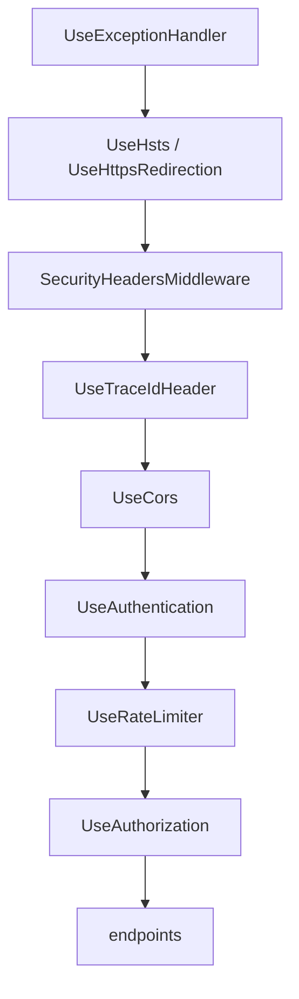

# Lesson 21 — Security Hardening: Ready for the Outside World

Good day, developer! Our ERP runs the whole business, and we can see what it's doing. But so far it has
only ever met friendly callers on your own machine. Out on a real network, it will meet password guessers, browsers that can be
tricked, and, one day maybe, a bug that lets someone run a query they shouldn't. Today we add the locks.
Each one is small; together they're what separates a demo from a product. About two hours. Are you ready?
Let's begin!

## What we'll build

| Protection | Stops |
|---|---|
| **Rate limiting** | One caller flooding the API, and password guessing across many accounts |
| **HTTPS redirection and HSTS** | Passwords and tokens travelling in plain text |
| **Security headers**, and a **Content-Security-Policy** for the app | Browsers being tricked into framing our pages, sniffing our responses, or running a script someone slipped in |
| **CORS from configuration** | Other websites calling the API from a user's browser |
| **Sign-in keys in the database, encrypted with a certificate** | Everyone being signed out whenever the server restarts; a stolen backup being used to forge a sign-in |
| **A least-privilege database account** | A compromised app dropping or changing your tables |

## Why we build it this way

Security works in layers. No single lock stops everything, and each of these assumes the others might fail.
The account lockout from [lesson 05](05-sign-in.md) protects one account from guessing, but someone trying
one password on a thousand accounts never trips it; a rate limit per IP address does. HTTPS protects tokens
on the wire, but a browser could still be tricked into embedding our pages; security headers stop that. And
if, despite everything, someone finds a way to run SQL through our app, a database account that can't `DROP`
anything limits the damage.

To remember it easily: a good building has a fence, a locked door, and a safe inside. Not one very strong
door.

## 1. Rate limiting

ASP.NET Core has a rate limiter built in. We'll give every caller a generous budget, and the sign-in
endpoints a strict one.

The policy name is shared between the host (which defines it) and the Identity module (which uses it), so it
goes in BuildingBlocks:

```csharp
// src/Shared/Erp.Shared.BuildingBlocks/Abstractions/RateLimitPolicies.cs
namespace Erp.Shared.BuildingBlocks;

public static class RateLimitPolicies
{
    public const string Auth = "auth";
}
```

```csharp
// src/Erp.Api/Security/RateLimiting.cs
using System.Security.Claims;
using System.Threading.RateLimiting;
using Erp.Shared.BuildingBlocks;
using Microsoft.AspNetCore.RateLimiting;

namespace Erp.Api.Security;

internal static class RateLimiting
{
    public static IServiceCollection AddErpRateLimiting(this IServiceCollection services, IConfiguration config)
    {
        var limits = config.GetSection("RateLimiting");
        var perClient = limits.GetValue("RequestsPerMinute", 300);
        var auth = limits.GetValue("AuthRequestsPerMinute", 10);

        return services.AddRateLimiter(o =>
        {
            o.RejectionStatusCode = StatusCodes.Status429TooManyRequests;
            o.OnRejected = (ctx, _) =>
            {
                if (ctx.Lease.TryGetMetadata(MetadataName.RetryAfter, out var retryAfter))
                    ctx.HttpContext.Response.Headers.RetryAfter = ((int)retryAfter.TotalSeconds).ToString();
                return ValueTask.CompletedTask;
            };

            // Only the API is budgeted. The app's own files (dozens on first load) and health checks are not.
            o.GlobalLimiter = PartitionedRateLimiter.Create<HttpContext, string>(ctx =>
                ctx.Request.Path.StartsWithSegments("/api")
                    ? RateLimitPartition.GetFixedWindowLimiter(ClientKey(ctx), _ => PerMinute(perClient))
                    : RateLimitPartition.GetNoLimiter("not-api"));

            // Sign-in endpoints: per IP and strict, to slow password guessing (lockout covers a single account).
            o.AddPolicy(RateLimitPolicies.Auth, ctx =>
                RateLimitPartition.GetFixedWindowLimiter($"ip:{ctx.Connection.RemoteIpAddress}", _ => PerMinute(auth)));
        });
    }

    private static string ClientKey(HttpContext ctx) =>
        ctx.User.FindFirstValue(ClaimTypes.NameIdentifier) is { } userId
            ? $"user:{userId}"
            : $"ip:{ctx.Connection.RemoteIpAddress}";

    private static FixedWindowRateLimiterOptions PerMinute(int permits) =>
        new() { PermitLimit = permits, Window = TimeSpan.FromMinutes(1), QueueLimit = 0 };
}
```

Let's read it slowly:

| Piece | Meaning |
|---|---|
| **Partition** | A separate budget per caller. Signed-in callers are counted per *user*; anonymous ones per IP address |
| **Fixed window** | Each minute, the budget starts over: 300 requests by default |
| Only `/api` | The app's first load fetches dozens of files, and a load balancer asks `/health` every few seconds. Neither should use up anyone's budget |
| The `auth` policy | 10 per minute per IP, for sign-in. Generous for a person, painful for a script |
| 429 and `Retry-After` | "Too many requests; try again in N seconds", so a polite client knows when to come back |

Register it in `Program.cs` with `builder.Services.AddErpRateLimiting(builder.Configuration);`, and put
`app.UseRateLimiter();` **between** `UseAuthentication()` and `UseAuthorization()`. It has to come after
authentication, or it couldn't tell who the user is, and every signed-in caller would share their IP's budget.

Then apply the strict policy to every sign-in endpoint. In `IdentityModule.MapIdentityModule`, add one line
to the end of the chain:

```csharp
.RequireRateLimiting(RateLimitPolicies.Auth);
```

And the defaults in `appsettings.json`:

```json
"RateLimiting": { "RequestsPerMinute": 300, "AuthRequestsPerMinute": 10 }
```

The sign-in page already handles the 429: lesson 15 taught it to say "Too many attempts. Wait a minute and
try again." The test suite signs in dozens of times a minute, so `CustomWebAppFactory` lifts both limits
for its own runs:

```csharp
builder.UseSetting("RateLimiting:RequestsPerMinute", "100000");
builder.UseSetting("RateLimiting:AuthRequestsPerMinute", "100000");
```

## 2. HTTPS everywhere

```csharp
// services
builder.Services.AddHsts(o =>
{
    o.MaxAge = TimeSpan.FromDays(365);
    o.IncludeSubDomains = true;
});

// pipeline, right after UseExceptionHandler()
if (!app.Environment.IsDevelopment())
    app.UseHsts();
app.UseHttpsRedirection();
```

`UseHttpsRedirection` answers any plain `http://` request with "go to `https://` instead". **HSTS** goes one
step further: it tells the browser "for the next year, never even *try* plain HTTP on this site". After the
first visit, a password can't leak over HTTP even if someone types `http://`. It's skipped in development,
because a browser would remember it for `localhost` too, and that gets annoying fast.

## 3. Security headers

A few response headers tell browsers to be careful with what we send:

```csharp
// src/Erp.Api/Security/SecurityHeadersMiddleware.cs
namespace Erp.Api.Security;

internal sealed class SecurityHeadersMiddleware(RequestDelegate next)
{
    public Task InvokeAsync(HttpContext ctx)
    {
        var headers = ctx.Response.Headers;
        headers.XContentTypeOptions = "nosniff";
        headers.XFrameOptions = "DENY";
        headers["Referrer-Policy"] = "no-referrer";
        headers["Permissions-Policy"] = "camera=(), microphone=(), geolocation=()";

        // JSON never needs scripts, styles or frames. The Blazor app needs its own files, WebAssembly (which
        // browsers class as eval) and MudBlazor's inline styles; nothing from any other site. Swagger is dev-only.
        if (ctx.Request.Path.StartsWithSegments("/api"))
            headers.ContentSecurityPolicy = "default-src 'none'; frame-ancestors 'none'";
        else if (!ctx.Request.Path.StartsWithSegments("/swagger"))
            headers.ContentSecurityPolicy =
                "default-src 'self'; script-src 'self' 'wasm-unsafe-eval'; style-src 'self' 'unsafe-inline'; " +
                "img-src 'self' data:; font-src 'self'; connect-src 'self'; object-src 'none'; base-uri 'self'; " +
                "form-action 'self'; frame-ancestors 'none'";

        return next(ctx);
    }
}
```

| Header | Tells the browser |
|---|---|
| `X-Content-Type-Options: nosniff` | Trust the declared content type; don't guess, and never run JSON as a script |
| `X-Frame-Options: DENY` | Never show this inside another site's frame (stops "clickjacking") |
| `Referrer-Policy: no-referrer` | Don't tell other sites which of our URLs a link came from |
| `Permissions-Policy` | This app never needs the camera, microphone or location |
| `Content-Security-Policy` on `/api` | This response may load nothing at all: no scripts, no styles, no frames |
| `Content-Security-Policy` on the app's pages | Load scripts, styles, images and fonts only from this site; call only this site's API; never run inline scripts |

The **Content-Security-Policy** (CSP) is the big one for a browser app. Say an attacker manages to get some
text onto a page, a customer named `<script>steal()</script>`. Blazor already writes text as text, not HTML,
so that's harmless; but if one day a bug lets it through, the browser itself refuses to run any script that
didn't come from our own files. That's why lesson 01 said "no inline scripts anywhere".

Now, let's be honest about the two loosenings in the app's policy. `'wasm-unsafe-eval'` lets the browser
compile WebAssembly; Blazor can't run without it, and it doesn't allow JavaScript `eval`. `'unsafe-inline'`
for *styles* lets MudBlazor set styles on elements, which it does everywhere. Inline *styles* can't run code;
inline *scripts*, the dangerous kind, stay forbidden.

Register it right after `UseHttpsRedirection()`: `app.UseMiddleware<SecurityHeadersMiddleware>();`. And one
more header to *remove*: by default, the web server announces itself with `Server: Kestrel`. That helps an
attacker pick their tools, and helps nobody else. Right after `CreateBuilder`:

```csharp
builder.WebHost.ConfigureKestrel(o => o.AddServerHeader = false);
```

## 4. CORS, from configuration

A browser won't let a web page from one site call an API on another site, unless the API says that site is
allowed. That permission is **CORS**. We list the allowed sites in configuration, so each installation can
set its own:

```csharp
var allowedOrigins = builder.Configuration.GetSection("Cors:AllowedOrigins").Get<string[]>() ?? [];
builder.Services.AddCors(o => o.AddDefaultPolicy(p =>
{
    if (builder.Configuration.GetValue<bool>("Cors:AllowAnyOrigin"))   // development only
        p.AllowAnyOrigin().AllowAnyHeader().AllowAnyMethod();
    else
        p.WithOrigins(allowedOrigins).AllowAnyHeader().AllowAnyMethod();
}));
// pipeline, before authentication:
app.UseCors();
```

Our own app is served from the API's own address (lesson 01), so it needs no CORS at all. `appsettings.json`
allows nobody, in development too:

```json
"Cors": { "AllowAnyOrigin": false, "AllowedOrigins": [] }
```

The setting is there for the day a buyer adds a second web front end on another address: they list it in
`AllowedOrigins`, and nothing else changes.

## 5. Why there's no API key

Many tutorials put an "API key" on every request at this point. We don't, and lesson 05 said why: a key
that ships inside a browser app is public, so it protects nothing, and it gives a false sense of a lock. Every
call is protected by who's signed in. If a non-person client ever needs the API (a partner's server, a
scheduled import), give it what Identity already provides: its own account and bearer tokens. And if you
need machine-to-machine sign-in with client secrets, add a library built for it, OpenIddict (Apache-2.0),
rather than writing key checks by hand. Security code is library code.

## 6. Sign-in keys that survive a restart

Identity encrypts its tokens and cookies with keys that, by default, live in your user profile. On a server,
that breaks two ways: an IIS app pool may not have a profile, so the keys vanish on every restart and
everyone is signed out; and two servers behind a load balancer would each have their own keys, so a token
from one is garbage to the other. The fix is to keep the keys in the database, where every instance can find
them.

```bash
dotnet add src/Modules/Identity/Erp.Modules.Identity package Microsoft.AspNetCore.DataProtection.EntityFrameworkCore --version 10.0.14
```

This package (MIT) stores the keys with EF Core. `ErpIdentityDbContext` implements one more interface, and
gets one more table:

```csharp
internal sealed class ErpIdentityDbContext(DbContextOptions<ErpIdentityDbContext> options)
    : IdentityDbContext<AppUser, IdentityRole<long>, long>(options), IDataProtectionKeyContext
{
    public const string Schema = "identity";

    // The keys that encrypt sign-in cookies and tokens. Stored here so sessions survive restarts and are shared
    // by every instance of the app.
    public DbSet<DataProtectionKey> DataProtectionKeys => Set<DataProtectionKey>();
```

In `OnModelCreating`, add `b.Entity<DataProtectionKey>().ToTable("data_protection_keys");`, and in
`AddIdentityModule`:

```csharp
services.AddDataProtection()
    .SetApplicationName("Erp")
    .PersistKeysToDbContext<ErpIdentityDbContext>();
```

(with `using Microsoft.AspNetCore.DataProtection;` and `using Microsoft.AspNetCore.DataProtection.EntityFrameworkCore;`).
`SetApplicationName` makes every instance agree they're the same app. Then
`dotnet ef migrations add AddDataProtectionKeys` for the Identity module.

That fixes restarts, and opens a new hole. The keys now sit in a table, and the table is in every backup.
Anyone who gets a copy of a backup, or a stolen database dump, holds the keys that sign every cookie, and
could forge a sign-in as the admin. So in production the keys are **encrypted with a certificate**, kept as
a file on the server and never in the database. A backup alone is useless without it.

```csharp
var dataProtection = services.AddDataProtection()
    .SetApplicationName("Erp")
    .PersistKeysToDbContext<ErpIdentityDbContext>();

// The keys live in a table the app can read. Encrypted with a certificate, a copy of that table alone
// (a backup, a stolen dump) can't be used to forge a sign-in.
var certificatePath = config["DataProtection:CertificatePath"];
if (!string.IsNullOrWhiteSpace(certificatePath))
    dataProtection.ProtectKeysWithCertificate(
        X509CertificateLoader.LoadPkcs12FromFile(certificatePath, config["DataProtection:CertificatePassword"]));
else if (config.GetValue("DataProtection:RequireCertificate", true))
    throw new InvalidOperationException(
        "Set DataProtection:CertificatePath and DataProtection:CertificatePassword: sign-in keys must be encrypted at rest.");
```

(add `using System.Security.Cryptography.X509Certificates;`). **`X509CertificateLoader`** is .NET's current
way to read a certificate file; the older `new X509Certificate2(path, password)` is obsolete in .NET 10. A
`.pfx` (also called PKCS#12) file holds the certificate and its private key, protected by a password.

The interesting line is the `throw`. **Without a certificate, the app refuses to start**, unless a setting
explicitly says that's fine. Production can't run with unencrypted keys by accident: forgetting the
certificate is a loud error on the first start, not a quiet weakness found in an audit. In
`appsettings.json`:

```json
"DataProtection": { "CertificatePath": "", "CertificatePassword": "", "RequireCertificate": true }
```

and in `appsettings.Development.json`, where there's nothing worth stealing:

```json
"DataProtection": { "RequireCertificate": false }
```

To make a certificate (a self-signed one is right here: nobody but the app ever checks it):

```bash
openssl req -x509 -newkey rsa:4096 -sha256 -days 3650 -nodes -subj "/CN=Erp data protection" \
  -keyout dp.key -out dp.crt
openssl pkcs12 -export -inkey dp.key -in dp.crt -out dataprotection.pfx -passout pass:'choose-a-long-password'
rm dp.key
```

(In Git Bash, put `MSYS_NO_PATHCONV=1` in front of the first command, or it rewrites `/CN=...` into a
Windows path.) Keep the `.pfx` and its password together with the database backups' *instructions*, but
never with the backups themselves. Lose the certificate, and everyone simply signs in again: the keys are
only for sessions, not for data. [Lesson 22](22-docker.md) and [lesson 23](23-deploy-iis.md) show where the
file goes on each kind of server.

## 7. A database account that can't drop your tables

So far the app has connected as `postgres`, the superuser. It can do anything: drop tables, read every
database, create accounts. If an attacker ever got the app to run SQL of their choosing, they could do all of
that too.

In production, we use two accounts:

| Account | Used by | Can |
|---|---|---|
| `erp_owner` | Migrations, at deploy time | Create, change and drop the tables it owns |
| `erp_app` | The running app | Read and write rows. Nothing else |

```sql
-- deploy/postgres/create-roles.sql
-- One-time server setup, run as a PostgreSQL superuser:
--   psql -U postgres -v db=erp -v owner_password='...' -v app_password='...' -f create-roles.sql
--
-- erp_owner owns the database and runs migrations   → ConnectionStrings:ErpDbMigrations
-- erp_app   is what the web app connects as: rows only, no DDL → ConnectionStrings:ErpDb
-- If the app is ever compromised, it cannot drop or alter a table.

CREATE ROLE erp_owner LOGIN PASSWORD :'owner_password';
CREATE ROLE erp_app   LOGIN PASSWORD :'app_password';

CREATE DATABASE :"db" OWNER erp_owner;
\connect :db

REVOKE ALL ON DATABASE :"db" FROM PUBLIC;
GRANT CONNECT ON DATABASE :"db" TO erp_owner, erp_app;
REVOKE CREATE ON SCHEMA public FROM PUBLIC;

-- Everything erp_owner creates from now on (i.e. every migration) is usable, but not changeable, by erp_app.
ALTER DEFAULT PRIVILEGES FOR ROLE erp_owner GRANT USAGE ON SCHEMAS TO erp_app;
ALTER DEFAULT PRIVILEGES FOR ROLE erp_owner GRANT SELECT, INSERT, UPDATE, DELETE ON TABLES TO erp_app;
ALTER DEFAULT PRIVILEGES FOR ROLE erp_owner GRANT USAGE, SELECT, UPDATE ON SEQUENCES TO erp_app;
ALTER DEFAULT PRIVILEGES FOR ROLE erp_owner GRANT EXECUTE ON FUNCTIONS TO erp_app;
```

The clever part is `ALTER DEFAULT PRIVILEGES`. Migrations will keep creating new schemas, tables and
functions for years. Instead of granting rights after each one, we say once: "whatever `erp_owner` creates
from now on, `erp_app` may use but not change".

Now the app has to run migrations as `erp_owner` and everything else as `erp_app`. That means a refactor.
Until now, each module migrated through its own DbContext, which uses the app's connection.

Before, in `IModuleDatabase`:

```csharp
Task MigrateAsync(CancellationToken ct);
Task SeedDevelopmentDataAsync(CancellationToken ct);
```

After:

```csharp
// Migrations and seeding take a connection because they run as the schema owner, not as the app's role.
Task MigrateAsync(DbConnection ownerConnection, CancellationToken ct);
Task SeedDevelopmentDataAsync(DbConnection ownerConnection, CancellationToken ct);
```

Each module now builds a short-lived context on the owner connection, just for migrating. `SalesDatabase`
becomes:

```csharp
// src/Modules/Sales/Erp.Modules.Sales/Infrastructure/SalesDatabase.cs
using System.Data.Common;
using Erp.Shared.BuildingBlocks;
using Microsoft.EntityFrameworkCore;

namespace Erp.Modules.Sales.Infrastructure;

internal sealed class SalesDatabase : IModuleDatabase
{
    public string Module => "Sales";
    public string Schema => SalesDbContext.Schema;

    public async Task MigrateAsync(DbConnection ownerConnection, CancellationToken ct)
    {
        var options = new DbContextOptionsBuilder<SalesDbContext>();
        SalesDbContext.Configure(options, ownerConnection);
        await using var db = new SalesDbContext(options.Options);
        await db.Database.MigrateAsync(ct);
    }

    public Task SeedDevelopmentDataAsync(DbConnection ownerConnection, CancellationToken ct) =>
        EmbeddedSql.ExecuteAsync(ownerConnection, EmbeddedSql.Read(typeof(SalesDatabase).Assembly, "DevSeed.sql"), ct);
}
```

`InventoryDatabase` changes the same way. `IdentityDatabase` migrates the same way too; its seeding keeps
using `UserManager` (which runs as the app, and only inserts rows, so that's fine), and so it no longer needs
the DbContext injected:

```csharp
internal sealed class IdentityDatabase(UserManager<AppUser> users) : IModuleDatabase
{
    // ... MigrateAsync exactly like SalesDatabase, with ErpIdentityDbContext ...

    public async Task SeedDevelopmentDataAsync(DbConnection ownerConnection, CancellationToken ct)
    {
        // ... unchanged: create the six dev users through UserManager ...
    }
}
```

Finally `DatabaseStartup` opens the owner connection and hands it to every module. Replace its middle part:

```csharp
// Migrations need the schema owner; the app itself may run as a role that can only read and write rows.
var ownerConnectionString = app.Configuration.GetConnectionString("ErpDbMigrations") is { Length: > 0 } owner
    ? owner
    : app.Configuration.GetConnectionString("ErpDb")!;
await PostgresDatabase.EnsureExistsAsync(ownerConnectionString, ct);

await using var ownerConnection = new NpgsqlConnection(ownerConnectionString);
await ownerConnection.OpenAsync(ct);
```

and pass `ownerConnection` to each `MigrateAsync` and `SeedDevelopmentDataAsync` call (add `using Npgsql;`).
If `ErpDbMigrations` isn't set, as on your development machine, it falls back to `ErpDb`, so nothing changes
there. Add it, empty, to `appsettings.json`:

```json
"ConnectionStrings": { "ErpDb": "", "ErpDbMigrations": "" }
```

Every module does this, all five of them, so the dispatcher, the migrations and the seeds all follow one rule.

The test suite can now prove the accounts are enough. `CustomWebAppFactory` gets an optional owner
connection: when `ERP_TEST_DB_OWNER` is set, the suite runs as `erp_app` against a database prepared by the
script, migrates as `erp_owner`, and doesn't drop that database. Before:

```csharp
public CustomWebAppFactory() => DropDatabase(TestConnectionString);
```

After:

```csharp
// Set to run the suite as the least-privilege erp_app (ERP_TEST_DB) against a database prepared by
// deploy/postgres/create-roles.sql, with migrations run as erp_owner. That database is not dropped.
private static readonly string? OwnerConnectionString = Environment.GetEnvironmentVariable("ERP_TEST_DB_OWNER");

public CustomWebAppFactory()
{
    if (OwnerConnectionString is null)
        DropDatabase(TestConnectionString);
}
```

and in `ConfigureWebHost`:

```csharp
if (OwnerConnectionString is not null)
    builder.UseSetting("ConnectionStrings:ErpDbMigrations", OwnerConnectionString);
```

## The pipeline, in order

Order matters in the middleware pipeline, because each step can only see what came before it:



## Mistakes to avoid

- Relying on lockout alone. It protects one account; a rate limit per IP protects them all.
- Putting the rate limiter before authentication. Every user behind one office IP would share one budget.
- Sending HSTS in development. Your browser remembers it for `localhost`.
- `AllowAnyOrigin` in production CORS.
- Loosening the app's CSP to allow inline scripts "just for one thing". Put the script in a file.
- Keeping the data-protection certificate next to the database backups. Together, they're the keys again.
- Running the app as the database superuser "because it's easier".

## Let's run it!

Restart the app, sign in as the rep, and look at the headers:

```bash
REP=$(curl -s -X POST http://localhost:5264/api/auth/login -H "Content-Type: application/json" \
  -d '{"email":"rep@erp.local","password":"Password123!"}' | jq -r .accessToken)
curl -si http://localhost:5264/api/sales-orders -H "Authorization: Bearer $REP" | grep -i "x-frame\|content-security\|server:"
curl -si http://localhost:5264/ | grep -i "content-security"
```

The API's policy is `default-src 'none'`; the page's allows only `'self'`. There's no `Server:` line. Open
the app in the browser with the developer tools' console showing: no CSP errors, and everything works.

Now trip the sign-in limit: on the sign-in page, type a wrong password eleven times in a minute. The
eleventh says "Too many attempts. Wait a minute and try again."

Then production mode, without a certificate:

```bash
ASPNETCORE_ENVIRONMENT=Production ConnectionStrings__ErpDb="Host=localhost;Database=erp;Username=postgres;Password=erp_dev_only" \
  dotnet run --project src/Erp.Api --no-launch-profile
# Unhandled exception. System.InvalidOperationException: Set DataProtection:CertificatePath and
# DataProtection:CertificatePassword: sign-in keys must be encrypted at rest.
```

It refuses to start. Make a certificate as in step 6, add `DataProtection__CertificatePath` and
`DataProtection__CertificatePassword` to the command, and it starts. Sign in once (with a tool like `curl`),
then look at the stored key:

```bash
PGPASSWORD=erp_dev_only "/c/Program Files/PostgreSQL/18/bin/psql.exe" -h localhost -U postgres -d erp \
  -c "SELECT left(xml, 200) FROM identity.data_protection_keys ORDER BY id DESC LIMIT 1;"
```

The XML says `encryptedSecret`, with the certificate's thumbprint: the key itself is unreadable.

And the least-privilege accounts. Create them against a fresh database, and run the whole suite as
`erp_app`:

```bash
PGPASSWORD=erp_dev_only "/c/Program Files/PostgreSQL/18/bin/psql.exe" -h localhost -U postgres \
  -v db=erp_roles_check -v owner_password=owner_dev_only -v app_password=app_dev_only \
  -f deploy/postgres/create-roles.sql

ERP_TEST_DB="Host=localhost;Database=erp_roles_check;Username=erp_app;Password=app_dev_only" \
ERP_TEST_DB_OWNER="Host=localhost;Database=erp_roles_check;Username=erp_owner;Password=owner_dev_only" \
dotnet test tests/Erp.Integration.Tests
```

Every test passes, with the app never holding more than row-level rights. And as `erp_app`:

```bash
PGPASSWORD=app_dev_only "/c/Program Files/PostgreSQL/18/bin/psql.exe" -h localhost -U erp_app -d erp_roles_check \
  -c "DROP TABLE sales.customer;"
# ERROR:  must be owner of table customer
```

The integration tests gain two checks in `PlatformTests.cs`: `Responses_carry_security_headers_and_a_trace_id`,
and `Pages_and_api_get_different_content_security_policies`, which asks for `/` and `/api/auth/me` and
compares the two policies.

## Let's check!

1. Account lockout and rate limiting both slow password guessing. What does each one stop that the other
   doesn't?
2. Why must the rate limiter come after authentication in the pipeline?
3. What does HSTS add on top of redirecting to HTTPS?
4. Why doesn't the app use an API key, and what would you use for a non-person client?
5. Why do sign-in keys move into the database, and why must they then be encrypted with a certificate?
6. What does `ALTER DEFAULT PRIVILEGES` save you from doing after every migration?
7. The app's CSP allows `'wasm-unsafe-eval'` and inline styles. Why each, and why not inline scripts?

And that's where this lesson ends. The app is ready for the outside world, with a lock on every door. Next
time, we put it on a real server, in containers, with HTTPS and nightly backups. Good luck, developer!

---

← [Lesson 20 — Payments and receivables](20-payments.md) · Next: [Lesson 22 — Docker](22-docker.md) →
