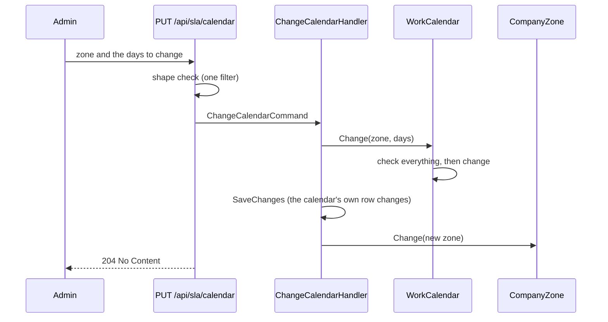

# Lesson 22 — Business Hours: Time That Only Counts While You Are Open

Good day, developer! So far a deadline has been simple arithmetic: a ticket filed at 09:00 with a 4-hour target is due at 13:00. Today that stops being true, because a help desk is not open all night. A ticket filed on Friday at 16:00 is not late on Friday at 20:00; it is due on Monday morning. We build the piece that knows the difference: a calendar of open hours and holidays, the math to count only open time, and the screen-free half of letting an Admin edit it. It takes about two hours. Are you ready? Let's begin!

## What we'll build

| Piece | What it is |
|---|---|
| **`BusinessCalendar`** | A plain class with two questions: "what moment is this much open time after that start?" and "how much open time lies between two moments?" |
| **Properties that prove it** | The same math checked against thousands of generated moments, in a zone with no daylight saving and one with |
| **`WorkCalendar`** | The calendar as data: the time zone, the hours of each weekday, and the holidays, in three new tables |
| **`CompanyZone`** | The organization's time zone, kept in memory, so "today" means today where the business is |
| **Four endpoints** | Staff read the calendar; an Admin changes the week and adds or removes holidays |

Deadlines do not use any of this yet. That is lesson 24. Today we build the calendar and prove it, so that when a deadline asks "when is 4 open hours from now?", the answer is already trustworthy.

## Why we build it this way

### The pain: a deadline that ignores the weekend

The obvious deadline is `start + target`. For "respond within 4 hours" and a ticket filed on Friday at 16:00, it says Friday 20:00. Nobody is there. By Monday morning the ticket is "breached" for a reason that has nothing to do with how well the team works, and every report built on it lies.

The next idea is a loop: add an hour, skip it if it is night or weekend, repeat. It works until the first holiday, and until the first time zone change, when an hour goes missing in spring and a day has 25 hours in autumn.

### The fix: a calendar that does the counting

We write the counting once, in one class with no database and no clock, and test it hard. A class like that is cheap to test with thousands of cases, so we can afford to be strict. The week, the holidays and the time zone are data an Admin edits, so none of them live in a config file: they are rows.

### Now, let's be honest about the cost here

Counting day by day is not the fastest possible math. Adding 30 days of open time walks about 30 days. For deadlines of hours and days that is nothing, and it keeps the code short enough to read in one sitting. A second cost: the calendar is rebuilt from its rows every time a deadline needs it. There is no cache, so there is nothing to forget to clear.

## 1. The calendar's two questions

Here is the whole class. Read the comments first; they carry the rules:

```csharp
// src/Modules/Sla/Yasda.Modules.Sla/Domain/BusinessCalendar.cs
using Yasda.Shared.BuildingBlocks;

namespace Yasda.Modules.Sla.Domain;

// The hours one weekday is open: from Opens until Closes, in the calendar's own time zone.
internal sealed record OpenHours(TimeOnly Opens, TimeOnly Closes);

// When the organization is open, and the two questions every deadline needs: "what is this long from now, counting only open
// time?" (Add) and "how much open time lies between these two moments?" (Between). It has no database and no clock, so it is
// tested on its own. All times that come in and go out are UTC; the weekday hours and holidays are read in the calendar's zone.
//
// A deadline that lands exactly at closing time stays at closing time (the target is met if the answer comes at that minute).
// Time outside open hours never counts: Add from a Sunday starts counting at Monday's opening.
internal sealed class BusinessCalendar
{
    // A calendar with no open day would make Add search forever. Ten years of days is far more than any real gap.
    private const int MostDaysToSearch = 3650;

    private readonly TimeZoneInfo _zone;
    private readonly Dictionary<DayOfWeek, OpenHours> _week;
    private readonly HashSet<DateOnly> _holidays;

    public BusinessCalendar(TimeZoneInfo zone, IReadOnlyDictionary<DayOfWeek, OpenHours> week, IEnumerable<DateOnly> holidays)
    {
        if (week.Count == 0) throw new DomainException(SlaErrors.CalendarHasNoOpenDay);
        foreach (var hours in week.Values)
        {
            if (hours.Closes <= hours.Opens) throw new DomainException(SlaErrors.ClosingBeforeOpening);
        }

        _zone = zone;
        _week = new Dictionary<DayOfWeek, OpenHours>(week);
        _holidays = new HashSet<DateOnly>(holidays);
    }

    // The moment that is `duration` of open time after `startUtc`. Zero open time from a closed moment is the next opening.
    public DateTime Add(DateTime startUtc, TimeSpan duration)
    {
        if (duration < TimeSpan.Zero) throw new ArgumentOutOfRangeException(nameof(duration), "A duration can't be negative.");

        var left = duration;
        var date = LocalDate(startUtc);

        for (var day = 0; day < MostDaysToSearch; day++)
        {
            var open = OpenPeriod(date);
            date = date.AddDays(1);
            if (open is null) continue;

            var from = open.Value.StartUtc;
            if (startUtc > from) from = startUtc;
            var until = open.Value.EndUtc;
            if (from >= until) continue;

            var available = until - from;
            if (left <= available) return from + left;
            left = left - available;
        }

        throw new InvalidOperationException("No open time was found in ten years. The calendar must have at least one open day.");
    }

    // The open time between two moments. Zero when the second is not after the first.
    public TimeSpan Between(DateTime fromUtc, DateTime toUtc)
    {
        if (toUtc <= fromUtc) return TimeSpan.Zero;

        var total = TimeSpan.Zero;
        var date = LocalDate(fromUtc);
        var lastDate = LocalDate(toUtc);

        while (date <= lastDate)
        {
            var open = OpenPeriod(date);
            date = date.AddDays(1);
            if (open is null) continue;

            var from = open.Value.StartUtc;
            if (fromUtc > from) from = fromUtc;
            var until = open.Value.EndUtc;
            if (toUtc < until) until = toUtc;
            if (from >= until) continue;

            total = total + (until - from);
        }

        return total;
    }

    // Is the organization open at this moment? Closing time counts as open, so a deadline there is still on time.
    public bool IsOpenAt(DateTime utc)
    {
        var open = OpenPeriod(LocalDate(utc));
        if (open is null) return false;
        return utc >= open.Value.StartUtc && utc <= open.Value.EndUtc;
    }

    private DateOnly LocalDate(DateTime utc)
    {
        var local = TimeZoneInfo.ConvertTimeFromUtc(DateTime.SpecifyKind(utc, DateTimeKind.Utc), _zone);
        return DateOnly.FromDateTime(local);
    }

    // The open period of one local date, in UTC; null on a holiday and on a day with no hours.
    private (DateTime StartUtc, DateTime EndUtc)? OpenPeriod(DateOnly date)
    {
        if (_holidays.Contains(date)) return null;
        if (!_week.TryGetValue(date.DayOfWeek, out var hours)) return null;

        return (ToUtc(date, hours.Opens), ToUtc(date, hours.Closes));
    }

    // A local time that doesn't exist (the hour a clock skips in spring) is moved to the hour after it. A time that happens twice
    // (the hour a clock repeats in autumn) is read the way .NET reads it, as standard time.
    private DateTime ToUtc(DateOnly date, TimeOnly time)
    {
        var local = date.ToDateTime(time, DateTimeKind.Unspecified);
        if (_zone.IsInvalidTime(local)) local = local.AddHours(1);
        return TimeZoneInfo.ConvertTimeToUtc(local, _zone);
    }
}
```

Let's walk through the parts you could not have guessed.

`OpenHours` is one weekday's opening and closing time. Times are `TimeOnly` (a time of day with no date) because "08:00" means the same wherever you are, while a moment in time needs a zone. Everything that goes in and out of the class is **UTC**. The week and the holidays are read in the calendar's own zone.

`Add(start, duration)` walks forward one local date at a time. For each date it asks `OpenPeriod` for that day's open stretch, in UTC. A holiday, or a weekday with no hours, gives `null` and the walk moves on. In an open stretch it either finishes (the remaining duration fits) or uses all of it and carries what is left to the next day. A deadline that lands exactly at closing time stays at closing time, so `left <= available` and not `<`: a reply at 17:00 sharp to a target due at 17:00 is on time.

`Between(a, b)` is the same walk the other way round. It adds up how much of each open stretch lies inside `a` to `b`.

Two details deserve a sentence each. The first is `ToUtc`. A local time such as 02:30 on the night the clocks jump forward does not exist, so we move it to the hour after. A local time that happens twice, in autumn, is read the way .NET reads it, as standard time. The second is `MostDaysToSearch`: a calendar with no open day would make `Add` search forever, so the constructor refuses one, and the loop has a ten-year limit as a second wall.

To remember it easily: `Add` and `Between` are inverses. `Between(a, Add(a, d))` is `d`, and the tests will say so.

Two new errors go in the module's catalog, one for each constructor rule:

```csharp
// src/Modules/Sla/Yasda.Modules.Sla/Domain/SlaErrors.cs
using Yasda.Shared.BuildingBlocks;

namespace Yasda.Modules.Sla.Domain;

// SLA-0001 and up. Codes are never renumbered or reused.
internal static class SlaErrors
{
    public static readonly ErrorCode RespondTargetNotPositive = new("SLA-0001", "The response target must be more than zero",
        "Enter how long a team has to answer a new ticket, in minutes, as a number above zero.");
    public static readonly ErrorCode ResolveBeforeRespond = new("SLA-0002", "The resolve target can't be shorter than the response target",
        "A ticket can't be due to be resolved before it is due to be answered. Raise the resolve target, or lower the response target.");
    public static readonly ErrorCode CalendarHasNoOpenDay = new("SLA-0003", "The calendar needs at least one open day",
        "Give at least one weekday opening and closing times. Without one, no deadline could ever be reached.");
    public static readonly ErrorCode ClosingBeforeOpening = new("SLA-0004", "A day must close after it opens",
        "Set the closing time later than the opening time on that day, or mark the day closed.");
    public static readonly ErrorCode UnknownTimeZone = new("SLA-0005", "That time zone isn't known",
        "Use a time zone name such as Asia/Manila or America/New_York.");
    public static readonly ErrorCode DayListedTwice = new("SLA-0006", "A weekday is listed twice",
        "Send each weekday once, with its opening and closing times, or with none to close it.");
    public static readonly ErrorCode HolidayNameRequired = new("SLA-0007", "A holiday needs a name",
        "Give the holiday a short name, up to 100 characters, such as Christmas Day.");
    public static readonly ErrorCode HolidayAlreadyListed = new("SLA-0008", "That date is already a holiday",
        "Each date can be a holiday once. Remove the old one first if you want to rename it.");
}
```

## 2. Prove it: the calendar's edges

The calendar is pure, so its tests need nothing: no database, no host. We start with examples, in one fixture: Monday to Friday, 08:00 to 17:00, in Manila (UTC+8, no daylight saving).

```csharp
// tests/Yasda.Modules.Sla.UnitTests/BusinessCalendarTests.cs (the top of the new file; the tests below go inside the class)
using AwesomeAssertions;
using Yasda.Modules.Sla.Domain;
using Yasda.Shared.BuildingBlocks;

namespace Yasda.Modules.Sla.UnitTests;

// Monday to Friday, 08:00 to 17:00 in Manila (UTC+8, no daylight saving), with Monday 2026-11-30 a holiday.
// 2026-11-20 is a Friday, 2026-11-23 the Monday after it.
public class BusinessCalendarTests
{
    private static readonly TimeZoneInfo Manila = TimeZoneInfo.FindSystemTimeZoneById("Asia/Manila");

    private static BusinessCalendar OfficeWeek(params DateOnly[] holidays)
    {
        var hours = new OpenHours(new TimeOnly(8, 0), new TimeOnly(17, 0));
        var week = new Dictionary<DayOfWeek, OpenHours>
        {
            [DayOfWeek.Monday] = hours,
            [DayOfWeek.Tuesday] = hours,
            [DayOfWeek.Wednesday] = hours,
            [DayOfWeek.Thursday] = hours,
            [DayOfWeek.Friday] = hours,
        };
        return new BusinessCalendar(Manila, week, holidays);
    }

    // A Manila wall-clock time, as the UTC moment it is.
    private static DateTime Manila_(int month, int day, int hour, int minute = 0)
    {
        var local = new DateTime(2026, month, day, hour, minute, 0, DateTimeKind.Unspecified);
        return TimeZoneInfo.ConvertTimeToUtc(local, Manila);
    }
    // ... the tests that follow
```

Here are the two tests that teach the most. The first shows a deadline carrying over the night; the second shows the closing-time rule:

```csharp
// tests/Yasda.Modules.Sla.UnitTests/BusinessCalendarTests.cs (added)
    [Fact]
    public void Time_after_closing_carries_over_to_the_next_morning()
    {
        // Wednesday 16:00 plus 4 hours: one hour today, three tomorrow.
        var due = OfficeWeek().Add(Manila_(11, 18, 16), TimeSpan.FromHours(4));

        due.Should().Be(Manila_(11, 19, 11));
    }
```

```csharp
// tests/Yasda.Modules.Sla.UnitTests/BusinessCalendarTests.cs (added)
    [Fact]
    public void A_deadline_that_lands_exactly_at_closing_time_stays_at_closing_time()
    {
        var due = OfficeWeek().Add(Manila_(11, 18, 13), TimeSpan.FromHours(4));

        due.Should().Be(Manila_(11, 18, 17));
    }
```

The rest are edge cases:

| Test | Why it matters |
|---|---|
| `Inside_one_open_day_the_deadline_is_just_the_duration_later` | The simple case must stay simple |
| `The_weekend_is_skipped` | Friday 16:00 plus 2 hours is Monday 09:00 |
| `A_holiday_is_skipped_like_a_weekend_day` | A holiday behaves like a closed day |
| `Counting_starts_at_opening_when_the_clock_starts_while_closed` | A ticket filed at night or on Saturday starts counting at the next opening |
| `No_time_at_all_from_a_closed_moment_is_the_next_opening` | A zero duration still lands in open time |
| `Between_counts_only_open_time` | Friday 16:00 to Monday 10:00 is 3 hours, not 66 |
| `Between_is_zero_when_the_second_moment_is_not_after_the_first` | A backwards range is nothing, not a negative |
| `A_day_with_its_own_hours_uses_them` | A short Friday closes at noon |
| `IsOpenAt_says_whether_the_moment_is_inside_open_hours` | Closing time counts as open; one minute later does not |
| `A_calendar_with_no_open_day_is_refused` | Otherwise `Add` could never finish |
| `A_day_that_closes_when_it_opens_or_before_is_refused` | Hours must have a length |
| `A_negative_duration_is_refused` | A deadline is never before its start |
| `An_opening_time_the_clocks_skip_moves_to_the_hour_after` | New York has no 02:30 on 2026-03-08 |

Examples prove the cases we thought of. The properties prove the rules, against thousands of moments we did not. You met property tests in [lesson 04](04-domain-model.md) and again in [lesson 20](20-articles.md): FsCheck generates inputs, and the test states what must hold for every one. Sla's test project needs FsCheck, so add it to the file:

```xml
<!-- tests/Yasda.Modules.Sla.UnitTests/Yasda.Modules.Sla.UnitTests.csproj -->
<Project Sdk="Microsoft.NET.Sdk">

  <PropertyGroup>
    <IsPackable>false</IsPackable>
    <OutputType>Exe</OutputType>
  </PropertyGroup>

  <ItemGroup>
    <PackageReference Include="AwesomeAssertions" />
    <PackageReference Include="coverlet.MTP" />
    <PackageReference Include="FsCheck.Xunit.v3" />
    <PackageReference Include="Microsoft.Extensions.TimeProvider.Testing" />
    <PackageReference Include="xunit.v3" />
  </ItemGroup>

  <ItemGroup>
    <Using Include="Xunit" />
  </ItemGroup>

  <ItemGroup>
    <ProjectReference Include="..\..\src\Modules\Sla\Yasda.Modules.Sla\Yasda.Modules.Sla.csproj" />
  </ItemGroup>

</Project>
```

Now the properties, in two zones. Manila never changes its clocks. New York springs forward on 2026-03-08 and falls back on 2026-11-01, which is exactly where hand-written time math breaks:

```csharp
// tests/Yasda.Modules.Sla.UnitTests/BusinessCalendarPropertyTests.cs
using AwesomeAssertions;
using FsCheck;
using FsCheck.Fluent;
using FsCheck.Xunit;
using Yasda.Modules.Sla.Domain;

namespace Yasda.Modules.Sla.UnitTests;

// The rules of business time, checked against thousands of generated moments and durations in two time zones: Manila (never
// changes its clocks) and New York (spring forward on 2026-03-08, fall back on 2026-11-01).
public class BusinessCalendarPropertyTests
{
    private static readonly DateTime FirstMoment = new(2026, 1, 1, 0, 0, 0, DateTimeKind.Utc);
    private const int MinutesInTwoYears = 2 * 365 * 24 * 60;
    private const int MostMinutesToAdd = 30 * 24 * 60;

    private static readonly DateOnly[] Holidays =
    [
        new(2026, 3, 9), new(2026, 11, 2), new(2026, 11, 26), new(2026, 12, 25), new(2027, 1, 1),
    ];

    // Monday to Friday 08:00-17:00, Saturday 09:00-12:00, Sunday closed.
    private static BusinessCalendar CalendarIn(string zoneId)
    {
        var weekday = new OpenHours(new TimeOnly(8, 0), new TimeOnly(17, 0));
        var week = new Dictionary<DayOfWeek, OpenHours>
        {
            [DayOfWeek.Monday] = weekday,
            [DayOfWeek.Tuesday] = weekday,
            [DayOfWeek.Wednesday] = weekday,
            [DayOfWeek.Thursday] = weekday,
            [DayOfWeek.Friday] = weekday,
            [DayOfWeek.Saturday] = new OpenHours(new TimeOnly(9, 0), new TimeOnly(12, 0)),
        };
        return new BusinessCalendar(TimeZoneInfo.FindSystemTimeZoneById(zoneId), week, Holidays);
    }

    private static DateTime Moment(int minutes)
    {
        return FirstMoment.AddMinutes(minutes);
    }

    private static Arbitrary<int> Minutes(int most)
    {
        return Gen.Choose(0, most).ToArbitrary();
    }

    private static Arbitrary<(int Start, int Length)> StartAndLength()
    {
        var pairs = from start in Gen.Choose(0, MinutesInTwoYears)
                    from length in Gen.Choose(0, MostMinutesToAdd)
                    select (start, length);
        return pairs.ToArbitrary();
    }

    private static readonly string[] Zones = ["Asia/Manila", "America/New_York"];

    [Fact]
    public void Add_never_lands_outside_open_hours_and_never_on_a_holiday()
    {
        foreach (var zone in Zones)
        {
            var calendar = CalendarIn(zone);
            var property = Prop.ForAll(StartAndLength(), pair =>
            {
                var due = calendar.Add(Moment(pair.Start), TimeSpan.FromMinutes(pair.Length));

                due.Should().BeAfter(Moment(pair.Start).AddTicks(-1));
                calendar.IsOpenAt(due).Should().BeTrue($"{due:O} in {zone} must be inside open hours");
            });
            property.QuickCheckThrowOnFailure();
        }
    }

    [Fact]
    public void Between_a_start_and_its_deadline_is_exactly_the_duration()
    {
        foreach (var zone in Zones)
        {
            var calendar = CalendarIn(zone);
            var property = Prop.ForAll(StartAndLength(), pair =>
            {
                var duration = TimeSpan.FromMinutes(pair.Length);
                var due = calendar.Add(Moment(pair.Start), duration);

                calendar.Between(Moment(pair.Start), due).Should().Be(duration, $"in {zone}");
            });
            property.QuickCheckThrowOnFailure();
        }
    }

    [Fact]
    public void A_longer_duration_never_gives_an_earlier_deadline_and_a_later_start_never_gives_an_earlier_one_either()
    {
        foreach (var zone in Zones)
        {
            var calendar = CalendarIn(zone);
            var triples = from start in Gen.Choose(0, MinutesInTwoYears)
                          from shorter in Gen.Choose(0, MostMinutesToAdd)
                          from extra in Gen.Choose(0, 5000)
                          select (start, shorter, extra);

            Prop.ForAll(triples.ToArbitrary(), t =>
            {
                var start = Moment(t.start);
                var shorter = TimeSpan.FromMinutes(t.shorter);
                var longer = TimeSpan.FromMinutes(t.shorter + t.extra);

                calendar.Add(start, longer).Should().BeOnOrAfter(calendar.Add(start, shorter));
                calendar.Add(Moment(t.start + t.extra), shorter).Should().BeOnOrAfter(calendar.Add(start, shorter));
            }).QuickCheckThrowOnFailure();
        }
    }

    [Fact]
    public void Open_time_adds_up_across_a_middle_moment_and_never_shrinks_when_the_range_grows()
    {
        foreach (var zone in Zones)
        {
            var calendar = CalendarIn(zone);
            var triples = from a in Gen.Choose(0, MinutesInTwoYears)
                          from firstGap in Gen.Choose(0, MostMinutesToAdd)
                          from secondGap in Gen.Choose(0, MostMinutesToAdd)
                          select (a, firstGap, secondGap);

            Prop.ForAll(triples.ToArbitrary(), t =>
            {
                var a = Moment(t.a);
                var b = Moment(t.a + t.firstGap);
                var c = Moment(t.a + t.firstGap + t.secondGap);

                calendar.Between(a, c).Should().Be(calendar.Between(a, b) + calendar.Between(b, c), $"in {zone}");
                calendar.Between(a, c).Should().BeGreaterThanOrEqualTo(calendar.Between(a, b));
            }).QuickCheckThrowOnFailure();
        }
    }

    [Fact]
    public void Time_inside_a_closed_stretch_is_worth_nothing()
    {
        foreach (var zone in Zones)
        {
            var calendar = CalendarIn(zone);

            Prop.ForAll(Minutes(MinutesInTwoYears), minutes =>
            {
                var start = Moment(minutes);
                if (calendar.IsOpenAt(start)) return;

                // A moment the organization is closed at, and one minute later if it is still closed: nothing was open between.
                var later = start.AddMinutes(1);
                if (calendar.IsOpenAt(later)) return;
                calendar.Between(start, later).Should().Be(TimeSpan.Zero, $"in {zone}");
            }).QuickCheckThrowOnFailure();
        }
    }
}
```

Each test is one rule of the calendar, written as a sentence that must hold for every generated start and every generated length:

| Test | The rule |
|---|---|
| `Add_never_lands_outside_open_hours_and_never_on_a_holiday` | Whatever the start, the deadline is a moment the organization is open |
| `Between_a_start_and_its_deadline_is_exactly_the_duration` | `Add` and `Between` agree: `Between(a, Add(a, d)) == d` |
| `A_longer_duration_never_gives_an_earlier_deadline_and_a_later_start_never_gives_an_earlier_one_either` | Time only moves forward |
| `Open_time_adds_up_across_a_middle_moment_and_never_shrinks_when_the_range_grows` | `Between(a, c)` is `Between(a, b)` plus `Between(b, c)` |
| `Time_inside_a_closed_stretch_is_worth_nothing` | A minute while closed counts for nothing |

### Make each one fail once

A test that has never failed proves nothing, so break the class twice. In `BusinessCalendar.Add`, change `if (left <= available)` to `if (left < available)` and run the tests: `A_deadline_that_lands_exactly_at_closing_time_stays_at_closing_time` fails, because the deadline now jumps to the next morning, and the property `Between_a_start_and_its_deadline_is_exactly_the_duration` fails too. Put it back. Then, in `OpenPeriod`, delete the line that returns `null` for a holiday: `A_holiday_is_skipped_like_a_weekend_day` fails, and so does the first property, which generates holidays. Put it back.

## 3. The calendar as data

The class counts; it does not know the week. The week is data. We store it in a **`WorkCalendar`**, an aggregate with the time zone and two lists: seven weekdays and the holidays. Two small entities sit inside it.

```csharp
// src/Modules/Sla/Yasda.Modules.Sla/Domain/WorkCalendar.cs
using Yasda.Shared.BuildingBlocks;

namespace Yasda.Modules.Sla.Domain;

// One weekday's opening hours. A closed day has no times at all.
internal sealed class WorkDay
{
    private WorkDay() { }

    public WorkDay(DayOfWeek day, TimeOnly? opens, TimeOnly? closes)
    {
        if (opens is null != closes is null) throw new DomainException(SlaErrors.ClosingBeforeOpening);
        if (opens is not null && closes <= opens) throw new DomainException(SlaErrors.ClosingBeforeOpening);

        Day = day;
        Opens = opens;
        Closes = closes;
    }

    public DayOfWeek Day { get; private set; }
    public TimeOnly? Opens { get; private set; }
    public TimeOnly? Closes { get; private set; }
    public bool IsOpen => Opens is not null;

    internal void SetHours(TimeOnly? opens, TimeOnly? closes)
    {
        Opens = opens;
        Closes = closes;
    }
}

// A date the organization is closed, and why.
internal sealed class Holiday
{
    private Holiday() { }

    internal Holiday(DateOnly date, string name)
    {
        Date = date;
        Name = name;
    }

    public DateOnly Date { get; private set; }
    public string Name { get; private set; } = "";
}

// The organization's working week, time zone and holidays: the data every deadline is counted from. An Admin edits it on a
// screen. There is exactly one.
internal sealed class WorkCalendar : AggregateRoot<CalendarId>
{
    public const int HolidayNameMaxLength = 100;

    private readonly List<WorkDay> _days = [];
    private readonly List<Holiday> _holidays = [];

    private WorkCalendar() { }

    // An IANA name such as "Asia/Manila".
    public string TimeZoneId { get; private set; } = "";
    public DateTime UpdatedUtc { get; private set; }
    public UserId UpdatedById { get; private set; }
    public string UpdatedByName { get; private set; } = "";

    public IReadOnlyList<WorkDay> Days => _days;
    public IReadOnlyList<Holiday> Holidays => _holidays;

    // The real calendar is seeded by the migration; Create is how the domain makes one (and how the tests do).
    public static WorkCalendar Create(string timeZoneId, IReadOnlyList<WorkDay> days, UserId by, string byName, DateTime nowUtc)
    {
        var calendar = new WorkCalendar { Id = new CalendarId(1) };
        calendar.Change(timeZoneId, days, by, byName, nowUtc);
        return calendar;
    }

    // Sets the time zone and the hours of the days named. A day that isn't named keeps its hours.
    public void Change(string timeZoneId, IReadOnlyList<WorkDay> days, UserId by, string byName, DateTime nowUtc)
    {
        FindZone(timeZoneId);
        EnsureEachDayOnce(days);
        EnsureOneOpenDayAfter(days);

        foreach (var incoming in days)
        {
            var existing = FindDay(incoming.Day);
            if (existing is null) _days.Add(incoming);
            else existing.SetHours(incoming.Opens, incoming.Closes);
        }

        TimeZoneId = timeZoneId;
        Touch(by, byName, nowUtc);
    }

    public void AddHoliday(DateOnly date, string name, UserId by, string byName, DateTime nowUtc)
    {
        var text = name?.Trim() ?? "";
        if (text.Length == 0 || text.Length > HolidayNameMaxLength) throw new DomainException(SlaErrors.HolidayNameRequired);
        if (FindHoliday(date) is not null) throw new DomainException(SlaErrors.HolidayAlreadyListed);

        _holidays.Add(new Holiday(date, text));
        Touch(by, byName, nowUtc);
    }

    // Removing a date that isn't a holiday changes nothing.
    public void RemoveHoliday(DateOnly date, UserId by, string byName, DateTime nowUtc)
    {
        var holiday = FindHoliday(date);
        if (holiday is null) return;

        _holidays.Remove(holiday);
        Touch(by, byName, nowUtc);
    }

    // The pure calendar the deadline math runs on.
    public BusinessCalendar ToBusinessCalendar()
    {
        var week = new Dictionary<DayOfWeek, OpenHours>();
        foreach (var day in _days)
        {
            if (day.Opens is null || day.Closes is null) continue;
            week[day.Day] = new OpenHours(day.Opens.Value, day.Closes.Value);
        }

        var dates = _holidays.Select(h => h.Date);
        return new BusinessCalendar(FindZone(TimeZoneId), week, dates);
    }

    private static TimeZoneInfo FindZone(string timeZoneId)
    {
        try
        {
            return TimeZoneInfo.FindSystemTimeZoneById(timeZoneId);
        }
        catch (TimeZoneNotFoundException)
        {
            throw new DomainException(SlaErrors.UnknownTimeZone, $"'{timeZoneId}' is not a time zone this server knows.");
        }
    }

    private static void EnsureEachDayOnce(IReadOnlyList<WorkDay> days)
    {
        var seen = new HashSet<DayOfWeek>();
        foreach (var day in days)
        {
            if (!seen.Add(day.Day)) throw new DomainException(SlaErrors.DayListedTwice, $"{day.Day} appears twice.");
        }
    }

    // Checked before anything changes, so a refused change leaves the calendar as it was.
    private void EnsureOneOpenDayAfter(IReadOnlyList<WorkDay> incoming)
    {
        var named = new HashSet<DayOfWeek>();
        foreach (var day in incoming)
        {
            if (day.IsOpen) return;
            named.Add(day.Day);
        }

        foreach (var day in _days)
        {
            if (day.IsOpen && !named.Contains(day.Day)) return;
        }
        throw new DomainException(SlaErrors.CalendarHasNoOpenDay);
    }

    private WorkDay? FindDay(DayOfWeek day)
    {
        foreach (var existing in _days)
        {
            if (existing.Day == day) return existing;
        }
        return null;
    }

    private Holiday? FindHoliday(DateOnly date)
    {
        foreach (var holiday in _holidays)
        {
            if (holiday.Date == date) return holiday;
        }
        return null;
    }

    // Every change, even a new holiday row, touches the root row, so its xmin changes and a second admin working from an older
    // copy is refused.
    private void Touch(UserId by, string byName, DateTime nowUtc)
    {
        UpdatedUtc = nowUtc;
        UpdatedById = by;
        UpdatedByName = byName;
    }
}
```

Three things to notice. First, `Change` leaves a weekday it was not told about alone, so a request can change only Friday. Second, it checks everything before it changes anything: an unknown zone, a weekday listed twice, or a week with no open day is refused with the calendar exactly as it was. Third, every method that changes a list also calls `Touch`, which updates `UpdatedUtc` on the calendar's own row. That matters for the reason you met in [lesson 09](09-take-a-ticket.md): a second admin working from an older copy must be refused, and the row version only changes when the row itself does.

`ToBusinessCalendar` turns the rows into the pure class from step 1. It is the only bridge between the two.

Now the strongly typed id, the same way every other id works:

```csharp
// src/Modules/Sla/Yasda.Modules.Sla/Domain/Ids.cs
namespace Yasda.Modules.Sla.Domain;

// Sla's own ids. The ticket's number is a plain fact Sla was told; the domain never references Tickets' types.
internal readonly record struct TicketId(long Value);

// The person who last changed a policy: a number from Identity, kept without any link to its table.
internal readonly record struct UserId(long Value);

// There is one calendar for the whole organization today, so its id is always 1. It is still a row with an id, so a second
// calendar (a branch with other hours) could be added without changing the tables.
internal readonly record struct CalendarId(int Value);
```

And four new error codes, SLA-0005 to SLA-0008, already in the file above.

Next, map it. This goes into `SlaDbContext`. The calendar gets its own method, called at the end of `OnModelCreating`, so the file stays readable:

```csharp
// src/Modules/Sla/Yasda.Modules.Sla/Infrastructure/SlaDbContext.cs (added)
        ConfigureCalendar(b);
    }

    private static void ConfigureCalendar(ModelBuilder b)
    {
        var calendarId = new CalendarId(1);
        var installed = new DateTime(2026, 11, 21, 0, 0, 0, DateTimeKind.Utc);

        b.Entity<WorkCalendar>(e =>
        {
            e.ToTable("work_calendar");
            e.HasKey(x => x.Id);
            e.Property(x => x.Id).ValueGeneratedNever();
            e.Property(x => x.TimeZoneId).HasMaxLength(64);
            e.Property(x => x.UpdatedByName).HasMaxLength(100);
            // Two admins saving at once: the second save fails instead of overwriting the first.
            e.Property<uint>("RowVersion").IsRowVersion().HasColumnName("xmin");
            e.Ignore(x => x.DomainEvents);

            e.HasMany(x => x.Days).WithOne().HasForeignKey("CalendarId");
            e.Navigation(x => x.Days).HasField("_days").UsePropertyAccessMode(PropertyAccessMode.Field);
            e.HasMany(x => x.Holidays).WithOne().HasForeignKey("CalendarId");
            e.Navigation(x => x.Holidays).HasField("_holidays").UsePropertyAccessMode(PropertyAccessMode.Field);

            // Every installation starts Monday to Friday, 08:00 to 17:00, in Manila (decision E3). An admin edits it on a screen.
            e.HasData(new
            {
                Id = calendarId,
                TimeZoneId = "Asia/Manila",
                UpdatedUtc = installed,
                UpdatedById = new UserId(0),
                UpdatedByName = "Installation default",
            });
        });

        b.Entity<WorkDay>(e =>
        {
            e.ToTable("work_day", t => t.HasCheckConstraint("ck_work_day_hours", "(opens IS NULL AND closes IS NULL) OR closes > opens"));
            e.HasKey("CalendarId", nameof(WorkDay.Day));
            e.Ignore(x => x.IsOpen);
            e.HasData(
                SeededDay(calendarId, DayOfWeek.Monday, open: true),
                SeededDay(calendarId, DayOfWeek.Tuesday, open: true),
                SeededDay(calendarId, DayOfWeek.Wednesday, open: true),
                SeededDay(calendarId, DayOfWeek.Thursday, open: true),
                SeededDay(calendarId, DayOfWeek.Friday, open: true),
                SeededDay(calendarId, DayOfWeek.Saturday, open: false),
                SeededDay(calendarId, DayOfWeek.Sunday, open: false));
        });

        b.Entity<Holiday>(e =>
        {
            e.ToTable("holiday");
            e.HasKey("CalendarId", nameof(Holiday.Date));
            e.Property(x => x.Name).HasMaxLength(WorkCalendar.HolidayNameMaxLength);
        });
    }

    private static object SeededDay(CalendarId calendarId, DayOfWeek day, bool open)
    {
        if (!open) return new { CalendarId = calendarId, Day = day, Opens = (TimeOnly?)null, Closes = (TimeOnly?)null };
        return new { CalendarId = calendarId, Day = day, Opens = (TimeOnly?)new TimeOnly(8, 0), Closes = (TimeOnly?)new TimeOnly(17, 0) };
    }
```

Three small additions go in the same file: the `DbSet`, two lines in `ConfigureConventions` (the id and the weekday, stored by name like priorities), and the id converter at the bottom:

```csharp
// src/Modules/Sla/Yasda.Modules.Sla/Infrastructure/SlaDbContext.cs (added)
    public DbSet<WorkCalendar> Calendars => Set<WorkCalendar>();
```

```csharp
// src/Modules/Sla/Yasda.Modules.Sla/Infrastructure/SlaDbContext.cs (added)
        c.Properties<CalendarId>().HaveConversion<CalendarIdConverter>();
        // Weekdays are stored by name, like priorities.
        c.Properties<DayOfWeek>().HaveConversion<string>().HaveMaxLength(10);
```

```csharp
// src/Modules/Sla/Yasda.Modules.Sla/Infrastructure/SlaDbContext.cs (added)
internal sealed class CalendarIdConverter() : ValueConverter<CalendarId, int>(v => v.Value, v => new CalendarId(v));
```

Look at the end of `ConfigureCalendar`: the migration will seed one calendar row (Manila, Monday to Friday, 08:00 to 17:00) and the seven weekdays. Every installation starts with a working week, and an Admin edits it from there. So the time zone is a row, not a setting.

Now let EF Core make the migration:

```bash
dotnet ef migrations add AddCalendar --project src/Modules/Sla/Yasda.Modules.Sla --output-dir Infrastructure/Migrations
```

```csharp
// src/Modules/Sla/Yasda.Modules.Sla/Infrastructure/Migrations/<timestamp>_AddCalendar.cs (the file EF Core made; replace its content)
using System;
using Microsoft.EntityFrameworkCore.Migrations;

#nullable disable

#pragma warning disable CA1814 // Prefer jagged arrays over multidimensional

namespace Yasda.Modules.Sla.Infrastructure.Migrations
{
    /// <inheritdoc />
    public partial class AddCalendar : Migration
    {
        /// <inheritdoc />
        protected override void Up(MigrationBuilder migrationBuilder)
        {
            migrationBuilder.CreateTable(
                name: "work_calendar",
                schema: "sla",
                columns: table => new
                {
                    id = table.Column<int>(type: "integer", nullable: false),
                    time_zone_id = table.Column<string>(type: "character varying(64)", maxLength: 64, nullable: false),
                    updated_utc = table.Column<DateTime>(type: "timestamp with time zone", nullable: false),
                    updated_by_id = table.Column<long>(type: "bigint", nullable: false),
                    updated_by_name = table.Column<string>(type: "character varying(100)", maxLength: 100, nullable: false),
                    xmin = table.Column<uint>(type: "xid", rowVersion: true, nullable: false)
                },
                constraints: table =>
                {
                    table.PrimaryKey("pk_work_calendar", x => x.id);
                });

            migrationBuilder.CreateTable(
                name: "holiday",
                schema: "sla",
                columns: table => new
                {
                    date = table.Column<DateOnly>(type: "date", nullable: false),
                    calendar_id = table.Column<int>(type: "integer", nullable: false),
                    name = table.Column<string>(type: "character varying(100)", maxLength: 100, nullable: false)
                },
                constraints: table =>
                {
                    table.PrimaryKey("pk_holiday", x => new { x.calendar_id, x.date });
                    table.ForeignKey(
                        name: "fk_holiday_work_calendar_calendar_id",
                        column: x => x.calendar_id,
                        principalSchema: "sla",
                        principalTable: "work_calendar",
                        principalColumn: "id",
                        onDelete: ReferentialAction.Cascade);
                });

            migrationBuilder.CreateTable(
                name: "work_day",
                schema: "sla",
                columns: table => new
                {
                    day = table.Column<string>(type: "character varying(10)", maxLength: 10, nullable: false),
                    calendar_id = table.Column<int>(type: "integer", nullable: false),
                    opens = table.Column<TimeOnly>(type: "time without time zone", nullable: true),
                    closes = table.Column<TimeOnly>(type: "time without time zone", nullable: true)
                },
                constraints: table =>
                {
                    table.PrimaryKey("pk_work_day", x => new { x.calendar_id, x.day });
                    table.CheckConstraint("ck_work_day_hours", "(opens IS NULL AND closes IS NULL) OR closes > opens");
                    table.ForeignKey(
                        name: "fk_work_day_work_calendar_calendar_id",
                        column: x => x.calendar_id,
                        principalSchema: "sla",
                        principalTable: "work_calendar",
                        principalColumn: "id",
                        onDelete: ReferentialAction.Cascade);
                });

            migrationBuilder.InsertData(
                schema: "sla",
                table: "work_calendar",
                columns: new[] { "id", "time_zone_id", "updated_by_id", "updated_by_name", "updated_utc" },
                values: new object[] { 1, "Asia/Manila", 0L, "Installation default", new DateTime(2026, 11, 21, 0, 0, 0, 0, DateTimeKind.Utc) });

            migrationBuilder.InsertData(
                schema: "sla",
                table: "work_day",
                columns: new[] { "calendar_id", "day", "closes", "opens" },
                values: new object[,]
                {
                    { 1, "Friday", new TimeOnly(17, 0, 0), new TimeOnly(8, 0, 0) },
                    { 1, "Monday", new TimeOnly(17, 0, 0), new TimeOnly(8, 0, 0) },
                    { 1, "Saturday", null, null },
                    { 1, "Sunday", null, null },
                    { 1, "Thursday", new TimeOnly(17, 0, 0), new TimeOnly(8, 0, 0) },
                    { 1, "Tuesday", new TimeOnly(17, 0, 0), new TimeOnly(8, 0, 0) },
                    { 1, "Wednesday", new TimeOnly(17, 0, 0), new TimeOnly(8, 0, 0) }
                });
        }

        /// <inheritdoc />
        protected override void Down(MigrationBuilder migrationBuilder)
        {
            migrationBuilder.DropTable(
                name: "holiday",
                schema: "sla");

            migrationBuilder.DropTable(
                name: "work_day",
                schema: "sla");

            migrationBuilder.DropTable(
                name: "work_calendar",
                schema: "sla");
        }
    }
}
```

Because lessons add things as they go, your migration history is longer than the reference build's, which squashes each module into one `InitialCreate`. The schema ends up the same.

The screens will read the calendar through SQL functions, as every read does. Three small ones, in the module's `Infrastructure/Sql/Functions/` folder:

```sql
-- src/Modules/Sla/Yasda.Modules.Sla/Infrastructure/Sql/Functions/sla.get_calendar.v1.sql
-- The organization's calendar: its time zone and who changed it last. There is one row.
CREATE OR REPLACE FUNCTION sla.get_calendar()
RETURNS TABLE (time_zone_id text, updated_utc timestamptz, updated_by_id bigint, updated_by_name text)
LANGUAGE sql STABLE
AS $$
    SELECT c.time_zone_id::text, c.updated_utc, c.updated_by_id, c.updated_by_name::text
    FROM sla.work_calendar c
    ORDER BY c.id
    LIMIT 1;
$$;
```

```sql
-- src/Modules/Sla/Yasda.Modules.Sla/Infrastructure/Sql/Functions/sla.get_calendar_days.v1.sql
-- The seven weekdays, Monday first. A closed day has no times.
CREATE OR REPLACE FUNCTION sla.get_calendar_days()
RETURNS TABLE (day_of_week text, opens time, closes time)
LANGUAGE sql STABLE
AS $$
    SELECT d.day::text, d.opens, d.closes
    FROM sla.work_day d
    ORDER BY CASE d.day WHEN 'Monday' THEN 1 WHEN 'Tuesday' THEN 2 WHEN 'Wednesday' THEN 3 WHEN 'Thursday' THEN 4
                        WHEN 'Friday' THEN 5 WHEN 'Saturday' THEN 6 ELSE 7 END;
$$;
```

```sql
-- src/Modules/Sla/Yasda.Modules.Sla/Infrastructure/Sql/Functions/sla.get_calendar_holidays.v1.sql
-- The holidays, earliest first.
CREATE OR REPLACE FUNCTION sla.get_calendar_holidays()
RETURNS TABLE (holiday_date date, name text)
LANGUAGE sql STABLE
AS $$
    SELECT h.date, h.name::text
    FROM sla.holiday h
    ORDER BY h.date;
$$;
```

They ship through a second migration, the same way lesson 14's did. Make an empty one and replace its content:

```bash
dotnet ef migrations add AddCalendarFunctions --project src/Modules/Sla/Yasda.Modules.Sla --output-dir Infrastructure/Migrations
```

```csharp
// src/Modules/Sla/Yasda.Modules.Sla/Infrastructure/Migrations/<timestamp>_AddCalendarFunctions.cs (the file EF Core made; replace its content)
using Microsoft.EntityFrameworkCore.Migrations;
using Yasda.Shared.BuildingBlocks;

#nullable disable

namespace Yasda.Modules.Sla.Infrastructure.Migrations
{
    // The calendar's read-side SQL functions ship with the tables they read. Never point a released migration at a changed file.
    public partial class AddCalendarFunctions : Migration
    {
        private static string Sql(string file)
        {
            return EmbeddedSql.Read(typeof(AddCalendarFunctions).Assembly, file);
        }

        protected override void Up(MigrationBuilder migrationBuilder)
        {
            migrationBuilder.Sql(Sql("sla.get_calendar.v1.sql"));
            migrationBuilder.Sql(Sql("sla.get_calendar_days.v1.sql"));
            migrationBuilder.Sql(Sql("sla.get_calendar_holidays.v1.sql"));
        }

        protected override void Down(MigrationBuilder migrationBuilder)
        {
            migrationBuilder.Sql("DROP FUNCTION IF EXISTS sla.get_calendar_holidays();");
            migrationBuilder.Sql("DROP FUNCTION IF EXISTS sla.get_calendar_days();");
            migrationBuilder.Sql("DROP FUNCTION IF EXISTS sla.get_calendar();");
        }
    }
}
```

The functions return `time` and `date` columns, and Dapper does not know `TimeOnly` out of the box. You already taught it `DateOnly` in [lesson 21](21-readers.md); `TimeOnly` gets the same small handler:

```csharp
// src/Shared/Yasda.Shared.Infrastructure/Data/TimeOnlyTypeHandler.cs
using System.Data;
using System.Globalization;
using Dapper;

namespace Yasda.Shared.Infrastructure;

// PostgreSQL `time` columns are a time of day; this maps them to TimeOnly.
public sealed class TimeOnlyTypeHandler : SqlMapper.TypeHandler<TimeOnly>
{
    public override void SetValue(IDbDataParameter parameter, TimeOnly value)
    {
        parameter.DbType = DbType.Time;
        parameter.Value = value;
    }

    public override TimeOnly Parse(object value) => value switch
    {
        TimeOnly t => t,
        TimeSpan span => TimeOnly.FromTimeSpan(span),
        _ => TimeOnly.Parse(value.ToString()!, CultureInfo.InvariantCulture)
    };
}
```

Register it next to the date one, in `AddSharedInfrastructure`. You will see it in a moment, together with the next piece.

## 4. Today, where the business is

Lesson 21 left a promise: "today" is the server's own time zone. A server in a data center is often in UTC. At 07:00 in Manila it is still yesterday there, so a view counted at 07:00 lands on the wrong day. The business has a time zone, and now it lives in the calendar row, so we need a way for the rest of the app to read it without asking the database on every call.

The answer is a small singleton, **`CompanyZone`**, that holds the current zone in memory:

```csharp
// src/Shared/Yasda.Shared.BuildingBlocks/Abstractions/CompanyZone.cs
namespace Yasda.Shared.BuildingBlocks;

// The organization's time zone: what "today" means, and where the working day is counted. It lives on the calendar screen, and
// this holder keeps the current value in memory: loaded when the app starts, replaced when an admin saves the calendar.
// One instance of the app is assumed (the target is Compose on one host); several would each need to hear about a change.
public sealed class CompanyZone
{
    public const string DefaultZoneId = "Asia/Manila";

    public TimeZoneInfo Current { get; private set; } = TimeZoneInfo.FindSystemTimeZoneById(DefaultZoneId);

    public void Change(TimeZoneInfo zone)
    {
        Current = zone;
    }
}
```

A `TimeProvider` is the one place the app asks for the time. We give it a version whose "local" zone is the company's:

```csharp
// src/Shared/Yasda.Shared.Infrastructure/CompanyTimeProvider.cs
using Yasda.Shared.BuildingBlocks;

namespace Yasda.Shared.Infrastructure;

// The system clock, with the company's time zone as "local": at 7 a.m. in Manila it's still yesterday in UTC, and a day's
// count must use the local date. The zone is the calendar's, so it changes when an admin changes it. Tests use FakeTimeProvider instead.
public sealed class CompanyTimeProvider(CompanyZone zone) : TimeProvider
{
    public override TimeZoneInfo LocalTimeZone => zone.Current;
}
```

Replace the line that registers `TimeProvider.System` in `AddSharedInfrastructure`:

```csharp
// src/Shared/Yasda.Shared.Infrastructure/DependencyInjection.cs (added)
        services.AddSingleton<CompanyZone>();
        services.AddSingleton<TimeProvider, CompanyTimeProvider>();
```

Now, let's be honest about the cost here: a value in memory is only right for the instance that holds it. YASDA runs as one instance on one host (the target of this whole course), so the holder is enough. If you ever ran two, each would need to hear about a change. We say it once, in the comment.

Two moments keep the holder right. When the app starts, a hosted service reads the saved zone:

```csharp
// src/Modules/Sla/Yasda.Modules.Sla/Features/Calendar/LoadCompanyZone.cs
using Dapper;
using Yasda.Shared.BuildingBlocks;
using Microsoft.Extensions.Hosting;

namespace Yasda.Modules.Sla.Features;

// When the app starts, the saved calendar's time zone becomes the company's. It runs after the migrations (which the host does
// before it starts its services), so the calendar row is there.
internal sealed class LoadCompanyZone(IDbConnectionFactory connections, CompanyZone companyZone) : IHostedService
{
    public async Task StartAsync(CancellationToken ct)
    {
        await using var conn = connections.Create();
        var zoneId = await conn.QuerySingleOrDefaultAsync<string>(new CommandDefinition("SELECT time_zone_id FROM sla.get_calendar()", cancellationToken: ct));
        if (zoneId is null) return;

        companyZone.Change(TimeZoneInfo.FindSystemTimeZoneById(zoneId));
    }

    public Task StopAsync(CancellationToken ct)
    {
        return Task.CompletedTask;
    }
}
```

And when an Admin saves the calendar, the handler replaces it, in the next step. The migrations have already run by the time hosted services start, so the calendar row is there.

## 5. Read and change the calendar

Four endpoints, each a handler and an endpoint, as always. Staff read the calendar; only an Admin changes it, so `SlaRoles` gains one line:

```csharp
// src/Modules/Sla/Yasda.Modules.Sla/Features/SlaRoles.cs
using Yasda.Shared.BuildingBlocks;

namespace Yasda.Modules.Sla.Features;

// Who may do what with SLA policies (decision D6): staff read them, team leads and admins change them.
internal static class SlaRoles
{
    public static readonly string[] Readers = [Roles.Agent, Roles.TeamLead, Roles.Admin];
    public static readonly string[] Editors = [Roles.TeamLead, Roles.Admin];
    // The calendar is the whole organization's: only an Admin changes it (decision E3).
    public static readonly string[] CalendarEditors = [Roles.Admin];
}
```

Reading is a Dapper query over the three functions:

```csharp
// src/Modules/Sla/Yasda.Modules.Sla/Features/Calendar/GetCalendarHandler.cs
using Dapper;
using Yasda.Shared.BuildingBlocks;

namespace Yasda.Modules.Sla.Features;

internal sealed record WorkDayDto(string DayOfWeek, TimeOnly? Opens, TimeOnly? Closes);
internal sealed record HolidayDto(DateOnly HolidayDate, string Name);
internal sealed record CalendarHeader(string TimeZoneId, DateTime UpdatedUtc, long UpdatedById, string UpdatedByName);
internal sealed record CalendarDto(string TimeZoneId, DateTime UpdatedUtc, long UpdatedById, string UpdatedByName,
    List<WorkDayDto> Days, List<HolidayDto> Holidays);

internal sealed class GetCalendarHandler(IDbConnectionFactory connections)
{
    public async Task<CalendarDto> HandleAsync(CancellationToken ct)
    {
        await using var conn = connections.Create();
        var header = await conn.QuerySingleAsync<CalendarHeader>(new CommandDefinition("SELECT * FROM sla.get_calendar()", cancellationToken: ct));
        var days = await conn.QueryAsync<WorkDayDto>(new CommandDefinition("SELECT * FROM sla.get_calendar_days()", cancellationToken: ct));
        var holidays = await conn.QueryAsync<HolidayDto>(new CommandDefinition("SELECT * FROM sla.get_calendar_holidays()", cancellationToken: ct));

        return new CalendarDto(header.TimeZoneId, header.UpdatedUtc, header.UpdatedById, header.UpdatedByName, days.ToList(), holidays.ToList());
    }
}
```

```csharp
// src/Modules/Sla/Yasda.Modules.Sla/Features/Calendar/GetCalendarEndpoint.cs
using Microsoft.AspNetCore.Builder;
using Microsoft.AspNetCore.Http;
using Microsoft.AspNetCore.Http.HttpResults;
using Microsoft.AspNetCore.Routing;

namespace Yasda.Modules.Sla.Features;

internal static class GetCalendarEndpoint
{
    public static void Map(IEndpointRouteBuilder app)
    {
        app.MapGet("/sla/calendar", async Task<Ok<CalendarDto>> (GetCalendarHandler handler, CancellationToken ct) =>
        {
            var calendar = await handler.HandleAsync(ct);
            return TypedResults.Ok(calendar);
        })
        .RequireAuthorization(policy => policy.RequireRole(SlaRoles.Readers));
    }
}
```

Changing the week loads the calendar with its lists, asks the domain to change, saves, and then replaces the zone in memory:

```csharp
// src/Modules/Sla/Yasda.Modules.Sla/Features/Calendar/ChangeCalendarHandler.cs
using Yasda.Modules.Identity.Contracts;
using Yasda.Modules.Sla.Domain;
using Yasda.Modules.Sla.Infrastructure;
using Yasda.Shared.BuildingBlocks;
using Microsoft.EntityFrameworkCore;

namespace Yasda.Modules.Sla.Features;

internal sealed record DayHours(DayOfWeek Day, TimeOnly? Opens, TimeOnly? Closes);
internal sealed record ChangeCalendarCommand(string TimeZoneId, List<DayHours> Days);

internal sealed class ChangeCalendarHandler(SlaDbContext db, ICurrentUser currentUser, IUserDirectory users, TimeProvider time, CompanyZone companyZone)
{
    public async Task HandleAsync(ChangeCalendarCommand cmd, CancellationToken ct)
    {
        var calendar = await db.Calendars.Include(c => c.Days).SingleAsync(ct);

        var days = new List<WorkDay>();
        foreach (var hours in cmd.Days)
        {
            days.Add(new WorkDay(hours.Day, hours.Opens, hours.Closes));
        }

        var myName = await users.NameOfAsync(currentUser.UserId, ct) ?? currentUser.Username;
        calendar.Change(cmd.TimeZoneId, days, new UserId(currentUser.UserId), myName, time.GetUtcNow().UtcDateTime);
        await db.SaveChangesAsync(ct);

        // Saved, so from now on "today" means today in the new zone.
        companyZone.Change(TimeZoneInfo.FindSystemTimeZoneById(calendar.TimeZoneId));
    }
}
```

The request is only checked for shape (a zone, at most seven days). Whether the zone exists, and whether the hours make sense, is the calendar's rule, answered with its code:

```csharp
// src/Modules/Sla/Yasda.Modules.Sla/Features/Calendar/ChangeCalendarEndpoint.cs
using FluentValidation;
using Microsoft.AspNetCore.Builder;
using Microsoft.AspNetCore.Http;
using Microsoft.AspNetCore.Http.HttpResults;
using Microsoft.AspNetCore.Routing;

namespace Yasda.Modules.Sla.Features;

internal sealed record DayHoursRequest(DayOfWeek Day, TimeOnly? Opens, TimeOnly? Closes);
internal sealed record ChangeCalendarRequest(string TimeZoneId, List<DayHoursRequest> Days);

// Only the shape is checked here. Whether the zone exists and the hours make sense is the calendar's rule (SLA-0003 to 0006).
internal sealed class ChangeCalendarRequestValidator : AbstractValidator<ChangeCalendarRequest>
{
    public ChangeCalendarRequestValidator()
    {
        RuleFor(x => x.TimeZoneId).NotEmpty().MaximumLength(64);
        RuleFor(x => x.Days).NotNull().Must(days => days is not null && days.Count <= 7).WithMessage("Send at most seven days.");
    }
}

internal static class ChangeCalendarEndpoint
{
    public static void Map(IEndpointRouteBuilder app)
    {
        app.MapPut("/sla/calendar", async Task<NoContent> (ChangeCalendarRequest body, ChangeCalendarHandler handler, CancellationToken ct) =>
        {
            var days = new List<DayHours>();
            foreach (var day in body.Days)
            {
                days.Add(new DayHours(day.Day, day.Opens, day.Closes));
            }

            await handler.HandleAsync(new ChangeCalendarCommand(body.TimeZoneId, days), ct);
            return TypedResults.NoContent();
        })
        .RequireAuthorization(policy => policy.RequireRole(SlaRoles.CalendarEditors));
    }
}
```

Holidays are two more handlers and two endpoints. Adding a date that is already a holiday is refused, and removing one that is not a holiday is not an error:

```csharp
// src/Modules/Sla/Yasda.Modules.Sla/Features/Calendar/HolidayHandlers.cs
using Yasda.Modules.Identity.Contracts;
using Yasda.Modules.Sla.Domain;
using Yasda.Modules.Sla.Infrastructure;
using Yasda.Shared.BuildingBlocks;
using Microsoft.EntityFrameworkCore;

namespace Yasda.Modules.Sla.Features;

internal sealed record AddHolidayCommand(DateOnly Date, string Name);
internal sealed record RemoveHolidayCommand(DateOnly Date);

internal sealed class AddHolidayHandler(SlaDbContext db, ICurrentUser currentUser, IUserDirectory users, TimeProvider time)
{
    public async Task HandleAsync(AddHolidayCommand cmd, CancellationToken ct)
    {
        var calendar = await db.Calendars.Include(c => c.Holidays).SingleAsync(ct);

        var myName = await users.NameOfAsync(currentUser.UserId, ct) ?? currentUser.Username;
        calendar.AddHoliday(cmd.Date, cmd.Name, new UserId(currentUser.UserId), myName, time.GetUtcNow().UtcDateTime);
        await db.SaveChangesAsync(ct);
    }
}

internal sealed class RemoveHolidayHandler(SlaDbContext db, ICurrentUser currentUser, IUserDirectory users, TimeProvider time)
{
    public async Task HandleAsync(RemoveHolidayCommand cmd, CancellationToken ct)
    {
        var calendar = await db.Calendars.Include(c => c.Holidays).SingleAsync(ct);

        var myName = await users.NameOfAsync(currentUser.UserId, ct) ?? currentUser.Username;
        calendar.RemoveHoliday(cmd.Date, new UserId(currentUser.UserId), myName, time.GetUtcNow().UtcDateTime);
        await db.SaveChangesAsync(ct);
    }
}
```

```csharp
// src/Modules/Sla/Yasda.Modules.Sla/Features/Calendar/HolidayEndpoints.cs
using FluentValidation;
using Microsoft.AspNetCore.Builder;
using Microsoft.AspNetCore.Http;
using Microsoft.AspNetCore.Http.HttpResults;
using Microsoft.AspNetCore.Routing;

namespace Yasda.Modules.Sla.Features;

internal sealed record AddHolidayRequest(DateOnly Date, string Name);

// A date outside these years is a typo, not a holiday.
internal sealed class AddHolidayRequestValidator : AbstractValidator<AddHolidayRequest>
{
    public AddHolidayRequestValidator()
    {
        RuleFor(x => x.Date).Must(date => date.Year is >= 2000 and <= 2100).WithMessage("Use a date between the years 2000 and 2100.");
    }
}

internal static class HolidayEndpoints
{
    public static void Map(IEndpointRouteBuilder app)
    {
        app.MapPost("/sla/calendar/holidays", async Task<NoContent> (AddHolidayRequest body, AddHolidayHandler handler, CancellationToken ct) =>
        {
            await handler.HandleAsync(new AddHolidayCommand(body.Date, body.Name), ct);
            return TypedResults.NoContent();
        })
        .RequireAuthorization(policy => policy.RequireRole(SlaRoles.CalendarEditors));

        // The date is in the address, like 2026-12-25. Removing a date that isn't a holiday is not an error.
        app.MapDelete("/sla/calendar/holidays/{date}", async Task<NoContent> (DateOnly date, RemoveHolidayHandler handler, CancellationToken ct) =>
        {
            await handler.HandleAsync(new RemoveHolidayCommand(date), ct);
            return TypedResults.NoContent();
        })
        .RequireAuthorization(policy => policy.RequireRole(SlaRoles.CalendarEditors));
    }
}
```

Register everything in the module, one line per handler, as you always do:

```csharp
// src/Modules/Sla/Yasda.Modules.Sla/SlaModule.cs
using Yasda.Modules.Sla.Domain;
using Yasda.Modules.Sla.Features;
using Yasda.Modules.Sla.Infrastructure;
using Yasda.Modules.Tickets.Contracts;
using Yasda.Shared.BuildingBlocks;
using FluentValidation;
using Microsoft.AspNetCore.Builder;
using Microsoft.AspNetCore.Http;
using Microsoft.AspNetCore.Routing;
using Microsoft.EntityFrameworkCore;
using Microsoft.EntityFrameworkCore.Diagnostics;
using Microsoft.Extensions.Configuration;
using Microsoft.Extensions.DependencyInjection;

namespace Yasda.Modules.Sla;

public static class SlaModule
{
    public static IServiceCollection AddSlaModule(this IServiceCollection services)
    {
        services.AddDbContext<SlaDbContext>((provider, options) =>
        {
            var configuration = provider.GetRequiredService<IConfiguration>();
            SlaDbContext.Configure(options, configuration.GetConnectionString("YasdaDb")!);
            options.AddInterceptors(provider.GetServices<IInterceptor>());
        });
        services.AddScoped<IModuleDatabase, SlaDatabase>();

        // Handlers: plain classes, injected straight into the endpoints that use them.
        services.AddScoped<GetPoliciesHandler>();
        services.AddScoped<ChangePolicyHandler>();
        services.AddScoped<GetCalendarHandler>();
        services.AddScoped<ChangeCalendarHandler>();
        services.AddScoped<AddHolidayHandler>();
        services.AddScoped<RemoveHolidayHandler>();
        services.AddHostedService<LoadCompanyZone>();

        // Event handlers are registered by the interface they answer to (the outbox looks them up that way).
        services.AddScoped<IIntegrationEventHandler<TicketCreated>, StartClockOnTicketCreated>();
        services.AddScoped<IIntegrationEventHandler<FirstAgentReply>, StopResponseOnFirstReply>();
        services.AddScoped<IIntegrationEventHandler<TicketResolved>, StopResolveOnTicketResolved>();
        services.AddScoped<IIntegrationEventHandler<TicketReopened>, RestartResolveOnTicketReopened>();
        services.AddScoped<IIntegrationEventHandler<TicketCancelled>, StopClockOnTicketCancelled>();
        services.AddScoped<IIntegrationEventHandler<TicketPriorityChanged>, ChangeTargetsOnPriorityChanged>();
        services.AddScoped<IDomainEventHandler<DeadlinesChangedEvent>, PublishDeadlinesChanged>();

        // Without includeInternalTypes no validator is found, and validation silently stops.
        services.AddValidatorsFromAssembly(typeof(SlaModule).Assembly, includeInternalTypes: true);
        services.AddSingleton(ErrorCatalog.From(typeof(SlaErrors)));
        return services;
    }

    public static IEndpointRouteBuilder MapSlaEndpoints(this IEndpointRouteBuilder api)
    {
        var sla = api.MapGroup("").WithTags("Sla");
        GetPoliciesEndpoint.Map(sla);
        ChangePolicyEndpoint.Map(sla);
        GetCalendarEndpoint.Map(sla);
        ChangeCalendarEndpoint.Map(sla);
        HolidayEndpoints.Map(sla);
        return api;
    }
}
```

## 6. Prove it: the calendar, in the domain and through the API

First the domain, with no database. These tests are in `WorkCalendarTests`:

```csharp
// tests/Yasda.Modules.Sla.UnitTests/WorkCalendarTests.cs (the top of the new file; the tests below go inside the class)
using AwesomeAssertions;
using Yasda.Modules.Sla.Domain;
using Yasda.Shared.BuildingBlocks;

namespace Yasda.Modules.Sla.UnitTests;

public class WorkCalendarTests
{
    private static readonly DateTime Now = new(2026, 11, 21, 9, 0, 0, DateTimeKind.Utc);
    private static readonly UserId Admin = new(1);

    private static TimeOnly At(int hour) => new(hour, 0);

    private static List<WorkDay> OfficeWeek()
    {
        var days = new List<WorkDay>();
        foreach (var day in new[] { DayOfWeek.Monday, DayOfWeek.Tuesday, DayOfWeek.Wednesday, DayOfWeek.Thursday, DayOfWeek.Friday })
        {
            days.Add(new WorkDay(day, At(8), At(17)));
        }
        days.Add(new WorkDay(DayOfWeek.Saturday, null, null));
        days.Add(new WorkDay(DayOfWeek.Sunday, null, null));
        return days;
    }

    private static WorkCalendar NewCalendar()
    {
        return WorkCalendar.Create("Asia/Manila", OfficeWeek(), Admin, "Dyst", Now);
    }

    private static ErrorCode CodeOf(Action act)
    {
        return act.Should().Throw<DomainException>().Which.Error;
    }
    // ... the tests that follow
```

```csharp
// tests/Yasda.Modules.Sla.UnitTests/WorkCalendarTests.cs (added)
    [Fact]
    public void An_unknown_time_zone_is_refused_and_changes_nothing()
    {
        var calendar = NewCalendar();

        CodeOf(() => calendar.Change("Mars/Olympus", [new WorkDay(DayOfWeek.Monday, At(9), At(18))], Admin, "Dyst", Now))
            .Should().Be(SlaErrors.UnknownTimeZone);

        calendar.TimeZoneId.Should().Be("Asia/Manila");
        calendar.Days.Single(d => d.Day == DayOfWeek.Monday).Opens.Should().Be(At(8));
    }
```

```csharp
// tests/Yasda.Modules.Sla.UnitTests/WorkCalendarTests.cs (added)
    [Fact]
    public void The_calendar_turns_into_the_pure_business_calendar_with_its_holidays()
    {
        var calendar = NewCalendar();
        calendar.AddHoliday(new DateOnly(2026, 11, 30), "Bonifacio Day", Admin, "Dyst", Now);
        var manila = TimeZoneInfo.FindSystemTimeZoneById("Asia/Manila");
        var friday4pm = TimeZoneInfo.ConvertTimeToUtc(new DateTime(2026, 11, 27, 16, 0, 0), manila);

        var due = calendar.ToBusinessCalendar().Add(friday4pm, TimeSpan.FromHours(2));

        // One hour on Friday, Monday the 30th is a holiday, so the second hour is Tuesday 08:00-09:00.
        due.Should().Be(TimeZoneInfo.ConvertTimeToUtc(new DateTime(2026, 12, 1, 9, 0, 0), manila));
    }
```

| Test | Why it matters |
|---|---|
| `A_new_calendar_has_its_zone_its_week_and_no_holidays` | The starting point |
| `Changing_a_day_replaces_its_hours_and_leaves_the_other_days_alone` | A change names only the days it changes |
| `A_day_can_be_closed_by_sending_no_times` | Closed is "no times", not a special flag |
| `Closing_every_open_day_is_refused_and_changes_nothing` | Otherwise no deadline could ever be reached |
| `Closing_the_last_open_day_while_others_stay_closed_is_refused` | The rule looks at the days that stay as they are, too |
| `A_weekday_listed_twice_is_refused` | One answer per day |
| `A_day_needs_both_times_or_neither_and_must_close_after_it_opens` | Four ways to write bad hours |
| `A_holiday_is_added_with_a_trimmed_name_and_touches_the_calendar` | The holiday list changes the root row |
| `A_holiday_needs_a_name_and_a_date_can_be_a_holiday_only_once` | Two refusals, two codes |
| `Removing_a_holiday_removes_it_and_removing_a_date_that_is_not_one_changes_nothing` | Remove is safe to repeat |

Now through the real API and database, with the host and the test database you built in [lesson 12](12-containers-ci.md). All tests share one database, so each one puts back what it changed:

```csharp
// tests/Yasda.Integration.Tests/SlaCalendarTests.cs (the top of the new file; the tests below go inside the class)
using System.Net;
using System.Net.Http.Json;
using System.Text.Json;
using AwesomeAssertions;
using Microsoft.Extensions.DependencyInjection;
using Yasda.Modules.Sla.Features;
using Yasda.Shared.BuildingBlocks;

namespace Yasda.Integration.Tests;

// The calendar is one row an Admin edits. Every test puts back what it changed, because all tests share one database.
[Collection("Integration")]
public class SlaCalendarTests(CustomWebAppFactory factory)
{
    private const string Admin = "admin@yasda.local", Lead = "lead@yasda.local", Agent = "agent@yasda.local", Requester = "requester@yasda.local";

    private sealed record Day(string DayOfWeek, string? Opens, string? Closes);
    private sealed record Holiday(string HolidayDate, string Name);
    private sealed record Calendar(string TimeZoneId, string UpdatedByName, List<Day> Days, List<Holiday> Holidays);

    private static async Task<string?> CodeOf(HttpResponseMessage response)
    {
        var problem = await response.Content.ReadFromJsonAsync<JsonElement>();
        return problem.GetProperty("code").GetString();
    }

    private static async Task<Calendar> ReadAsync(HttpClient client)
    {
        return (await client.GetFromJsonAsync<Calendar>("/api/sla/calendar"))!;
    }

    private static async Task SetSaturdayAsync(HttpClient admin, string? opens, string? closes)
    {
        var response = await admin.PutAsJsonAsync("/api/sla/calendar",
            new { timeZoneId = "Asia/Manila", days = new[] { new { day = "Saturday", opens, closes } } });
        response.EnsureSuccessStatusCode();
    }
    // ... the tests that follow
```

```csharp
// tests/Yasda.Integration.Tests/SlaCalendarTests.cs (added)
    [Fact]
    public async Task Saving_a_new_time_zone_changes_what_today_means_at_once_and_a_restart_loads_it_back()
    {
        var admin = await factory.ClientFor(Admin);
        var zone = factory.Services.GetRequiredService<CompanyZone>();
        try
        {
            var response = await admin.PutAsJsonAsync("/api/sla/calendar", new { timeZoneId = "America/New_York", days = Array.Empty<object>() });
            response.EnsureSuccessStatusCode();
            zone.Current.Id.Should().Be("America/New_York");

            // A restart: the holder starts as the default, and the loader reads the saved zone.
            zone.Change(TimeZoneInfo.Utc);
            var loader = new LoadCompanyZone(factory.Services.GetRequiredService<IDbConnectionFactory>(), zone);
            await loader.StartAsync(CancellationToken.None);

            zone.Current.Id.Should().Be("America/New_York");
        }
        finally
        {
            var back = await admin.PutAsJsonAsync("/api/sla/calendar", new { timeZoneId = "Asia/Manila", days = Array.Empty<object>() });
            back.EnsureSuccessStatusCode();
        }

        zone.Current.Id.Should().Be("Asia/Manila");
    }
```

| Test | Why it matters |
|---|---|
| `Staff_read_the_calendar_the_installation_starts_with` | The seeded Manila week, Monday to Friday, 08:00 to 17:00 |
| `A_requester_cant_read_the_calendar_and_only_an_admin_can_change_it` | Staff read; only an Admin writes: 403 for everyone else, on all four endpoints |
| `An_admin_changes_one_day_and_the_others_keep_their_hours` | The partial change, through HTTP |
| `A_calendar_that_makes_no_sense_is_refused_with_its_code` | Four refusals (SLA-0003 to SLA-0006), and the calendar unchanged |
| `A_holiday_is_added_listed_and_removed_and_a_date_is_a_holiday_only_once` | Add, list, refuse a duplicate, remove, remove again |

## How a request flows

An Admin moves Saturday to a morning shift:



## Mistakes to avoid

- Adding the duration to the start and skipping the night afterwards. The next holiday, and the first daylight-saving change, break it.
- Doing time math in local times. Convert to UTC, count, and convert back only to show it.
- Keeping the time zone in `appsettings.json`. An organization changes its zone on a screen, not by editing a file on the server.
- Letting a change to a holiday leave the calendar's own row alone. Two admins would overwrite each other silently.
- Putting the "is this a valid week?" check in a validator. A validator reads one request; the rule needs the days that stay as they are, so it belongs to the calendar.
- Treating a closing time as closed. A reply at 17:00 sharp to a target due at 17:00 is on time.

## Let's run it!

```bash
dotnet build Yasda.slnx
dotnet test --solution Yasda.slnx
dotnet run --project src/Yasda.Api
```

The tests should end with no failures (the browser tests skip until you give them an address). Sign in as `admin@yasda.local` in the browser, then open `/api/sla/calendar` in a new tab. You see the zone `Asia/Manila`, seven days with Monday to Friday open from `08:00:00` to `17:00:00`, and no holidays. A signed-in agent sees the same page; a requester gets a 403.

## Let's check!

1. Why does `Add` count one local date at a time instead of adding hours to the start?
2. Why is a deadline that lands exactly at closing time left at closing time?
3. What does `Between(a, Add(a, d))` equal, and which test says so?
4. Why do the property tests run in two time zones?
5. Why does `WorkCalendar.Change` check everything before it changes anything?
6. Why does every change to a holiday touch the calendar's own row?
7. Why is the time zone a row an Admin edits, and not a setting in `appsettings.json`?
8. What is `CompanyZone` for, and what does it assume about how YASDA runs?

And that's where this lesson ends. The calendar can count open time and prove it, and an Admin can change the week and the holidays through the API. Next time, we give the calendar a screen, load a country's holidays in one click, and import them from a file. Good luck, developer!

---

← [Lesson 21 — The knowledge base, part two: readers and screens](21-readers.md) · Next: [Lesson 23 — The business hours screen, holidays and imports](23-holidays.md) →
